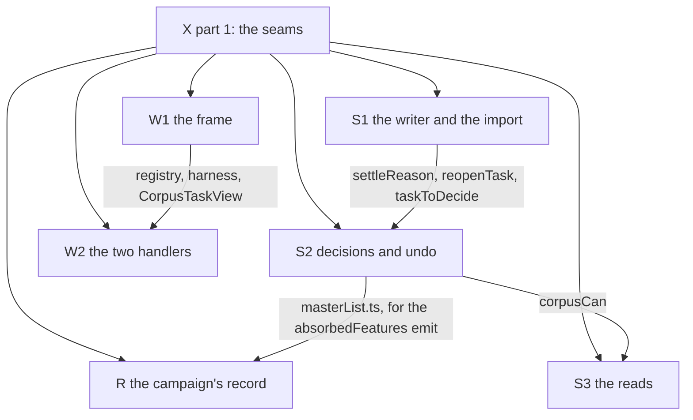

# Phase B01 — The admin console: one surface, organized by what an operator is doing

> **Status:** scoped, 2026-10-12. Nothing built. This doc is the record of the founder's brief, the
> inventory of what `/admin` does today, the diagnosis, the information architecture, the founder's
> calls (§7, minted as **D216–D222**; the look's D223–D224 came 2026-10-14), the workstreams (§8), and the season-statistics pick (§10,
> all of tiers 1 and 2). The raw inventory is
> [`research/admin-surface-inventory-2026-10-12.md`](../research/admin-surface-inventory-2026-10-12.md).
> Next: static wireframes per mode in `skating-mockups/admin-console/`.

Phase 07 built `/admin` as *work queues plus a control room* (D37), and every phase since added a
page for its own feature: the lake editor (A02), body features (A05a), hazard identity (A05c), ice
calibration (A06h), intake review (A07a), standing and requests (A07b), imports (A06c §6.2), seasons
(A06i), place names (D202). Sixteen nav items later the surface is organized by **table**, not by
**task**: an operator who wants to know "what needs me?" reads four pages and still misses eight
queues; an operator fixing a lake bounces between a list page and a 2,900-line editor whose map
scrolls off-screen; an operator watching a corpus campaign has a read-only history with no way to
tell a live run from a dead one. This phase rebuilds the surface around the tasks an operator
actually has, as a dense, keyboard-first console, without losing a single lever that exists today.

## §0 — The brief (founder, 2026-10-12)

Six things an admin needs to do, in the founder's words, condensed:

1. **Watch the corpus machinery** — when runs happened, whether each was a full canonical re-import
   or a gap-fill from one source, how it went, full detail for investigation; trigger runs and
   watch them live, the way a Vercel build log or a GitHub check feels — *watching the machinery
   work*, with the tools to catch a pipeline going wrong.
2. **Read the season** — are we in one; this season and past seasons: when they started, lows,
   record freezes, most popular lakes, reports filed, lakes added, removed or marked
   no-public-access, new put-ins, lots and landmarks; usage and behavior statistics; a log of
   corpus changes; how often weather and imagery were fetched and what it cost (a running-cost
   ledger).
3. **Work the inbox to zero** — everything users submit: new bodies, no-public-access reports,
   POIs, names for unnamed bodies, wrong-polygon reports, safety flags (what are these?), support
   tickets. Each kind gets its own handling UI, but every task completes *from the inbox*.
4. **Improve the corpus** — a searchable queue of what the import could not settle. Today's Intake
   Review / Place Names / Standing / Imports are indistinguishable from the nav; make it clear.
   Separate from the machinery view (§0.1), but open to a better UX.
5. **Edit any body of water** — a console like the report console (`/post`): side panels, a central
   map with toggleable layers, POIs placed, moved, deleted and modified, polygon edges tweaked,
   bodies joined, sub-areas marked; an app, not a long-scrolling page.
6. **Discipline users** — block, mute, ban, restore, promote.

Constraints: **lose nothing** that `/admin` can do (Tuning, Ice calibration, and whatever else is in
there, including things the founder has forgotten); a **high-density, HUD-style power console**
(keyboard-first, command palette, every pixel of a desktop used); **mobile supported, desktop the
focus**; IA first, then wireframes, then the real UI. Inspiration (direction, not detail):
[Military interface HUD](https://www.behance.net/gallery/58307759/MILITARY-INTERFACE-PROJECT-HUD-UI),
[Battlefield 2042 maps interface](https://www.behance.net/gallery/134505091/BATTLEFIELD-2042-MAPS-INTERFACE),
[The Table](https://www.behance.net/gallery/95170531/THE-TABLE),
[Samolevsky futuristic UI kit](https://www.samolevsky.com/products/futuristic-ui-kit-200-design-elements?variant=31461113561185).
The report console's re-skin (A10-6, D206; mockups at `skating-mockups/a10-sheet/`) already set a
register in this family — ink-first, color rationed by meaning, Saira and Martian Mono, 2 px
radius, bracket corners on the thing being edited — and the admin console inherits it rather than
inventing a second one.

## §1 — What exists today, in one table

Every capability the current surface has, where it lives, and where this phase proposes it lands
(§5). This table is the *lose-nothing* check; the build closes when every row's last column is 🟢.

| Capability today | Page | Gate | Lands in |
| --- | --- | --- | --- |
| Queue-depth tiles (4 of ~12 queues), app-health trends, catalog coverage, last 20 audit rows | `/admin` | mod (trends admin) | **Overview** |
| Flags: safety lane, access lane (per lake), standard; resolve, hide/remove, retract or pin an access alert; rule public access | `/admin/flags` | mod | **Inbox** — pinning an alert as official is offered on the Inbox's alert item (board 2.6; the founder's "Sure.", 2026-11-21), its server half built in B01-5a (`alertVerdict` with `verb: 'pin'`) and its *Pin* button on 2.6 built for B01-5b (key P, a required reason), so retiring `/admin/flags` loses nothing — closed; the facts are in B01-5, *What the build found*, under *Pin as official* 🟢 (#176) |
| User search; detail with trust tiles, contributor trend, posting permissions, bounty limit, suspend, ban, lift; role grant/revoke | `/admin/users`, `/admin/users/$id` | mod (role admin) | **People** |
| Find a lake by name; curated list; pending user-drawn bodies approve/reject; suspected-duplicate groups merge/dismiss | `/admin/water` | mod | search → **Body console**; pending → **Inbox**; duplicates, curated → **Corpus** |
| The lake editor: name, prominence, sub-areas (chord, freehand, paste), landmarks, depth, weather sample points, put-ins, parking and approach, known features, hazards, recurrence, promotion candidates, aggregate tracks, posted rules, satellite link, reference links, standing, history | `/admin/water/$id` | mod (remove/restore admin) | **Body console** |
| Intake review: six merge reasons, read-only, links to the editor | `/admin/water/review` | mod | **Corpus** |
| Standing: five lanes off the active map + recent activations, read-only | `/admin/water/standing` | mod | **Corpus** (lanes) + **Season** (activations) |
| Requests: seven kinds, approve/decline, admit resolver, preview map | `/admin/water/requests` | mod (restore/takedown admin) | **Inbox** 🟢 (#172) |
| Place names from the emails: set lake, dismiss, reopen, hand off to the editor | `/admin/water/place-names` | mod | **Corpus** |
| Body features: list the newest 100, demote | `/admin/features` | mod | **Corpus** (the pre-ice pass) + **Body console** |
| Hazard identity: recurrence queue (suppress), recent merges (unmerge) | `/admin/recurrence` | mod | **Corpus** (the pre-ice pass) |
| Ice calibration: the fit, the pairs, the Open-Meteo meter | `/admin/ice-calibration` | mod | **Instruments** (meter → **Machinery**) |
| Seasons: the watch, imagery start/pause/retry, versioned thresholds with replay, field dates | `/admin/seasons` | admin | **Season** (imagery → also **Machinery**) |
| Support inbox: tickets by status, assign to me, resolve | `/admin/support` | admin | **Inbox** (admin lane) 🟢 (#175) |
| Tuning: every constant read-only beside its chart; operational-health charts | `/admin/tuning` | admin | **Instruments** |
| Imports: newest 50 runs, campaign tiles, run detail (outcome, coverage, tallies, path, failures) | `/admin/imports` | admin | **Machinery** |
| In-context moderation on skater pages: takedown on report/post/comment/hazard, promote a hazard, rule public access, approve/reject a body, user levers on a profile, edit history | `/water/$id`, `/hazard/$id`, `/report/$id`, `/feed`, `/u/$username` | mod | stays; each gains a link into the console |
| Things only a terminal can do today: `finalizeNow`, the standing rollover, `regionStats.recompute`, analytics backfill, every ETL command, `seedBayRequests` | — | admin | **Machinery** (what is safe to trigger), the rest stays CLI |

Role model unchanged: `member < moderator < admin` (D37). Admin-only stays exactly where D37 drew
it — role-granting, PII (support), the constants — plus what later phases added (imports, seasons).

## §2 — Diagnosis: what the inventory found

Read the research doc for the evidence; this is what it adds up to.

1. **Organized by table, not by task.** Sixteen nav items, four of them `Water bodies` children
   with no visible relationship. The nav comments say why each got its own entry ("burying it one
   click deep is how 2,010 stored rows went unseen") — the fix each time was a *flatter* list, so
   the list grew. The dashboard counts four queues and ignores eight.
2. **Queues that don't act.** Intake review and Standing *list*; Place names triages but the act
   is in the editor; Requests acts for five kinds and hands off for two. Every hand-off lands in
   the editor with no sign of which queue sent you or what you came to do.
3. **The editor is the real workbench and the worst-shaped page.** Nineteen stacked cards beside
   a 70 vh map that scrolls away; one `placing` slot shared by four tools; `window.prompt` for a
   rename; no polygon editing, no class/state/alias editing, no merge, no public-access ruling (the
   Standing card, the Standing page and a server error all say to use "the Access section", which
   does not exist); admin-only buttons shown to moderators; a reason dialog whose text is
   discarded (`RemovalTool`).
4. **Nothing links.** Flags don't link to the content, the lake or the person; features don't
   link to the lake or the hazard; the audit feed drops the target; support tickets don't link to
   the account an appeal is about.
5. **One item, many places.** Bay and landmark asks appear on Requests *and* in the editor; the
   duplicate queue and the intake "duplicate candidates" are two independent flags on the same
   bodies; approve/reject exists on `/admin/water` and in the skater drawer; promote/demote lives
   on four pages.
6. **The machinery is invisible.** Thirty crons; only four (imagery) have a run log with a manual
   trigger, and one (the standing rollover) writes an `importRuns` row. Imports are read-only, no
   run can be started, no event stream exists, a killed loader leaves a row in `running` forever,
   and "full re-import vs. one-source gap-fill" is not a field — it is inferred from `kind`,
   `label` and `campaignId`. Notifications, weather appends and the NWS poll have no record at all.
7. **A season is a date range, not a record.** `seasonOf(now)` is derived; the only stored season
   is the ice watch (A06i). Per-season reports, bodies added or removed, POIs, fetch counts: none
   stored, all computable. Cost is metered for one provider (Open-Meteo, counts only); ORS, Fly,
   Convex, Vercel, Resend, Clerk, R2 and Anthropic are not.
8. **Discipline has the levers and misses the edges.** Suspend, ban, lift, per-action posting
   permissions, a bounty cap, role grant/revoke, all audited; no mute or shadow state; a lapsed
   suspension never resets `status`; *Lift* is offered on deleting and deleted accounts (a real
   bug); no restore for hidden content anywhere; no takedown for photos; a flag *on a user* has no
   action and no link.
9. **Dead and half-wired.** Flag status `reviewing` is never written; `getAdmin` returns the
   user's audit history and nobody renders it; `userSearch` returns `trustClass`, unshown; support
   `createdAt` never shown; `subAreas.setCuratedBoost` has no caller; `RestoreGate` is reachable
   only for rejected bodies and its button fails for them; the raw trust score shows to moderators
   on `/u/$username` against D50.
10. **The inbox is empty on dev.** Every person-filed queue is 0 rows. The corpus backlog is not:
    the intake queue carries ~2,010 rows, place names 237 (pre-#88), and 217 import runs exist.
    The UI will have to be designed against seeded data for the inbox and real data for the rest.

### Safety flags, a refresher

A **safety flag** is a `contentFlags` row with `reason: 'unsafe_false_report'` — someone says a
report (or a hazard, or a person's pattern of reports) claims ice is better than it is. D3 makes
that a safety incident, not spam, so it rides a priority lane at the top of the flag queue and
emails the staff (D38). Three things file one: a skater, from any report, hazard, comment or
profile; the hazard vote, when two people say a pin *never existed* (D65); and the contradiction
check, when a person's report disagrees with the weather too often (D56 §7b, filed against the
*user*, throttled). Resolving one is two audited decisions: the flag's disposition (actioned or
dismissed, which notifies the flagger) and, separately, what happens to the content (hide,
remove) or the person (posting permission, suspend, ban).

## §3 — Goals and principles

- **Organized by intent.** The top level is what an operator is *doing* — reading the state of
  things, clearing what people sent, improving the corpus, fixing one lake, watching the machines,
  reading a season, handling a person, checking the instruments. A new feature adds a lane inside a
  mode, never a nav item.
- **Every task completes where it is found.** A queue row opens its handler in place; a geometry
  task opens the body console *in a task mode* that returns to the queue on save. No dead-end
  hand-offs.
- **Everything links.** A lake, a person, a run, a flag, an audit row — each is a link to its
  console page, and each console page lists what is asked of it ("3 open asks, 1 intake reason").
- **Counts are honest.** The overview counts every lane with the same bounded reads the lanes use.
  A lane that can't be counted cheaply gets an index.
- **The machinery is watchable.** Every job that runs on a schedule or by hand leaves a record with
  a heartbeat; a run that stops reporting reads as *stalled*, never as *running*.
- **Dense, keyboard-first, desktop-first.** One shell for the whole console: locked to the viewport
  like `/post`, resizable panes, a command palette, list navigation from the keyboard, the
  inspector on the right. Mobile gets the lists and read-only views; the map editor is a desktop
  tool.
- **Moderators see what they can do.** A button the server will refuse for this role is not drawn.
- **D3 still binds.** Nothing here reads as *the ice is safe*; the season view reports air lows,
  reports and usage, never a verdict.
- **Nothing lost (§1).** The old routes redirect to the new homes until the register is 🟢.

## §4 — Prior art inside the repo

- **The report console** (`/post`, A10-5/6): `grid-cols-[372px_minmax(0,1fr)_452px]` with a 36 px
  top bar and a 30 px status bar, locked to the viewport, a center *instrument* with modes
  (`ConsoleMode`: where, put-in, place), Escape leaves a mode. The body console is the same shape
  with a MapLibre canvas as the instrument.
- **The shared map shell** (`lib/mapCanvas.ts`, D61) and `LakeEditorMap`: the editor's camera lock,
  layer registration and terra-draw integration already exist; the console re-hosts them.
- **`ReasonDialog`**: the one audited-action dialog. `ModeratorActions` re-implements it badly; the
  console uses one.
- **`ReviewClosedNotice` / `useReviewWatch`**: the colleague-decided-this lock for requests —
  generalize to every inbox item.
- **`ImportRunDetail`**: outcome → funnel → detail → evidence is the right read for a run; it
  needs a live tail and a heartbeat, not a redesign.
- **shadcn on Base UI** is the house kit; the console will add `command` (palette), `resizable`,
  `table`, `tooltip`, `kbd`-style primitives from it rather than hand-rolling.

## §5 — The proposed information architecture

Nine modes (Reports added by D225, 2026-10-14). The left rail lists them with a count where a count means work; `g` then a letter
jumps; `⌘K` opens the palette from anywhere.

| Mode | Route | Gate | What it is |
| --- | --- | --- | --- |
| **Overview** | `/admin` | mod | The HUD: season state strip, inbox depth by lane, corpus backlog by task, machinery health (last run per pipeline, stalls, backoffs), cost meters (admin), the audit feed with links |
| **Inbox** | `/admin/inbox` | mod (support lane admin) | Everything a *person* filed that waits on a person. One list, lanes, a handler per kind in the inspector, Inbox Zero |
| **Reports** | `/admin/reports` | mod | Every report, post, comment and photo, read in full: lanes for flagged, edited, contradicted, hidden; the report with its edit history, flags, thread and author; hide, remove, restore. Flags are decided in the Inbox (D225) |
| **Corpus** | `/admin/corpus` | mod | What the *machines* could not settle, as tasks: duplicates, class and name conflicts, orphan bays, chord re-fits, place names, the pre-ice pass (recurrence, promotion), standing lanes, enrichment gaps; plus a browser over every body including removed and rejected |
| **Body console** | `/admin/body/$id` | mod (remove/restore admin) | One lake, one canvas, every lever: the report-console layout with the map as the instrument |
| **Machinery** | `/admin/machinery` | admin | Pipelines and runs: ETL campaigns, crons, imagery, weather appends, notifications, external calls and cost; live tails; triggers for what is safe to trigger |
| **Season** | `/admin/season`, `/admin/season/$season` | mod (settings and reset admin) | This season and every past one: the watch, imagery, field dates, the statistics (§0.2), the corpus change log |
| **People** | `/admin/people`, `/admin/people/$id` | mod (role admin) | Search and browse (moderators, suspended, banned, flagged, newest); the detail with history; the levers |
| **Instruments** | `/admin/instruments` | admin (ice calibration mod) | Tuning's constants beside their charts; ice calibration; operational health |

### §5.1 — Overview

Not a dashboard of charts — a status board. Top strip: *Winter 2026-27 · watch open since 3 Oct ·
imagery running · 2 staff*. Then four columns of counts that are links: Inbox by lane (safety first,
red when > 0), Corpus by task, Machinery (last run per pipeline, red for failed or stalled, amber
for a cron that has not run inside its window), People (new this week, suspended, open appeals).
Below: the audit feed, every row naming actor, verb, target *as a link*, filterable. The trends
that live on `/admin` today move to Instruments; the catalog-coverage card moves to Machinery.

### §5.2 — Inbox

**Lanes**, in priority order: Safety (`unsafe_false_report`), Access reports (per lake,
corroboration-ranked), Requests (`activate`, `admit`, `restore`, `contest_access`, `takedown`),
Places (`name_bay`, `name_landmark`, skater landmark proposals), Drawn bodies (`reviewStatus:
pending`), Content flags (spam, harassment, inappropriate, low quality, other), Support (admin;
tickets and appeals). One list, `j`/`k`, `e` to resolve, `x` to decline, `o` to open the subject;
filters by lane, kind, age, lake, person; the inspector on the right shows the item and its
handler; a map pane when the item has a place.

**Handlers per kind** (each exists today in some form; the console gives each one home):

| Kind | Handler |
| --- | --- |
| Safety flag | The content (or the person's recent reports), the flagger's note, the weather that night beside the claim, prior occurrences; actions: dismiss, action, hide, remove, restrict posting, suspend, ban — the last three open the person inline |
| Access report | The lake, every reporter's note, the prior ruling if disputed; *no public access* (its reason asked in a dialog when chosen) / *confirm accessible* / *clear the accessible ruling* |
| Request (five kinds) | What exists today on Requests: the body or the 3DHP candidate, askers, note, *look up again* (only where no candidate matched); approve/decline; approve performs the verb (D179) |
| Place ask (bay, landmark) | The point on the map, lookalikes (D202), *same place*; **draw** opens the body console in bay-mode or landmark-mode with the ask attached; saving approves and returns |
| Drawn body | The polygon over the basemap and aerial, overlap with known bodies; approve, reject, or *merge into* |
| Content flag | The content in place; dismiss, action, hide, remove, **restore** (new: `setModerationStatus('visible')` exists, no UI does) |
| Flag on a user | Links to the person; posting permission, suspend, ban inline |
| Flag on a photo | **New verb needed** — photos have no moderation axis today (§7, question 9) |
| Support ticket | The ticket with its context, the submitter as a link, **a note and a reply** (new; today assign and resolve leave no trail); **no assignee** — anyone pitches in (founder, 2026-10-19); a reply is sent from `SUPPORT_FROM_EMAIL` (support@gli.app until the domain is bought) |

"Colleague decided this" locks every item (generalize `useReviewWatch`). An item leaves the list
on decision; the Decided tab keeps the record.

### §5.3 — Corpus

The backlog of what the import could not settle and what the season's pass needs, as **tasks**,
each with a count, a blurb that says what *done* means, and rows that open the body console in
the right tool:

| Task | Source today | Done means |
| --- | --- | --- |
| Duplicates | `dedupStatus` groups (D36) **and** intake `duplicate-candidate` / `same-source-duplicate` — one lane, one decision | merged or dismissed; the intake reason cleared on decision (today only the next campaign clears it — the register's "small fix blocked on nothing") |
| Name conflicts | intake `name-conflict` | a name chosen (clears the reason) |
| Class conflicts and dissent | intake `class-conflict`, `class-dissent` | a class chosen (**new**: no class editing exists) |
| Orphan bays | intake `bay-without-parent` | a parent assigned (**new**) or demoted to landmark |
| Chord re-fits | `mouthReview` kept/refitted, `mouthStale` (D215) — today visible one lake at a time | the chord saved |
| Place names | `corpusPlaceNames` open | placed, filed as a spelling, or dismissed |
| The pre-ice pass | recurrence queue, promotion candidates, body features | promoted, suppressed, or left; the pass is dated so Overview can say *done for this season* |
| Standing | the five lanes + recently activated | not a queue: a browser with the lanes as filters |
| Enrichment gaps | "awaiting elevation / wind / depth" (today a column on Standing) | the enrichment run (→ Machinery) |
| Curated | `curatedBoost > 0` | not a queue: a browser filter |

Plus **the corpus browser**: search by name, id, external id; filters by state, class, standing,
review reason, source, curated, has-open-asks; every body including removed and rejected (today
unreachable); columns chosen by the operator; a row opens the body console.

*2026-11-23 — the rename (D293).* The library B01-3 built as "Bodies" is this browser, and is now
Corpus: the list at `/admin/corpus` (G then C, still opening on Active), the Body console under it
at `/admin/body/$id`, `/admin/bodies` gone without a redirect. The tasks above join its sidebar
when they are built; until then Home's Corpus links open the old pages. The sections below that
say "Bodies" and `/admin/bodies` record what was built under the old name.

*2026-11-24 — the task lanes designed (B01-7, D300–D305).* The table above is superseded where the
boards and the code differ; see *The Corpus tasks (B01-7, the design)* in §12.8. In short: the tasks
are decided in place in Corpus's own sidebar, not by opening the Body console (only *Place it in Body*
and *Redraw in Body* hand off, drawn unavailable until task modes, D304); Duplicates' intake reasons
and the dedup flags are two unconnected systems today, joined by that design; Orphan bays' *done* is
*Make a bay of …*, *Demote to landmark* or *Not a bay*; Standing and Curated are already the library's;
Enrichment gaps is deferred to Machinery (D303); and "the pre-ice pass" is *the Pre-Season Pass* in
every visible word (D301), a seasonal group shown from July until its last decision and then
collapsed to one plain line (D302, amended).

### §5.4 — Body console

The report console's frame with the lake as the instrument. Left column: identity (names and
aliases, class, states, ids, standing with its reason, prominence), *what is asked of this lake*
(open inbox items and corpus tasks for it, each a link that arms the right tool), and the history.
Center: the map, full height, camera-locked (D61), with a layer rack — outline, sub-areas and
mouths, landmarks, put-ins, lots, sample points, hazards, features, aggregate tracks, aerial,
bathymetry — each toggled, and a mode banner when a tool is armed (Escape leaves). Right: the
inspector, tabbed by tool:

- **Shape** — the polygon: ~~vertex edit, split,~~ **merge into** (today only from the duplicates
  page), sub-areas by chord and freehand, paste GeoJSON. ~~Polygon editing is **new** (no mutation
  exists) and has consequences — area, bbox, interior point, weather cells, sub-area clipping, the
  D215 re-fit — so it is its own workstream (§8, question 10).~~ Vertex editing and splitting a
  body were ruled out by D221 (merge and sub-areas are the levers; see *Ruled out*).
- **Names** — catalog claims, community name, aliases (today uneditable after creation).
- **Places** — landmarks (edit, move, draw-as-bay, remove, restore), the community's email names,
  skaters' proposals.
- **Access** — put-ins (official, hide), lots (**edit and remove**, new), approach links, posted
  rules, and **the public-access ruling** (today only in the skater drawer and the flag lane).
- **Water** — depth with the source ladder, weather sample points, satellite link, bathymetry
  state.
- **Hazards** — this lake's hazards, recurrence, promotion candidates, known features.
- **Standing** — active, dormant with note, removed with reason, restore; the request and ruling
  history.
- **Links** — reference links.

Task modes: opened from the inbox or corpus with `?task=<id>`, the console arms the tool, shows
the ask in the banner, and *Save* returns to the queue. The skater-facing drawer's moderator card
becomes one link here.

### §5.5 — Machinery

Pipelines as rows: **ETL campaigns and runs** (`importRuns`), **crons** (all thirty, with schedule,
last run, outcome, next due), **imagery** (poll, pump, index, the granule ledger), **weather**
(the daily appends, the gap sweep, the cell registry), **notifications** (flush, delivery,
failures), **external calls and cost** (per provider per day: Open-Meteo today; ORS, Fly, Anthropic,
Resend added as they are metered). A run page: outcome → funnel → detail → evidence as today, plus
a **live tail** (an event stream per run with timestamps), a **heartbeat** (a run silent past its
interval reads *stalled*), and *Cancel* where the runner supports it. **Trigger** for what Convex
can run itself — the standing and recurrence rollovers, region stats, the analytics rollup, an
imagery poll, a weather sweep, the catalog measure — each with a dry-run where one exists.
Laptop-bound ETL (osmium over gigabytes of extracts) is watched, not started, until a runner
exists (§7, question 4).

The run vocabulary gains what the brief asks for and the data lacks: a **scope** on every run —
`full-canonical`, `single-source`, `enrichment`, `seed`, `rollover`, `archive` — so the list can
say *full re-import* vs. *gap-fill* without inference.

**Added 2026-10-16 (founder: yes to both).** Two pieces of new build work the review-2 mocks drew:
a **per-run record for every cron** (today only the imagery pump and the standing rollover leave
one), so a cron's page can list its runs, their outcomes and their durations; and **Fly machine
logs** for the imagery cutters, fetched per granule, so a cutter run has a log to tail like a
corpus run. The Machinery mode is laid out as **Health** (the landing page: what needs a look,
7-day failures, heartbeats, quotas and spend, every job) plus **one page per pipeline**; whether
Notifications, Analytics, Hygiene and Rollovers each keep a page is decided once they are mocked.

**Added 2026-10-17.** The stalled-run alarm's **Keep waiting** snooze starts at **30 minutes**, a
placeholder. Tune it once the heartbeat (D218) records per-flush times: take the longest quiet gap
between flushes in runs that finished normally and set the snooze to 2–3× that. Consider letting
the alarm clear itself on the run's next flush instead of on a fixed timer.

### §5.6 — Season

`/admin/season` is this season: the watch (A06i's card), imagery state, field dates, and the
numbers — reports and posts, active contributors, most-reported lakes, new accounts, bodies
activated, demoted, removed, admitted, POIs added, landmarks named, inbox throughput, fetch counts
and cost — computed over the season's date range (`seasonOf`), with a **corpus change log** read
from `moderationActions` and `importRuns`. `/admin/season/$season` is any past season with the
same shape, plus the watch replay. Settings and reset stay admin (D213). A season record table
(per-season rollups) is a build choice (§7, question 6).

**Added 2026-11-11 (D246).** The imagery card carries a **bake staleness counter**: active bodies
missing from this season's bake (an *activate*, *admit* or *restore* approved after bake day gets
no imagery until a re-bake), and the reverse — baked bodies since shelved, which keep being cut for
free. Both counts sit beside the bake's date, with the re-bake pair (`bake-masks --upload`,
`publish-search-plan`) named right there; zero-zero draws quiet. D246 holds the why and the read's
open build choice (the bake's member list lives in R2, not Convex).

### §5.7 — People

Search as today, plus browse lists: moderators and admins, suspended (with *until*), banned,
flagged, newest, leaving. The detail renders what `getAdmin` already returns and nobody draws —
the audit history, `suspendedUntil`, comments, bounty points — beside the trend; the levers; the
role card (admin); open inbox items about this person. New levers, if the founder wants them: mute
(a comment-only restriction already exists as `canPostComments`; "mute" may be that), restore
hidden content by this person, and a per-user *flagging* permission (the founder's own note in
`CLAUDE_NOTES`: a lever to stop someone flooding the queue).

**Added 2026-10-17 (D227, refined).** An admin's page carries an **invoice editing** row, drawn
only for a viewer who holds that grant and isn't on their way out — `getAdmin` sends `ledgerEditor`
and `lastLedgerEditor` to that viewer alone, so a non-holder learns neither the row nor who holds it
(founder call, 2026-10-18); `lastLedgerEditor` says why the last holder's switch can't be turned
off. The server half is built (`ledger.grantEditor` / `revokeEditor` / `seedEditor`,
`lib/ledgerEditors.ts`); the row lands with this workstream's screen. **Seed at this branch's first
dev push** (the founder is `@admin1` there, an admin with no grant as of 2026-10-18):
`pnpm --filter @skating/convex exec convex run ledger:seedEditor '{"username":"admin1"}'`; prod's
`@teagan` is a step in `docs/deployment-and-release.md`'s cutover.

### §5.8 — Instruments

Tuning as today (constants read-only beside charts, D37's settled decision 1 unchanged), ice
calibration as today, and the operational-health charts that are about the operator (time to
resolution, support volume) — here, not on the overview. The Open-Meteo meter moves to Machinery.

## §6 — Interaction model and aesthetic direction

- **One shell.** The console takes the viewport like `/post`: a 36 px top bar (mode, breadcrumb,
  search, the season chip, staff presence), a 48 px icon rail on the left (the eight modes, counts
  as badges, expandable to labels), the mode's own split (list | inspector, or list | map |
  inspector), a 30 px status bar (selection, keyboard hints, connection, last sync).
- **Keyboard.** `⌘K` palette: jump to any mode, lake, person, run, or cron; run an action on the
  current selection; recent items. `g i` / `g c` / `g b` / `g m` / `g s` / `g p` / `g t` for the
  modes; `j`/`k` lists, `Enter` opens, `Esc` closes; `?` shows the map. Shortcuts are discoverable
  (a `kbd` hint on every button that has one).
- **Density.** 12–13 px body in lists, Martian Mono for every value that aligns (times, counts,
  coordinates, ids), 2 px radius, 1 px hairlines, no cards-within-cards; raised fill and bracket
  corners mark *the thing being edited*; color rationed as the A10 system does it — ice for
  geography and selection, amber for *needs you*, red for safety and hazards only, inverted ink
  for a selected row.
- **The HUD register, honestly.** Corner brackets, reticles, monospaced readouts, dashed guides
  and thin scan-lines are decoration with a job: they mark focus, bounds, and live state. Nothing
  decorative that doesn't encode something. Dark first (the founder designs dark); light is the
  same ramp inverted.
- **Mobile.** The rail collapses to a bottom bar; lists and inspectors stack; the map in the body
  console is view-only below `lg`; nothing is *unreachable* on a phone, and nothing is optimized
  for one.
- **The visual register (founder calls, 2026-10-12).** The restrained end of the HUD boards,
  with two or three signature devices used consistently, decoration only where it encodes state.
  **Saira, Saira Semi Condensed and Martian Mono** debut on the web here (the A10 reservation is
  lifted for the admin console). **Neutral grayscale ink** — not the boards' blue cast — with the
  A10 accents by meaning only: ice for geography and selection, amber for needs-you, red for
  safety and failure. **Motion** on appearance, interaction and live data; nothing ambient;
  reduced-motion respected. **Type floor:** 14 px body, 12 px assistive, 10 px kickers, labels
  and numerals. The inspiration is one project, *The Table* (Behance 95170531): eleven frames
  saved with the founder's notes in `skating-mockups/admin-console/inspiration/` and indexed in
  that folder's README; the vocabulary taken from it — tracked small-caps labels with a kicker
  above and a hairline or dotted leader beneath, inverted-block section titles, hollow-circle
  bullets with the selected row bright, panels bracketed by L-lines with endpoint dots, hollow
  markers on thin charts, segmented meters, boxed readouts, the map as gray plates with a reticle
  on the target and a dotted track. The pass is the Body console in **three skins over one base**
  (`pass/body.html?skin=a|b|c`: Instrument, Table, Plate) so the founder picks per element; the
  chosen set becomes the token and component sheet, then a decision.
  **Pass 3 (2026-10-13).** The founder restated the brief — simple white, black and grayscale,
  not the boards' blue; take the weights, when a label inverts, the chart and map styles, solid
  versus dotted versus connecting lines, corner ticks, accent color only for data — and asked for
  three or more variations to pick from per element. They are in
  `skating-mockups/admin-variants/` (README: the per-frame notes, the axis table, the open flags):
  **V1 Field** (no filled panels; rules, slugs, brackets, space; white lit), **V2 Plates**
  (corner-marked plates, the wireframes' tables, meters under every value; ice lit), **V3 Trace**
  (corner-dot plates joined by stepped traces that encode sources → machinery → queues; a dashed
  region around what waits on a person; inverted value boxes; sliders), each on the Overview and
  the Body console drawn from the real Mascoma record. Open: white or ice for selection; rail
  names under the type floor; the single display word. **The founder's read, same day:** V1's
  no-filled-panels field is the base; grayscale with white highlights first (a blue comparison
  kept alongside); the circuit belongs on the Season page, not the Overview; V3's navbar lockup
  and lake header; V1's cards with V2's machinery matrix; V3's sentinel chart with an ice-ramp
  matrix; V2's POI squares; the layer menu, the bay-mode to-do and the matrix need deeper work;
  8 px rail names are fine under icons; the big page word lives in the page, never the navbar.
  **V4** (`overview-v4`, `body-v4` + `?blue=1`, `season-v4`, `explore-v4`) is that merge, with
  the aerial layer docking the app's freeze-up stepper and an admin override for clouded passes
  (a product addition; needs a D# if it stays). **The founder's read of V4 (2026-10-14):** blue
  for transient modes (confirmed by the comparison); "bodies", never "lakes", for anything that
  may be a bay or a river; the circuit stays on Season but with uneven columns; the Season page
  keeps every lane and section of the wireframe; the matrix follows the temperature scale (cold
  cyan → neutral → warm orange); no key hints on cards — `G` as a go-mode is the proposal; the
  rail is the FontAwesome set (tachograph-digital, inbox, cabinet-filing, map-location-dot,
  calendar-days, users, engine, sliders); **the clouded-pass override is in scope for B01**.
  **V5** (`overview-v5` + `?go=1`, `body-v5`, `season-v5`, `imagery-v5`) is that read applied;
  the dock has three states and an inspector-card twin. **The founder's read of V5 (2026-10-14):**
  go-mode stays (every G-binding is the ordinary key chip turned blue, the spent G greyed; the
  tape, search, avatars and status bar dim too); the Season page's word stays *Winter 26–27*;
  the admin's thumb lands on skipped passes only with the *Imagery* tab open; machinery colors:
  red = will not recover without a person, amber = late or retrying; the layer menu stays open at
  desktop width (a collapsed state exists for narrow maps and is never used inside a mode). D223 and D224 followed the same day.
  **V5, the other modes (2026-10-14):** the six pages the admin-hud round drew are redrawn in
  the register — `inbox-v5`, `corpus-v5`, `bodies-v5`, `machinery-v5`, `people-v5`,
  `instruments-v5` over `v5-pages.css` — with the display word as the page's *subject* (the
  lane, the task, the campaign, the person, the section), lanes as the Season page draws them,
  one-left-edge rows, inspectors as blocks over dotted rules with the stable action bar (primary
  wears the corner dots; destructive is a hairline box until armed). Four explorations for the
  founder before the build: the ⌘K palette and the *Bodies* lookup (`palette-v5`, `lookup-v5`),
  three more inbox handlers and inbox zero (`handlers-v5`: a drawn body, a support ticket with
  the note and reply, a place ask with a lookalike), the cost ledger with the invoice form
  (`ledger-v5`, D219), and the mobile bar (`mobile-v5`, D216). Open: green for *allowed* on
  People (round three) versus D223's palette (drawn white); the palette's actions in one list
  via ⇥. The Inbox was also rebuilt in **Paper** (the *Gli* file, *Admin Dashboard* page) over a
  token set, as the trial of iterating there instead of by PNG; what ports and what does not is
  in the admin-variants README.
  **The parity pass (2026-10-14):** the mocks checked against today's `/admin`
  (`research/b01-mock-parity-2026-10-14.md`), then the founder's calls — Reports as a ninth mode
  with the in-context controls kept (D225); undo for every action and a reason only when something
  is taken away (D226) — and the mocks the first build workstreams need: the six remaining Body
  console tabs with their map modes (Names; Places in landmark mode; Access in parking mode; Water
  with the sample-point preview; Hazards; Standing), the Reports mode, four more inbox handlers
  (access reports with a dispute, admit, an access-alert flag with unpin, a photo flag), the task
  round trip as four frames, a states sheet (the reason dialog's six states, toasts and undo,
  autosave, colleague locks, standing in every state) and a live sheet (a run going quiet, the
  audit feed arriving, list states, the moderator's console, the `?` key sheet). All 31 V5 pages
  are in Paper; the first import is on an archive page. Corpus, Machinery, Season and Instruments
  are mocked just before their workstreams.
  **Review 3 (2026-10-18/19).** The founder's third read (184 comments) moved the console to its own
  Paper file, *Gli · Admin console*, one row per rail item (the old file had reached Paper's size
  limit); what changed is in the admin-variants README, *Review 3 in Paper*. The calls that bind the
  build: **keys** — no number keys or J/K; Tab between panels, ↑↓ within one, type-ahead in a list;
  ⏎ or Space on a list item opens it *and moves focus into the right pane*, and single-letter action
  keys act only while that pane has focus, so typing in a list never fires an action; ⌘K and
  G-then-a-letter go anywhere; ⇧⏎ returns to the queue. **Green is sparing** — success stays the
  quiet state. **Ledger editing** covers rates as well as invoices, a backdated rate reprices every
  day since, and every admin reads the ledger (D227, widened). **Changed after posting** lists a
  report when its author edits a claim field (thickness, surface, the where) an hour or more after
  posting, or after anyone else commented, voted or flagged; rewording never lists it, and listing
  never flags or hides. **Expert** stays the derived trust class's tag. Staff in the mocks are
  Sarah Berman and Matt Steinberg. **The Overview splits into two tabs (2026-10-19):** *Home* is what
  needs a person (the stats, the four lane cards, then cost beside the audit feed); *Metrics* is how
  staff are keeping up (open and oldest flags, time to resolve, open support tickets by day) and
  whether people are showing up (the season pulse, accounts, sign-ins, contributors, vantage, the
  most-reported bodies, coverage by state). Its instruments move out of Tuning, which keeps only how
  things are calculated; the sentinel lows leave the Overview (Season has them). Metrics' top stats
  are the last seven days (or now); everything under them is the season. **What Metrics needs that
  doesn't exist yet:** *signed in* and *came back* (on two days or more of the last seven) need a
  one-row-per-person-per-day sign-in record (`pushTokens.lastSeenAt` keeps only the latest open);
  *open support tickets by day* needs a queue-depth rollup like `flag_queue_depth`
  (`support_volume` counts only opened); per-state comments, photos, kudos and contributors widen
  `state_coverage`; and `active_contributors` widens (founder, 2026-10-19) from report and hazard
  authors to anyone who posted a report, hazard, comment or photo — kudos and thumbs are reactions
  and count only as *signed in*. Home's cost reads by service (hosting, Anthropic · TypeSafe summed
  as *AI*, Fly as *compute*, then each free tier against its ceiling), and its by-month bars are
  always the last three full months and this one; the ledger has the rest. The weather-strip coverage figure goes back to Tuning,
  since it tunes the strip's window. "Reports from the email groups" waits on either half of the
  bridge (Q8). **The live mark** (the feed's and the status bar's): hover shows *Last checked* to the
  second, a spinner and *Checking* while a request is in flight; quiet past three times the expected
  interval, it goes hollow, reads *Not live* and offers a refresh. Which Convex signal stands in for
  "checked" is settled in the build. **The Inbox pass (2026-10-19)** set rules for every board:
  filter tabs carry no counts (a filter menu's options keep theirs); a list's filter bar sits 10 px
  in; the action bar floats at its pane's foot, tight to its buttons, 8 px clear of the status bar
  and both sides; a button's key is its label's letter (Admit A, Decline D, Same place S, Draw in
  Body B, Approve as new A, Reject R, Resolve R, Retract R, No public access N; ⌘⏎ still sends); a
  bare age reads "4 d ago"; access rulings say *accessible*, never *open*; the App link moves to the
  rail above the viewer's avatar; a sheet's scrim covers the rail and the status bar; map embeds pan
  and zoom inside their body's reach. A pane head's *History →* named no place: an item's history
  (D226) lives on its own page — the report's in Reports, the body's in the Body console, the
  person's in People — so the link names that page. A lookalike has no outer radius, as built
  (`landmarkAskLookalikes`): the nearest same-named place on the lake that the same-place rule
  doesn't already merge, shown with its distance. **The second pass (2026-10-24)** added: every
  button in an action bar rests alike (none looks primary until focused or armed); a one-action
  bar (Open in Body, Resolve) spans its pane with the button grown to fill it; a pane head never
  repeats what the pane shows (no asker's name over the ask list, no "Flag" or occurrence count
  over the flag and author blocks); a table sorts by clicking a column heading (lit, with its
  arrow; a search ranks by match), not a sort menu; a focused boxed input brightens a step, never
  to white; a support ticket's reply spans the thread column with *Send reply* inside it, under a
  fixed edge-to-edge rule, and *Resolve* is the side column's own bar; an access alert's life is a
  strip map (evenly spaced events, the line's weight the alert's state, days on the line) so any
  number of confirmations fits. A report's vantage is on the ice, from shore or secondhand —
  nothing else. **The third pass (2026-10-25)** added: a pane head writes its age out ("4 days
  ago"; list rows keep "4 d"); whoever took an action goes on its own line under it (a person
  lockup), never after a "·" on the action's line; a link on a list row sits in the row's
  bottom-right corner, clear of its chips; a tooltip's dotted rule hugs its text. Machinery's
  lanes put the Cost ledger second, under Health. **Machinery's first pass (2026-10-25)** added: an
  action bar never carries an explaining line — a button's tooltip says what it does, on hover and
  focus; a run history's foot is Run now with a key or nothing, its strip spans the sheet, and it
  filters to failed runs; the cost ledger lands everyone on its invoices, and a holder edits by
  clicking a month's cell (filled: edit, empty: add); Rates is a sheet over the ledger, with Change
  rate a second, narrower sheet on top. The Body console and the round trip await their
  first read.
- **Wireframes first.** Before any React, a static HTML mockup per mode in
  `skating-mockups/admin-console/` (the A10 pattern), rendered dark at 1440 × 900 and reviewed.
  **v1 exists (2026-10-12):** eight pages (`overview`, `inbox`, `corpus`, `body`, `machinery`,
  `season`, `people`, `instruments`) over a shared `console.css` + `chrome.js`, with the README
  carrying what each shows and what v1 leaves out. The signature is the **season tape** in the top
  bar of every mode — the console's clock is the winter, not the time of day. **Founder review
  (2026-10-12), folded into v1.1:** the tape stays, centered, one line, the same place and width on
  every page, hover-labeled; the top bar carries an **App** switch back to Map, Latest, Post and
  Settings (`g a`) and a **staff avatar stack** (lit = present), and no clock; the Overview's cards
  take the height they need and the audit feed fills the rest, with a cost meter; the inbox's
  flow-through list (the next lanes follow the current one, so `j` runs to zero) stays, revisited
  if other staff dislike it; the body console's **left column is read-only and every value is a
  deep link** that opens the right tool and lights the row it names (the inspector needs an
  addressable highlight: `?tab=names&lit=alias:Mascoma`); a dead local run can be **marked
  failed** from Machinery, the reason auto-filled from the diagnostics where they can name it.
  Deeper interaction wireframes are not drawn; the novel interactions (the task round-trip, the
  deep-link highlight, the palette) are prototyped first in code.

## §7 — The questions, and the founder's calls (2026-10-12)

The forks that changed the build, asked with a recommendation each. **The calls** (same day):

1. Inbox is what a person filed; Corpus is what a machine found; email place names are Corpus —
   **yes** (D216).
2. Geometry asks open the one body editor through a task door, never an embedded copy — **yes**
   (D216).
3. Audience and the admin-only line as drawn — **yes, and make access easy to adjust going
   forward** → a capability map in core, read by client and server (D217).
4. Run triggers — **no runner now.** Show where each job runs; trigger what the dashboard can;
   for local jobs show instructions with copy-paste commands (D218).
5. Cost ledger — **both** metered and invoiced; where dollars aren't derivable, record the native
   unit (tokens, minutes, requests); **every** third party if possible; a place for Anthropic and
   Zed bills later (D219).
6. Season statistics — **nightly rollup** if it saves money; **which statistics is decided
   together from a list** → §10, still open (D220).
7. Polygon editing — **pushed indefinitely.** Merge and sub-areas are enough until a lake proves
   otherwise (D221).
8. Splits — **no** (D221).
9. Photo takedown — **yes** (D222).
10. Mute — **withdrawn.** Restricting actions or sign-in is enough control (D222).
11. Per-user flagging permission — **yes** (D222).
12. Seeding the inbox on dev — **yes**; the build invents realistic examples (§8 §2).
13. Sequencing as proposed — **yes**.
14. Names as proposed — **yes, for now**.
15. Mobile bar as proposed — **yes** (D216).

The questions as asked, kept for the record:

1. **Inbox vs. Corpus — the split.** Recommendation: *Inbox* is what a **person** filed (flags,
   access reports, requests, place asks, drawn bodies, tickets); *Corpus* is what a **machine**
   found (intake reasons, duplicates, chord re-fits, email place names, the pre-ice pass). The
   email place names are the gray row: the community's words, loaded by the ETL. Corpus, because
   nobody is waiting on an answer.
2. **"Every task completes from the inbox."** For geometry asks (draw a bay, place a landmark,
   approve a drawn body) the handler *is* the body console in a task mode, opened in place and
   returning on save. Recommendation: same route (`/admin/body/$id?task=`), not an embedded copy —
   one editor, two doors.
3. **Who is this for.** The founder, Matt (admin), and possible volunteer moderators. The
   admin-only line stays where D37 drew it plus imports and seasons; Machinery is admin. Confirm.
4. **Triggering runs from the web.** Convex-native jobs (rollovers, region stats, imagery, weather
   sweeps, analytics) can be triggered now. The ETL (`run-corpus.sh`, `run-canonical.sh`) runs on
   a laptop against gigabytes of extracts. Options: (a) *watch only* — a heartbeat, an event log
   and a stalled state, the CLI stays the trigger; (b) a **runner** — GitHub Actions
   `workflow_dispatch` or a Fly machine pulling archives from R2, started from the console, logs
   streamed back. Recommendation: (a) in this phase with the run vocabulary built for (b); (b) is
   its own decision because it moves the ETL's credentials and 100 GB reads off the laptop.
5. **The cost ledger.** What it records: metered estimates (calls × a rate table, for Open-Meteo,
   ORS, Anthropic, Fly machine-minutes), or manual monthly entries (Convex, Vercel, Clerk, Resend,
   R2 invoices), or both. Recommendation: both, in one `costLedger` table — metered rows written
   by the meters, invoice rows typed in on Machinery — and Season reads it. Which providers matter
   for v1?
6. **Season statistics — stored or computed.** Computing over `reports`, `moderationActions`,
   `importRuns`, `externalApiCalls` at read time is bounded by the season's date range but reads
   whole tables; a nightly per-season rollup is a `seasonSnapshots` table keyed by season and
   metric. Recommendation: extend the existing `metricSnapshots` rollup (Phase 07-2) with a season
   key and the new metrics; compute the change log live from the indexed audit table. **Which
   statistics are must-have for v1?** The brief's list is long; the first season's rollup only
   needs the ones that will be read.
7. **Polygon editing.** In scope for this phase, or a follow-on? It is a new mutation with
   consequences (area, bbox, interior point, weather cells, sub-area clipping, D215's re-fit, the
   next import's merge rules — does an operator-edited outline survive a campaign the way a chosen
   name does?). Recommendation: in this phase as the last workstream, behind an *operator outline*
   that the import respects like `setWaterBodyName`.
8. **Merging bodies from the console** ("join bodies") exists as `waterBodies.merge`; it needs a
   home in the Shape tab and in Corpus → Duplicates. Confirm that a *split* (one body into two) is
   not asked for.
9. **Photo takedown.** Flags on photos exist with no verb. Add a moderation axis to `photos`
   (hide/remove/restore, audited)? Recommendation: yes, it is the one flaggable thing without a
   lever.
10. **Mute.** Does the brief's *mute* mean `canPostComments: false` (exists), a new
    comment-and-thumb silence, or a shadow state (content visible only to its author)? A shadow
    state is a bigger lift and a policy question. Recommendation: mute = comments + thumbs,
    labeled *Mute*, audited; no shadow state.
11. **The user flagging permission** (the founder's `CLAUDE_NOTES` item): a per-user `canFlag`,
    default on, switched off from People. In scope? Recommendation: yes, small.
12. **Seeding the inbox on dev.** Every person-filed queue is empty. A seed script that files
    representative flags, requests, tickets, drawn bodies and place asks from the second dev
    account (`sarah`) is how the inbox gets designed against something real. OK to seed dev?
13. **Sequencing.** This is several PRs. Proposed order (§8): the shell and Overview → Inbox →
    Body console → Corpus → Machinery → Season → People → Instruments and the redirects. The
    season is weeks away; the corpus backlog and the body console are where real work is today;
    the machinery view matters most when the next campaign runs. Reorder?
14. **Naming.** *Body console* for `/admin/body/$id` (the code says "lake editor"); *People* for
    users; *Machinery* for runs and crons; *Instruments* for tuning and calibration. Objections?
15. **Mobile.** Confirm the bar: reachable everywhere, optimized nowhere; the map editor view-only
    on phones.

### The founder's calls before slice one (2026-11-10)

Asked while the branch was readied for the first slice (§12.7). **The calls:**

1. **Transition navigation is rail option (a):** the rail carries the modes as they are built, plus
   a temporary **Legacy** group for the old pages still standing. A mode that lands takes its old
   pages out of Legacy (§12.7's progressive replacement); the group goes with the last of them.
2. **Metrics lands only what can't be backfilled.** B01-1 adds the two write paths whose history is
   lost for every day they don't run — the per-day sign-in record and the support queue-depth
   rollup. The widenings (`state_coverage` per state, `active_contributors` to anyone who posted)
   wait.
3. **Saira and Martian Mono go app-wide**, self-hosted through `@fontsource-variable`, in a
   standalone PR to main ahead of B01-1 — not a console-only load.
4. **The console's map uses the same token system** under `data-surface="admin"`, expressed as
   the boards' look.
5. **Typed console analytics events are deferred.** Pageviews, with the `surface: 'admin'` stamp
   PostHog already applies (D240), suffice for now.
6. **The sweep branch is ported here, then retires.** `fix/standing-putins-summary-sweep`'s three
   commits — a saved put-in keeps a body active through the rollover, the map-card sweep reads only
   the cards that are due, and a failed backfill walk waits six hours — land on this branch. The
   put-in decision, D228 on that branch, is **D245** here: D228–D231 belong to Phase B02.

**Pondered, not decided: Reports may become *Content*** (founder, 2026-11-10 — a direction, not a
decision). The mode now called Reports may be renamed **Content**: the full library of everything
people generate — posts, reports and hazards, comments, photos, and later perhaps events,
announcements and a marketplace — for exploring, grouping, filtering, searching, correcting,
amending and hiding. **The Inbox stays the one place** for flags, contradictions and asks that need
a moderator to act promptly. Slice one builds neither mode, and the rail's Legacy group bakes in no
name for it; the D# is minted when the mode is built and the name firms up.

### The founder's calls of 2026-11-13

The first two were asked by the Overview's Metrics build and govern its read queries when they
land; the third came out of the #108 review. **The calls:**

1. **The Metrics season window starts 1 October** (D249). The data season resets on 1 July, and only for
   data cleanliness; the season as any skater thinks of it starts in late fall — the watch opens
   1 October, and ice rarely comes before November. The dashboard shows the watch, so the Metrics
   charts' season window runs from 1 October, not from the data season's 1 July.
2. **Kudos are positive reactions, and *helpful* counts as one** (D250). Reports keep thumbs up and down
   for helpfulness, and the door stays open for social-style reactions on posts later, kudos being
   the easy starter. A thumbs-up (*helpful*) is a kudos; a thumbs-down is not an anti-kudos and
   never lowers a post's kudos count. So the Metrics kudos strip reads the count of positive
   reactions — today the helpful ratings in `reportRatings`, which needs a by-time index to read by
   day (backfillable, so it waits for the reads) — and the metric is named and shaped for positive
   reactions in general, so later reaction kinds join it without a rename.
3. **A Post is never shown with none of its Reports** (D247; the #108 review). D186 says a Post requires
   a Report; the Report→Post direction already kept that, and the Post→ direction now does too: a
   Post is never stored visible unless at least one member is visible after the same mutation,
   decided before anything is written. A restore that would bring a Post back empty is **refused
   with a message**; an undo that would is refused too and points at Restore — **undo stays a pure
   inverse and never takes choices**. Restore instead takes a **choice of Reports to bring back
   with the Post**, in one mutation, each with its own row naming the Post, so the restore's undo
   is still the exact inverse. The chooser lists the Post's Reports — what each is, why it is down
   — with nothing pre-selected, since each takedown was a decision and bringing one back is a
   conscious override. **Reports their author deleted are never restored through a Post** (the
   2026-09-21 call: people control what they shared); they are shown, not choosable, and a Post
   whose every Report its author deleted can't be restored. (A moderator's per-Report restore of an
   author-deleted Report is untouched by this call — superseded by call 4.)
4. **Author deletions are final, verdicts outlive content, deleted content is erased at 30 days
   unless held, and a filed request can be retracted until it is decided** (D248). "Any
   author-deleted content should not be able to come back, no moderator should be able to restore
   it"; a user "shouldn't be able to delete their comment and thereby remove evidence of their bad
   behavior, which would influence future penalties"; a deletion is honored for real after 30 days
   "if no moderator action is taken during that time", so "people's mistakes don't live on for
   perpetuity"; and a person can retract what they filed "up until the action is determined/taken."
   Part A (final) lands in #108; Parts B (the verdict record), C (the erasure) and D (retraction)
   land together in the next PR.
5. **What an erased Report takes with it** (D248, answering the three calls the erasure waited on):
   the hazards drawn in it stay exactly as they are, only unlinked — "a live warning others
   confirmed" is not the author's to take down by deleting a Report; its linked recording returns to
   the author's private recordings ("they deleted the Report, not the recording"); its point events
   stay — they carry none of its content, and removing them would penalize deleting.
6. **A hazard is the author's to withdraw until someone else has said it is there** (D248): "any
   hazard that has confirmations from other users shouldn't be able to be deleted, only hazards that
   are either disputed or have no interactions at all." And **an alert's author's "it's open" wins**
   over a moderator's pin — a skater reports an unplowed lot, a moderator pins it, the skater later
   sees it plowed; resolved, never retracted, with a history entry so the moderator can re-pin.
7. **What the build held, ruled** (D248): a hazard joined to others' records — merged, counted in a
   cross-season pattern, or made a permanent feature — is a shared record and stays up; and **a
   past pin counts as acted on**: once a moderator pinned an alert, its author can't retract it even
   after the pin is released, though their "it's open" always stands. A verdict or open flag on a
   Post holding its member Reports is accepted as built. And **an alert its author retracted is
   erased after 30 days**: "we should go with your recommendation here to follow the 30-day
   pattern" — a moderator's own retraction is not on that clock, and a moderator can keep a
   withdrawn alert as evidence with a verdict.

### The governor's rulings at the Overview's integration (2026-11-13)

Made while B01-2 integrated Home, Metrics and the shell; the founder may overturn any of them.

1. **"Open flags" counts `reviewing` everywhere** (D251). A flag a moderator has opened but not decided
   is still open — on Home's Inbox card, the heads row, and Metrics' *Open flags* and *Oldest open
   flag*. The server reads that count today in more than one place; unifying them on one
   definition is owed to the server agent (the B01-2 server register, §12.8).
2. **The oldest open flag turns red at 72 hours — provisionally** (`OLDEST_FLAG_BAD_HOURS`), until
   the founder reviews it with real queue data.
3. **A most-reported row clicks through to that body's Body console** (the old lake editor until
   the Body console lands).
4. **The old dashboard lives at `/admin/dashboard`, under Legacy,** until Instruments and Machinery
   are built and carry what it draws (the queue tiles, app health, the base map's provenance, the
   recent actions). The Overview took `/admin`; nothing the old page showed is out of reach.

### The founder's calls on the B01-2 integration (2026-11-13)

Asked by the integration's report. **The calls:**

1. **From 1 July to 1 October the Overview shows the new season, empty** (D249). *"We should show empty
   new season state from Jul 1 -> Oct 1. The user should have to explicitly choose a previous
   season in order to see its data."* The season's identity flips on 1 July with the data season
   (D63); its chart window still starts 1 October (the call above); between the two the window is
   empty and every season-ranged block says when the season's record begins — the watch *Waiting,
   counting nights from 1 Oct*, every other block *Record begins 1 Oct* — and nothing about the
   ice (D3). This reverses the integration's first rule, which kept the previous 1 October through
   the summer. A past season is reached only by choosing it; no chooser is built until the reads
   behind it exist (M10 in the B01-2 server register, §12.8).
2. **B01-2 ships as one PR, its size accepted:** *"this size is fine for the goal we set out to
   accomplish in this PR."* The review boundary is the console shell and its first page.
3. **The dim lamp stands for *not live*** until the kit's live `Badge` and `StatusLamp` have a
   hollow state (the kit extensions owed, §12.8). *Resolved in B01-3:* both have it, and the live
   mark and the lamp wear it (the kit extensions table, under the component kit checklist).

### The founder's call on the console's mark (2026-11-13)

**The console rail wears the Gli logo** (the kit's `Logo`) instead of the text wordmark the boards
draw — a deliberate deviation from the boards, by the founder's call. It sits 16 px tall in the
wordmark's old 32 px head with the same bottom gap, so nothing below it moved.

### The governor's rulings at the Bodies integration (2026-11-13)

Made while B01-3 built the Bodies list and the Body console; the founder may overturn any of them.

1. **Completeness is the founder's ten** — outline, name, access, depth, elevation, wind, put-ins,
   lots, landmarks, bathymetry, in that order — one rule in `@skating/core` (`bodyCompleteness`),
   which the list and the console both read. A fact no read serves yet is *unknown*: drawn dashed,
   never counted, never named in the *Missing …* note.
2. **"Opened recently" is this browser only**; **"Changed this week"** is any moderator action on
   the body or its bays, landmarks or put-ins.
3. **The Class facet offers "Lake or pond" as one option**, as the class is stored. **F** opens the
   filter from the list's tools, never from inside the rows (where letters type ahead).
4. **Add-a-bay tiles hand off to the old editor** until the console's bay mode exists.
5. **A mapped launch's "where" is the nearest landmark's real name.**
6. **Remove on the landmark card stays "Not available yet"**, as does every tool entry point not
   built: it says so on hover, focus and press, and does nothing else.
7. **The Standing tab keeps the saved put-ins lane** (D245).
8. **The Hazards tab opens on the current season even when empty**; a past season is shown only
   by choosing it (the Overview's rule). The chosen winter lives in the lit address
   (`winter:<year>`, `hazard:<year>.<id>`), so the map and the list show one winter.
9. **Bodies is gated on `body.read`**, the capability map's line for reading a body; the list's
   standing lanes are served by `standing.listLane` (`corpus.read`), the same moderator line.
10. **The skater app's `InsetCard` stays unmerged** with the kit's for now (owed, below).
11. **`/admin/water/$id` stays standing, with no redirect,** until the tools that still say *Not
    available yet* exist; the console's empty slots and the bay tiles link to it.

### The founder's calls on the Inbox (2026-11-20)

Asked by the governor before the Inbox's design (B01-5). **The calls:**

1. **Everything in §8 §2 is in this wave**, including the three heavy additions, each its own PR:
   photo moderation (D222: an axis on photos — hide, remove, restore, audited; removed photos purge at
   30 days), support notes and replies, and telling askers a decision (§11's call 3: email, push and the
   in-app notifications page, through the settle queue, so an undo inside the window cancels it).
2. **The dev inbox seed's hold (2026-11-17) is lifted.** The seed may create fake users, and every fake
   user's last name starts with "Test-" (D287).
3. **Handlers no board draws are derived by the build** from the nearest board, with every invented
   choice listed for the founder's look; Paper is there for any worth working through together
   first.
4. ***Draw in Body*** (board 2.4) **opens the old editor** (`/admin/water/$id`) until task modes exist
   (the wave after this one), as the Bodies bay tiles do (the Bodies rulings, 4).
5. **Merge into another body from the console** (register row Bo21) **is pulled into this wave**:
   board 2.5 is a drawn body merged into a known one.
6. **A link to a mode that isn't built** (*Open in Reports →*, a *History →* naming Reports) **is drawn
   but unavailable, saying "Coming soon"** on hover, focus and press (D286; the governor's pick between
   the founder's two offers, on the console's existing pattern for unbuilt tools).
7. **The colleague lock is decided-only** ("Sarah decided this"), never a claim ("Sarah is looking at
   this"); the flag status `reviewing` is retired — nothing writes it, D251 stays true trivially, the
   member is narrowed out at the close (D283).
8. **Support builds no assignee and no `in_progress`** (anyone pitches in). Replies go out from an
   address at `skating.teaganatwater.com` until a real domain is bought, and are outbound only: a
   person's emailed answer is not threaded back in (D284).
9. **Askers are told the decision for all seven request kinds and for drawn bodies**; access reporters
   already hear through the flag verdict (D285).
10. **The two stored facts** (the exact Deleted count, a body's names list) **are built first**, by
    another agent, on `phase-b01-stored-facts`, which holds `packages/convex`, `packages/core` and
    `packages/guards` meanwhile and D282.
11. **The Inbox ships as about five sequential PRs** (each merges before the next opens, each under
    ~5,000 lines and ~100 files unless the reason is stated) — re-sliced where the code says a different
    cut reviews better. *The design re-slices it to six* (*The Inbox (B01-5, the design)*, the build
    plan, and its fork 1).

### The founder's answers to the Inbox design's forks (2026-11-20)

Asked by the design (*The Inbox (B01-5, the design)*, its forks), answered the same day. **The calls:**

1. **A takedown closes every flag on the content** (fork 2): *Hide* or *Remove* on a flagged item
   actions every open flag on that content, in every lane, and tells each flagger; *Dismiss* clears
   only that item's flags.
2. **One item per question** (fork 3); the Overview's Safety and Content figures count items, not flags.
3. **The Stefan estimate is shown on 2.1** (fork 4): *"Let's still show it, but make it clear that
   estimate is the Stefan thickness (with an eventual link to the Tuning page with that function
   explained)"* — labeled plainly, context for the moderator and never a verdict, never shown to
   skaters, with a *Coming soon* link to the page that will explain it (D288, amending D160).
4. **A photo takedown moves the bytes** (fork 5): copied to a new storage object and the old one
   deleted, so a hide takes the photo off its old address at once and a restore serves the new copy —
   proved on dev first.
5. **The unmerge is built in this wave** (fork 6, PR 4).
6. **A support reply's footer** says replies to the email aren't read and to write back from the app's
   Help (fork 8).
7. **An alert's author is told when a moderator retracts it** (fork 9), as board 2.6 draws: a second
   kind under D285's type, through the settle queue (D285, amended).
8. ***Around it* quotes the reports' own claims** (fork 10) — "2 measured less · 1 saw open water" —
   never a class like "thin".
9. **A staffer can't decide an ask or a flag they filed** (fork 12): *"If we want to make a change
   without going through the request flow with the other's approval, we can just make the change
   manually in the admin dashboard, which is how we'd probably do it anyway. Admin dashboard
   modifications should not go through the Inbox"* (D289).
10. **Confirmed from earlier answers:** a purged photo keeps its record; *Sarah is on it* and *Take
    over* are removed; a merged drawing gets `reviewStatus: 'merged'`.

### The governor's rulings on the Inbox design (2026-11-20)

Made on the design's engineering forks; the founder may overturn any of them.

1. **Six PRs, the seed first** (fork 1), as the design slices them. *(Superseded 2026-11-21 by the
   founder's call for fewer PRs, below: the seed rides with the server.)*
2. **The stored items are accepted** (`inboxItems`, `inboxItemMembers`, `inboxCounts`, one writer,
   its guard, the drift repair, the backfill) — with every backfill and repair pass bounded on bytes as
   well as rows, a pass that can't advance recording it and moving on rather than wedging, and the one
   writer's property test strong enough that its random runs alone catch a dropped `decideItem` or
   `leaveMember` (the mutation checks are listed in the design).
3. **Installed phone builds** (fork 7): `notifications.list` takes the client's known types and serves
   anything newer as the existing unknown row, plus a new preview build in PR 3.
4. **The seed is its own package**, `scripts/seed-inbox` (fork 11).
5. **D282 is the stored-facts branch's**; this wave holds D283 onward.
6. **Asks a script filed are not Inbox items** (from D216 and D289). `waterBodyRequests` gains an
   optional `origin` (`app` | `seed`; absent reads as `app`), written `seed` by
   `corpusRequests.seedBayRequests` and backfilled on the rows it already wrote. A seed-origin ask
   files no Inbox item and counts in no lane and not on the Overview's Inbox card; it stays decidable
   where it is today (the old editor's bay queue, the Bodies preview's asks) until Corpus (§4) takes
   it; and D289's own-filing refusal doesn't apply to it — no person asked, so any staffer holding the
   capability decides it (D289, amended).
7. **Undoing the admission of brand-new water shelves the body** as `not_in_campaign` (2026-11-21): the
   create's inverse is a soft removal (§11), never a delete — the body the admission inserted goes back
   to what the corpus doesn't keep, its id and history kept.
8. **A flag decision's own undo refuses whole only on its lead flag** (2026-11-21, Greptile on #170,
   round five): the lead is the one its offer checks. Any other flag that can't reopen is left closed
   and named on the undo's row, so the offer and the run always agree.
9. **A request decision's drain closes at most 499 siblings** (`REQUEST_SIBLINGS_MAX`; 2026-11-21,
   round five). Any past that stay open in their item for another decision, as a ruling already leaves
   reports past its cap.
10. **B01-5b doesn't retire `/admin/flags`** (2026-11-21, after #170 merged). A flag on a photo has no
    handler until the photos PR, and the frame draws it read-only, so retiring the old page now would
    leave photo flags undecidable. The old flags, requests and support pages all stay in the Legacy
    group, untouched, with `OLD_SHELL_TREES` unchanged; the Inbox is added beside them. **Each old page
    retires with the PR that lands the last handler it still serves:** flags with photos, requests with
    the request handlers, support with support (*Legacy retirement*, in the design). **Owed before
    B01-5b opens:** the read-only placeholder (a photo flag, a request, a place ask, a drawn body, a
    ticket) draws only the item's facts. Neither its row nor its pane says the item is decided on the
    old page, and neither links there.
11. **Pe25 (the record sheet's cross-links) is out of B01-5c** (2026-11-21): it stays on the
    register, blocked on its board.
12. **A moderator's retraction tells the author with no reason** (2026-11-21): the reason is
    audit-facing, and the payload carries none.
13. **B01-5c's builders**: S3 (the notification, with the phone's `knows`), W5a (the request
    handler), W5b (places, drawn bodies, both kit candidates, the retirement's links, the bell)
    (2026-11-21).
14. **The life strip may show stacked, then run across once late web fonts land** (2026-11-21):
    accepted for now and owed on the register (Sh9).
15. **`moderatorDecision` is narrowed back to required with B01-5d** (2026-11-21), after its dev
    backfill.
16. **An admin decides a restore or a takedown, both ways** (2026-11-22): a viewer without
    `body.remove` can neither approve nor decline one, **nor undo a decline of one** (un-deciding is
    deciding). The server says so (S3, ask 11: `can.decline` refuses that viewer, as `can.approve`
    already does, and the reopen's offer and run ask the same lever), and the request bar draws from
    `can` alone.
17. **A request's nearest known body moves to B01-5d** (2026-11-22): `candidate.nearestKnown` stays
    `null`. A bounded geographic read doesn't fit the item's budget; the merge PR's preview read is
    where a body's neighbors are read.
18. **B01-5d: a drifted row is left and counted** (2026-11-22, fork 1 (B)). The unmerge's body-level
    refusals run first; a row that has moved again since the merge stays where it is, counted on the
    receipt and named in History, as ruling 8 does for a flag's undo.
19. **B01-5d moves the drawing's skates** (2026-11-22, fork 2 (B)). `gpsActivities` move with a merge,
    recorded and read back by the unmerge. Access alerts and linked lots go to the register, each
    with its reader census.
20. **B01-5d's merge stays atomic** (2026-11-22, fork 3 (A)). The preview and the write refuse past
    one transaction's budget with one sentence, and so does a question past 1,000 asks.
21. **The pref narrowing is B01-5d's last commit** (2026-11-22, fork 4 (A)), after #172 has merged,
    dev is deployed, and the backfill has left zero rows lacking the key. This sharpens ruling 15.
22. **D291: an inverse may restore from a recorded before-image** (2026-11-22, fork 5 (A)), through
    the forward paths' side effects. The unmerge takes the survivor's merged lists apart by
    difference.
23. **B01-5e: an uploader's delete of a flagged or decided photo withdraws it** (2026-11-22, the
    photos pack's fork 1). It hides the photo at once and starts the 30-day clock, instead of deleting
    it: a verdict outlives the content, and an author can't drop evidence by deleting (D248). An
    unflagged, unmoderated photo deletes as today.
24. **B01-5f: with `SUPPORT_FROM_EMAIL` unset, a reply reads `failed`** (2026-11-22, the support
    pack's fork 1), the skip logged, and it never falls back to the general address. Resend is
    already set on dev, so once the founder sets the variable a reply really sends; the seed must
    never cause one to.
25. **B01-5f: the seed carries one reply**, stored `failed`, never sent, to a "Test-" person's ticket
    (2026-11-22, the support pack's fork 2).
26. **B01-5e and B01-5f build in parallel and ship as two sequential PRs, support first** (2026-11-22).
    Photos follows its rotation proof and rebases onto support's merge. The letters stay as named
    even though f ships before e.
27. **Into B01-5e's scope, from the pack's design-versus-code read** (2026-11-22), each a requirement:
    - the Inbox serves photo URLs only to a viewer with `content.read`, enforced on the server;
    - the own-content rule (D269) knows a photo's `uploaderId`;
    - `photos.remove` follows ruling 23;
    - `listPhotos` matches URLs to rows by id, not position;
    - every one of the seven photo deleters respects flags and verdicts, with a guard test that fails
      when a new photo deleter appears without that check.
28. **The rotation proof runs on dev after #173's rollout** (2026-11-22), by the deploy executor from
    the photos pack's plan. The photos builders start at once on everything that doesn't depend on
    its outcome; the rotation action is the last piece, built or dropped per the proof.
29. **"The same image" is not symmetric after a takedown, and that stands for now** (2026-11-23,
    Greptile on #176, round 3; the founder is told). Suppose photo A is taken down and moved to its
    own copy:
    - A's item lists the photos that shared its old file;
    - their items don't list A, because a photo finds twins only by its own files and its own saved
      list.

    A is already down, so this hides nothing public from a moderator. Making "the same image" exact
    and symmetric needs a content hash on every photo row, which is its own change: register row
    Sh14, with the reader census it needs.

### The founder's calls of 2026-11-21

Asked by the governor as the Inbox's first PR was cut. **The calls:**

1. **Fewer PRs.** "My preference is for fewer PRs so we spend less on Greptile requests, but that
   preference breaks down if the seven-PR strategy is light enough (and you're confident/tested
   enough) that we get 5/5 first time on all seven, vs going round and round with the two PRs. I'll
   leave it to you." The governor's slicing: **B01-5a**, the Inbox's server and its seed; **B01-5b**,
   the Inbox's web so far — the kit additions, the frame, the embedded map, the Access and flag
   handlers (and `/admin/flags` retired — overturned by the governor's ruling 10: the old page stays
   until the photos PR); then the remaining slices as designed (requests, places,
   drawn bodies and telling askers; merge and unmerge; photos; support), bundled where they review as
   one unit. The design's *The slices* and *The phase branch for this wave* say how each is cut.
2. **Pin as official is offered on the Inbox's alert item** (board 2.6), so retiring the old flags
   page loses nothing: "Sure." Its server half is built with B01-5a; §1's row points at it.
3. **The board-versus-kit differences go with the governor's suggestions for now**, to be discussed
   later: "I have no idea where you laid these out so I'm just going to have to go with your
   suggestions I think and we can discuss them later." The governor's rulings, each reversible at the
   founder's look:

| Difference | The boards draw | The build draws (ruled) | Why |
|---|---|---|---|
| A byline's name | a white name and a mono dotted handle | the kit's: a gray name, a plain handle | changing it moves every console page |
| The life strip's dashed line | 1 px (board 2.6) | the kit's 2 px (from People 8.3) | the kit stays |
| The candidate outline on Inbox maps | ice | neutral, bright and dashed | the console map's rule is no accent strokes |
| The skate track | white | the console's gray | changing it recolors the Body console's tracks |
| The map scale bar | KM and M (the kit's) | **miles and feet** — **done** (W3, 2026-11-21): feet up to 500 ft, then miles from a tenth, on the Body console's map and every Inbox embed (no skater or mobile map uses the component). For the copy pass: whole miles read "1.0 MI", because the bar takes the console's distance formatter verbatim | D25: stored metric, shown imperial; the kit's KM/M contradicted a decision |
| Five values drawn without tokens: the `.08em` tracking, an 11 px sans step, the 204 \| 384 px columns, a 36 px pane head, the 26 px display title | as drawn | the build's values stay; no token minted | until the founder has seen them |

### A governor's ruling the founder has been told of (2026-11-21)

Not overturned, so recorded as standing:

- **The Body console's ruling lever closes a body's access reports, including any the ruling staffer
  filed, with no own-filing check**; and **a ruling's undo skips the undoer's own report, leaving it
  dismissed.**

### A governor's ruling the founder is told of (2026-11-22): abandoning a dead unmerge

The founder may overturn it.

- **The ruling:** a stalled unmerge can be **abandoned** — an audited way out, so a dead unmerge
  can't lock two bodies for good. It is allowed on any stall, a resumable one included: a page that
  fails the same way every time would otherwise hold both markers forever.
- **The write:** `unmerge.abandon({ mergeActionId, reason })`, gated on `corpus.duplicates`. It is
  refused while a page runs, once the unmerge is done or abandoned, and without a reason. In one
  transaction it:
  - clears both bodies' markers;
  - recomputes their derived facts through their paths;
  - writes an `unmerge_waterbody` row on the loser.
- **The audit shape:** no new verb in `MODERATION_ACTIONS`. The row is an `unmerge_waterbody` with
  `metadata.abandons` (the unmerge's row) and `metadata.mergeActionId`. Its metadata also records
  the stall (`code`, `error`), what was put back (`left`, and the phases before the cursor), and what
  wasn't: `notReached`, each phase's rows from the cursor on, or `null` when the merge's record
  can't be read. The unmerge's own row gains `metadata.abandoned` (`at`, `byUserId`, `actionId`),
  and `unmerge.receipt` answers it as `abandoned`. `unmerge_waterbody` itself is undone by nothing,
  as before: "merge it again" is a fresh merge.
- **The web:** *Abandon* is red, armed for a second press, and asks a reason held to the audit cap.
  Its dialog says in plain words what abandoning does. Afterwards the row reads "Abandoned before
  it finished", with what was and wasn't moved back.

## §8 — Workstreams (firmed up 2026-10-12; order is the founder's call 13)

Wireframes come first (§6, a static HTML mockup per mode, reviewed before React). Then, one PR
per workstream unless two are small enough to share one; the roadmap entry flips 🟡 at the first.

- **§1 — The shell, the capability map, undo, and Overview.** Undo's backbone (§11) lands here,
  because every later workstream's actions go through it. The console frame (rail, top bar, status
  bar, resizable panes), the command palette, keyboard routing, dark and light; the capability
  map in core with `requireCapability` on the server and the same map gating every control on the
  client, plus the test that holds every gated function to it (D217); Overview with honest counts
  for every lane (indexes where a count needs one) and the audit feed with links. Old routes
  redirect. *The register's first 🟢 rows.*
- **§2 — Inbox, and the seed.** Lanes, the list, the inspector, every handler in §5.2;
  `useReviewWatch` generalized to every item; restore for hidden content; photos'
  `moderationStatus` (D222); the support note and reply with an audit target; the `reviewing`
  status used or removed; **a dev seed** that files realistic flags (every reason, a safety flag,
  an auto flag with occurrences), access reports (one disputing a prior ruling), requests of every
  kind, place asks with a lookalike, a drawn body over a known lake, and tickets of every category,
  from the second dev account — invented by the build, run with `CONVEX_RUN_AS`.
  **Designed 2026-11-20** (the founder's calls that day and answers to its forks, §7; D283–D289):
  see *The Inbox (B01-5, the design)* in §12.8, which also names what in this item and §5.2 is now
  stale.
- **§3 — Body console.** The frame over `mapCanvas`; the layer rack; every existing tool re-homed
  into the tabs; the public-access ruling, lot editing, aliases, and **merge into** added (D221:
  no outline editing, no split); task modes (`?task=`); moderators see only what they can do; the
  `RemovalTool` reason bug, the doubled History heading, `window.prompt` renames and the
  `RestoreGate` dead end fixed on the way.
- **§4 — Corpus.** The task lanes with *done* semantics (clearing `reviewReason` on decision; the
  chord re-fit lane across lakes; the pre-ice pass dated); the browser over every body.
  **Designed 2026-11-24** (the founder's calls that day, D300–D305): see *The Corpus tasks (B01-7, the
  design)* in §12.8. The browser is built (B01-3, renamed Corpus by D293); the task lanes land lane by
  lane in four PRs, each whole with its undo and its old page's retirement; "clearing `reviewReason`"
  becomes a settled reason the next campaign honors until its evidence changes; "the pre-ice pass
  dated" becomes a stored pass record that also closes the recurrence rollover's skip bug; enrichment
  gaps and script-filed bay asks are deferred (D303). The forks were ruled the same day (D306–D309,
  D300 and D302 amended): Contested as water moves to the second PR (D307), and the email mention
  counts load in the third (D308).
- **§5 — Machinery.** The job registry with where-it-runs, trigger or instructions (D218); run
  scope, heartbeat and event stream; the cron list with last outcome and next due; the cost
  ledger (D219) with the meters generalized and the invoice form; the catalog-coverage card;
  `imageryRuns` and `importRuns` read through one list; stalled runs.
- **§6 — Season.** The season page, the per-season rollup (D220, the §10 pick), the change log,
  past seasons; A06i's components re-homed; the cost summary from the ledger.
- **§7 — People.** The person's content record (`contentRecord.personVerdicts` and `personWithdrawals` — retired in B01-4m for `personDeleted` — D248, built
  server-side in B01-1b): the standing verdicts with the content still kept, labeled when its author
  deleted it afterward, and the recently withdrawn list with each item's erasure date; the controls
  to record a verdict on deleted content and to overturn one (`moderation.overturnVerdict`).
  Browse lists; the detail drawing what `getAdmin` returns; the flagging
  permission; the suspension-expiry and lift-on-deleted bugs; D50's trust-score leak closed; no
  mute (D222).
- **§8 — Instruments and the close.** Tuning and calibration re-homed; the operational-health
  charts; the §1 table all 🟢, the redirects, the roadmap entry closed.

Tests land with each (D40): Vitest for the keyboard, palette and capability models, `convex-test`
for every new query, mutation and index, `fast-check` for the rollup's season bucketing.

## Component kit checklist (2026-11-06)

The founder's call (2026-11-06): the kit is tracked here, not in Linear. One row per kit component,
admin-first, in `apps/web/src/components/kit/`. shadcn's raw installs stay in `components/ui/` as
the base; a kit file re-skins one and is what everything imports. Sources: the 57-pattern map in
`skating-mockups/web-stack-research/shadcn-vs-designs.md` (its `#n` and its `R…` rule references
are used below) and `plans/research/web-frontend-stack-2026-10-30.md` §2.

**Rules for every row:**

- **Tokens only** (D232). Semantic tokens from `@skating/design`; no raw color, and px only for
  borders, hairlines, radii and fixed-stroke drawing (D233). Pressable things take
  `radius.control` (admin 0, skater 2 px); containers take `radius.container` (square on both);
  keyboard hints take `radius.key` (3 px); people and dots take `radius.full`.
- **Props, not Convex.** A kit component never calls a Convex hook; routes and surface
  compositions (`components/admin/*`, `components/skater/*`) fetch and pass data down.
- **A four-up story for every component** (all four surface × mode maps), each story a board state
  and a Vitest test. **Junction tests** (`kit/measure.ts`, D234) wherever the component sets space
  between content: a label to its edge, a heading to its content, a key inside its button.
- **Loading states reserve final dimensions**, so nothing shifts as content fills.
- **`prefers-reduced-motion`** honored by every transition, with timing from the motion tokens.
- **Base UI, never Radix**; after every `shadcn add`, swap lucide for FontAwesome Sharp and declare
  any new direct dependency.
- **Status:** ✅ in the kit with its story and tests · 🟡 in progress · ⚪ not started.

### Re-skinned shadcn atoms

| Component | Status | Built from | Surfaces | Rules it breaks or follows |
|---|---|---|---|---|
| Button (+ `nav` chip variant) | ✅ | shadcn Button | both | 10 px caps, tracked; focus and hover = the corner-dot primary look (R3#1); destructive outlined at rest, red on hover or armed (two-press); no underlined link variant (R2#3); no press nudge; equal heights and the arrow pad as variants, not JS (#22, #23; D233, D234) |
| Kbd / KbdGroup | ✅ | shadcn Kbd | both | Mono, `radius.key`; dim, lit and go (ice) states; never makes its button taller (R9#2); an input's ⏎ shows only while it has focus (R14#3) (#7) |
| Badge | ✅ | shadcn Badge | both | Square, not pill; solid dim/amber/red/lit; two states = two badges, never a bullet inside one (R14#4); a live LED has no box; green sparing (#42) |
| Avatar (+ group) | ✅ | shadcn Avatar | both | Circles for people (R1); the top bar's faces never include the viewer; reconcile with `components/Avatar.tsx` (#5, #43) |
| Tooltip | ✅ | shadcn Tooltip | both | Not inverted: g1/g2 plate, g4 edge, kicker title, no arrow, square; **never in navigation** (R11#1); the trigger's dotted rule hugs the text (#27) |
| Tabs | ✅ | shadcn Tabs | both | Joined boxes, the chosen one filled; no pill, no shadow; rich run tabs allowed; no tooltips in a tab row (#16) |
| ToggleGroup (filter tabs, segmented) | ✅ | shadcn ToggleGroup | both | **No counts on filter tabs** (R4–7); a key hint sits on a two-way toggle's inactive option (R9#15); choices are never "A · B · C" text (R2#10) (#14, #17) |
| Switch | ✅ | shadcn Switch | admin | 20 × 10 with a 6 px knob, `radius.toggle`; disabled is dashed with no knob, not faded (R13#4); a layer row is Switch + label + Kbd as one control (#36) |
| RadioGroup | ✅ | shadcn Radio Group | admin | Whole-row items; a chosen cell lights the whole cell (R8); picking moves the pick, only the bar's button applies it (#37) |
| Checkbox (+ Checkbox Group) | ✅ | shadcn Checkbox + Base UI Checkbox Group | admin | Square 14 px, FontAwesome check; "restore all" parent state (#38) |
| Slider | ✅ | shadcn Slider | both | A grippy rectangular thumb, not a ringed knob; ticks drawn by us (Base UI has no marks); align `FreezeUpScrubber` (#39) |
| Select | ✅ | shadcn Select | both | Underline trigger, not boxed (R14#2); FontAwesome Sharp Regular angle-down (#30) |
| Input + InputGroup + Field | ✅ | shadcn Input, Input Group, Field | both | **The underline input is the standard** (R14#2): placeholder g5, white rule on focus, no ring; autosave meta (typing, saving, saved, not saved) (#32) |
| Textarea | ✅ | shadcn Textarea | admin | Boxed; focus brightens the edge to g6, never white, no ring (R4–7) (#33) |
| DropdownMenu | ✅ | shadcn Dropdown Menu | both | Square, g1 plate, g4 edge, 30 px rows, 12 px text; no check or shortcut columns unless used (#29) |
| Popover | ✅ | shadcn Popover | both | Square container; hosts the Bodies lookup (no ice: not a mode), the Filter menu and the month grid (#10, #15, #31) |
| ButtonGroup | ✅ | shadcn Button Group | admin | Joined, shared edge, square: split buttons, the map's zoom pair, a cron's buttons (#24) |
| Table | ✅ | shadcn Table + TanStack Table | admin | No forced overflow wrapper; a row washes only if it's clickable (R3#3); dotted rows under a solid head rule; sort by clicking a heading (R4–7); rules unbroken, in CSS (R8); 20 px outer cells (#19) |
| Resizable | ✅ | shadcn Resizable (react-resizable-panels v4) | admin | Widths in a cookie read on the server, so nothing shifts on load; panes stack below `lg` (research §5) |
| Toast | ✅ | shadcn Toast (Base UI Toast) | both | Bottom-left at the rail's edge, over the status bar; Undo with ⌘Z, a countdown and a 2 px time bar, 10 s (D226); swipe and stack motion subdued (#44) |
| AlertDialog (the reason dialog) | ✅ | shadcn Alert Dialog | admin | **Not Dialog.** A reason only when something is taken away; restore and approve ask nothing (D226, R4–7); armed two-press, typed confirmation, server refusal; ⌘⏎ confirms; no blur, no ×, no zoom; `ReasonDialog` moves onto it (#45) |
| Sheet | ✅ | shadcn Sheet | both | Scrim over `main` only, no blur; no default × (the head carries Close + Esc); fixed width per sheet; stacked sheets; never the floating bar (R8) (#26, #46) |
| Dialog (viewer modal, inset card) | ✅ | shadcn Dialog | admin | Viewer: scrim over everything, ←/→, inset 32 px (#47). Inset card: portaled into the inspector with focus trapped, the map live beside it (R14#10) (#48) |
| Collapsible | ✅ | shadcn Collapsible | admin | FontAwesome chevrons (#49) |
| ScrollArea | ✅ | shadcn Scroll Area | both | Thumb visible in a still render; replaces `trimFades` (#50) |
| Separator | ✅ | shadcn Separator | admin | The status bar's vertical rule (#6) |
| Combobox with chips | ✅ | shadcn Combobox (Base UI chips) | admin | Aliases with free-text create; verify Base UI supports it, else Autocomplete + custom chips (#35) |
| Chart | ✅ | shadcn Chart (Recharts v3) | both | `--chart-*` mapped to the grayscale + meaning accents; hover hairline + plate (R3#6); nothing clips at the edge; unbroken gridlines (R11#9) (#53) |
| Skeleton | ✅ | shadcn Skeleton | both | Holds the final box exactly; no shimmer under reduced motion |
| Drawer | ✅ | shadcn Drawer | skater | The mobile bottom sheet; verify it's Base UI Drawer, not `vaul`, before adding |

### Base UI primitives shadcn doesn't wrap

| Component | Status | Built from | Surfaces | Rules it breaks or follows |
|---|---|---|---|---|
| Meter | ✅ | Base UI Meter | admin | The 4 px quota bar, one height everywhere (R3); amber and red at thresholds; `role=meter`, not Progress (#40); the white gate tick (`markTone="lit"`) and `value={null}` for *not measured* — an empty track, no fill, no meter role (B01-3: Imagery's gates; ThresholdMeter folded in) |
| NumberField | ✅ | Base UI Number Field | admin | The input holds only its number, the unit hangs outside (R10#4); steppers hidden, arrow keys kept, scrub off; the saved value shows only on changed rows (R10#5) (#34) |
| Toolbar (the action bar) | ✅ | Base UI Toolbar | admin | `role=toolbar`, arrows between buttons; every button rests alike, the focused or armed one takes the primary look; no explaining line or reason input (R4–7); a one-action bar's button is outlined (R11#4) (#25) |
| Command palette (⌘K) | ✅ | Base UI Autocomplete in a Dialog | admin | Not shadcn Command: cmdk pulls Radix and fights server-side Convex search; always-open list; keys only on the selected row; ⇥ to actions; ice edge (a transient mode, R9#12) (#9) |

### Custom, no primitive

| Component | Status | Built from | Surfaces | Rules it breaks or follows |
|---|---|---|---|---|
| App shell (rail, top bar, status bar, panes) | ✅ | custom: CSS grid + Router layout routes | admin | Not shadcn Sidebar: the rail never collapses and takes no ⌘B (#1) |
| Rail item + count badge | ✅ | custom: Router `<Link>` + Badge + Avatar | admin | No tooltips in navigation (R11#1); the count is a square mono badge, gray/amber/red; on = white edge + glow; app links open a new tab (#2) |
| Top bar parts: season tape, search trigger, colleague faces | ✅ | custom + Tooltip + Avatar | admin | The search is a button dressed as an underline input (R14#2); the tape's marks get real tooltips, not `title` (#3, #4, #5) |
| Status bar + key registry | ✅ | custom + Kbd + Separator | admin | Keys per page and per focus; a key a button already wears isn't repeated (R12); the lamp's pulse respects reduced motion (#6) |
| Go-mode + hotkey layer | ✅ | custom, behind one `lib/keys.ts` | admin | `G` then a letter anywhere; letters act only in the focused pane (R3); no J/K, no number keys; composites' own arrow keys never leak to the page (#8, #56) |
| Lanes sidebar | ✅ | custom: Router links + roving focus | admin | Picks *which list*; facets never go here (R4–7); no tooltips (#11) |
| Selectable middle list | ✅ | custom listbox (roving tabindex) + ScrollArea | admin | Type-ahead; ⏎/Space opens and moves focus to the right pane (R3); the wash only on interactive rows (R3#3); a locked row at half opacity; the decided list 32 px below (#12) |
| List-end tab | ✅ | custom (measured SVG or clip-path) | admin | Not shadcn Empty: an empty list still says what it is (R1); replaces `drawEndMarks` (#13) |
| Section slug (section title) | ✅ | custom typography | both | A heading sits 12 px over its content (junction-tested); the count replaces the square terminal (R14#5) (#18) |
| Stat tile + value-with-unit | ✅ | custom (from `admin/adminUi.tsx` `StatTile`) | admin | Not Card; a unit 7 px from its value with no space character, in the gray slot (R8, R3#5); replaces `unitGaps` (#21) |
| Grid lists (key/value, history with Undo, invoices) | ✅ | custom CSS grid | admin | Rules unbroken across column gaps (R8): dividers are padding, never margin (R9#5) (#20) |
| Plates / cards | ✅ | custom (corner ticks) | admin | Chosen = a 1 px border, never a thick top edge (R9#7); `radius.container` (#55) |
| Notes and banners | ✅ | custom | admin | A 2 px left rule, no fill, gray/amber/red; the "decided while you looked" lock banner (#52) |
| Log + run error block | ✅ | ScrollArea + custom lines | admin | The live line on a white rule; a failing line red-washed; Follow + Copy split (#50, #51) |
| Map controls (layer rack, zoom pair, scale, mode bar, hover plate) | ✅ | custom MapLibre controls + Switch, ButtonGroup, Kbd | admin | Scale on the map (R12#4); UI 56 px up (R13#5); the mode bar in ice; one hover plate per board where hover is the point (R14#1); real geography (R11#5) (#28, #54); the plate's `caption` line (B01-3) |
| Matrix and trace charts (temperature matrix, season traces, sparkbars, LED segments, stage bar) | ✅ | custom SVG / CSS grid | admin | The temperature scale tokens; ice only for water and transient modes (R9#12, D223); translucent marks bound for Paper need `rgba()` fills (#41, #53); `LedStrip` is the one segment strip — the Bodies list's and the Body console's candidates folded in (B01-3): a 5 px `row` size, a `tall` size, per-segment `on / off / unknown` (unknown dashed, never counted) |
| Mobile bar | ⚪ | custom nav + ToggleGroup chips | admin | A later phase (#57) |
| Map key (`map-key`) | ✅ | custom; promoted from the skater map (B01-2) | both | A slim bar on the map's bottom edge; lists only what the map draws; a name is a noun for what the mark is, never a word about the ice (D3); scrolls at phone width, never wraps; `MAP_FOOT_ROOM` lifts the foot controls over it; every landmark kind, sample points and proposals as kinds (B01-3) |
| Map marks (`map-marks`) | ✅ | custom SVG; promoted from the skater map (B01-2) | both | Put-in, lot, photo and hazard in its three tones — the key's glyphs and the Body boards' marks are one drawing; `HazardTone` is the marks' own type; `PlaceMark` for each landmark kind, a sample point and a proposal (B01-3: the frame's place marks and the Places tab's landmark mark folded in); `fade` for a hover elsewhere (`opacity-fade`), a hazard never below half (D3) |
| Map graticule (`map-graticule`, `graticule`) | ✅ | custom SVG + a pure layout | admin | True parallels and meridians at a round step, faint, labeled at the pane's edges clear of the chrome (Review 13 #5) (B01-3, from the Body console) |
| Filter chips (`filter-chip`) | ✅ | custom | admin | `FilterChip` (the facet as a kicker, the option, its own ×), `FilterChipRow`, `FilterCount` — a list's applied filters (B01-3, from Bodies 5.2) |
| Facet menu (`facet-menu`) | ✅ | custom, inside a kit Popover | admin | Facets as rows of square options with counts (a filter *menu* keeps its counts); two-way keys, one tab stop (B01-3, Bodies 5.2) |
| Search mark (`search-mark`) | ✅ | custom | both | What matched, marked in place: the ice mark ground and a 1 px ice underline; case- and accent-blind (B01-3, Bodies 5.3) |
| Table group row (`table-group-row`) | ✅ | custom on Table | admin | A divider row inside a table: a kicker and its count over a `line2` rule, never washed (B01-3, Bodies 5.3) |
| Record lockup (`record-lockup`) | ✅ | custom | admin | A record's kind over its name, folding to one line over a rule once the panel scrolls (Review 12 #8) (B01-3, the Body console) |
| Bullet list (`bullet-list`) | ✅ | custom listbox | admin | A short list of things to open on hollow bullets, the open one lit; one tab stop, type-ahead (B01-3, *Asked of this body*) |
| Inset card (`inset-card`) | ✅ | custom | admin | A task over the inspector, the pane dimmed behind it and the map live (Review 14's `.icard`); the head is one Back control with its Esc (B01-3, Places' landmark card). The skater app's own `InsetCard` is not merged yet (owed) |
| Person lockup (`person-lockup`) | ✅ | custom on Avatar | admin | A person's circle, real name, then @handle (B01-3) |
| Unavailable button (`unavailable-button`) | ✅ | custom on Button + Tooltip + Toast | admin | A tool's entry point not built yet, drawn as the board draws it: *Not available yet* on hover, focus and press, nothing else; focusable (B01-3) |
| Entry tile (`entry-tile`) | ✅ | custom | admin | The way-in tile: a glyph (square, or a `wide` gesture), its name in caps, a sub-line, its key; `what` makes it a not-yet entry point; disabled for a viewer without the capability. Access's tile and Shape's bay ways are this one piece (B01-3) |
| Radio cell (`radio-cell`) | ✅ | custom on Base UI Radio | admin | A value you can pick as a boxed table cell; the one in use wears *Now*; the unit on `gap.unit` (B01-3, Water's depth ladder) |
| Lane timeline (`lane-timeline`) | ✅ | custom | admin | One lane per thing that holds, on a time axis, each span with its arrowhead or stop (B01-3, Standing) |
| Sortable rows (`sortable-rows`) | ✅ | custom | admin | Rows that reorder by a grip, by pointer or keys (B01-3, Links' staff links) |
| Day strips (`day-strips`) | ✅ | custom SVG | admin | A few series on one day axis, stacked, each a baseline with its days (B01-3, Hazards' winters) |
| Search parts (`search-parts`) | ✅ | custom on Base UI Autocomplete; promoted from `GlobalSearch` (B01-2) | both | `FootKey` (one dim cap per key), `SearchGroupLabel` (`plate` / `palette` looks, optional count and rule), `SearchStatus` (spinner, else the caller's note); the rows stay each list's own; one popover plate (`POPOVER_PLATE`) so the two can't drift |
| Theme picker (`theme-picker`) | ✅ | custom on ToggleGroup; promoted from the skater menu's `ThemeMenu` (B01-2c) | both | System · Light · Dark, the stored one filled; props only, over the one shared choice (`useThemeChoice`: the cookie, `theme_changed`), so both surfaces' menus remember the same preference the same way |

**Count:** 71 components: 30 re-skinned shadcn atoms, 4 Base UI primitives, 37 custom (B01-3 added
sixteen, B01-2c the theme picker). Seventy are done; the mobile bar waits for a later phase.

**Kit extensions (B01-3, 2026-11-13)** — the B01-2 owed list, built on `b01-3-kit` and carried with
B01-3, and what the Overview adopted:

| Piece | Status | What it is | Adopted by |
|---|---|---|---|
| Badge `variant="live" tone="off"` | ✅ | The hollow LED: not live | `LiveMark` (its local hollow class is gone) |
| StatusLamp `state="off"` | ✅ | The status bar's hollow lamp | `OverviewLamp` (was the dim lamp, a stand-in) |
| StatGrid `ruled={false}` | ✅ | A bare strip of stats on the grid's gap | Home's season strip |
| Chart `quiet` tone | ✅ | The context gray (`--line2`) under a lead series | `KeepingUp`'s open-flag and *other*-ticket bars (overrides gone) |
| `SparkbarSet` + Sparkbars `tone="muted"` | ✅ | One hairline and plate across a stack of strips, keyboard stepping; a `null` day is an empty slot, out of the scale, and the plate says *Not recorded yet* | Metrics' *Each day* strips (the pulse's own hover, plate and chart strips are gone) |
| `ChartLegend`, `ChartNote`, `StatusDot` | ✅ | Promoted from the console into the kit | Their importers |
| `DisplayWord` (`page`, `column`) | ✅ | The page word and a column's head | `OverviewPage`, Metrics' `ColumnHead` |
| Button `size="row"` | ✅ | The 18 px chip that fits a 22 px row | `RowLink` |
| `Logo` | ✅ | The Gli mark | The console rail (§7, the founder's call) |
| Avatar `xl`, the page head's tone | ✅ | — | — |
| Meter's gate tick and dim fill | ✅ | — | — |
| `LifeStrip` | ✅ | An item's life as a strip map | — |
| The top bar's search and tape | ✅ | Never truncate the search or run the tape over it | The shell |
| Tokens: `btn-row`, `avatar-xl`; the gaps `section`, `unit` (7 px), `segment` (3 px); the fade opacity; a token catalog story read off the registry | ✅ | — | — |

**Kit extensions (B01-5, 2026-11-20)** — what the Inbox's boards needed, and People's candidates
promoted, built on `b01-inbox-w4-kit` and integrated on `phase-b01-inbox` (ten new pieces join the
count above; B01-5c's `OverlapGauge` and `CompareTable` make twelve):

| Piece | Status | What it is | Adopted by |
|---|---|---|---|
| ActionBar (`action-bar`) | ✅ | The inspector's floating bar: labeled groups of buttons with their keys; a single unlabeled button takes the full-width layout by itself; a button's key defaults to its label's first letter; J, K, G and a duplicate key throw at render (Review 3's keys) | — (the Inbox handlers, PR 2) |
| ToolbarKeyButton (`toolbar`) | ✅ | An action-bar button: its label, its key as a chip (announced as `aria-keyshortcuts`, the chip hidden from a reader) and its tooltip | `ActionBar` |
| PersonByline (`person-lockup`) | ✅ | The boards' `.byline` under a flag's quote (2.1, 2.6, 2.7): the person lockup, and at the line's far end their standing and when, in mono | — (the flag block, PR 2) |
| Quote (`note`) | ✅ | The boards' `.q`: someone's own words, a faint hairline down the left, italic; who said it is a byline under it, never inside (2.3, 2.5) | — (PR 2–3) |
| Badge `tone="bright"` | ✅ | A standing fact, outlined in the bright ink (*Standing ruling*, 2.2) | — (the access handler, PR 2) |
| SheetFooter `full` | ✅ | One action filling a sheet's ruled foot (`.sfoot.full`) | — |
| UnavailableButton `title` + ComingSoonLink (`unavailable-button`) | ✅ | A link into an unbuilt mode says *Coming soon* on hover, focus and press (D286); tools keep *Not available yet*; `ComingSoonLink` is that link ready made, ending in its arrow | — (the Inbox's *Open in Reports →*, *History →*, Tuning; PR 2) |
| SearchLane (`search-lane`) | ✅ | Promoted from People's list | People |
| LeverRow (`lever-row`) | ✅ | Promoted from People's person page | People |
| RecordRow, LabelRows, LifeList (`record-row`, `label-rows`, `life-list`) | ✅ | Promoted from People's record sheet | People |
| ActionBar — the narrow layout (`action-bar`) | ✅ | Switches when the boards' bar would be wider than its pane — measured on an unseen copy, no breakpoint — spans the pane, fits what fits and folds the rest under *More*, every key still live | The Access handler (its *Narrow* story at 360 px) |
| ToolbarOverflow — keyed and stretch modes (`toolbar`) | ✅ | *More* lists its actions with their keys and grows to fill the bar's remainder | `ActionBar`'s narrow layout |
| ReticleMark, LookalikeMark (`map-marks`) | ✅ | Promoted from `inbox/map/kit-candidates`: a report point's reticle, and a lookalike's dashed ring | `InboxMap`, `BodyMapMarks` |
| MapLegend (`map-controls`) | ✅ | Promoted: a map's legend plate, swatch and label per line | `InboxMap` |
| ItemTimeline (`item-timeline`) | ✅ | Promoted from the Access handler: claims against a ruling, newest first, down to the ruling (2.2) | The Access handler |
| StepRugChart (`step-rug-chart`) | ✅ | Promoted from the Inbox list: an open-count step line with its rug of filings and decisions (2.9) | Inbox zero |
| LockBanner — decided-only (`note`) | ✅ | The held state and *Take over* are gone (D283); `state` is optional and only `decided` | `DecidedLock` |
| LifeStrip — the narrow form (`life-strip`) | ✅ | Stacks top to bottom when its stations don't fit across — a date wider than its station, or a line shorter than a mark on either side of its duration — measured on a hidden, inert copy so the visible strip never remounts | 2.6's alert life (its own scroller removed) |
| ClaimChip (`claim-chip`) | ✅ | Promoted from the flag handler: a report's claim as a chip, the claim under question marked | The flag handler's report subject |
| FactList (`fact-list`) | ✅ | Promoted from the flag handler: a compact, unruled near-twin of `LabelRows` | The author block, 2.6's alert facts |
| FacetMenu — a floor count (`facet-menu`) | ✅ | An option's count may be `{ count, capped }`, drawn "200+" and marked, the shape `Section` already uses; a number draws as before | The Inbox's age options |
| Pane and global keys — once per press (`lib/keys`) | ✅ | `usePaneKeys` and the two global keys (⌘K, ?) register with `requireReset`, as go mode's G already did: a held key acts once and again only after its release; a busy bar button's key is held inert. A list's ↑↓ is its own handling and still repeats | Every pane, the shell |
| LockBanner — announced (`note`) | ✅ | Its polite live region is in the page before its words, which go into a reader-only slot a frame after mount (`RetryNote`'s rule), so a screen reader announces the lock | `DecidedLock` |
| LifeStrip — re-measured after every commit (`life-strip`) | ✅ | Re-decides its narrow layout when its words change, not only its count or box: its unseen copy is measured after every commit, and its observer set up once; the strip seen is never remounted | The flag and Access handlers |
| Keys — a held key swallows its own repeats (`lib/keys`) | ✅ | A bound key that acted swallows its own repeat keydowns, and the text they would type, until it is released, wherever focus has gone. So holding an action letter no longer types into the reason dialog it opens. A fresh press, any other key, a held ⇧ or ⌘, and IME composition pass through; it lets go on keyup, window blur or a hidden page | Every pane, the shell |
| LockBanner — its live region is its words only (`note`) | ✅ | The reader-only status region holds the banner's line alone, never its buttons | `DecidedLock` |
| StepRugChart — the caller's ticks (`step-rug-chart`) | ✅ | Takes its tick instants from the caller (`ticks`), and `hourTicks(from, to, floor)` makes whole hours by the caller's own floor, so a chart's ticks fall on the reader's clock in any zone | Inbox zero |
| OverlapGauge (`overlap-gauge`) | ✅ | Promoted from the Drawn handler: a share of a drawing as a bar, with its threshold's tick and label, the label bright at or past it (2.5) | The Drawn handler |
| CompareTable (`compare-table`) | ✅ | Promoted from the Place handler: two things side by side, row by row, the second's head in the warn ink (2.4's *Same place?*) | The Place handler, `placeModel` |

**Owed to the kit, found reviewing the adoption (2026-11-13) — all four settled the same day:**

- **`DisplayWord` lost its `leading-none`** (tailwind-merge drops a leading set before a font size):
  each size now carries it after the size class, and the Overview's caller-side restatements are
  gone. Its stories hold the line height to the font size.
- **`Logo` ignored the system mode** (white on white on a light OS): the nearest `data-mode` wins,
  and with none the page's `.dark` — how the app resolves *system* (`lib/theme.ts`: the attribute
  removed, `.dark` kept in step by the before-paint script and the provider). Precedence rides
  specificity, not rule order; `EveryTheme` covers explicit light and dark, system on a light and
  a dark OS, and a scope of each mode inside each.
- **`Sparkbars` had no *not recorded* day:** a `null` day is an empty slot (never a zero stub), out
  of the scale, and the set's plate says *Not recorded yet*; the Metrics strips adopted it.
- **Chart tones' colors** are exported (`chartToneColor`), and the Metrics legends read them.

**The kit review's first batch (§12.7), as integrated in B01-2 (2026-11-13):**

| Candidate | Outcome |
|---|---|
| `useIsPhone` | Moved to `lib/usePhoneLayout.ts` with `useIsMidWidth`, on one media-query store (`lib/mediaQuery.ts`) shared with `useCoarsePointer` — surface-neutral, so `lib`, not the kit |
| `SkaterPair` | One `ThemePair` in `.storybook/theme.tsx`, parameterized by surface, beside the four-up and its one token copy; `SkaterPair` is that pair bound to the skater surface |
| The grouped-autocomplete search | Its shared parts promoted as `search-parts` (above); the lists stay each caller's |
| The map key and its marks | Promoted as `map-key` and `map-marks` (above) — not on §12.7's list; the Body boards draw them |
| `InsetCard` (+ `useCardMechanics`) | **Deferred** to the Body console, whose landmark editor, *Drop a Landmark* and *Link a Lot* are its first console uses |
| `ReportCard` | **Deferred** to the Body console's reports, then Inbox and Reports |
| `CodeInput` | **Deferred** until a console board needs it; none in slice one does |
| `INK_PRIMARY` | **Ruled out:** the surfaces' primaries deliberately differ, so one shared constant would be wrong for one of them |

## §9 — Decisions minted

D216 (organized by intent; Inbox vs. Corpus; one editor, two doors; the shell; mobile), D217 (the
capability map), D218 (where each job runs; scope, heartbeat, event stream; no runner), D219 (the
cost ledger), D220 (nightly season rollup; the statistics are a §10 pick), D221 (outlines trusted;
merge and sub-areas; no split), D222 (discipline: no mute; photos' moderation axis; `canFlag`). **Added 2026-10-14:** D223 (the visual register: a field, not panels; grayscale ink;
blue means a transient mode; go-mode; the temperature scale; *bodies*), D224 (a clouded pass shown
to skaters, per frame, from the Imagery tab). D225 (Reports, a ninth mode; in-context
moderator controls kept) and D226 (undo for every operator action; a reason only when something is
taken away). **Added 2026-10-16:** D227 (invoices edited by named people — Teagan from the start — not a role). **Refined 2026-10-17:** D227's grant is a row on an admin's People page that only a holder sees and changes; never no holder; a demotion clears it. **Ported 2026-11-10:** D245 (a saved put-in keeps a body active through the standing rollover; minted on the sweep branch as D228, §7). **Added 2026-11-13:** D249 (the season flips on 1 July, its Metrics window opens on 1 October, empty between), D250 (kudos are positive reactions), D251 (a flag under review is open), D252 (discipline never leaves the ledger without an editor), D253 (what a contribution is), D254 (the sign-in record keeps the current season and one past), D255 (a body's completeness is ten things). **Added 2026-11-14:** D257 (People reads a light row per person; flagged means the person or their content; a staffer's figures, defined once). **Added 2026-11-15:** D266 (a body is in a town when 25 m of its shoreline is; states and region follow; one rule for the merge, the import and the facts). **Added 2026-11-15:** D267 (the record sheet's levers and lists: one rule, each item once). **Added 2026-11-17:** D275 (moderators read the sentinels' overnight lows; one named capability decides it). **Added 2026-11-24 (B01-7):** D300 (Corpus's tasks
land lane by lane, each whole; no placeholder entries), D301 (*Pre-Season Pass* is the visible name),
D302 (the pass group is seasonal and dressed apart), D303 (enrichment gaps and script-filed bay asks
deferred), D304 (task modes stay their own wave; their hand-offs drawn unavailable), D305 (an old page's
code goes with the PR that retires it). **Added 2026-11-24, the forks ruled (B01-7):** D306 (a settled
question holds until its evidence changes), D307 (Contested as water leaves 7a; its refusals stored
first; its shape ruled on real rows), D308 (the email mentions loaded as counts in 7c), D309 (Known
features reviewed in the pass, not browsed year-round; its reading confirmed 2026-11-25); D300 amended
(built whole at its measured size, 7a one PR) and D302 amended (a done pass collapses; the bracketed
card; the group first). **Added 2026-11-25 (B01-7):** D310 (the campaign after 7a is the first with a
complete record: its record-only changes join 7a, and it runs right after the merge), D311 (corpus
decisions made on dev carry to prod, re-attributed to their makers' prod accounts); D302 amended again
(a done pass's line at the sidebar's foot).

## §10 — Season statistics: the options (picked 2026-10-12: all of tiers 1 and 2)

**The call:** every tier-1 and tier-2 statistic below is in; tier 3 waits for PostHog (D29, the
split recorded on D220 — facts about our own records stay in-house, behavior is PostHog's).

D220 rolls the chosen statistics up nightly per season. The list below is every number the brief
named or the data can give, in three tiers by what it costs to have. The recommendation is the
first two tiers for v1, with the third left until the instrumentation it needs exists for another
reason.

**Tier 1 — free: already stored per season, or one indexed read.** No rollup needed; the Season
page reads them directly.

| Statistic | Source |
| --- | --- |
| Watch opened, first imagery-line night, winter region-wide, watch closed, and what opened it | `imageryIngestSeasons` (A06i) |
| Coldest night per sentinel, first freezing night, nights below the imagery line | `seasonWatchSeries` |
| First and last skated (field dates) | `seasonFieldDates` |
| Imagery: granules queued, landed, empty, failed; frames | `imageryCounts`, `imageryFrames` |
| Hazard recurrence clusters by seasons seen | `hazardRecurrence` (already a metric) |
| The standing rollover's scanned / demoted / retained | the `standing_rollover` run row |

**Tier 2 — cheap: one nightly pass over indexed rows, bounded by the season's dates.** The rollup
(D220) writes one row per statistic per season per night; the page reads the latest.

| Statistic | Source | Why it earns its row |
| --- | --- | --- |
| Reports and posts filed; reports by vantage (on the ice / from shore) | `reports`, `posts` by `skateEndTime` | the headline usage number |
| Distinct contributors; new accounts | `reports` authors, `profiles.createdAt` | the second headline |
| **Most-reported lakes** (top 20, with report and contributor counts) | `reports` by body | the brief's "most popular lakes" |
| Bodies activated, demoted, removed, restored, admitted | `moderationActions` by action + `standing` events | the corpus change log's totals |
| Put-ins, lots, landmarks, sub-areas, features added by operators and by the ETL | audit rows + `importRuns` counts | "new POIs for lakes" |
| Hazards filed, confirmed, archived, merged | `hazards`, `hazardConfirmations`, audit rows | the safety picture |
| Inbox throughput: flags filed and resolved, requests decided, tickets resolved, median time to resolution | `contentFlags`, `waterBodyRequests`, `supportTickets` (two of these are metrics already) | "how are we keeping up" |
| Bounties opened and fulfilled | `bounties` | small, already partly rolled up |
| External calls and cost per provider | the ledger (D219) | "how often we fetched weather and imagery, and what it cost" |
| Notifications pushed and emailed | `notifications` stamps | cheap once indexed; says whether the pipeline ran |
| Photos uploaded and bytes | `photos` | storage is a cost line |

**Tier 3 — needs instrumentation that does not exist.** No client analytics (D29 deferred PostHog;
Phase 07-2 allows one narrow authenticated client signal): sessions, map views, lake page views,
search terms, drive-time notifications tapped, the feed read. Each would be a forward-only counter
or a client signal with its own design, and each is a product question before a statistics one.
**Recommendation:** not in B01; revisit when a product decision wants one.

**Record freezes**, from the brief: the coldest night per season at each sentinel is tier 1; a
*record* across seasons is the minimum over the tier-1 rows, computed at read time. Lake-by-lake
freeze dates do not exist — the watch samples sentinels and a sample of lakes, and D3 forbids
saying a lake froze; the page will say *coldest overnight air low*, never *froze*.

## §11 — Undo (D226): the design (2026-10-14; the founder's calls the same day)

D226 says every operator action undoes, from its toast for ten seconds and from History after
that, and asks a reason only when an action takes something away. This is how, from what the
code records today.

### What exists

- **One audit table, 51 writers.** `moderationActions` (`actorId?`, `action` — 59 verbs,
  `targetType`, `targetId`, `reason`, `metadata: any`, `createdAt`) is written by 51 direct
  `insert` calls in 16 files, with four local `audit()` helpers and no shared one.
- **About a third record what they replaced.** `set_public_access`, `set_posted_access`,
  `set_reference_links`, `set_satellite_imagery`, `set_lake_depth`, `set_water_body_name`,
  `set_standing`, `grant_role`, `revoke_role` and the content `hide`/`remove`/`restore` family
  carry the earlier value (`prev`, `priorStatus`, `priorRole`). The rest record the new value or
  nothing: `set_curated_boost`, `set_weather_sample_points`, `set_parking_area`,
  `set_approach_kind`, `suspend` (no prior status), `set_posting_permission`, `edit_landmark`,
  `rename_sub_area`, `redraw_sub_area` (no prior polygon), `dismiss_duplicate` (no prior group),
  `merge_waterbody` (counts of what moved, not which rows).
- **Half the inverses exist.** hide/remove ↔ restore (content, sub-areas, landmarks), pin ↔
  unpin, suppress ↔ unsuppress, merge ↔ unmerge (hazards), ban/suspend → unban, grant ↔ revoke,
  dismiss ↔ reopen (place names), dormant ↔ active. Missing: reactivate a known feature, unhide a
  put-in, reopen a flag, reopen a request, a rejected drawn body back to review, undo a body merge.
- **Messages already wait.** The only operator action that tells someone anything is a flag
  verdict, and it goes through the A08 queue: it settles 60 s (`SETTLE_MS`) and at flush re-checks
  that the flag still has that resolution. Undo inside a minute already silences it. The mocks'
  "the askers are told" for requests is new behavior (question 3).

### The approach: every verb names its inverse

Not a generic snapshot-and-restore. An undo runs the **inverse verb through the same internal
path the forward action uses**, so its side effects run too: a post's restore brings back the
reports it hid (D186), a sub-area redraw re-stamps reports and hazards, a depth change recomputes
shallow-thaw decay, a ban's lift unlocks Clerk, a weather-grid change resyncs cells. A snapshot
patch would skip all of that and leave derived state wrong.

1. **`lib/audit.ts`, one writer.** `writeAudit(ctx, { action, target, reason, prev, next,
   undoes? })` replaces the 51 inserts. `prev` is typed per verb, so a writer whose inverse needs
   it does not compile without it.
2. **An undo registry**, `packages/convex/convex/lib/undoPolicy.ts` (beside `MODERATION_ACTIONS`;
   History rows carry `canUndo` and `needsReason` from the server, so the client needs no copy): for each of the 59 verbs, its
   `inverse` (a verb, or `none` with the reason), whether it **takes something away** (D226's
   reason rule, which the reason dialog reads too), and the capability it needs (D217). A test
   holds the registry exhaustive over `MODERATION_ACTIONS`, as D217's test does for gated functions.
3. **`moderation.undo({ actionId, reason? })`**, one mutation. It loads the row, checks the caller
   holds the inverse's capability, checks the row is still current, asks a reason only when the
   inverse takes something away, and dispatches to the inverse's internal helper with `prev`. It
   writes the inverse's own audit row with `undoesActionId` set.
4. **Schema, additive.** `moderationActions.undoesActionId: v.optional(v.id('moderationActions'))`
   with index `by_undoes`, so History shows "undone by @x" without scanning. Widen-only, no
   backfill: old rows have no undo.
5. **"Still current."** A row can be undone if no *later* row on the same target exists other than
   its own undo. Checked inside the mutation, so it is transactional. Otherwise History says what
   overtook it ("@sarah redrew this bay at 14:42") and links there instead of offering Undo.

### Per verb

| Class | Verbs | Undo |
| --- | --- | --- |
| **Toggles** — the inverse exists | hide, remove ↔ restore (report, post, comment, hazard, sub-area, landmark); pin ↔ unpin; suppress ↔ unsuppress; merge ↔ unmerge hazards; ban, suspend → unban; grant ↔ revoke role; dismiss ↔ reopen place name; set_standing; set_included_by_request; promote_body_feature, promote_recurrence → demote | the existing inverse |
| **Setters with `prev`** | set_public_access, set_posted_access, set_reference_links, set_satellite_imagery, set_lake_depth, set_water_body_name | set it back to `prev` |
| **Setters missing `prev`**, added in §1 | set_curated_boost, set_weather_sample_points, set_parking_area (edit), set_approach_kind, set_posting_permission (and the bounty limit), suspend (prior status and `suspendedUntil`), edit_landmark, rename_sub_area | set it back to `prev` |
| **Large `prev`** | redraw_sub_area (a polygon), set_weather_sample_points (a point list) | `prev` kept in a side table `auditSnapshots` (actionId, payload) so the audit row stays small |
| **Creates** | create_sub_area, create_landmark, set_put_in (new), set_parking_area (new) | soft-remove what was created |
| **New inverses**, built where their UI lands | demote_body_feature → reactivate (§3); hide put-in → unhide (§3); resolve_flag, dismiss_flag → reopen (§2); approve, decline request → reopen, plus the body-side row's own undo (§2); reject_waterbody → back to review (§2); approve_waterbody → reject (§2); dismiss_duplicate → re-flag the group from `prev` (§4) | as listed |
| **Change sets** | merge_waterbody (moves reports, hazards, bounties, features, put-ins, favorites, sub-areas, landmarks; deletes duplicate favorites) | record every moved and deleted row in `auditSnapshots` from §1; the unmerge lands with the merge UI in §4. Merges made before this ships can't be undone, and the merge dialog says which kind it is |
| **System rows** | activate_body, demote_body, automatic merge_hazards | undoable by an operator through the same inverse; the undo row names the operator |
| **Not operator actions** | author_delete | a moderator restores the content (it is `remove` underneath); the author's row is not "undone" |
| **Permanent** | finalizing an account deletion (CLI today); purging removed photos after their window, if question 4 says so | no undo; the dialog says so before it runs |
| **Outside the audit table today** | support assign/resolve, season settings, reset watch, field dates | get audit rows in their workstreams (§2 support, §6 season) and join the registry then; settings are already versioned, so their undo is "save the previous version" |

### Who, when, and messages

- **The toast** offers undo of your own last action for ten seconds. **History** offers undo of
  anyone's action to anyone holding the inverse's capability: a moderator can undo a moderator;
  only an admin undoes the removal of a body (restore is admin). Undo is never shown to someone
  who could not perform the inverse (D217).
- **Messages.** Anything an action sends a person goes through the settle queue with a re-read at
  flush, so an undo inside the window cancels it. After it has gone out, an undo changes the state
  and sends nothing on its own.

### In §1, and later

§1 builds `lib/audit.ts` (the 51 writers moved onto it), `prev` on the setters that lack it,
`auditSnapshots`, the registry and its exhaustiveness test, `moderation.undo` for the toggle and
setter classes, `undoesActionId` with `by_undoes`, the toast and History undo in the shell, and the
merge change-set recording. The new inverses land with the screens that use them (§2–§4). Tests:
Vitest for the registry and the reason rule; `convex-test` for each class's round trip (act, undo,
state equals before, side effects included), for "overtaken", and for capability refusals.

### What §1 built (2026-10-14)

`lib/audit.ts` is the only audit writer (`writeAudit`, plus `writeSnapshot`/`readSnapshot` for
`auditSnapshots`); `lib/undoPolicy.ts` is the registry, `lib/undo.ts` the engine, `undo.run` and
`undo.latestOwn` the API, and `lib/undoHandlers*.ts` the handlers; `listActions` rows carry each
row's undo state for the viewer, and `blocked(row, viewer)` hides an undo the viewer could never run
(a change to their own role). Undoable now: content hide/remove/restore (a Post with its members),
ban, suspend, lift, posting rights and the bounty limit, role changes, every body setter
(boost, links, name, depth, satellite link, weather grid, access ruling, included-by-request),
standing, a body's removal (admin), sub-area create/redraw/rename/remove/restore, landmark
create/edit/remove/restore, access pins, approach overrides, posted rules, promotions, recurrence
suppression, hazard merges. Body merges write their change set to `auditSnapshots` (the ETL's merges
too). `undoOwed()` lists what §2–§4 still owe. **Since (the Inbox, B01-5, 2026-11-21):** an access
ruling's undo reopens the reports it closed and their Inbox item — the leftover this section once listed
("flags a no-public-access ruling closed stay closed after its undo") is gone.

**What some undos leave behind** — each is the forward verb's own behavior, kept rather than patched
around:
- An undone dormancy restarts its clock; a body restore clears any stored dormancy.
- A sub-area redraw's undo puts the outline and mouth back but not `mouthStale`, `mouthReview`,
  `systemDelistReason` or the cleared derived depth; landmarks the redraw retired stay retired.
- Undoing a sub-area create does not reopen the request it answered. It restores the landmarks the
  bay retired (B01-6a, founder call 2026-11-25).
- Undoing a hazard merge also keeps the pair from auto-merging again (the unmerge verb's rule).
- Rows the engine can't see change — an author's own retraction, an ETL re-route — are checked when
  the undo runs, not when History draws it.
- **Added 2026-10-17 (D227).** Undoing an invoice editor's demotion gives back the admin role, not
  invoice editing: the demotion cleared the grant with its own row first, and that row has no undo
  of its own. A holder gives it again.
- **Added 2026-11-13 (founder call).** A landmark restore records what it cleared (`prev`: the
  removal time, the catalogs' drop, a merge's fold, the moderator stamp), and its undo puts exactly
  that back: a catalog-dropped label returns to the catalogs, a folded one returns folded into its
  twin — and that removal, like the merge's own, comes back only with the merge. A restore from
  before `prev` is refused rather than turned into a person's removal.
- **Added 2026-11-13 (#108 review).** Two writes the audit log can't see are checked against the
  row when the undo runs: a depth undo refuses once the import has rewritten the depth since (each
  `set_lake_depth` row records `after`), and an unpin's undo refuses a claim the community resolved
  or whose clock ran out before the sweep.
- **Added 2026-11-21 (the Inbox, B01-5).** A past day's flag-disposition count stands after its flag is
  reopened (it was decided that day). When an ask for a bay or a landmark is reopened, the bay or
  landmark that answered it stays. Undoing the undo of a takedown takes the content down again but
  leaves its flags open. And an approval made before the Inbox's deploy refuses its undo ("This was
  done before undo existed, and nothing records what it replaced."): the body-side marker
  (`bodyActionId`) exists only on later approvals.
- **Added 2026-11-21 (the Inbox's review fixes).** Inside a parent's undo — a ruling, a takedown, an
  alert verdict, a restore — a flag that can't reopen is left closed and named on the undo's row as
  `metadata.flagsLeftClosed`: a reporter who filed again (their newer flag holds the question open), a
  superseded app flag, and the undoer's own report or a report about them. And the siblings of a
  request decision made before the Inbox stay decided when it is undone: no stamp names them.
- **Added 2026-11-21 (Greptile on #170, round four).** A paged undo is one act across its pages. A
  flag that a later page can no longer reopen (its reporter filed again between pages) is left closed
  and named on the undo's lead row, as the first page names one. Undoing a flag reopen part-way closes
  again only what reopened; the flags no page had reached stay closed under the original decision.
  An actor suspended between pages doesn't stop their act: it was authorized when made, so it
  completes.
- **Added 2026-11-21 (Greptile on #170, round five).** A flag decision's own undo is refused whole
  only when its lead flag (the one its offer checks) can't reopen. Any other flag that can't is left
  closed and named, so the offer and the run always agree. An undo whose decision stamped more rows
  than any decision closes is refused in words, never part-reopened.

### The founder's calls (2026-10-14)

1. The simple rule: a later write on the same target means no undo; History links to it.
2. Yes: anyone holding the inverse's capability can undo anyone's action from History, and the
   undo row names both people.
3. Yes: a skater who asked hears the answer — **email, push and the in-app notifications page**
   (which already exists on web and mobile, A08), through the settle queue so an undo inside the
   window cancels it. Built in §2 as a new notification type on the existing pipeline.
4. Removed photos purge after 30 days (permanent, said in the dialog); everything else stays soft.

### The questions as asked

1. **"A later write means no undo."** Keep that simple rule, or try harder (undo when the later
   write touched different fields)? Recommendation: the simple rule; History links to what
   overtook it.
2. **Undoing another person's action** from History, with the capability check: yes? It is the
   same power as acting, but a different social act. Recommendation: yes, and the undo row names
   both people.
3. **Telling askers about request decisions.** Nothing does today; the mocks assumed it does. Add
   it (through the settle queue, so undo cancels it), or leave requests silent? Recommendation:
   add it in §2; a skater who asked for a lake should hear the answer.
4. **Do removed things ever purge?** Today nothing removed is deleted. The photo-flag mock says
   removed photos leave storage after 30 days (D222). Recommendation: photos purge after 30 days;
   everything else stays soft forever.

## §12 — The build model

*Ported 2026-11-07 from B03, which built the skater web app with one governor and parallel agents
(`plans/phases/B03-skater-web.md` on main: §5 the model, §7 the mechanics, §8 what the build
found), with the corrections the founder made after it.* §8 above says what to build; this says how.
Where B03's doc and this one disagree, this one is B01's rule.

### §12.1 — The model

- **One governor thread (Fable): decisions, briefs, reports, the founder.** It reads plans and
  reports, briefs delegates, makes the integration and fork calls, and talks to the founder. It
  **never implements**. B03's governor built the wave-0 foundations itself and the founder corrected
  it mid-phase: every hands-on task goes to an Opus-high delegate, *including* what a plan assigns to
  "the governor" — foundations commits, seam mounts, cherry-picks, suite runs, lint, doc and register
  edits. Two budgets at once: the governor's context has to last the phase, and Fable tokens cost
  more than Opus tokens for work Opus does as well.
- **Builders are Opus 5.5 at high effort, each in its own worktree cut from the phase branch**,
  owning a disjoint file territory (§12.3). An agent starts the moment its "needs" are integrated,
  not in lockstep waves, so the machine stays busy instead of draining between them; 6–8 at once is
  B03's proven ceiling.
- **One writer per push target at a time.** The phase branch has one integrator; a PR branch has
  one pusher. B03's near-miss was a second writer reaching for a PR ref already under review; after
  it, a frozen ref is named in every brief that could touch it.
- **Integration is a cherry-pick by an executor delegate**, one builder's commits onto the phase
  branch at a time, with the full gate after each (§12.6). Every commit carries a trailer naming
  the model that did the work (`Co-Authored-By: Claude Opus 5.5 <noreply@anthropic.com>`, or Fable's
  on a Fable delegate's commit); cherry-pick keeps it, so the phase branch's history says who built
  what.
- **Convex dev is a singleton.** One agent owns `packages/convex` and `packages/core` per slice;
  everyone else proves functions with `convex-test`. Nobody but the deploy executor the governor
  names runs `convex dev --once` (§12.6).

### §12.2 — PR strategy: sequential, each closed on its own branch

B03 shipped as four stacked PRs (#95–#98) and fixed every Greptile finding at the stack's tip. The
founder accepted that once and ruled it out as a pattern: each PR's 5/5 and its resolved threads
are part of the quality record, and Greptile's re-reviews on a moving branch find *new* issues — a
fix landed on a later PR silences them for the lower one and leaves its threads open.

- **Sequential PRs, not a stack.** PR *n* merges before PR *n+1* opens, and PR *n+1*'s base is
  main. Builders keep working on the phase branch while a PR is in review; the PR branch is a cut of
  the phase branch at the slice boundary.
- **Each PR closes at Greptile 5/5 with every comment resolved on its own branch.** A finding is
  fixed on the branch it was raised on, pushed, and re-reviewed there until clean. Fixes never land
  on a later PR. Fix and explain in the commit; never reply to the bot; trust only comments on the
  latest SHA.
- **After each squash-merge, the phase branch moves onto main** with
  `git rebase --onto main <the PR branch's last tip> <phase branch>`, so only the commits past the
  boundary replay, and the review fixes arrive from main. Merging main into the phase branch
  conflicts everywhere; don't.
- **If a stack is unavoidable** (the founder's call, with the reason in the PR): merge bottom-up;
  retarget a child to main *before* its base merges (#90 once landed on an orphaned branch); after
  each squash, `rebase --onto main <old base tip>` for the child; fixes still go on the PR that got
  the comment, and the children absorb them by restacking.
- **Size:** under ~5,000 lines and ~100 files, or the reason stated in the PR — Greptile is metered.
  B03's first PR ran far past it, and its stated reason (half a shell reviews worse than a long PR)
  is the only kind that counts.

### §12.3 — Territory law

- **Every brief names its agent's territory explicitly** — directories and named files — and the
  agent edits nothing outside it.
- **Shared seams are governor-decided and executor-applied:** `routes/__root.tsx`, the route tree
  and its generated file, the admin layout route and `components/admin/AdminLayout.tsx`,
  `AppProviders`, `AuthGate` (its old-shell predicate), `lib/theme.ts` (its init script),
  `lib/posthogOptions.ts`, `package.json` and the lockfile, `vitest.config.ts` and the test setup
  files, `kit/`, `packages/design`, `packages/convex/convex/schema.ts`, and everything under
  `plans/`. The governor installs every dependency up front; agents never run `pnpm install`
  (concurrent installs in one checkout race the lockfile — the kit build's lesson).
- **Two agents that must create the same file get a canonical seam snippet**, written by the
  governor into both briefs verbatim — path, exports, signature. The first to integrate lands it;
  the second's copy is dropped at the cherry-pick. (B03: `RegionBackdrop` was the sign-in agent's
  file, and the shell agent imported it by the agreed `{ className? }` signature.)
- **A needed cross-territory change is a *seam request* in the final report** — the file, the
  change, why — never an edit. The governor decides; an executor applies it at integration.
- **Kit promotions are the governor's.** Agents propose *kit candidates*; the governor decides at
  integration and an executor moves the piece into `kit/` with its four-up stories and tests, so two
  agents never add the same kit piece.

### §12.4 — Brief invariants

Verbatim in every brief, with the placeholders filled:

```
- Never display an env file or a variable's value — not `cat`, `echo`, `env`, `printenv`, nor a
  `grep -v` that keeps values; a transcript is forever, and one such dump rotated five secrets. To
  learn which variables exist: `grep -o '^[A-Z_][A-Z0-9_]*=' <file>`. To load them:
  `set -a; source <file> >/dev/null 2>&1; set +a`.
- Never bare `git stash` / `git stash pop`: the stash stack is shared by every worktree and session,
  and a pop can land someone else's work. Set work aside with a WIP commit. Commit with explicit
  paths, never `git add -A` or `git add .`.
- `pnpm`, never `npx` (the root devEngines blocks npm, and the error doesn't say so). Never
  `pnpm install`; the governor installs up front.
- D3: no copy, score, decay curve or classification may say or imply that ice is safe, skateable,
  or "good to go", or predict it. Decay is confidence, not safety; a stale hazard never reads as
  "all clear".
- D40: tests land with the feature — Vitest for logic, `fast-check` for safety-sensitive math,
  `convex-test` for functions. US spellings in all new text.
- Territory: you own <paths>. Edit nothing else. A change you need outside it is a seam request in
  your report, never an edit.
- Targeted tests only: `pnpm --filter <package> exec vitest run [--project unit|storybook] <files>`.
  The full suite, the Storybook build, `convex dev` and every deploy are the governor's.
- No pushes, no deploys. Work in <worktree> on <branch>.
- Before you report: render your boards beside the mock HTML and fix or name every difference;
  mutation-check the invariants your tests guard (§12.5 of the phase doc).
- Report, compactly: what landed (one line per commit); seam requests; kit candidates; server asks;
  branch + HEAD.
```

### §12.5 — Quality mechanics that caught real bugs

- **Render-compare against the mock HTML before handoff.** Each agent renders its boards beside
  the source HTML in `skating-mockups/admin-variants/` (the board's file and query from the round's
  manifest — `review9/`–`review14/boards.tsv`), at the board's size, in both modes, and fixes each
  difference or names it in the report. B03's agents caught about a dozen real defects this way,
  none of which a test would have.
- **`fast-check` on anything safety-adjacent.** B03's sheet-calendar property test found a DST bug
  in core's `zonedInstantOnDayOf` that had been wrong on mobile too. B01's candidates: the
  rollup's season bucketing (§8), hazard staleness and the season bar on the Hazards tab, the live
  mark's *Not live* threshold (three times the expected interval), every relative age ("4 d ago"),
  and undo's "a later write means no undo" (§11).
- **Mutation-check your own invariants.** After writing the test that guards an invariant, break
  the code it guards — flip the comparison, drop the clause — and watch the test fail. A test that
  stays green under the mutation guards nothing. The report says which mutations were run.
- **The story-flake class.** Every CI-only red in B03 was a read landing mid-flight on a
  frame-starved runner: green locally, red on CI. Its shapes (six from B03, a seventh from B01):
  1. *A node held across an `await`* — Recharts remounts its bars every entrance frame, and a
     detached node computes every property to `''`.
  2. *A transitioning value compared as a string* — a `box-shadow` read at 99.97% of its transition
     is `0.999749px`, not `1px`.
  3. *Focus arriving after the state marker* — Base UI drops `data-open` the instant a close starts,
     but focus returns to the trigger only when the animation ends; a popover's opening focus lands
     a beat after the plate appears.
  4. *A fade read mid-fade* — a tooltip found while still transparent fails `toBeVisible`; a color
     read during a fade is the blend.
  5. *`img.complete` as a proxy* — Chromium loads a lazy, hidden image from memory cache if an
     earlier story fetched it, so the value depends on file order.
  6. *A debounce outrunning `findBy`* — in the jsdom project, a 200 ms debounce on a starved runner
     outran the old 1 s budget.
  7. *A list sampled once, judged later* (B01, "Legend Matches Bars" on #111, "Quiet Tone" on
     #119) — a helper waited until *some* bars were drawn, returned their fills, and the
     assertions ran on that sample; a chart's series don't all draw on the same frame, so CI caught
     six gray bars and neither red one. The read and its assertion belong in one retry.

  Which overlay reads must wait (B01-3's audit of every kit story's `getComputedStyle` read): the
  overlays animate only opacity on open and close (sheet, drawer and toast translate too), so a
  background, border, shadow or text color read right after one opens is safe; an opacity or
  translate read waits for the animation's end. A control's own state change is different: the
  buttons, rows and menu items transition `color`, `background-color` and `box-shadow`, so a read
  after a focus, highlight or hover retries until the end state — and asserts that state exactly,
  since a retry passes on the first frame that meets it: an outline button's inset ring is a
  `box-shadow`, so `not.toBe('none')` holds at rest; the ring is `focusRing()`.

  The standing fixes: `waitFor` the thing itself (the focus, the attribute), never elapsed frames;
  `await Promise.all(el.getAnimations().map((a) => a.finished))` before measuring; a fresh query and
  one synchronous read, numbers compared with a tolerance; fake timers stepped past a debounce;
  assert the attributes that keep an image off the network, not its load state. Both web setup
  files (`apps/web/src/test/setup.ts`, `storybook.setup.ts`) set `asyncUtilTimeout: 5_000`, so a
  1 s budget is the default nowhere. `kit/measure.ts`'s color probes resolve before a `waitFor`,
  never inside one (they loop forever).

### §12.6 — The cadence

- **Builders report compactly** in §12.4's format; the governor reads reports, not diffs.
- **The governor integrates serially**: one builder at a time, cherry-picked by an executor, then
  the gate — `pnpm check-types`, lint, the full web suite (both Vitest projects), and the touched
  packages' suites. A repo-wide guard runs uncached in `packages/guards` once the branch is on main
  (D236); until then the plan-conventions tests live in `packages/core`, and turbo needs `--force`
  after anything under `plans/`.
- **Before each PR opens: `/code-review xhigh --fix` with an explicit range** (`main...<PR branch>`;
  the default reads the working tree), then the types, the suites and lint again. The goal is one
  round from open to merge.
- **Deploys are governor-gated singletons.** Convex dev is one stream — one worktree's push drops
  another's indexes — so the governor names one executor, which runs `convex dev --once` from the
  phase branch's integrated tip only (codegen first: `convex/_generated` is committed). **Deploy
  before the founder drives dev**, and run the owed backfills and seeds with it: B03's one real
  incident was the founder driving dev before the deploy. Never prod.
- **Founder check-ins are forks only** (a trade-off, a scope question, a surprise in the data).
  The roadmap entry flips 🟡 with the first PR and 🟢 with the last; what the build finds goes in
  this doc, in a section after this one.

### §12.7 — B01 specifics

- **The first slice is Overview and the Body console, with People if it runs fast.** Overview is
  1.1–1.4 (Home, Home in go-mode, Not Live, Metrics); Bodies is the list (5.1–5.3) and the Body
  console's 17-board row (5.4.1–5.4.9, *Gli · Admin console · Review 5*, manifest
  `review14/boards.tsv`), **default views first** — task modes and the map modes wait (founder,
  Review 12); People is 8.1–8.6 (`review10/boards.tsv`). In §8's terms: the client half of
  workstream §1 (the shell, the palette, keyboard routing, the undo toast and History, Overview),
  workstream §3, and workstream §7. Metrics' tiles that need records nothing keeps yet (a per-day
  sign-in record, a support queue-depth rollup — the admin-variants README, *Review 3½*) are a
  server ask, not a blocker for Home.
- **The branch comes first.** This branch forked from main at `d55318c9`, before #89 and #90; its
  design and kit commits reached main squashed in those PRs and have moved since (B03 changed 72 kit
  files). The build runs on a phase branch cut from today's main, carrying only B01's own commits
  (the docs, the capability map, the audit writer and undo, the Overview counts, D227),
  cherry-picked rather than rebased — a rebase would replay the kit commits against their own
  squashes. D216–D227 are not on main yet; they arrive with B01's first PR. **Never run
  `convex dev --once` from this branch:** dev carries B03's server code, and a push from here would
  roll it back.
- **The console mounts at `/admin`** in the same app (founder, 2026-11-07), on its own layout route,
  never under `_skater` (whose validated `?post=` would open the report sheet over the console —
  B03 §1.0).
- **The B01 shell replaces the old admin pages progressively, the way B03's did.** On main,
  `AuthGate`'s `OLD_SHELL_TREES = ['/admin']` wraps every admin path in the old `AppShell`, and
  `routes/admin.tsx` binds `AdminLayout` (the old gate and sidebar) over the whole tree. Each
  integration that lands a mode **narrows the predicate** to the old pages still standing; an old
  route becomes a redirect only when its replacement lands, so the console works at every merge,
  and the old components are deleted at the close, not before. *Amended 2026-11-24 (D305):* an old
  page's code is deleted in the PR that retires it — the founder's request that day to strip the
  Legacy pages already replaced, and what #177 did for the Inbox's pages.
- **`data-surface="admin"` on `<html>`, per route.** `lib/theme.ts`'s `THEME_INIT_SCRIPT` removes
  `data-surface` under `/admin` today (the old pages don't read the tokens; absent keeps their look).
  The B01 shell takes the attribute over: the init script sets `admin` for the paths the new shell
  owns and keeps removing it for the old pages, and the shell re-states it after hydration, as
  `SkaterShell` does. One predicate decides the shell, the surface attribute and the old-shell
  wrap, with one test over all three, since the init script is a string constant that can't import
  it. The `.dark` class sync (D241) stays until the last old admin page retires. PostHog already
  stamps `surface: 'admin'` on every `/admin` route id (`surfaceForRouteId`, D240).
- **The kit review's first batch** is the skater compositions the console wants, each proposed by
  B03 and promoted only at integration:
  - `InsetCard` (`components/skater/panels/`, with the `useCardMechanics` it shares with
    `PanelDrawer`) — the landmark editor, *Drop a Landmark* and *Link a Lot* are inset cards
    (Review 14).
  - `ReportCard` (`components/skater/cards/`) — the Body console's reports, then Inbox and Reports.
  - `CodeInput` (`components/skater/auth/`) — if the console has a use for it.
  - `INK_PRIMARY` (`components/skater/styles.ts`) — the primary ink, if the console's is the same.
  - The grouped-autocomplete search (`GlobalSearch`, `GlobalSearchView`) — its internals shared with
    the kit's `CommandPalette`, both on Base UI Autocomplete.
  - `SkaterPair` — three copies on main (`skater/storySupport.tsx`, `skater/auth/storyFrame.tsx`,
    `skater/map/mapStill.tsx`), to become one surface-parameterized story helper.
  - `useIsPhone` (`components/skater/phone/usePhoneLayout.ts`) — surface-neutral, so it belongs in
    `src/lib`.

### §12.8 — What the build found

**B01-1 (2026-11-13): the two Metrics write paths** (the founder's call 2, 2026-11-10), so their
history starts on merge day; the reads and the tiles come with the Metrics tab.

- **The sign-in record** is `signInDays`, one row per person per UTC day (`metricDay`), written by
  `profiles.syncFromClerk` — the one call both clients make on every open once a profile exists,
  and again when an app left open comes back to the foreground on a new UTC day (`onceADay`, so a
  resumed tab or phone app is counted without a call on every focus).
  The first open of a day reads one `by_user_day` entry and inserts; every later open finds it and
  writes nothing, and two racing opens conflict under OCC and settle on one row. A suspended account
  counts (it did sign in); a pending or finished deletion records nothing, and finalization erases
  the rows (D33). *Signed in*, *on two days or more* and the season's per-day line read `by_day`.
  **Settled (D254):** the current season and one past season are kept; earlier days are swept daily. **Was open:** no retention bound. Rows grow with people × days, about a season's worth is what
  Metrics reads, and a per-person record kept forever is a privacy question (`bountyGateEvents`
  keeps 180 days for the same reason) — the founder's call when the reads land, with the day counts
  rolled into `metricSnapshots` first if the rows are to be pruned.
- **The support queue's depth** is `support_queue_depth` on `metricSnapshots`: tickets open at any
  point of the day, by category (the board's *Open support tickets*). It rides the existing 6-hourly
  `roll up operator metrics` cron, beside `flag_queue_depth`, and measures today so far and
  yesterday, so the first tick after midnight closes the day before. Its reads are the open queue
  (`by_status`) and resolutions since yesterday (`by_status_resolved_at`, lower-bounded), each
  capped. It is forward-only even though a rollup writes it — tickets are erased with their
  submitter's account — so the day backfill never replays it. One edge stays: `support.resolve`
  re-stamps `resolvedAt` when a resolved ticket is resolved again, which would count it open on the
  days between; nothing in the console does that today.

**B01-2 (2026-11-13): the shell, Overview Home and Metrics, integrated.** Four builders (kit
promotions, the shell, Home, Metrics) cut from `eb1f7242`, cherry-picked serially onto `b01-2` off
the phase branch at `519cc1c8`.

- **The Overview mounts at `/admin`** in the console shell, Home | Metrics as a validated `?tab=`
  (Home is no param). Home reads what exists — `console.overview` (Inbox, People),
  `waterBodies.reviewQueueCounts` (Corpus's intake rows), `moderation.listActions` (the feed) —
  and every block no read serves is drawn *Not recorded yet*: the season's four tiles, cost (no
  Ledger link), Machinery (no Health link), all of Metrics. The Corpus rows nothing counts yet
  (chord re-fits, place names, the pre-ice pass, enrichment) are left out, never zeroed. No
  fixture reaches the app: `fixturesStayInStories.test.ts` fails on any non-story importer.
- **Links go to the old pages until each mode lands**, as the palette does: every Inbox lane,
  Corpus task, People list and audit target type maps to an old page still standing, and a test
  holds each to the old-shell predicate. The ledger has no page yet.
- **The old dashboard moved to `/admin/dashboard`** (the governor's ruling, §7), in
  `OLD_SHELL_TREES`, the init script's copy and the Legacy menu; the old sidebar's Overview line
  is the way back.
- **Found at integration:** #108's fix round made `appealsOpen` a capped `Count`, and Home was
  built on the bare number (fixed at the pick); `admin.tsx` binding `AdminRoot`, which picks a
  shell and owns no outlet, failed the route-nesting guard, which now follows a shell switch and
  requires an outlet on *every* branch; Metrics runs taller than a 900 px screen and the shell's
  main area doesn't scroll, so the tab scrolls under the page head. **From 1 July to 30
  September** (the founder's call, §7) the page shows the new season, empty: Home's four season
  tiles and Metrics' season-ranged sections say when the record begins, and the now and
  this-week stats are unchanged. The shell's lamp now speaks
  the live mark's words (*Convex live / checking / not live*); *not live* is the dim lamp until the
  kit has a hollow state (below).
- **Seam review of `lib/theme.ts`:** the init script's old-page list is compared to
  `OLD_SHELL_TREES` by importing the real constant and parsing the real script, and the script is
  run over every old tree, a page under each and the near-misses — dropping one tree from the
  script alone fails it, and so does writing `admin` on a skater path. Skater paths behave as
  before: `skater` everywhere outside `/admin`, the `.dark` sync unchanged.

**B01-1b (2026-11-13): what a person can take back, and what stays on record** (D248). Server only;
the People page and the skater screens that reach it are owed (the roadmap's register).

- **A verdict outlives its content (D248's heading; found by the erasure property on CI, #114, seed
  1947312279).** Erasure takes the author's item and leaves every verdict row on it — a standing one
  can't be there (it would hold the item), and an ended one stays on the person's record as history,
  pointing at an id that no longer resolves, the way other people's votes on an erased item do. The
  backfill follows the same rule for every kind: it replays an item that is gone like any other, and
  names the person from a verdict row the item left, its author's own deletion in the history, or the
  person the action recorded. Every moderator action that can put a verdict on the record now records
  it: an author's retraction of their alert leaves no row of their own, and neither does a Post a
  moderator removed and its author then emptied one Report at a time, since the clients delete Reports,
  never a whole Post (found by the code review, 2026-11-14). An item whose history names nobody, on
  rows from before that record, is left unrebuilt and logged (on each page that skipped one), never
  guessed. The property runs four pinned seeds and one random seed on
  every build, its found counterexamples run first as examples and as named cases, and
  `ERASURE_PROPERTY_RUNS` / `ERASURE_PROPERTY_SEED` widen or replay it locally.
- **The verdict record (Part B).** `contentVerdicts`, one row per top-level hide or remove, naming
  whose content it was, written beside the audit row by `lib/contentVerdicts` and ended only by a
  moderator — a restore (a Post restore's chosen member included), an undo, or `overturnVerdict` on
  content its author has since deleted (or a Post its author emptied Report by Report, or a withdrawn
  hazard). A takedown on already-deleted content, history only in #108, is now a verdict; undoing
  one points at the overturn. `contentRecord.backfillVerdicts` rebuilds the record from the audit
  log through the same rules (a property test holds the replay to what the live writers keep under
  any order of deletes, hides, removes, restores, undos and overturns). **Every history is read
  whole** (Greptile #110, round 3: a fixed read of the newest 100 rows, and a fallback that guessed
  from it, put a reversed hide back on a person's record): the verdict replay, the stamp backfill's
  "not restored since" and the comment backfill's last word each hand one item at a time to a job
  that reads its history a charged page per transaction, carrying the replay's two-field state
  between them, and hands the audit walk back where it left off — so no history is too long, nothing
  is left unknown, and nothing is guessed. The verdict replay runs twice per item: first it makes what
  the history leaves standing stand (only ever adding a hold), then it brings every other row to the
  history, so the item is never less held mid-replay than its history leaves it. The stamp backfill also now
  withdraws a member a moderator hid after its Post was author-deleted; a member a moderator brought
  back *up* is left live, since taking it down would change what skaters see.
- **The erasure (Part C).** Every withdrawable row carries `eraseAt`, written only by
  `lib/eraseClock` at the writes that move a withdrawal or a hold — the author's delete, a verdict
  recorded or ended, a flag filed, closed or retracted, a retraction — so `by_erase_at`'s bounded
  range is the sweep's whole work list. `erasure.eraseDue` (hourly) re-reads the hold anyway, pages
  with a size seam, and writes one actorless, contentless `erase` row per item. **Nothing an item
  carries is capped away** (Greptile, #110): its revisions (one per edit, unbounded), joins, links
  and the author's own votes go a per-tick write budget at a time, through indexes on each link
  (`accessAlerts.by_report`, `waterBodyRequests.by_report`, `putIns.by_origin_report`), and the item's
  own row goes last, so a pass that runs out leaves it whole and still due for the next; the
  `erase` row is written only when it is really gone. **Every read is charged** (Greptile #110, three
  rounds; `lib/readBudget`): each transaction of the sweep, the photo settlement, the Post jobs and
  the backfills charges every read it makes — page rows, `get`s, `first()` existence checks, and a
  second touch of a row it patches or deletes — at its table's worst case against a 12 MiB budget
  (Convex's 16 MiB less headroom), and a read past the plan throws. The worst cases come from the
  real caps — a comment's 2,000 characters, a Post's 120 + 20,000 — and from the 1 MiB document limit
  wherever a field has no cap (**a Report's notes, a flag's note, a photo's caption, a request's
  polygon, a hazard's or an alert's client-sent `idempotencyKey`, a put-in's name, a moderator's
  reason**). The sweep takes the head of the due range one item at a time and starts an item only
  when the budget covers its hold check, its fixed reads and one drained row (`ITEM_NEED`, under a
  fresh budget for every kind — a test holds it), so every pass erases an item, clears a clock that
  should not run, or deletes a row. A Report's Post is re-derived after it in a job of its own
  (`dropErasedMember`: the Post and its ≤ 9 other members, each read once, one write), and a Post's
  hold reaches its members' clocks a few a transaction (`refreshMemberClocks`) — until either runs,
  nothing is unsafe, because the sweep re-reads every hold before it erases. The D248 suites run under
  Convex's real transaction limits (`convexTest({ transactionLimits: true })`) with rows near the
  document limit, and `packages/guards` holds every read in the erasure and record modules to a charge.
  **A photo is erased only when nothing of its uploader's uses it** — an unknown is never "unused":
  `erasure.settleStep` reads the uploader's Reports and hazards a charged page per step, and
  deletes a photo only in a transaction that has itself read to the end of their hazards (resuming
  after the last one read, so one filed mid-settlement is seen), beside the photo's back-link and
  access-photo checks, as many as the budget affords; the rest carry on, the list only shrinking.
  **What is owed is a row**: the transaction that erases an item with photos writes a
  `photoSettlements` row (the uploader and the item's photo ids), the settlement takes an uploader's
  rows and deletes them only after it has finished, and every sweep run's end starts `settleOwed`,
  which walks the oldest debts one uploader at a time — so a pass that throws never leaves an erased
  item's photos with nothing coming back for them. One row per erased item rather than per uploader:
  an insert reads nothing and is bounded by the item's own list, where a per-uploader list would be
  read and rewritten whole at every erasure and could outgrow a document. A
  photo whose blob outlives the delete is kept as the orphan sweep's pointer, stripped and marked
  `erasedAt`, and leaves the uploader's export. **What is left** is in the read table below: reads
  outside the erasure and record jobs whose weight is the live write's or the page's own, not this
  build's to rebound. Two ticks' settlements for one uploader can run at once and each read their
  history (correct, metered); and the orphan sweep that retries an `erasedAt` photo's blob reads the
  oldest photos first and can starve behind referenced ones.
  **What was withdrawn before the clock** gets one from the clocks backfill: content through Part A's
  stamps; an alert its author retracted before `retractedAt` existed (no time on the row, none in the
  history) is stamped at the backfill — never in the past — and so is one its author retracts again.
  Flags, requests and hazards have no withdrawals older than this branch. What each kind loses:
  a **comment** its words (a placeholder stays only where replies point at it, and goes with its last
  reply; comments keep no revisions); a **Report** its row, words, revisions, photos (unless the
  uploader's other content still uses one) and bay joins — its hazards stay unchanged and unlinked,
  its recording is unlinked with its prompt settled (`dismissed`, so nobody is asked again to report
  it), an access alert filed from it is unlinked, its point events stay (a delta, a reason, the
  Report's id and a time — no content), and its Post drops it and re-derives its album, sort key and
  search words; a **Post** goes after its last member (held while any member is stored), with its
  words and revisions — and a verdict or an open flag on a Post holds its members too, since it
  judged what the Post showed; a **hazard** its row, photos and its author's own vote; a retracted
  **request** or **flag** its row; an **access alert its author retracted** its row and the author's
  own vote (other skaters' votes stay theirs; a moderator's retraction of a live alert is not on the
  clock). A moderator keeps a withdrawn alert as evidence by retracting it again with a reason: on an
  alert its author already retracted that records a verdict (`contentVerdicts`, kind `retracted`)
  instead of moving the row, holds it, shows on the People record, and is ended by
  `overturnVerdict` (under the alert lever, `access.alert`). The clock is `WITHDRAWN_ERASE_DAYS`, a
  sibling of the account grace pinned equal to it, because the codebase names each promise it
  states.
- **Other people's content attached to an erased item stays theirs.** Comments on an erased Report
  stay in each commenter's record and export, unreachable in the app (the thread answers empty, as
  for a removed Report today); replies under an erased comment hang from its placeholder; ratings,
  flags and votes others left stay, pointing at an id that no longer resolves (their readers already
  skip a missing target — the flag queue shows "(deleted)"); a bounty another skater posted keeps its
  fulfilled state and its answer list skips the gone Report; notifications already delivered to
  others stay in their inbox. Two things copy a Report's content and stay, per call 5: a hazard
  derived from a located sighting carries the sighting's words in its description ("Seen, not
  skated: …") — the hazard's own words now, withdrawable with it; and a put-in the pre-D62 purge
  made from a Report's point keeps that coordinate as an access point, its link to the Report cleared
  at erasure.
- **Hazard withdrawal (call 6).** `hazardWithdrawal.withdraw`: the author, while no other skater's
  latest vote is `still_there` or `healing_unsafe` (a property test over any votes). The pin leaves
  as never posted — moderation `removed`, lifecycle untouched, so nothing reads it as healed — and is
  final. Refused for good (call 7): a merge tombstone, a survivor that absorbed pins, a member of a
  cross-season pattern, and a pin promoted to a permanent feature — each a shared record now, and
  the refusal says so.
- **Retraction (Part D).** Requests (`corpusRequests.retract`, while open; approve and decline then
  say the asker withdrew it), flags (`contentFlags.retract`, while open or picked up; not one the
  system filed or has counted again for others; it leaves the queue and stops holding content), and
  alerts (the author's retraction only while a live community claim no moderator ever pinned — read
  from the history, bounded, an undone pin not counting; a moderator's of someone else's alert
  unchanged, but on their own alert a moderator is its author and follows the same rule; an
  author-retracted alert can't be pinned or released back). The author's own `open` resolves their
  alert, pinned or not, releasing the pin with an `author_resolve_access_alert` history row; **both
  clients show the author "It's open" on their own pinned alert** (one rule in core,
  `accessAlertVoteControls`; web has a render test, the phone has no render harness and was not
  device-tested). Which alerts are the viewer's comes from its own small query
  (`accessAlerts.myAlertIdsForBody`, read by author, live status and, for `active`, the clock —
  `by_author_status_expires_at` — so its cap bounds their live alerts, not a history no row ever
  leaves; which lake an alert is on is the shared read's own rule; the clients ask it only once the
  lake has an alert), never from `accessForBody` or
  `listForBody`: those are the lake page's shared reads, and reading the viewer there would cache a
  copy per person and re-run per person on every alert change. **No client reaches the retractions
  yet** (the register).
- **The export carries what a person filed.** `dataExport.collect` now includes their flags (only
  ones a person filed — a system flag names someone who filed nothing; a flag from before `origin`
  existed reads as the system's, the rule the flag notifications use) and their requests (the
  catalog's polygon named, not copied), leaving out which moderator decided either; access alerts,
  their votes and hazard confirmations were already in. A retracted one erased at 30 days leaves
  nothing there.
- **No pointer to an erased Report.** A put-in the pre-D62 purge made from a Report's point keeps its
  place and coordinate on the community record and loses only its `originReportId`; a landmark
  proposal the Report's `where` filed stays the author's request and loses its `reportId`.

**B01-1b: every read, weighed (2026-11-13, after Greptile's third round on #110).** Every database
read in the files D248 touched, with what one row can weigh and what rests on the answer. *R* is the
1 MiB document limit (any row with an uncapped field), *F* a flag (its note is uncapped, so *R*),
*V* a verdict row (ids and numbers, ≤ 8 KiB), *C* a comment (2,000 characters, ≤ 16 KiB), *S* a row of
ids, numbers and literals (≤ 8 KiB). "Charged" means the read goes through `lib/readBudget` and the
transaction holds at most 12 MiB of charged reads; the guard in `packages/guards/src/readBudget.test.ts`
holds the first four modules to that. Two tests apply to each row — **weight** (can the transaction
pass 16 MiB with valid data?) and **completeness** (is a capped, `null` or partial answer used to
erase, hide from the export, restore, record or clear a verdict, or start or stop a clock?) — and a
third to each continuing job: **progress** (does every pass erase, stamp or advance something?).

| Where (at the PR's head) | Table · index | Bound | Row | Rests on it | Weight · completeness · progress |
| --- | --- | --- | --- | --- | --- |
| `erasure.ts` `dueHead` (7 tables) | erasable table · `by_erase_at` `gt(0).lte(now)` | 1 row a step | R (C) | which item is erased next | charged; exact due range; each step erases, clears or moves the head's clock, or drains a row — **fixed** (was a page of up to half the budget, with an item's fixed reads uncounted) |
| `lib/eraseClock` `directHold` | `contentVerdicts` · `by_target_standing` | `first()` | V | holds erasure | charged; an existence check on an exact prefix is complete |
| `lib/eraseClock` `directHold` | `contentFlags` · `by_target_status_reason` ×2 | `first()` each | F | holds erasure | charged; complete; a Report reads its Post's too (`HOLD_COST`) — **fixed** (was uncounted, and re-read the Report and its Post) |
| `lib/eraseClock` `refreshEraseClock` / `holdMoved` | the item; a Post | one `get` | R | the clock | charged; a caller holding the row passes it (`refreshClockOf`); a Post's members follow in `refreshMemberClocks` — **fixed** (ten members inline read ~70 MiB at worst) |
| `erasure.ts` `eraseComment` | `comments` · `by_parent` ×2, `get` | `first()` / one | C | placeholder kept or deleted | charged; complete |
| `erasure.ts` `eraseRevisions` | `contentRevisions` · `by_target` | drained by budget | R (Post: 84 KiB) | erased before the row | charged read + touch; the row goes last |
| `erasure.ts` `eraseReport` links | `reportSubAreas`, `putIns`, `accessAlerts`, `waterBodyRequests`, `hazards`, `photos` · `by_report` / `by_origin_report` | drained by budget | S / R | unlinked or deleted before the row | charged; a drain runs to a short page or stops the pass with the item whole |
| `erasure.ts` `eraseReport` recording | `gpsActivities` `get` | one | R | returned to private | charged (kept back in `TAIL`) |
| `erasure.ts` `eraseHazard` / `eraseAlert` own votes | `hazardConfirmations` · `by_hazard_and_user`; `accessAlertVotes` · `by_alert_user` | drained | S | erased before the row | charged |
| `erasure.ts` `eraseHazard` origin Report | `reports` `get` | one | R | Report stops listing it | charged |
| `erasure.ts` `dropErasedMember` (new job) | `posts` `get`; members `get` | 1 + ≤ 9 | R | the Post's album, sort key, search words, clock | charged, 11 MiB; one write — **fixed** (ran in the sweep, three helpers re-reading ten members: ~33 MiB) |
| `erasure.ts` `refreshMemberClocks` (new job) | `posts`, members, holds | a few members a pass | R, F | members' clocks | charged; the first member always fits, so every pass advances |
| `erasure.ts` `settleStep` reports | `reports` · `by_author` | paginate by budget | R | strikes photos in use | charged |
| `erasure.ts` `settleStep` hazards | `hazards` · `by_author` `gt(_creationTime)` | take by budget | R | strikes photos in use | charged; resumes after the last hazard read, so one filed mid-settlement is seen — **fixed** (a paginate cursor at the end of a range reads nothing new) |
| `erasure.ts` `settleStep` deletes | `photos` `get`, `accessPhotos` · `by_photo` | as many as the budget affords | R, S | **a photo is erased** | charged; only in a transaction that read to the end of the hazards; the rest carry on, the list only shrinking — **fixed** (Greptile #110: every remaining photo in one transaction) |
| `erasure.ts` debts (`photoSettlements`, `photoSettlementQueue`) | the erasing transaction inserts debts of ≤ 500 photo ids and reads the uploader's queue row (`by_uploader` `first()`) to add one; `settleOwed` · `by_parked_queued` `take(1)` a turn; `settleStep`'s place `first()`, take · `by_uploader` ≤ 16 debts, clear: each debt `get` + delete | 1 a turn; ≤ 16; while the budget lasts | 64 KiB (≤ 500 ids) | **erases photos later; a debt cleared only after its settlement finished; a failing uploader parked, never in anyone else's way** | charged — **fixed** (the list rode the sweep's arguments, then a claim by re-stamping let a failing uploader with more debts than one take starve everyone: Greptile #110). Each step is its own nested transaction; failures are counted on the queue row and park the uploader after three |
| `accountDeletion.ts` `erasePrivate` debts | `photoSettlementQueue` · `by_uploader` `take(size)` (one row); `photoSettlements` · `by_uploader` `take(size)` | 200 rows a pass | R (an item's photo ids) | drops a deleted person's place in the queue and their debts; their photos go with the `photos` stage | not charged, as no read of `erasePrivate` is; realistically under 1 KiB a row (an item's few photo ids), but an item's list has no cap below Convex's 8,192 values, so 200 rows at worst could pass 16 MiB — **not changed**, like the stage's other drains |
| `erasure.ts` `backfillClocks` | each erasable table · `by_creation_time` `gt(after)` | rows by budget, a withdrawn row's stamp, hold and clock kept back | R | **starts a clock** | charged; resumed by creation time (erasure deletes rows mid-walk) — **fixed** (each row's hold re-read the Report and its Post uncounted: ~24 MiB on a page of eight) |
| `contentRecord.ts` `backfillVerdicts` | `moderationActions`, paginate; newest row · `by_target` desc; the item `get` | sized by budget | R | which item to replay, once | charged; an item is replayed at its newest row — **fixed** (200 audit rows a page) |
| `contentRecord.ts` `replayVerdictHistory` (new job) | `moderationActions` · `by_target` asc, paginate; `contentVerdicts` · `by_action` | sized by budget | R, V | **records, ends or drops verdicts** | charged; the whole history, a page a pass, two passes; no fallback — **fixed** (Greptile #110: the newest 100 rows, and a guessed standing verdict) |
| `contentRecord.ts` `personVerdicts` / `personWithdrawals` | `contentVerdicts` · `by_subject_standing`; action and item `get`; each kind · `by_author_deleted` | paged by budget | R | the People page (display) | charged — **fixed** (100 verdicts × action + item, and 5 × 100 rows, in one query) |
| `authorDeletions.ts` `backfillFromAudit` | `moderationActions`, paginate; the item `get` | sized by budget | R | hand-off | charged — **fixed** (200 rows a page) |
| `authorDeletions.ts` `stampWithdrawal` (new job) | `moderationActions` · `by_target` `gt(_creationTime)`; `by_undoes` `first()`; members `get` | sized by budget | R | **"restored since" → stamps (finality, and later a clock)** | charged; read to the first standing restore or the end — **fixed** (the newest 100 rows; longer left unknown) |
| `authorDeletions.ts` `backfillCommentDeletions` / `commentLastWord` | `comments`, paginate; `moderationActions` · `by_target` desc | sized by budget | C, R | **the last word → stamps** | charged; read to the first deciding word or the end — **fixed** (as above) |
| `lib/contentVerdicts.ts` `endStanding` | `contentVerdicts` · `by_target_standing` | 16 a page, until none | V | **ends verdicts** | complete: ends every standing one — **fixed** (`take(10)`, the rest left standing) |
| `lib/contentVerdicts.ts` `recordUndoneVerdict` | `contentVerdicts` · `by_ended_by` | `first()` | V | an undo re-records | complete |
| `lib/authorDeletion.ts` `authorDeletedAtOn` | the item `get` | one | R | refuses a restore | complete |
| `hazardWithdrawal.ts` `othersSayItIsThere` | `hazardConfirmations` · `by_hazard_and_verdict` + filter | stops at the first other person's | S | **allows a withdrawal (starts a clock)** | complete: skips only the author's own rows (one per person by the upsert) |
| `hazardWithdrawal.ts` `isJoined` merges | `hazards` · `by_merged_into` | `first()` | R | **refuses** | complete |
| `hazardWithdrawal.ts` `isJoined` patterns | `hazardRecurrence` · `by_water_body` | `MAX_BODY_CLUSTERS + 1` | R | **allows a withdrawal** | completeness **fixed** (a 1,001st pattern was never read; now unknown → refused); weight **not changed**: up to 1,001 rows a lake, realistically tens — past the limit the mutation fails, which refuses |
| `hazardWithdrawal.ts` `withdraw` | the hazard `get`; `recomputeBodySummary` (200 Reports + 200 hazards) | — | R | the lake card | the card helper is A06c's, shared by every hazard and Report write; **not changed** |
| `accessAlerts.ts` `everPinned` | `moderationActions` · `by_target` desc, paginate | 200 rows and 6 MiB **as the rows really weigh** (`maximumBytesRead`) | R | **refuses an author's retraction** | weight **fixed** (200 rows of uncapped reasons in one read); a history the read can't finish is unknown and refused with its own words (`historyTooLong`), never "a moderator confirmed this" |
| `accessAlerts.ts` `retract` | profile, the alert `get`; its clock | — | R | the clock | the clock reads the row as written — about 13 MiB at worst |
| `contentFlags.ts` `retract`; `corpusRequests.ts` `retract` | the flag / request `get`; target hold; clock | — | R, F | **starts a clock; releases a hold** | bounded (a Post's members via the job) |
| `contentFlags.ts` `flag` dedupe | `contentFlags` · `by_target` + two filters | every flag on the target | F | a duplicate open flag | pre-existing (A02); unbounded by weight; **not changed** |
| `contentFlags.ts` `myAccessFlags` | `contentFlags` · `by_flagger` `collect()` | all of a person's | F | display | pre-existing (A06f); **not changed** |
| `accessAlerts.ts` `recomputeAlert` | `accessAlertVotes` · `by_alert` `collect()` | every vote | S | the alert's lifecycle | pre-existing (A06d); small rows, unbounded count; **not changed** |
| `accessAlerts.ts` `loadLiveAlertsForBody`, `myAlertIdsForBody`, `create`, `vote`, `setOfficialImpl`, `expireLapsedAlerts` | `accessAlerts`, `parkingAreaBodies`, `putIns` | 64 / 500 / 512 / 200 | R | display; the lifecycle | caps bound counts, not bytes: every alert row is *R* only because the client-sent `idempotencyKey` is uncapped. Not erasure or record; **not changed** (capping the key — not user text — would bound them) |
| `dataExport.ts` `collect` | 17 tables · by person, `take(5000)` each | 5,000 a table | R | **what the export holds** | pre-existing (D33/A03): one query over every table, so a heavy contributor's export can pass 16 MiB, and a 5,001st row is silently left out; D248 filters only complete rows (`erasedAt`, `origin`); **not changed** — it needs the export built in pages, its own change |

**B01-1b: every chained job, sized (2026-11-14, after Greptile's fourth round on #110).** The budget made
every read safe and opened a new way to fail: a job whose full page did not fit at its worst case
threw `OverBudget`, and its chain stopped (Greptile: the verdict walk's page was sized for a row and
its item's newest row, but every newest row also looks its item up, found or gone). Every job that
charges the budget now does one of two things: **(a)** sizes its page with `sizePage` from a row's own
read plus `work`, everything any branch may charge for it, with what follows the loop kept back; or
**(b)** asks the budget for the next row's worst case before starting it, and saves its position when
the budget can't cover it. Either way each row's work (an `eraseDue` item aside: its drains size themselves
by what is left) runs inside `ReadBudget.row(work)`, which throws on
the first row whose branch charges more than declared, in any test that reaches that branch. A pass
that makes no progress throws instead of rescheduling, and every pass runs in `traced`, which logs the
position to re-run from (every job is idempotent from it) before Convex records the failure. Sizes
below are at the 12 MiB budget; *R* 1 MiB, *V* 8 KiB, *C* 16 KiB, *F* a flag (*R*).

| Job | Design | Page | One row's worst case (own read + work), every branch | Worst-case pass |
| --- | --- | --- | --- | --- |
| `contentRecord.backfillVerdicts` | a | 4 audit rows | R + newest row R + item R (found → hand-off; gone → continue) | 12 MiB |
| `contentRecord.replayVerdictHistory` | a | 4 rows, the finish (≈ 7 MiB) kept back | R + stray lookup and delete 2V + ended verdict lookup and write 2V; finish: item R + standing verdict 2V + clock (R + 4F + 2V + R) | ≤ 12 MiB |
| `authorDeletions.backfillFromAudit` | a | 6 audit rows | R + item R (`author_delete` rows; gone or live → continue) | 12 MiB |
| `authorDeletions.stampWithdrawal` history | a | 5 rows, item read and stamp kept back | R + an undo's lookup R (restores) | ≤ 12 MiB |
| `authorDeletions.stampWithdrawal` members | b | members until the budget ends | member R + stamp R | Post R + 5 members |
| `authorDeletions.backfillCommentDeletions` | a | ≤ 200 comments | C (a match hands off, no more reads) | ≤ 3.2 MiB |
| `authorDeletions.commentLastWord` | a | ≤ 11 rows, the stamp kept back | R | ≤ 12 MiB |
| `erasure.eraseDue` | b, each item nested | one item at a time while `PASS_NEED` fits (the due row, the item's `ITEM_NEED`, a failure's record; ≤ 11 MiB + 80 KiB for a Report) | the due row R; the item in `eraseOne` (its hold, its eraser's fixed reads, one drained row, its uploader's queue row); a failure: the item's row touched | ≤ 12 MiB; a pass that stops part-way on an item carrying a failure count clears it inside the eraser's unspent `TAIL` |
| `erasure.settleStep` reports | a | 11 Reports, its place kept back | R | ≤ 12 MiB |
| `erasure.settleOwed` (each sweep run's end, and its own hourly cron) | b, each step nested | turns while a turn fits (its place, a step's least `MIN_STEP`, a failure's record) | a place 64 KiB; the step gets the rest of the budget and spends what it charges; a failure: the place touched | ≤ 12 MiB |
| `erasure.retryParkedDaily` (its own daily cron) | b, each nested | **every** parked settlement, then every parked item of each kind, a pass at a time, chained: oldest tried first and only what was parked or tried before the run began, each while a turn or a `PASS_NEED` fits; a held item is walked past (its position carried); a pass that moves nothing throws (unreachable on a fresh budget) | as the hourly walks: a place, a step, a failure's record; a due row (two probes past a held item, at most one charged), `ITEM_NEED`, and either the failure's record or the un-park write (never both) | ≤ 12 MiB |
| `erasure.settleStep` take | a | ≤ 16 debts (≤ 500 ids carried) | 64 KiB | ≤ 1.2 MiB |
| `erasure.settleStep` clear | b | debts while one fits | 64 KiB + delete 64 KiB | ≤ 12 MiB |
| `erasure.settleStep` hazards + deletes | a then b | 9 hazards, one photo kept back; photos while one fits | R; a photo R + access check V + delete R | ≤ 12 MiB |
| `erasure.backfillClocks` | a then b | 5 Reports (more of lighter kinds), one row's work kept back; withdrawn rows while their work fits | R; a withdrawn row: stamp R + hold (4F + 2V) + clock R | ≤ 12 MiB |
| `erasure.dropErasedMember` | a (fixed) | the Post and ≤ 10 members (9 when the erased one is listed) | — | ≤ 12 MiB with the Post's write; more members than a Post can hold throws, traced |
| `erasure.refreshMemberClocks` | b | members while one fits | member R + hold (2F + V) + clock R | Post R + its hold + 2 members |
| `lib/contentVerdicts.endStanding` | — | 16 standing verdicts a read, until none | V (not budget-charged: a live writer's loop over rows the writers keep to one) | the writers' invariant |

Each job has a test on its dearest page under Convex's real limits (`chains.test.ts`). **No lint
holds this line.** A static check could insist page sizes go through `sizePage`, but the bug class is a
`work` that understates a branch, and only running the branch shows that. `ReadBudget.row` is that
check, at runtime, on every branch a test reaches.

**B01-1b: one failing item never starves the rest (2026-11-14, after Greptile's fifth and sixth rounds on #110).**
Greptile found the settlement could starve (a claim by re-stamping six debts let an uploader with
seven, whose settlement kept failing, be chosen again every time), then that a large item's failures
counted though progress came between them. The property now held by construction, for both
recurring jobs: **one item failing — any pass, any reason, every time — never stops, delays past the
run, or reorders anyone else's.** Each item's work is its own nested transaction (`eraseOne` for a
due item, `settleStep` for a step of an uploader's settlement), so a failure rolls back only that
item; the walk records it and goes on.

**Parking is one rule, read by both walks** (`lib/attempts`, a fast-check state machine):
- **Only a failure counts**, with the error's class (never its message). Three failures in a row park
  it: out of the due range (an item) or skipped by the walk (an uploader).
- **Progress clears the count, the class and any parking.** For the sweep, progress is an item erased,
  or anything it carries erased or unlinked in a pass that stops part-way; for the settlement, any step
  that goes through (taking debts on, a page further, a photo settled, a debt cleared). The clearing
  write happens only when there is something to clear, so the common path writes nothing, and fits by
  construction: a part-way stop always leaves the eraser's reserve (`TAIL`, never less than the row)
  unspent; a settlement step clears in the write it makes anyway.
- **Held is neither**: an item a verdict or an open flag keeps is not attempted and not written.
- **One attempt a run.** Each run reads only what is due by the moment it started; a failure moves the
  item's clock, or the uploader's turn, just past that cutoff — so three failures in a row take three
  runs, and a healthy settlement (whose turns stay at the cutoff) still finishes in its run.
- **Parking heals itself.** `erasure.retryParkedDaily` (its own daily cron) tries every parked
  settlement and every parked item of each kind, a pass at a time and chained (the cap of three a kind
  a day went in the follow-up to #110, so a backlog clears the day its fix deploys), least recently tried first, each
  in its own nested transaction and never in the hourly walks' way, each once a run (it reads only what
  was parked or last tried before it began). A held item is not tried and stays as it is; the walk goes
  on past it, so it never takes another's turn. A success un-parks it and the walks carry on with it
  when the run ends; a failure keeps it parked, re-stamped as just tried — behind every other
  parked piece next day, so one that never works can't keep another from its turn — and noted as
  retried. A deployed fix frees what it parked within a day with nobody remembering to;
  `erasure.retryParked` still releases everything at once. `erasure.parked` (`machinery.read`) lists
  each with its attempts, class, when last tried and whether the daily retry has run.
- **Parking never clears a debt, deletes a photo or erases anything.**

Where the state lives: **on the item's own row** for the sweep (`eraseAttempts`, `eraseErrorClass`,
`eraseParkedAt`, `eraseRetriedAt`, with `by_erase_parked`) — the item already carries its clock, the
sweep already reads the row, and the state goes when the item does; and **one row per owed uploader**
for the settlement (`photoSettlementQueue`) — the settlement succeeds or fails per uploader, an
uploader has no row of their own to carry it, and the same row holds the settlement's position, so a
run that dies resumes where it was. A new debt does not release a parked uploader: what fails is
reading their history, which a new debt does not change; the daily retry does. Fast-check properties
hold both walks over any outcomes across runs, any subset failing (`erasure.test.ts`, "fairness under
failure, under any mix").

**The other recurring jobs, and whether one poison item can block them** (read, not run; none
changed here — they are outside D248 and go to the follow-up with the text caps). The one-time,
hand-run backfills (`authorDeletions.*`, `contentRecord.backfillVerdicts`, `erasure.backfillClocks`)
may fail loudly and stop; each logs where to re-run from (`traced`).

| Cron | Blocks forever? | Why |
| --- | --- | --- |
| flush notification queue | yes | oldest due rows in one transaction, no per-row isolation; a throw rolls back the pass and the next starts at the same row |
| prompt unreported skates | yes | oldest 50 pending activities in one transaction; its own comment says a throwing tick re-reads the same rows forever |
| sweep body summaries (due mode) | yes | oldest 50 due cards in one transaction; only a success moves a card past now |
| watch for the imagery season to open | yes, by design | one site's fetch failing fails the whole tick; the site list is fixed |
| sweep orphan photos | yes, without any failure | the oldest 500 photos past grace, in-use ones skipped unmarked: once 500 in-use photos are old, it re-reads them forever |
| refresh hazard weather | partially | per-hazard try/catch, but a failed one stays at the head; ~1,000 such freeze it |
| finalize account deletions | partially | a job per account, but a failing one stays in the oldest-first 20 |
| sweep expired exports | partially | an undeletable bundle stays at the head of 500 |
| pump live satellite imagery | partially | a granule stuck in flight holds one of 100 slots |
| reconcile weather cell registry, repair weather archive gaps, demote inactive bodies at the rollover | partially | a page that throws ends the walk; the next run starts over and dies at the same page |
| recompute hazard recurrence at the rollover | partially | attempts saved and a body skipped after three, but a failure ends the day's chain inside a 7-day window |
| refresh nws alerts | partially | a state whose write throws skips the states after it while that alert is live |
| expire bounties, expire access alerts, the prune and purge jobs, roll up operator metrics, sweep water-body coverage, append daily (bay) weather archive, expire departed skaters' photos, poll for new satellite imagery, rebuild the live imagery index | no | per-item isolation, a cursor that moves past failures, deletes or status patches only, or no per-item work |

**B01-1d (2026-11-14): the recurring jobs, fixed** (D258). Every job the table above marks *yes* or
*partially*, read against the code first, then changed so one failing item never stops, delays past
its run, or reorders anyone else's work. The shared pieces are `lib/recurringWork` (an item in its own
nested transaction under limits of its own, the walk asking the transaction's real metrics before each
item, `jobFailures` for work with no row of its own, `jobPositions` for a walk that laps its table) and
`lib/attempts`, the rule the erasure already used. `recurringJobs.health` (`machinery.read`) is the one
read Machinery will draw: per job, failing and parked counts, the oldest parked time and oldest
failure, and the error classes — counts only, from small rows only (`jobFailures`, where the
queue-shaped jobs mirror the state they keep on their own rows, and where the finalize sweep counts an
account more than a day past its date and the export sweep a bundle whose blob would not delete),
every count capped and saying so.

**Where the audit's list was wrong or short:**
- *Sweep orphan photos* was worse than stuck: its read of 500 photos at up to a document each (the
  caption is uncapped) and its one-transaction reference scan (4,000 Reports and 4,000 hazards per
  uploader) could each fail the same page every day by weight alone, with no item throwing.
- *Prompt unreported skates* could also fail by weight: fifty due recordings and fifty windows of fifty
  recordings each, a path per row, in one transaction.
- *Demote inactive bodies at the rollover* was understated as "partially": a run that fails is retried
  only through 14 July, so a page that always throws left every body past it undecided for the season.
- *Refresh hazard weather*: a fetch that comes back empty is deliberately left un-stamped and is not a
  poison item (Open-Meteo down leaves them all at the front, and they all go when it returns); only a
  throw was. Its list read of 1,000 hazards at up to a document each is unbounded by weight (owed).
- *Finalize account deletions*: the ghost redaction beside it had the same shape (the oldest 200
  pending, re-read every hour).
- *Flush notification queue*: a new event coalesced into whatever row held its key, so once a row is
  parked a new event would have landed in it and never been sent (found while fixing; now a parked row
  is passed over by a new index).
- The *no* row was spot-checked, not re-read in full (the departed-photo sweep and the season purge
  hold up); the Bodies library's three crons came after the audit and park on their own.

| Cron | Was | Now | Parked means | Test |
| --- | --- | --- | --- | --- |
| sweep orphan photos | the oldest 500 past grace, re-read for ever | a lap from a saved place (`jobPositions`), a chain owning it by run and lease; the photos the settlement would keep without reading history (a back-link, an access point) passed, the rest owed to the settlement (`erasure.owePhotos`), whose complete check is the one rule; an erased photo's blob retried directly | a marker: the daily lap is the retry | `storageHygiene.test.ts` "600 old photos in use…", "…a hazard filed mid-walk…", "sweepOrphanPhotos under failure" (fast-check) |
| flush notification queue | one transaction, a throw re-ran first | the batch whole, then a row at a time if it fails; a failure counted on the row, moved past the run's cutoff; twelve-hour freshness on every row | out of `by_parked_flush`; retried hourly, expired past the window | `recurringJobs.test.ts` "flush notification queue, under failure" (fast-check), "the freshness rule…", "…never coalesces into a parked row" |
| prompt unreported skates | fifty rows, one transaction | each skater's due rows in their own nested transaction; the run walks forward from a position it carries | out of `by_prompt_parked_detected`, still on the skater's list; retried daily | "prompt unreported skates, under failure" (fast-check) |
| sweep body summaries (due mode) | fifty cards, one transaction | each card in its own nested transaction; a failure moves it past the run's cutoff | out of `by_parked_refresh_at`, its card left as it was (hazards included); retried daily | "sweep body summaries (due mode), under failure" (fast-check) |
| demote inactive bodies at the rollover | a page that threw ended the run | the page whole, then a body at a time; the rule is one helper (`rolloverBody`), unchanged | the body stays active; the daily retry decides it, parked or not, since the walk runs once a season | `standing.test.ts` "a page that throws…" |
| reconcile weather cell registry | a page that threw ended the walk | pages bounded by weight; a write whole, then a row at a time; a run with failures prunes nothing and is not marked complete | never parked; the next walk retries | `weatherArchive.test.ts` "a page whose write throws…" |
| repair weather archive gaps | a cell that threw ended the walk | each cell an item; counted, the walk goes on | a marker: the daily run is the retry | "one cell that throws no longer ends the walk…" |
| refresh hazard weather | a throw stayed at the front | a throw is stamped to the back, its last multiplier kept, counted | never parked: the cadence gate spaces its tries | `hazardWeather.test.ts` "a hazard whose refresh throws…" |
| refresh nws alerts | a state's failed write skipped the rest | each state's write an item; it keeps what it had | never parked | `weatherAlerts.test.ts` "a state whose write throws…" |
| watch for the imagery season to open | a failed tick was silent past the logs | all or nothing kept (a shrinking sample opens seasons); each failed day counted with its class | never parked | `imageryIngest.test.ts` "an Open-Meteo failure throws…", "a tick that goes through clears…" |
| finalize account deletions (and the redaction) | the oldest twenty (two hundred), every hour | a turn after the last tick's, wrapping | never parked; overdue accounts on the read | `accountDeletion.test.ts` "accounts whose chains keep failing…" |
| sweep expired exports | the oldest five hundred | a turn after the last tick's, wrapping | — | `storageHygiene.test.ts` "bundles whose blob will not delete…" |

Each queue-shaped job's property holds, over any set of items and any subset that always fails: every
healthy item goes through in its first run, a failing one is tried once a run and parked after exactly
three failures in a row, the walk does not try it again, the retry frees it once it heals with nobody
releasing anything, and no item is delivered twice. The lap walk's version: every photo once a lap,
counted while it fails, cleared by the lap after it heals. One seam makes any item fail in a test:
`lib/recurringWork.asItem`, which every isolated item runs through.

**Sized, under Convex's real limits** (`recurringChains.test.ts`, every row near the document limit):
these walks use design (b) with real metrics — before each item the walk asks whether the transaction
can still pay the item's own limits and a reserve past it, so a light item leaves room for many and a
heavy one for few, and the item runs under those limits.

| Job | Item's own limits (read · docs · queries · writes) | Reserve past it | Worst-case test |
| --- | --- | --- | --- |
| `storageHygiene.sweepOrphanPhotos` | 2 MiB · 20 · 20 · 10 | 3 MiB, for the next photo and each owed uploader's queue place | thirty photos near the limit, half in use: the lap ends, the orphans go |
| `notifications.flushNotificationQueue` | the batch 8 MiB · 8,000 · 3,200 · 4,000 (above its own 3,000-read soft stop); a row 3 MiB · 2,000 · 200 · 500 | 1 MiB | twenty recipients near the limit: the batch fails as a batch, every row lands one at a time |
| `gpsActivities.sweepUnpromptedActivities` | a skater 8 MiB · 3,000 · 300 · 300 | 1 MiB, plus 1 MiB per due row read | twelve skaters and recordings near the limit: each is asked |
| `waterBodies.refreshDueBodySummaries` | a card 8 MiB · 2,000 · 100 · 50 | 1 MiB | cards with four Reports near the limit each: several batches, every card refreshed |
| `recurringJobs.retryParkedDaily` | 8 MiB · 3,000 · 300 · 300 | 1 MiB | (covered by the three properties' retries) |
| `recurringJobs.health` | small rows only: `jobFailures`, to 200 a job | — | fourteen parked queue rows near the limit: counted from their mirrors |
| `standing.demoteInactiveBodies` | a body 8 MiB · 2,000 · 200 · 500 | 1 MiB | twelve outlines near the limit: pages sized from them, every body decided |

**The jobs #118 added (B01-3b), read against the same question** (merged into this branch 2026-11-14):

| Cron | Blocks forever? | Why |
| --- | --- | --- |
| compute body geometry facts | no | each due body computed on its own (`Promise.allSettled`), a failure recorded on its facts row by `lib/attempts` and parked at the third; a run passes what it already tried; the unparked range leaves parked rows out |
| retry parked body geometry | no | the same walk over parked rows, least recently tried first; a failure re-stamps the row to the back |
| repair body geometry drift | in principle | one transaction over the 40 longest-unchecked rows, stopping by the real read budget; a row whose check *throws* (not one that is merely behind) would fail the tick, and the next tick reads the same rows. Nothing throws on valid data today; owed — isolate each row's check |
| find bodies missing geometry | partially | a page of library rows that throws ends the chain, and the next weekly run starts over and dies at the same page — the "same page" shape; the page reads small rows and probes one index each, so nothing throws today; owed |

Their parked count is not on `recurringJobs.health`: a geometry facts row carries the computed lists
and can be heavy, so counting them would load heavy documents; owed — a small mirror, as the queues
have, or the geometry module's own parked read.

**First read and fallback, worst case — and a fallback never repeats the read that failed** (Greptile
#116). Every walk with a "page failed" path, what its first read can weigh, and what its fallback reads:

| Walk | First read, worst case | Fallback, worst case | Every-document-at-the-limit test |
| --- | --- | --- | --- |
| rollover | a page sized from the heaviest outline: each body charged at 1 MiB (`lib/readBudget`), one body's decision (9 MiB) kept back — at most three bodies; each body then decided in its own nested transaction under 8 MiB | the same page at half the size it really read (three, whatever was asked for — so 3, then 1), from the same position; one body that still fails is read alone (1 MiB, always fits), recorded and passed; a body that is not active is passed without a nested transaction or a second read of its outline | twelve heavy outlines: reaches its end |
| registry reconcile | a page of bodies (and of bays) read by `maximumBytesRead` 6 MiB — at most 6 MiB and one document past it | the page's writes a row at a time (each one small registry row); the page is never re-read | twelve heavy outlines: every body registered |
| archive gaps | a page of registered cells by `maximumBytesRead` 6 MiB; each cell its own item | none — a cell that fails is recorded and the walk goes on | forty heavy cells: reaches its end |
| orphan photos | one photo a step (`first()`, at most 1 MiB), each examined in its own nested transaction under 2 MiB | none — a photo that fails is recorded and the lap goes on | thirty photos with captions near the limit: the lap ends |
| flush notification queue | a batch read by `maximumBytesRead` 2 MiB (at most 250 rows) under the batch's 8 MiB | one row at a time (`first()`, at most 1 MiB), each under 3 MiB — a smaller read than the batch, never the batch again | forty queue rows near the limit: every row lands |
| prompt sweep | one due row at a time (`first()`, at most 1 MiB) while a skater's prompt still fits | none — a skater that fails is recorded on their rows | twelve heavy recordings and recipients: each asked |
| card sweep | one refresh row at a time (small), each card in its own nested transaction under 8 MiB | none — a card that fails is recorded on its row | cards with heavy Reports: every card refreshed |

**What "latest" means, and every comparison that orders by a timestamp** (Greptile #116, P2: the
digest picked its report by a row's `createdAt`, which a later event joining the row does not move —
after a zone change and back, two rows flushed together and the older report won). The class is a
decision made from a proxy timestamp the thing it stands for can drift from. Each comparison, its
field, and why:

| Where | Decides | Field | Why it is the right one |
| --- | --- | --- | --- |
| the digest (`flushRows`) | which report a lake's line links | `latestAt`: the linked report's own creation time, moved only forward by a join (`createdAt` on a pre-D258 row, which is never joined and drains within the day) | follows the content, not arrival order — a fan-out page for an older report can land after a newer one's; the fix |
| freshness (`isStaleQueueRow`) | expire or deliver | `dueClockOf`: `firstDueAt`, or a pre-D258 row's earliest clock | a deadline, and it must never move |
| joining (`coalescingRow`) | whether an event may join a row | `firstDueAt` after now; `flushAfter` after now and no later than the event's | the row's clock has not started, and joining never delays the event |
| a failure (`recordQueueFailure`) | when the row is tried next | `flushAfter` moved past the run's cutoff | delivery time only; the clock (`firstDueAt`) is left alone |
| the flush and retry order | which row first | `flushAfter`; `parkedAt` (least recently tried) | order only — no decision about content |
| the Machinery read | oldest failure, oldest parked | `firstFailedAt`, `parkedAt` | `firstFailedAt` is written once per failing stretch, so it is how long something has been stuck; `parkedAt` is re-stamped by every retry that fails (`lib/attempts`), so "oldest parked" reads as least recently tried, never as how long parked |
| forgetting a failure, "failed since" (`forgetFailuresBefore`, `failedSinceAt`) | whether a walk saw a failure again | `lastFailedAt` against the walk's or lap's start | re-written on every failure, so one from before the walk began is one the complete walk did not see fail again |
| the lap walks | where to resume | photo `createdAt`, export `expiresAt`, account `deletionRequestedAt`, recording `detectedAt` | positions in an index; a value that changes (a re-requested deletion) only moves an item within the lap, which wraps |

**A dry run writes nothing** (Greptile #116). The only dry mode among these jobs is the rollover's
(`apply` false). It now records no failure and clears none — a failure is cleared only by an applied
decision — and the purity property found one more write: the dry run's success scheduled a weather
registry reconcile (`importRuns.finish` fires one for `standing_rollover`); `finish` now takes
`applied: false` and schedules nothing. The property: over any corpus, any bodies whose decision
throws, any pages that shrink to the single-body path, and any failures already recorded (parked or
mid-retry), every table is unchanged but for the dry run's own `-dry` run row — kept, since it is how
a dry run's counts are read — and nothing is scheduled.

**The freshness rule, by construction** (Greptile #116): a notification row's due clock (`firstDueAt`)
is written with the row and nothing moves it, nor its due time; a new event joins only a row that is
unparked, still settling and due no later than the event would be alone (an event stamped earlier — a
digest for a recipient who changed zone — starts a row of its own), otherwise it starts a row of its own; a row written before D258 is read by its earliest clock
(`createdAt` for an actor row, `flushAfter` for a report notice), never as fresh, and never takes a new
event — a fresh event on it gets its own row, so it can never expire undelivered with the old one
(Greptile #116's legacy-row case; a backfill would only stamp the same guess, and old rows drain
within a day). The actor path's old
"a due row takes the incoming deadline" branch was the moving deadline, and is gone: a re-thumb after a
row fell due is its own notification. Review found the one deadline still moving: a failure moves a
row's due time just past its run's cutoff, so to an event at that cutoff a failed row read as still
settling — and a pre-D258 row's first failure stamps its old clock, so the "no clock of its own" guard
let it through, to expire the fresh event with it. The join now asks that the row's clock has not
started (`firstDueAt` after now), which keeps out both. And since one key can now hold several rows
(a pre-D258 one, a parked one being retried, a zone change, a late flush), a digest names each body
once, its counts summed.

**Owed, with the reason:**
- *Pump live satellite imagery*: a Machine that stays live keeps its granule in flight and one of a
  hundred slots; every other failure already counts attempts, fails the granule and alerts. Bounded by
  how long a cut can run; not changed.
- *Recompute hazard recurrence at the rollover*: already saves attempts and skips a body after three;
  a failure ending the day's chain inside the seven-day window is the remaining shape, and its retry
  is the next day. Not changed here.
- *Refresh hazard weather*'s list read (1,000 hazards and their bodies at up to a document each) is
  unbounded by weight.
- *The Bodies library queue* keeps its own copy of the park rule (`lib/bodyLibrary.recordRefreshFailure`):
  it keeps the first `parkedAt` where `lib/attempts` re-stamps it, and has no daily-retry stamp, so the
  switch is not behavior-neutral — left as it is.
- *A parked map card* keeps its last counts and quality dots past their window. Clearing it would drop
  its hazards, which reads as all-clear, so it stays; drawing it as stale needs the clients.
- *The orphan walk owes every in-use photo with no back-link every lap* (hazard photos, pre-A10 Report
  photos): the settlement then reads that uploader's history once a day. Correct and bounded; a cost
  that grows with hazard photos.
- *Found in review and left:* a
  hazard-weather or weather-gap failure whose work goes away (the hazard resolves, the cell leaves the
  registry) keeps its row until cleared by hand — neither walk has a complete pass that proves the work
  gone, as the orphan lap's end and the registry's complete walk do; four indexes the new ones replace
  (`notificationQueue.by_flush`, `.by_coalesce`, `bodySummaryRefreshes.by_refresh_at`,
  `gpsActivities.by_prompt_state_detected`) are unread now and wait for the narrow step after deploy;
  the orphan walk reads each photo's failure row to clear it (a query a photo); and the position walk
  (same value and a later creation time, then a greater value) is written in four places.
- *The rollover's pages are small*: sized from a heavy outline with one decision kept back, a page
  holds at most three bodies, so a season's pass is several thousand page calls (once a year). The
  action walks at most 400 of them, or four minutes, and continues itself with its position and
  tallies, so the pass never nears the action limit; one run row records it at the end.
- *Overdue deletions are counted by the finalize sweep itself*: if that hourly tick fails outright,
  its count rolls back with it, and Machinery shows nothing overdue exactly when nothing is being
  finalized. A signal that survives the sweep's own failure needs a read of its own (owed).
- *A re-thumb after a row fell due is its own notification* (the moving deadline it replaces is
  gone): the actor can be named twice, minutes apart.
- *The mirrors* (`jobFailures` rows for the queue-shaped jobs) can briefly outlive a row erased some
  other way (an account's erasure, the season purge) until a retry's background check forgets it, a few
  a run.
- *A registry walk with a row that always fails* never prunes or completes until it heals: the
  registry keeps vacated cells (a few Open-Meteo calls), and the import debounce sees an hour-old
  in-flight claim as dead and walks again.

**B01-3 (2026-11-13): the Overview's server reads, and the page reading them.** Server and web on
one branch (`b01-3-server`).

- **The reads:** `console.overview` (the median open item as an instant the client ages, total users
  from a rollup), `console.corpusCounts` (duplicates as the dedup queue's own total, chord re-fits, place
  names, the last run — its own query so a flag filed doesn't re-read body outlines), `machinery.overviewJobs` (only
  the jobs a record can tell; the untracked crons are counted in *more* and never called ok),
  `console.systemFeed` (the machine's rows, actor-less), `seasonWatch.tape` and `.homeSummary`
  (moderator-readable; no site sampling), `metrics.keepingUp` / `.showingUp` / `.coverage` (every
  one taking the season), `console.heartbeat` and `.colleagues`.
- **The season's distinct figures** come from a walk (`seasonReach`), one page per transaction,
  writing `season_reach` and `most_reported` once at the end. Its tally travels as a scheduled
  function's arguments, so it is bounded (8,192 ids a set, 15,000 in all, 1,000 bodies); a figure past
  that reads as not recorded. A season whose sign-in rows retention erased (D254) can't be counted
  again: a re-walk keeps the signed-in figure the reads were showing, and says not recorded only
  when none was.
- **This week's contributors** stand whenever their reads were whole; *first-timers* alone reads as
  not recorded when someone's first contribution can't be told, or past 300 people.
- **What still says *Not recorded yet*:** cost (no invoice or rate rows exist), the pre-ice pass (no
  record of when it was done), enrichment (nothing indexes what a body lacks), a strip before the walk
  has run, a figure whose read stopped short, new accounts until every day of the season has a
  rollup row, and *signed in* for a season the sign-in record never reached (it began after the
  season's last day). A past season with no watch record says it for the watch, winter and imagery
  alike, and a past season's imagery reads *Ended* even when its record never closed.
- **Contract:** a job's time and the season's dates arrive as instants and record days and are written
  on the client in the reader's zone; first skated is the first on-ice report, a staff date only for a
  season without one and marked as staff's (the founder's call); imagery reads *Ended* once the
  watch's own close is recorded. A read whose answer turns on the time takes the page's clock as an
  argument, held near the server's (`callerNow`, `@skating/core`): Machinery and the faces by the
  minute, Metrics and the season tiles by the UTC day, the tape by its season — a cached read
  otherwise keeps its old answer while no row it read moves.
- **Open on the next server round:** H4's call sites in `moderation.ts` and its undo (D252's rule is
  built), the feed's target names, H3, U1, U2 — all in files the author-deletion PR is rewriting.
- **Found in review (#111):**
  - *Duplicates* counted rows by intake review reason, while the merge queue reads `dedupStatus`, so a body a skater drew over a known one (`waterBodies.create` stamps no review reason) sat in the queue and never reached the Overview. Both now share one read and one grouping (`lib/dedupQueue`), so the Overview's figure is the queue's `total` by construction. The count fetches only the candidates that can change it (an unflagged body named by two or more flagged rows), not every candidate's outline. A group past six bodies is one card, cut along its links: a breadth-first walk from its first flagged row, a body's candidates before the rows that name it. Every shown body links to one shown before it, and the card says how many it leaves out (*and N more*). *Not duplicates* clears the links among the bodies shown, never a pairing with a live body the moderator wasn't shown (links to deleted or merged bodies drop, as they always did), and the rest come back as their own card. The queue sorts by the whole group's size, not the cut's. A merged tombstone a one-way flag still names is never offered to keep or merge. **Open for a ruling:** merging from a cut card can clear the flag on a body not shown, if it was flagged only against the merged ones (`merge` drops a link to the loser rather than moving it to the survivor). The card warns about this, and merge is unchanged by instruction. Greptile caught the first cut, which listed the flagged rows first: six flags naming one lake hid the lake, and dismissing that card cleared nothing. A property test now drains arbitrary queues a card at a time and checks three things at every step: what is left to decide strictly shrinks, the count equals the queue total, and no card of two or more bodies lacks a link. **Open for a ruling:** an intake review reason alone is no longer counted, but the Corpus table above defines the Duplicates lane as both flags, one lane. Counting the union means the old water page's queue holds intake-only rows too, and nothing there clears an intake reason on a decision yet.
  - A day pulse count whose read hit its scan cap was saved as a whole number. It is now saved with no number, and the rest of the day still saves. That covers all eight strips: the five the pulse rollup counts and the day rollup's reports, hazards and new accounts. The strip draws that day *Not recorded yet*. The season totals come from the walk, except new accounts, which add up their days and so show no total while a day is missing. A day's rows only grow, so a re-run under the same cap stays not recorded; only a higher cap fills the gap.
  - The stat skeleton was sized `calc(n * 1ch)` on an empty box, and Chromium left that `ch` on the fallback face after Martian Mono loaded. That made it 13 px short in about one cold run in five, in the app as well as the story. It is now laid out from invisible mono glyphs.
- **Owed, left as is (the governor's ruling, 2026-11-14):**
  - *Signed in*'s season total counts from the day the sign-in record began (about 7 November 2026), and the page doesn't say so. An honest *since* label needs the record's first day from `showingUp`; the strip's first recorded day can be later than that when a day rollup is missing.
  - Splitting the reads in `seasonWatch.homeSummary` and `metrics.showingUp` so a row change re-runs less.
  - The caller clock's five-minute slack around midnight.
  - The kit `Logo` keys its dark ink on the old `.dark` class until the old pages retire.
  - Cost (S2): no ledger rows exist.
  - A strip with no record still draws its full-height hairline on hover.
- **Founder rulings (2026-11-14):**
  - A write refused for its length is not counted by the server; the "at the cap" band is the
    signal that writes are meeting the cap.
  - The audit feed shows an actor's "Name via script-name" in full on hover; the Actor column
    stays as it is for now.

**B01-1c (2026-11-14): the server follow-up that waited on #110.** One branch,
`b01-1c-server-followup`, opened after #112.

- **A write made through a script names the person and the script (D256).** `moderationActions.via`,
  written only by `lib/audit.ts` from the caller identity's `via` claim, and only when it passes
  `isAuditVia` (core). `convexRun` requires a `via` for every call made as a person and puts it beside
  the `subject` in `convex run --identity`, which needs the deployment's admin credentials, so no
  client can set it. It is a label, never a permission. History and the audit feed read "Teagan via
  seed-destinations", the name in mono. Old rows stay unmarked.
- **Discipline never strands the ledger, wired (D252).** `banImpl` and `suspendImpl` refuse the last
  ledger editor who can act, and an undo that puts a ban or suspension back runs through them.
- **A lift is refused on an account being deleted, or deleted** (`unbanImpl`, and so its undo).
  **Owed to the People server PR:** the other direction, a ban or suspension on an account `deleting`
  or `deleted` (the finalization lock, the tombstone), which overwrites that status, and whose lapsed
  suspension window would unlock an account mid-deletion. Found in this PR's review; left out of its
  scope.
- **Text caps at the write.** Report notes 5,000 characters (core's `validateReportInput`, on create
  and edit), photo captions 500, flag notes 1,000 (a person's and the automatic flags'), the
  access-alert `idempotencyKey` 128. No client sets a limit on any of them. Longer rows stay as they
  are. `lib/readBudget` charges a photo, a flag and an alert at their capped worst. That holds because
  every writer is capped and no existing row exceeds a cap: dev has none, prod has no data. A Report and
  its revision stay at the document limit, for their other fields.
- **The lengths are recorded, for a screen beside each cap (the founder, 2026-11-14).**
  - Each write of one of the three texts inserts a `textLengthEvents` row (counts only, never the
    text), folded per day into a `text_lengths` snapshot by band against the cap in force. An insert
    reads nothing, so writes never contend.
  - An edit counts its new length; the old one stays counted.
  - `metrics.textLengths` reads a season, with a day nothing recorded as `null`. The record has begun
    once an event or a folded day exists, so a quiet day after a quiet week (every event pruned) is a
    measured zero, not a gap.
  - **Refusals can't be counted:** a refused mutation commits nothing, so the server can't tally
    them. **Owed before launch:** a backfill of existing rows' lengths.
- **The daily retry walks all parked erasure work** (no longer three a kind), chained, each piece once
  a run; a pass that moves nothing throws.
- **Undo (U1, U2).** Any verdict on a Post down only because its Reports were (a restore, or a
  removal) records the member that took it down, and its undo puts the Post back marked
  `rederivedFromReportId`, so restoring a member later brings the Post back. A redo of that undo
  records what it clears in turn, so undo → redo → undo lands in the same place. "Undone by" names the
  undo's own row on the target.
- **A Post goes on the next hourly run after its last Report.** Its clock is set by the job the
  Report's erasure schedules, after that run's cutoff. With lighter charges the sweep no longer runs a
  second pass, so the tests that expected the same run now take the next one. That was always the
  production behavior: the tests freeze the clock.
- **Raw trust points stay visible to moderators — an accepted deviation** from the admins-only rule
  (D50; the founder, 2026-11-14, "at least for now"). `profiles.getPublicProfile` is unchanged; not a
  bug.
- **Waiting:**
  - H3: no console write calls the undo toast yet; `undo.latestOwn` serves it until one does.
  - S5's target names: a body's name needs #112's stored library row, not the body's outline.
  - `listActions`' verb filter in the index: it needs #112's `by_target_action`.

**B01-4 (2026-11-14): the People server** (boards 8.1, 8.2, 8.5, 8.6; the founder's rulings of the
same day, D257). Server only; the page is *The People pages (B01-4, the page)*, below.

- **The list reads a stored row per person** (`peopleRows`, `lib/peopleRows`), not `profiles`: a
  profile can weigh a whole document (two cached isochrone polygons), so a page of fifty could pass
  the read limit, and the lanes need indexes `profiles` doesn't have. The row is derived from the
  profile alone and written at every write that moves a fact it carries — the profile's creation and
  renames, the avatar mirror, every discipline and role write, the deletion request, its cancel, the
  finalization lock, the tombstone, the lapsed-suspension sweep; trust points take a light path (they
  move on every rating and no lane reads them). A drift repair re-derives the rows refreshed longest
  ago, ten every ten minutes, so a write that missed its refresh heals within days. The restriction
  marker and the suspension's end therefore live on the row, not on `profiles` (the brief's
  "restriction marker on profiles" became the row's `restricted`).
- **Counts, one rule per lane** (`lib/peopleFigures`, read by `people.lanes` and the Overview's
  People card alike): Everyone, Staff (admins + moderators), Banned, Restricted, Leaving and Deleted
  are `peopleCounts`, moved by the row writer in the row's own transaction — exact once the rows
  backfill marks itself done, and until then named in the read's `pending` (never `capped`); Suspended (still running at the page's clock)
  and Newest (the last seven days) are counted from the very index range the list pages, to 200;
  Flagged and Appeals open group the open queue their list pages (open flags; waiting account
  tickets), to 200. A property test drives random histories of writes and holds every lane's count
  to the rows its own list yields.
- **Orders, as the boards state them:** Everyone by name; Staff admins first, each by name;
  Suspended soonest to lapse first, an open-ended one last, a lapsed one gone at once; Banned and
  Deleted most recent first (a ban older than the row's record last); Restricted most recently
  restricted first; Flagged and Appeals oldest first; Newest newest first; Leaving the window that
  ends soonest first. A search ignores the lane and orders by match.
- **`can` is the write's answer** (`lib/peopleCan`): one function per lever family decides both the
  refusal a write throws and the `can` `people.person` returns, and undo state refuses through it too.
  A property test tries every lever as every viewer on every state a person can be in.
- **A deletion is never overwritten** (found by #113's review, owed here): suspend, ban and lift are
  refused on an account in its deletion window, being finalized or deleted; a restriction is refused
  only once it is being finalized or deleted. Every undo that would put a status back goes through the
  same writers and is shown unavailable first (undo state reads the light People row, which carries no ledger grant, so only the last-editor refusal waits for the write). **Detecting a row already broken on dev:** a tombstone
  a discipline write overwrote has `deletedAt` set and a status other than `deleted`; the rows
  backfill logs each it meets (`peopleJobs.backfillRows`), and `peopleJobs.restoreTombstoneStatus`
  puts one back. An overwritten finalization lock (`deleting`) heals on its own: the hourly
  finalization sweep re-drives any account past its window that isn't deleted, and re-locks it.
- **Flagged means the person or their content** (D257): `contentFlags.subjectUserId`, stamped at
  filing by both writers (a person's flag, `lib/autoFlag`), `null` for a body; `by_subject_status`
  reads a person's flags; `backfillFlagSubjects` stamps the rest. Until it has run, the flagged
  figures name it in their `pending`.
- **Give-backs ask no reason** (D226 at the writes): a lift, a restored right (flagging included), a
  raised or cleared bounty limit and a promotion take an optional reason and otherwise get a default,
  marked `reasonDefaulted` so History can leave it out (`reasonGiven: false` on the row); a demotion
  and every take-away still require one, and an undo asks one exactly when it takes something away (a
  role undo by rank, a bounty-limit undo by the limit in force).
- **`canFlag`** joins the posting-permission family (`setPostingPermission`, `permission:
  'flagging'`): the same shape (one boolean right, off with a reason, on without), so it shares the
  verb, its undo and History's words. `contentFlags.flag` refuses a member whose flagging is off;
  staff are exempt, and switching it off on a staffer is refused.
- **The lapsed-suspension sweep** (D222, ruling 10): `peopleJobs.sweepLapsedSuspensions` every 15
  minutes, over `profiles.by_suspension_due` (suspended, not parked, not in the deletion window, a
  lower-bounded range on the end); each reset is its own nested transaction writing an actorless
  `unban` ("The suspension ran its course"); a failure is counted on the profile (`lib/attempts`), the
  walk moves past it, three runs park it; `retryLapsedDaily` tries every parked one once a day, least
  recently tried first; `peopleJobs.parkedLapses` lists them (`machinery.read`). A new suspension, ban
  or lift starts the record over. A fast-check property holds fairness over any mix of outcomes.
- **Time to decide** reads when the item was filed from the decision's own row: the flag, request and
  drawn-body decisions now record `filedAt`. A drawn-body decision from before that can't be timed
  without reading its outline, so a week holding one reads *not recorded* until it passes.

**B01-4: every read, weighed.** *P* a profile (1 MiB, its isochrones), *R* a row with an uncapped
field, *F* a flag (its note capped), *S* a row of ids, numbers and short strings (≤ 8 KiB): a People
row is *S* (its reason line is cut to 280 characters).

| Read | Table · index | Bound | Row | Capped or partial says so |
| --- | --- | --- | --- | --- |
| `people.lanes` | `peopleCounts`; `peopleRows` ranges; open flags · `by_status` ×2; account tickets · `by_status_category` ×2; a queue lane's rows (`by_user`, one per person it names) | 64; 201 ×2; 201 ×2; 51 ×2; one each | S, S, F, S, S | `reasons` (the table below); `capped` exactly when there are any |
| `people.listPage` | one lane's range (`paginate`), or `search_people`; the queues as above; a queue lane's rows | ≤ 100 a page | S | `partial` and `reasons` (the table below) |
| `people.person` | the profile; `by_target_action` 1 row (its actor from the People row); flags · `by_target_status_reason` and `by_subject_status`; tickets · `by_clerk_user_created`; `by_flagger`; verdict counts; the last-editor check (admins' rows, once a request) | 51 / 101 a status; 201; 201; 501; 200 rows | P, R, F, S, F, S, S | `onUser`, `onContent` (also before the subject backfill), `flagsFiled`, `appealsCapped`, `hidden.capped` |
| `people.history` | `by_target` (user); verdicts · `by_subject_standing` ×2 and `by_subject_ended`, each its action row; flags · `by_subject_status` ×2, each its decision rows | `limit + 1` each (≤ 101) | R | a capped source keeps only rows newer than what it didn't read; `capped` |
| `people.decisions` | `by_actor`, filtered in the query, `paginate` | 100 a page, 2,000 scanned | R | `isDone` |
| `people.staffStats` | `by_actor` + `_creationTime` (`paginate`, nine weeks); per row this week its chain's first row (`lib/undoChains`) and its filing; grant rows; revoke rows | 2,000; 1 a row; 50; 50 | R | a week the read didn't cover; `undoneByOthers.capped`, `timeToDecide.capped`; `tenureCapped` when a role walk stopped short or read its last row without the entering grant |
| `people.staffSeason` (new) | `by_actor` + `_creationTime` over the season's own range (`paginate`); per decision its chain's first row; per takedown its verdict (`contentVerdicts.by_action`), the row that ended it and that row's chain | 2,000 rows, 4 MiB as they weigh; ≤ 600 decisions checked | R | `overturned.capped`; `overturned: null` and `empty` while the season's record hasn't opened |
| `people.reportTrend` | `reports.by_author_skate_end_time`, `paginate` | 3,000 rows, 8 MiB as they weigh | R | `capped`; `monthsCapped` only when the read stopped inside the window |
| `contentRecord.personVerdicts` | adds the comment's or Post's Report and the body's library row | charged (`ROW_MAX.bodyLibraryRow`) | R | a short page is not the end |
| `peopleJobs` sweep / retry | `by_suspension_due` / `by_suspension_parked` `first()` a step; nested reset | while a step fits (head *P* + nested 2*P* + a failure's touch *P*) | P | each pass logs its position (`traced`) |
| `peopleJobs.backfillRows` / `backfillFlagSubjects` / `repairDrift` | `profiles` / `contentFlags` · `by_creation_time`; `peopleRows.by_refreshed_at` | sized by budget (*P* + 2*P* nested; *F* + a target at *R*; 10 rows) | P, F, S | not marked ready after any failure |

**B01-4: every read that loads profiles** (Greptile on #115, P1 — a profile can weigh a whole
document, its cached isochrone polygons, so a read that loads many can pass the 16 MiB limit). The
caller's own profile (`requireCapability`) is one more in every row.

| Read | Profiles it can load, at worst | Worst bytes | Shape |
| --- | --- | --- | --- |
| `people.lanes`, `people.listPage` (and search) | none | — | light `peopleRows` only |
| Overview's People card (`lib/peopleFigures`) | none (the `accounts_total` snapshot aside) | — | counts, light rows, the queues |
| `people.person` | the target | 1 MiB | **reshaped:** the status note's actor from the People row; the last-editor check reads admins' light rows once a request, where it read every admin's profile once per lever |
| `people.history` | none | — | **reshaped:** each row's actor from the People row (`PersonRef`, names `null` only before the rows backfill); undo state reads the target's light row (and at most the last-editor check above, once a read) — it read one profile per row |
| `people.decisions` | none | — | **reshaped:** as History |
| `people.staffStats`, `people.reportTrend` | the target | 1 MiB | one `get` |
| `peopleJobs.parkedLapses` | a page: profiles until 8 MiB as they really weigh (`maximumBytesRead`) | 8 MiB | **reshaped:** paged with a cursor — it read 51 profiles in one go |
| `peopleJobs` sweep / retry | the head, and the nested reset's two reads, a step at a time | charged by `lib/readBudget` per step | the nested call's limit is now the budget left (`nestedAllowance`): a fixed limit is measured from what the caller already read, so a heavy head left the reset nothing and every heavy reset failed — which the old test, its profiles half the weight it meant, never reached; and, as in the erasure sweep, a nested call that fails is charged its whole allowance (its reads count though it rolled back), which ends the pass |
| `backfillRows`, `repairDrift` | a profile and its nested refresh (two reads) a step | charged per step | as the sweep |
| `backfillFlagSubjects` | a flag's target when it is a person | charged at the limit | one at a time within the budget |
| `restoreTombstoneStatus`, `lapseOne` | one (read twice) | 2 MiB | one person |
| `lib/ledgerEditors.otherLedgerEditors` (every revoke, demotion, suspension or ban of a holder, and every question about one) | a read: none once the rows exist; a write: ≤ 4 counted editors confirmed from their profiles; before the rows backfill, ≤ 6 admins under the check's own allowance | 0 for a read; 4 MiB for a write | **reshaped twice:** read from admins' light rows — role, grant, status, suspension and window are all on the row — **once per request** and shared by every question, forgotten when the request writes a People row; a write confirms what it counted, so a stale row only ever refuses |

**Per-row callers** (Greptile's second review of #115: a helper that loads profiles, called once a
row inside a paged read, had escaped the table above). Every helper here that can load a profile, and
each caller that runs it per row:

| Helper | Loads | Per-row callers | Worst case per page |
| --- | --- | --- | --- |
| `isLastLedgerEditor` / `otherLedgerEditors` | no profile in a read once the rows exist (the editors set, light rows, once a request); a write confirms ≤ 4 | `writeRefusal` for suspend, ban, a demotion and a ledger revoke — so `people.person`'s `can`, and undo state on every History and Decisions row | one light read of ≤ 200 admin rows a page, however many rows ask |
| `writeRefusal` (the `can` helper, `loadModeratableUser`, undo's refusal) | none of its own; the target's facts come from the caller (a profile in a write; the light row in undo state) | undo state per History / Decisions row | as above |
| undo state's person facts (`lib/undo`) | the People row; a person without one (before the backfill) read once per request, charged to `requestBudget` | every History and Decisions row on a person | in History and Decisions, what the request's one budget has left (the page's own reads charge it too); in a request that charges none of its own reads (the audit feed, a body's History, the toast) ≤ 4 profiles (`REQUEST_PROFILE_BUDGET`); then the undo says it can't be checked yet (`UNDO_NEEDS_ROWS`) |
| History and Decisions actor naming (`personRef`) | the People row only | every row | none |
| `withoutLedgerGrantsFor` | none (the viewer's own profile, already read) | every row | none |
| main's `undoState` → `authorDeletedAtOn` | the content item a row is on | every content row in History | pre-existing engine behavior; a content row's weight is its own (a report's notes capped at 5,000 characters) |
| main's `moderation.listActions` → `toActionView` | each row's actor's profile | every audit-feed row | **outside this PR** and unchanged: up to 100 actor profiles a page; worth moving onto People rows when the feed is next open |

`requestBudget` (`lib/readBudget`) is the guard: the helpers above that can still load a profile
charge it at a profile's worst, so a helper that starts loading profiles once a row throws in a test.
Worst-case tests under Convex's real limits (`peopleHeavy.test.ts`): a Decisions page where every row
is a ban or a lift of a different ledger holder at the document limit, and a Decisions page of rows
on sixteen heavy people without rows.

**B01-4: every read of every People query and job, on every limit** (Greptile's third review of #115:
the count of reads per row, the third axis in three reviews). Convex limits a transaction to 16 MiB
read, 32,000 documents, 4,096 database calls, and a query to one second; `lib/readBudget` now counts
calls and documents beside bytes (`TX_CALLS` 3,500, `TX_DOCS` 28,000, `TX_BUDGET` 12 MiB, headroom
left for what no helper charges) and every People query and job reads through one budget, asked
before each read (`affordsRead`); a row with no worst case below the document limit (an audit row, a
request) is read **as it really weighs** with its worst case reserved first (`measured`), and a
paged read under its own real-weight cap is charged that cap (`capped`). `packages/guards`'
read-budget lint now covers `people.ts` and `peopleJobs.ts`: a read there outside a charging call
fails the build.

| Function | Reads (direct and through helpers) | Loop · bound | Worst calls · documents | Worst bytes | When a bound is hit |
| --- | --- | --- | --- | --- | --- |
| `people.lanes` | counts (64); open flags ×2 (201); account tickets ×2 (51); two lane ranges (201, reserved); each queue lane's People rows | per person a queue names · ≤ 200 + 100 | ≈ 310 · ≈ 1,300 | ≈ 10.7 MiB charged at every cap, within the request's 11 MiB | `count.capped` with `reasons` |
| `people.listPage` | as above for the queues; one lane page (`page`, ≤ 100 rows) or search | per queue person · ≤ 200 | ≈ 410 · ≈ 1,400 | ≈ 9 MiB | `partial` with `reasons` |
| `people.person` | target; counts; status row (`measured`); flags ×4 (`takeCapped`, 51/101); tickets (51); filed (101); verdict counts (501, reserved); editors (200 rows, reserved, once) | none per row | ≈ 15 · ≈ 1,200 | ≤ 12 MiB by the budget | each figure's `capped`; a take the budget can't afford reads fewer and says capped |
| `people.history` | target; counts; the person's rows (`capped` 2 MiB real); verdicts ×3 (`takeCapped`), each its action row (`measured`); flags ×2, each its deciding row (`measured`); per merged row: actor and target name (People rows, memoized), undo state (main's engine: `undoRowOf` ≤ 16, the newest row, the content's author stamp, the person's row) | per item · ≤ `limit` (≤ 100) a source; per merged row ≤ 100 | sources ≤ 7 + 500 measured; rows ≈ 6 a row → ≤ 1,100 · ≤ 3,000 | sources within the budget; **the undo engine's per-row reads are main's, unbudgeted** (audit rows uncapped; a report at its worst) | a source cut keeps its horizon; `capped` |
| `people.decisions` | one `paginate` (`capped` 2 MiB real, 2,000 scanned); per row as History | per row · ≤ 100 | ≤ 700 · ≤ 3,600 | the page within its cap; the engine's per-row reads as above | `isDone: false` |
| `people.staffStats` | target; marker; role rows walked one at a time first (`measured`, ≤ 50 a verb); one `paginate` of the nine weeks' decisions (`capped` 4 MiB real, 2,000); per decision its chain's first row when not in the page, then per filed decision its filing (older rows only) — each set in page order, in waves (`ReadBudget.waves`, B01-4c), ≤ 400 reads together | per decision · ≤ 2,000, budget-stopped | ≤ 3,500 · ≤ 28,000 by the budget | ≤ 12 MiB by the budget | `undoneByOthers.capped`, `timeToDecide.capped` / `medianMs: null`, `tenureCapped` — never a throw. **Reshaped:** chains are read from stored facts (no walk); the season moved to its own query |
| `people.staffSeason` (new) | target; marker; one `paginate` of the season's own range (`capped` 4 MiB real, 2,000); per decision its chain's first row when not in the page; per takedown its verdict, the ending row and that row's chain — each step for every row in page order, in waves (`ReadBudget.waves`, B01-4c) | per decision · ≤ 600 checked (the query's time bound), budget-stopped | ≤ 2,403 · ≤ 4,402 | ≤ 12 MiB by the budget | `overturned.capped` — never a throw; a season no one can name is this season (`resolveSeason`) |
| `people.reportTrend` | target; one `paginate` (`capped` 8 MiB real, 3,000) | none | 2 · 3,001 | 9 MiB | `capped`, `monthsCapped` |
| `contentRecord.personVerdicts` | as before (charged by `lib/readBudget`, guarded) | — | — | — | a short page is not the end |
| `peopleJobs.parkedLapses` | one `paginate` (`capped` 8 MiB real) | none | 1 · 50 | 8 MiB | `isDone: false` |
| sweep / retry | per step: due head (≤ 2 `one`), nested reset (its own transaction under the budget left) | steps while `STEP_NEED` fits | per pass ≤ 10 calls | ≤ 12 MiB | the pass ends and reschedules from its position |
| `backfillRows` / `repairDrift` / `backfillFlagSubjects` | as before, each step charged | steps while a step fits | — | ≤ 12 MiB | reschedules; not ready after a failure |
| `backfillUndoChains` (new) | one `paginate` (`capped` 4 MiB real, 200); per undo row its parent and first row (`measured`) | per row · ≤ 200, budget-stopped | ≤ 401 · ≤ 600 | ≤ 12 MiB | the page again from its start (placed rows passed over); not ready after a failure |

**Undo chains are stored, not walked.** `lib/audit.ts` — the one writer of audit rows, which already
tags every row an undo writes — now also records each undo row's chain first row and depth and stamps
the chain's newest depth and its writer on the first row (two point reads and a patch in the write
that undoes). A row stands while the undos above it are even in number, so "did this stand?" is a
property of the row and its first row, at any chain length (Greptile's P2: a ninth undo is no longer
past a truncation). `peopleJobs.backfillUndoChains` places chains written before; until it has run
the undo figures name it in their `pending`.

~~**Owed:** the lapsed-suspension sweep's parked count in `recurringJobs:health` (D258's one place to
look). That read counts small `jobFailures` rows and never loads a profile; the sweep keeps its
attempts on the profile, so joining it means mirroring a parked lapse into `jobFailures` at the
sweep's failure write — not a one-line change, so it waits; `peopleJobs.parkedLapses` lists them
meanwhile.~~ Built in B01-4b (#125): each parked lapse is mirrored into `jobFailures` (job `lapses`). #116's turn-taking finalization sweep leaves the never-touch rule as it was: the sweep's
due range excludes a deletion window, a lock and a tombstone by index, and the reset re-reads the
profile (the tests re-run after the merge).

**Open for a ruling:** an audit row's `reason` and `metadata` are uncapped, so no audit read has a
worst case below the document limit; everything here reads them by count and by real weight. The undo
engine's per-row reads on main (History and Decisions shape each row through `undoState`, and
`moderation.listActions` does the same for the feed) can't be held to a budget until audit rows have
one. Recommendation: cap `reason` at the write (2,000 characters, refused past it, like the other text
caps) and make the engine's per-row reads part of a budget — a change to main's audit writer and undo
engine, so it waits for the founder's word.

**One reading of undo chains** (`lib/undoChains`, Greptile's second review). An undo can be undone, so a
chain is change → undo → undo of the undo → … . Its net effect: pairs cancel from the newest end, so a
change undone once is gone and undone twice is back, with its own time — decided by the chain's links,
never by the rows' times. Every reader that asks "did this stand?" asks it: staff tenure
(`canceledRows` over the role rows), "later undone by someone else" and "overturned this season"
(`standingUndoOf`, which reads the chain forward from a row, each link the engine's own `undoRowOf`; a
restore that ended a verdict and was itself undone no longer counts). History's undo state is main's
engine (an undone row shows *undone*, an undo shows its own state) and the status note names whoever
wrote the row that set the status — both read the newest row, not a chain. A fast-check property
replays arbitrary grants, revokes, moves and undos of any depth through the real writes and holds the
reported dates to a plain replay (`peopleTenure.test.ts`); grant, undo, undo-the-undo is its first
shrunk counterexample under the old reading.

Each reshaped read has a test at the worst a profile weighs, under Convex's real limits
(`peopleHeavy.test.ts`): twenty heavy parked profiles, twenty heavy admins five of them holders, sixty
History rows by thirty heavy moderators and a holder banned and lifted twenty times, a heavy staffer's
decisions and figures, and the per-row cases below.

**B01-4: what each lane depends on, and how a cap shows** (Greptile on #115, P2). A lane's count and
its list read the same upstreams, and any cap among them is named in both: `lanes` returns each
count with `reasons` (and `capped` exactly when there are any), `listPage` returns `partial` and the
same `reasons`. A list also carries every row's open flags and appeals, so a list's `reasons` include
the flag and ticket queues whatever the lane. A backfill not yet finished is not a cap: it is the
lane's and the page's `pending` (round 4, below).

| Lane | Upstream reads and their caps | Reasons | Pending |
| --- | --- | --- | --- |
| Everyone, Staff, Banned, Restricted, Leaving, Deleted | `peopleCounts`; the lane's `peopleRows` range | — | `rows` |
| Suspended, Newest | the lane's range, counted to 200 | `count_capped` (the count only; the list pages on) | `rows` |
| Flagged | open flags · `by_status` per status to 200 (+1); each flag's subject; each person's row | `flags_capped`, `rows_missing` | `rows`, `flagSubjects` |
| Appeals open (admins) | waiting tickets · `by_status` per status to 200 (+1); each person's row | `tickets_capped`, `rows_missing` | `rows` |
| Search | `search_people` | — | `rows` (and `flagSubjects`, as every list's rows carry open flags) |

A queue lane's count is the people its list can show — those with a row (`listablePeople`, ≤ 200 light
reads, read whole by the count and by every page) — so the two never disagree, and someone the queue
names without a row is `rows_missing` in the count and on every page. The Overview's flagged figure
counts through the same function. One test at cap + 1 for each upstream
of each lane (`peopleTruth.test.ts`).

**B01-4: the backfills, and the one procedure that runs them** (Greptile's fourth to sixth reviews of
#115: the roadmap listed two of the three backfills; the documented recovery passed an argument one
backfill refused, and the documented completion check left one out; then a delayed pass of an old run
could finish on a failure count a recovery had zeroed, and mark a backfill ready with a row missing).
Every one-time job a People read rests on is one entry in `PEOPLE_BACKFILLS` (`lib/peopleRuns`), in
run order. The operator starts the first and each run starts the next backfill when it ends, whatever
its outcome; on a database with nothing to backfill each ends at once, ready, so a fresh deployment
takes the same procedure. All three take the same arguments with the same meaning (`BACKFILL_ARGS`):
`run` and `pass` (the run a pass belongs to and its token; left out, the call starts a new run),
`cursor` (where a pass resumes, opaque) and `alone` (a new run that doesn't start the ones after).
The check reads the three backfill rows only, so the sweep's frequent writes don't touch a People
read.

| Job | Started by | Reads that say `pending` until it is ready |
| --- | --- | --- |
| `peopleJobs:backfillRows` | the operator (step 2) | `people.lanes` (every lane, and the top level), `people.listPage` (every lane and search), `console.overview` → `people` (every figure but *N users*) |
| `peopleJobs:backfillFlagSubjects` | `backfillRows`, when a run ends | `people.lanes` (Flagged, and the top level), `people.listPage` (every page: rows carry open flags), `people.person`, `people.history`, `console.overview` → `people` |
| `peopleJobs:backfillUndoChains` | `backfillFlagSubjects`, when a run ends | `people.staffStats`, `people.staffSeason` |
| `peopleJobs:backfillVerdicts` | `backfillUndoChains`, when a run ends | `people.person`, `contentRecord.personVerdicts`, `personReversed`, `personDeleted`, `recordCounts`, `recordPresence`, `item` (B01-4d) |
| `peopleJobs:backfillWithdrawals` | `backfillVerdicts`, when a run ends | `contentRecord.personDeleted`, `recordCounts`, `recordPresence` (B01-4m) |

The ledger's "never no editor" check also reads whether the rows are ready (through the same
reading), but it isn't a figure: before the rows exist it reads admins' profiles under its own
allowance and only ever refuses (safe).

**A run has an identity** — for every chained People job: the three backfills, the lapsed-suspension
sweep and its daily retry (`lib/peopleRuns`, table `peopleJobRuns`, one row per job).

- **A lease.** Starting a job — by the operator, by another backfill's end, by the recovery, by a cron
  tick — mints the next run number and makes it the job's current run, in the same transaction, so
  every older run is non-current before the new one does anything. Every pass carries its run and a
  pass token, and takes the lease first; a pass whose run isn't current, or whose token was already
  spent (its arguments replayed by hand), returns at once: it writes no progress, no failures, no
  `ready`, and schedules nothing. Each pass moves the token on, so a run is one chain. At most one run of a job can make progress or declare
  completion, so "the old run finishes later" is harmless by construction — the stalled recovery
  included. For the sweep and the retry it also means two cron ticks never walk the same range at
  once, so no lapse takes two attempts in one run.
- **Failures belong to the run.** The row's `failed` is the current run's own count; only the start
  that makes a new run current zeroes it, and the old run can no longer write.
- **`ready` is a conclusion, and correctable.** It is written only when the current run reaches the
  end of its range: true exactly when that run recorded no failures, false otherwise (a run with
  failures takes back an earlier conclusion). A new run given a `cursor` begins part-way and never
  sees what lies before it, so it can keep an earlier clean conclusion but never reach one (the
  documented re-run starts from the start). A later run that finds what the backfill exists to fix —
  a profile whose row is missing or stale, a flag without its subject, an undo without its place —
  clears it in that pass, so reads go back to "not ready" honestly until a run ends clean. That was
  chosen over a check that verifies the fact on every read: verifying "every profile has a row" means
  reading every profile, which no read can afford.
- **What finds a gap after `ready`.** Nothing can open one: every write that creates what a backfill
  fixes does the backfill's work in its own transaction — the one profile insert refreshes the
  person's row, both flag writers stamp the subject, the one audit writer places the chain — and
  `packages/guards` holds the first two to it (`auditWriters.test.ts` already holds the third). A row
  that goes stale is caught by the drift repair (the oldest-refreshed rows, every ten minutes); a run
  of the backfill (the documented re-run) meets any gap left by a bug and says so.

**The check** — `peopleJobs.preparation` (internal: only the deployment's key can call it), `{}` →
`{ ready, pending: PeopleBackfill[], rerun: string[], backfills: [{ backfill, job, run, ready, running,
stalled, cursor, failed, updatedAt }] }`, each backfill as its current run has it. `ready` is every
backfill ready. `rerun` is the jobs to run again: not ready, not running (or running but `stalled` —
nothing recorded for ten minutes, so a pass threw or was delayed), and not about to be started by an
earlier backfill whose chain is still running. The documented re-run starts a new run, which
supersedes any old one.

**Three answers, three fields** — for the web builders:

- **Not ready** — `pending: ('rows' | 'flagSubjects' | 'undoChains' | 'verdicts')[]`, on `people.lanes` (top level
  and each lane), `people.listPage`, `people.person`, `people.history`, `people.staffStats`,
  `people.staffSeason` and the Overview's `people` card. Non-empty means the figures resting on it may
  be *wrong*, not merely short: say "still being prepared", never a number with a "+".
- **Capped** — `capped: true` on a `Count` (and `tenureCapped`, `flagsCapped`, `appealsCapped`), or a
  lane's `reasons` / a page's `partial`: a read stopped at its cap, so the figure is a floor ("200+").
- **Not recorded** — `null` (`contradictions`, `timeToDecide.medianMs` with an unrecorded filing,
  `staffSince` with no role row, `overturned` in a season not yet open): nothing on record to show.

A dependent figure is never folded into `capped` while a backfill is pending.

**Tests.** `peopleRuns.test.ts` is a fast-check property, run for each of the five chained jobs: run
A (delayed) and run B (the recovery, or the next tick, started once A reads as stalled) through
arbitrary interleavings of their passes, with failures and items added mid-run. It holds that a
superseded run's pass changes nothing and schedules nothing, that the job terminates, and that the
conclusion is true: a backfill is `ready` exactly when its last run ended with no failures, and never
while an item is unfixed; a lapse run with no failures left none it began with. Greptile's sequence is
a named case. `peopleBackfills.test.ts` performs the procedure below literally, including a recovery
issued while an old pass is still scheduled.

**After merge, on dev** — word for word the same in the roadmap's Owed list and the PR body. The text
is `AFTER_MERGE_PROCEDURE` in `lib/peopleRuns`, which `peopleBackfills.test.ts` performs literally:
its `convex run` commands are parsed out of the text and run with exactly those names and argument
objects, on an empty database and on seeded ones, a failure and a stalled run included.
`packages/guards`' `peopleBackfills.test.ts` holds this doc and the roadmap to it, and this table to
the registry. Each `convex` command runs as `pnpm --filter @skating/convex exec convex …` from main.

(1) `convex dev --once`. (2) `convex run peopleJobs:backfillRows '{}'` — it runs the five People backfills in turn (rows, flag subjects, undo chains, the content record — which ends by giving withdrawn content its erasure clocks — and the withdrawal rows the Deleted list reads). Estimate: unmeasured. (3) `convex run peopleJobs:preparation '{}'` until it returns `ready: true`. (4) For each job in its `rerun`: `convex run <job> '{"alone":true}'` (a new run, which supersedes any older one), then step 3 again. (5) For each id `backfillRows` logs as an overwritten tombstone: `convex run peopleJobs:restoreTombstoneStatus '{"userId":"<id>"}'`. (6) Only if steps 2–5 ran before the People follow-up (B01-4b) or the status-terms rule (B01-4f) was deployed: `convex run peopleJobs:backfillRows '{"alone":true}'` once, which stamps each staffer's tenure, and when each suspended or banned person's terms were set, on their row, then step 3 again.

**B01-4: one rule for what is offered** (Greptile on #115, P2). An undo is a write of the previous
state, so its refusal is computed by `lib/peopleCan.writeRefusal` on the write the undo's handler
runs (`personWrite`, which `run` dispatches on too) — every person verb: each posting right, flagging,
the bounty limit, suspend, ban, lift, role grant and revoke, ledger grant and revoke. The forward
writes refuse through the same function, and `people.person`'s `can` asks it (with `needsReason`, the
take-away rule). A fast-check property drives arbitrary sequences of person actions, role and ledger
changes and account states, and holds every offered undo to succeeding and every refused one to not
being offered, and every lever `can` draws to its write (`peopleUndo.test.ts`); the reported case — a
member's flagging off, promoted, flagging given back, its undo — is pinned as an example.

**B01-4: staff since** (Greptile on #115, P2). `grant_role` also records moves between moderator and
admin, so *staff since* is the grant that moved them in from member (`priorRole: 'member'`) after the
latest revoke; when that entry isn't on record the answer is `null`, never a later move's date. A grant
with no `priorRole` — rows from before it was recorded — can't be told from an entry and counts as not
recorded. *Role since* is the newest role row when it gave the role held now, else `null`. Undo
chains read as `lib/undoChains` reads them (below).

Reads whose rows are audit rows (*R*) are bounded by count, not charged: an audit row's reason and
metadata are uncapped, so a page of them is weighed by its real size where a `paginate` can say so
(`maximumBytesRead`) and otherwise by count — realistically under 2 KiB a row. One `paginate` per
query is Convex's rule, so `history` and `staffStats`' season read use `take`.

**What is *not recorded* (`null`) and what is capped.** `null`: contradictions never counted; raw
trust points for a viewer without `people.trustScore`; the status note's actor and time when no audit
row set the status; Time to decide with no decision, or with one whose filing time isn't known;
Overturned while the season's record hasn't opened (1 July to 1 October); Staff since and role since
without a grant row (the first admin); a list row's status time and restriction time when the row
first met that state in the backfill. Capped (a floor): everything in the table's last column.

**Open for a ruling:** the Overview's *N users* still reads the 6-hourly `accounts_total` rollup,
shared with Metrics' total, while the Everyone lane counts live — the same definition (every account
but a tombstone), refreshed differently; and the Overview's *open appeals* counts tickets where the
lane counts people. Both were left as they were (the brief: the Overview's numbers change only where
a ruling changes a rule).

**Owed to the record sheet's PR** (ruling 1): the verdict and withdrawal lists' mock round and any
read solely for them; overturn on the sheet. **Owed to the web builders:** ~~`RestorePost.tsx` names
the person by `@username` in its "why down" line (the rule is real names)~~ (B01-4j) and is a Dialog
where the boards draw a sheet. **Deferred:** the decisions' target names (S5), and ~~bounty asks this
season on the Bounties lever~~ (drawn since B01-4j).

**B01-4b (2026-11-15): the People server's follow-up** (stacked on #115; the list and person pages'
requests, and the founder's rulings of the same day — D261, and the Overview's figures as the lanes').
Every shape change is additive except where noted.

- **One rule for the Overview and the lanes.** `lib/peopleFigures.laneCounter` counts every lane as its
  list is read, and both `people.lanes` and the Overview's People card count through it: *N users*
  (`totalUsers`) is now the live Everyone lane, *open appeals* (`appealsOpen`) counts people with a row,
  not tickets, read from the account-ticket range (so a page of other tickets can't hide one). The
  6-hourly `accounts_total` rollup is no longer read here; Metrics' *total* and its history still read
  it (`lib/metricReads.accountsTotal`). Shapes unchanged; the values follow the lanes.
- **The list page.** `people.listPage` takes `endCursor` and reads exactly `(cursor, endCursor]`, as
  Convex's own reactive pagination does, returning `splitCursor` / `pageStatus` past 200 rows. The
  queue lanes and the Staff lane are read whole (≤ 200 and ≤ 500 light rows) and keyed by their own
  order (a JSON key: oldest open item and id; rank, name and id), so a person who leaves or joins an
  earlier page moves nothing on a later one; a bare-offset cursor from before is still read. Rows add
  `oldestOpenAt` (Flagged and Appeals: the oldest open flag or waiting ticket — the very key they sort
  by) and `staff` (Staff lane only: `lastSeenInConsoleAt`, `lastSeenCapped`, `roleSince`,
  `roleSinceCapped`, `decisionsThisWeek: Count`). The Staff columns are two reads for the whole page —
  the presence rows within the record's retention, and the week's audit rows under a one-document
  real-weight cap (a function gets one `paginate`, which is why the Staff lane is read whole; a support
  viewer's queues, charged ahead, leave room for no more) — never one a row. A lane read whole is cut
  by its key, sorted by it, so a tie the index breaks by creation time can't be skipped or repeated;
  a page given an `endCursor` returns it as its `continueCursor`. The Staff page's `pending` names
  `undoChains` while a role since can't be told yet.
- **Last seen in the console.** `consolePresence` keeps one row per staffer — the last instant a
  console page heartbeat, replaced in place, erased with the account — and nothing about skaters. The
  lane shows it only within the current season and the one before (`signInRetentionFromMs`, the sign-in
  record's own rule, D254); older is `null`, not recorded, and a read stopped at its cap says
  `lastSeenCapped` rather than `null`. The row itself follows the same rule (the coordinator's ruling,
  2026-11-15): the daily sign-in prune (`analyticsRollup.pruneSignInDays`) removes presence rows last
  seen before the previous season's 1 July, a page per transaction beside the days, each its own delete.
- **A staffer's tenure, defined once** (`lib/staffTenure`): the strip's undo-aware staff since and role
  since, now one function. `people.staffStats` reads it live; every role write stamps it on the
  person's row (`roleSince`, `staffSince`, `tenureCapped`, `tenureAt`), as do the rows backfill (in
  its own nested call, for each staffer) and the undo-chain backfill when it places a role undo; a
  refresh keeps the stamp while the role holds. The Staff lane's `roleSince` is that stamp, so the lane
  and the strip give one date — and one reason for none: `tenureCapped` only for a read that stopped
  short; an undo not yet placed is the readers' `pending`. The undo-chain backfill un-places a role
  undo whose stamp failed, so its re-run stamps the person again.
- **The person page.** `person` adds: `rightsSince` (when each right now off was last turned off, from
  one capped read of the person's `set_posting_permission` rows; `rightsSinceCapped`), `ledger.since`
  (holders only), `publicProfile: { opens, private, path }` (the profile read's own `profileAccess`,
  whose block check is now two point reads on a new `blocks.by_blocker_blocked` index, never either
  person's whole block list),
  `bountySeason` (this season's asks, over-limit and recent-report counts from `bountyGateEvents` via a
  new `by_requester_created` index; `null` when the season began before the gate's 180-day record),
  `open.flags[].targetLabel` (the person's own name, or the body the flagged thing is about by the
  Inbox's rule, `lib/openFlags.flagBodyId` — a Post, comment or photo through its Report — each body's
  name read once; at most 20 distinct, then `open.flagLabelsCapped`), appeals' `body` (admins only,
  as appeals already are), and explicit `can` entries for every give-back: `restore.{reports, hazards,
  comments}`, `flaggingOn`, `bountyRaise` (no reason), `bountyLower` (a reason), `extend` (a new window
  for a running suspension; refused when not suspended). Each is the write's own answer
  (`lib/peopleCan.writeRefusal`).
- **The last-editor sentence is a holder's to read.** A read's `can` (and History's undo state) gives a
  viewer who doesn't hold ledger editing `This isn’t available for this account right now.` where it
  gave `They are the last person who can edit the ledger; give another admin ledger editing first`;
  holders still read the sentence, and the write's own refusal is unchanged.
- **Every person write returns its audit row** (H3): `{ userId, undoable: true, actionId,
  undoNeedsReason }` — or `{ userId, undoable: false }` when the caller can't undo it now — from the
  five discipline writes, the two role writes and the two ledger writes (they returned the id, or
  nothing; no client read it). `undoNeedsReason` is `lib/undo.undoNeedsReason` — the rule `undoState`,
  and so `undo.latestOwn` and `undo.run`, answers by: the undo of a give-back takes something away and
  asks; the undo of a take-away gives back and doesn't. One test holds the three to one answer for every
  person verb, so the toast needs no lookup. The offer is read for the caller **as the write left
  them** (`personWriteResult` re-reads them, in one place): a holder stepping down while another holds
  the ledger loses the grant its undo needs, so it is offered none. Every other person write is
  refused on the caller themselves — the discipline writes and the role writes by their own rules, a
  ledger grant because the caller already holds it — so stepping down is the one write that changes
  its own caller's standing. A property holds "what a write returns is what `undo.latestOwn` and
  `undo.run` give that caller right after" over sampled states, writes, targets (the caller included)
  and one or two holders (pinned seeds plus a fresh one); every write on the caller, with one holder
  and with two, is checked by name.
- **Ids at the edge.** The People queries take the person's id as a string and normalize it once:
  anything that isn't a profile id is `null` — no such person — rather than a validator error.
  `people.decisions` can now return `null` for that case.
- **`staffStats.decisions.undoneByOthers`** adds `by` (up to three undoers, most first, named from their
  rows, with counts) and `byMore`.
- **The audit-reason cap (D261).** 2,000 characters, refused at `lib/audit.writeAudit` — the one insert
  site of the log (the `auditWriters` guard holds that) — so no lever, undo, script or job is missed;
  rows from before are left alone. `readBudget`'s worst case for an audit row is **left at the document
  limit**: whether any row on dev exceeds 2,000 characters can't be known without a dev query, and an
  undo's metadata copies a status reason already on a profile, which no cap reaches back to.
- **The parked-lapse count in `recurringJobs:health`.** The sweep's attempt state stays on the profile
  (its due range must leave a parked lapse out); each change is mirrored into `jobFailures` (job
  `lapses`, keyed by profile id, the queue-shaped jobs' pattern) and cleared wherever the state is
  cleared (a reset, a suspend, ban or lift); the daily retry forgets mirrors whose lapse went another
  way, a few a day. Machinery counts small rows only.
- **Bounds.** The ledger check before the rows backfill reads admins' profiles under the smaller of
  six documents and what the transaction really has left, and a write confirms an editor from their
  profile only while a whole one still fits — either way a shortfall undercounts and refuses (safe).
  `staffStats` makes at most 400 database calls across its per-row loops (Convex gives a query one
  second); past it the figures say capped. An avatar URL past 2,048 UTF-8 bytes is not stored (the
  person shows initials) rather than refusing the Clerk sync, keeping a People row light.
- **The undo engine's per-row worst case** (main's, unchanged): shaping one History or Decisions row
  reads up to 16 undo-tagged audit rows, the newest row on the target, the content's author stamp, the
  person's row and a rowless profile — about 19 documents at the document limit each in theory, since
  an audit row's reason was uncapped and its metadata still is — and, since #127, its verb's refusal
  hook (a launch's: up to 201 documents, see below). Its calls and documents are counted ahead; its
  bytes are not.
- **The page's two assumptions, checked.** Suspending a banned account replaces the ban (the status
  becomes `suspended` and the Clerk lock is lifted) — right. An open-ended suspension, or one that ran
  its course but isn't reset yet, can only be lifted — **wrong**: the suspend write accepts a new
  window on any suspended account (`can.extend` says so). Ruled 2026-11-15: the server stays as it is,
  and the page draws what `can.extend` allows.
- **After merge, on dev:** the People procedure above, step 6 included — if #115's backfills ran
  before this deployed, `peopleJobs:backfillRows '{"alone":true}'` once stamps each staffer's tenure
  (tested literally in `peopleBackfills.test.ts`). The two new indexes (`blocks.by_blocker_blocked`,
  `bountyGateEvents.by_requester_created`) build with the deploy.

**B01-4b, after Greptile's review of #125** (each fixed as its class):
- **Fixed needs before variable reads.** The person page takes its fixed reads (the public profile's
  block checks, the ledger grant time, the status setter's row) before the first read that sizes
  itself by what is left; a test holds every People read to an answer for one person at the cap on
  every axis at once.
- **A bounded page holds the cap.** `listPage` with `endCursor`, on every lane, returns and charges at
  most 200 rows and says `SplitRequired`, with a `splitCursor` where one can be made (the keyed lanes,
  and Convex's own on paginated lanes; a search index gives none, so the client re-reads that range
  unbounded).
- **Walks lap.** The parked-lapse mirror check laps from a saved place (`jobPositions`, job
  `lapseMirrors`), so kept mirrors never hold a stale one behind them; the daily retry mirrors a lapse
  parked before the mirror existed, so Machinery's count is whole within a day of deploy. The other
  walks this PR adds were checked: the presence prune deletes what it reads (no kept rows), the sweep
  and the retry walk their whole range a run.
- **The time axis is owed, in its own PR** (landed in B01-4c, below). A query has one second, and
  `people.decisions` awaited its rows one after another: about 480 ms for a page of 50, measured on
  dev, from roughly three point reads a row. So do History, the person page's flag labels, staffStats' and staffSeason's per-row
  checks and a queue lane's rows. The fix builds on the shared reservation B01-3i landed (#128:
  `ReadBudget.measured` reserving a read's worst case and handing back the difference, and
  `undoStates` reading a page's undo states in waves), so one budget has one rule. It comes next as
  `b01-4c-people-rounds`, with a round bound per page and a guard test.
  The concurrency first built here is parked on a local branch to be redone on that rule.
  `staffStats` keeps its time bound in the meantime: at most 400 reads across its per-row loops, counted
  as they are made.
  The per-row plan is charged, not just declared: Decisions and History count each row's calls and
  documents ahead, and a page the budget can't shape whole shapes fewer and says capped. #127's
  refusal hook (a launch reads up to 200 hidden launches) is not in that plan since #131: it reads
  through the share `undoStates` reserves for its row, and a row with no room for one says "check
  elsewhere" (a test runs a page of launch lines at that peak).
- **A "since" is the start of the current unbroken state** (Greptile's 5/5 note on 88c0cdd6:
  "repeated restrictions reset their date"). One rule, `lib/stateSince.startOfCurrentState`: walking
  a run of audit rows newest first, a write that changed nothing (its `prev` equals what it set) is
  passed over, and the answer is the first real change if it led to the current state; if the rows read
  end first, "can't say" (`capped`) when more were unread, "not recorded" when the record ends. It
  serves each right's restriction (`rightsSince`) and the status note's start (`statusNote.at`, with
  `atCapped`, walking up to ten rows of the verb and one document's weight; a suspension whose window
  had run out before the next one, which the sweep hadn't reset yet, counts as over, so the next one
  starts a new run, and the list row's `statusSince` counts it the same way; the note's who, via and
  reason come from the same write as its date — the one that began the status — so no moderator is
  credited with another's date or words; with no start found, the reason on file stands alone). The ledger grant and the tenure dates were already starts: a grant to a holder is refused
  (since the grant was built, #108), and so is a move to the role held — but only since #115; before
  that `grantRole` recorded a regrant, so dev's older role rows can hold a no-op that `staffTenure`'s
  role since would take as the move (prod has none). A fast-check property holds the rule over
  random sequences of real changes and repeats by different staff. Person writes that accept a no-op and still write a row (for the founder's call on whether
  they should): a right set to the value it has (`setPostingPermission`), a bounty limit set to the one
  in force (`setBountyPostLimit`, recorded with the give-back's default reason), a ban of a banned
  account (`banUser`), a lift of an active account (`unbanUser`), and a suspension of a suspended
  account to the same end (`suspendUser`). Role and ledger writes refuse their no-ops.
- **Tagged reasons at the type.** The People writers take only a tagged reason (`writePersonAudit`):
  `typed()` (refused past the cap) or `composed` (shortened to fit), each a branded shape no literal
  can spell. The other writers keep a compatible type (a string is held to the cap as typed). The
  composed-reason guard is the backstop, and now covers the Bodies writes #126 brought.
- **A sweep's run record carries no `ready`.** Only a backfill's does.
- **The newest audit row on a busy target, read for undo state:** it is read whole and its bytes are
  not charged (the undo engine counts its calls and documents only — the same holds for the rows an
  undo tagged and the content's author stamp; #127's refusal reads are the exception, charged their
  real weight through `undoRead`, all but a snapshot and a launch's hidden neighbors, which B01-3f
  owes). For rows written since D261 the
  reason is at most 2,000 characters, but metadata is uncapped and older rows' reasons are too, so the
  worst case is still the document limit per line in a page (read once a line, as on main — reading it
  once per target waits on the rounds PR). A fix belongs with the metadata ruling below (or a
  per-target "latest action" row the undo engine could read instead).

**Owed: audit metadata, writer by writer** (the coordinator's ask, 2026-11-15 — facts for the ruling,
from the code, not from dev; nothing capped in this PR). Every audit row passes through
`lib/audit.writeAudit`; its `metadata` is free-form. By the largest each writer can produce today:

| Writers (verbs) | Metadata | Largest today | Near the document limit? |
| --- | --- | --- | --- |
| Content status (hide, restore, remove, author_delete, overturn; the hazard and alert retractions) | statuses, ids, a subject id; a Post's `cascaded` list | ≤ `POST_MAX_REPORTS` (10) cascade entries — under 2 KB | no |
| Flag and request decisions, drawn-body approve/reject, sub-area create/redraw/restore, curated boost, imagery mode, included-by-request, standing, recurrences' promote, body features | ids, enums, numbers, `filedAt`, a fraction | a few hundred bytes | no |
| `merge_waterbody` | survivor id, per-table **counts**, `changeSet: true` | under 1 KB — **the moved-rows list, the deleted favorites and the sub-area and landmark snapshots already go to the snapshot table** (`writeSnapshot`), not metadata | no |
| `set_weather_sample_points` | counts, `snapshot: true` (the points are in the snapshot table) | under 100 bytes | no |
| `dismiss_duplicate` | `waterBodyIds` | ≤ `DEDUP_GROUP_CAP` (6) ids — under 1 KB | no |
| `set_reference_links` | the links, before and after | ≤ 2 × `MAX_REFERENCE_LINKS` (8) links, labels ≤ 80 characters; URLs uncapped | only through a URL no writer caps |
| `set_parking_area` | coord, the bodies a lot serves, its name, `prev` | the lot's body list (uncapped at the write) and an uncapped name | in theory |
| Status writes (suspend, ban, lift, the lapse sweep's reset) | `prev` with the profile's `statusReason` | a reason from before D261 is uncapped; from now on ≤ 2,000 characters | old rows only, in theory |
| Names (`set_water_body_name`, landmarks' create/edit, `corpusPlaceNames`) | the name, before and after; a landmark edit also its spellings, before (`prev`) and after (`aliases`, #127) | body and place names are uncapped at their writers, and a landmark's spellings in number too | in theory |
| `suppress_recurrence` / `unsuppress_recurrence` | `prev` with the suppression reason | uncapped (as `ROW_MAX.hazardRecurrence` notes) | in theory |
| `set_lake_depth` | the depth source's before and after | ids and numbers | no |

**Proposal:** cap the three free texts that leak into metadata at their own writers (a body or place
name at 200 characters, a lot's body list at the link cap the lot's History already uses, 64; reference
URLs at 2,048), and copy a status or suppression reason into `prev` cut to the D261 cap. The snapshot
table — the merge's own pattern — stays the place for any payload that is a list of rows. With those,
the largest metadata is a few KB, and an audit row's worst case could come down from the document
limit to the reason cap plus about 16 KB.

**Composed reasons are shortened, never refused** (the coordinator's ruling, 2026-11-15, closing the
risk D261 opened). D261's cap is for what a person types. A reason the system builds from fixed words
and stored names or text is written with the `composed` tag (`lib/audit.composed`); `writeAudit` keeps
its fixed words and trims the quoted values — the longest first, each cut marked with an ellipsis —
until it fits 2,000 characters, and the write goes through. A plain string is still refused past the
cap with its plain message; a writer that quotes a person's typed reason inside a composed one checks
it first (`checkedReason`). `packages/guards`' `auditWriters.test.ts` fails on a raw template with a
value passed to an audit writer. The composing writers:

| File | Writers | Fixed words around |
| --- | --- | --- |
| `subAreas.ts` | auto-delist (with an actor), create (drawn and by chord), redraw, redraw by chord, rename / aliases, delist, restore, curated boost, the A02 seed, the A07a campaign | a bay's and its lake's names, the delist reason |
| `landmarks.ts`, `lib/landmarkRows.ts` | add, edit, remove, restore; drawn as a bay; folded into / removed by a merge | a landmark's and its twin's names |
| `corpusPlaceNames.ts` | dismiss (with the moderator's note), reopen, spelled as a landmark's alias | a place name, the dismissal reason and note |
| `waterBodies.ts` | remove from map, merge (operator default and the catalog campaign's absorption), satellite mode, sample points, name override cleared, community name, display name, curated boost, reference links, depth override released, aliases, class, the depth source chosen or handed back | a body's names, a campaign id, counts, modes, a class and a source |
| `putIns.ts` | set official put-in, made official in place | the put-in's name |
| `imageryOverrides.ts` | a pass cleared, shown, hidden (the person's reason kept whole, checked first) | the pass id |
| `corpusRequests.ts` | admit from the catalog | a catalog id |
| `lib/requestDecisions.ts` | a request's default decision line | the decision and the request kind |
| `postedAccess.ts` | the posted-access change, with the person's reason quoted | the change, and the typed reason (checked first) |

No recurring job composes a reason from stored text today: the lapse sweep, the standing rollover,
the hazard auto-merge and the erasure write fixed reasons; the auto-delist and the catalog absorption
that do compose run from the ETL and operator writes. A composed reason can't fail its write, so none
could be parked by it.

**B01-4c (2026-11-15): the People reads in rounds, not rows** (after #125, on B01-3i's
`undoStates` and `ReadBudget.waves`; no new concurrency primitive — `lib/readBudget.ts` is main's).
Every People read that awaited its rows one after another now reads a step for all of them at once,
in page order, in waves over the request's budget: what the budget reaches depends only on the page's
order, never on the order reads settle in. Counted structurally in `undoRounds.test.ts` (a round is
a database call started with none in flight), each against a stated bound; *before* is the serial
reads the old loops made for the same data:

| Read | Before | Now | Bound |
| --- | --- | --- | --- |
| A Decisions page of 50 on one target (History shapes the same way) | a few a row | 3 | History's `PAGE_ROUNDS` (8) |
| The worst Decisions page: 46 refusals on distinct targets | a few a row | 9 | History's worst (`WORST_PAGE_ROUNDS`) |
| A staffer's week: 200 undo roots outside the read, 200 filing times | over 400 | 56 | 58 |
| A staffer's season: 100 hides each restored by someone else | over 200 | 29 | 34 |
| The person page's labels: 20 flagged Reports on 20 lakes, on a whole request budget | 40 | 4 | 4 |
| A queue lane's people: 200 | 200 | 1 | 1 |

- **Decisions and History** (`shapeRows`): the undo states in one `undoStates` reading, the labels
  once per target through `auditTargetLabels` (a rowless person's charge waits for the undo states),
  the actors once per person — all at once, as `moderation.listActions` takes its page.
- **A staffer's week** (`staffStats`): the chain roots not in hand (`lib/staffTenure.readRoots`) and
  the older rows' filing times (`readFiledAts`), each a page read in waves; the 400-read time bound
  stays, now as a cap on what is read. A row with its answer in hand is never capped by it.
- **A staffer's season** (`staffSeason`): the reversals a step at a time for every row — roots,
  verdicts (small: one wave), the rows that ended them, their roots.
- **The person page's flag labels**: two passes of waves — every flag's way to its lake, in page
  order, then each lake's name once, in the order the flags first reach it. A name is reserved once
  a lake, never once a flag, so a wave holds as many flags as the budget left holds their steps (one
  wave item carrying both was two rounds a wave at half the width: on what the person page leaves,
  a flag or two a wave, hardly faster than the loop it replaced). The name is now charged its real
  weight and handed back, where a fixed reservation per lake held a document each, so twenty lakes
  are all named where about ten were. Past the budget, a flag is unlabeled when its way or its lake's
  name didn't fit: a later flag on a lake already named still is.
- **A queue lane's people** (`listablePeople`): one wave of light rows.
- The labels' bound is measured on a whole request budget; on the person page they run after its
  other reads (about 3.5 to 5.5 MiB left in the People tests), so three to five go to a wave there —
  still a round a wave.
- A wave reserves each item's worst case, so a page of audit-row reads (a document's worth each) goes
  four or five to a wave in what a page leaves; the steps that read small rows take one.
- Each test also reads its page under a different settling order and expects the same answer;
  Decisions' takes pinned fast-check seeds plus one fresh run over a page whose budget reaches only
  some rows. The past-budget answers — the roots, a season's endings, the labels, a queue's people —
  are tested to stop in page order the same way, and a first row since gone (an undo's, or a
  reversal's) to be judged on its own.
- **Measured on dev** (the median of three, server time, a fresh identity each run, before and after
  the deploy at `4b7ab7aa`): Decisions at 50 rows 361 ms → 81 ms, with the same rows in the same order;
  a staffer's week 63 → 57 ms; their season 70 → 52 ms; a queue lane 42 → 49 ms and History 103 →
  116 ms, both within run-to-run noise (the lane is empty on dev, and History is not this build's);
  the person page 71 ms (no figure from before). Still serial, and small: the status note's walk (at
  most ten rows) and the tenure walk (`readTenure`, its role rows).

**B01-4d (2026-11-15): the People record sheet's server** (boards 8.7–8.9; stacked on #125). Server
only; the sheet itself is the web's next pass. Every shape change is additive except where noted.

- **One rule for the four levers** (`lib/recordRules`): Restore (`setModerationStatus`, `visible`),
  Hide again (`hidden`), Overturn (`overturnVerdict`) and Keep on the record (`keepOnRecord`, new).
  Each write refuses through `recordRefusal` over the item as it read it, and every read's `can` is
  `recordLevers` — the capability (`content.moderate`, `access.alert` for an alert) and the viewer's
  own deletion window first, then the same function — so a lever is never drawn that its write turns
  down. An item offers one lever at most: a decision standing on content still its author's →
  Restore; on content they deleted since → Overturn; content they deleted that nothing holds → Keep;
  content that is up → Hide again; erased → none. A Post whose author didn't delete it answers
  Restore with *Open it to see what can be done with it* on a list (its members decide between
  Restore and Overturn, and a page can't read ten Reports a row); the item pane reads them and answers
  exactly, `needsChoice` when its Reports each went down on their own. A pure fast-check property holds
  the rule over every state and viewer; a model property (below) holds the writes to it.
- **The rules this build set — D267** (the coordinator's rulings, 2026-11-15): Restore and Overturn take a
  reason only if one is given — otherwise a default the row marks `reasonDefaulted`, which the sheet
  shows as no reason (D226's give-back); Keep on the record is a removal on the record (an alert's,
  a retraction) marked `keptOnRecord`, a takeaway with a required reason, refused on an item a decision
  already holds (no second row for nothing); Reversed shows each item once, as its newest decision.
- **Each item once, by a stored flag.** `contentVerdicts.superseded` is `false` on an item's newest
  verdict and `true` once a later one is minted — a hide that became a removal is the removal, never
  also a Reversed hide; restored, hidden again and restored again, the item shows its last restore.
  Every writer keeps it (`lib/contentVerdicts`, and the replay, which `contentVerdicts.test.ts` now
  compares flag for flag against the live writers); `packages/guards`' `verdictWriters.test.ts` holds
  every verdict insert and ending to it. `isReversed` is the one predicate, and a test holds the
  index range the reads take to it both ways. (A flip constant was built and removed untested: showing
  superseded decisions too — the founder's open question — changes the predicate and the range
  together, and the range over every ended verdict would want a kind index of its own.)
- **The reads** — `contentRecord.personVerdicts` (Standing, widened: `decidedBy`, `can`,
  `reportAuthor`, `postReportCount`, `pending`), `personReversed`, `personDeleted` (all five kinds,
  merged), `recordCounts` and `item`. Cursors are positions in the list's order (JSON), not Convex
  page cursors: a page reads its rows by index with `take` (two parts after a cursor inside a tie) and
  can end anywhere the budget does. People are named from their People rows (`RecordPerson`, the shape
  of `people.PersonRef`). A short page is not the end; `isDone` is.
- **Counts are a sibling read**, not `people.person.record`: Reversed to 500 (4 MiB of verdict rows
  at their declared worst) and Deleted beside it don't fit in the person page's budget without
  shrinking its other figures. Standing stays `person.hidden`. `person.pending` now names `verdicts`.
- **A restore of what is already up writes nothing** (refused, *This is already up.*) — unless a
  decision still stands on it, which the restore ends; and an erased comment's shell offers Overturn
  for a decision standing on it, nothing else (the review over `origin/main..HEAD`). A restore needs
  no reason now, so a second press would otherwise write a second row. Before this build a restore of
  a visible item wrote a row (its reason a re-assertion); a hide of a hidden item still does.
- **The item pane names every decision's end**: `endedHow` is `restore`, `undo`, `overturn` — or, in
  the pane, which shows superseded decisions too, `superseded` (a later hide, removal or retraction).
- **Known and left:** an erased comment that had replies stays a shell with its `authorDeletedAt`, so
  it stays in the `by_author_deleted` range the Deleted list and count read: the list passes over it
  (a page can come back empty with `isDone: false`, and the next moves on), and a person with 30 or
  more such shells has a Deleted count that is always a floor. Clearing the field at erasure, or the
  stored withdrawal row below, would fix it.
- **The content record is a People backfill** (`peopleJobs:backfillVerdicts`, fourth in
  `PEOPLE_BACKFILLS`): its run's lease rides the walk (`contentRecord.backfillVerdicts`), every item's
  replay and the clocks (`erasure.backfillClocks`), each pass taking the lease and moving the token
  (`chainedLease`, `handOn`); the clocks' last pass hands it back to conclude. A pass that rewrote a
  verdict or set a clock found a gap. A run by hand without a lease still works and concludes nothing.
  The two-runs property (`peopleRuns.test.ts`) covers it; the procedure's step 2 now runs four.

**B01-4d: a page always moves on** (Greptile on #134, each as its class). A page that says
`isDone: false` has returned a row or moved its cursor: its first row is read whole — every stage, on
its own — before any other row is admitted (`headFirst`; its worst case fits what the rows leave of a
fresh budget, which `recordRounds.test.ts` holds for every list), and a document many rows share is
read once a page (`PageCache`: each Report a comment or a Post names its body through, each library
row, each People row) — fifty deleted comments on one ~250 KiB Report once returned the same empty
page for ever. A property drives any mix of kinds and sizes to their worst through every list (each
pages to its end, every item once). And a window is selected in the order it is shown: the pane's
decisions come newest first by when they were made (`contentVerdicts.by_target_at`, on the required
`at`) beside the standing one, never fifty by insertion time sorted afterward; the lists already
range over the times they show (`at`, `endedAt`, the withdrawal time).

**B01-4d: what the web sheet asked for** (all additive). `contentRecord.recordPresence({userId})`
→ `{deleted, reversed, pending}`, cheap enough to stay live on every person page (two rounds: the
backfill check, the first row of Reversed's own range and a few rows of each Deleted range through the
list's own filter, together; then their holds — `true` when a range has more rows than it looked at
and none would show — the row over an empty tab is honest, a missing row is not; a property holds it
never false while a list shows a row); the counts are read once the sheet opens. The pane adds
`content` (the rows' `contentOf`), `eraseAtIfReleased` (the clock an overturn would leave — the
write's own `clockOf`, asked as if the item's standing verdicts were ended, so a Post's decision or an
open flag still holding it gives `null`, as the overturn then returns; tests hold the two equal; for
an item withdrawn more than 30 days ago it is the moment the pane was read, so the sheet should read
any date not in the future as "at once") and `comesBack` for a Report (its comments still up — shown,
not withdrawn, not a departed author's emptied shell — to 50, and its ratings, to 200: counts and
floors, no documents). The Post chooser's members add `authorDeletedAt`.

**Two changes the web saw, both intended.** An access alert never offers Restore — no write restores
one (`setModerationStatus` takes no alert); an alert's one verdict is on an alert its author retracted,
which offers Overturn (`lib/recordRules.test.ts`, *a standing alert its author didn't retract offers
nothing*). An erased comment's shell offers Overturn for a decision standing on it — its words are
gone, but the decision must still be able to come off the record (D267; `recordSheet.test.ts`, *an
overturn takes a reason only if given …*, its erased placeholder).

**B01-4d: every read, weighed.** Each page reserves its rows' worst cases in waves (`ReadBudget.waves`)
over the request's budget (11 MiB after the caller's profile) and hands back what didn't come; a row
whose reads the budget can't reserve ends the page there. Rounds measured on fifty rows of the dearest
kind (`recordRounds.test.ts`, which states each worst case from the budget):

| Read | Rows · documents per row (declared worst) | Rows a wave | Worst rounds, a page of 50 |
| --- | --- | --- | --- |
| `personVerdicts` | 51 verdicts; decision R + item (≤ 1 MiB); comment/Post → its Report; library row and People rows once a page | 5 (a Report) | 17 |
| `personReversed` | 51 verdicts; decision R + ending R + item; a gone item → its erasure row; then the undo engine's first step (main's: calls and documents counted, bytes not) | 3 | 27 |
| `personDeleted` | report 2, post 1, comment 50, hazard 1, alert 50 a merged page (narrowed to one kind: 4, 2, 50, 4, 50); each row's hold check; each distinct Report once a page (none for a row the list leaves out) | 10 (a Report) | 13 |
| `recordCounts` | Reversed 501, Reports by real weight (512 KiB, one `paginate`), comments 30 and alerts 30, together; then Posts and hazards by real weight in steps (each its share of what is left, at most 7); each row's hold check | — | 11 |
| `item` | the item, its 51 newest decisions and the standing one (each R, ending R), its Report, a Post's ≤ 10 members (Report + newest row); while a decision stands, its clock (≤ 6 hold checks, `HOLD_COST`); a Report's comments (51) and ratings (201) together | — | a fixed few |
| `recordPresence` | Reversed's first row and each Deleted range's first 1–8 rows, beside the backfill check; each looked-at row's hold | — | 2 |

**The undo engine's reads on Reversed rows are counted, not weighed.** Each Reversed row's undo state
is main's engine (`lib/undo.undoStates`): its first step reads the row's undoing row (up to 16 tagged),
the target's newest row and the author's stamp. Their calls and documents are reserved ahead
(`reserveCalls`, 3 and 18 a row); their bytes are not charged — the same as History today (*B01-4b*:
"the undo engine counts its calls and documents only"). **Owed with History's:** a budget for the
engine's per-row reads, which waits on audit rows having a worst case below the document limit (the
metadata ruling above); nothing in the engine changed here.

**What the budget can't count.** Convex has no index-only count. Reports count by their real weight
(the read's one `paginate`, 512 KiB); Posts and hazards — a whole document each at their declared
worst, a few KB in fact — count in steps (`countHeavy`): each step reads, after the last row, as many
rows as its kind's share of what is left affords at the worst case, then hands back what they really
weighed, so the next step's share is nearly as large again; comments and alerts to 30 each. So
`deleted` is exact while a person has deleted (and nothing holds) fewer than 100 Reports within 512 KiB,
29 comments and 29 alerts not yet erased, and as many Posts and hazards as seven steps reach — about
50 of one kind alone in the suite's measure, and at least 7 of each at the worst the budget allows with
both kinds long (500 Reversed, 30 comments, 30 alerts; each step also re-reads the row at the last
one's time, a whole document reserved) — and past any of those it says `capped` (a floor). The
Deleted list pages on regardless, a heavy kind a few rows a page. **Owed:** a small stored row per
withdrawal (ids and times, written by the clock's one writer, removed by the eraser) would make the
list one range and the count exact to 500 at 4 MiB — not built here (a new stored fact, its writers
and a backfill).

**Open for the founder:** nothing refuses a moderator acting on their own record (restoring their
own hidden report, overturning a decision on their own content) — not before this build, and not now;
the levers only follow the writes. A self rule would belong in `lib/recordRules`, beside a matching
refusal in `setModerationStatus`.

**B01-4e (2026-11-15): the record sheet on the web** (boards 8.7–8.9; stacked on *B01-4d*). The
sheet behind the Account row's *On the record › Review* (`people/record/`): 1000 wide over the
person's page, Standing / Deleted / Reversed as tabs with the kinds behind *Filter* (one kind at a
time — the reads narrow by one), the open item beside, master–detail under the two columns' width
(`shell/columnsFit`; its life then reads top to bottom). What it found and decided:

- **The lever is `can`, and only `can`.** The pane draws the one lever `contentRecord.item` offers
  (`leverOf`, a fast-check property over every `can`, in the model and drawn); a refusal is the
  server's sentence in the foot. List rows draw no levers — a Post's row answers *Open it to see
  what can be done with it* there, so the pane is where a lever lives.
- **A restore keeps its row for the sitting** (8.8): lit *Restored ·* and who restored it, with its Undo while the
  write said `undoable`, until the server lists it again (an undo, a hide again) or the sheet closes.
  A receipt now says when its write can't be undone (`Receipt.undoable: false`): no Undo, no lookup —
  Keep on the record and Overturn answer so.
- **Every write is tied to its attempt** (`useRecordActing`): a late answer never lights, refuses or
  moves focus on the item open now; a late refusal is said once in a toast. A reason dialog holds
  while its write is out. A table test runs the four writes, landed and refused.
- **The Account row widened** to all three lists (`recordRowShows`): it stands for anything on any
  list, a floor, or a record still being prepared, and says what stands ("0 items" when only the
  other two hold anything). The page reads `recordPresence` (cheap, live); `recordCounts` — the
  filter's counts by kind — is the sheet's own, read only while it is open, as is everything else
  the sheet asks.
- **Its life** is drawn from the item's own read (posted, each decision and how it ended, the
  author's deletion; today; what the lever would do, dashed) — no second read. Only for an item with
  a decision whose words are still kept, as the boards draw it.
- **The contract's additions, drawn as they come** (the coordinator's, 2026-11-15): the item's
  `content` (the rows' own words; the web reads no document fields of its own), *If overturned*'s
  date from `eraseAtIfReleased` — a date not ahead of the read is *at once*, and `null` with an
  overturn offered is *Not erased while anything else holds it* (its Post's decision, an open
  flag) — *Comes back with it* / *Came back with it* from `comesBack` (comments still up and thumbs,
  a floor past the cap, *None* for none; the restore's toast says what came back), and the chooser's
  *Deleted by its author 28 Sep* from `PostRestoreMember.authorDeletedAt`.
- **Ages** are the console's one short form (`shortAge`, "209 d"), not the board's "7 mo" — one call,
  `RECORD_WORDS.rowAge`, while the founder decides.
- **Known and left:** *Kept* is told by when a decision came (on or after the author's deletion),
  not by a fact the server states — a hide on content already deleted reads *Kept* too, where
  History says hidden; a stored `keptOnRecord` on the row would settle it. A Post restored with
  chosen Reports keeps its own row for the sitting; ~~the Reports that came back with it leave
  Standing without one~~ (each keeps its row beside the Post's since B01-4j).

**After merge, on dev:** the People procedure above. Where its backfills already ran before this
deployed, the check names `peopleJobs:backfillVerdicts` in `rerun` (step 4 runs it alone); until it
concludes, the record's reads say `pending: ['verdicts']`. The new indexes (`contentVerdicts`
`by_subject_reversed`, `by_subject_reversed_type`, `by_target_superseded`, `by_target_at`;
`accessAlerts` `by_author_retracted`) build with the deploy.

**B01-4f (2026-11-16): the People rules — three founder calls** (D269, D270; server, and one line
on the person page).

- **A write that changes nothing writes nothing (D270).** The no-op inventory, every person write on
  main and the towns:

  | Write | Changes nothing when | Since |
  | --- | --- | --- |
  | `setPostingPermission` | the right already has that value (missing is allowed) | returns `changed: false` |
  | `setBountyPostLimit` | the limit in force is the one set (both absent included) | returns `changed: false` |
  | `banUser` | banned, same reason, no end | returns `changed: false` |
  | `suspendUser` | suspended, same reason, same end | returns `changed: false` |
  | `unbanUser` | active, no reason, no end | returns `changed: false` |
  | `grantRole` / `revokeRole` | the role is the one held | refused, as before (nothing written) |
  | `grantEditor` / `revokeEditor` | they hold it / they don't | refused, as before |
  | `setModeratorTowns` | the same towns, in the same order | returns early (nothing written) |

  A no-op writes no audit row, offers no undo and skips the undo lookup; the person page says
  *Nothing changed — ‹name› was already set that way* (`WORDS.alreadySo`). Rows written before that
  changed nothing offer no undo (`NOTHING_TO_UNDO`). A refused write, person or record, leaves every
  table as it was (`peopleRefusals.test`); `packages/guards`' `writersDecideFirst` holds every People,
  record and alert writer to deciding before it writes the log. An undo whose write would change
  nothing is refused (`NOTHING_TO_UNDO`), never an empty success.
- **One reason after a repeat ban.** A person's terms are their status, its reason and a suspension's
  end (`lib/peopleCan.StatusTerms`). The person page's status note and the list row answer from one
  reading (`lib/statusTerms`): the write that set the terms as they stand — its date, who and through
  what on the note, its reason (the one on file) on both, and its time as the row's `statusSince`
  (the status writers say they set terms: `termsSet`). A repeat that changed nothing is passed over. A
  suspension's new end is new terms, so it dates the note and the row anew (before, the note kept the
  status's start). **Rollout, for the dev agent:** after the deploy, `convex run
  peopleJobs:backfillRows '{"alone":true}'` once — it stamps each suspended or banned person's row by
  the same reading (`stampStatusTerms`; a reading that can't say leaves the row as it was, one that
  finds nothing on record stamps 0, "not recorded", as the note says) — then
  `convex run peopleJobs:preparation '{}'` until `ready: true` (step 6 of the procedure above). Not run
  by the build.
- **A moderator may not act on their own content (D269).** The inventory of decisions on authored
  content: the record sheet's writes (`setModerationStatus` hide, remove and restore; `overturnVerdict`;
  `keepOnRecord` — through `lib/recordRules.recordActorRefusal`, which `can` asks too); the Inbox's
  `resolveFlag` on a flag whose subject is the moderator; `accessAlerts.setOfficial` (pin, release) on
  their own alert; and every undo of one (the undo engine reads the author with the deletion stamp). A
  moderator's own retraction of their alert is an author's act, unchanged. Person writes aimed at
  oneself were already refused — discipline and roles by `lib/peopleCan`, a ledger grant to a holder —
  except stepping down from the ledger, which another holder makes safe. The record sheet shows the
  write's own sentence where the lever is (*This is yours, so another moderator decides on it.*); the
  web needed no change. Rows written before the rule, where a moderator acted on their own content:
  their undo is refused to that moderator and open to any other — an undo is a decision on the
  content too. **Every role is bound — admins included** (the founder, 2026-11-16: there are two
  more admins, and there will always be more than one; `OWN_CONTENT_EXEMPT_ROLES` stays empty). A
  staffer's own content, and flags about them, are cleared by any other holder of the capability
  (`content.moderate`, `inbox.flag`, `access.alert` — moderators and admins), so nothing is stuck. The
  one condition it rests on: if the console were ever down to a single admin with no moderators, that
  admin's own flagged content (Inbox *Flags*, the record sheet's levers on their own record) and their
  alerts' pins would wait for a second staff member.

**B01-4g (2026-11-16): the follow-ons to B01-4f** (D270 refined; server only). Rollout: nothing new
for dev — the rows backfill writes what it wrote under B01-4f (`termsSetBy` reads a row's
`metadata.statusReason` where it has one, which only writes from this change carry), so #137's
rollout stands and needs no re-run.

- **The Clerk mirror.** Clerk's side of a ban is a lock on new sign-ins: a banned person whose Clerk
  was never told can still sign in, but every Convex function refuses them (the status gate is the
  boundary). After a lift, a Clerk still locked keeps an active person out of sign-in. A suspension
  never locks Clerk; one that replaces a ban unlocks it. A failed sync retries three times
  (`clerkAdmin.setBanned`: 30 s, 5 min, 30 min), then pages the operator to fix it in the Clerk
  dashboard; ~~there is no `jobFailures` row and no reconcile job~~ (B01-4k adds both). No screen offers Ban on a banned
  person or Lift on an active one, so pressing again was never an operator's repair — only a raw call
  or a double submit reached it. What #137 dropped was that resend; it is back for a ban, a
  suspension and a lift whose terms stand (no audit row, no undo). **The syncs converge** (Greptile
  on #139): every run of `setBanned` reads what Convex wants (`lockWanted`) before its request and
  again after every answer — success, or a failure it would give up on — and sends again when it
  moved: at most three sends a run, each held to a 20-second timeout (a hung request would otherwise
  hold the run until Convex's action limit killed it, unretried and unreported), then the retry
  schedule (which reads afresh), and past its budget the operator, never a silent stop. Clerk answers
  a request only after applying it, so the sender of the last request applied reads Convex after it,
  and either Convex still wants that or a further request lands later (its own, or its retry's); any
  later change schedules its own run. So once everything has answered, no retry is pending and no run
  has paged the operator, Clerk's lock is Convex's status — a suspension replacing a ban, an undo and
  a redo in quick succession and the retry schedule's delayed runs included (a model test drives
  random status changes, answer orders and transient failures; named tests cover a permanent failure
  whose wish moved and a wish that keeps moving past every round). A person being deleted, or
  deleted, stops the run — account deletion deletes their Clerk user itself — so no ban is sent to a
  deleted Clerk user and no page is mailed about one. **Left:** ~~a run that dies between an answer and
  its read, and a request whose answer is lost (a timeout included) but which Clerk applies later
  than the retry that follows it, leave the last applied value until the next status write; a
  reconcile over every account (the mirror's state tracked) would close both.~~ (Closed by B01-4k: a
  daily reconcile, with no mirror state stored, finds either within a day and repairs it through
  `setBanned`.)
- **The sweep for the same shape** — outbound writes that mirror a Convex value and can be sent by
  more than one action for the same subject: `clerkAdmin.setBanned` (fixed above);
  `clerkAdmin.deleteUser` (account deletion's last step — one-way, a 404 is success, so any order
  ends deleted); `lib/clerkEmail` (a read); no Clerk role or metadata write exists. Outside Clerk:
  `imageryLive.buildIndex`'s R2 season index and `latest.json` (under its own lease — one builder at a
  time); the Fly pump (under its lease); Resend and Expo pushes (sends, not mirrors); Strava uploads
  and Google Photos picker sessions (per-request, not a mirrored value). Only the ban lock had the
  shape.
- **Content writes under the same rule.** The inventory:

  | Write | Changes nothing when | Now |
  | --- | --- | --- |
  | `setModerationStatus` restore | it is up, no decision standing | refused, *This is already up.* (D267) |
  | `setModerationStatus` hide / remove | a decision of that kind holds it, and on a Post no Report is up | refused, *This is already hidden.* / *…removed.* |
  | the same on content its author deleted | a decision of that kind holds it | refused, the same words |
  | `keepOnRecord` | a decision already holds it | refused (D267) |
  | `overturnVerdict` | nothing stands | refused (D267) |
  | `resolveFlag` | the flag is resolved or withdrawn | refused, as before |
  | `accessAlerts.setOfficial` | a pin of a pinned alert, a release of one that isn't | refused, *This alert is already pinned.* / *…isn't pinned.* |
  | `accessAlerts.retract`, a moderator's word on the author's retraction | a verdict already holds it | nothing more written, as a retraction already made answers |

  Refused, as D267's restore of what is up, whatever the reason given (as a keep already held). The
  record sheet never draws these levers (*Hide again* is on what is up only); rows recorded before
  offer no undo.
- **Undo puts the prior terms back.** An undo of a ban or suspension restores the terms it replaced
  whole — status, end and the reason on file; the undo's own reason is its audit row's. A row from
  before `prev` has no reason to restore: none on file, *not recorded* on the page. A redo is the same
  path; each dates the terms anew (undo then redo starts a fresh *since*, as the founder ruled).
- **One normalizer at the write.** `lib/audit.checkedReason` trims, then holds to the cap; `typed`
  and the ban and suspension writers compare and keep through it. ~~A reason kept with spaces before this (only a
  raw call could send one) compares unequal to its trimmed repeat once, which writes one row and keeps
  the trimmed reason from then on.~~ (Closed by B01-4h: comparisons read both sides normalized, so the
  repeat writes nothing.)

**B01-4h (2026-11-16): the record's rules, closed as classes** (D271; server only; PR #140). Six
follow-ons to B01-4f and B01-4g, each found still true on main, each fixed as its class with a failing
test first.

- **An undo of a takedown that only moved the record.** Hiding what its Post's hide took down — hidden,
  no decision of its own — puts a decision on the person's record, but its undo said *Nothing changed:
  it was already hidden.* A row that left the item's status as it found it (and moved no member of a
  Post) now undoes through the same writer, on the record alone: the decision comes off, the item stays
  as it was, Reversed shows it once as undone, and the replay rebuilds it flag for flag
  (`superseded` included; `verdictWriters` needed no new writer). Whether it is offered is read from the
  verdict rows (`lib/undoHandlers.recordOnlyRefusal`, a refusal the engine reserves in its waves, 2
  reads, ≤ 24 KiB): a decision put on that still stands, or one taken off and none put on (the undo's
  redo, which asks a reason — a record-only row's undo alternates give-back and takeaway down its
  chain). A repeat from before D270 (one decision replaced by another of its kind) or a row that moved
  neither still has nothing to undo. A Report taken off its own decision this way is its Post's again,
  as it was: the undo row records the Post's word it puts back (`backToCascade`), so the Post's
  restore and its undo bring it back (`moderation.cascadeWordOf`; found by the review — without it the
  Report stayed down for good with nothing on the record). A restore that ended a decision on content already up (a
  history from before the record) says so (`RESTORE_ENDED_ONLY`, *Hide it again …*) instead of
  claiming it predates undo: putting that decision back would stand a decision on content that is up,
  which no write records. The class, as a table test (`undoRecordEffect.test.ts`):

  | Verb, on | Content | Record | The undo |
  | --- | --- | --- | --- |
  | hide · up, undecided | up → hidden | mints | back up, decision off (no reason) |
  | hide · down by its Post's hide, undecided | hidden → hidden | mints | stays hidden, decision off (no reason) — **new** |
  | hide · a Post down because its Reports are | hidden → hidden | mints | stays hidden the same way (a member restored brings it back), decision off — **new** |
  | hide · held by a hide of its own | — | refused (D270) | — |
  | remove · down by its Post's removal, undecided | removed → removed | mints | stays removed, decision off — **new** |
  | hide · removed, held by a removal | removed → hidden | supersedes | back to removed, the removal back (asks a reason) |
  | hide · its author deleted it, undecided | as deleted | mints | refused: the overturn reverses it |
  | keep on the record | as deleted | mints | refused: the overturn reverses it |
  | overturn | as deleted | ends | none: record it again |
  | restore · up, a decision standing (legacy) | up → up | ends | refused, *Hide it again …* — **new sentence** |
  | the undo above, redone | as it was | mints again | asks a reason; its own undo takes it off again |
  | pin · a live alert | pinned | none | released |
  | pin · already pinned | — | refused (D270) | — |
- **The takedown refusal is the rule's** (D267's one rule). *Hide again*'s answer was always yes while
  `setModerationStatus` refused a hide of what a hide already held in its own code.
  `lib/recordRules.takedownRefusal` now owns it — a takedown of what a decision of that kind holds
  changes nothing unless it still moves the content (not yet at that status, or a Post with a Report
  up) — over facts that carry the standing decision's kind (`heldAs`) and a Post's Reports up
  (`membersUp`; the pane's member read supplies it, a list row says *Open it …*). The write builds the
  facts once and refuses only through the rule (its restore too, the Post's plan asked before anything
  is written). Restore and Hide again on an access alert say no write moves an alert's status (no lever
  ever offered either). A property (`recordCan.test.ts`) drives histories over a Report, a Post and its
  two Reports, a comment and a hazard, and probes every lever and a removal on every item, each write
  run and rolled back: `can` says yes exactly when the write lands, in its sentence, and the pane's
  lever is that answer; against main's rule it fails six of nine runs. (Alerts are held by the pure
  property; the convex one seeds none.)
- **Every audit reason is stored normalized.** Plain strings were stored untrimmed. The one writer now
  trims every kind (`normalizeReason`: plain, typed, and a composed one after it is fitted), and holds a
  plain string to the cap once its outer whitespace is off, as `checkedReason` already did. The
  inventory of plain-string writers: fixed sentences of ours (`AUTHOR_DELETE_REASON`, `ERASE_REASON`'s,
  defaults such as *Set put-in access*), and a person's typed reason passed through (`args.reason`,
  `reason ?? default`) in the content, flag, body, landmark, sub-area, put-in, access, recurrence and
  feature writers. A property proves the normalizer only ever takes off outer whitespace; a guard proves
  every literal reason a writer passes (and every `*_REASON` constant) is already trimmed, so it is
  stored unchanged. The one reader matching a composed reason by text (`bodyConsole`'s `Seeded ` /
  `A07a campaign` prefixes) matches old rows still: the guard holds each prefix to a composed writer's
  fixed start, which has no whitespace to lose. Comparisons read both sides normalized
  (`sameReason`, in `sameStatusTerms` and `lib/statusTerms`' key), so a reason kept with spaces before
  this matches its trimmed repeat — the repeat ban writes nothing, and that old row's undo is never
  offered (the write it would run changes nothing). No backfill.
- **A person's words reach a composed reason only checked.** `composedOf`'s fixed parts are typed
  literal-or-`CheckedText` (the brand `checkedReason` returns), and `auditWriters.test.ts` holds every
  composed template's and `composedOf`'s values named as a reason or a note (`reason`, `note`, `why`,
  `…Reason`, `…Note`) to `checkedReason` where they are quoted, with four named exemptions (two enums,
  a stored row's reason, the system's delisting cause); a deliberately wrong sample shows it failing. It
  found two: a place name's dismissal note and a body removal's note (checked upstream, now where
  quoted). **What it can't see:** a person's words renamed to something else before they are quoted.
- **Clerk's delete takes the ban's path.** `clerkAdmin.deleteUser` had no timeout and no tests. Both
  actions now send through one request (`clerkRequest`, held to `CLERK_TIMEOUT_MS`, 20 s) and one
  failure path (`retryOrPage`: 30 s, 5 min, 30 min, then the operator's page with the manual fix). Tests:
  success, 404 as success, 503/429/408 retried, a hung request timed out (the timeout's signal aborted by
  the test), a spent budget and a permanent 4xx paging the operator; no test calls Clerk.
- **The pane's decisions name the write that ended them** (server half; the web half landed in
  B01-4j).
  `contentRecord.item`'s decisions carry `endActionId` (absent while standing), and the item's newest
  decision, while Reversed, carries that write's undo for the viewer (`undo`, main's engine, one row in
  view) — as History says it; every older decision has none (a newer decision's write overtook its
  ending). Both fields optional, so the web's types stand as they are; no schema change. Cost: the undo's first step for one row (3 calls and 18 documents
  reserved, as Reversed's rows reserve theirs; a content refusal's 2 reads charged in its wave); the
  pane at its deepest — 52 decisions, the newest 50 read, the newest restored — makes 114 calls, against
  3,500 planned.

**Rollout, for the dev agent:** `convex dev --once`. Nothing else: no schema change, no index, no
backfill (old rows are read normalized).

**B01-4k (2026-11-17): Clerk's ban lock, reconciled daily** (D277; server only). The two gaps
*B01-4g* left in the Clerk mirror, closed by a job rather than by stored mirror state.

- **The gaps.** (1) A `setBanned` run that dies between Clerk's answer and its re-read (Convex runs
  an action at most once): when an earlier request lands after a later one and its run dies, Clerk
  keeps the older value. (2) A request whose answer is lost (a timeout included) but which Clerk
  applies after the retry that followed it: the retry sends what Convex wants, then the old request
  lands. Either way nothing noticed until that person's next status change, and the harmful direction
  is a lifted person still locked out of sign-in, unalerted. Both are reproduced as tests (Clerk ends
  out of step, nothing is scheduled) before one pass closes them, in both directions.
- **What the job checks** (`clerkReconcile.run`, the cron *reconcile clerk ban locks*, daily at 10:20
  UTC), with no schema change, the harmful direction first: (a) every user Clerk says is banned
  (`GET /v1/users?banned=true&limit=100&created_at_before=…` — `GetUserList` in Clerk's Backend API
  spec, the same in every published version) must be banned in Convex, read by `lockWanted`'s rule
  (`lockWish`): active or suspended is unlocked; being deleted or deleted is left alone (account
  deletion deletes the Clerk user); no profile is left alone; (b) every profile Convex says is banned
  (`profiles.by_status`, a page of 100 by cursor, at most 8 MiB as they weigh) must be locked in Clerk
  — each page's users are read in one request by id (`GET /v1/users?user_id=…&limit=100`; `limit`
  defaults to 10, so it is always sent). A banned profile with no Clerk user is counted and left
  alone. A suspension never locks, and a ban is never unlocked: the repair is `setBanned`'s, which
  sends only what Convex says.
- **Clerk's list is paged by creation time, not by its `starting_after` cursor.** That cursor names
  the previous page's last user, and the spec doesn't say what it answers once that user no longer
  matches `banned=true` — which this job makes likely, since a page's last user may be the one it just
  unlocked (or someone deleted during a back-off). Each next page asks instead for users created at or
  before the last one's millisecond (`created_at_before`, documented as strict, in ms, under the
  default newest-first order) and skips the ids already read at that millisecond, so a tie across a
  page boundary is read once. More than a page of locked users created in one millisecond can't be
  walked past: the run stops and pages the operator rather than loop (tested, with the boundary user
  unlocked between pages, a tie cut by a page, and a page-sized tie).
- **One sender.** A repair asks for a `setBanned` run (`repair: true`, carried by its retries; with no
  profile the run stops rather than sending its argument), so there is no second way to call Clerk.
  The reads share `setBanned`'s request (`clerkRequest`, now with `GET`, the 20 s timeout) and its
  failure path (`retryOrPage`): a 429, 5xx, 408 or thrown fetch retries the step from the same cursor
  at 30 s, 5 min, 30 min, then pages the operator; a step that gave up is a `jobFailures` row
  (`Unfinished`) until a run finishes.
- **Bounded and polite.** Five Clerk reads a step, then the step continues itself 2 s later; repairs
  spaced 500 ms apart across the run, each batch from the slot after the last one's and never a slot
  in the past (at most two syncs a second, however late a batch is found — after a retry's back-off
  too); at most 400 reads (20,000 accounts a side) and 200 repairs a run, past which the rest are
  counted (`Capped`, `OverRepairCap`), mailed and left for the next run; the run's own row is keyed
  `!run`, ahead of every repair's key, so Machinery's capped read always counts it. Clerk allows 1,000 requests per 10 s on production and 100 on development,
  `GET`s included; the job's worst case is about 25 reads and 20 syncs (each at most three
  requests) per 10 s. Requests a pass
  sends: one `GET` per Convex page that has anyone on it, one per 100 users Clerk locks, plus a retry
  per failure — and at most `SETTLE_ROUNDS` (3) `POST`s per repair. Idempotent: a second pass over
  the same state repairs nothing (the model test checks it).
- **Why it cannot fight a sync in flight.** The reconcile reads Clerk and Convex at different moments,
  so either read can be stale — Convex's page from before a lift, or Clerk's lock from before a sync
  lands. But it only nominates: the repair is a `setBanned` run, which reads Convex before it sends
  and after every answer, and `setBanned`'s convergence argument holds for any number of overlapping
  runs (*B01-4g*), so one more run is one more of them. A stale nomination at worst sends the value
  Convex holds now — one redundant, idempotent request — never the value the reconcile read. Tests:
  Convex read banned, then lifted while the pass's Clerk read is out — answered in either order, the
  repair sends an unlock, never a lock; Clerk read locked against an active person, then banned while
  the repair is queued — the repair sends a ban, never an unlock, whichever request lands first.
- **Reported, counts only.** Each run ends with one log line of its tally (checked on each side,
  repairs each way, no Clerk user, no profile, being deleted, over the cap, Clerk reads); each repair
  is a `jobFailures` row (`clerkMirror`, `LockRepaired` / `UnlockRepaired`, keyed by the run and a
  sequence number, never a person) counted on the Machinery health read for a week; a run that
  repaired anything mails the operator one summary with the counts (the convention: `jobFailures` for
  Machinery's counts, `operatorAlerts.send` for what a person should know — an email per repair would
  be too loud, a run with a repair means a gap actually happened). No log line, row or mail names a
  person.
- **Not an audit event** (D270): a repair changes no one's terms, so it writes no audit row and offers
  no undo; the model test counts `moderationActions` at zero.
- **Dry run** (`{"dryRun": true}`): every read, no repair asked for, no row, no summary mail — a read
  that fails past its retries still pages the operator.
- **The first gap at its source — not closed there.** A verifier scheduled ahead of each sync (it
  must be scheduled before the request, since the run it guards may die after) would have to read
  Clerk, so every status write would cost a second action and a Clerk read; it could not prove it
  never double-sends (a verifier finding Clerk behind while the sync's own retry ladder, up to ~35
  minutes, or a newer write's sync is still in flight sends again — idempotent, but a send); and it
  would not close the second gap, whose late request can land after any verifier. The daily
  reconcile covers both with one bounded pass.
- **What stays uncovered.** A gap lasts until the next run (up to a day: a lifted person may be locked
  out of sign-in that long, then is unlocked and the operator mailed). A Clerk user with no profile is
  never touched, nor anyone being deleted or deleted (account deletion's `deleteUser` owns their Clerk
  user and pages on its own failure). A lock set by hand in Clerk's dashboard on someone Convex has
  active is lifted by the next run — Convex is the authority, so a ban belongs in the console. A run
  killed by a Convex failure stops with its side and counts in the log (no id), counted `Unfinished`,
  and the next day's tick starts afresh. A run's checked counts live in its log line and its mail,
  not a table — a durable per-run record waits on §5's heartbeat (D218). A sync still in its retry
  ladder when the run reads (a status changed in the half hour before) is counted as a repair, and
  the mail says so; the repair is one more idempotent request. Two runs at once (a manual run during the cron's) double-count
  repairs and send redundant, idempotent requests. Past 20,000 locked Clerk users the list's tail is
  never reached (each run starts from the newest).

**Rollout, for the dev agent.** (1) `convex dev --once` — the module, the cron and `clerkMirror` in
`jobFailures.job` (an enum widened, no index, no backfill). (2) Right after the deploy — before the
next 10:20 UTC tick — `convex run clerkReconcile:run '{"dryRun":true}'` and read back its tally:
`convexChecked` should be the People *Banned* lane's count, `clerkChecked` the users the Clerk
dashboard shows banned; `lockRepairs` / `unlockRepairs` are what a real run would repair (expected 0 on
dev). With `state: "continued"` (more than five pages) the final tally is the log line *Clerk ban-lock
reconcile (dry run) done* (`convex logs`). (3) Only then let the cron run: if the counts look wrong
(the checked counts far from the lane and the dashboard, or repairs in the dozens), stop and tell the
founder before the tick. A real run can only send what Convex says, so this is a check of the reads,
not a safety interlock. **A non-zero repair count** (Machinery's *reconcile clerk ban locks* row, the
mail) means one of the two gaps happened — or someone locked a person by hand in Clerk's dashboard —
and the repair has already been asked for: nothing to do unless it recurs; if it does, look for
`Clerk ban … failed` / `unban … failed` lines in the logs (the sync itself is failing). `Unfinished`
means Clerk could not be read (check `CLERK_SECRET_KEY` and Clerk's status); `Capped` or
`OverRepairCap` means more than a run's limit — read the logs before the next run.

### The B01-2 server register (owed to the server agent)

Every seam request the B01-2 builders raised against `packages/convex` and `packages/core`, and
the two undo fixes the executor's final review of #108 found (U1, U2). Nothing here blocks a merge: each block draws *Not recorded yet* until its read lands, then swaps its
`null` for the read.

| # | Ask | For | Status |
|---|---|---|---|
| S1 | `machinery.overviewJobs` — the jobs that need a look first (stalled, failed, late, retried, then a few ok), how many more and whether they're all ok | Home › Machinery card, the heads row's *needs a hand*, the status bar | 🟢 B01-3 |
| S2 | `ledger.overviewCost` — this season's total and its invoiced/metered split, each service's amount and free-tier meter, the last three full months and this one by hosting/AI/compute | Home › cost strip, *Cost · this season*, *By month* | ⚪ no ledger rows yet |
| S3 | `seasonWatch.homeSummary`, moderator-readable — the watch (waiting/open/closed, sentinels), winter region-wide, imagery state, the first skate | Home › the season's four tiles | 🟢 B01-3 |
| S4 | `console.overview` additions — `inbox.medianAgeMs`; `people.totalUsers`; the Corpus counts no read has (chord re-fits across bodies, place names, the pre-ice pass's date, awaiting enrichment, the last campaign); dedup groups counted as decisions, not rows | Home › Inbox foot, People's *N users*, Corpus rows | 🟢 B01-3 (pre-ice pass, enrichment: no record) |
| S5 | The audit feed: a `targetLabel` on each `listActions` row (the body's or person's name), and machine-run events (cron and run outcomes) in the same feed as `system` | Home › audit feed | 🟡 B01-3: machine rows; target names wait on #112's stored body row |
| S6 | One definition of *open flags* that includes `reviewing`, used by every count (§7, the governor's ruling 1) | Home, Metrics | 🟢 B01-3 (D251) |
| M1 | Keeping up, now — open flags (all, safety), the oldest open flag (when, which body), open tickets and the oldest | Metrics › Keeping up's stats | 🟢 B01-3 |
| M2 | Keeping up, the season — `flag_time_to_resolution_h` for the last 7 days and the season, the flag queue per day (`flag_oldest_open_age_h`, `flag_queue_depth`), support's resolution histogram and `support_queue_depth` per day | Metrics › the oldest-flag chart, both histograms, open support tickets | 🟢 B01-3 |
| M3 | Showing up, the week — reports and their people, accounts added and total, signed in and on two days or more (`signInDays`), contributors and first-timers | Metrics › Showing up's stats | 🟢 B01-3 |
| M4 | The daily strips — reports, comments, kudos, photos, hazards, new accounts, signed in, contributors per season day (1 October on), each with its total and spread; comments and photos as **backfillable** rollups | Metrics › *Each day* | 🟢 B01-3 |
| M5 | The vantage rollup — the season's reports by `observedFrom`, and those stating none | Metrics › *Reports by vantage* | 🟢 B01-3 |
| M6 | Most-reported — via the §10 tier-2 per-body rollup: reports, photos, distinct people, last report | Metrics › *Most-reported* (rows open the Body console, §7 ruling 3) | 🟢 B01-3 |
| M7 | Coverage by state — listed bodies once each, and per state: bodies, reports, comments, photos, kudos, contributors | Metrics › *Coverage by state* | 🟢 B01-3 |
| M8 | A moderator-level metrics capability — the tab reads today's admin-only rollups; a moderator sees Metrics without support (PII, D37) | Metrics for moderators | 🟢 B01-3 |
| M10 | A season chooser in the Overview's own content (not the rail or any sidebar navigation), and every season-ranged read taking the season as an argument (M2, M4–M7, S3; S2's season total). The founder's call (§7): a past season is shown only when chosen. The client is ready: `OverviewView` takes `season`, `seasonRecordWindow(season, now)` (`@skating/core`) draws a past season whole, and Metrics and the season tiles draw whatever window and facts they're handed | The Overview, both tabs | 🟡 B01-3: reads take the season, ?season= routes it; no chooser yet |
| M9 | A by-time index on `reportRatings` for kudos (the founder, 2026-11-13: kudos are positive reactions; *helpful* counts; a thumbs-down never subtracts) | M4's kudos strip, M7's kudos column | 🟢 B01-3 (D250) |
| H1 | A moderator-readable season-tape summary — the watch's opening and the day count, so the tape can wear its *Day N* badge and its marks | The shell's season tape | 🟢 B01-3 |
| H2 | A colleague-presence read — who else is in the console now | The top bar's faces | 🟢 B01-3 |
| H3 | An optional audit-row id returned by every operator mutation | Undo's toast and History linking a write to its row | ⚪ waits on a console write that calls the toast (B01-1c: none does yet) |
| H4 | Suspend and ban refuse the last ledger holder — D227's *never no holder* holds through discipline as well as demotion (the governor's ruling, D252) | People, D227 | 🟢 B01-1c (the rule in B01-3) |
| U1 | A Post's restore records the auto-hidden state in its `prev` snapshot, and its undo puts it back — today undoing a moderator's restore of an auto-hidden Post (all its Reports hidden) loses that record, and restoring one of its Reports afterwards no longer brings the Post back. The true-inverse rule of the landmark-restore fix (founder-ratified 2026-11-13): a restore records what it clears | Undo (D226), Post moderation | 🟢 B01-1c |
| U2 | History's *undone by* link on a Post can point at a Report's row instead of the Post's own undo row (`lib/undo.ts`). Nothing reads the link yet; a pre-wiring fix before the History panel does | Undo's History panel | 🟢 B01-1c |

### The Overview's season row and Each day's new rows (B01-2b, D275)

The founder's two asks of 2026-11-16, from the Seasons board (*7.1 Seasons | Winter 2026–27*, in
*Gli · Admin console · Review 5*): build its *Overnight Lows at the Sentinels* row into Home, between the
four cards and cost and audit — which reverses Review 3's "the sentinel lows leave the Overview"
(§6) — and make every statistic in its *Statistics* section representable on Metrics. His calls of
2026-11-17 cut the second ask down (below).

**Home: Overnight Lows at the Sentinels.** What the board's row shows, and how it is built:

- **The row.** The section slug, its rule ending in "°F · 1–12 Oct" (the nights drawn: the season's
  floor, 1 October by default, to the last night stored). A line a sentinel in the board's inks
  (white, `g6`, `g5`) named by the board's short names (*Clouds*, *Eagle*, *Kinsman*, from
  `sentinelWords.ts`; any other sentinel by its full name); the watch's freezing line dashed faint and
  the imagery line dashed amber, both at the settings that decided the season, named in the legend
  ("the watch · 32 °F", "imagery · 20 °F"); the record's two marked nights as a rule the plot's height
  with their words ("Watch opened · 2 of 3", "Imagery line · 19 °F") and a ⊗ on each sentinel the record
  named; each line's end label ("Kinsman 37"). Under it the kit's temperature matrix and its scale.
- **The read** (`sentinelLows.forSeason`, `{ season?, now? }`): the season record, the current settings,
  the merge chain of each stored id that names a sentinel (the roster's, the record's copy of it and
  its two nights' sites — ten at most each, so at most forty ids) — the cron's own eight-hop rule, so a
  merged sentinel is read under the body the watch stores it under — and each sentinel's one stored
  series, each through one `ReadBudget` (12 MiB of 16, as the rows really weigh after reserving each
  worst case; at most about four hundred calls). A sentinel the budget can't reach is `unread`, and one whose body is gone `gone`;
  both draw as a row of gaps — no reading, never zero. Gated on `SENTINEL_LOWS_CAPABILITY` (D275).
  **One identity for a sentinel** (Greptile on #150, fixed as a class): the lake the watch stores its
  lows under now — the end of its merge chain, as the cron follows it. Every stored id that names a
  sentinel — the roster's, the season record's copy of it, and the sites its two nights stored (saved
  when they happened, possibly since merged) — resolves to it once, on the server (`sentinelRows`),
  before anything is compared; each row's `key` is the first stored id that reached its lake (stable
  when the lake merges again), and each marked night names rows by that key, so the page compares
  keys and nothing else. Two roster sentinels merged into one lake are one row (one lake, one series);
  a sentinel the record names but the roster no longer does still gets its row (the record is the
  fact); one whose lake is gone, or that the budget couldn't follow, is its own row of gaps. A site
  stored before ids were is matched by name, once, on the server. Property-tested over generated
  rosters, merges and records: every site the record names lands on exactly one row, its lake's. The
  imagery line is drawn at the settings that opened the season, where a later settings change may have
  decided the imagery night — left for a ruling if it ever bites.
- **How nights are dated.** The read sends the watch's own calendar days, unchanged: the day each low
  was cut into when it was stored (`dailyLowsFromOpenMeteo`, in the site's own zone from unix time —
  never Open-Meteo's fixed-offset labels), stepped with the watch's `addDaysIso`, labeled by
  `dayLabel`, which reads the string in UTC. Nothing makes a `Date` in the reader's zone, so a night
  reads the same date everywhere. Property-tested (pinned seeds and one random, on both sides): hourly
  readings around both 2026 DST changes go through the watch's cut and store, and every night lands on
  its own date with its own value — on the web, in each of CI's three zones — and every other date is a
  gap; the chart's nights are the watch's consecutive days. The window ends at the last night stored,
  read from the rows (tonight's low is never stored), so no clock decides it.
- **Four answers**, each in the row's one box (the page doesn't move as it lands): on its way (the
  frame, shimmering); failed ("The sentinels' overnight lows couldn't be read", with Try again);
  nothing recorded — before the floor *Record begins 1 Oct*, after it *Not recorded yet*, under "The
  sentinels' overnight lows land here"; and the lows. A night with no stored low is a break in its
  line and an empty cell (`no reading` to a reader), never zero; a sentinel whose last low is an
  earlier night says which ("Eagle 30 · 9 Oct"). The marked nights come only from the record's stored
  facts (`opensOn` and its sentinels; `imageryNudgeOn` and its sites), never from the lows.
- **Readable.** The chart names what it draws; the matrix is an ARIA grid whose every cell says its
  sentinel, night and value, and its plate shows the value on hover. Under the console's narrow rule
  (`useColumnsFit`, the list and inspector widths) the end labels go and the names move left; at 360 px
  nothing scrolls sideways.
- **One night, one column** (founder, 2026-11-20). The cells are color alone — written values forced
  them too wide — and each night's cell sits under that night's point: the chart's x axis gives every
  night an equal band with its point at the band's center, and the matrix pins its cells to the plot's
  span (the kit's `MatrixChart` `track`), its gap capped at half a band so a long season in a narrow
  plot still lines up.
- **Home scrolls** under the page head now, as Metrics does: with the row it runs past a 900 px screen.
  The cost and audit half keeps at least its board height, the feed scrolling inside it.
- **Where it differs from the board:** the legend is the kit's mono caps (the board sets it in sentence
  case); the chart has the kit's hover hairline and plate, and the matrix the kit's hover plate; the
  plot keeps the board's left and bottom hairlines but no minor ticks past a month of nights; an end
  label names its night when it isn't the last; the rows' names sit right of the matrix only while the
  row is wide; the cells carry no numbers, and the first and last nights sit half a band in from the
  plot's edges.

**Metrics: what the board's Statistics hold, and what moved.** The founder, 2026-11-17: "I'm actually
okay with dropping some of these stats, now that I look at them… Let's forget the grid and go with what
I broke down in #1. I think basically we aren't moving that stats section over after all" — and, of
weather and imagery, "I'd rather just show that data in the Machinery pages when we get around to
building them."

| The board's statistic | On Metrics before | Server | Now |
|---|---|---|---|
| Reports · 14 · "in 11 posts" | Each day › Reports, "In N posts" | `season_reach` | present, matching |
| Reports' "All from shore · none on the ice yet" | Reports by vantage, as counts | `season_reach.vantage` | **built**: the line under Each day's Reports row — the board's sentence when every report is from shore, "yet" kept (the founder's call) |
| Contributors · 6 · "2 new · 4 returning" | Each day › Contributors, "People" | count kept; new vs returning not | **built**: the row stacked (below), its sub-line "2 new · 4 returning" |
| Bodies activated · "admitted · removed · demoted · restored" | — | no rollup | not moved — founder's call, 2026-11-17 |
| Places added · "put-ins · lot · landmarks" | — | no rollup | not built: not easy — `bodyLandmarks` has no index that tells a hand-added landmark from a load's (only `by_water_body`), so counting the season's means an index (a schema change) or reading every row a 24,000-landmark load wrote |
| Hazards · 3 · "confirmed · archived · merged" | Each day › Hazards | count kept; the split not | waiting on the founder's call on what *confirmed* counts; follow-up (below); archived and merged not wanted here (founder) |
| Inbox · resolved · "open · median" | the flag and support charts | flags, tickets; not requests | not moved — founder's call, 2026-11-17 ("sort-of" shown by the charts) |
| Bounties · "1 opened" · "0 fulfilled" | — | the bounties' rows | **built**: Each day's Bounties row |
| Photos · 31 · "88 MB" | Each day › Photos | count kept | count present; size not moved — founder's call, 2026-11-17 |
| Weather calls · "weighted" · "~N per day since the watch opened · free" | — | `externalApiCalls` | not moved — to be shown in the Machinery pages when they are built (founder, 2026-11-17) |
| Imagery · "landed" · "queued since · empty · failed" | — | `imageryCounts`; per-day outcomes only as granule rows | not moved — to be shown in the Machinery pages when they are built (founder, 2026-11-17) |
| Notifications · "to skaters · staff emails" | — | no rollup; imagery alert emails unrecorded | not moved — founder's call, 2026-11-17 |
| Cost · "$" · "of it invoiced" | Home's cost (not recorded) | no ledger tables (S2) | not moved — founder's call, 2026-11-17 (Home has it) |

**Where the board and §10 disagree:** §10's contributors are distinct people and new *accounts*; the
board's are new vs returning *contributors*. §10's places count sub-areas and features too, split by
operator and import; the board's doesn't. §10's inbox throughput is flags filed and resolved, requests
decided and tickets resolved; the board's is resolved, open and a median. §10 counts notifications
pushed and emailed; the board, to skaters and staff. §10 meters every provider; the board, weather.

**Built on Each day** — one strip capability for all of them (the kit's `Sparkbars` `split`): two series
a day, each solid or outlined (outlined in the row's own full-strength ink, never dimmer), beside each
other or stacked, a two-item key under the row's name — told apart by shape, never color.

- **Bounties**: posted outlined, fulfilled solid, side by side (a bounty fulfilled today was mostly
  posted another day, so stacked would say something untrue). Posted counts every bounty on the day it
  was created, whatever became of it; fulfilled counts a bounty on the day its requester's helpful
  thumb fulfilled it (`status: 'fulfilled'`, its `fulfilledAt`), whenever it was posted. A canceled or
  expired bounty is posted and never fulfilled, and nothing subtracts it; one fulfilled before
  `fulfilledAt` was stamped has no day and isn't counted. One rule (`bountyDays.ts`, fast-checked:
  each bounty posted once and fulfilled at most once, on its own day), two day rollups
  (`bounties_posted`, `bounties_fulfilled`) in a job of their own beside the pulse day's (so neither
  transaction nears Convex's documents-scanned limit at its caps) — the fulfilled read is the fulfilled
  bounties expiring no earlier than a week before the day (a bounty is fulfilled only while open, and
  the 6-hourly sweep closes it within hours of expiring) and before twice the lifetime after it (it was
  posted before it was fulfilled; `fulfilledExpiryRange`, so a past day's backfill never reads every
  bounty fulfilled since; twice, so a bounty posted under a longer lifetime than today's is still read)
  — and the season's totals, "N posted · M fulfilled", only when every day is recorded.
- **Contributors**: stacked, returning solid under first-timers outlined; the bar's height is the day's
  contributors, or its first-timers where they are more (`splitDay`). A first-timer is new on the day of their **first-ever** contribution — across
  every season, by the one rule (`firstContributionAt`, D253's kinds), on the metric day the strips
  count by. The season walk counts it, in a last stage over its contributors set (25 people a page,
  progress in the walk's arguments, never a document the reads subscribe to; each page a scheduled
  mutation, which Convex retries until it lands, so an interrupted walk resumes from its last page; the
  figures are written once at the end, so a re-walk replaces them): each day's first-timers
  and the season's new people, into `season_reach.meta.firstTimers`. A day after the walk's last, or a
  walk that couldn't date someone's first, has no split: its bar is dashed and the plate says *Not
  recorded yet* — never a zero split. The sub-line is the board's "2 new · 4 returning" (new: first-ever
  contribution in the season; returning: the rest of the season's distinct contributors). A first-
  timer's first contribution may be one the day strip doesn't count (a report a moderator has since
  hidden); the stack then draws the first-timers whole — never shorter than what is known.
- **Reports**: the vantage line under the row (`vantageLine`), each vantage in the app's one order.
- **What a two-series day draws** (Greptile on #150, fixed as a class: one series' gap decided what was
  drawn for the other). One rule, `splitDay`, which the strip renders and a property checks against
  the hover plate, the totals and their words over every combination of not recorded, zero and a
  value. Beside, each half is its own answer: a value, a zero's stub, or not recorded — a dashed hair,
  never a zero and never nothing. Stacked (the day's whole, and the part on top):

  | Whole | Top part | Drawn |
  |---|---|---|
  | n | k | the rest (n − k) under k — as tall as n, or k if k is more: never shorter than known |
  | n | not recorded | the whole n, dashed |
  | 0 | 0 or not recorded | the zero stub |
  | 0 | k > 0 | k |
  | not recorded | k > 0 | k, with the not-recorded hair over it |
  | not recorded | 0 or not recorded | the not-recorded hair |

  The contributors' whole and its split come from different records (the day rollup, the walk), so
  every row can happen. Each series' season total stands on its own days (`wholeTotal`): a posted day
  the cap withheld withholds the posted total only, and its words say "Posted not recorded yet".
- **Hazards — waiting on the founder's call on what *confirmed* counts; a follow-up PR.** The founder
  asked for confirmed solid under the rest outlined. The app's
  *confirmed* is `!isProvisional(confirmCount, confirmThresholdFor(type))` read from the hazard's
  **cluster** (D80: confirmations on any pin in the cluster count), which the walk could only compute by
  reading each body's cluster scope — one of the unbounded per-body reads the B01-3n sweep listed. A
  pin's own `confirmCount` alone is bounded but means less (a pin confirmed only through a neighbor
  would read as unconfirmed). Which the row counts is the founder's call; it is not built.

**Strings this PR wrote** (the founder's copy pass; the board's are verbatim and not repeated): on Home —
"Watch opened" (opened with no sentinel), "Imagery line" (no site stored), an end label's " · 10 Oct",
"The sentinels' overnight lows land here", "The sentinels' overnight lows couldn't be read", and the
reader's names "Overnight lows at the sentinels, 1–12 Oct, °F" and "Overnight lows by sentinel and night,
1–12 Oct". On Metrics — "Posted", "Fulfilled", "Returning", "New", the plate's "Bounties posted",
"Bounties fulfilled" and "New contributors", the total's "Posted · 1 fulfilled" (said "3 posted · 1
fulfilled"), the vantage line's other forms ("2 on the ice · 11 from shore · 1 secondhand", "3 from shore
· 1 secondhand · none on the ice yet", "All on the ice", "All secondhand · none on the ice yet", "1 on the
ice · 2 not stated", "2 not stated · none on the ice yet"), and the strip's "Bounties posted and bounties
fulfilled, each day".

**After merge, on dev:** (1) `convex dev --once` — a new query module, two metric keys, a walk stage; no
schema change, no index. (2) `pnpm --filter @skating/convex exec convex run analyticsRollup:backfill
'{"days":48}'` — 48 on 17 November, one more for each day after, so every day from 1 October gets its
bounty rows (the backfill replays the day rollups, idempotently). (3) `convex run seasonReach:start '{}'`
— or wait for the 6-hourly rollup — for the first-timers. (4) Read back as a moderator
(`convex run --identity …`): `sentinelLows:forSeason '{}'` is `state: 'value'` with the three sentinels,
`opened.on` 3 October with two sites of three (the Ice watch tile's "Opened by 2 of 3 sentinels") and
the imagery night the record holds; `metrics:showingUp '{}'` has `bounties.totals` and
`pulse.contributors.split.newPeople` not `null`. The board's numbers are a mock's; the record is what
they are checked against.

### Kit extensions owed (B01-2)

Raised by the builders as kit candidates or gaps; each is the governor's to promote (§12.3).

- **A hollow state** for the live `Badge` and `StatusLamp` — the live mark and the status bar's
  *not live* draw it locally (or as the dim lamp) until then.
- **`StatGrid ruled={false}`** — a strip of stats without the column rules.
- **A display-word component** — the page word (*Overview*) and the column heads share its type.
- **`RowLink`'s in-row size** — the 18 px chip that fits a 22 px row, now local to Home.
- **`Chart`'s quiet tone** — the context-bar gray (`--line2`) the kit's tones stop short of.
- **`Sparkbars` shared hover** — one hairline and one plate across a stack of strips.
- **`ChartLegend` and `ChartNote`** — Metrics' legend and empty-chart note, kit candidates (cost's
  spend chart already borrows the note).
- **`AppShell`**: the search label truncates at 1440 (*Jump to a body or a pers…*), and the
  season tape overlaps the search under about 1,000 px.

- **The skater app's `InsetCard`** (`components/skater/panels/`, with `useCardMechanics`) and the
  kit's console `InsetCard` (B01-3) are two pieces for one idea; merging them is owed (the
  governor's ruling at the Bodies integration, §7).

**Known bug, skater territory (owed, not B01-2):** client-side navigation from a skater page to an
old admin page leaves `data-surface="skater"` on `<html>` — the old page wants it absent, and no
shell on that path takes it off.

### The viewer's menu (B01-2c)

The founder's request of 2026-11-16: a user menu in the console, like the skater app's — sign out,
change the theme, go to their own page. **The boards draw no menu**: every board in *Review 5* puts
the viewer's 26 px circle (the viewer tone, initials) at the rail's foot under the App item, closed,
and nothing reads *Sign out* or *Theme* anywhere in the file. So this is the plainest kit menu
(`DropdownMenu`) on that circle, and every choice below is the build's, the founder's to overturn.

- **Where it sits.** The circle is the trigger, a button the rail's width so the menu opens at the
  rail's edge, beside it, as Legacy's does (`side="right"`, `align="end"`). The rail never collapses,
  so a phone reaches the menu exactly where a desktop does (a 360 px story holds the plate inside the
  screen and over the page). Layering is the kit menu's own: one step above the toast dock (B01-3m
  moved the kit's popups there, so a menu just opened is never under a refusal).
- **What it says.** A reader hears *Your account, ‹name›* on the trigger; the open menu's head is
  the circle and the real name through `PersonName` — no handle, no role, no sub-line. Then **Your
  page in People**, **Theme** (System · Light · Dark) and **Sign out**, with hairlines between.
- **Their page in People** (the founder's correction, same day: "their own profile" is the console's
  person page, not the skater-facing one) — `/admin/people/<profile id>`, in this tab through the
  router (navigation inside the console, so the new-tab rule does not apply). The id is the one the
  gate's own `profiles.current` read carries; nothing is looked up by name. It lands on the person
  route itself, so a phone's stacked People opens on the person, never the list. The page draws for
  oneself as board 8.6 does (no levers on yourself; the existing `PersonView` test). Gated on
  `people.read`, which every role that can enter the console holds (moderator and admin, leaving or
  not: it is a read) — so today it is always there; a viewer without it would get no row.
- **The theme** is the skater menu's, shared, never copied: `useThemeChoice` moved to
  `components/useThemeChoice.ts` (the cookie, `data-mode`, the `.dark` sync, `theme_changed` on a
  real change only), and the picker into the kit (`theme-picker`). The menu's words — *Your account*,
  *Theme*, *Sign out* — are one source with the skater menus (`lib/account.ts`); the console's own
  are `shell/shellWords.ts`.
- **Sign out** is the skater menu's: the draft guard (`useGuardedSignOut`), then Clerk. A report this
  browser still holds unsent from the app is never discarded without asking; *Open the draft* opens
  the app in a new tab on it (the console never opens the report sheet over itself). Signed out,
  Clerk navigates home and `AuthGate` holds every path — `/admin` ones included — on the splash and
  sends it to `/sign-in`, so Back never draws a console page. When Clerk doesn't answer, a toast says
  *Not signed out* (still signed in) and the button can be pressed again — the guard gained an
  optional `onFailed`; the skater app passes none and behaves as before.
- **A write still out at sign-out.** Nothing throws and nothing sticks: the console unmounts with its
  queues, the Convex client sends the write's message before the auth change on the same socket, so
  the server answers under the moderator's identity; a refusal is said through `said` in the root
  dock, wherever the viewer is by then — the sign-in page — and a landing says nothing more.
- **Loading and failure.** Past the gate the viewer's profile is always read (the splash holds while
  it loads; no profile turns the viewer away), so these heads are for a read that changes under the
  menu: loading keeps the circle's box (a skeleton) and says *Loading your profile* to a reader;
  unreadable is the empty circle, still, and the head says *Your profile didn't load*. Either way the
  page row is disabled and the theme and Sign out work.
- **A theme switch over the Body map** neither crashes nor remounts the page (the test drives the
  real menu, provider, `useBodyMapCanvas` and `useMapCanvas` over a MapLibre fake that throws on any
  write before `load` or after `remove`). The MapLibre instance itself **is rebuilt** for the new
  mode — by the shared shell's design (its basemap style is built per flavor, inherited from the
  skater map) — at the operator's own view, and the console's layers are repainted once it loads.

**Sign out and another tab's report (Greptile on #148).** The draft guard asked two places — this
tab's sheet and the stored copy — whether a sign-out would discard unsent work, and unsent work can
live in a third: another tab's memory. An edit of a published report is never stored (`persist`: a
stale copy restored over a later save would undo it), and a sign-out ends every tab's session, whose
sheet goes with the account (`bindSheetOwner`). Both menus share the guard, so the skater menu lost
it the same way. The guard now asks the other tabs at that moment over a `BroadcastChannel`
(`lib/unsavedElsewhere.ts`): each tab answers while it holds unsent work (`holdsUnsentWork`, the one
rule for this tab and the others; the answer is mounted once per tab beside the owner binding), and
silence for 300 ms is "nothing". Chosen over a stored dirty marker because nothing is stored, so
nothing goes stale — a closed or crashed tab simply doesn't answer — and the ask and the answer
carry an id and a word, never what was written. A browser without the channel answers `unknown`, and
the guard warns. The warning is the guard's own dialog, without *Open the draft* (the work is in the
other tab), which is not disturbed by the ask. Every sign-out with nothing open now waits the 300 ms.

Where it falls short, kept as found: silence is read as "nothing" even from a tab that holds work
but can't answer in time — one the browser has frozen in the background (tab freezing, the
back/forward cache), or one whose page is busy past the wait — so that tab's edit still goes with the
sign-out unasked. And the stored copy is read only when this tab has no sheet open: with an untouched
sheet open here, a new report written in a tab since closed is discarded without asking (as before
this build — the stored record is one slot, last writer's, so this tab's own next keystroke would
overwrite it anyway).

| What a sheet can hold | This tab | Storage | Another tab |
|---|---|---|---|
| A new report, written in | memory | stored (`persist`) | stored copy (read when this tab has no sheet open), and now the ask |
| An edit of a published report, written in | memory | **never** | **the ask** (was the gap) |
| A send that failed, waiting for a retry or the resend on reconnect (`attempt`, `resendArmed`) | memory | stored with a new report; never with an edit | the ask |
| A Post that went out and may be live (`postCreateSent`) | memory | stored | the ask |
| Photos on the sheet, or mid-upload in a send | the sheet is written in, so as above | blobs in IndexedDB, claimed by a new report's record | as the sheet |
| A sheet opened and untouched | nothing to lose | — | — |

**Found, not fixed (not this mechanism):** two sign-outs never ask at all — the Legacy pages' header
(*Sign out* in the old `AppShell`) and the re-acknowledgment page (`routes/reack.tsx`) call
`useSignOut` straight, discarding this tab's draft and the stored one without a word; both are shared
seams. And a session that ends without anyone pressing Sign out (it expires, or the person signs out
on another device) unbinds every tab: a new report survives in storage for the same person to find,
but an unsent edit, and an edit's failed send, are dropped from memory with no warning — owed with
the report sheet's cross-tab store (`plans/phases/B04-skater-contributions.md`, the running list).

**Every string, for the founder's copy pass:** *Your account* (the trigger and the menu, to a
reader); *Your page in People*; *Theme*; *System*, *Light*, *Dark*; *Sign out*; *Loading your
profile*; *Your profile didn't load*; the toast *Not signed out* — *You're still signed in. Check
your connection and try again.* The draft guard's dialog is the skater app's own (*Sign out and
discard your draft?*, *Open the draft*, *Cancel*, *Sign out*), with two new descriptions shared by
both menus: *A report open in another tab of this browser has changes that aren't posted yet.
Signing out discards them.* and *This browser can't check its other tabs, so a report you're writing
in one of them may be discarded.*

**Found, not fixed here:**
- **Back after sign-out can't leave the console's paths.** `AuthGate` sends a signed-out path to
  `/sign-in` with `history.push`, so each Back lands on the console path again and is pushed
  forward again; `replace` would let Back through. Every gated path does this, not only the
  console's — a shared seam.
- **The Body map is built twice on a light OS.** The route reads `resolvedTheme`, which is
  `undefined` until the provider's first effect, and draws dark until then; the map is created dark
  and re-created light on mount (body territory).
- **`/admin/people/<id>` is spelled inline in six places** (the Overview's routes and links, the
  palette, `ModeratorTools`, the old user route, and now this menu); a People-owned helper would
  make it one.
- **The Legacy pages keep the old header** (they draw in the old `AppShell`, not the console's
  shell): its own *Sign out*, theme toggle and profile link were already there, so this menu is
  the console shell's only.

### The Bodies library on the server (B01-3, the design)

The library lists about 25,000 bodies; a lane, a state tab, seven facets and eight sortable columns
cannot be answered from `waterBodies` (a polygon per row, no index on most of what the list shows).
So the list reads a **stored row per body**, written where the facts change.

**The row** (`bodyLibraryRows`): exactly what the list shows, sorts by and filters on — name, the
aliases and a `searchText` of name, aliases and every id (ours, `waterBodyKey`, OSM, NHD, 3DHP,
GNIS); class; states; area and its size option; standing and its lane; completeness as core's
`bodyCompleteness` stores it (`have`, `of`, `missing`, and its facet option); open asks and whether
one waits on a skater; reports this season (with the season they count) and whether the body was
ever reported; the outline's origin, put-ins, curation, an intake reason and awaiting enrichment;
and when a moderator last changed the body or its bays, landmarks or put-ins.

- **One row per body per scope**: `*` and each state it touches, so a state tab is an index prefix
  and a border body (Champlain) is listed under both states. Merged bodies have no row.
- **Indexes**: each sort column twice — `[scope, key, nameKey]` for *All bodies* and
  `[scope, lane, key, nameKey]` for a standing lane. Every sort key is a required number or string;
  an unknown area or change date is stored as two keys (`-1` for the descending order, the largest
  number for the ascending one), so an unknown sorts last both ways and no index ranges over an
  optional field. *Changed this week* is a lower-bounded range on the change key.
- **Search** is a search index over `searchText`, filtered by scope and lane: a body is found by any
  name or id; while searching the order is the match.
- **Facets** narrow inside the index read (`filter` before `paginate`, with `maximumRowsRead`), never
  after a page: a page is the true next run of matches in the index's order, and a narrow facet costs
  more pages, never a wrong one. Seven facets times eight columns cannot each be an index; this is
  the one place the list's filter is evaluated in the query rather than ranged by an index.
- **Counts** (`bodyLibraryCounts`) — lane totals, the corpus, the state tabs and every facet option,
  per lane and scope — move with the rows: the one writer of a row applies the difference between
  its old and new options in the same transaction, so a count is the tally of the rows by
  construction. A facet's counts are exact while no other facet is applied (the menu's rule: what
  an option would leave with the others as they are); otherwise the read says it has none.

**Kept current at the writes.** One writer (`lib/bodyLibrary.ts`) recomputes a body's rows from the
records and applies the count differences:

- **Every audited action** (`writeAudit`): a row whose target is a body, a bay, a landmark, a put-in,
  a lot (each body it serves), a corpus request or a place name refreshes that body in the same
  transaction; a moderator's action on the body, its bays, landmarks or put-ins stamps *Changed*,
  and so does a merge, on its survivor. One rule decides a body's *Changed* on every path — the
  latest of the write's, the rows' and the queue entry's (`changedDateOf`).
  Writers that audit before they write call the refresh again after. A transaction runs at
  most four of these refreshes; a bulk writer's further rows (a request's siblings, a rollover or
  prune page, a seed's bays) stamp *Changed* and queue the body instead, so each page keeps the
  read budget it was sized against. **A transaction's fifth refresh and on lands through the queue,
  within a minute** (the governor's ruling, 2026-11-14).
- **Every report write and report moderation** (`recomputeBodySummary`, which each of them already
  calls): reports this season, ever reported, and the put-ins reports derive.
- **The machine's bulk writes with no audit row** (the canonical import, depth, elevation, wind,
  contour coverage, the access join, the landmark and place-name loads, the prunes and duplicate
  resolution) queue the bodies they touched (`bodyLibraryQueue`); a cron drains the queue each
  minute, bounded, and a hard-deleted body's rows go with its queue entry.
- **The season turning** (1 July) re-counts the rows still counting the last season's reports, ten
  bodies an hour. The rows and the *reported this season* filter read honestly at once — a row
  counted for an earlier season reads as zero reports this season — while the stored counts behind
  the facet's number and the reports sort lag until the turn finishes: a body an hour per ten
  reported last season, about 30 hours for 300. It happens on 1 July, when nobody is skating
  (accepted by the governor, 2026-11-14). A parked body, which can't be re-counted, has its rows
  closed on the new season (zero in its empty record, the counts moved with them), so the turn
  always finishes. While the turn runs, `listSummary` gives no counts for the reports facet (and no
  total with it applied), since rows still counted for last season are filed under *reported this
  season* in the counts while every row and the page's filter read them as zero.
- **A body whose refresh throws never blocks the rest.** Every refresh outside the writer runs in
  a nested transaction of its own (`refreshBodyLibrary`), so a failure rolls back only that body's
  work — never the moderator's write, the report, or the rest of a drain, repair or backfill page.
  The failure goes on the body's queue entry with an attempt count — one per transaction, however
  often a writer refreshes it — and its error's class (never its message), at the back; after three
  attempts the entry is **parked**: skipped by the drain, the drift repair and the season turning,
  counted in `bodyLibrary:state`, and listed by `bodyLibrary.parked` (Machinery,
  `machinery.read`). A parked body is tried again by its next audited write — success clears the
  entry, and one past the inline cap releases it to the queue — or released by
  `bodyLibrary:retryParked`. Each nested refresh runs under its own read limits (6 MiB, 4,000
  documents, 1,000 queries — far past any real body), so one that reads too much fails as itself;
  and a drain, repair, turn or backfill page stops when it can no longer fund another full refresh,
  leaving the rest queued, so a healthy body is never starved into failing. A *Changed* stamp a
  failed or deferred refresh owes rides on the queue entry until the drain lands it.
- **A drift repair** walks the oldest-refreshed rows a few at a time — only rows a day old or more,
  since a refresh marks an unchanged row read at most daily and a younger one would be re-read every
  tick. Nothing a moderator does depends on it; it catches what is deferred below.
- **The contour coverage** knows a body only by its catalog id, and resolving one reads its polygon:
  the bodies whose coverage moved are queued by a job of their own (`bodyLibrary.queueByExternalId`)
  that reads as many as a transaction affords and schedules the rest, since a replacement's first
  batch clears the whole set.
- **Deferred, in files the author-deletion PR rewrites:** a skater's new corpus request
  (`corpusRequests.ts`) and a new flag on a body (`contentFlags.ts`) change its asks without an
  audit row; each needs one line (`queueLibraryRefresh`) at its insert. Until then the drift repair
  picks them up.
  The hazard writes (`hazards.ts`, `hazardConfirmations.ts`, `lib/hazardMerge.ts`, and the hazard
  hide in `moderation.ts`) call `recomputeBodySummary`, which refreshes the library; no library fact
  counts hazards, so each could pass `library = false` — one argument per call site, deferred with
  them. Until then a hazard write pays a refresh that writes nothing.

**A figure a read stopped short on says so.** A row's reports this season come from its newest 300
reports and its asks from up to 100 of each kind; when either read stopped inside what it counts,
the row says `reportsCapped` or `asksCapped` and the number is a floor, never presented as whole.

**Reads** (`bodies.ts`, gated on `body.read`): `listPage` (lane, state, search, facets, sort, paged
— a starting page up to the library's most, so a return reloads as many rows as were showing; a
page that came back short because its scan budget ran out says so, `scanBudgetSpent`, and is not
done — the list keeps loading and draws no end, the governor's condition on facets in the read);
`listSummary` (lane counts, the corpus, the state tabs, the list's total and facet counts, and what
the read can honor); `preview` (reports this season by vantage and all time, the open asks, the
towns). **Backfill**: `bodyLibrary.backfill`, paged by body and resumable, then
`bodyLibrary.backfillChangedAt` over the audit log.

**What the Bodies server built (B01-3), against the register.** Where a page's prop type and the
register's shape differ, the prop type won; where the page draws words, the read returns facts.

| # | Built | Notes |
|---|---|---|
| BS1 | `bodies.listPage` | The stored row above; facets in the paged read, capped at 2,000 rows scanned a page |
| BS2 | `bodies.listSummary.laneCounts` | Exact from the counts; *Changed this week* counted from its range to 500 |
| BS3 | `bodies.listSummary.facetCounts` | Exact while at most one facet is applied (`servedCounts`); none while searching |
| BS4 | `bodies.preview` | Reports this season by vantage and all time (capped at 1,000), the open asks as facts, the towns (sampled) |
| BS5 | Stored as `have`, `of`, `missing` and the facet option | Core's `bodyCompleteness`, with every count served — nothing unknown on the server |
| BS6 | `LIBRARY_PAGE_SIZE` 50, `LIBRARY_MAX_START` 400 | The read clamps a first page; the page keeps how many rows were showing in its return address |
| BS7 | `bodyConsole.consoleExtras` | Towns sampled; the outline trusted since a person's approval, else its campaign's run; touching bodies among the 12 most prominent nearby, within 30 m, `null` above 20,000 vertices |
| BS8 | `subAreas.listForBody.createdAt`, `bodyConsole.bayProvenance`, `bodyConsole.history` | How a bay was made comes from its creating audit row (new rows say `via`); History covers the body's whole family, the targets `bodiesOfTarget` files under it — its bays, put-ins and landmarks whatever their state, the lots that serve it, its known features, and the requests, corpus place names and flags on it — and the same family of every body merged into it, through the merge chain (up to 50 bodies, each family taken in only while the read can afford it) — by relation, never by which fields a row carries; `capped: false` means every row; by verb as an index range |
| BS9 | Deferred | `setAliases` and `setClass` need audit verbs, whose undo rows live in `lib/undoPolicy.ts` (the author-deletion PR rewrites it); an alias also needs a call on how it is stored beside the user claim that already means *a moderator picked the display name*. Per-catalog name and class claims are not stored — the import keeps one source per spelling and only a class confidence — so they are `null` until the ETL keeps them |
| BS10 | `bodyConsole.places`, `landmarkProvenance`, `landmarkProposers` | Places sampled; the proposer read is gated on `inbox.read` |
| BS11 | Bathymetry in `consoleExtras.hasBathymetry` | Depth candidates are not stored (the depth loader keeps each measurement's winner), so `null`; choosing a source and filing a survey need verbs (as BS9) and a call on what a survey filing records |
| BS12 | Index `moderationActions.by_target_action`; `bodyConsole.history` takes `action` | ~~`moderation.listActions` still filters after its page — one line, deferred to after the author-deletion PR~~ Done in #113 (B01-1c): `listActions` reads a verb through `lib/auditReads.auditRowsOn`, the index range |
| BS13 | Deferred | A pass override needs a table and an audit verb (as BS9) |
| BS14 | `standing.retentionForBody` | The newest use and its kind, the boost and when it was set, favorites (to 1,000), saved put-ins |
| BS15 | `bodyConsole.dailyHazards` | Each day's `count` is the hazards established on the lake (from the first report; an active one through today) and its `unknown` the archived ones that may have been — an archived hazard's end isn't stored and its votes can't establish it (edited in place, still taken after the archive), so its later days are unknown, never clear, and a vote cast today changes no past day. An honest end needs the hazard writers to stamp when a hazard left the lake: deferred until #110 merges |
| BS16 | Deferred | Editing a feature's shape needs an audit verb (as BS9) |

**Every capped read's order (Greptile on #112, "cap, then sort").** A capped read takes its rows in
the order it presents them, or says it is capped. Read order is the index's; "drop" asks whether a
cap can cut an item the returned order says belongs.

| Read | Index order read | Order returned | Can a cap drop a row that belongs? |
|---|---|---|---|
| `bodies.listPage` | The sort column's index (ties by name), or the search's match | The same | No: a page ends at a cursor; `scanBudgetSpent` says when the scan, not the list, ended it |
| `bodies.listSummary`: state tabs | `bodyLibraryCounts` by lane, key, scope (64) | Most bodies first | No: at most one scope per state plus `*`, inside the bound |
| `bodies.listSummary`: facet counts, total | One range of a lane and scope's keys | — | No: every key fits; *Changed* is counted to 500 with `capped` |
| `bodies.preview`: asks | **Fixed:** each request kind, each flag status and reason, and the place names newest first (20 each) | Newest first, 20 | No, after the fix: each source keeps its newest, so their merge holds the newest overall. `askCount` (all open asks, by the row's rule) and `asksListCapped` say when the list is "20 of N" |
| `bodies.preview`: reports | A body's reports by skate end, newest first (1,000) | Counts | No: `season.capped` and `allTime.capped` say when the read stopped |
| `bodyConsole.history` | Each target's rows newest first (one past the page) | Newest first, merged | No: each target keeps its newest; past any bound, `capped` |
| `bodyConsole.bayProvenance` | **Fixed:** the same bays `subAreas.listForBody` lists | A lookup by bay | No, after the fix: every bay the tab shows has its provenance (it read only the first 100 before) |
| `bodyConsole.landmarkProvenance` | The same landmarks the editor lists (`landmarksForBody`) | A lookup by landmark | No: the same set as the list it annotates |
| `bodyConsole.landmarkProposers` | **Fixed:** the same range, order and cap as `openLandmarkRequestsForBody` (oldest first, 200) | A lookup by request | No, after the fix: every proposal the tab shows has its proposer (it read 100 before) |
| `bodyConsole.places`, `consoleExtras` towns | Sampled points | — | Sampled, said in the read's description; touching bodies among the 12 most prominent, with `capped` |
| `bodyConsole.dailyHazards` | A winter's hazards by first report, oldest first (500) | Per day | Yes, past 500 in one winter on one body: `capped` says so |
| `standing.retentionForBody`: favorites | A body's favorites (1,000) | A count | No: `favoritesCapped` |
| `standing.retentionForBody`: saved put-ins | A body's stored put-ins (1,000, probing one past) | A count | **Fixed:** `savedPutInsCapped` now says when the body has more rows than the read took, so the count is of the rows read (an unread hidden coordinate could suppress one counted, so not a floor) |
| Library row: asks, reports | Each ask source (100 each); reports newest first (300) | Counts | No: `asksCapped`, `reportsCapped` |
| `bodyLibrary.parked` | Parked entries, oldest parked first (50) | The same | No: `capped` |
| `recurrence.listForBodyAdmin` | **Fixed (B01-3d):** a body's patterns, highest priority first (`by_water_body_priority`, 1,000) | Highest priority first | No, after the fix: the cap keeps the top 1,000 (it read the first 1,000 stored, then sorted). The array says nothing past 1,000; `waitingCountForBody` is the figure that does |
| `recurrence.waitingCountForBody` | A body's patterns (1,000, probing one past) | A count | No: `capped` (B01-3d) |
| `recurrence.listForBody` (skaters) | **Fixed (B01-3d):** a body's public patterns, highest priority first (`by_water_body_public_priority`, 1,000), then those a live sighting stands down | Highest priority first | No, after the fix. ~~**Owed:** its read of the body's active hazards is an unbounded `.collect()`~~ Bounded in B01-3n: the body's active pins created this season, newest first, 500, and past them every advisory stands down |
| `recurrence.listQueue` | The cross-lake queue by season and priority, paged | Highest priority first | No: genuinely paginated, filters per page |
| `recurrence.recomputeBody` | A body's stored patterns to match against (1,000) | Not presented | Matching only; unreachable in practice (a body holds tens) — a body past it would re-insert its unmatched patterns |
| `bodyFeatures` demote, `hazardWithdrawal` | A body's patterns to find a promotion's or a pin's (1,000) | Not presented | The withdrawal says `unknown` past the bound; the demote's walk-back is bounded the same way |
| `recurrence` discovery | Stale queue rows (200 a page), and a paged body walk | Not presented | No: each re-runs until a page comes back short |

**The governor's rulings on the deferred items (2026-11-14).** A moderator's aliases are their own
bounded field on the body, `moderatorAliases` — at most 20, each at most 120 characters, trimmed,
de-duplicated case-insensitively against the display name and each other — never name claims: a
`user` claim keeps meaning *a moderator picked the display name*. The library row's aliases and
search text fold them in. **Built after the author-deletion PR (#110) merges**, with the four
deferred writes (BS9's `setAliases` and `setClass`, BS11's choosing a depth source and filing a
survey, BS13, BS16), since their verbs and undo rows land in files it rewrites — and with the
one-line call sites waiting on the same files: `queueLibraryRefresh` at a skater's new corpus
request (`corpusRequests.ts`) and new flag on a body (`contentFlags.ts`), `library = false` at the
hazard callers of `recomputeBodySummary`, and `moderation.listActions` filtering by verb through
`by_target_action`.

### The Bodies list (B01-3, the page)

*Renamed Corpus on 2026-11-23 (D293): the list now lives at `/admin/corpus`, G then C.*

The library at `/admin/bodies` (boards 5.1–5.3), on the server's reads above; the rail's Bodies
mode (G then B) lights for it. The first of four Bodies page PRs — the Body console's frame and
Shape, its Names/Places/Access/Water tabs, and its Imagery/Hazards/Standing/Links tabs follow.

- **What it reads.** `bodies.listPage` through Convex's paginated hook: lane, state tab, facets,
  search and order are the server's, and the page sorts and filters nothing itself. It starts at
  `LIBRARY_PAGE_SIZE`, or as many rows as it was showing when left (to `LIBRARY_MAX_START`); a page
  its scan budget cut short keeps the list loading, and the end is drawn only once the read is done.
  `bodies.listSummary` counts the lanes, the corpus, the state tabs, the total and the facets; the
  total and the menu's counts are only ever this query's — no number while loading, failed,
  retrying, searching, with two facets, or for the reports facet while the season turns — and
  *Changed this week* reads "500+" at its cap. Both read against the list's clock (the minute it was
  opened), so a new minute never restarts the paging. The preview words `bodies.preview`'s facts:
  reports this season by vantage (empty before 1 October, saying when the record begins) and all
  time, floors marked "+", every open ask counted (`askCount`) with "Newest 20 of N" when its list
  is partial, the town and the others, and completeness as stored (core's ten); its history is
  `bodyConsole.history`. A rejected body, which `waterBodies.get` doesn't serve, is drawn from its
  row with a line that the full preview isn't available.
- **Where a body opens.** In the list's own PR, before the Body console exists, the preview's action
  (and ⏎) opens the body in the old editor, *Open in the editor →* — never a link to a page that
  isn't there. The console's frame points it at the console (*Open in Body*, below).
- **Every read's states.** Skeletons while on their way; a failure said in its own place with *Try
  again* (the kit `RetryNote`: a live region mounted before its words, so it is announced;
  *Trying again…* until the fresh answer; focus kept in the note when it empties). The counts and the
  preview go through the console's one read layer (`components/admin/reads/consoleReads.ts`: one
  registry of paused reads, pending, Sentry once per failure by the read). The paginated list runs
  in a small reader under the kit `ReadBoundary` that hands its pages up, so the page and its
  failure note are drawn once, outside the boundary. `null` is *Not recorded yet*, never a zero.
- **Kit pieces with it:** `LedStrip`'s segments, `FilterChip` and its row and count, `FacetMenu`,
  `SearchMark`, `TableGroupRow`, `RetryNote`, `ReadBoundary`, and `Section`'s capped count ("400+")
  and amber chip.
- **Deliberately absent:** board 5.3's matches in other standings and its tally (no read answers
  across standings yet); a rejected body's full preview; *Opened recently*'s rows (its lane, this
  browser's own list, comes with the Body console, which writes it).
- **Where the mock and the code differ** (founder calls; the code stands until ruled): the state
  tabs carry no counts; completeness is out of ten, not twelve; the ask kicker is *Bay name · Inbox*,
  not the raw `name_bay`.
- **Wording the mock did not supply** (all asks' words in `components/admin/bodies/askWords.ts`,
  approved as written by the founder on 2026-11-14): request kinds *Activation*, *Admission*, *Restoration*, *Access contested*, *Takedown*,
  *Landmark name*; what a nameless request asks for — *Make it active*, *Add it to the map*,
  *Bring it back*, *Reopen its access*, *Take it down*, *Name a bay*, *Name a landmark*; a flag's
  reason — *Dangerously false ice report*, *Spam*, *Harassment*, *Inappropriate*, *Rated
  unhelpful*, *No public access*, *Other*; *Flag · Inbox*; *Newest N of M*; *Open in the editor*;
  *Couldn't read this list*, *Counts couldn't be read*, *Couldn't read this body*, *Couldn't read
  the history*, *Reports, completeness and asks couldn't be read*, *Put-ins and bays couldn't be
  read*, *Try again*, *Trying again…*;
  *The full preview isn't available for a rejected body*; *Record begins 1 Oct* (Metrics' words).
- **Server requests it raises** (accepted for a follow-up server PR): a search across standings
  (`bodies.listPage` answering the other lanes); the number of askers and the intake reasons on
  `bodies.preview.asks[]`; `moreTowns` with each town's state; `bodies.rowsByIds` (rows by id, for
  *Opened recently*); `SEARCH_MIN_CHARS` in core; a row-and-facts read for a rejected or removed body,
  with when and why it left.
- **Owed:** each page commits twice (the reader hands it up), the price of drawing the note outside
  the boundary; the preview's notes share one pending flag across its reads; the library backfills
  on dev (`bodyLibrary:backfillAll`, then `bodyLibrary:backfillChangedAt`) before a deployment shows
  real rows.

### The Bodies reads made right (B01-3b, the first server follow-up)

What the dev verification of #112 found (2026-11-14), and the first of two server PRs that answer
it; the second carries the writes and the reads the list's page asked for.

**Why `consoleExtras` timed out on the largest lake.** Both timeouts logged the cover's warning
(about 350 level-13 cells against its 256), so the cover looked like the cause. It wasn't: past 256
cells at a rung, `bodiesCoveringBox` skips that rung and finer (bounded, never an unbounded
fallback), and read 215 cells in under 0.1 s. The second went to the touching test — about 1,300
point-to-outline distance checks against a 14,151-vertex outline and its twelve neighbors' (1.4 s,
reproduced). The skip did hide something: a small neighbor indexed only at the finest rung was
never a candidate. Only `consoleExtras` asked the cover for a body's whole box; the map's viewport
reads and `listedBodiesNearCoord` (with `marginMeters`) ask for a viewport or a point's margin and
truncate by design.

**What it does now.** A body's touching bodies and places are computed at the write and stored
(`bodyGeoFacts`, `lib/bodyGeo.ts`, the `bodyGeo` jobs). An outline's change, a body's creation,
import, merge or deletion marks it stale (and the neighbors whose relation moves); a five-minute
cron recomputes stale bodies in an action, where the geometry has room. Its box is tiled so every
tile reads the finest rung whole (`coverTiles`: halved along the longer side until each covers at
most 256 cells there, at most 32 tiles; `neighborsCapped` past that). The answer is stored only if
the outline it was computed for is still the body's. A body that fails three times parks
(`lib/attempts.ts`) and waits for the daily retry; one failure never blocks the rest. A body never
computed reads `null` — *not computed* — and a body computed in no boundary reads empty lists.
The console's reads do no work that grows with an outline: the largest-lake test seeds a
14,151-vertex body with twelve 3,000-vertex neighbors and holds every Body read under 800 ms in the
simulated backend (warm, best of three; each takes ~20–35 ms locally, and the touching test took 1.4 s
before it moved).

**When the stored geometry goes stale** (after Greptile on #118: an admitted body was never
computed, and a neighbor's held ring never followed its outline). The rule is the library row's: a
stored, derived fact is invalidated by every write that can change it, found by enumeration. Every
input, every writer, and the mark:

| Input | Writer | How it is marked |
| --- | --- | --- |
| A body is created | `waterBodies.importCanonical` (insert), `waterBodies.create` (a drawn body), `corpusRequests` admit (`admitCandidate`) | **The choke point:** `syncWaterBodyCells` marks a body whose cells changed or that has no facts row. Every creation re-cells the body, so none can skip it (the admit did, before: Greptile's P1) |
| A body is admitted that already exists (its twin) | `activateBody` → `transitionStanding` | Re-celled when its listing or zoom rung changes; it already has a row otherwise |
| A body's box moves | `importCanonical` (patch) | The choke point (the cell set moved), and the import's own `footprintMoved` mark |
| An outline moves inside its box | `importCanonical` (`footprintMoved`) | `markGeoStale` explicitly; no other writer moves an outline (D221) — the drift repair compares stamps for one that ever does. The stamp is the vertex count, the box and a hash of every coordinate, so a reshape at the same count inside the same box moves it too |
| The point its places are first read at | `importCanonical` (`shapeFields` rewrites `interiorPoint`) | `markGeoStale` when the point moves (`placePointMoved`), the outline unchanged or not |
| A listing changes | approve, reject, merge (the loser), removal, restore, every standing transition | The choke point when the cell set moves; a merge and the two prune deletions also mark explicitly |
| A body is deleted or merged away | `resolveIncomingMergeDuplicates`, `resolveCampaignDuplicates`, `mergeBodyInto` | Marked, then `bodyGeo.store` drops its facts and links and marks every body holding its outline |
| An unmerge | none yet (§4 Corpus) | It will re-cell the body: the choke point |
| A neighbor's outline | any write above, on the neighbor | **The fan-out:** each stored neighbor carries its outline's stamp, and `bodyGeoLinks` indexes who holds whose. When a body's own stamp changes, `store` marks every holder — 25 inline, a chained job past that. Only a body's own stamp moving fans out, so it ends (Greptile's P2) |
| A neighbor's relation (touching or not) | the neighbor's recompute | `store` marks the bodies whose ids entered or left the list |
| A neighbor's name or standing | rename, reject, merge, delete | Not stored for display: `consoleExtras` reads the name and drops a merged, rejected or gone neighbor from the library row at read time |
| The places layer | `adminAreas.importCanonical`, `deleteByExternalIds`, `retireOsmSourcedAreas` | `noteAdminAreasChanged` inserts a mark — on an insert, a boundary that changed in anything the places read, or a delete; never on an unchanged re-import. A row computed under an older mark is behind |
| Anything the above missed | — | **The drift repair:** `bodyGeo.repairDrift` every 30 minutes checks the 40 rows checked longest ago (the body's stamp, the places mark, each held neighbor's stamp against that neighbor's answer — or, for a parked neighbor that never lands one, against its outline as it stands) within the read budget; a row never checked comes first, so one computed before the links existed is recomputed — the whole table in about two weeks (slow on purpose: each check reads an outline, and it is a net for rare misses); `bodyGeo.repairMissing` weekly finds library bodies with no row |

The guard (`packages/guards/src/geoStaleWriters.test.ts`) finds every insert of a body and every
write whose literal names a `polygon` or `bbox` (and, in `adminAreas.ts`, every delete), and fails
when the enclosing function doesn't call the matching mark — or, for a patch that names a `polygon`,
when its own block doesn't call `markGeoStale` (the cell index marks only a changed cell set). It can't see a write whose fields come through a variable or a spread, a write in
a helper whose caller holds the mark, or one outside `convex/`; the drift repair is the net. **The
library row has no such gap:** the admit's `set_included_by_request` audit row refreshes it
(`writeAudit`), and a twin's activation queues it (`transitionStanding`); the admit test checks both.

**Compute cost, before and after.** Dev's numbers are user execution time on the largest lake
(the Convex limit is 1 s); the synthetic numbers are wall time in `convex-test` on the same
outline size, warm. They are different clocks; the point is the column of timeouts going away.

| Read | Dev, before (ms) | What it reads now | Synthetic largest lake, after (ms) |
| --- | --- | --- | --- |
| `bodyConsole.consoleExtras` | 1,002 — **timed out** | The body, its stored facts, a library row per stored neighbor | 23 (167 on the first, cold call) |
| `bodies.preview` | 52 | Unchanged, plus the stored towns | 35 |
| `bodyConsole.history` | 210 (2,318 wall) | One link range per body in the merge chain | 22 |
| `bodyConsole.places` | ~280 wall | The stored facts | 22 |
| `bodyConsole.bayProvenance` | 112 wall | Unchanged | 22 |
| `bodyConsole.landmarkProvenance` | 93 | Unchanged | 21 |
| `bodyConsole.dailyHazards` | 41 | Unchanged range, stamped ends | 22 |
| `standing.retentionForBody` | 85 | Two bounded put-in reads | 23 |
| `bodies.listPage` | 327 (max) | Unchanged | 2 |
| `bodies.listSummary` | 62 | Unchanged | 1 |
| `bodyGeo` computation (action) | — | The body, its candidates per tile, its places' cells | ~5,000–6,000 for the giant and its twelve neighbors |

**The rest of the PR.**

- **History is one indexed range per body** (D259). Audit rows link to every body they concern
  (`auditBodyLinks`, written by `writeAudit`; `auditLinks:backfill` for the rows before). A body's
  History reads its own links and those of every body merged into it, newest first. `capped` means
  only that more rows exist than returned (or the merge chain ran past 50). `bodyOnly` narrows to
  rows on the body itself (and on each body merged into it); for a body nothing was merged into, those
  equal `moderation.listActions`' rows for it (tested).
- **A merge moves what was asked of the merged-away body**: its requests of every kind and status
  (the founder's ruling), and — the coordinator's extension — its open place names and its open or
  reviewing flags (a flagger's flag stays where it is when they already have an open one on the
  survivor). The moved rows are in the merge's change set beside the reports, hazards and the rest it
  already recorded. **No unmerge exists yet** (`undoPolicy`: *later, §4 Corpus*), so "undo puts them
  back" holds when it is built from that change set, not before.
  `waterBodies:retargetMergedAsks` moves the asks of the bodies merged before this existed (eight on
  dev).
- **The winters' strip counts recorded ends.** A hazard records when it left the lake
  (`leftLakeAt`): the vote that archived it (archival is a ratchet, so there is one such vote) or its
  merge into another pin. Set once, never moved. `dailyHazards` counts a recorded end through its
  day and no further; an archived pin without one (every pin archived before this) stays *unknown*
  after its first day. Days run through the end of the caller's UTC day; the window opens 1 July, the
  span the Hazards tab's list covers. Each counted hazard's first-report day and whether its end is
  recorded come back in `hazards`. Nothing reads as ended on weaker evidence than before: an
  unstamped end is never guessed, and a still-active pin counts through today whatever its stamp.
- **Every read that takes a body id follows a merge** through `resolveSurvivor` (`lib/bodies.ts`):
  the console's reads, `bodies.preview`, `standing.retentionForBody`, a lake's open names and bay
  asks.
- **A hidden put-in no longer keeps a body active.** `hasSavedPutIn` read 25 rows of any status and
  answered *yes* when they filled, so a body with 25 or more stored rows and no unsuppressed launch
  (a run of hides; launches all at a hidden coordinate) was kept. `savedPutInsOf` reads the visible
  rows, then the hidden coordinates, through `by_water_body_status`, 25 each; it answers exactly when
  both reads are whole and keeps the body when either isn't. The rollover walk is unchanged;
  `retentionForBody` asks the same function with wider reads. The fixture counts two shapes of nine
  that the old rule answered differently, both towards dormant, both bodies with no launch.
  **Counting them on dev:** a dry `standing:demoteInactiveBodies` pass over every page before the
  deploy and after; the difference in `demoted` is the bodies this changes.
- **Exactly the cap is whole.** The library's asks (each source) and reports, and the place-name
  queue, read one past their caps. `bodyLibrary:requeueCapped` re-counts the rows stored under the
  old meaning. `corpusPlaceNames.openForBody` and `corpusRequests.openBayRequestsForBody` say `more`.
- **The deferred call sites** (the governor's ruling above): a skater's new request and a new flag on
  a body queue the body's library refresh; the hazard callers of `recomputeBodySummary` pass
  `library = false`.
- **The audit feed names its targets** (S5): `listActions` rows carry `targetLabel`, a body's name
  from its stored library row, a person's display name.
- **`SEARCH_MIN_CHARS` is core's**; the list's page re-exports it.

**API shapes this PR changes** (every other read is as it was):

- `bodyConsole.consoleExtras`: adds `touching` (`[{ waterBodyId, name, ring }] | null`) and
  `geoComputedAt`; `towns` and `touchingBodyIds` come from the stored facts, `null` until computed,
  and `towns` is `[]` (not `null`) for a body in no town.
- `bodyConsole.places`: adds `computedAt`; `null` only until computed, empty lists for a body in no
  boundary (it was `null` for both).
- `bodyConsole.history`: adds the `bodyOnly` argument; `capped` means only more rows than returned.
- `bodyConsole.dailyHazards`: adds `hazards`; the window opens 1 July (it opened 1 October) and runs
  through the caller's whole day.
- `bodies.preview`: adds `townsComputedAt`.
- `standing.retentionForBody`: adds `putInKeeps`; `savedPutIns` counts at most 1,000 visible rows
  against at most 200 hidden coordinates, `savedPutInsCapped` past either.
- `moderation.listActions`: rows add an optional `targetLabel`.
- `corpusPlaceNames.openForBody`: was an array, now `{ names, more }`.
- `corpusRequests.openBayRequestsForBody`: was an array, now `{ bays, more }`. The old lake editor's
  two call sites read the new fields — the PR's only web change besides the search constant.

**After merge, on dev, in order** (each an internal function; the operator runs it with
`convex run`, no identity): `convex dev --once`; `bodyGeo:seedAll` then `bodyGeo:computeAll`;
`auditLinks:backfill`; `waterBodies:retargetMergedAsks`; `bodyLibrary:requeueCapped`.

**What the self-review changed** (before the PR opened):

- An unmerged hazard drops the stamp its merge wrote, so an archiving vote later records its real
  end; before, it kept the merge's day and the strip read the days between as clear.
- A merge leaves a flagger's flag on the merged-away body when they already have an open or
  in-review flag on the survivor for *any* reason (it checked the same reason and status), and
  `contentFlags.flag` files a flag through a merged-away id on its survivor.
- The geometry jobs: a stale mark that lands while a body is computed survives that body's store (a
  mark on a stale row moves `staleAt`, and `store` takes the mark `inputs` read); `consoleExtras` drops
  a rejected neighbor as it drops a merged one; the daily retry walks every parked body, not the cron's
  batch of 60; `seedAll` pages 250 (a re-seed rewrote up to 1,000 facts rows of ~16 KB); a tile's
  candidates skip the outlines the action already holds.
- A lot's audit row links to up to 64 of the bodies it serves (it took the library refresh's 16, so a
  seventeenth never saw it); History's body-only verb reads `by_body_self_action_time`.
- `corpusPlaceNames.openForBody` reads most discussed first (`by_water_body_status_messages`), so a
  lake past the cap shows its most discussed names; `reportsCapped` asks whether the first report left
  unread is inside the record; `retentionForBody.putInKeeps` is the rollover's own read.
- `adminAreas.townsForBody` is gone; `bodyGeo.placesFrom` is the one rule.

**Waiting for the second server PR:** a search across standings; a row-and-facts read for rejected
and removed bodies; askers and intake reasons on the preview's asks; `moreTowns` with each town's
state; `bodies.rowsByIds`; a light completeness read; the bathymetry search record; town lines; and
the four writes (`setAliases` with `moderatorAliases` and `setClass`; choosing a depth source and
filing a survey; the imagery pass override; editing a feature's shape).

### The Body console (B01-3, integrated)

**B01-3 (2026-11-13): Bodies — the library and the Body console, integrated.** Five builders (the
kit extensions, the Bodies list, the console's frame with Shape, Names/Places/Access/Water,
Imagery/Hazards/Standing/Links), cherry-picked serially onto `b01-3` off the kit branch.

- **Bodies mounts at `/admin/bodies`** and each body's console at `/admin/body/$id`; the rail's
  Bodies (G then B) stays lit inside a body. *Open in Body* carries the list's own address as
  `from`, and the console's way back defaults to the list. Home's most-reported rows, the audit
  feed's body rows and the palette's bodies now open the Body console; the old editor stays
  standing for the tools not built.
- **What the pages read today.** The list's reads are above (*The Bodies list*). *Opened recently*,
  which the console writes, has no server lane:
  each body by id (`waterBodies.get`), drawn as the body carries it, nothing narrowing or ordering
  it. The console reads the server too (the frame, Shape and the eight tabs, BS7–BS15): stored
  completeness (`bodies.preview`'s `complete`, core's ten — no stored answer reads *Not recorded
  yet*), the body's family history (`bodyConsole.history`, a capped read heads "Latest N" and says
  more exists), `consoleExtras` (towns, the outline's trust, touching bodies drawn as neighbors),
  bays' provenance, places, landmarks' provenance and proposers, the ruling's history by verb,
  `hasBathymetry`, `retentionForBody` and `dailyHazards` (a day's known count as bars, its unknown
  part said in words — "at least N, some unknown", never clear — and each archived hazard one mark
  on the day it was first reported, from the archived list). Controls whose write doesn't exist yet
  are drawn and say *Not available yet*.
- **One read layer, one failure note, one boundary** (the fold of the three wiring branches).
  `components/admin/reads/consoleReads.ts` is the console's only read layer, shared by the Bodies
  list (its counts and preview) and the Body console: `useConsoleReads` /
  `useConsoleReadSet` over one `useQueries` keyed on values; each read loading, a `ReadFailure` or
  its value, never a throw; one registry of paused reads, so *Try again* lets go of a read in every
  holder — frame, tab, the tab's map, and Imagery's archive (`useExternalRead`) — and the server
  runs it once afresh; from *Try again* to the fresh answer the read is a *pending* failure (the
  note says *Trying again…*), so the old failure never flashes back; Sentry hears a failure once by
  the read's identity (the client hands back a fresh `Error` each time it is asked, so the frame's
  `WeakSet` re-reported on every render) and again only after the read recovers. The failure note
  is the kit `RetryNote` (a live region mounted before its words, `aria-disabled` while pending,
  focus kept when it empties), drawn through `ReadNote` (`reads/`). The list's paginated read stays
  on Convex's paginated hook, run in a small reader under the kit `ReadBoundary` that hands its pages
  up, so the page — and its failure note — is drawn once outside the boundary: the note is mounted in
  every state, holds as *Trying again…* while the boundary resets and the first page reloads, and
  keeps focus on its own region when it empties (the kit's rule, as in the console). `TabBoundary` (the
  kit `ReadBoundary`) is the one boundary around a tab, reset by another body or tab. Kit moves:
  `RetryNote`, `ReadBoundary`, `EntryTile` and `UnavailableButton` (with Shape), `UnavailableField`
  and `UNAVAILABLE` (once, beside it), `Section`'s capped count and `warn` chip, `DayStrips` with
  first-report marks, a caption and an undrawn unknown part that keeps its words (replacing the old
  strips), and one `listWords` (`lib/words`).
- **Server requests — one list, from the list and the three wiring branches.** #118 (the first
  server follow-up, merged 2026-11-14) delivered, and the pages now read:
  - ~~`SEARCH_MIN_CHARS` in core~~;
  - ~~`more` on `corpusPlaceNames.openForBody` and `corpusRequests.openBayRequestsForBody`~~ (the
    client's mirrored caps are gone);
  - ~~`bodyConsole.history`'s `bodyOnly` and an honest `capped`~~;
  - ~~neighbor names and simplified rings in `consoleExtras`~~ (`touching`; nothing is read per
    neighbor);
  - ~~`dailyHazards` through the caller's whole UTC day, from 1 July, following a merge~~ (and
    `retentionForBody`);
  - ~~each counted hazard's first-report day and whether its end is recorded~~ (`hazards`, the
    marks' source);
  - ~~the list and the day-by-day read agreeing on expired crossings~~;
  - ~~`putInKeeps`, the rollover's own answer~~;
  - ~~"not computed yet" told from "in no town"~~ (`computedAt`, `geoComputedAt`, `townsComputedAt`).

  What remains waits for the next server PR, and until then each page says what it can't do rather
  than drawing it:
  1. **Search across standings** (`bodies.listPage` answering the other lanes): board 5.3's
     "Dormant 4" group and its tally are not drawn until it lands.
  2. **A row-and-facts read for a rejected or removed body, with when and why it left.**
  3. **`bodies.preview.asks[]`: the number of askers and the intake reasons.**
  4. **`bodies.preview.moreTowns` as `{ name, state }`.**
  5. **`bodies.rowsByIds`**: *Opened recently* draws only what `waterBodies.get` carries.
  6. **A light completeness read, or `complete` in `consoleExtras`**: the frame reads
     `bodies.preview` for one stored answer.
  7. **A bathymetry search record**: Water says *Not recorded yet*.
  8. **Town lines for the Names map.**
  9. **The four writes**: `setAliases` and `setClass`, choosing a depth source and filing a
     survey, the pass override, and `updateShape`.
  10. ~~**An `active` flag on each of `dailyHazards`' hazards**: the read says whether an end is
      recorded, not whether a hazard is still up, so the strip tells an archived hazard from an
      active one by the next day's unknown part. A hazard first reported today is a bar until
      tomorrow says which.~~ Built in B01-3n (below).
- **Where the mock and the code differ** (each a founder call; the code stands until ruled):
  the list's state tabs carry no counts (the board's do), completeness is out of ten (the boards'
  twelve), and the ask kicker is *Bay name · Inbox* (the board's raw `name_bay`); the frame's
  *Trusted* carries a second line (how it came to be trusted) the board doesn't draw, and Merge
  stays when the touching test couldn't run or stopped short, with its note; Names and Water draw
  extra *Not recorded yet* lines on their ladders (each catalog's own claims, the other sources'
  depths); Names' Location comes from `bodyConsole.places`, where the board draws it; Hazards' quiet
  winter heads *No open reports · N archived* (the board's *All voted gone*); the strip runs the
  whole season, 1 July to 30 June (the boards draw October to March), so a hazard reported before
  October never falls off it; Standing's favorites read "1,000+" past the read's cap.
- **The hazard strip — ruled by the founder, 2026-11-14** (it closes the question of last winter's
  unknown part). A hazard whose end isn't recorded — every archived hazard today — draws **one mark,
  on the day it was first reported, and nothing after**, never a stack of "unknown" days; a hazard
  whose span is known (an open one, through today; later, an archived one with a stamped end) draws
  a bar for each day it was on the lake. A caption under the strips, present whenever a mark is
  drawn, says what a mark is and that how long the hazard stayed isn't recorded. A day's words say
  *first reported*, never ended, and pass the all-clear test; the server's `unknown` is still said
  for the day (an unknown-only day draws nothing but keeps its words on an unseen target) and in
  the strip's summary. A day draws the server's `count` less its marks as bars, so it never draws
  fewer known hazards than the count. Since #118 the marks come from the day-by-day read itself
  (`hazards`, each first-report day and whether its end is recorded), so every strip is marked —
  last winter's beside this one too; an archived hazard is told from an active one by the next
  day's unknown part (server request 10). The strip runs the season's whole window, 1 July to 30
  June, on one axis with a slot for 29 February; every month is ticked, the quarters named. The
  *Today* line stands over a list as beside an empty winter, since both now cover the same span.
  Property-tested: each archived hazard with no recorded end yields exactly one mark, on its
  first-report day; an ended or active one never; no day draws fewer than `count`; the caption is
  there whenever a mark is.
- **Wording the mock did not supply.** The list's ask words, all in
  `components/admin/bodies/askWords.ts`: request kinds *Activation*, *Admission*, *Restoration*,
  *Access contested*, *Takedown*, *Landmark name*; what a nameless request asks for — *Make it
  active*, *Add it to the map*, *Bring it back*, *Reopen its access*, *Take it down*, *Name a bay*,
  *Name a landmark*; a flag's reason — *Dangerously false ice report*, *Spam*, *Harassment*,
  *Inappropriate*, *Rated unhelpful*, *No public access*, *Other*; the kicker *Flag · Inbox*. The
  Hazards words, all in `tabs/hazards/hazardsWords.ts` and held by its test to never say gone,
  clear, healed, resolved, safe or fine about the lake: *No hazard reports on record* (never "no
  hazards"), *No open reports · N archived*, *At least N reported on the lake, M unknown*, *N
  reported on the lake, M first reported this day*, *M unknown: archived, may still have been on
  the lake*, *N days with hazard reports, M first reports with no recorded end, K with some
  unknown*; the strip's caption, *A bright mark is the day a hazard with no recorded end was first
  reported. How long it stayed on the lake isn't recorded; the days after it are not a reading of
  the ice.*; *N archived reports have no recorded end. Each is marked on the day it was first
  reported; from then on, every day counts them as unknown: each hazard may still have been on
  the lake.* (or, while one was first reported today, *M are marked on the day first reported,
  and the rest counted that day without a mark*), *Not computed yet*, *In no town*, *In no
  county*, *Towns not computed yet*; *The count stopped short of every hazard
  reported; each day is at least what it shows*, *No reports counted; the count stopped short*,
  *Archived this winter*, *Gone votes* and the counted, attributed
  "N skaters voted it gone". The failure lines: *Couldn't read this list*, *Counts couldn't be
  read*, *Couldn't read this body*, *This body couldn't be read*, *Couldn't read the history*,
  *Reports, completeness and asks couldn't be read*, *Couldn't read …* (a tab's list of what
  failed), *Couldn't be read* (in place), *{Tab} couldn't be shown*, *The map couldn't be drawn*,
  *The map couldn't read …*, *Try again*, *Trying again…*; and *The full preview isn't available
  for a rejected body*, *More history exists than is shown here.*, *Latest N*, *Record begins 1
  Oct* (Metrics' words).
- **States no board draws yet:** the console's removed and merged pages ("This body was merged into
  X", a link, no redirect); every failure note and its pending state; the map's failure notice in
  its foot; *Record begins* before 1 October (Metrics); the unknown and capped notes (a floor, "at
  least N", "Latest N"); the hazard strip's first-report marks and their caption, and its
  season-long axis; *Not computed yet* for a body's towns and touching bodies; the list's preview
  of a rejected body.
- **Owed** (accepted, 2026-11-14): **a design question for the founder — a hazard the map cannot
  show.** A hazard whose footprint can't be grown (malformed geometry, a buffer error) is drawn
  nowhere on the map (core's rule: "nowhere rather than somewhere wrong"), while the list counts it,
  so the map can show fewer hazards than the list. Also owed: Imagery builds its freeze-up timeline
  three times (inspector, dock, map); the four tabs' write wrappers and clock hooks are copies of
  `useTabAction`'s and each other's; ~~a failed archived read over a list says so only inside the
  collapsed group~~ (B01-3o); every Hazards open reads the body's whole archived history (`includeArchived`);
  the Hazards, Imagery and Standing views' own notes are still drawn only in their failed branch —
  they hold as *Trying again…* through a retry, but mount with their words (so they aren't
  announced as reliably as a region mounted before them) and leave with the fresh answer, so focus
  that was on *Try again* drops to the page. Fixed since: the leap-year axis (every winter on one
  1 October – 31 March axis with a slot for 29 February, property-tested), the hourly skeleton (a
  winter keeps its last answer through the hour's turn, drawn against the hour it was read for, so
  a held winter never reads the new day as clear), the list's notes (one read layer, mounted live
  regions, *Trying again…*, focus kept), and *Trying again…* on the tabs-b views' notes
  (Imagery's archive holds its own wait, since the registry keeps none for a reader outside
  Convex).
- **The console's interaction rules, set by the PRs' review round** (each held by a test over
  every tab, `tabs/tabAudits.test.tsx`):
  - **What answers a click answers the keyboard** (`src/test/keyboardAudit`). The kit's clickable
    `TableRow` is now a Tab stop that ⏎ and Space press, with ↑↓ Home End between rows.
  - **A cursor that isn't the focused element is scrolled into view** on every keyboard move, at
    once, never smoothly (BulletList fixed; MiddleList and the Bodies grid already did it).
  - **A tab's keys work wherever focus lands when the tab is reached**: they listen on the whole
    inspector (`frame/tabKeys`). Arriving at a body with nothing focused puts focus in the panel.
  - **A tab change restores that tab's defaults**: the map's switches, the lit item, the panel's
    scroll. State saved for one key is cleared, never parked: Hazards' held winter too. The map's
    camera through a theme switch and the list's scroll per list are remembered on purpose.
  - **No absent fact renders as a blank** (`src/test/blanksAudit`), and each model lists what its
    reads return that it doesn't keep, and why. The audit carried two facts through:
    - each proposal's first-asked date (*Asked 11 Oct 2026* / *Asked: Not recorded yet*);
    - a landmark's staff edits (*Changed*: *Edited … · Moved …*).
    It also wrote out three absences: *Who ruled: Not recorded yet*, and a bay with nothing
    recorded about its making.
  - **A write that settles never drops the keyboard to the page** (`frame/keepFocus` on the panel;
    Links returns focus to the link's own Edit, and a saved drop keeps its grip). A kit draft never
    outlives its items: SortableRows puts a lift down when its rows change, and a link keeps its id
    across the page's own edit (the list it sent), otherwise only to a link with exactly its words
    (`carryIds`).
- **Left by the three PRs' reviews** (each a call or a follow-up, none blocking):
  - the map pans only within three times the body's box, which keeps the min zoom out of reach on
    a wide pane; widening the fence changes "pans only within the body's reach" (founder call);
  - a depth stored without a source is not drawn in Water's table, whose rows need a source; focus
    does not return to the landmark row when the inset card closes (it would steal focus from a
    click in the left column);
  - archived rows' *last seen* is in the reader's zone while the strip's days are UTC; *since the
    watch opened* scopes an archived count that runs from 1 July; Imagery builds its timeline three
    times; an unmeasured kit `Meter` drops its passed props; the pass pager's ← → hints work only
    from the dock's slider; a dragged staff link snaps back until its save lands;
  - in the list: the survivor redirect (a merged body's id swapped for its survivor) moves the
    search's place and drops typing in progress; a heading sorted while a search waits is
    re-ranked by match when the search lands;
  - staff links have no id on the server: the console keeps a link's id across its own edits on the
    client and carries one otherwise only to a link with exactly its words (`carryIds`), so another
    operator's edit reads as a new link; a stored id per link would hold across operators.
- **The map contract settled before any tab landed.** Adopted from the tab builders: a `proposal`
  mark; `approach` and `dimension` lines and a `measure` label (a dimension is drawn in pixels with
  fixed ticks); a footprint's `field` — the hazard dot field, dimmed by freshness and a step further
  while unconfirmed, floored at .24 so a stale hazard fades and is never removed (D3, fast-checked);
  a `raster` item for an imagery pass, adopted into `items` rather than a separate list so the rack,
  the merge and the lit rule hold it, and painted by the skater app's own reveal
  (`useFreezeUpFrame`, its frame now asking only for the key); a plate `caption`; a tab `Dock` in a
  foot slot; and `useData(bodyId, lit)`, so Imagery follows the chosen band and Hazards the chosen
  winter. Every style write still waits on the live map; the map's projection math moved to
  `lib/mapSurface.ts`.
- **Duplicates merged:** three LED strips into the kit's `LedStrip`; the frame's place marks and
  the Places tab's landmark mark into `PlaceMark`; Access's entry tile and Shape's bay tiles into
  `EntryTile`; `ThresholdMeter` into the kit `Meter`'s lit tick (with a not-measured state).
- **Tokens taken up:** `gap.section` (the tabs' section gap), `gap.unit` (value to unit),
  `gap.segment` (the LED strip), `opacity.fade` (a mark stepping back for a hover). The rest of the
  builders' literals are each component's own dimensions.
- **What the integration found:** the tabs' copies of the frame's contract were verbatim, so
  removing them was mechanical; the frame's tab registration became generic over a tab's data; a
  test that pinned an unbuilt slot to *Water* now builds a Shape-only registry; the Hazards tab
  held its winter in local state, which its map could not see — the winter moved into the lit
  address; a promoted proposal glyph drawn as SVG text leaked a "?" into the map key's words, and
  is drawn as a path.
- **What is verified about the map, and what isn't.** The dot field, dimension lines, measure
  labels, proposals, the captioned plate, the fade on a plate and the foot slot are asserted on the
  SVG still (`Admin/Body/Map contract`); the layer order, the live-map gating of every write
  (against a fake map that throws before `load`) and the palette are unit-tested. The live MapLibre
  canvas — and the imagery raster on it — can't run in the automated browser (its tiles answer only
  a local dev address) and wasn't driven.
- **Every shown value and what qualifies it** (the review round of 2026-11-15, after Greptile
  caught a straight-line walk drawn as a measured route on #120). For each number, distance, date
  or count a tab shows, the server field that says how far it can be trusted, and how it is drawn.
  Rows marked *new* were dropped on the way to the screen until this round. Each weaker state is
  rendered by a test (`tabs/qualifiers.test.tsx` for Access and Water; the rest beside their
  views).

  | Tab | Shown | Qualified by | Drawn |
  |---|---|---|---|
  | Frame | Area | The outline it is computed from (`geometrySource`, the trust) | Exact for that outline; its source tag and *Trusted since* beside it |
  | Frame | Depth avg / max | `meanDepthSource`, `maxDepthSource` | *New:* plain only where a measured source vouches for it; "~9.4" for a modeled or unrecorded one, as core's `lakeCaption` reads it |
  | Bodies list | The preview's depth | The same two sources | *New* (the same drop, from #114): the same rule |
  | Frame | Elevation | `elevationSource` (moderator, 3DEP, GLO-90) | Not drawn: a DEM sample is a measurement at the interior point, the skater's header draws it plainly too, and freeze order is a hundreds-of-feet question |
  | Frame | Towns | `townsComputedAt` | *Not computed yet*, never *In no town* |
  | Frame | Asks, History | The reads' `more`, `capped` | Never counted as whole: a note, *Latest N* |
  | Shape | Touching bodies | `touchingComputedAt`, `touchingCapped` | *Isn't computed yet*; *smaller ones weren't checked* |
  | Shape | Bay acres; how each bay was made | Its polygon; `createdVia`, `createdAt` | Exact; *Not recorded yet* |
  | Names | Towns, county | `townsComputedAt`, `geoComputedAt` | *Not computed yet*; *In no town / county*; a county not found beside towns, *Not recorded yet* |
  | Places | Asks | The reads' `more` | A floor, "2+" |
  | Places | A proposal's nearby landmark, in meters | Point to point | A distance between two points, not a route: plain |
  | Places | Added, edited | The provenance read | *Not recorded* when it doesn't say |
  | Access | Walk from the lot | `approachRouted` | *New:* "at least 412 m" for a straight line (a moderator's link, until the ETL routes it); plain when routed or from before the flag, as core reads it |
  | Access | Earlier rulings; who ruled | History `capped`; the ruling's row | "19+"; *isn't recorded* |
  | Water | Each source's depth | Measured or modeled (core) | "~8.1" and *Modeled · an estimate* |
  | Water | A moderator's depth | `depthSourceNote` | *New:* the note ("NH Fish & Game, 1998 chart"), or *Entered by hand · no source noted* |
  | Water | Bathymetry | `hasBathymetry` only | What was searched isn't recorded, and says so |
  | Imagery | Cloud, coverage | The stop's `basis` and stats | *New:* *Not measured* on screen (it was a blank cell and an empty track, which read as zero); a region-wide figure says *over the region* |
  | Hazards | Age; state | `lastConfirmedAt`; `freshness`, `provisional` | Since anyone looked; fades, never removed; *unconfirmed* |
  | Hazards | Day counts | `unknown`, `capped`, `unknownEnds` | The unknown part; *at least what it shows*; the notes |
  | Hazards | A report's kind | `type` | *New:* a crossing is *Reported crossing*, its own mark, neutral (below) |
  | Hazards | Patterns waiting | The read stops at 1,000 with no `more` | Can't be told from whole; owed (BS19) |
  | Standing | Favorites, saved put-ins | `favoritesCapped`, `savedPutInsCapped` | "1,000+" |
  | Standing | Last activity, boost set, put-in keeps | `at: null`, `putInKeeps: null` | *Not recorded* |
  | Links | — | The derived links are built from the record; staff links are as entered | Nothing qualified |

- **A whole-list write is one queue; a single value is the last write** (Greptile's P1 on #121,
  Links' saves undoing each other). Two writers send a whole list: Links' staff links
  (`setReferenceLinks`) and a landmark's other spellings (`landmarks.update`'s `aliases`). Both go
  through `tabs/listWriter.ts`: a save path hands it a change by id, applied one write at a time to
  the newest list the server acknowledged (its own last write until the echo is seen, else the
  server's list, which carries another moderator's change — and always when the echo renders
  before the acknowledgment, the console's usual order, since the receipt is a further round trip;
  Links compares lists by their words, its row ids being the page's own). Chosen over blocking
  every control while a write is pending: it is small, and a press is never refused. A fast-check
  property drives arbitrary interleavings of presses, fast, slow, echo-first and refused
  acknowledgments, renders and outside changes, over both the generic changes and Links' own. Every other write sends one value — Names'
  name, a landmark's name and kind, Access's ruling and its put-in levers, Standing's standing,
  Imagery's satellite link — so a second press while the first is pending sends a second value and
  the later wins, nothing built from a stale copy; each dialog's own busy state keeps its reason
  from sending twice; a server change underneath moves the shown value, and an open dialog keeps
  what was typed. The race no client can close: another moderator's whole-list write committing
  while ours is in flight is overwritten by ours (BS17).
- **A reported crossing, on the safety tab** (Greptile's P1 on #121). `ridge_crossing` is a report
  that someone got across a ridge there (D51, D64), and it drew as a red danger field. `hazardKind`
  is now an exhaustive switch over core's types (a `never` check), and it decides the map mark (the
  kit's two-bar crossing mark, never the danger field), the row (*Reported crossing* in neutral ink,
  its age, *Reported again N times*; no state word, since "fresh" reads as good), the archived row
  and the words, held by a crossing claim guard (safe, passable, crossable, ok / clear / fine to
  cross, the way across). Not copied from the skater app, and raised with the founder: its passage
  color is a "positive-but-cautious green", and its verdict reads *Still crossable*, which trips
  the guard. The kit's crossing mark wears the ice accent, the boards' choice — neither red nor
  green; gray is a one-token change if the founder wants it quieter. The day strip follows the
  server, which counts a crossing as a report on the lake (BS18). Needs eyes on a real map: a fresh
  crossing on the preview reads as the two-bar mark, not a red field, and sits under the lit plate
  as the marks do.
- **Every write control and what its write does** (Greptile's P1 on #120: *Make official* inserted
  a second put-in). Read from each mutation's server source, since a test that mocks the Convex
  hook can't see it. Each control has a test that applies the mutation's real effect to the reads
  and shows the lever gone or inert with a second press writing nothing. *Undo* is what the
  server's undo policy offers on the receipt.

  | Tab | Control | Mutation (ids) | What the server does | The page after | Undo |
  |---|---|---|---|---|---|
  | Frame | Map boost | `waterBodies.setCuratedBoost` (the body) | Patches the boost; a dormant body rising above zero is brought back | The slider follows the record; letting go where it stands sends nothing | Set back |
  | Names | Display this; Back to the ranking; a community name | `waterBodies.setWaterBodyName` (the body, a name or `null`) | Sets the name with a `user` claim over the catalogs', or drops the claim and restores the catalogs' first | The chosen rung loses its lever; Back goes when nothing is overridden; ⏎ on the held name sends nothing | Set back |
  | Places | A landmark's name, kind, other spellings | `landmarks.update` (the landmark, one field) | Patches that field in place | The card shows the record; the same value sends nothing; spellings queue | Set back |
  | Places | Already here | `corpusPlaceNames.fileAsSpelling` (the name, the landmark) | Adds the name to the landmark's spellings; closes the name as *placed* | The ask leaves the list | The landmark's edit only; the name stays placed |
  | Places | Dismiss | `corpusPlaceNames.dismiss` (the name, a reason) | Closes the name as *dismissed* | The ask leaves the list | Not built ("not built yet") |
  | Places | Same place | `corpusRequests.approve` (the request, the landmark it may be) | Decides the request as approved, answered by that landmark; tells the asker | The ask leaves the list | Later (Inbox) |
  | Places | Decline | `corpusRequests.decline` (the request, a note) | Decides it as declined with the note the asker reads | The ask leaves the list | Later (Inbox) |
  | Access | Rule accessible; Rule no public access; Clear the ruling | `waterBodies.setPublicAccess` (the body, a verdict or `null`) | Sets the ruling; *accessible* brings a listed body back; closes open *no public access* flags | The lever for the ruling now standing goes | Set back |
  | Access | Hide | `putIns.hide` (the body, the launch's point, a reason) | Inserts a hidden row there, which hides every launch within 150 m (the dialog says "with every launch close by") | The launch leaves the list | Not built for a body target |
  | Access | **Make official** | ~~`putIns.setOfficial`~~ `putIns.promote` (the launch, a name only when given) — B01-3e | Makes the stored launch official on its own row: point, bay, lot and walk kept | The row reads *official*, its walk kept; the lever goes | Puts the source and name back (asks a reason) |
  | Names | Aliases (add, remove) — B01-3e | `waterBodies.setAliases` (the body, the whole list, `expected`) | Replaces the moderator's aliases; refuses past 20 or 120 characters, in place | Through the one queue; a moved list re-applied on top | Set back |
  | Names | Another class; Back to the catalogs' class — B01-3e | `waterBodies.setClass` (the body, a class or `null`) | Sets `moderatorClass` (the class follows); `null` puts back the import's own ranking | The chosen class holds; Back goes with no override | Set back |
  | Water | A depth's source — B01-3e | `waterBodies.chooseDepthSource` (the body, mean or max, a source or `null`) | Holds the measure on that source's value; refuses a source with no value or a mean deeper than the max | The chosen source wears its mark; pressing it again sends nothing | Set back |
  | Imagery | Satellite link | `waterBodies.setSatelliteImagery` (the body, a mode) | Patches the mode | The chosen mode holds; pressing it again sends nothing | Set back |
  | Imagery | Show anyway; Hide from skaters | (`imageryOverrides.set`, B01-3d, not wired) | — | *Not available yet*: the apps don't honor an override yet (B01-3e) | — |
  | Hazards | Demote | `bodyFeatures.demote` (the feature, a reason) | Sets the feature inactive; the active read drops it; frees its source hazard | The feature leaves the list | Later |
  | Standing | Set dormant; Bring back | `standing.setStanding` (the body, a standing, a note) | Sets the standing with the note; refuses a move it can't make | The pick follows the record; the form goes | Set back |
  | Standing | Remove from the map; Restore | `waterBodies.remove` / `restore` (the body) | Stamps or clears `removedAt` and its reason | The form goes; Restore is picked from Active | Each other |
  | Links | Reorder, add, edit, remove | `waterBodies.setReferenceLinks` (the body, the whole list) | Replaces the list | Through the one queue (above) | Set back |

  The one mismatch, *Make official*, became *Not available yet*; nothing else said one thing and did
  another.
- **A body's own state dies with it** (Greptile's P1 on #121: Standing's pick and note followed a
  switch to another body already read, and its save targeted the new body). One place keys a body's
  subtree: `BodyTabHost` mounts every tab and its dock keyed by body and tab; the map's drawing
  probe, the left column and the list's preview are keyed by body too. Kept across bodies on
  purpose: nothing — every draft, pick, open dialog and typed reason dies with its console. **A
  save, once pressed, is not a draft:** it completes against the body it was composed for, wherever
  the page goes next — D265, as built in the follow-up, *The save lifetime* under B01-3e below
  (it replaced the first rule, which dropped a save whose console had gone).
- **A write's completion acts only on the attempt that started it** (Greptile's P2 on #121). Links'
  editor openings each have an id; the reason dialog, Hazards' demote, Imagery's hide ask, Standing's
  form and the map boost tie their answers to their own opening or commit. The dialogs refuse to
  close while sending, so no dismissed attempt exists mid-write.

### The Bodies server register (owed to the server agent)

Every seam the B01-3 builders raised against `packages/convex` and `packages/core`; what the server
built against each is the table above. Nothing here blocks a merge: each block draws *Not recorded
yet* (or the fact as unknown) until its read lands.

| # | Ask | For | Status |
|---|---|---|---|
| BS1 | `bodies.listPage` — paged, server-sorted and filtered, a denormalized library row per body, indexes, search by standing, state, class and ids | The Active and All lanes, sorting and facets beyond a held lane | 🟢 server |
| BS2 | Lane counts | The lanes sidebar's counts | 🟢 server |
| BS3 | Facet counts | The facet menu's counts | 🟢 server |
| BS4 | `bodies.preview` — reports this season and all-time, asks, the town | The list's preview | 🟢 server |
| BS5 | Completeness in core (`bodyCompleteness`, on the server branch) and stored per body; the client module (`components/admin/body/completeness.ts`) is replaced by it | Both pages; the list's completeness column and facet | 🟢 server |
| BS6 | The starting page size | The list | 🟢 server |
| BS7 | `waterBodies.consoleExtras` — towns, `hasBathymetry`, `outlineTrustedSince`, `touchingBodyIds` | The console's identity list, completeness's bathymetry, neighbors on the map | 🟢 server |
| BS8 | `subAreas.listForBody` with `createdAt` / `createdVia`; a body-scoped history read that includes its sub-areas, landmarks and put-ins | Shape's bays; the console's history; *Changed this week* | 🟢 server |
| BS9 | Names: `setAliases`, `setClass` and class claims, per-catalog name claims unfolded | The Names tab's writes | 🟢 server (B01-3d) and page (B01-3e): `setAliases`, `setClass`, `bodyConsole.identity`; class claims stored from each body's next campaign. Per-catalog *name* claims unfolded still owed |
| BS10 | Places: `adminAreas.placesForBody`; the asker on landmark requests; a landmark's `createdAt` / `createdBy` | The Places tab | 🟢 server |
| BS11 | Water: `depthCandidates` + `chooseDepthSource`; `bathymetryState` + `fileBathymetrySurvey` | The Water tab | 🟢 `depthChoices` + `chooseDepthSource`, `bathymetrySearched` (B01-3c/3d, adopted in B01-3e); 🟡 the survey filing held for the founder's call |
| BS12 | `listActions` filtered by action, indexed | Access's ruling history, the tabs' receipts | 🟢 server: the index and `bodyConsole.history`; ~~`listActions` deferred~~ `listActions` too, in #113 (B01-1c) |
| BS13 | Imagery: `imagery.setPassOverride` + `overridesForBody` | The Imagery tab's call on a pass | 🟡 server built (`imageryOverrides`, B01-3d); the page leaves it *Not available yet* until the apps honor overrides (B01-3e) |
| BS14 | Standing: `standing.retentionForBody` | The Standing tab's lane timeline | 🟢 server |
| BS15 | Hazards: `hazards.dailyOnLakeForBody`; the watch's opening date | The Hazards tab's winters and day strips | 🟢 server |
| BS16 | `bodyFeatures.updateShape` | Editing a known feature's footprint | 🟡 server built (B01-3d); the page leaves it *Not available yet*: the map contract has no edit mode (B01-3e) |
| BS17 | A compare-and-set on the whole-list writers (`waterBodies.setReferenceLinks`, `landmarks.update`'s `aliases`): the list or version the write was built on, refused when it moved | Two moderators editing one body's links or spellings at once: today the later write silently drops the earlier | 🟢 `expected` / `list_changed` (B01-3d); the queue re-applies on top (B01-3e) |
| BS18 | `bodyConsole.dailyHazards` counts a reported crossing (`ridge_crossing`) as a hazard on the lake, every day from its first report through today (its 72-hour expiry is applied at read, never stored), with a first-report mark, and returns no type to tell it apart: leave passage markers out, or return the type | The day strips and their counts | 🟢 `days[].crossings`, `hazards[].type`/`passage` (B01-3d, drawn in B01-3e) |
| BS19 | `recurrence.listForBodyAdmin` stops at 1,000 clusters and says nothing: a `more` | Hazards' *patterns waiting* count, today drawn as whole | 🟢 `recurrence.waitingCountForBody` `{ count, capped }` (B01-3d, drawn in B01-3e) |
| BS20 | `putIns.promote({ putInId, name?, reason? })`, `body.access`: makes the selected visible `osm` or `derived` row `official` **in place** — its id, point, bay, `parkingAreaId`, `approachMeters`, `approachRouted`, `approachAscentM`, `approachPath` and `approachKindOverride` kept; the name set only when given; a `set_put_in` audit row with `metadata.prev` (source, name), `accessKind` recomputed, the standing rule `setOfficial` applies (an official put-in brings a dormant body back) kept. Undo puts the source and name back, leaving the row and its walk. `setOfficial` stays for placing a new point. | Access's *Make official*, drawn *Not available yet* until then | 🟢 `putIns.promote` (B01-3d, wired in B01-3e) |

### The Bodies reads the pages asked for (B01-3c, the second server follow-up)

The reads the list and the Body console's tab PRs asked for, and four carried items. The writes —
aliases and class, depth source and survey filing, the imagery override, a feature's shape — are
their own PR (they would have taken this one past its size, and two need a call; see *Owed*).

- **A search across standings** (`bodies.searchOtherStandings`, the list's arguments): beside a
  lane's search, each other standing's matches counted to 50 (`capped` past it) with the best five
  rows. None for no search, *All* or *Changed*. One search read per lane, ranked by the match.
  **The lane's facets are not applied** (`facetsIgnored` says when set): a search considers only its
  top results, so a facet filtered over them would count a partial set as whole.
- **Rows by id** (`bodies.rowsByIds`, *Opened recently*): up to 12 ids, trimmed and de-duplicated in
  order, each with what became of it — `ok`, `merged` (the survivor's row), `unlisted`, `unknown` —
  and how many were dropped. A row is one indexed read; only an id with no row reads its body.
- **A removed or rejected body's facts** (`bodyConsole.removedFacts`, `body.read`): stored name,
  class, states and area, standing, when it left, why and who decided (the row its standing names:
  the newest `remove` for a removed body, the newest `reject_waterbody` for a rejected one), towns,
  and a report count floor (200).
- **The preview's asks** gain `askers` (distinct people with the same question open, to 50 — the
  asks one decision closes, `openSiblings`' rule: for a bay the same name key, for a landmark the
  same place, as the inbox counts them) and the body's `intake` reasons, worst first, each with what
  is stored beside it (a duplicate's candidate count, a conflict's corroboration level).
- **Towns with their state**: the facts store each town's state and boundary (`townStates`,
  `townIds`); the preview gains `townState` and `moreTownsWithState`, the frame and Places
  `townsWithState`. **The recompute:** a row computed before is *behind* for the drift repair, so it
  fills in incrementally over the two-week sweep with no step; or at once with `bodyGeo:seedAll`
  then `bodyGeo:computeAll` — **47 minutes measured** on dev (24,953 bodies, B01-3b's run).
- **Completeness on the frame** (`consoleExtras.complete`, the library row's), so the frame stops
  calling `bodies.preview` and its 1,000-report scan for one field.
- **The bathymetry search record**: the coverage run records each contour dataset it searched and
  its states (`importContourCoverage`'s `searched`, the loader's `--searched=NAME:VT,NH`, sent with
  the run's last batch so a run that dies records no search), one row per (dataset, state); `consoleExtras.bathymetrySearched` is the newest search of the body's states,
  `null` (*not recorded*) where none covers it.
- **Town lines** (`bodyConsole.townLines`): each boundary's largest outer ring kept to 96 points (97
  positions: a ring closes on its first point, as GeoJSON's must) is
  stored beside it at its import (`adminAreaOutlines`; `adminAreas:backfillOutlines` for the rows
  before); a body's town lines are one small row per town, at most 24.
- **Only a geometry change marks a body** (the coordinator's ruling): the cell index marks a body
  with no facts row (a new body) and nothing else; the import marks by the outline stamp (every
  coordinate); a merge, a deletion and a boundary change mark as before. A rollover sends no
  unchanged body back (tested). The guard now requires a mark in the block of any patch naming a
  polygon *or* a box.
- **The audit feed's labels, one read per distinct target** (`auditTargetLabels`) and actors once
  per person: a full page of 100 makes at most 100 label reads (tested at the limit with a counting
  ctx; it was a read per row, 315 ms on dev). `systemFeed` builds its labels from its own rows; the
  People history should use `auditTargetLabels`.
- **The geometry walks survive a bad row**: a drift check that throws is recorded (`geoDrift`), its
  body marked for recompute and its row moved to the back; a missing-row probe that throws is
  recorded (`geoMissing`) and passed. Each clears when its item next goes through, and a body gone
  takes all three with its facts (no walk visits it again). The computation's attempt state is
  mirrored into `jobFailures` (`bodyGeo`), so `recurringJobs.health` counts geometry failures from
  small rows.
- **Exactly at the cap** (a quick audit): accounts total, the gate scatter, the contributor trend, a
  body's recurrence denominators and a bay's mouth line read one past their caps now. Loops that
  only decide whether to run another pass (`=== PAGE`, then continue) are left: an extra empty pass,
  never a wrong count.

**Owed — the writes PR:** ~~`setAliases` (`moderatorAliases`, folded into the library row) and
`setClass`~~; ~~`chooseDepthSource` with every source's candidate kept~~, and `fileBathymetrySurvey`;
~~the imagery pass override and its read~~; ~~`bodyFeatures.updateShape`~~ (all but the survey
filing built in B01-3d; what the page made of each is under B01-3e). Two need a call first: per-catalog
class claims exist only at import time (the import must start storing them, and old bodies read
*not recorded* until the next campaign), and what a survey filing records.

### The Bodies writes (B01-3d, the third server follow-up)

Built on B01-3c's reads; opened after #122 merges. Each write takes a capability from the map, writes
an audit row with its verb (the script's `via` rides through `writeAudit` as on every row), has an
undo-policy row and a handler whose undo is the forward write of the previous state (refused by the
same function), refreshes the library row through its audit row, refuses a merged-away body and
leaves a removed one editable.

- **Aliases** (`waterBodies.setAliases`, `body.identity`): `moderatorAliases`, trimmed, collapsed,
  de-duplicated case-insensitively against the display name and each other, refused past 20 or past
  120 characters; folded into the library row's aliases and search text (`aliasesOf`).
- **Class** (`waterBodies.setClass`, `body.identity`): `moderatorClass` is its own fact; `type`
  follows it and a re-import keeps it; clearing puts back `baseClass` — the import's own ranking,
  kept on every touch even under the override (never the first claim: the merge ranks classes by its
  own order, so the first claim is often not the class it stored); on a body no import touched, the
  class the first override displaced. **The import now stores each
  catalog's class claim** (`classClaims`, one per source, at most eight; the ETL carries them through).
  Every body on dev — all 24,961 — predates it and reads *not recorded* for the per-catalog lines
  until its next campaign: the merge threw the claims away, so no backfill can recover them.
  `bodyConsole.identity` serves the claims (or `null`), the moderator's class and aliases.
- **Depth source** (`waterBodies.chooseDepthSource`, `body.water`): the ladder now keeps every
  plausible offer as a candidate (`depthCandidates`); a candidate alone is stored but is not a changed
  depth, so a load's counts and the library refresh are as before (tested). A choice holds its
  source against better rungs and follows that source's fresh value; `null` hands the measure back
  to the ladder (the best-ranked candidate the pair allows — the best-ranked alone may be the one the
  ladder dropped for inverting it). Refused: a source with no value, a typed (operator) depth, a
  mean left deeper than the max. `bodyConsole.depthChoices` lists what `chooseDepthSource` accepts
  (`depthChoicesOf`).
  **What it can affect:** the depth every read shows, the shallow classification and the decay model
  that read a body's depth. A depth is the basin's; choosing one says nothing about ice.
- **A known feature's shape** (`bodyFeatures.updateShape`, `corpus.preIce`, as creating one is): the
  hazards' shape gate and its 500-position ceiling, a footprint on its lake's box. It changes the
  feature's geometry, box and bay stamp — never the body's outline, its geometry facts or a library
  fact (tested). The replaced shape is the audit row's snapshot.
- **The imagery pass override** (`imageryOverrides.set` / `.clear`, `machinery.imagery` — the board's
  *admin's override*): show a pass the gates hid (no reason, who and when recorded) or hide a shown
  one (a reason, at most 500 characters); at most 200 calls per body and season, bound at the write
  so the skater read is whole. `passOverrides` (public, granule and call only) and `forBody` (who,
  when, reason; newest first). `@skating/core`'s `buildBodyTimeline` honors an `overrides` map — a
  shown cloudy pass lends no lake to a seam, a hide is counted only where the pass would have been a
  stop; with
  none — the default, and what the apps pass today — the timeline is unchanged (tested). An override
  is a statement about one pass of a satellite, never about the lake. **Owed:** the apps'
  `useFreezeUpTimeline` passing `passOverrides` (web and mobile).
- **Towns keyed on name and state** (the coordinator's ruling on #122): the facts store
  `townEntries`; every read that offers a town's state reads them, so a border lake's Franklin, VT and
  Franklin, NH are two. `towns` stays keyed on the name for the pages that read it.
- **`rowsByIds` on merged ids (the read table):** worst case 12 merged ids, each reading its own body
  document and up to eight merge hops, each a whole body with its outline — accepted for 12.

**BS17–BS19 (the Body console pages' findings), checked against the code:**

- **BS17, a whole-list write overwrote a concurrent one.** Confirmed for the two the page named
  (`setReferenceLinks`, `landmarks.update`'s aliases) and found in three more: `setAliases`,
  `setWeatherSamplePoints`, `subAreas.rename`'s aliases. Each takes an optional `expected`
  (`expectedAliases` on the landmark and bay writes); a list that moved is refused with
  `{ code: 'list_changed', message, current }` in the error's data. Without it, the later write wins as
  before. The undo of a links or aliases write passes the list its row wrote. Left: single values (the
  later legitimately wins), writes that name what to act on (`clearDepthOverride`,
  `dismissDuplicates`), creation, and a lot's or a rule's record (`setOfficialParking`,
  `setPostedAccess` — owed if the Access tab saves them whole).
- **BS18, a reported crossing on the day strip.** Confirmed; one correction: a crossing expires 72
  hours after its **last confirmation**, not its first report (`isPassageExpired`). A crossing is a
  passage marker (D64), not a hazard: it leaves the day's hazard count and unknowns, and
  `days[].crossings` counts the crossings live that day (to expiry or recorded leaving, never past the
  caller's day). Each `hazards[]` entry carries `type` and `passage`.
- **BS19, patterns waiting.** Confirmed, and worse than logged: `listForBodyAdmin` also sorts by
  priority *after* its cap, so a body past 1,000 clusters can drop its highest-priority ones.
  `recurrence.waitingCountForBody` → `{ count, capped }` counts by the tab's rule (`isWaitingPattern`)
  over one read one past the bound; the list's array shape is left for the page that reads it.

**A launch made official in place** (`putIns.promote`, `body.access`; found by the Access tab, whose
*Make official* called `setOfficial`, which always inserts a new point). Checked: `setOfficial` snaps
to the shore, stamps the bay, writes `set_put_in` and recomputes access; `accessForBody` lists stored
visible rows with no proximity merge (so the tab drew both), while the map's marker read lets an
official marker win over others within the hide radius. `promote({ putInId, name?, reason? })` makes a
stored `osm` or persisted `derived` launch official on the same row — point, bay, lot, walk and
approach-kind override kept, the name set only when given — and returns `{ putInId, actionId,
undoNeedsReason }`. A live report cluster has no row and never appears in the tab's list; making one
official is `setOfficial` at its coordinate. Refused: official, hidden, suppressed, a merged-away
body, missing. The undo puts the source and name back (asking a reason: it takes official status
away) and is refused once the launch moved, was renamed, hidden or demoted; its undo promotes again.
`setOfficial` shares the after-write steps (`afterPutInChange`: the body back if shelved, access kind,
library row). The old lake editor places a clicked point with `setOfficial` — a moderator who clicks on
an existing launch there gets a second row too (the map hides the first; the console lists both); the
phone app has no caller.

**The sweep before re-review (B01-3f): an undo or redo over a row something un-audited changed.** An
undo was offered whenever its row was the newest on its target; a few verbs' refusals depend on the
row as it stands, which an import, a loader run, a merge's moves or a hide on another target change
without a row on that target. Each undo in B01-3d was run as write → un-audited change → undo → redo
(a table in `bodyWrites.test.ts`, every case also run without the change):

- **Restored stale values — fixed:** `edit_landmark`. A merge's fold and a catalog run change a
  landmark's spellings with no row on it, and the undo put the old list back over them. The edit now
  records the spellings it left (`aliases`) and its undo passes them as `expectedAliases`; a row from
  before carries none and undoes as it did. (The handler predates B01-3d; the compare-and-set came
  with it.) A bay rename's undo passes the aliases its row wrote too — no un-audited writer moves
  them today.
- **Offered, then refused — fixed:** `choose_depth_source` redone after a loader run took its source
  away; `update_body_feature_shape` after the outline moved off the shape it puts back;
  `set_put_in` after the launch was hidden (audited on the put-in) or moved or renamed by an import;
  `set_weather_sample_points` after the outline moved off the grid it puts back.
- **Held:** `set_class` after a re-import (the undo puts back the newer catalog class, never the
  recorded one); `set_aliases` and `set_reference_links` (every writer of the lists is audited on the
  body, and a merge's row overtakes); `choose_depth_source` undone after a loader refresh (hands back
  to the fresh value); `set_imagery_override` after its pass was recut or pruned (keyed by the pass,
  read from nothing of it); a feature after a merge (it moves to the survivor and undoes there). Rows
  written before B01-3d (no claims, no candidates, `undefined` lists, a feature with no bay) held
  for every write.

`UndoHandler.refusal` is the fix: an async check `undoState` asks last (after capability and an
operator leaving), running the same function the write refuses by — `depthChoiceOutcome`,
`shapeRefusal`, `launchRefusal` and `directionRefusal`, `samplePointsRefusal`, `listChangedRefusal`.
Its row reads (`lib/undoReads`) are charged at their real weight to the request's budget, one after
another, read once per query; past it the line reads *unavailable* — "This page has too much to check
this undo here — open what it changed to undo it." — never a read past the limit. A refusal's
snapshot read and a launch's hidden-neighbor read (at most 200, a handful in practice) went
uncharged at first; since B01-3h (#131) they go through the share `undoStates` reserves for the row,
so People's per-row plan (`ROW_SHAPE_DOCS`) counts none of a refusal's reads — a row with no room
for its share says "check elsewhere". **Owed:** the landmark undo's refusal checks the spellings
only on a page, not the duplicate and bay-name rules its write also takes.

**A page of History in a handful of rounds (B01-3i).** After #127 deployed, one busy body's first
page of History took 803 and 710 ms uncached on dev. Counted structurally (a round: a database call
started with none in flight) on a 50-row page: 203 sequential rounds before #126 and after it, 249
after #127 — `bodyConsole.history` awaited every read row by row, and #127 added the refusal reads.
Now 6 for a page whose rows share a target, 20 for the worst page (45 refusals), 18 for a 50-row feed
over 50 targets. The rule: a page's undo states are one reading (`undoStates`) — every row at once up
to its refusal, then the refusals **in page order** through `ReadBudget.waves`, each reserving its
declared worst case before it reads and handing back the difference after, so the accounting is exact
and the answer the same whatever order reads settle in. Reserve, never queue.

**B01-3h: aliases in skater search, the text caps, and the gaps #127 left.**

- **One rule for every search.** `@skating/core`'s `bodyAliasesFor` — the catalogs' other names, then
  a moderator's aliases, each once — builds `waterBodies.searchText` (`bodySearchTextFor`), the
  console's library aliases, and a search hit's `aliases`. Every skater search (the map box, Explore,
  the sheet's "Which lake?", web and phone) reads `searchByName`, which now finds a body by a
  moderator's alias and says which other name matched (`matchedAlias`, additive — how a result shows
  it is B04's). A merged-away duplicate's names find its survivor (at most eight survivor reads a
  search); a removed or rejected body is found by no name. Every writer of an ingredient rebuilds the
  text through the builder (`searchTextWriters.test.ts` inventories them: the import, a drawn body,
  `setAliases` and its undo, the name override and its undo, an admitted catalog body, the repair
  pass, and — since B01-3g — a merge, which carries a loser's aliases to its survivor); a merge moves
  no catalog names, a removal leaves them. No backfill: with no moderator aliases the
  rule gives today's string, and dev carries none. The repair pass (`backfillSearchText`) reads the
  builder; dry by default, one page a call or `chain`, each stale body its own nested write.
  The search read, measured worst case (a full page of heavy outlines, every alias at its bound, half
  the hits merged): 164,648 bytes before, 255,522 after — the same page, plus the survivors and the
  alias text. An alias is a name a skater might type, never a claim about the ice.
- **The text caps** (`@skating/core`'s `textCaps`): a place's name and each alias at 200 characters,
  a URL at 2,048, a catalog's machine id at 128 (every format ingested is under 40), a landmark's ids
  by their total length (see *B01-3j* below — the 32 first written here froze 18 stitched waterways
  on dev), a launch's walk at 256 points (thinned, its ends kept). A moderator's write past a cap is
  refused with a plain message; an import skips the row and counts it (`tooLong`), never the campaign.
  Stricter caps stand: a landmark's name at 80, a launch's at 60, a request's at 80, a link's label at
  80, a moderator's alias at 120. The apps' `maxLength`s match the request and landmark caps; the
  console's name and link inputs set none yet (owed with their pages). A cap holds what a
  write introduces: a stored value past it keeps working, and an undo putting one back runs. Audit
  metadata from these writers is at most 160 KiB (fast-checked; the reference links' eight labels and
  URLs, before and after, are the largest). **Owed:** counting the rows written before the caps that
  exceed one (the dev agent's read); a read charges such a row its real size and carries on.
- **The gaps #127 left.** The weather-grid and feature-shape snapshots are charged through the row's
  share (each one document, bounded by its writer). A launch row is bounded at its writers
  (`ROW_MAX.launch`, 12 KiB: 8,852 bytes measured at the caps), so the put-in refusal reserves the
  launch and the body's hidden launches (200 × 12 KiB) and hands back the difference; a page that
  can't reserve them answers "check elsewhere". **A deliberate exception, on cost:** the landmark
  undo's duplicate-name and bay-name rule (`landmarkEditRefusal`, shared with the edit) runs where one
  landmark is in view — the toast, one landmark's own history, `runUndo` — and a list page checks the
  spellings only, because that rule reads the body's whole landmark list (up to 1,500 rows) and its
  bays' outlines, about 3.5–4 MiB at worst against a page's 4 MiB. Where it bites, it says so: `runUndo` answers
  "…, so this undo can't bring the old name back — a list of changes can't check that in advance.",
  and the single views say the first half before it is offered. Those
  list reads are uncharged in the one-landmark views (the forward write reads the same lists under the
  mutation's own limits). **Owed:** a stored light list of a body's bay and landmark names, kept by
  every writer of either, would let a page check it — a derived fact, not this PR's. A landmark's
  `externalIds` and a launch's id are now capped; what stays uncapped after this PR is a bay's outline
  and a landmark's corpus fields. People's per-row read plan needn't count the refusal reads: they
  reserve through `ReadBudget.waves` on the same budget, and a page past it reads "check elsewhere".

**B01-3j: a landmark's catalog ids are bounded by their total length, never their count.** The post-
deploy count of #131 found 18 landmarks on dev past the 32-id cap it introduced — waterways the ETL
stitches from many OSM ways (142, 120, 64, 56, 54, 53, 47, 46, 44, 44, 42, 40, 40, 38, 37, 36, 34, 34
ids; Monument Brook the largest, about 3,550 characters). The load skipped each one (`tooLong`), so
every one was frozen at its last load, and a merge's fold cut a union to 32 silently. Nothing read is
bounded by that count: no landmark read multiplies its worst case by it, and no audit row's size
depends on it (a merge's snapshot of the rows it changes carries their ids, but is split into parts).
Now `MAX_LANDMARK_EXTERNAL_ID_CHARS` (16,384, the sum of the ids' lengths — over four times the
largest measured) bounds them through one rule, `landmarkIdsToKeep`, which both writers use: every id
kept while the total fits; past it, the newest that fit, the oldest dropped. A repeat counts at its
newest place — a stored id this run's catalogs still carry is this run's — so a row past the total
keeps the same ids run after run, and a still-used id never goes before one that left the catalogs.
The load never skips or freezes a row for its ids — past the total it counts `idsTrimmed` (a dry run
too) and names the row in its `notes`, which the loader prints and keeps in the run's record;
`tooLong` now means only a single id past 128 characters. The fold keeps the union whole under the
total; past it, the merge's audit row counts `landmarkIdsTrimmed` and names the twins
(`landmarkIdsTrimmedOn`). The ETL's placement reports any stitched landmark past the total
(`overIdTotal`), so the number is checked at the source. Whatever their count, a landmark's ids now
weigh at most 16,384 characters (64 KiB at four bytes each) — the bound a later `ROW_MAX.landmark`
can claim for that field, beside its name (80) and aliases (12 × 80).


**Held — the survey filing** (`fileBathymetrySurvey`): the board shows the field (*A survey the next
build should load*, *Paste a link or a citation*) but not what appears once one is filed; it waits on
the founder's call.

### The region rule (B01-3g, D266)

**Why.** Seven dormant bodies had no town. All seven lay outside the five states, and the catalog had
stamped them with a state anyway: `importCanonical` filled any record without `states` from the
loader's `--state` tag. The facts' towns came from 13 sampled points (the interior point and twelve
shore vertices), so a big lake listed a fraction of its towns and called the list complete (Lake
Champlain: 13 of 40), and a shore point a few meters across a state line placed a Connecticut pond in
Massachusetts. Membership, towns, counties and states now come from one rule and one function.

**The rule (the founder's, 2026-11-15).** A body is in a town when at least `REGION_SHORE_M` (25 m)
of its shoreline lies inside that town — every ring, islands included, clipped exactly against the
town's polygon and measured in meters on the ground. The test is access from the land, not where the
water is: 25 m is enough shore for a put-in. Open water alone lists no town (a TIGER "not defined"
water unit holding none of the shore is not one the body is in; one that holds 25 m counts for its
county and state, and is never listed as a town). A stretch within 1 cm of a town's edge lies on it
and counts for both sides. When no town holds 25 m: if 25 m or more of the shore lies outside every
loaded town the body is **out of region**; otherwise (a short shore, or one split among towns in short
pieces) it is in the town holding the most of it, so a body inside the towns is never in none. In
region means in at least one loaded town; states follow from the towns, counties from each town's
GEOID (`tiger/SSCCCsssss`: its first five digits are its county's).

**One function, two readers.** `@skating/core`'s `createReach` (`regionReach.ts`) is the rule: exact
along every edge (a line meets the 1 cm capsule around each town edge in one closed-form interval; what
is left of the edge is wholly in or out, settled by one point-in-polygon test; each segment's ground
length comes from its own endpoints at its own mid-latitude, so nothing depends on vertex order, a
ring's start or its closing vertex — Greptile on #130 found the frame once did), pageable (towns are
added a page at a time, order-free), with a brute-force reference and fast-check properties under
pinned seeds plus one random run (monotone in the constant; invariant to vertex order and ring start;
equal to the reference; split by a line lists both; on a line lists both; short shores go to the most;
inside the towns is never none). Its readers:

| Reader | Layer | What it decides |
|---|---|---|
| The merge's `statesFor` (`scripts/etl`) | The rows `scripts/admin-areas` loads into `adminAreas` (`.raw/areas-*.ndjson`), read directly | A record's `states`, measured on the outline the import stores (the one the facts read); `[]` is out of region, always emitted |
| The geometry facts (`bodyGeo`) | `adminAreas` towns, paged by cell | A body's towns, counties, states (`placesRule: 2`) |

**The import.** `importCanonical` has no `state` argument any more (the exact validator refuses the
old tag), and the loader refuses `--state=`. A record without `states` throws before any write (the
producer ran without boundaries, which must never read as a corpus out of region); the loader refuses
such a file up front; the merge's `townLayerOf` throws on a missing, empty or short town layer. An
empty `states` is out of region: a new body is not inserted, and a stored body is patched but keeps
its states — no import relabels a body off the map — and both are counted and named (`outOfRegion`,
`outOfRegionKept`, `outsideRegion`, on the run row as itemized failures).

**Limits (the geometry facts).** Candidates come from `adminAreaCells` over the body's box padded by
0.0005°, at most 2,000 cell reads a query (`CANDIDATE_CELL_READS`), paged by a `{ z, i }` cursor that
must move on (else the body fails); a cell holding more than 64 town rows throws. Towns are read 11 to
a query (`TOWN_PAGE`: a polygon is uncapped, so each is charged at 1 MiB against the 12 MiB budget;
dev's largest is 98 KB) and counties 11 to a query. The action never holds more than one page of town
polygons. The worst body is Lake Champlain: 75 candidate towns, seven town pages; the rule took 28 ms
for it offline, and the whole dev corpus (24,953 bodies) 8.6 s. The chain keeps its run, attempt and
parking pattern unchanged. Tested on a 14,151-vertex outline over 81 towns.

**Honest states.** A facts row without `placesRule: 2` holds the sampled answer from before, and no
read shows it: places, town lines, the preview's town and the frame's towns read *not computed yet*,
the touching bodies still show. The drift repair marks such a row; a parked body keeps reading *not
computed yet* until its recompute goes through. The interior point no longer marks a body stale.

**What changed, measured on dev data offline** (the rule over every body against the loaded towns,
compared with the sampled rule's answer):

| The 20 largest bodies | Listed (stored, sampled) | Touched (vertex measure, Part C) | Under the rule |
|---|---|---|---|
| Sum | 95 | 155 | 155 |
| Lake Champlain | 13 | 40 | 40 |
| Seneca / Cayuga | 10 / 10 | 16 / 15 | 16 / 15 |

(The earlier report's 85 and 145 were each 10 short; every per-body figure stands.) Every one of the
20 lists exactly the towns it touches. Corpus-wide: **248** bodies change their town list, **647**
their counties (a border lake now names every county its towns lie in, not the interior point's),
**12** their states, and **8** are out of region. The full recompute's live cost is owed (measured
after merge).

**A shore along a line is the rule's own uncertainty.** The stored boundaries are good to ~5–7 m, so
a shore that follows a town or state line can count for one side, both or neither depending on a few
meters. Two of the seven are the worked examples: a quarry pond on the PA/NY line near Chemung holds
0 m of shore in New York by the stored layer and 247.6 m by raw TIGER (that shore lies within 3.4 m of
the raw line, 4.2 m of ours), and a 1,965-acre Quebec body holds 0 m by the stored layer and 546.1 m by
raw TIGER (within 0.2 m of the raw line). Two kept bodies sit just under the constant (24.2 m and
22.8 m). The constant is the founder's and is not tuned to these.

**Readers of the towns.** Console only: the preview's place line and its "+N" (the tooltip now names
a dozen and counts the rest), the frame's towns, Names (every county, labeled *Counties* when more than
one), Places, and town lines (cap raised from 24 to 48: Champlain is 40). The skater apps read only
`waterBodies.states` (the import's) — the search sub-lines, the lake kicker, the region filters; no
skater screen lists towns, and body search is by name only, so no skater wording changes until a
body's states change at its next campaign. The phone picker's empty state says "Try another spelling,
or the lake's town" though search does not match towns (owed, below).

**One entry per boundary, never per name (B01-3l).** After #130's recompute the rule reached 40
subdivisions for Lake Champlain and the facts listed 39: the town and the city of Plattsburgh share
TIGER's name "Plattsburgh, NY", and the entries B01-3d keyed on name and state folded them (Lake
Memphremagog's Newport town and city likewise, 3 listed from 4). The rule was right; the key was wrong.
Now a town entry is keyed by its boundary (`placesFrom`, the pins' merge), and two subdivisions of one
state with one name are told apart by their kind — TIGER's legal class, the suffix of its full name
(`NAMELSAD`, "Plattsburgh city") past its name, read by `townKindOf`, never guessed. `adminAreas` keeps
the full name (`fullName`, optional, written by the loader on upsert; a re-load that only gains it marks
nothing), an index (`by_level_state_name`) finds a town's namesakes in its state, and an entry carries its `kind`
only where they carry more than one kind (`kindsDiffer`) — two Clinton towns gain nothing from
"(town)": each is its own entry, and both read "Clinton, NY" (owed, B01-3k). One function names a town for every reader (`townName` / `townLabel`):
"Plattsburgh (city), NY" and "Plattsburgh (town), NY"; every other town reads as before. The lists the
console reads (the frame, Places, the preview, town lines, a removed body's towns, the pins) take their
names from the entries, one per boundary (`townNamesOf`; a name two states share in one list shows its
state there — Franklin, VT and Franklin, NH — and nothing else changes); the facts' name-keyed `towns`
stays for the pages written before. Before the re-load brings the full names, the two Plattsburghs are two entries reading the
same — the count right, the label not yet. **The recompute is a step, not the sweep:** a row stored
before keeps its folded entries (B01-3d's entries still pass the drift repair's `hasTownEntries`), and
the re-load that brings the full names marks nothing, so after the TIGER re-fetch and each state's
load, run `bodyGeo:seedAll` then `bodyGeo:computeAll`. A town's namesakes are read (at most eight
boundary rows, polygons and all, one name a query) only when its full name gives a kind, once per name. There is no town filter: the
Bodies list filters by state; were one added, picking one Plattsburgh would match only its own bodies.
The web keys its town lists by name and occurrence (the reads return names, not boundaries), so two
reading the same never share a key. **Left keyed by name:** two same-kind subdivisions of one state with one name (TIGER
has same-named towns in different counties) would still read the same — the county, which a pinned
town carries and a computed entry does not, would tell them apart; whether any pair touches one body
is not counted yet (owed).

**A removal can say why.** `waterBodies.remove` takes an optional note: trimmed, refused past
the audit-reason cap (D261: 2,000, `AUDIT_REASON_MAX`, its own sentence), written into the audit
reason beside the fixed one (composed, so a note at the cap shortens the line rather than failing it)
and kept whole in its metadata, returned by `bodyConsole.removedFacts` (`left.note`). No note is
exactly the old removal; the undo is unchanged.

**A moderator's pin outranks the rule.** `waterBodies.moderatorTownKeys` — stable `tiger/<GEOID>`
keys (a boundary reload keeps the document, and a key survives even a delete and reload), at most 8 —
holds a body in region in the towns named. `setModeratorTowns` is a whole-list write (`expected`,
`list_changed`), audited (`set_moderator_towns`) and undone through the same write. **A write that
removes any pin is a takeaway** and refuses without a nonblank reason ("A reason is required", as
every reason-required write says); a write that only adds takes an optional reason, defaulted ("Pinned
in N towns") and marked `reasonDefaulted` in the audit row. The person's reason is trimmed and
refused past the audit-reason cap (D261, `AUDIT_REASON_MAX`; #130's interim 1,000-character cap is
gone, one cap for every audit reason) — early in the mutation, and again by `writeAudit`, which
holds the same plain string to the same cap; an undo's own reason quotes the row's but never trips
it, since `runUndo` fits the line it composes to the cap. Its undo follows the same rule on the list
it puts back (one rule, the undo policy's `{ from, to }`): undoing an add removes pins and asks a
reason; undoing a removal only adds and asks none. The undo is refused, so never offered, when a
merge moved the list since its row. A body's states are built from two ingredients kept apart —
the rule's (`regionStates`) and the pinned towns' — by one builder (`regionStatesFields`), which
the pin's write, its undo, a merge and the import all patch through, so skater search, the library
and the console read a pin's state in the write's own transaction, and clearing a pin removes exactly
the state it added (Greptile on #130). The facts keep the pinned towns apart too (`pinnedTowns`,
rebuilt in the same transaction as every pin write and by each recompute) and the readers merge them
in, so no reader shows the pins as they were; a key whose town is gone is kept in `pinnedMissing`. The
import adds pinned states and never reads a pinned body as out of region (`keptByPin`). A merge folds
the loser's pins into the survivor and records both in its change set; a removal leaves them.
**Nothing a moderator set is dropped by a merge** (Greptile on #130): the survivor takes the union of
both bodies' pins, aliases and reference links (`mergedModeratorLists`) — the aliases with the
survivor's search text, rebuilt in the same patch (`bodySearchTextFor`) — and a union past a cap is a
refusal in a sentence (which list, how many, the cap, clear some first) — never a truncation. The
duplicate card never offers that merge and shows the sentence; the import's automated merge skips
the pair, names it and flags it into the duplicate queue on an applied run. Its dry run predicts
the apply exactly whatever the batch boundaries (Greptile on #130): each call returns `taken`, every
survivor's lists as they stand by now in this pass, merged under its own name as the merge merges
them, and the script feeds it to the next batch — chosen over keeping a survivor's pairs in one batch
because it holds for any batch size, order and chained absorption. A survivor the pass retired earlier
is skipped as merged in the dry run too, as the apply skips its tombstone. Weather sample points are not carried: each lies on its own body's outline.
The merge's change set keeps both bodies' lists as they were, for the unmerge (not built yet). A
guard reads the functions' source: nothing else writes the pins.

**The founder's determinations (2026-11-15), by hand, after the PR deploys.** Of the seven: keep the
Sterling Forest body (Warwick, NY; inside the state park), remove the other six with notes. Of the
twelve further out-of-state bodies: keep four (the Amity ME land-trust preserve, the Hodgdon ME public
reserved land, South Pond by Taconic State Park, Hatchet Pond by the Southbridge town reserve) and pin
South Pond (North East, NY) and Hatchet Pond (Southbridge, MA), which sit under 25 m; remove eight
with notes. Every removal runs as the founder through the run-as marker, reason `other`.

**Owed.**
- The console control for a pin (the server write and its reads are built; no page sets one).
- Better ownership and public-land data — a parcel or protected-area layer — so a call like these
  nineteen is made from data rather than by hand (OSM's land-use and protected-area polygons were
  the only evidence; no state parcel layer was queryable).
- The boundary-following shore caveat above stands documented; nothing in the rule resolves it.
- The full recompute's measured cost on dev, after merge.
- The phone picker's "or the lake's town" hint, which search does not honor.
- ~~`waterBodies.remove` adopts the tagged-reason type when #125 lands.~~ Done in #125: the note goes
  through `checkedReason`, and since #140 it is checked where the composed line quotes it.

### The People pages (B01-4, the page)

People at `/admin/people` (boards 8.1, 8.2, 8.5, 8.6) on the People server's reads above, in one PR after
that server's (#115); the rail's People mode (G then P, `people.read`) lights for the list and every person.

- **One page, three columns.** `/admin/people` is a layout: the lanes, the list, and the person
  route's page (`/admin/people/$id`) drawn in the third column through the outlet, so the list stays
  put while people open and close. The lane and the search ride in the URL both ways (opening a
  person carries them; the person's way back returns to them); a deep link opens the list beside the
  person on the lane it names, Everyone when none, and an id of the wrong shape or with no account
  is *No such person* with the list still usable. Esc or ⇧⏎ in the person's page puts focus back on
  the list, on the person's row.
- **The list.** A search lane over every account (`/` focuses it; the server ignores the lane while
  a search runs and the match is marked), then the server's lanes, Appeals open only for a viewer
  with support's read. `people.listPage` is read as a chain of cursor pages through the console's
  one read layer — it isn't Convex's paginated contract, and each page's `partial`, `reasons` and
  `pending` must survive. Rows in the server's order: the status chip first, the trust class, the
  person lockup (the handle is text inside a clickable row, never a nested control), the sub-line,
  the reason on file, and an age the lane defines (since the status, since the restriction, the
  time left in the window, otherwise since joining). Typing pending in the search is dropped on
  every change of place (another lane, a person opened, leaving).
- **The person page** renders `people.person` and its five companions; every lever is drawn from
  `can` exactly as the write would answer it, and every write goes through one action hook to the
  shell's undo toast. The toast skips its `undo.latestOwn` lookup only when a write returns both
  its audit row and whether undoing it asks a reason (`{ actionId, undoNeedsReason }`, asked of the
  server follow-up); with either missing it looks, which is also how it learns that another staffer
  acted in between (then no Undo).
- **The three answers, every block.** *Still being prepared* while a People backfill hasn't finished
  (no number, no "+": a lane draws no count, the lanes' foot names which, the head shows only the
  order, a note over the rows says the list may not have everyone, the list never ends on "All";
  the Overview's People card hides its figures while the rows are pending, and only *Flagged
  people* while only the flag subjects are); a floor while a read stopped at its cap ("200+", and
  why in a sentence per reason; a list short of its lane ends on "N shown"); *Not recorded yet* for
  `null`. Empty lanes say so in plain words; a failed read says so in its own place with *Try
  again* (a later page failing keeps the rows already in); a moderator's view simply lacks Appeals
  open and every support fact.
- **One of each.** `lib/ages` holds the row's short age (`shortAge`) and the written-out pair
  (`ageInWords`, `timeLeftInWords`) for the Overview, Metrics, the list and the person page;
  `people/answers.ts` words the three answers once; the read clock both pages use is the
  console's one (`reads/readArgs.ts`, since B01-3e); `lib/routerTarget` splits a path for the router. The old `/admin/users` and
  `/admin/users/$id` redirect; Users leaves Legacy and the old shell; a profile's moderator tools,
  the palette and the Overview link to People.

**Where the boards and the code differ** (the code stands until the founder rules):
- The list column is the `list` token (340), not the board's 380; the kicker's orders were
  shortened to fit it (*by end date* for *soonest to lapse first*, *latest first*), and a very long
  count wraps to a second line inside the head's height rather than being cut.
- A row says "4 d"; a head, a note or a status line writes its units out ("1 day left").
- ~~The Staff lane draws no age and no "since … · N decisions this week" — no read gives either yet;
  Flagged and Appeals open age from joining until the server gives each person's oldest open flag
  or ticket.~~ Drawn since B01-4b (#125) supplied them: the Staff lane ages from last seen in the
  console with the week's decisions in its sub-line, and Flagged and Appeals open age from each
  person's oldest open flag or ticket (`list/peopleModel.ts`).
- The staff page has no *Switch off* on flagging: the server refuses switching it off on staff.
- Receipts carry no pronouns (none is known); *Staff since* reads "Admin since …" as the value.
- No photos on the person page; no *Restore all*; the *On the record* row (the founder's name for it:
  the sheet covers hidden, removed, retracted and author-deleted items) is drawn with no sheet yet.
- *Make admin* in the role menu confirms first.
- A narrow screen (a phone): the open person takes the page with *Back to the list*; with no one
  open, the lanes over the list. The person page's strips wrap two to a row below an inspector and
  a search's width, and the head's chips wrap under the name.
- A block is left out only for a complete, genuinely empty answer (`settledEmpty`): *Open about this
  person* stays, saying so, when its read was capped or flags are still being prepared; *On the
  record* stays for a capped standing count.
- One heading outline for the joined page: the lane's word is the only `h1`, the person's name an
  `h2` in the board's look, its blocks `h3` (or `h2` when no name is drawn).
- A capped count is plural ("1+ open flags"); Metrics' *Oldest* keeps a tenth under two days
  ("1.5 d"), as every row does now that one formatter answers both.
- A suspension that ends while the list is open reads *Ran its course … · lifting on its own* (the
  person page's words) on the live minute; the list's reads stay held.

**Words the boards did not supply** are each in one module for the founder to read together: the
list's in `apps/web/src/components/admin/people/list/peopleWords.ts`, the person page's in
`…/people/person/personWords.ts`, the three answers in `…/people/answers.ts`.

**Kit.** Both pages draw the kit's `PersonLockup`, extended here: a person list's `row` and the
page `head` sizes, a heading name (`nameAs`), the search mark, a photo, and analytics masking on
every size (its `sm` and `md` draw as before). The *On the record* row's *Review* is the kit's
`UnavailableButton` (its sheet isn't built); refused levers keep the lever row's own refusal
tooltip, the server's no with its reason. Nothing on the person page is an unbuilt field, so the
kit's `UnavailableField` has no use here. Candidates still beside their pages: `SearchLane`
(`list/kit-candidates/`) and `LeverRow` (`person/kit-candidates/`). Two other kit changes: a lane
count's amber or red survives selection (`Lanes`, board 8.1), and `ListEnd` draws no tab until its
measures are numbers (an unresolved stroke token drew NaN).
Token differences: the person page's lever key column (112 px) and feed tag column (76 px) have no
token; the head's name is the 15 px logo step (no name step); lever rows are 32 px where the board
draws 34; the role menu's item takes two lines.

**Owed:**
- A web pass on the server follow-up (B01-4b), which supplies what was owed to it here:
  ~~`people.listPage` taking an `endCursor`~~ (B01-4i, below); staff rows' `lastSeenInConsoleAt`,
  `roleSince` and `decisionsThisWeek`; each Flagged and Appeals row's oldest open flag or ticket
  time; `{ actionId, undoNeedsReason }` from every People write; ~~`ledger.since`; `rightsSince`; the
  bounty season line; explicit `can` entries for every lever; a profile-opens flag~~ (B01-4j); ~~flag
  target labels and appeal text~~; ~~who undid a row~~ (both B01-4i) — and the capped answers beside
  them the page doesn't draw yet (`decisions.capped`, ~~`open.flagLabelsCapped`~~,
  ~~`ledger.sinceCapped`, `rightsSinceCapped`~~ (B01-4j), and a staff row's `staff.lastSeenCapped`
  and `staff.roleSinceCapped`), so a
  capped date there still reads as not recorded. The merge filled the fixtures with the new fields
  and made the list row's staff overlay take `null`; `lanesFor` now reads core's `peopleLanesFor`;
  the status note's who-and-when line tells a start past the read (`statusNote.atCapped`) from one
  not recorded.
- The record sheet's kit candidates (`RecordRow`, `LifeList`, `LabelRows`) await a kit pass with the
  others — ~~their tests~~ (B01-4i); the promotion still waits.
- The kit promotions (`SearchLane`, `LeverRow`) await a kit pass.
- One `useClockFor` and one `ID_SHAPE` across Bodies and People — each duplicated in the Bodies
  directory, which the open Body console PRs are changing.
- **One rule for a list that pages as it scrolls** (`lib/loadAhead`): it asks for its next page
  only while it is in sight and measured — never from a zero-height viewport (a hidden pane, a
  section not shown, a list not yet laid out) or a background tab, which would read as "near the
  end" for every page — and asks again when it comes into sight. People's list reads it (the only
  People list that pages on scroll: History is one read, Decisions pages on a press). The Bodies
  library reads it too since B01-3k, with the narrow-screen rule.
- **The console's one narrow-screen rule** (`shell/columnsFit`): below the width where a mode's
  columns fit side by side (their size tokens summed), the open record takes the page with a way
  back, and with none open the list does; nothing scrolls sideways. People and the Bodies library
  (B01-3k) have it, with one rule for where focus goes as panes hide (`usePaneFocus`); ~~the Body
  console lays out its own columns and breaks the same way at phone width — it adopts the rule in
  its own pass (owed)~~ — the Body console has it too since B01-3o, one pane at a time. The kit `AppShell`'s own stacking (below `lg`, for
  pages that pass it panes) measures the same way and should read the same rule.

### The People pages draw what the server sends (B01-4i)

A web pass over three facts the People server has sent since B01-4b and the pages didn't draw, and
the record sheet's kit candidates' tests (2026-11-16; web only, no server change).

- **The list's pages stay stitched** (`list/pageChain.ts`, pure). `people.listPage` took an
  `endCursor` and the list never passed it: each page was a subscription read unbounded, so a person
  joining or leaving an earlier page moved its end and the chain was cut there and read again from
  the new end — the deeper pages dropped while they re-read. Now, as Convex's own reactive pagination
  does, a page is pinned when the next is asked for: it is read as exactly `(cursor, end]`, its end
  the `continueCursor` it gave, which the server then keeps whatever joins or leaves it; only the last
  page is unbounded. A pinned page that grew past the server's 200 (`pageStatus: 'SplitRequired'`)
  is split at its `splitCursor` into two pinned pages; a search gives no split point, so that page is
  read again unbounded and the chain goes on from its new end (the deeper pages are asked again — a
  search re-reads, it can't lose or repeat a row). While a page is being pinned its rows stand from
  its last answer, which covered exactly that range (else every *Show more* would blink the page
  above it out); a page to split draws its rows and nothing after them until the halves land. A
  page read past that comes back done ends the chain; one whose end doesn't meet the next page's
  start still re-anchors the pages after it (a server that didn't hold the end). A model property
  (`pageChain.test.ts`, against `listPageFake.ts`, the server's paging with a small cap) drives
  random joins, leaves and pages asked for, keyed and searched: no page overlaps another, the rows
  are the server's list from its start with none missing, *done* only when the server's last page
  is, and on a keyed lane every row a page read past covered still shows. The route test runs the
  same against the mocked hook with reads first asked after a change held on their way. A
  pinned page costs one more read of that page each time the list asks on (its range read again,
  bounded); the server reserves a bounded page's 200 light rows.
- **The paged People reads, inventoried.** The list (`people.listPage`: every lane, the queue and
  Staff lanes read whole and keyed, the search) — fixed here. History (`people.history`) and
  Decisions (`people.decisions`) are one read each, by `limit` (Decisions doubles it on *Show more*,
  to 100) — no chain, so nothing to stitch. The record sheet's three lists (`contentRecord`
  `personVerdicts`, `personReversed`, `personDeleted`, `record/recordReads.ts`) are a chain of
  position cursors with the same re-anchoring, and **their server takes no `endCursor`**: stitching
  them needs one (owed to the server agent, below). The Post chooser and the sheet's counts, item
  and presence are single reads.
- ***Open about this person* draws its facts.** A flag names the body it is on after what it is on
  (*Spam flag on a report · Mascoma Lake*, `open.flags[].targetLabel`); a flag on the person names
  nothing more — the label is their own name, already the page's head. When some flags went
  unlabeled past what one read names (`open.flagLabelsCapped`), a note says so — only when a flag
  on content is the one left unnamed (a flag on the person past the cap names nothing more anyway).
  An appeal shows what the person wrote (`appeals[].body`, an admin's to read) as their words, quoted
  and never reworded, masked from analytics as a name is, clamped to four lines as they render
  (`ClampedText`, below), with *Show all* exactly when they are cut. Every word is in the page: the
  body is capped at its write (`support.create`, 5,000 characters), the one bound on what reaches
  the DOM. Long unbroken text wraps rather than scroll the pane sideways at phone width. The
  *Handle* links still go to the old flags and support lists (the Inbox is on hold).
- **A person's words are bounded by the lines they take, never by the string** (Greptile on #142,
  P2: the first build cut an appeal at 280 characters or four newlines, so a short paragraph
  wrapped far past four lines at a phone's column and, not cut by the count, offered no *Show
  all*). The class is a visual bound decided from the text — the width isn't in the string, so any
  such bound is wrong at some width. The kit candidate `person/kit-candidates/clamped-text.tsx`
  clamps by rendered lines (CSS line clamp) and measures whether the element is cut
  (`clampOverflows`: its content past its clamped box — one question in both states, so shown
  whole it is asked under the clamp, put on and off before paint, never predicted from a line
  height, which can be `normal`), asked again when its box resizes, a face loads or the words
  change; *Show all* is a real button (`aria-expanded`, `aria-controls`) drawn exactly while the
  words are cut, focus stays on it as it expands and collapses and goes to the text if the button
  goes, and the words' own line breaks hold in both states. Unit tests drive the measure through
  its one seam (`clampMeasure`); its stories prove it in Chromium with a 215-character paragraph
  cut at a 200-px column, whole at the detail column, and still collapsible under a `normal` line
  height. `boundedWords` is gone. **The sweep** — every place on the People pages, the record
  sheet, History and Decisions that draws a person's words or a reason:

  | Where | How it is bounded | This fault? |
  | --- | --- | --- |
  | *Open about*'s appeal (`PersonFeeds.tsx`) | was 280 characters / four newlines; now `ClampedText` | fixed |
  | History and Decisions rows' reason (`PersonFeeds.tsx` `FeedRows`) | not shortened: drawn whole, inline after the sentence (≤ 2,000 at the write since D261; older rows uncapped) | no |
  | The status note's reason (`PersonView.tsx`, #138's) | drawn whole | no — not touched |
  | A list row's reason on file (`list/PeopleList.tsx`) | drawn whole, wrapping | no |
  | A record row's words and lines (`record/kit-candidates/record-row.tsx`) | one rendered line each (CSS `truncate`, the browser's ellipsis); the open item's pane shows them whole | no — a rendered bound, by design |
  | The record item pane's words, reason and life (`record/RecordItem.tsx`, #138's) | drawn whole | no — not touched |
  | A lever row's status and detail (`person/kit-candidates/lever-row.tsx`) | one rendered line (`truncate`); the console's own words, not a person's | no |

- **The staff strip names who undid a staffer's decisions** (`staffStats.decisions.undoneByOthers.by`
  and `byMore`): *5 later undone by ‹Ada›, ‹Bo› and 1 more*, each in the kit's `PersonLockup` (a
  circle, the name masked from analytics) by first name, as the page names staff everywhere else; a
  person whose row isn't written yet is counted in the *more*, never drawn blank; with no one the read
  could name, the plain words stand. While the undo chains are being prepared, or nothing was undone,
  the words are as they were. The cell's four answers — on its way, failed, no strip (`null`, not on
  staff), named — are held apart in `PersonStrips.test.tsx`; a story (`PersonStrips.stories.tsx`)
  measures every circle under its cell's value and inside its cell, at the detail column and at
  phone width.
- **The record sheet's kit candidates have tests** (`RecordRow`, `LifeList`, `LabelRows`, each fully
  covered, beside the stories they had). Not promoted: the promotion moves imports in files #138 is
  changing.

**Words this pass added** (in `person/factWords.ts`, beside `personWords.ts` — which another open PR is changing — for the founder's copy pass): *Some flags here
don’t say which body they’re on: more than one read names*; *Show all*; *Show less*; *‹N› later
undone by* (followed by the names); *‹N› more*; *and*.

**Owed:**
- ~~**`endCursor` on the record sheet's three lists** (`contentRecord.personVerdicts`, `personReversed`,
  `personDeleted`) — the server agent's: each reads `(cursor, endCursor]` and keeps the end as its
  `continueCursor`, as `people.listPage` does; then `recordReads` reads `pageChain` as the list does.
  Until then a decision landing in an earlier page of a sheet's list re-reads the pages after it.~~
  (B01-4j, below.)
- What else B01-4b sent that the pages don't draw yet stays on *The People pages*' list above.
- **The skater feed has the same fault** (`components/skater/cards/FeedCard.tsx`): *Read more* is
  decided by 240 characters or four newlines while `line-clamp-4` cuts by rendered lines, so a short
  body that wraps past four lines at phone width is clipped with no *Read more*, and a long one that
  fits shows one that does nothing. For Phase B04's running list; `ClampedText` is the shape of the
  fix once it is promoted.

### The People part's owed items (B01-4j)

The People part's remaining owed items, server and web, each found still true on main (`4b7d6ffa`),
each fixed as its class with a failing test first (2026-11-16). No decision minted.

- **A People backfill in flight re-ran every People read on every pass** (measured on dev: about
  2,200 re-runs during one backfill, the Overview's People card among them). Every People read's
  `pending` read the backfills' run rows (`peopleJobRuns`), and every pass patched its job's row —
  cursor, failures, pass token, heartbeat — so each pass invalidated every subscriber. Now what
  changes every pass is a new table, **`peopleJobProgress`** (one row per job: `run`, `pass`,
  `cursor`, `failed`, `updatedAt`), and `peopleJobRuns` is written only when a run starts, ends or
  finds a gap (the conclusion readers rest on: the run, whether it runs, `ready`). The reading is two:
  `readPending` (the run rows alone — every People read, the Overview card and the ledger's editor
  check) and `readPreparation` (the operator's check, joining each running run's progress for
  `stalled`, `rerun` and the cursor); one rule for `ready` in both. **A new table, not new optional
  fields:** Convex re-runs a subscription when any document it read changes, whichever field, so the
  progress needs a document of its own; a table of its own keeps it out of the readers' `by_job`
  ranges too (two rows per job in one index range would have put it back in). Widen-only: the run
  row's fields stay, holding the run as it started or ended. **A run in flight at the deploy carries
  across:** its progress is on its run row (the old shape) until its next pass, which takes the lease
  from there (`progressOf`: the progress row only when it is this run's and the run is running) and
  writes the progress row from then on — no cursor lost, the same token, so a duplicate of that pass
  finds it spent. Tests (`peopleRuns.test.ts`): a recording database proxy holds `readPending`'s read
  set to the run rows; over a whole chain of four backfills (seventeen-plus passes) each run row goes
  absent → started → concluded and nothing between (red against main's `savePass`); a run in the old
  shape resumes at its cursor and token, its duplicate pass a no-op, the walked profile not walked
  again; a stalled run is still told by its progress's heartbeat. The two-runs property covers both
  tables. `packages/guards`' `peopleBackfills.test.ts` holds both tables to `lib/peopleRuns` and
  `readPreparation` to the operator's check alone, and `savePass` to the progress row.
- **The class — per-tick progress in a document a hot read depends on**, swept across
  `packages/convex/convex`:

  | Job | What it writes per tick | Hot reads of that document | Here |
  | --- | --- | --- | --- |
  | The People backfills, the lapse sweep and its retry (`lib/peopleRuns`) | cursor, failures, token, heartbeat | every People read's `pending`, the Overview's People card | **fixed** (the sweep's rows were already outside the readers' ranges) |
  | ETL imports (`importRuns.progress`) | the run's counts, stages and failures, a call per loader batch | `console.overview`'s Bodies counts (the newest `corpus_merge` / `canonical_water` run, for its start), `console.systemFeed` (the newest `limit` runs), `machinery.overviewJobs` (the newest ten), `bodyConsole` (a campaign's run, for its start) — beside Machinery's own run pages, which do show progress | **same shape, not fixed** (`importRuns.ts`, `console.ts`, `machinery.ts`, `bodyConsole.ts` are not this build's): every loader batch re-runs the Overview's counts and jobs card and the activity feed while an import runs |
  | The imagery poll (`imageryLive.setWindowTo`) | the season row's `imageryWindowTo`, once a poll | the season readers (`seasonWatch`, `console.systemFeed`, `bodyConsole`, Machinery) | same shape, four times a day: left |
  | The imagery pump (`lib/imageryPump`) | its lease row at a beat's start and end | `machinery.overviewJobs` (`runStartedAt`) | per run, not per pass, and the card shows the run: not the shape |
  | Weather archive walks (`weatherCellSyncs`) | the run row at its start and its last page only | `lib/standing` | already the right shape |
  | The walks' saved places (`jobPositions`), the recurring jobs' failures (`jobFailures`) | a position a pass; a failure when one happens | positions: internal reads only; failures: `recurringJobs.health`, which shows them | not the shape |
  | The Bodies library drain, the imagery counts, the season series, the metric rollups | the rows and counts the pages show | the pages that show them | the data itself, not progress |

  Related but not progress: a staffer's console heartbeat (`consolePresence`, once a minute while a
  console page is open) re-runs the Staff lane, whose *last seen* it is; left. And during a rows or
  flag-subject backfill the lanes still re-run as the backfill writes the rows and stamps they read
  (`peopleRows`, `peopleCounts`, `contentFlags`) — the data changing, though a lane draws no count
  while `pending`; skipping those reads while pending is possible, not built.
- **The record sheet's three lists take `endCursor`** (`contentRecord.personVerdicts`,
  `personReversed`, `personDeleted`, one `LIST_ARGS`), as `people.listPage` does: once a page has been
  read past it reads exactly `(cursor, endCursor]` — the rows its existing read already fetched,
  filtered to its end (`within`), so no new read and no new budget — and keeps that end as its
  `continueCursor` even when its rows have all left. A range grown past what one page returns, or cut
  by the budget, answers `pageStatus: 'SplitRequired'` with a `splitCursor` after the last row it
  returned; the merged Deleted list is whole only when every kind's range is known to its end (its
  fence at or past it), else it splits the same way. `isDone` stays true only when nothing follows
  (a pinned page reads one row past its end, as before). Page rows have a test seam
  (`RECORD_PAGE_ROWS`; every budget still reserves for `RECORD_PAGE`). A model property
  (`recordEndCursor.test.ts`, each list, pinned seeds plus one random): the web's chain rule restated
  against random adds and removals anywhere while deeper pages are held — no row twice, the list
  from its start in order, every row a held page showed still shown while the list holds it, done
  only when nothing follows; red without the end (deeper pages cut and re-asked).
- **The record sheet's lists stitch their pages as the People list does.** The chain is one hook,
  `list/useChainedPages` (the People list's, moved: its stand-ins for a page being pinned or split
  included), over the pure `list/pageChain`; `useRecordList` reads it, and its own re-anchoring
  (`reanchor`) is gone. `joinRecordPages` stops at a page to split, as `joinPages` does. Sheet tests:
  a page read past is asked again with its `endCursor` and its rows stand meanwhile; a pinned page
  that outgrew a page is read as its two halves.
- **The record pane offers Undo on the write that ended its newest decision**, from the item's own
  read (`contentRecord.item`'s `endActionId` and `undo`, the server's B01-4h fields), whichever list
  it was opened from — no longer only from the Reversed row it was opened from (`endingUndoOf`):
  offered while the server says available; drawn off with the server's why when a restore's or an
  undo's ran out (8.9); nothing for an overturn's no, or once undone or overtaken. Its label says how
  the decision ended; its dialog says what is being undone. A refusal is Undo's own toast (`said`).
  A property holds the offer to exactly the server's word.
- **A person write answering `{ undoable: false }` still did the undo lookup** (`usePersonWrites`
  handled only `changed: false`). Now its receipt carries `undoable: false`: no Undo, no lookup. The
  record writes already read it (`useRecordWrites`); the Bodies writes never answer `undoable` (no
  instance).
- **The person page draws the lever facts the server sends:** since when each right now off was
  turned off (`rightsSince`) and since when ledger editing has been held (`ledger.since`) — a date, *not
  recorded yet*, or *not found in what this read covers* for `rightsSinceCapped` / `ledger.sinceCapped`
  (the read stopped short, or the budget couldn't afford it — so never "old");
  this season's bounty asks under the limit (`bountySeason`, floors as "500+", *not recorded yet* when
  the season began before the gate's record); the head's link by the profile read's own answer for
  this viewer (`publicProfile.opens`, its `path`; *Private profile* when it opens to name and picture
  only — a blocked, leaving or deleted account draws none, where the page had decided from visibility
  and status); and every lever by its own `can`: each right given back (`can.restore`), flagging
  switched on (`can.flaggingOn`), the bounty limit (*Set limit* drawn while `bountyRaise` or
  `bountyLower` is open; its dialog sends only a way that is, asks a reason exactly when that answer
  does, and shows a refused way's answer). These facts are the person read's own, so their answers
  are three (a value, not recorded, not found in the read) — loading and failure are the page's.
  The *can is the law* property now draws every entry independently.
- **A Post restored with chosen Reports**: those Reports left Standing with no row for the rest of
  the sitting. Now each Report the write restored with its Post (the chooser's `withReportIds`) keeps
  its row beside the Post's, on the Post's write (`Restored.cameWith`): its Undo is the Post's
  restore, its dialog names the Post. Each goes when the server lists it again, and with the Post's
  own row when that goes (a hide again of the Post takes its Reports down with no decision of their
  own, so the server lists only the Post). Model and sheet tests.
- **A profile's moderator tools say *Nothing changed***. The brief named `ModeratorActions.tsx`, which
  only takes content down — those writes are refused, never `changed: false` (D270). The tools that
  do person writes are `skater/profile/ModeratorTools.tsx` (the levers on a person's profile), which
  closed on a no-op as if it changed something — and printed the server's refusal inside its dialog
  (D268's class, outside the writers guard's walk). Now every lever goes through `said`: a refusal is
  one toast naming the person (*Not changed · ‹name›*), the dialog open over its reason and printing
  nothing; a no-op is the person page's receipt from the same words entry (`WORDS.alreadySo`). The
  guard (`adminWriters.test.ts`) now walks the file. **Found, not this build's:**
  `skater/lake/ModeratorCard.tsx` prints its own sentence for a refused ruling in place and swallows a
  refused approve or reject without a word (`.catch(() => {})`) — D268's class on the skater surface.
- **`RestorePost` names who took a Report down by their real name** (the handle only for an account
  with none), masked from analytics (`PersonName`). Its dialog-versus-sheet shape is left for the
  Inbox.

- **The record lists' model runs over what the web sends** (Greptile on #145, P2: the Deleted model
  always narrowed to comments, so the merged default tab — and its fence, `known` — never ran). The
  class: a model that pins a parameter the page varies. The property now runs every scope — the
  default tab (no `targetType`) or one kind — on every seed, for all three lists, over all five
  kinds the filter sends (Reports, Posts, comments, hazards, access alerts — an alert withdrawn by its
  own author's retraction, its own index), with times from a small set so kinds tie. The scope is enumerated, not drawn: drawn
  over five runs, seed 7 never drew the merged list, and a narrowed run held a row or two of its
  kind — one page, nothing to pin. Narrowed, most rows are the scope's kind. The comment and alert
  ranges shrink with the page (`DELETED_TAKE` / `DELETED_ALONE`, a page's worth), so a full comment range
  fences a page too. Whether *merged* is its own path: **Standing and Reversed** read one index
  range either way (`by_subject_standing` / `…_reversed`, or the `…_type` index narrowed) — merged
  is a different index, not a merge, its order the key then the newer row; **Deleted** merges five
  ranges (`DELETED_KINDS`, a few heavy rows a page) by withdrawal time, then the kind's place, then
  the newer row, and only it has a fence. The fence's contract is written beside the code: a row is
  placed only once every kind that could sort ahead of it is known up to it, so a pinned page is
  whole only when the fence is at or past its end. Merged Deleted adds Greptile's case (a full
  Report range ending before a pinned end: the page splits, every row stays in order), an explicit
  tie across kinds (Report, Post, comment; the newer first within a kind), and a property over mixes
  where a full range ends before another kind's rows — each run ending with two Reports or hazards
  landing at the top of the pinned first page, so its heavy range fills ahead of the page's end;
  Greptile's case holds its page to fewer rows
  than a page, so the split is the fence's, not its size. **Mutation check:** `known` forced true
  turns Greptile's case, the comment page that grew past a page, and the mixes property on every
  seed red (pinned and random); the per-scope property catches it on some seeds, not all (it needs a
  heavy row added inside a held page, which the mixes property forces). No bug surfaced in the merged path. **The web side:** the People list's
  stitching tests ran one lane and one search, and the record sheet's pinning tests the default tab
  only; both now run every list the pages can show (every lane, a search over a lane; each tab
  merged and narrowed), each later read holding the list's own arguments, and the pinned, asked-on
  and split reads each asserted made. `pageChain`'s model is lane-agnostic by design — the server's
  two paging modes (a split point, or none) are what it varies.

**Words this pass added** (for the founder's copy pass): in `person/factWords.ts` — *Since ‹date›*;
*Since: not recorded yet*; *Since: not found in what this read covers*; *This season: ‹N asks›, ‹N› over
the limit, ‹N› turned away for a recent report*; *‹N› ask* / *‹N› asks*; *No bounty asks this
season*; *This season’s asks: not recorded yet*; *Private profile*. In `record/recordWords.ts` — *Put
the decision back*; *Undo the overturn*; *The decision on this ‹kind› was undone*; *The decision on
this ‹kind› was overturned*. The profile tools reuse *Not changed · ‹name›* and *Nothing changed —
‹name› was already set that way*.

**Rollout, for the dev agent:**
1. `convex dev --once` from main (the new table `peopleJobProgress`; widen-only; no index on an
   optional field; nothing to backfill).
2. **A People backfill in flight** when it deploys needs nothing: its next pass resumes from the
   cursor and token on its run row and records its progress in the new table from then on;
   `peopleJobs:preparation` reports it as before (a run that read as stalled still does).
3. **To verify the fix on dev:** open the console's Overview in one tab and the People list
   (Everyone) in another, then `convex run peopleJobs:backfillVerdicts '{"alone":true}'` and, once
   `peopleJobs:preparation '{}'` says it is not running, count the executions of `console:overview`
   and `people:listPage` in `convex logs` (or the dashboard's logs) for the window it ran. Expected:
   a handful each (its start and its end), where before every pass re-ran both. Pick the verdicts or
   undo-chains backfill: the rows and flag-subject backfills write the rows and flag stamps the
   lanes read, so those re-run the lanes as the data changes. Count from the function's executions,
   not raw log lines (a write-conflict retry logs a line of its own).

**Left:** the importRuns progress re-running the Overview while an import runs (table above);
`skater/lake/ModeratorCard.tsx`'s refusals; what of B01-4b's facts *The People pages*' list above
still names (this pass took only the lever facts).

### The Body console follow-up (B01-3e)

Built on #121's head with B01-3d merged in, then rebased onto main once #121 and #126 merged; what
the pages made of B01-3c's reads and B01-3d's writes, the save rule the stack's last P1 asked for,
and the owed small items. It carries B01-3j (the landmark id total, below) as its own commits.
**The second PR (B01-3k)** carries what this one leaves, so the two stay reviewable: the latest-press
rule on main's own controls (Names' *Display this* and class pick, Water's depth source, Access's
ruling buttons, the frame's boost) with a late-completion table test over main's tabs; the day
strips' neighbors in the kit (`LedStrip`, the matrix chart) read without a pointer; `lib/loadAhead`
and the narrow layout for the Bodies list; and a test settling whether Places' other spellings and
Names' aliases can bind an edit to the wrong entry by its text.

- **The save lifetime (D265)** (the stack's last P1: *saves outlive the body*). A draft dies with its
  console; a pressed save never does.
  - **A save carries the body it was composed for** and completes against that body whatever the
    page does next — a tab switch, another body, an uncached body loading, leaving the Bodies area.
    Every write goes through `sendFor` (`frame/currentBody.tsx`): it always sends; a write naming
    another body than its console's own (a subtree that missed its reset) is refused loudly.
  - **Whole-list saves queue above the consoles**, per body, in the admin shell
    (`ListWritersProvider` in `ConsoleLayout`, keyed `links:<body>`, `aliases:<landmark>`,
    `names-aliases:<body>`), so a queued save goes out after its console has gone. Each sends the
    list it was built on (`expected` / `expectedAliases`); on `list_changed` it re-applies the change
    on top of the current list and sends again (three times at most), and says plainly when the change
    no longer applies (*Not saved*, naming the body). **What the shell keeps per list it has seen**
    (accepted, not evicted): when idle, a settled queue, the last server list it observed, an
    acknowledged list only if the page left before the server's list showed it, and the last
    page's send and refusal callbacks (closures over that page's hold and mutation) — not an empty
    queue alone; a few small objects per list visited, until the shell remounts.
  - **A result is said honestly, wherever the page is.** A receipt names its body ("Links saved ·
    Mascoma Lake": a `subject` on the shared undo `Receipt`, composed once in `announce`), so its Undo
    is unambiguous on any page — this settles the call the stack left open (close receipts on a
    switch, or name the body). A refusal is said in place while
    the console that sent it is on screen; once that console has gone it is a toast naming the body
    and what failed ("Not saved · Mascoma Lake — The links: …"), never swallowed.
  - **Proved** by the model test (`bodyBinding.model.test.tsx`, fast-check over opening cached,
    uncached and failing bodies, tab switches, typing, single and queued saves answered late, another
    moderator's write, leaving and returning, remounts): every pressed save is sent exactly once to
    its body; none is dropped; no draft travels; no result is unnamed off its console; nothing is
    resurrected. Mutation-checked (dropping a save when its console goes, an unnamed receipt, a
    swallowed refusal, the queue held in the tab: each red). The named examples stand, rewritten to
    the rule.
  - **A link's id carries only to the same link** (Greptile on #132). A link whose words changed
    was given the id of the link in its place, so a retry after another moderator replaced A with C
    overwrote C with the edit meant for A. Now an id carries only to exactly its words; the page's
    own edits keep theirs through the list it sent; the retry and the rows key a moved list once
    between them; and an open editor whose link is gone stays at the list's foot, saying so.
- **A secondary read's four answers are never folded** (Greptile on #132): on its way, failed (in
  the tab's note, with *Try again*), settled with nothing (*Not recorded yet*), or a value —
  `readState` in the read layer. Water's other sources' depths were the case (a failed read drew
  *Not recorded yet*); Names' town lines go through it too. A table test (`secondaryReads.test.ts`)
  holds Water's two reads, Names' two and Places' provenance to it; B01-3k adds Access's two (who
  ruled, where each launch is), Shape's bay provenance, Hazards' day strips and Standing's
  retention. **Owed:** ~~Shape's extras~~ (B01-3n) and ~~Hazards' patterns-waiting count~~
  (B01-3o) — their mapping is inline in the tab's wiring, and a settled zero there is a value, not a
  nothing.
- **A rendered property stays under a second locally** (CI's coverage run is about ten times
  slower and stops a test at 20 s): the sequences that found bugs are plain cases, the random run
  is a few short runs, and the arithmetic is fuzzed without rendering. Each test is its own: a
  property a timeout cut short stops at the next step (a run counter), and pages and timers are torn
  down after every test.
- **Reads adopted.** The search's other standings (`searchOtherStandings`: counted to the server's
  bound, a floor past it, gathered under the board's dividers — the three dormant lanes are one
  *Dormant* — and *(other standings unfiltered)* when the lane's facets are set); *Opened recently*
  on `rowsByIds` (the library's own rows, one read; a merged id listed once as its survivor;
  unlisted and unknown ids said at the list's end); the preview's `askers` (*asked by 3*, *10+*),
  `intake` (its own section) and each town's own state (`townState`, `moreTownsWithState`: a border
  body's town goes bare rather than take a guessed state); a removed body's record on the preview
  and the console's page (`removedFacts`: area, how it left — when, who, the listed reason, the
  row's words — towns, the report floor, by one rule `removalFromLeft`); completeness from
  `consoleExtras.complete` (the frame no longer reads `bodies.preview`); `bathymetrySearched`;
  the Names map's town lines (`townLines`). A failed other-standings read is said in the groups'
  place (*Other standings couldn't be checked*, with *Try again*, through the shared read layer) —
  never drawn as no matches there.
- **How a removed body left: one rule, the server's.** The console's page draws exactly what
  `bodyConsole.removedFacts` serves the viewer — the same as the preview — with or without
  `audit.read` (that capability gates History alone); a `left.by` the server withholds is simply not
  drawn, never *not recorded*. A merged body's merge row still comes from History.
- **The town lines are each town's outline, not the borders between towns.** The read gives one
  ring per town; the page draws each ring where it passes the body's view and names it on its inside
  only, so where two towns meet two lines run side by side, each naming its own town — the board's
  line with a town either side, drawn twice. A town whose outline isn't stored is said under the
  towns (*On the map, 1 town's line isn't stored yet*), a failed read in the tab's failures.
- **Writes turned on** (the table above): Names' aliases and class (with `bodyConsole.identity`; each
  catalog's class reads *not recorded until this body's next import campaign*), Water's depth
  source (`depthChoices`), Access's *Make official* (`promote`). Each is on the one write path with
  a receipt naming its body, and tested for the lever gone after the server's real answer, a second
  press writing nothing, the keyboard, focus, and an undo only when it would succeed.
- **Hazards**: a day's live crossings (*1 reported crossing*, never a hazard and never a way across),
  passage markers out of the first reports, and *patterns waiting* from `waitingCountForBody`
  (*At least 1,000 … the count stopped short* past its bound).
- **Controls still unavailable, and why:**
  - *Show anyway* / *Hide from skaters* (Imagery): the server's override exists, but neither app's
    `useFreezeUpTimeline` passes `passOverrides`, so a call made here would change nothing a skater
    sees while the console said it had.
  - *Edit shape* (Hazards' known features): `bodyFeatures.updateShape` exists, but the map contract
    (`map/`) has no edit mode — no way to hand a feature's geometry to the map, let a moderator move
    its vertices, and take the edited geometry back. It needs that mode (draw and edit on
    `BodyMap`, with its own undo of a vertex move) before the control can be honest.
  - *File a survey* (Water): what a filing records is the founder's call (held above).
- **Small items:** one clock and one id shape for every read (`reads/readArgs.ts`: `useClockFor`,
  `minuteOf`, `ID_SHAPE`; People's own copies, `people/clock.ts` and `PersonPane`'s, folded in once
  it landed); the reason dialogs on main's tabs — Access and Places' ask, Undo's — hold a sent reason
  while its one-shot write is out, as #121's do (a reason typed then could never be recorded); the Hazards, Imagery and Standing notes mounted before
  their words (announced, and focus kept when they go — the list's and console's rule); Access's
  clock on the tabs' `useTickingNow`; one list of removal reasons' words (`REMOVAL_REASON_WORDS`,
  shared by Standing and both removed pages).
- **Wording the mock did not supply** (each new string in a words module, standing until the
  founder reviews it: `body/consoleWords.ts` — the save results, the queue's refusals, the new
  receipts, Names' not-recorded and town-line words, the removed page's *The record doesn't say when
  it left*; `bodies/listWords.ts` — the other standings, Opened recently's ids, the removed
  preview; `bodies/askWords.ts` — askers and intake; `tabs/hazards/hazardsWords.ts` — crossings
  and the patterns floor): *asked by N*; the intake reasons — *Possible duplicate*,
  *One catalog lists it twice*, *A bay with no parent*, *A catalog says it isn't water we cover*,
  *The catalogs disagree on its class*, *The catalogs disagree on its name*, with *Overlaps N
  bodies*, *Confidence: low*, *Advisory*; *(other standings unfiltered)*; *N opened isn't in the
  library*, *N is no longer a body*, *N older not read*; *What its record still holds couldn't be
  read*, *N since the record began*; *On the map, N town's line isn't stored yet*, *more towns than
  one read returns: some lines aren't drawn*; *Each catalog's class: not recorded until this body's
  next import campaign*; *Not saved · {body}*, *{what}: {the server's words}*; *Other standings
  couldn't be checked*; *The record doesn't say when it left*; *Another moderator changed these
  links while yours was saving, and the link you changed is gone. Your change wasn't saved.*;
  *This link was changed or removed while you were editing it, so this edit can't be saved. Cancel
  to see the list as it is now.*; *Couldn't read the other sources' depths*;
  *Another moderator kept changing these links / aliases while yours was saving. Your change wasn't
  saved — try again.*; *Another moderator kept changing these spellings; yours weren't saved. Try
  again.*; *Aliases saved*, *Class set to {class}*, *Back to the catalogs' class*, *{Mean / Max}
  depth from {source}*; *1 reported crossing*.
- **What the server still lacks:** ~~names for an unlisted or unknown id in `rowsByIds`
  (`entries[].name`, so the list can say *which* opened body isn't listed)~~ (B01-3n); **low priority** — the
  borders between towns near a body (`townLines` with `{ faces: [town, town], path }` segments, so
  a shared border is one line; the doubled lines are accepted for now); per-catalog name claims unfolded (BS9's last part: the Names ladder still says
  *Other catalogs that gave the same spelling: not recorded*).

### The Body console's second follow-up (B01-3k)

What B01-3e left, built on its head and rebased onto main once #132 merged; it carries B01-3l (one
town entry per boundary, above) as its own commits.

- **The latest press wins, on every control that writes on press** (`useLatestPick`, as Imagery's
  satellite link): Names' *Display this* and class, Water's depth source, Access's ruling and the
  map boost. Each shows the latest press at once, sends one write at a time in press order (a
  newer press replaces one still waiting, so the server's last write is the last press), and draws
  the server again once all are answered — a second press is never weighed
  against a record that hasn't moved yet and dropped (*The Basin*, then *Lake Auburn* before the
  first answer: the second button wasn't offered). The views draw the picks through
  `namesWithPicks` and `rulingWithPick` (who ruled and what stood before wait for the answer).
  A clear of the class shows the class it puts back: `bodyConsole.identity` now returns
  `baseClass` (`null` only for an override older than the kept class, when the tab keeps the
  record's class until the answer). Ruling no public access is a press once its reason is
  confirmed: the pick hands each press its own note and answer, so the reason dialog stays over the
  shown ruling (its trigger hidden, never unmounted) until that answer and says a refusal over the
  kept reason. The boost's let-gos now go one at a time (they went in parallel); an earlier one
  landing no longer moves the slider from a later one on its way.
- **A pick's queue outlives its tab** (Greptile's P1 on #136). Reservoir, then Wetland while it
  waited; another tab and back; then another class: the returning tab started a fresh queue and
  sent at once, and the old one sent Wetland after it, so the server stored the older choice last.
  The class: every press-to-save control kept its queue and waiting press in the tab while the
  writes outlived it — the shape #132 fixed for whole lists. The queues now live in one store
  (`createPickStore`), keyed by control and body (`names-class:<body>`), which
  `ListWritersProvider` mounts in the admin shell beside the list queues: one owner for every queue
  a page's writes outlive. A control that mounts joins the queue there (it shows the press on its
  way; its press waits behind the write in flight), the latest mounted page's sender stands, and an
  entry leaves once drained. **A refusal while away** is said in a toast — the console's own: the
  tabs' write path says one in the server's words (naming the body once its console has gone), and
  the store says one for a control that throws its refusal to be said in place when none is
  mounted — and the control that comes back shows the record. Two browser windows on one body each
  have their own store (the server's last write wins between them, as between two moderators).
  People's person levers are one-shot dialogs with no waiting press: not this shape. **Left:** the
  shell's splash while the viewer's role reloads unmounts the provider, so a write out then has no
  queue on return (the list queues share it); the store's own refusal toast names neither the body
  nor what (a sender carrying its own words is a design change).
- **A pick's answer reaches exactly one audience still there** (Greptile's second P1 on #136).
  Clear the ruling, confirm no public access behind it, Back and Forward before the clear answers;
  the ruling is refused — and no one was told. Two faults met: a refusal *returned* as a value (the
  dialog's string) was invisible to the store, which spoke only for thrown ones; and the answer went
  through the sender the store had handed to the returning tab, to a dialog that had gone. Now every
  write answers the store in one shape (`PickOutcome`: landed; refused, in the server's words; or
  refused and already said by its write path) — a sender that answers anything else doesn't
  compile — and a press carries its asker (a reason dialog's opening, ended when it closes or
  goes). A refusal goes to the asker while it is there (said over the kept reason); else to a
  control that says refusals in place (the satellite link); else the page's words — a toast naming
  the body and what wasn't saved ("Not saved · Mascoma Lake" / "The ruling: …", `PICK_WHAT` beside
  `notSavedWhat`, the shape of #135's late-refusal toast). The same fault outside the store: a
  result was said "here" whenever its console was on screen, even when the page that sent it had
  gone, so the Links queue set its error on a page no one saw; `useBodyHold().here()` is now the
  console alive *and* the holder mounted, and the one-shot reason dialogs (Hide, Dismiss, Decline)
  hand their opening to `actInDialog`, which says a refusal once when it has gone. **Left:**
  Standing's and Hazards' forms keep a refusal in the form's own state while their tab's hold
  decides "here" — a form that unmounts under a mounted tab could still lose one (outside the
  pick and list mechanism; owed); Undo's reason dialog, in the shell, is untouched.
- **A late answer never acts on moved UI** — a table over the wired tabs and the boost
  (`tabs/latestPress.test.tsx`): A pressed and held, then B before A's answer (A landing shows B
  still, B stored), a move outside the tab (A lands taking no focus), or the control left and
  returned while A waits (landed: it joins, and B pressed then is stored after; refused: said, and
  the record shows), and who hears the answer — every control × still there / tab away / tab
  returned / another body shown × landed / refused, and the reason dialog in flight and waiting ×
  its four places; Access's dialog canceled is no press. The store has a model test over two
  bodies — presses, leaving, returning, answers landed and refused (three pinned seeds, one
  random; askers, closings, and answers landed, returned, thrown and already said, with every refusal
  said exactly once by an audience still there) — and a remount that must join its queue, the guard that no queue lives in a component
  again. Mutation-checked.
- **The Bodies library reads the narrow rule and `lib/loadAhead`** (above). Back to the list is a
  button and ⇧⏎ (it replaces the place, as opening a row does).
- **The day strip's neighbors.** `LedStrip`'s meter said "1 of 4" for on, unknown, off, unknown —
  the dashed parts folded into the dark one; it now says "1 of 4, 2 not recorded yet". The matrix
  chart has no such gap: each cell is a grid cell named by row, column and reading, one tab stop,
  arrows and Home/End, and the plate a hover brings comes on focus too.
- **A dry run's row always says it wrote nothing.** The landmark loader's close now always sends
  its trimmed-id notes, which replace the start's on the server — so a dry run's row read as
  applied. The run logger owns the label (`dryRun`): the row's notes end with *dry run — nothing
  written* from start to close, and the close says `applied: false`, so a dry run schedules no
  weather-cell reconcile. Landmark names, the bays loader (whose dry run never said so),
  reconciliation, the 3DHP measure, retire-absorbed and resolve-merge-duplicates (whose dry runs,
  `canonical_water` and `dedup_resolve` rows, scheduled a reconcile) pass it too.
- **The two server asks.** A removal's typed note on History's rows was already served:
  `bodyConsole.history` returns each row's `metadata`, `note` included (and the frame's History
  draws no reasons). A removal's reason that is a person's own words — a restore's undo — is marked
  on its row (`metadata.reasonIsOwn`) and returned by `removedFacts` (`left.reasonIsOwn`), so the
  shared rule quotes it; rows written before read as today.
- **Owed from B01-3k's review** (the town-keys series):
  - **Two same-kind namesakes read identically.** Two subdivisions of one state with one name and
    one kind (New York's two Clinton towns, in different counties) are two entries reading
    "Clinton, NY" in one body's list — B01-3d folded them into one. The fix is the county in the
    label, which a computed entry does not carry yet; whether any body touches such a pair has not
    been counted on dev.
  - The namesake check reads up to `NAMESAKES_READ` boundary polygons per name on every recompute,
    one query per name; deciding it once at boundary load would be cheaper (a schema and loader
    change).
  - Mid-load, a namesake without its full name counts as a kind of its own (`''`), so one town can
    read "(city)" while its namesake reads bare.
  - `townLabel` in core repeats the web's `townWithState` and `townNamesOf`'s inline
    name-and-state; one of the three should go.
  - `townNamesShared` takes an array but refuses more than one name (`SHARING_PAGE = 1`): the array
    and its paging do nothing.
- **Wording the mock did not supply** (standing until the founder reviews it): *Back to the list*
  on the Bodies library (People's words; `bodies/listWords.ts`); *N not recorded yet* in a segment
  strip's spoken value (the kit).

### Late answers are never buried (B01-3m, D268)

The founder's call of 2026-11-16: a server's refusal or error reaches the moderator wherever they are
when it comes — and, asked again once the first footing had failed, **always a toast**. Every admin
write the server refuses, that throws, or whose send fails is one toast naming its subject and what was
not changed, in the server's own words, held until dismissed; it is never also printed in place
(D268). A dialog refused stays open with what was typed; one that landed closes.

- **One write helper** (`said`, `components/admin/said.ts`). It runs the write, says a refusal in its
  toast (`sayRefusal`: the failure's tone, `timeout: 0`, no Undo) and answers its caller `{ landed:
  false }` — never the words. `errorText`, the server's sentence out of a `ConvexError`, is private to
  it. Every path is built on it: `sendFor` (the Body console, resolving `false` for a refusal and
  passing on only a list that moved, for its queue), the pick store (`PickOutcome` is `{ landed }`,
  its `why` typed `never`; a sender that throws is said by the store through the helper, in the page's
  words), the list queues (their sends answer `false`), the People write paths (`usePersonWrites`,
  `useRecordWrites`), Undo, and the Legacy net (`useSaidMutation`, which then throws a word-less
  `Refused`, so a page's `try` still skips what follows and a reason dialog stays open).
- **What a component hears.** The person page's `useActing` and the record sheet's `useRecordActing`
  answer `'landed' | 'refused' | 'waiting'`; `AskDialog`, `PostChooser`, `ReasonAsk`, Hazards' demote
  dialog, Undo's dialog, Standing's form and `ReasonDialog` close on a landing and otherwise stay as
  they were. The pages' own notes stay in place because they never reached the server: "another
  change is still on its way" (a press while another is out), the record sheet's "This changed while
  it was open" (said only when no refusal of the dialog's own write was just said), the link editor's
  own checks, a form's required reason.
- **Gone:** the drawn place (`usePlace`, `drawn`), the dialog's asking place (`askFrom`,
  `keepAsking`), the page's place (`PagePlace`, `refusalOnPage`), the hold's `here` and `holdFor`, the
  pick store's asker and in-place control, `useRecordActing`'s `onLateRefusal`, the person page's
  mounted guard, and every inline refusal line (the lever rows, the sheet's foot, the aliases and
  links lines, the satellite link's line, the reason dialogs, the old editor's banner and restore gate).
- **The toast.** Drawn over every overlay (`--z-toast` 20 → 60, above the scrim, a sheet and a viewer;
  the kit's popups — menus, selects, popovers, tooltips — moved from the viewer's step to one above
  the toast's, so a menu just opened is never drawn under a refusal waiting to be dismissed),
  outside anything inert (Base UI leaves an `aria-live` region unhidden), reached by `F6` from inside a
  dialog and tabbed through, announced once (Base UI's alert for a `high` toast), dismissed by its own
  *Dismiss* — or Esc inside it, which the toast keeps to itself so the dialog under it stays open. The
  dock still draws one plate at a time: several refusals wait behind the front one, inert, and each is
  drawn once the one in front is dismissed; a receipt in front of a refusal times out and the refusal
  comes back. No new bound: the limit on what is drawn is the dock's own.
- **One dock at the app's root** (`AppToaster`), placed by surface, so the console's loading splash
  and the skater app draw an answer; the skater surface draws its own toasts too
  (`SKATER_SURFACE_TOASTS` stays `all`, the founder's call of 2026-11-16). With it on, the skater
  app's own three toasts show (the map's location button): *Your location isn't available in this
  browser.*, *You're outside the area Gli covers, so the map stayed put.*, *Couldn't get your
  location.*
- **The queues' owners outlive the splash.** The pick store, the list writers and Undo sit above the
  console's splash, so a write out while the viewer's role reloads keeps its queue; leaving the
  console takes them with it, and a write still out says its answer through its own write path, in the
  root dock, on whatever page the viewer landed.
- **The Legacy pages.** Every write is the net's (`always`; the old `inPlace` mode is gone). The two
  Legacy dialogs that hold open while their write is out (`ReasonDialog`, ModeratorActions') still
  do. The old editor's banner keeps only landed outcomes and its own checks (about thirty `catch`es,
  each a line or two, mechanical), and lets the last one go when any refusal is said
  (`useRefusalClears`, as the requests page and place names do), so it never reads "saved" for a
  write that wasn't; its reason dialogs now let the net's `Refused` through, so they stay
  open; the requests page, place names, seasons (`SeasonWatch`'s buttons), RestorePost, the posted-
  access form and the dismiss dialog print nothing a server said. Support's buttons and the water
  list's *Approve*, which have no `catch`, now catch the `Refused` (no unhandled rejection).
- **The guard** (`packages/guards/src/adminWriters.test.ts`): a console file that reaches a mutation
  directly is in an inventory naming its write path; no other file than the helper calls `errorText`,
  reads an error's `message`, tells a `ConvexError` apart (but `listChanged`, which reads a moved
  list's `code` and `current`), or draws a toast in the failure's tone; and the prediction machinery's
  names stay gone.
- **The table** (`components/admin/lateAnswers.test.tsx`): twenty-five write paths from the inventory
  below × three answers (the server's refusal, a server error, a failed send) × six places (the same,
  another tab, another body or person, another section, the splash, the skater app) — every pair of
  dimensions in full: in every cell one toast, nothing printed, and a dialog or form still open with
  what was typed where the operator stayed. A returned refusal (a sender answering `false`) is the
  pick store's and list queues' model cell. Greptile's case (a Restore refused after the person was
  promoted, the row's buttons gone) is its own test on the person page, red before this build.
- **Namesakes of one kind** (the two Clintons): a subdivision's boundary key carries TIGER's GEOID,
  whose first five digits are its county's, and the recompute already reads each loaded county's
  name — so no new data was needed, only a widen-only field (`inCounty` on the facts' town entries
  and pins). `namesakeTells` in core is the one rule: the kind where the namesakes carry more than
  one, the county where another has its own kind ("Clinton (Clinton County), NY"). **After merge, on
  dev:** `convex dev --once`, then `bodyGeo:seedAll` and `bodyGeo:computeAll` (the B01-3l timing,
  about 32 minutes); no boundary re-load.

**Every admin write, the toast it says, and what its dialog does on refusal:**

| Write | The toast | Its dialog or form, refused |
|---|---|---|
| Names: *Display this*, the class (pick store) | "Not saved · ‹body›" — "The displayed name: …" / "The class: …" | no dialog; the control goes back to the server's value |
| Names: aliases (list queue) | "The aliases: …"; a list that kept moving, "Another moderator kept changing these aliases…" | no dialog; the chips are the server's list |
| Names: a community name (`act`) | "Named “…”: …" | no dialog |
| Water: a depth source (pick store) | "The mean depth's source: …" / "The max depth's source: …" | no dialog; goes back |
| Access: ruling buttons (pick store) | "The ruling: …" | no dialog; goes back |
| Access: *Rule no public access* (pick store, its reason dialog) | "The ruling: …" | stays open over its reason |
| Access: *Make official* / *Hide* (`act`) | "Made … official: …" / "Hid …: …" | *Hide*'s dialog stays open over its reason |
| Places: landmark card and spellings (list queue) | "Saved · ‹name›: …"; spellings that kept moving, "Another moderator kept changing these spellings…" | no dialog; the field is the server's |
| Places: *Dismiss*, *Decline* (their dialogs) / *Same place* (`act`) | "Dismissed “…”: …" / "Declined “…”: …" / "Answered “…” with the landmark already there: …" | the dialogs stay open over their note |
| Links (list queue) | "The links: …"; a change that no longer applies or kept moving, its own sentence | the editor stays open with what was typed |
| Imagery: satellite link (pick store) / pass override | "The satellite link: …" | no dialog; goes back. The override's dialog would stay open (no writer on the server yet) |
| Hazards: demote | "The demotion: …" | its dialog stays open over its reason |
| Standing: dormant, active, remove, restore | "Set dormant: …" / "Back on the active map: …" / "Removed from the map: …" / "Restored to the map: …" | the form keeps its note or reason |
| The frame: map boost (pick store) | "The map boost: …" | the slider goes back to the record |
| People: a person's levers | "Not changed · ‹person›" — the server's words | a lever's dialog stays open over its reason; a press behind another change says the page's own "Another change is still on its way" |
| People: a lever's write that changed nothing | the receipt "Nothing changed — … was already set that way" (not a refusal) | closes, as a landed write's |
| People: the record sheet's levers and the Post's chooser | "Not changed · ‹person›" | the dialog or chooser stays open; one the live answer closes says nothing more of a refusal just said |
| Undo: from a toast or History (no reason) | "Not undone" — the server's words | — |
| Undo: with a reason | "Not undone" | its dialog stays open over its reason; pressed after the console has gone, "Not undone" — "Undoing it needs a reason: undo it from History in the console" |
| The shell: presence heartbeat | — no one asked | — |
| The Bodies list, People list, Overview | no writes | — |
| Legacy, every write (the net) | "Not saved" — the server's words | a reason dialog (`ReasonDialog`, ModeratorActions') stays open over its reason; a page's banner keeps only landed outcomes |

**What this build found.**
- **Three predictions, three defects.** The first footing said a refusal in place while the place that
  asked was still there; each fix of Greptile's findings on #138 sharpened the prediction (a mounted
  hook, then a drawn element) and the third finding was one the drawn element could not see: a row's
  buttons gone under a new read, its block still drawn. The founder's call removes the prediction.
- **A toast was drawn under every dialog.** `--z-toast` (20) sat below the scrim (40): a refusal said
  while a reason dialog was open would have shown behind its scrim. Now 60.
- **Esc in a toast closed the dialog under it** — the dialog listens on the document, and Base UI's
  toast closes on a React handler that does not stop it. The toast now catches its own Esc.
- **No toast could be dismissed by a button** — every one timed out. A toast that never times out
  carries *Dismiss*.
- **Base UI keeps a limited toast in its queue**, its timer running: a refusal behind a newer receipt
  is drawn again once the receipt times out; nothing was lost, and no bound was needed.
- **Copy owed to the founder's pass:** the missed-reset refusal ("Not saved: this page now shows
  another body…") repeats "Not saved" under the toast's own title; a button's refusal (`act`) names
  what it was by its receipt's past tense ("Not saved · Mascoma Lake" — "Hid Boat ramp: …", "Saved ·
  The Gut: …"); a Legacy toast names only the server's words.
- **ModeratorActions never closed on a landing** (found by the review): it relied on its content
  unmounting, and in the skater panels it stays — a second press sent a second takedown. It closes
  now, its reason cleared.

**Left:** a Legacy toast names the server's words, not its subject — owed with each page's
retirement; across a full remount of the console (leaving it), a write from each store can be out at
once (the accepted limit, said in the model); a namesake pair in one county with one kind would still
read the same (TIGER holds none we know of; not counted on dev); the founder's copy pass on the
refusal words.

### The Bodies reads' last owed items (B01-3n)

Five owed items in the Bodies part, each checked on main first (`442b5b5f`) and fixed as a class.
No schema change, no new function, no backfill.

- **A hazard's state on the day strip** (server request 10 above). `dailyHazards` said whether each
  hazard's end was recorded, not whether it was still active, so the strip told an archived hazard
  from an active one only by the next day's unknown part — one archived today was a bar until
  tomorrow. Each listed hazard now carries `active`, its record's word: anything but a stored
  `archived` reads as still on the lake (`stillOnLake` — a status the read doesn't know is never
  gone), and a crossing is active only while live. The per-hazard rule moved into a pure
  `hazardDays`, which the read applies to each. The strip's model (`firstReports`) marks a hazard
  only on the read's own `active: false` with no recorded end, today's included; a read without
  the fact (a web deploy ahead of the server's) keeps the next-day rule, which is also the server's
  word, a day later. **Property-tested both sides** (pinned seeds and one random): on the server,
  over generated hazards, statuses (one unreadable) and clocks, a hazard with no recorded end
  counts on every day from its first report through today, as established or unknown — never
  absent — `active: false` comes only from a stored archive, and an end only from a stored leaving;
  on the web, over generated hazards, days and both kinds of read, in each of CI's three zones, no
  day with a hazard whose end isn't recorded draws fewer than were there or says ended, gone or
  clear, and a mark appears only on the read's word. ~~**Left, in another PR's files:** the Hazards
  view's test that pins the old read ("one reported today is counted without a mark yet",
  `HazardsTabView.test.tsx`) and its stories still use the fixture's read without the fact, so the
  fixture (`dailyFrom`) says `active` only when asked (`told`); flipping its default, and that
  test, is owed once #138 lands.~~ Done after #138 merged: the fixture says each hazard's state by
  default (the old read is `legacy`), and that test reads both — every archived report marked
  today on the read's word, the old read's note kept.
- **Opened recently names what it can't list.** `rowsByIds` gave `row: null` and nothing else for an
  id with no library row. Such an entry now carries the body's `name` and `why`: `merged` (into a
  `survivor` with no row, named — or `null` when the chain dead-ends or runs past the hop cap),
  `removed` or `rejected` (a row not written yet), or `not_listed` (still in the library's queue).
  Bounded and gated as before (12 ids, `body.read`, one row read per id, a body read only for an id
  with no row); an id that is no body stays `unknown`, with no name to give. The list's end names
  each ("Old Lake was merged into Lake Morey, which isn't listed yet") and says an id that no longer
  exists plainly. A read from before the names is said as a body not listed, never as no body.
- **The skater recurrence read is bounded.** `recurrence.listForBody` read every active pin the
  body ever had (`.collect()`) to decide which history advisories stand down beside a live pin
  (§9.3 in A05c). It now walks the body's active pins newest first, back to the season's start (a
  pin is written at or after its first report, so every one first reported this season is seen) and
  at most 500 (one more only to know) — archived pins never count; past them **every advisory
  stands down**: an advisory returned from a partial
  read would claim no live pin sits in its footprint, which the read can't vouch for, and yielding
  is the rule's own conservative answer (it withholds a statement about past winters, never a
  hazard). The pins never come from this read — both apps draw them from `hazards.listForBody` — so
  no hazard is dropped, and nothing reads as fewer. The return stays an array, so the phone builds
  in the field read it unchanged. **What skaters see past the bound:** the web's About tab and the
  phone's lake detail both draw no *Ice history* section (each already draws none for an empty
  answer — and the read returns empty for every body while the public switch is off); the hazards
  themselves as before. Nothing owed to the phone (B04). Not done: a `more` the apps could say —
  an array can't carry it, and a new shape would break the installed phones; worth a call if the
  history ever needs to say it stood down.
- **Shape's touching read has its row** in the four-answers table (`secondaryReads.test.ts`): the
  route maps `consoleExtras` through `readState` into `shapeMergeOf` — on its way, no block yet;
  failed, the failure in the block; not computed (`touchingNotComputed`), *isn't computed yet*; a
  value, where a settled zero is no block, never *not computed*. Withheld (no `body.read`), it is
  never asked. **Still owed:** Hazards' patterns-waiting count, whose mapping sits in
  `HazardsTab.tsx` (another PR's file).
- **The lake drawer's moderator card opens the Body console** (§5.4's last line), in a new tab, as
  the admin links do. The card stays behind `canModerate`; the link is drawn only for an id the
  console's route opens (a Convex id's shape) and a viewer with `body.read` (`consoleHrefFor`) —
  otherwise no link at all, and the card says the console can't open the lake from here. Approve
  and reject on a pending skater-drawn body stay on the card.

**The unbounded reads sweep** (per-body hazard and recurrence reads in `packages/convex/convex`, on
main). None is fixed here: each either feeds a skater list whose array can't say "more" without
breaking the phones in the field, or a write or consensus path where a cap changes a verdict — none
is the shape of the one fixed above.

| Read | What it reads unbounded | Why not here |
|---|---|---|
| `hazards.listForBody` (`hazards.ts` ~575) | a body's active pins; with `includeArchived`, every pin it ever had | The skater map's hazards and the Hazards tab: a cap must say more, on both apps and the console (the console's every Hazards open reads `includeArchived`, already owed) |
| `bodyFeatures.listForBody` (`bodyFeatures.ts` ~55) | a body's active known features | Skater-facing, the same array shape |
| `clusterScopeFor` (`hazards.ts` ~466) | a body's active pins, the consensus scope | Pools gone votes: a cap changes a verdict |
| Auto-merge's siblings (`lib/hazardMerge.ts` ~337) | a body's active pins | A write path deciding a merge |
| A skater's pins on a body (`hazards.ts` ~1031) | by author and body, no time in the index | Needs an index with `firstReportedAt` (a schema change) |
| A body merge (`waterBodies.ts` ~3620) | the loser's pins, with its reports and bounties | A one-off write; the merge's own budget |
| Per pin, not per body | votes (`hazardConfirmations.ts` ~239, ~262, ~422; `hazards.ts` ~509) and the merged-into chain (`hazards.ts` ~1223; `lib/hazardMerge.ts` ~122, ~293) | Listed for completeness |

**Wording the mock did not supply** (standing until the founder reviews it): in
`bodies/listWords.ts` — *{name} was merged into {survivor}, which isn't listed yet*, *{name} was
merged into a body that can't be found*, *{name} was removed and isn't listed yet*, *{name} was
rejected and isn't listed yet*, *{name} isn't listed yet*, *1 opened body no longer exists* / *N
opened bodies no longer exist* (replacing *N opened isn't in the library* and *N is no longer a
body*), and *A body opened here* (a name the read didn't give); in `skater/lake/moderatorWords.ts`
— *Names, shape, places, access, depth, hazards, standing and the links above are all edited in the
Body console, with the audit trail.*, *Open in the Body console*, *This lake can't be opened in the
Body console from here.*

**After merge on dev:** `convex dev --once` — new fields on two reads, a bounded third; no schema,
index or backfill. The web and the server can land in either order: the web reads a strip without
`active` by the old rule and an unlisted id without a name as a body not listed.

### The strip's last day, pinned (B01-3s)

A rendered property on the Hazards view (*a past winter marks each archived hazard once…*) failed
twice on CI, on other people's PRs: once in a three-zone run, once in the `Etc/GMT+5` run with seed
1442103800 and the counterexample `[{"day":364,"hour":0,"active":false}]`.

- **A test bug, not the product's.** The seed fails in UTC as in `Etc/GMT+5`, the counterexample
  in `Etc/GMT-14` too, and so does any archived hazard first reported on the season's last day at
  any hour: the zone and the midnight were the seed's draw, not the cause. The test still held the
  old next-day exception (one first reported on the season's last day is a bar, since no later day
  can say it was archived). B01-3n made the shared fixture say each hazard's state by default, as
  the server does, so the strip marks that hazard on the read's own word — which is the founder's
  rule (one mark on the day first reported, for a hazard archived with no recorded end) and is
  right there: the server stored the archive. The property draws at most 14 hazards over 365 days
  in one generated run a test pass (fast-check counts its two pinned examples toward `numRuns: 3`),
  so it reached day 364 archived only now and then, which is why it flaked rather than failed.
- **Nothing a moderator saw was wrong**, and the server and the web already agree on one day rule:
  a UTC day, `floor((instant − the season's start) / one day)`, the season from core's
  `seasonStartMs`/`seasonEndMs` — `dailyHazards`' `daysCovered` and the strip's `dayIndex` both. No
  local date enters either, so no zone, clock change or leap year moves a day.
- **Pinned so it cannot recur.** The rendered property replays CI's seed as it ran (its pinned
  examples, then the seed's first draw — the one that found the case), then one random run, with
  the counterexample, the first day at midnight and the last day's last hour as pinned cases. The
  edge coverage lives in the unrendered model test: its safety property now draws a common winter
  and two with a 29 February, its days aimed at the first and last two days, 29 February (1 March
  in the common winter, the first day the axis's leap slot moves along), the two days the clocks
  change and the turn of the year, its hours at 0 and 23, its clock at each edge's first and last
  minute and the season's first and last instant, over both kinds of read (pinned seeds, then one
  random — CI's seed replays only the rendered view's arbitrary, so it isn't one of them); each
  edge is also a case of its own, its bar or mark checked as drawn, and the counterexample a named
  one. The other strip properties (the server's
  `hazardDays`, the model's marks and its old-read rule) keep no last-day exception but the old
  read's, which is its rule.

### The geometry facts' reads, bounded (B01-3p)

Three Convex reads ran past a second on real data, and the town-name leftovers B01-3k owed sat beside
them. Every answer a body gets is the same as before (proven, below), with one exception asked for:
what a label says while a namesake's full name is still loading.

**What was measured on dev** (24,953 bodies; 2,546 boundaries, 2,425 of them towns; NY, VT, NH, ME,
MA). During a full town recompute (`bodyGeo:seedAll` then `bodyGeo:computeAll`, about 34 minutes,
25,371 calls), `bodyGeo:townCandidates` peaked at 1,466 ms (three calls over 500 ms; median 44 ms,
p99 89 ms) and `bodyGeo:candidates` at 1,345 ms; both finished without error. `waterBodies:
reviewQueueCounts`, which the Overview's Corpus card and the intake page read, runs at 1.1–1.4 s on
every load. A second full recompute on main (2026-11-16, 31 min 47 s; 20,327 bodies in the log
stream, none failed or parked): `candidates` peak 1,113 ms, p99 377 ms, p50 249 ms, three calls over
1 s; `townCandidates` peak 1,102 ms, p99 66 ms, p50 40 ms, one over 1 s; `seedAll` (a mutation, 100
pages of 250) peak 1,337 ms, p99 1,120 ms, four pages over 1 s; `reviewQueueCounts` over 1 s again.

**Is that the 1 s limit? No — the limit is JavaScript time, not the wait on the database.** Measured
on a local anonymous backend (the same backend, run locally): a query spinning JavaScript for about a
second fails with *Function execution timed out (maximum duration: 1s)*, and one spinning 850 ms
draws the backend's warning that it *took a long time*; a query making 3,500 index reads one after another (12.6 s of wall time locally)
and one reading 120 documents of about 95 KB each (11 MB, 1.3 s) both finish with no warning at all.
So the 1.47 s was almost all round trips, and no recompute call failed for time. The same holds for
every function here: `townCandidates`, `candidates`, `candidateOutline`, `townNamesShared`,
`reviewQueueCounts` are queries and `seedAll` a mutation — each limited to a second of its own
JavaScript — while `computeDue`, `computeAll` and `checkStored` are actions, which wait on those
calls without that limit. A call "over 1 s" in the logs is wall time, round trips included; what it
costs is that time, paid by the chain (and, for `reviewQueueCounts`, by the operator on every Overview
load), and its JavaScript share is the one that would fail. The limits these
reads could reach are the others: 4,096 calls, 16 MiB read, the size of a returned value — and the
1.47 s is still a second of round trips the recompute pays on every big body.

**A body whose call runs over** (any limit, or any other throw) is not silently left without towns:
the action's `computeOne` throws, the run records one failed attempt by error class on the body's
facts row (mirrored into `jobFailures` for Machinery), and the run goes on to the rest; each run tries
a body once, so three runs failing in a row park it, and the daily retry walks parked bodies. Until a
computation goes through, the row keeps what it had: the answer from its last success (marked stale,
so it is owed a recompute), or, never computed, *not computed yet* on every reader.

**`townCandidates`: one call a cell, one after another.** A page read the ladder's cells covering the
body's padded box one at a time — up to 2,000 calls a page (`CANDIDATE_CELL_READS`), each a round
trip: the 1.47 s is a full page. Lake Champlain's box covers 533 cells; the body that filled a page
has a box past 2,000. **Now a page reads a column of cells a call** (`townColumnsOf`: a page is a
run of row-major cells, so the cells it holds in any one column are a contiguous run of rows — one
`by_cell` range), keeps the town rows, and reads the columns concurrently in `ReadBudget.waves` (a
boundary cell row is planned at 1 KiB, `ROW_MAX.areaCell`; it weighs about 120 bytes). A column that
fills its read (`COLUMN_ROWS`, 256 rows) is read again a cell at a time, exactly as before. The
pages, the cursor and the ids are the same, in the same order: assembled in the old walk's order;
were the budget ever to run out, the page ends at its first unread cell and `next` starts there.
A cell over its 64-row cap still throws.

**`candidates`: every outline shipped, twelve tested.** Each tile's query returned every candidate
with its whole outline (up to 20,000 vertices, about 0.4 MB each), up to thirteen a tile and up to 32
tiles, and the action held them all though only the twelve most prominent are ever tested. **Now a
tile returns summaries** (box, prominence, stamp, kept ring, whether it tests whole) and the action
reads the tested outlines alone once it has ranked them (`candidateOutline`, one document each,
together, stamp-checked: a candidate gone or reshaped between the two reads fails the attempt rather
than test one outline and record another's stamp). The tile's own reads are unchanged: its cover
(`waterBodies.bodiesCoveringBox`, shared with the skater map) still reads each ranked candidate whole,
one after another, until thirteen fit — owed, below. **So this moves the tail, not the median**:
the 249 ms typical tile is that cover's cell walk and hydration (up to 341 cells and the ranked
bodies, each a round trip), which ship nothing large; the change takes off the tiles that returned
big outlines (the peaks) and the action's memory of every candidate's outline.

**`reviewQueueCounts`: 1,206 whole bodies.** Convex counts nothing without reading it, and a queued row
is a whole body, outline and all. The count read up to 201 a reason for six reasons, one reason after
another. **Now it reads 51 a reason, all six at once** (`REVIEW_COUNT_CAP` 200 → 50; at most 306 rows,
least prominent first), and a reason past the cap reads "50+" (`capped: true`), never a complete
count. An exact count needs a stored counter kept by the writers of `reviewReason` (a field on
`bodyLibraryRows` and its count keys: a schema change and a backfill), owed.

**The town-name leftovers (B01-3k's owed list).**

| Owed | What was true | What changed |
|---|---|---|
| The namesake check reads polygons | Each recompute read every reached town's namesakes, up to 8 whole boundaries a name, one query a name, for every body | Convex reads documents, never fields, and no lighter row holds a boundary's name, so the reads are still whole rows — but a run asks each name once and its bodies share the answer (`NamesakeReads`, keyed by the places-layer mark; a body marked stale after a held read started reads afresh, since a full-name load moves no mark). A light mirror (state, name, full name, key: about 2,425 rows of ~150 bytes, indexed by state and name) would make it light; a schema change, owed |
| A namesake mid-load | A namesake without its full name carried the kind `''` and counted as a second kind: one Plattsburgh read "(city)", its namesake bare | Its kind is unknown (`null`, `namesakeKindOf`), and an unknown namesake — the town's own entry included — holds every tell back: the town reads by its name alone until the load finishes — never a kind or a county the loaded layer doesn't prove. A full name giving no kind (`''`) is known and still tells. The one change to any answer: only where a namesake lacks its full name |
| `townLabel` three times | Core's `townLabel`, the web's `townWithState`, and `townNamesOf`'s inline "name, state" | The web's `townWithState` is core's `townLabel`; `townNamesOf` labels through it |
| A paging array of one | `townNamesShared` took an array and refused more than one name (`SHARING_PAGE = 1`) | It takes one name: a second, at eight whole boundaries planned at 1 MiB each, would not fit the read budget's twelve |

**Proof that nothing else moved** (`bodyGeoReads.test.ts`). The old algorithms are kept in the test as
references. The towns: over generated boundaries (every level, from smaller than the finest cell to
several rungs wide) and boxes, with small pages and small column reads so paging, the cell-by-cell
fallback and both together are reached (counted, so a run of empty boxes can't pass), the pages' ids
equal the old walk's in order — three pinned seeds and one random; and a fixture shaped like the
worst case (a 2.6° by 1.3° box across New York and Vermont, 458 towns over 2,448 cells, two pages).
The touching bodies: over generated clusters of ponds, every body's stored neighbors and cap equal the
old step's, plus a crowd past the twelve and a giant tested by its samples. The cost guards: on the
fixture each page's calls are its columns (130 and 60, against 2,000 and 448) in at most four waves;
over the whole region's box every page plans under the calls limit even if every column fell back;
the count reads at most 306 rows.

**The new cost, the worst body.**

| Read | Before | After |
|---|---|---|
| `townCandidates`, a full page | 2,000 calls one after another; 1.47 s on dev | One call a column — 130 for the fixture's 2,000-cell page, 30 for Lake Champlain's 533 cells — in a wave or a few. Locally, on the fixture, two runs each: its two pages took 6.6–8.1 s and 1.1–1.4 s before, 0.15–0.18 s and 0.04–0.08 s after (about 40 times less; dev's round trips are faster than local, so expect tens of milliseconds there) |
| `candidates`, a tile | Up to 13 whole outlines returned (about 5 MB at the 20,000-vertex bound); the action held every tile's | Summaries only (about 1.5 KB each); the tile's reads unchanged; the action then reads at most 12 outlines, one document each |
| `reviewQueueCounts` | Up to 1,206 whole bodies, six reads in turn; 1.1–1.4 s | At most 306, six reads at once; by rows read, about a quarter of the time or less — to be read back on dev |
| Namesakes, a full recompute | One query a name a body | One a name a run (a run is four minutes) |
| `seedAll`, a page | 250 facts rows one after another; 1.12 s p99, 1.34 s peak | 100, read together: by rows and round trips, well under half the time |

**The sweep: reads in a loop bounded only by the data, or whole outlines where a summary would do**
(the Bodies area; fixed here only in files this build owns):
- `bodyGeo.seedAll` — a page of 250 library rows, each body's facts row read one after another (`markGeoStale`): 1.1 s at p99. Now 100 a page (`SEED_PAGE`), and `markGeoStale` reads its rows together for every caller; the same marks. Fixed.
- `bodyGeo.store` — a stored answer's moved neighbors read one after another (at most 24 whole bodies): now together. Fixed.
- `bodyGeo.townPage`, `countyPage` — at most 11 reads one after another: now together. Fixed.
- `waterBodies.bodiesCoveringBox` — hydrates the ranked candidates one after another, each a whole body, including those whose box misses the query, until the limit fits (up to the 1,500-row budget); read by the skater map's `listInViewport` and by each `candidates` tile. The largest remaining cost of the recompute's neighbor step; waves over the ranked ids, admitted in order, would keep the answer. Not this build's file.
- `waterBodies.listDedupCandidates` — up to 250 flagged bodies, each candidate read whole one after another; the dedup queue's page. Not this build's file.
- `waterBodies.searchSubAreas` — each bay's parent read whole, one after another; a search's bays. Not this build's file.
- `bodyConsole.townLines` — up to 48 outline rows one after another (40 for Lake Champlain; small rows). `consoleExtras`' touching bodies (12 library rows) and the Bays tab's provenance (one audit read a bay) likewise. A dozen to fifty round trips each; `Promise.all` keeps the order. Not this build's file.
- `adminAreas.findContainingArea` — each candidate boundary read whole one after another, to test a point; a report's place at create. Not this build's file.
- `bodyGeo.repairDrift` — each checked row's links read one after another (up to 32 small rows, 40 rows a tick), bounded by its byte reserve; not measured slow. Left.

**After merge, on dev (for the dev agent).**
1. `convex dev --once` from main. No schema change, no index, no backfill.
2. **No recompute.** The answers are the same. To check that cheaply, on a handful of the largest
   bodies — Lake Champlain, Lake Memphremagog, Seneca Lake, Cayuga Lake, Moosehead Lake, Lake
   Winnipesaukee, Lake George, and the body with the widest box (the one whose page filled 2,000
   cells) — run `bodyGeo:checkStored '{"waterBodyIds":[…]}'` (at most 25 ids; computes each in full
   and compares with its stored row, writing nothing). Every one should read `same`; `behind` means
   the row was owed a recompute anyway, and so does `stale: true` (a neighbor's outline or relation
   moved since — a `differs` on such a row is that, not this build); `differs` on a row that is not
   stale names the fields — stop there and report them. The
   one expected difference: a body with a town whose namesake has no full name (labels now hold back);
   count such towns first with a one-off read of `adminAreas` towns missing `fullName` (zero after
   B01-3l's re-load, if every town came from TIGER).
3. Read back: `bodyGeo:townCandidates` (peak, p99, calls over 500 ms), `bodyGeo:candidates` and
   `bodyGeo:candidateOutline` (peak, p99), `bodyGeo:townNamesShared` (how many calls a run), and
   `waterBodies:reviewQueueCounts` (its time on an Overview load), and `bodyGeo:seedAll` (each page; 250 pages now) — from the next `computeDue` runs, or
   a `seedAll` + `computeAll` if a full run's numbers are wanted (not needed for correctness).

**Read back on dev** (2026-11-17, `ce449f19`; no schema or index change; 0 of 2,425 town boundaries
lack `fullName`). `bodyGeo:checkStored` read `same` for all 17 bodies checked, none stale — Lake
Champlain, Memphremagog, Seneca, Cayuga, Moosehead, Winnipesaukee, Lake George, Lac Saint-François
(the widest box among the 40 largest), the two pinned bodies, a body in each Clinton, five small ponds
— in one call of 32 s. From that run:

| Function | Calls | p50 | p99 | Peak | Over 1 s | Before |
|---|---|---|---|---|---|---|
| `townCandidates` | 17 | 30 ms | 61 ms | 61 ms | 0 | peak 1,102 ms |
| `candidates` | 34 | 675 ms | 1,210 ms | 1,210 ms | 5 | p50 249 ms (corpus-wide), peak 1,113 ms |
| `candidateOutline` | 94 | 19 ms | 60 ms | 63 ms | 0 | new |
| `townNamesShared` | 93 | 23 ms | 56 ms | 56 ms | 0 | — |
| `reviewQueueCounts` | 7 | 77 ms | 269 ms | 269 ms | 0 | 1.1–1.4 s |

The intake counts at the cap: bay-without-parent 14, class-dissent 18, and class-conflict,
duplicate-candidate, name-conflict and same-source-duplicate each 50+. The cron's pass ran twice on
the new code with nothing due, no error lines. `townCandidates` and `reviewQueueCounts` are fixed;
`candidates` on the largest lakes is no better at its peak, as predicted — its cost is
`bodiesCoveringBox`'s walk and hydration, taken up in B01-3q (below). (These 34 calls are the 17
largest-and-chosen bodies' tiles, so their p50 is not the corpus-wide one.)

**Owed.**
- `bodiesCoveringBox`'s cell walk (`lib/cellScan`'s `scanCells`, one read a cell, its fair share of the row budget decided by what the cells before returned) — its hydration is B01-3q's.
- An exact intake count: a stored counter (schema).
- The namesakes from a light row (schema): a boundary's name, full name and key without its polygon.
- The sweep's items in other files.
- `bodyGeo:seedAll`'s page time on dev, the third of the three reads (not read back above; not needed
  for correctness).

### Every town page advances or is done, and the cover hydrates in waves (B01-3q)

**What the review found after #143 merged** (Greptile's note on its last head). A town candidates page
read its columns in waves, then read each full column again cell by cell. The columns could spend the
whole budget first — 109 full columns of 256 rows and one of 96 are exactly the 28,000 documents a
transaction plans — and then the first cell's own read was refused, the page ended at its first cell,
`next` named where it began, and the action failed the body (*town candidates made no progress*),
leaving its last answer in place. Not reachable on dev's data (a real column holds a few dozen rows),
but the code allowed it.

**The invariant: every page advances its cursor or is done, for any budget that can hold one unit of
its work; a budget that cannot is its own named failure.** It lives in one mechanism,
`ReadBudget.reserveFirst` (`lib/readBudget.ts`): a paged read holds back the worst case of settling
its first item — every read that item can need — before anything else spends; a budget that cannot
hold it throws `CannotAdvance` (an `OverBudget`) on the first call, holding nothing. The town page
(`settleTownPage`, its reads now passed in) holds its first column's read and that column's own read
of the first cell, reads them alongside the other columns' first wave, and so settles its first cell
on every page: `cut` is at least one, so `next` is a later cell than `from`, or the page is done. The
action's `movedOn` check stays as the backstop. With the whole budget the page is unchanged: one call
a column, the same ids in the same order.

**What changed in `lib/readBudget.ts`** (additive): the class `CannotAdvance extends OverBudget`, and
the method `reserveFirst(cost: WaveCost)` — it checks bytes, calls and documents (`docs` defaulting
to one a read, as `waves` counts) and only then takes them, through the existing `reserveCalls`. Its
own tests: held from every axis; refused on each axis alone, holding nothing; the docs default.

**Tests** (`townPageProgress.test.ts`, without a database — the cell index is synthetic). Greptile's
exact case, red before the fix (the page ended at its first cell); a budget one document or one call
short of a unit is `CannotAdvance` on the first call, and exactly one unit settles the first cell;
over generated fills (empty, light and heavy cells, full and short columns), page sizes, column sizes
and budgets from one unit to many, every page moves strictly on, the pages' union is the old walk's
answer in its order, the pages are at most the walk's cells (each settles at least one), and runs
are counted that the budget cut short — three pinned seeds and one random; with the whole budget, the
pages are exactly the walk divided by the page size. The first cell's reads and the other columns'
wave are settled together (a head read that fails is never an unhandled rejection, and a column that
fails leaves no head read running past the page), and `waves` counts the head's own rounds.

**The fixture, cheap.** #143 raised the worst-case fixture's hook timeout after CI under coverage
spent past 10 s building it: most of that was the old walk's 2,448 reads, one after another, to get
the expected answer. That answer is now computed from the areas themselves (each town in the cells
its box covers at its own rung, a cell's towns in the order added), and the small-world property
checks it against the database walk on every run. The fixture builds in about 0.7 s under coverage;
the default timeout is back.

**The sweep: every paged or chained read #143 touched.**
- `townCandidates` — could stall (above); fixed.
- `townPage`, `countyPage` — no cursor: the action hands each a fixed slice of at most eleven and moves by the slice. Cannot stall.
- `candidates`, `candidateOutline` — no cursor: one query a tile of a fixed tile list, one a tested outline. Cannot stall.
- `seedAll` (and `fanOut`, `repairMissing`) — Convex's `paginate` with no filter and no byte cap: a page that is not the last holds at least one row and its cursor is past it. Cannot stall.
- `markGeoStale`, `reviewQueueCounts`, `checkStored` — not paged (a list in hand; six bounded reads; at most 25 ids). Cannot stall.
- `computeDue` — its pass tries at least one body it has not (unchanged by #143); the run-wide namesake reads change what a body reads, not which body is next. Cannot stall.
- `hydrateRanked` (this build's) — the same class, found in review: a fractional or `NaN` limit made a wave of none, and the loop never moved; a wave now holds at least one candidate. Cannot stall.
- `ReadBudget.waves` in these files — only the town page, whose second wave (the full columns' cells) was the follow-up its first could starve; now its first cell is held, and any later cell refused ends the page after the first.

**`bodiesCoveringBox`'s hydration, in waves.** Dev's read-back of #143 left `candidates` the one read
still past a second on the largest lakes (1,210 ms peak). Its tile's cover read each ranked candidate
on its own, one after another, until thirteen fit — a whole body a round trip, rejected ones (a box
that misses the tile) included. `lib/cellScan`'s `hydrateRanked` now reads a wave of exactly as many
as could still be kept (the limit less those kept): every read is one the old loop made — never one
more, so never another document's bytes — and the kept bodies, their order and `truncated` are its
(a property against the old loop, kept as the reference in `cellScanHydrate.test.ts`: the kept
ones, the flag, and the set of ids read, over ranked lists of kept, rejected and gone candidates and
limits from 0; three pinned seeds and one random; an all-kept list is one round). Its callers read
the same `byId` and `truncated`: the skater map's `listInViewport`, `viewportReadStats`,
`listedBodiesNearCoord` (the coordinate resolver, and through it the access-point imports, GPS
activities, hazards, corpus requests, a proposed body's match candidates and the depth matches), and
`bodyGeo.candidates`. The cell walk before it (`scanCells`, one read a cell, its share of the row
budget decided by the cells before) is not changed: a concurrent walk is not the same walk when the
row budget binds; owed. A wave holds at most 64 reads (`HYDRATE_WAVE_MAX`), so the map's 1,000-body viewport reads in about 16 rounds rather than 1,000 reads in flight at once. The bay-label layer's twin (`subAreas.subAreasCoveringBox`) still hydrates one at a time: its vertex budget stops it mid-list, so `hydrateRanked` is not a drop-in there; owed. Expect `candidates`' rounds on a giant's tile to fall from one a candidate
read to a few; its cell walk remains.

**After merge, on dev.** `convex dev --once`, nothing more: no schema change, no backfill, and no
answer changes (with the whole budget the page is the one #143 shipped). `bodyGeo:checkStored` on the
largest bodies stays the right check and should read `same`. Read back `bodyGeo:candidates` (p50,
p99, peak) from that run against B01-3p's on the same 17 bodies (675 ms, 1,210 ms, 1,210 ms).

### The Body console's owed web items (B01-3o)

Six items the Body console's reviews left on the web side, each checked against main first, closed as
a class with its failing test first. No server behavior changed and no decision was minted; four
convex files take a constant from core instead of their own (below), so dev takes a
`convex dev --once` and nothing else.

- **The Body console under the one narrow rule.** The Bodies library, People and the record sheet
  stacked by `columnsFit`; the console laid out its own grid and never stacked. It now reads the same
  rule (`useColumnsFit`), over its own three columns' tokens — the left column, a lanes column's worth
  of map, the inspector: the Bodies library's own sum, so both pages turn narrow at one width (956 px
  of page; at the boards' 1440 nothing changes). Below it the page shows **one pane at a time**: the
  body (the left column) first; the map and the tab are reached from a head of buttons on each pane —
  *Show the map* and *Show the tabs* on the body, *Back to the body* and the other one on each of the
  two — drawn as the Bodies library's *Back to the list* is. An ask opened from the body goes to its
  tab, focus in the tab's panel, as at full width; an arrival with an item lit (a task, a deep link)
  opens on the tab; another body opens on its front. Focus moves by the same hook as the other pages
  (`usePaneFocus`), generalized rather than copied: it names the list's panes (`listPanes`, the
  library's two unless said) and whichever detail pane is on screen, so a move from the map to the tab
  is the same move as from the list. **Every pane stays mounted**, hidden, so a draft, an open dialog
  or a write out in one survives going to another; the pick store and the list writers stay in the
  admin shell, above the page. **The map is mounted the first time it is shown and kept**: created into
  a pane with no size it would frame the body at a meaningless zoom (its load reads the container),
  and a switch never re-creates it; a window narrowed under the columns keeps the map it made. ⇧⏎ is
  still *Back to the list* (the Bodies library), from any pane. Checked in a real browser at 360 px
  (`Admin/Body/Console` *Phone*, light too, and *Phone | Open an ask*): each pane takes the page's
  width, nothing scrolls sideways, every control lies inside the page, and focus follows the pane;
  every tab's own board at a phone's width (`Admin/Body/Phone width`, the inspector's token set to
  360 px) the same — Names, Places, Access, Water, Hazards, Standing and Links. Imagery's board is its
  dock over the map, which the console's story covers; Shape is the console story's own tab.
  - **What the 360 px check found:** the day strips' screen-reader table (`DayStrips`) carried
    `sr-only` on the table itself, and a table never shrinks to its 1 px, so its days' width (633 px
    on Mascoma's winter) spilled into the pane's sideways overflow — at the inspector's width too,
    invisible behind the panel's hidden scrollbar. It is now clipped in a box of its own; nothing
    drawn changed.
  - **The map key's row** scrolls sideways on a phone by the kit's own design (`MapKey`: "a phone's
    width scrolls the row rather than wrapping it", its scrollbar hidden). Left as built — a founder
    call if a phone board wants it wrapped — and excepted, by name, from the story's sideways check.
  - **Layout choices made without a board** (the founder has not reviewed a phone board for the
    console; each is the plainest stacking of what exists, nothing restyled): the body is the front
    pane; the three panes are reached by buttons in a head row, not a tab bar; the map is a pane of
    its own (its dock — Imagery's — goes with it), not a strip over the tab; the threshold is the
    Bodies library's sum, with a lanes column standing for the map's least width; the panes drop the
    side rules that divided the columns; ⇧⏎ keeps its one meaning; the map stays pannable — §6's "the
    map is view-only below `lg`" is not built (it was never built at any width), and is a founder call
    if it should be.
- **Hazards' patterns waiting through `readState`.** Its mapping was inline in the tab's wiring, so a
  settled nothing could not be told from a value. `patternsWaitingOf` now maps the read's four answers
  — on its way, failed (the tab's note), settled with nothing (*Not recorded yet* in the Promotion
  section), a count whose zero is a value ("No patterns on … wait in the pre-ice pass"). Its row is in
  the four-answers table (`tabs/secondaryReads.test.ts`, with a settled zero held as a value), and
  the Promotion section's drawing of each answer beside the tab (`hazards/patternsWaiting.test.tsx`).
  Today the server never answers with nothing: a body it can't resolve reads `{ count: 0 }`, the same
  as none waiting (`recurrence.waitingCountForBody`) — a server ask for whoever next touches it.
- **A removal's note reaches the server.** The old editor's removal dialog asked for a note and
  dropped it; the console's Standing tab could not take one, though `waterBodies.remove` accepts it
  (checked there by `checkedReason`, written beside the fixed reason in History and the removed lane).
  Both now send it, trimmed, only when typed. Standing's removal form gains *Note · optional*, held to
  the audit cap (`AUDIT_REASON_MAX`, D261) where it is typed, read-only while its write is out and kept
  when refused; its form starts its note afresh on each pick, so a dormant note typed and then left
  never carries into the removal's (one form across the picks, never keyed by one: its
  one-write-at-a-time guard outlives a pick moved while a write is out). The old editor's
  `ReasonDialog` now caps every reason at the audit cap; a write with a stricter cap passes its own —
  the two request declines (`corpusRequests.decline` refuses past `MAX_REQUEST_NOTE_LENGTH`) and the
  place-name dismissal, whose note `corpusPlaceNames.dismiss` cuts silently to the same 280 (its copied
  `280` now that constant), as the console's Places dismissal does. **The sweep** — every dialog and form in the console and the
  Legacy pages whose text no write receives: the old editor's removal and the console's Standing were
  the two; every other reason and note dialog passes what it collects (the Legacy flag, feature,
  recurrence, requests, duplicate, landmark and place-name dialogs; the console's Access, Places,
  Hazards and Undo reasons). Imagery's pass-override reason has no write behind it yet, its control
  drawn *Not available yet*. The skater app's moderator tools were outside the sweep.
- **Every console field takes the server's cap from the one definition.** Names' aliases and community
  name, a landmark's name and other spellings, a link's label and address, and every reason box set
  no `maxLength`, though the server refuses past its caps. The stricter caps a writer held were
  defined beside it — a landmark's name in core's `landmarks.ts`, a link's label in
  `referenceLinks.ts`, a request's note in `corpusRequests.ts`, and a moderator's alias and a standing
  note inside the server (`waterBodies.ts`, `standing.ts`) — so a page could take them only as copied
  numbers (Standing's note was one, `160`). Each is now defined once in `packages/core/src/textCaps.ts`
  and imported by its writer — a launch's name too (`putIns.ts`'s `60`), which the old editor's
  Put-ins name field takes; the kit's `ChipInput` gains `maxLength`, `ReasonAsk` requires the cap of
  the write it feeds, and the audit log's cap stays `AUDIT_REASON_MAX`. The kit's input has no count,
  so none is drawn (Standing's dormant note keeps the count it had). A guard
  (`packages/guards/src/consoleTextCaps.test.ts`) holds every text field in the Body console, the
  Bodies library and the shell to a cap imported from core and defined in `textCaps` (or the audit
  cap), with the three fields no capped write receives named and why — Water's survey field (no write
  yet), Imagery's override reason (no write yet), the Bodies search (the server cuts a long search,
  never refuses it) — and no field capped by a number. People's pages are outside it (their owner's):
  their reason dialog (`AskDialog`) sets no cap yet.
- **The old editor's *Make official* promotes in place.** The old editor had no *Make official*: the one
  way to make a mapped launch official was to place an official point on it, and `setOfficial`
  inserted a second row beside the first. Each stored, unofficial launch in its Put-ins list now has
  *Make official*, which calls `putIns.promote` as the console's Access tab does (no name sent: the
  row keeps its own); placing stays for a point no row stands on. The server's in-place rule (one row
  before and after, its point, lot and walk kept) was already tested (`bodyWrites.test.ts`); the page's
  test shows the button reaching `promote`, never `setOfficial`, once per press. The Standing and
  Put-ins cards moved out of the route file (`components/admin/RemovalTool.tsx`, `PutInTool.tsx`), as
  `LandmarkTool` did, to be tested.
- **A failed archive read is said outside its group** (the owed review leftover). Over a list of open
  reports the archived group is collapsed, and a failed read was said only inside it. The note now
  stands above the group, mounted whenever the group is.
- **Owed — the archive read on open, sized and held** (the brief's stop: an item over ~300 lines). Every
  open of Hazards still reads the body's whole history (`hazards.listForBody` with `includeArchived`,
  a `.collect()` over the body's every hazard). No bounded or paged archived read exists, and none can
  be made of the skater-facing `listForBody` without editing it. The build it needs: a bounded count
  of the season's archived hazards for the quiet winter's headline and the group's count line (*N
  archived*, or *at least N* past the bound — never fewer, never clear), and a paged read of the
  archived rows the group runs only once opened (the body's archived rows on `by_water_body_status`,
  newest first from the season's start), each a new query beside `listForBody`, with convex tests;
  the tab reading the count instead of the whole list, the group's rows on the paginated hook under
  the kit `ReadBoundary`, the count line saying what is known and what isn't loaded, and their tests —
  about 450–550 lines with codegen. Until then the tab's reads and words stand as before.

**The review round on #144 (Greptile, 4/5).**

- **A hidden map kept the wrong view** (P1). Leaving the map's pane before its map loaded — or the
  map re-created for another body while the pane was hidden — let the load fit the body into a zero
  box, which `fitCamera` reads as one pixel of room; nothing fitted it again. The class: work that
  measures an element, done while it is mounted but not laid out. **The rule** (`frameInRealBox`,
  `map/bodyMapFraming.ts`, run on load and on every `resize` of the live map — MapLibre's own
  observer fires one as the pane is shown): a zero box measures nothing and the fit stays owed; the
  floor follows every real size; the camera is framed once per body, the first time it is drawn in a
  real box. **Owed fit versus the operator's camera:** a fit is owed only for bounds never yet framed
  in a real box; once paid, a hide and a show, a resize, a pan or a zoom never frame it again, and a
  theme re-create keeps the view the shell restores. A map for other bounds loaded hidden takes the
  camera (the shell re-creates each map at the last one's view, clamped to its own reach), so it
  clears the earlier bounds' paid fit: coming back to them is owed a frame afresh. The traps held:
  the container is still sized, never positioned; nothing waits on `idle`; the resize handler is
  attached to the live map only (`liveMap()` is its effect's whole dependency), and asks once at
  attach, for a box that became real between the load and the effect. Tests (failing first, through
  one seam: the fake map's box): loaded hidden then shown — framed; another body loaded hidden — the
  new body framed on show; a body left for another loaded hidden, then returned to — framed afresh
  on show; a moved camera left and returned — not re-framed; a resize while hidden — the shown
  size's floor. Over the real layout at 360 px (`Admin/Body/Console` *Phone | Map loads hidden*): a
  stand-in map on the pane's own element, resized by the browser, loads while its pane is hidden —
  nothing framed while the box is zero — and is framed for the pane's real size when shown.
- **The sweep for the same shape** under the new stacking: the map's chrome (`BodyMapPane`'s
  graticule keep-outs), the kit `Toolbar`'s fit, `LedStrip` and the day strips' marks (`TraceChart`),
  `ListEnd` — each measures on a `ResizeObserver`, which fires as a hidden pane becomes real, so each
  re-measures on show; the matrix chart, the sortable rows and Imagery's pass rail measure at the
  moment of a pointer or a key, which a hidden pane can't receive; `columnsFit` measures the page,
  which is never hidden; focus goes only to the pane on screen (`usePaneFocus`, the arrival, an ask's
  panel), and the panel's keep-focus rescue is ended by the move to another pane; the lockup's fold
  reads scroll events, and a hidden pane keeps its scroll in the browser — a story holds that the
  body's column comes back where it was, folded (*Phone | Coming back keeps the place*); the
  console's panes draw no virtualized list (the Bodies library's grid pauses its loading while
  hidden, as before). Only the map's fit measured once and never again.
- **Stored launches lacked the button** (P2). `putIns.listForBody` dropped the id from a stored
  `derived` row (one written down for a departed skater's report), so the old editor's *Make
  official* — offered only where an id came — skipped it, though `putIns.promote` accepts it. The
  class: identity dropped by a read, so a write that needs it can't be offered. The read's kinds:
  stored `official`, `osm` and persisted `derived` rows, each now with its id; and live clusters of
  report points, which have no row and now say so by type (`cluster: true`; the server's
  `PutInMarker` is a union of the two). One rule, core's `canMakeOfficial` (a stored row not
  official), is read by `putIns.promote`, the console's Access tab and the old editor's list; a live
  cluster's row says it has no row and that placing an official point is the way (its derived marker
  gives way to an official one within the hide radius). The read is skater-facing: an id was already
  on every other stored marker, the rows are launches (no person's data), and both fields are
  optional additions no client keys on (the skater web's report-derived list keys by coordinate; the
  phone's put-in reads were checked for `id` and `cluster` and read neither). **Against the Access
  tab:** it lists the body's stored rows (`accessPoints.accessForBody`), never live clusters, so the
  two offer *Make official* by the same rule on every stored launch each lists; the lists themselves
  differ at the edges (`listForBody` folds a stored launch within the hide radius of an earlier
  marker into it, and reads up to 1,000 rows against the Access read's 64), so the Access tab can
  offer it on a launch the old editor folds away. The old editor alone lists clusters, as
  report-derived spots with the note.
- Also from the review's fixes before the round: the Places dismissal's note was cut to 280 by a
  copied number (`corpusPlaceNames.dismiss`) while its field allowed 2,000 — the cut and both fields
  now read `MAX_REQUEST_NOTE_LENGTH`; the Legacy declines pass their 280 cap to `ReasonDialog`; a
  launch's name cap (60) moved to `textCaps` and caps the old editor's name field; the three
  focusable panes wear the shell's inset focus ring; Standing's form clears its note on a pick change
  instead of remounting (a remount dropped its one-write guard, and let a second write out).

**Wording the mock did not supply** (standing until the founder's copy pass): *Back to the body*, *Show
the map*, *Show the tabs* and the map pane's name *Map* (`body/consoleWords.ts`, `PANE_WORDS`); *Note ·
optional*, *Why, in your own words*, *Kept in History beside the reason* (`REMOVAL_NOTE_WORDS`); the
old editor's *Make official*, *Made official, on its own row.* and *From reports, with no row: place
an official point here to make it official* (`components/admin/legacyWords.ts`, new: the Legacy pages
had no words file).

### A hazard's shape unknown, and the record's Kept (B01-3t, B01-4l)

Two register rows, each the founder's call of 2026-11-17: Bo26 (*founder call 4*) and Pe17 (*founder
call 6*). Web and read only: no schema change, no write, nothing to backfill.

**The pin (B01-3t, Bo26).**

- **One rule.** `drawingOf` (`tabs/hazards/hazardDrawing.ts`) decides how a stored shape is drawn,
  and every place that decided asks it. It answers one of three:
  - *footprint*: the stored clip, or the shape grown. Every shape the server's gate admits
    (`isValidHazardShape`) is always this.
  - *pin*: the footprint can't be drawn, but the geometry holds a usable point. The pin goes at the
    hazard's own point, or the middle of its outer rings' distinct corners, or of any position it
    holds.
  - *nowhere*: no finite, on-globe coordinate anywhere in the geometry.
- **What used to decide, each on its own:**
  - the map scene's `footprintOf` (hazards and known features);
  - the crossing's `crossingAt`;
  - the feature glyph, which grew its footprint a second way in `HazardsTab` and a third in the
    fixtures, ignoring the stored clip.
  - The list rows didn't decide at all. They now say what the map draws, by the same rule: *Shape
    unknown* beside a pin, *Not on the map* for nowhere.
- **The views.** The live and past winters draw from one read (`hazards.listForBody`, whose
  `HazardView` already carries the stored geometry), so they share the rule. The archived group and
  the strip draw no shape, so they have nothing to decide.
- **Never a lesser hazard (D3):**
  - The pin is the hazard's own mark: the warning, healing's amber for *healing, still unsafe*, or
    the feature's.
  - It takes exactly the fade its dot field would have had. `MapPoint` gains `field`, and the pane
    fades the face by `fieldOpacity`, so a stale, unconfirmed pin is as faint as a stale,
    unconfirmed field and no fainter.
  - It is on the same layer, under the same switch, and it puts *Hazard* in the map key.
  - Its plate names the type, with the caption *Shape unknown*: the words say the shape is unknown,
    never the hazard.
  - A crossing stays its own two-bar mark at its point whatever its shape, so a pin changes nothing
    about it, and its row adds no word.
  - A known feature's pin is at full strength, as its field is.
- **What reaches it.** Every hazard writer today validates its shape (`hazards.ts`'s one insert,
  `isValidHazardShape` first), so only a row stored before that gate, or a clip or geometry corrupted
  since, can be undrawable. What breaks the grow, measured: a NaN radius, a one-vertex line, an
  unclosed ring. Each now pins. A NaN point has no usable coordinate: nowhere.
- **Open (a fork, not built):**
  - What the map draws for a hazard whose geometry has no usable coordinate at all. Today its row
    stands and says *Not on the map*. Other options: a mark at the body's interior point labeled as
    place unknown, or a body-wide note on the map.
  - The skater map drops an undrawable hazard (core's `hazardsToFeatureCollection` skips it). It is on
    B04's running list; the founder's call was the console's.
- **Tests:**
  - the rule over stored geometry of every sort, the corrupt included (fast-check, seeds 20261117,
    42 and 7, then one random run): only on-globe coordinates; never *nowhere* while a usable point
    exists; a pin inside its points' box; every admitted shape drawn as its footprint;
  - the scene, the row and the glyph giving one answer for every hazard of every type, the pin's
    fade equal to its field's;
  - the named cases (each breaking shape, the crossing, the feature, nowhere);
  - a story (*Admin/Body/Map contract › Shape unknown*) drawing a stale, unconfirmed pin beside a
    field of the same freshness, a healing pin and a feature's pin, with the lit pin's plate.

**Kept from the record (B01-4l, Pe17).**

- **The fix.**
  - *Server:* `contentRecord`'s Standing rows, Reversed rows and pane decisions each return `kept`,
    read from the decision's own audit row (`keptOf`: `metadata.keptOnRecord === true`; `null` when
    that row can't be read). The reads already held that row for `decidedBy`, so this adds no read.
  - *Web:* `isKept` replaces `keptAfter` everywhere it decided:
    - the Standing chips and line;
    - the pane's badges, by-lines and life;
    - the deletion's *kept while the decision stands* and *Kept as evidence* notes.
  - A Reversed row's line now says a keep was a keep. `false` and `null` read the decision's own
    kind beside the *Deleted* or *Retracted* chip.
- **The class sweep** (labels on the record sheet and the People lists drawn from timing where the
  server stores the fact):
  - *Fixed:* the life line's today station said *Visible to skaters* from the order of the item's
    decisions. It now reads the stored `moderationStatus`. A Report restored from its own hide and
    since down by its Post's decision read *Visible to skaters*. An access alert has no such status
    (its `status` is the claim's life), so it keeps the order. Today no alert reaches that branch:
    an alert with no standing decision and no retraction by its author has no ended decision.
  - *Not the same kind, left:*
    - the *If overturned* "at once" (`erasureOf`) reads the server's `eraseAtIfReleased` by the
      server's own documented contract: a date past the 30 days is the moment of the read;
    - the suspension's *lapsed* and *ran its course* (`statusNoteWords`, `peopleModel`) extend the
      server's `lapsed` and `suspendedUntil` by the live minute, because a query doesn't re-run as
      time passes. The fact is a time, and nothing stored disagrees with it;
    - the life line's *down after the deletion* is the deletion's own effect;
    - the person page's *Kept* trend plate counts reports left up, a server count.
- **Tests:**
  - convex-test: a keep, a hide after the deletion, a hide before it, and an unreadable audit row,
    across Standing, the pane and Reversed (a keep overturned still says kept);
  - the web views per case;
  - a property (seeds 1, 42, 20261115, then one random run) that a label says *Kept* exactly when
    the record does, whatever the decision's and the deletion's times;
  - the today station on each stored status.
- **Left by the build's own review** (each a founder call or outside this build):
  - *A moderator's retraction of an alert its author already retracted* is not a keep, so its
    Standing row reads *retracted · retracted*: the decision's word beside the author's. Before,
    the timing read it as *kept*. Telling the two apart is a wording call for the copy pass.
  - *Today's station against the line into it.* The station reads the stored status, but the line
    before it and the *out of sight* note still follow the item's own decisions. Nothing stored
    says when a Post's decision took its Report down, so a Report restored from its own hide and
    since down by its Post reads *Still hidden* after a line drawn as visible.
  - *A comment under a hidden Report.* Its own status stays `visible` (the Report's hide hides its
    thread without touching the comment), so its today station still reads *Visible to skaters*,
    and the pane's *On … again* heading has the same gap. A fix needs the item read to return the
    Report's status.
  - *A lit stale pin.* Its corner brackets are drawn inside its fade, where a lit footprint's
    outline is drawn at full strength. Its plate shows at full strength beside it.
- **Left:** the roadmap's People record sheet bullet still says *Kept* is told by its timing. It sits
  next to a line PR #150 edits, so it is corrected in the next roadmap pass. This doc and the
  register are right.

### The Inbox (B01-5, the design)

*Designed 2026-11-20 against `origin/main` at `5cac61f8`; nothing built.* The Inbox mode
(`/admin/inbox`, workstream §2, boards 2.1–2.9 in `review9/boards.tsv`): everything a person filed
that waits on a moderator, each item decided where it is found. The founder's calls of 2026-11-20
(§7) scope it; D283–D289 are the decisions it mints. The boards are the spec where they and §5.2
differ, and §5.2's stale lines are named below. The design's twelve forks were ruled the same day
(the founder's and the governor's blocks in §7, 2026-11-20; D288, D289, and D284, D285 amended); this
section reads as the settled plan, and *How the forks were ruled* at its end maps each one to where it
landed. The *Briefs* appendix is what PR 1's builders are handed.

#### What the code says today

| Lane | Read | Decision writes | Audit | Undo today | Who hears |
|---|---|---|---|---|---|
| Safety and content flags | `moderation.listFlags` (`moderation.ts:1625`): `open` and `reviewing` off `by_status`, 100 each, oldest first, split *priority* (`unsafe_false_report`) / *standard*; one row **per flag**, no grouping, no `can`, no cursor | `moderation.resolveFlag` (`inbox.flag`, refuses own subject per D269, terminal and single-shot) → `lib/flagResolution.closeFlag` (status, `flag_dispositions` metric, erasure hold, notification); the content's takedown is a **separate** `setModerationStatus` (`content.moderate`) | `resolve_flag` / `dismiss_flag` (`metadata.filedAt`); the takedown its own `hide`/`remove` | none: both `later('§2 Inbox')` in `lib/undoPolicy.ts` | the flagger, `content_flag_resolved` through the settle queue, `origin === 'user'` only; re-checked at flush (`lib/notificationQueue.settleTrigger`, `flag_resolved`: the status must still be that resolution) |
| Auto-filed flags | the same read; `occurrences`, `priorResolution` from `supersedesFlagId` | the same | the same | none | nobody (auto origin) |
| Access reports | `listFlags.accessReports`: `no_public_access` flags on a body grouped by body, most reporters first, `disputesReviewFrom` derived from the ruling's date | `waterBodies.setPublicAccess` (`access.rule`), which closes every open access flag on the body through `closeFlag` | one `set_public_access` with `prev` | `setPrev` (but the flags it closed stay closed, §11 *What some undos leave behind*) | each reporter, by the flag verdict |
| Requests (5 kinds) | `corpusRequests.listQueue` (`corpusRequests.ts:515`): open off `by_status_created`, 200, **every row** (siblings separately) with `askers` grouped from the page | `corpusRequests.approve` performs the verb (`activateBody`; `ctx.runMutation(api.waterBodies.restore/setPublicAccess/remove)`; `admitCandidate`), then `lib/requestDecisions.decide` closes the row and every sibling, the rest in scheduled pages (`closeSiblings`); `decline` needs a note | one `approve_request`/`decline_request` **per closed row** (siblings carry `withRequestId`), plus the body-side row (`activate_body`, `set_standing`, `set_public_access`, `remove`, `set_included_by_request`) | none (`later('§2 Inbox')`) | nobody; the drawer reads the decision back (D179) |
| Places asked (bay, landmark) | the same `listQueue`; the old editor's `openBayRequestsForBody`, `openLandmarkRequestsForBody`, lookalikes (`landmarkProposalView`) | approve needs the bay or landmark to exist (`drawnBay`, `namedLandmark`, `sameAs`); `subAreas.createFromChord` and the landmark add approve from the editor | as requests | none | nobody |
| Drawn bodies | `waterBodies.listPendingReview` (`waterBodies.ts:7123`): `by_review_status = pending`, capped | `waterBodies.approve` / `reject` (`inbox.drawnBody`); `waterBodies.merge` (`corpus.duplicates`) accepts a pending loser with **no review check** and leaves its `reviewStatus: 'pending'` | `approve_waterbody`, `reject_waterbody`, `merge_waterbody` (change set in `auditSnapshots`) | none for any of the three | nobody |
| Access-alert flags | the content lane; no alert life read | `accessAlerts.setOfficial` (`access.alert`, own-content refused), `accessAlerts.retract` (`requireContributor`, a moderator branch inside) | `pin_access_alert`/`unpin_access_alert` with `prev`; a moderator's `retract_access_alert` records **no prior status** | pin ↔ unpin; retract `later('§2 Inbox')` | nobody on retraction |
| Photo flags | the content lane; `FLAG_TARGET_READERS.photo` gives uploader and caption | **none** — `photos` has no moderation field (`schema.ts:4148`) | — | — | — |
| Support | `support.list` (`support.ts:66`, `inbox.support.read`): 100 by status or newest, category filtered after the page | `support.assign` (sets `in_progress`), `support.resolve` | **none** | none | nobody; `create` mails the operator (D38) |

**Every place §5.2, §8 §2 and §11 are stale against the boards or the code:**

- The keys in §5.2 (`j`/`k`, `e` resolve, `x` decline, `o` open) predate Review 3: no J/K, Tab between
  panes, ↑↓ within, a button's key is its label's letter (§6, *The Inbox pass*).
- The lanes in §5.2 list "skater landmark proposals" beside `name_landmark`; they are the same
  thing (D202).
- The safety handler in §5.2 offers *action* and *restrict posting / suspend / ban* as buttons;
  board 2.1 draws *Dismiss*, *Hide*, *Remove* and the author as a menu — there is no separate
  *Action* (the takedown is the action; the founder's call, §7).
- The request handler in §5.2 keeps *look up again*; the Inbox pass took it off 2.3 (which has a
  match). It stays only where no catalog feature matched (`resolveError`), as
  `corpusRequests.reresolve` serves.
- Both §5.2 and board 2.8 send replies from `support@gli.app` (`SUPPORT_FROM_EMAIL`); the
  founder's call 8 moves them to `skating.teaganatwater.com` (D284).
- The states board (`states-v5.html`) draws a presence lock (*Sarah · 2 min*, *Take over*), and
  board 2.4's row wears *Sarah is on it*; D283 retires both. The states board's *Decided while you
  looked* is the one lock built, as §5.2's "colleague decided this" always said.
- The seed in §8 §2 files "from the second dev account"; call 2 makes it fake *Test-* people (D287).
- The line in §8 §2 ("the `reviewing` status used or removed") is settled: retired (D283).
- The table in §11 says `approve_waterbody → reject`; `lib/undoPolicy.ts` says "Back to pending review",
  and the policy's pure inverse wins (D247's "undo stays a pure inverse").
- The line in §11 ("the unmerge lands with the merge UI in §4") moves to this wave with Bo21
  (call 5).
- The deep links out of the server still name the old pages: `contentFlags.flag`'s safety alert and
  `support.create`'s operator mail say `/admin/flags` and `/admin/support`.
- `console.overview` counts the content lane **per flag** and access **per body**; the Inbox lists one
  item per question (below), so the Overview and the lanes would disagree until the Overview reads
  the Inbox's own counts.
- "Changed after posting" (§6, Review 3) is drawn only on the Reports row, never in the Inbox row, so
  it is not in this wave.

#### The server design

##### The unit: one item per question

An operator decides *a question*, not a row: five people saying a lake has no public access is one
job (A06f), four asks to activate one body are one decision (D179), and a report flagged by three
people is one report to rule on. So the Inbox lists **items**, one per question, each holding the
source rows that ask it (the founder confirmed it for content flags too, and the Overview's Safety and
Content figures count items, not flags — §7, 2026-11-20):

| Item kind | Lane | Members | Question key |
|---|---|---|---|
| `flag` | Safety, or Content flags | the open flags on one target in that lane (Safety: `unsafe_false_report`; Content: every other reason but an access report) | `flag:<lane>:<targetType>:<targetId>` |
| `access` | Access reports | the open `no_public_access` flags on one body | `access:<waterBodyId>` |
| `request` | Requests | the open asks of one kind on one body; an `admit` by its catalog feature once resolved, alone until then | as `corpusRequests.questionKey` |
| `place` | Places asked | a bay ask's open asks by `nameKey` on one body; a landmark ask joins the first open item on its body it is the same place as (`landmarkAsksAreSamePlace`), else starts one | `bay:<body>:<nameKey>`, `landmark:<body>:<first ask id>` |
| `drawn` | Drawn bodies | one pending user-drawn body | `drawn:<waterBodyId>` |
| `ticket` | Support | one ticket | `ticket:<ticketId>` |

A report with a safety flag and a spam flag is two items, one per lane; a takedown from either closes
both (the founder's call). A landmark ask that would bridge two open items does not merge them: the decision's
sibling drain (`openSiblings`) already closes every same-place ask, and each item closes with its last
member.

##### The stored items, their members and their counts

Lanes span four tables, rank access reports by how many people agree, group siblings that straddle
any page of a source index, and need a flow-through order across lanes ("All open") that no source
index holds. As with the Bodies library, the list reads a **stored row per item**, written where the
facts change:

- **`inboxItems`**: `key` (the question key), `kind`, `lane`, `laneOrder` (Safety 0 … Support 6),
  `facet` (the lane's tab: Reports/Hazards; Disputes/New; the request kind; Bays/Landmarks;
  Overlap/New water; Alerts/Photos/…; the ticket category), `status` (`open` | `decided`),
  `rankKey` (a required number, smaller first: `filedAt` for every lane but Access, whose key is
  `(MAX_REPORTERS − reporters) × 10¹³ + filedAt`, so most-corroborated then oldest),
  `filedAt` (the oldest open member), `lastActivityAt`, `memberCount`, `waterBodyId?`,
  `subjectUserId?` (whose content or person it is about, from `lib/flagSubject`; the asker for an
  ask, the drawer for a drawn body, the filer for a ticket; what the own-content rule asks), and the
  decision once decided: `decidedAt`, `decidedByUserId`, `decision` (`dismissed`, `actioned`, `ruled_closed`,
  `ruled_accessible`, `cleared`, `approved`, `declined`, `merged`, `rejected`, `resolved`), and
  `decisionActionId` (the audit row an undo and the lock read).
  Indexes: `by_key` (`[key, status]`), `by_status_lane_rank` (`[status, laneOrder, rankKey]` — "All
  open" is this range, Support's rows excluded for a viewer without support's read by an upper bound
  on `laneOrder`), `by_status_lane_facet_rank`, `by_status_decided` (`[status, decidedAt]`),
  `by_lane_status_decided` (each lane's *Decided this week* tail), `by_body_status`
  (`[waterBodyId, status, filedAt]`) and `by_subject_status` (`[subjectUserId, status, filedAt]`) —
  both read with `eq` on the optional field, never a bare range (the sparse-index rule).
- **`inboxItemMembers`**: `itemId`, `sourceTable` (`contentFlags` | `waterBodyRequests` |
  `waterBodies` | `supportTickets`), `sourceId`, `filedByUserId?` (who filed it, for D289),
  `status` (`open` | `closed`), `closedByActionId?`, `filedAt`. Indexes `by_item_status`,
  `by_source`, `by_item_filer`, `by_closed_by` (the literal blocks are in *Briefs*). The members are how an undo finds every sibling a decision
  closed, across the scheduled drain pages, without the `withRequestId` scan.
- **`inboxCounts`**: one row per `(lane, facet)` and `(lane, *)` open count, and the decided total,
  moved by the one writer in the same transaction as the item, so a count is the tally of the rows by
  construction (the `bodyLibraryCounts` pattern). Support's rows are counted and served only to a
  viewer with `inbox.support.read`.

**One writer, `lib/inboxItems.ts`**: `fileMember(source)` (find or create the item by key, add the
member, move `filedAt`, `memberCount`, `rankKey` and the counts), `leaveMember(source)` (a retraction
or an erasure: the member goes; an item with no member left is deleted, never decided),
`decideItem(item, decision, actionId)` (the members it closed are stamped), `reopenItem(actionId)`
(the undo's: the members that decision closed reopen, the item reopens, the counts move back), and
`rekey(source)` (an admit resolving to a catalog feature, a merge moving asks and flags to a
survivor). A guard in `packages/guards` (`inboxWriters.test.ts`, the `verdictWriters` shape) holds
every writer of the four source tables' open/closed state to calling it. **Every path in the code
today:**

| Source | Paths that open, close or move a member |
|---|---|
| `contentFlags` | `contentFlags.flag` (insert), `contentFlags.retract`, `lib/autoFlag` (insert and the occurrence bump), `lib/flagResolution.closeFlag` (every resolution, the ruling's included), `waterBodies.retargetAsks` (a merge), the erasure of a retracted flag (`erasure.ts`) |
| `waterBodyRequests` | `corpusRequests.create` (two inserts), `corpusRequests.retract`, `corpusRequests.recordResolution` (an admit's rekey), `lib/requestDecisions.closeRow` (every decision: the queue, `subAreas.createFromChord`, the landmark add), `lib/landmarkProposals` (a report's `where`), `corpusRequests.seedBayRequests` (writes `origin: 'seed'` and files no item), `waterBodies.retargetAsks`, the erasure of a retracted request |
| `waterBodies` | `waterBodies.create` (a user-drawn body), `approve`, `reject`, `mergeBodyInto` (a pending loser) |
| `supportTickets` | `support.create`, `support.resolve`, the new reopen (below) |

That list is from reading, not proven complete: the guard is what proves it. A **drift repair**
(the Bodies library's, smaller) walks open items a few a minute and re-derives each from its members,
counting fixes on Machinery; nothing a moderator does depends on it.

**Every pass is bounded on bytes as well as rows, and never wedges.** The backfill, the drift repair
and the clear each read through a `ReadBudget` (`lib/readBudget.ts`, as the People backfills and the
Bodies library's drain do) charged by each document's real size, not a row count: a pass takes rows
while it can still afford a whole item's worth (its members and their source rows, each sized at its
worst case), stops when it can't, saves its cursor and reschedules itself. A row-bounded pass can
cross Convex's read limit on a few heavy rows and then never reschedule, so the cursor moves only
inside a pass that committed. A pass that cannot advance — its first item alone outweighs a pass —
records the item (`jobFailures`, keyed by the job and the item, its error class, never its contents),
steps past it and goes on; the item is retried by the next drift-repair pass and counted on Machinery
until it succeeds. No pass ever re-runs the same page forever.

**The one writer's property test** (`fast-check`, `inboxItems.property.test.ts` with `convex-test`):
random sequences of source events — file a flag of any reason on any of a few targets, retract it,
resolve or dismiss, a ruling closing access flags, file and decide asks (siblings across a drain
page), resolve an admit to a catalog feature, draw/approve/reject/merge a body, open and resolve a
ticket, merge a body moving asks, undo any decision — applied through the real mutations, then after
each step: every open source row is the member of exactly one open item whose key its fields give;
no open item has no open member; every decided item's members are closed by its `decisionActionId`;
`memberCount`, `filedAt` and `rankKey` equal what the members derive; every `inboxCounts` row equals
the tally of its rows; and the drift repair finds nothing to fix. **The mutation checks the builder
runs** (§12.5), each of which the random runs alone must catch, with no targeted test helping:
drop the `leaveMember` call from `contentFlags.retract`; drop `decideItem` from `closeFlag`; drop it
from `closeRow`'s sibling page (only the primary decided); skip the count move in `decideItem`;
skip `rekey` in `recordResolution`; skip `reopenItem` in `reopen_request`; and make `fileMember` key a
content flag by flag id instead of target. A check that survives means the generators are too narrow
(more targets, longer runs, sibling drains forced across a page), and the report names which
mutations were run.

**Backfill** (`inboxItems.backfill`, paged and resumable): every open flag (both open statuses),
open request, pending drawn body and open or `in_progress` ticket, grouped by key; then the decided
history from the source rows' decided states (flags by `by_status_resolved_at`, requests by their
`decidedAt`, bodies by their review audit rows, tickets resolved), so *Decided* starts with the
record. Reads say `pending` until it finishes, as People's do (`PEOPLE_BACKFILLS`).

##### The reads

All gated on `inbox.read` (Support's rows on `inbox.support.read` as well), all bounded, all on the
console's read clock (`reads/readArgs.ts`).

- **`inbox.listPage({ lane, facet?, filter?, cursor, endCursor, pageSize, now })`** — People's
  `endCursor` chain (`people.listPage`, `list/peopleReads.ts`): a page read past is pinned to where it
  ended, so an item decided on page one moves nothing on page two. `lane` is a lane or `all` (the
  flow-through range, each row carrying its lane so the list draws the boundary) or `decided`.
  `filter` is `{ waterBodyId: string }`, `{ subjectUserId: string }` (ids as strings, checked by the
  read; each its own index, ordered by `filedAt`) or `{ minAgeDays }` (one of `INBOX_AGE_FLOORS_DAYS`),
  applied inside the paged read with `maximumRowsRead` as the Bodies facets are, with
  `scanBudgetSpent` when the scan, not the list, ended a page. Each row returns its label facts (the
  target's snippet, the body's name, the people's names — up to three point reads a row, resolved at
  read so a rename never leaves a row stale), `memberCount`, `filedAt` and `lastActivityAt`, and
  **`can`** (below), as `InboxRowView` (one variant per kind); the page answers `InboxListPage`
  (`rows`, `isDone`, `continueCursor`, `splitCursor?`, `pageStatus?`, `scanBudgetSpent`, `pending`).
  Decided rows add who, when and what (`InboxDecidedState`).
- **`inbox.lanes({ now, dayStart })`** — the lanes' open counts and each tab's from `inboxCounts`,
  *All open*, the decided total, *Today* (decided since `dayStart`, counted from `by_status_decided`
  to 500 with `capped`), the oldest open item per lane, the median open item's `filedAt`, and
  `pending` while the backfill runs (`InboxLanesView`). **`dayStart` is the console's local midnight,
  sent by the client** — the server can't know the browser's zone — and held to the 36 hours before
  `now` (`heldDayStart`), so a stale or hand-made value never widens a read. **`console.overview`
  switches its Inbox card to these counts** (and its foot's median age to the items' `filedAt`) in the
  same PR, so the Overview and the lanes agree by
  construction; `readOpenFlags` stays for Metrics' flag figures and the rollup.
- **`inbox.tail({ lane, now })`** — the lane's *Decided this week* (newest 20, `capped`).
- **`inbox.item({ ref, now })`** behind `?item=`, answering **`{ item, pending }`** (`InboxItemRead`). `ref` is the item's id or a source ref
  (`flag:<id>`, `request:<id>`, `body:<id>`, `ticket:<id>`), so the audit feed's existing
  `?item=<contentFlag id>` links (`overviewLinks.tsx` `auditHref`), People's open-item links and the
  Bodies preview's asks all resolve to the item that holds them. It returns the kind's handler facts
  (each kind's below), its members, `can`, and the decided state (`decidedAt`, `decidedBy`,
  `decision`, `decisionActionId`, `byMe`). A ref to nothing is `item: null` — *No such item* with the
  list still usable, as People's `No such person` — except while `pending` (the backfill hasn't
  stored that source's item yet), when it reads *Not yet*.
- **`inbox.today({ now, dayStart })`** (2.9): the items filed and decided since `dayStart` (held as
  `lanes` holds it; 500 each, `filedCapped`/`decidedCapped`), with the open count as the day began
  (`openAtStart`, `null` when it can't be told) (`InboxTodayView`), from which the page draws the open line, its rug, the median from filing to
  decision and *Decided today, by lane*.
- **`inbox.aroundIt({ reportId, days })`** (board 2.1's line and its drawer, `content.read`): the
  body's reports within ±`days` (default 3, the drawer's control offers 1, 3, 7) of the flagged
  report's skate end, off `reports.by_water_body_skate_end_time`, 50 each side with `capped`, each
  with time, vantage, author lockup and report count, notes, claims, its distance from the flagged
  report's point, and its moderation status (staff read hidden ones, marked). **The line's summary
  quotes the reports' own claims, never a class** (the founder's call; D3): one rule in core,
  `aroundItPhrases(flagged, others)`, builds each phrase from stored claim fields, counting each other
  report once per phrase it earns, in this order, at most three on the line (the drawer lists all):
  - *N measured less* / *N measured more*: reports with a `measured` reading
    (`iceThickness.readings[].method`) whose mean, in cm, is below / above the flagged report's own
    measured mean by more than 0.5 cm — only when the flagged report has a measured reading;
  - *N saw open water*: `sightings` includes `open`; *N saw skim ice*: `sightings` includes `skim`;
  - *N said don't go*: `suitability === 'dont_go'` (the report's own label, quoted);
  - *N surface wet or slushy*: `surfaceTags` includes `wet`, `slushy` or `overflow`.
  Nothing else becomes a phrase: no "thin", "safe", "solid" or any word the reports didn't choose, and
  an estimate (`method: 'estimated'`) never counts as measured. A `fast-check` property holds that
  every phrase's count equals a recount of the rows by its field rule.
- **`inbox.claimWeather({ reportId })`** (2.1's *That night, at the body*, `content.read`), read
  from the code that already computes the Ice calibration instrument's pairs (`iceCalibration.ts`):
  - **The cell and the day.** The body's browse cell (`lib/sampling.bodyWeatherCell(body,
    'browse')`, as `collectCalibrationPairs` uses) and the skate's *local* calendar day
    (`iceCalibration.skateLocalDay`, which resolves the day by span containment, not a guessed
    offset). Both private helpers move to `lib/stefanWindow.ts` (with `windowIntegrals`), so the
    instrument and the Inbox read one rule and 2.1's figure for a report always equals the
    instrument's *predicted* for the same report.
  - **Low · ‹day›**: that day's `weatherDays.nightMinTempC` (the minimum over the previous 18:00 to
    09:00 local, `schema.ts`); absent when that window wasn't fully observed — then *Not recorded*.
  - **Freezing nights**: consecutive days ending on the skate day whose `nightMinTempC` is below 0 °C;
    a missing night ends the run (said: "2 in a row, then a gap").
  - **Freezing degree-days since 1 October** (D249's window): Σ `freezingDegreeHours` ÷ 24 over the
    complete days (`isCompleteDay`, so a forecast hour never counts) from 1 October to the skate day,
    off `weatherDays.by_cell_day` (at most ~150 rows), shown in °F·days beside the °F low (the unit
    is the copy pass's).
  - **The Stefan thickness estimate** (D288, amending D160): core's `estimateIceThickness(fdh)` over
    the instrument's own window (`CALIBRATION_WINDOW_DAYS`, 60 days to the skate day) at
    `STEFAN_ALPHA_DEFAULT`, refused as the instrument refuses it — over
    `CALIBRATION_MAX_THAW_DEGREE_HOURS` of thaw in the window, or under `STEFAN_MIN_FDD`. The answer is
    `{ thicknessIn, freezingDegreeDays, alpha, windowDays } | { declined: 'thaw' | 'too_little_cold' |
    'no_weather' }`, and each declined case is worded ("Too much thaw in the last 60 days for the
    estimate", "Not enough cold yet for an estimate", "No weather recorded for this body"). Labeled
    on 2.1 as *Stefan thickness estimate* with the sub-line *a model's figure from air temperatures
    only — context, not a verdict*, and a *How it is calculated →* link to the Tuning page that will
    explain the function, unbuilt, so *Coming soon* (D286). Never on any skater payload: the read is
    `content.read`, and nothing stores or reads the figure back.
  - A removed body, or one with no cell, answers `null` for the block (*Not recorded yet*).

##### Per-row `can`

One rule per verb, shared by the read and the write, as `lib/recordRules` is for the record sheet:
`lib/inboxRules.ts` answers, for a viewer and an item, each verb the item's handler draws — `null`
(allowed) or the write's own refusal sentence — and every Inbox write asks the same function before
it writes. It covers the capability (D217), the own-content rule (D269, `lib/ownContent`: no ruling on
a flag about you or your content, no pin or retraction of your own alert, no takedown of your own
content — this closes Pe18), a decided item (refused, D283), a retracted member, and the verb's own
preconditions (an admit with no class we accept, a bay not yet drawn, an alert its author retracted,
a restore/takedown approval without `body.remove`). A button the answer refuses is not drawn
(D217); a verb drawn but refused by a later write is a toast (D268). **A staffer never decides an
ask or a flag they filed themselves** (D289): `inboxRules` refuses every verb on an item whose members
include one the viewer filed ("You filed this, so another staff member decides it"), and the writes
refuse the same; another staffer decides it. A seed-origin ask is never an item and is exempt (no
person asked; *What D289 found in the code*). Staff change the corpus directly in the console; the
Inbox is for what skaters file (D289).

##### The decided-only lock (D283)

The lock is the item's own decision, read live: `inbox.item` is a subscription, and when an item open
in the inspector turns `decided` by someone else the inspector locks — the action bar goes, a banner
says who decided it, when and what ("Decided by Sarah Berman · 14:42 · approved"), with the item's
*History* link (D286 where it names Reports) and *Back to the queue* (⏎) — and the list moves the row
to its lane's *Decided this week* tail. A decision of the viewer's own clears quietly (they know).
`corpusRequests.reviewState` and `useReviewWatch` stay for the old landmark tool until it retires;
the Inbox reads only the item.

##### Decisions made from the Inbox

The boards decide a flagged item with the content's own levers (2.1: *Hide*, *Remove*; 2.6: *Unpin*,
*Retract*; 2.7: *Hide*, *Remove*), and nothing else closes the flag. So each lever is **one
mutation** that writes the content's verdict through its existing path and closes the item's flags as
`actioned` through `closeFlag`, each flagger told (the founder's call, §7):

| Mutation (`inboxWrites.ts`) | What it runs | Audit |
|---|---|---|
| `dismissFlags({ itemId, reason? })` (`inbox.flag`; the reason is optional — dismissing takes nothing away, D226) | `closeFlag(…, 'dismissed')` on each open member | one `dismiss_flag` per flag, the first the toast's, the rest `withActionId`; the first's undo reopens every flag that names it |
| `takeDown({ itemId, status: 'hidden' \| 'removed', reason })` (`content.moderate` + `inbox.flag`) | `setContentStatus` (reports, Posts, comments, hazards; photos once they have the axis), then `closeFlag(…, 'actioned')` on every open flag on that target, every lane | the content row (the toast's), and each flag's `resolve_flag` with `withActionId` naming it — which is how its undo finds the flags (*corrected after the build*: no `resolvedFlagIds` list is written or needed) |
| `alertVerdict({ itemId, verb: 'unpin' \| 'retract', reason })` (`access.alert` + `inbox.flag`) | `setOfficialImpl` or the retraction (moved behind `access.alert` from `requireContributor`'s moderator branch), then the flags as above | the alert's row, with `prev` (`status`, `expiresAt`, `pinnedByUserId`) added to the retraction |
| `restoreAndDismiss` (`content.moderate` + `inbox.flag`) | for an item whose content is already down (a flag filed before the takedown): restore and dismiss | as above |

The access ruling (2.2) is `setPublicAccess` as today, which already closes the item's flags; *Clear
the accessible ruling* is its `verdict: undefined` path. The person levers on the author menu are
People's writes (`usePersonWrites`), unchanged.

##### Undo: the inverses this wave owes

`undoOwed()` lists seven for §2; Bo21 and the support and photo verbs add more. Each runs the inverse
through the forward path (§11), so its side effects run too:

| Verb | Inverse | How it runs | What it re-runs |
|---|---|---|---|
| `resolve_flag`, `dismiss_flag` | `reopen_flag` (new verb) | the flag back to `open`, resolver cleared; the item reopens; the erasure hold put back (`holdMoved`); `flag_dispositions` moved back by one (not verified that `bumpMetricMetaCounter` takes a negative; else a paired counter) | the verdict message: inside the settle window the flush re-check (`flag.status !== resolution`) drops it; after it went, nothing (§11). **Refused** when a newer flag supersedes it (`supersedesFlagId`) or an open flag of the same reason now exists on the target — reopening would break the auto-flag bundling's one-open-row rule (`lib/autoFlag.ts`). A past day's 07-2 rollup keeps its count: it was resolved that day |
| a `takeDown`'s content row | the content's existing `restore` inverse, then `reopen_flag` on every flag whose row names it (`withActionId`) | one undo, from the toast or History | D247 and D271 hold: a Post's restore that would show it empty is refused and points at Restore |
| `approve_request` | `reopen_request` (new) | **first the body-side row's own undo** through the engine (its capability, its "still current"), then every member the decision closed reopens | the body-side effect (activate → dormant, admit's `set_included_by_request`, the ruling, a removal); `approve` must call the verbs' impls and record the body-side `actionId` on its row, since `ctx.runMutation` hides it today. Refused, with History's overtaken sentence, if the body-side row was overtaken. A restore or takedown approval's undo needs `body.remove`, as the act did. **An admitted new body runs its own path** (*What the build found*): its body-side row is blocked by its own undo handler |
| `decline_request` | `reopen_request` | the members reopen | the message, as a flag's |
| `approve_waterbody`, `reject_waterbody` | `return_to_review` (new) | `reviewStatus: 'pending'`, cells re-synced (listed again, as a pending body is), the item reopens | the drawer's message, as a flag's; this is also the old `RestoreGate` dead end fixed |
| `merge_waterbody` | `unmerge_waterbody` (new; built in PR 4, the founder's call) | from the change set already written to `auditSnapshots` (`MergeChangeSet`, `waterBodies.ts`): every moved row back to the loser, deleted favorites re-created from `deletedFavorites`, bays and landmarks back from their before-images, the lists from `listsBefore`, dedup flags from `dedupBefore`, the loser untombstoned and re-listed; then both bodies' library rows, cells and geometry facts re-marked | refused if any moved row has since changed bodies again or the loser's id is reused by a later merge; a merge from before change sets were recorded (pre-§1) has none and is refused, said in the dialog before it runs (D226) |
| `retract_access_alert` | `unretract_access_alert` (new) | the alert back to its recorded `prev` | the author's message (from PR 3), as a flag's: inside the window the re-check drops it. Refused where the author has since resolved or retracted it; a retraction recorded on an alert its author already retracted is a verdict, reversed by an overturn, as the policy already says. Rows written before `prev` are refused |
| `support_note` | `remove_support_note` | soft-removes the note | — |
| `support_reply` | `cancel_support_reply` | only while it settles (below); after it went, `none` with "Sent replies can't be unsent" | the send |
| `resolve_ticket` | `reopen_ticket` | back to open | — |
| photo `hide`, `remove` | `restore` | the photo back to visible, its purge clock cleared | — |
| `purge_photo` (system) | none | permanent (§11's *Permanent* row); the removal's dialog says so | — |

Each new verb joins `MODERATION_ACTIONS` and the registry, whose exhaustiveness test already holds
it; `supportTicket` joins `MODERATION_TARGET_TYPES`. Each needs a `convex-test` round trip (act, undo,
state equals before, side effects included), its overtaken case, and its capability refusal (§11).

**The scheduled sibling drain and undo race.** A decision's later sibling pages run in scheduled
transactions. A `reopen_request` that lands between two pages would be undone by the next page closing
more rows. So every drain page first checks its decision is still current (the primary request still
closed by that `actionId`) and stops if not, and the reopen reopens what the members say was closed.

##### Retiring `reviewing` (D283)

Nothing writes it; the new reads never read it (an item is `open` or `decided`); the old readers keep
it until they go; the member is narrowed out at B01's close after a dev count of zero. `contentFlags`'
comments that name "picked up" are reworded when their files are next open.

##### Telling askers, and an alert's author (D285)

- **The type** `moderator_decision` joins `NOTIFICATION_TYPES` (`packages/core/src/notifications.ts`)
  with the pref key `moderatorDecision` (default on), a label ("A moderator decides something I asked
  for or posted" — invented), email-eligible, and a `NotificationView` variant: `{ type:
  'moderator_decision'; about: RequestKind | 'drawn' | 'accessAlert'; outcome: 'approved' |
  'declined' | 'merged' | 'rejected' | 'retracted'; body: NotificationBodyRef | null; note?: string
  }`. `describeNotification` words it (invented, for the copy pass): "Gli added ‹body› to the map",
  "Your request for ‹body› was declined — ‹note›", "Your drawing was merged into ‹body› — your
  report moved with it", "A moderator took down your access alert at ‹place›, ‹body›". A decline
  carries the moderator's note (D179: the asker reads it); a retraction does not carry the
  moderator's reason, which is audit-facing (invented, for the founder's look). It never says
  anything about the ice (D3).
- **Two queue kinds** in `notificationTrigger` (`lib/validators.ts`) and `TYPE_FOR_KIND`, both
  flushing to the one type: `request_decided` (`{ requestId | waterBodyId, outcome, actionId }`,
  enqueued by `closeRow` for each closed row's requester and by `approve`/`reject`/the drawn merge for
  the drawer) and `alert_retracted` (`{ accessAlertId, actionId }`, enqueued by a moderator's
  retraction of someone else's live alert — never a verdict recorded on an alert its author already
  retracted, which they withdrew themselves). Settle re-check: the row's decision is still that
  `actionId` (an alert still `retracted` by it). No `actorId` (the moderator is not the actor, as
  `closeFlag` reasons). An undo inside the window reopens or unretracts, so the re-check drops it.
- **The order across PRs is safe.** PR 2 builds 2.6's *Retract* (through `alertVerdict`), and the
  author's message starts with PR 3, where the type and its queue kind land. Between the two merges a
  retraction tells no one, exactly as today, and nothing is queued that a later flush can't parse (the
  kind doesn't exist yet); prod has never been initialized, so no skater misses a message. 2.6's
  *What each does* says *Retract · gone, "no longer true"* in PR 2 and gains *· author told* in PR 3.
- **Schema**: `profiles.notificationPrefs` is a strict object (`boolFlags`, `schema.ts`), so the new
  key rolls out widen (optional) → deploy → backfill (`profiles.ts`' existing canonicalizing
  migration, which writes every `NOTIFICATION_PREF_KEYS` key) → narrow.
- **Push and email** are composed on the server from core's `describeNotification`
  (`notificationDelivery.ts`), so they work without a phone build. **The in-app page on the phone
  does not**: `apps/mobile/app/notifications.tsx` destructures `describeNotification(view)`, and an
  installed build whose core lacks the case returns `undefined` and throws. So `notifications.list`
  takes the client's known types (`knows?: NotificationType[]`); absent (every build installed today),
  a type outside the pre-wave list is served as the existing `unknown` view, which every build words.
  The web reads the current core on deploy. A new EAS `preview` build ships the case and the toggle
  in PR 3 (the governor's ruling).

##### Support: notes, replies, audit (D284)

- **`supportMessages`**: `ticketId`, `kind` (`note` | `reply`), `authorId`, `body` (capped, core's
  `textCaps`), `createdAt`, `removedAt?`; a reply adds `sendAfter`, `status` (`settling` | `sent` |
  `canceled` | `failed`), `sentAt?`, and never the address (resolved at send from `profiles.email`,
  else `lib/clerkEmail.clerkEmailForSubject` on the ticket's `clerkUserId`, so a ticket filed before
  provisioning can be answered). Index `by_ticket_created`.
- **Writes** (`inbox.support`): `support.addNote`, `support.reply` (`settling`, `sendAfter = now +
  SETTLE_MS`, a scheduled `support.sendReply` action that re-reads and sends only a still-settling
  row), `support.resolve` (audited now), `support.reopen`. Audit verbs as in the undo table; reasons
  are their defaults (a note or reply takes nothing away; a resolve's undo gives back). A note or
  reply is staff-only and PII: no read outside `inbox.support.read` returns it.
- **The sender**: `lib/resend.sendEmail` with a new from-address variable (`SUPPORT_FROM_EMAIL`, an
  address at `skating.teaganatwater.com`); it ships unset on dev as every Resend variable does, and the
  reply then reads `failed` with the skip logged, never `sent`. The new variable is a row in
  `05-accounts-and-credentials.md`, which `credentialsRegister.test.ts` enforces. **Every reply's
  footer** says replies to this email aren't read and to write back from the app's Help (the founder's
  call; the sending domain has no inbound mail on purpose, so an answer would bounce).
- **The thread** on 2.8 is the ticket body, then every message, newest last; notes in the dashed staff
  box. `in_progress` and `assignedToUserId` read as open and are never drawn or written.

##### Photos: the moderation axis (D222)

- **Schema** (`photos`): `moderationStatus?` (`visible` | `hidden` | `removed`; absent reads as
  visible through one helper, `photoVisible`), `moderatedAt?`, `purgeAt?` (a removal's 30 days),
  `purgedAt?`; index `by_purge_at` read `gt(0).lte(now)` (the erasure clock's shape, never a bare
  range). Rollout: widen, deploy, backfill `visible`, narrow `moderationStatus` to required, as every
  other content table has it. `contentVerdicts.targetType` gains `photo` (an enum widening, no
  backfill), so a photo verdict is on the uploader's record (D248); `verdictWriters.test.ts` holds the
  new writer.
- **Writes**: `setModerationStatus` gains `photo` (`content.moderate`, `lib/recordRules`' refusals,
  D269 on the uploader). A hide is restorable indefinitely; a removal sets `purgeAt = now + 30 days`
  and its dialog says the photo is deleted then unless restored (the board's tooltip words it); a
  restore clears it. A **purge job** (daily, bounded, `lib/attempts` parking) deletes the blobs through
  `lib/photoOrphans.deletePhotoAndBlobs`' blob half and keeps the row as a tombstone (`purgedAt`, the
  caption cleared, the uploader kept), so the verdict and History still name what was removed —
  meeting D248: the verdict outlives the content, the bytes go on the founder's 30-day clock (§11,
  call 4). `purge_photo` is a system row with no actor and no undo.
- **A takedown moves the bytes** (the founder's call): a hide or removal schedules
  `photos.rotateBlobs` (an action: a mutation can't read stored bytes), which reads the full image and
  the thumbnail (`ctx.storage.get`), stores each as a new object (`ctx.storage.store`), then an
  internal mutation swaps `storageId`/`thumbStorageId` on the row — only if the row is still moderated
  and still holds the old ids — and deletes the old blobs (`lib/storageBlobs`' honest delete). So a hide
  takes the photo off its old address within seconds, and a restore serves the new copy (whose address
  nobody outside staff has seen). A failure parks by `lib/attempts` and is retried, never dropped; the
  photo stays hidden from every read meanwhile. The rotation is a system effect of the takedown, not a
  separate audited action, and the takedown's undo (a restore) doesn't rotate back. **Verified on dev
  before PR 5 opens** (its after-merge steps): an old URL fetched after the rotation answers 404. **If
  Convex storage can't do it** (an old address still answers after its blob is deleted, or `get`/`store`
  can't carry the bytes): the fallback is the founder's option (a) — the old address serves until the
  removal's 30-day purge — recorded as a finding and said in the removal dialog ("Anyone who already
  has its link can still open it until it is deleted"), with a hide offering *Remove* for an urgent
  case.
- **Every reader that must honor it:**

| Where | Reader | What changes |
|---|---|---|
| `lib/photoAccess.ts` | `resolvePhotoUrls` — `photos.getUrls` (a report), `photos.getHazardUrls`, `accessPoints.listPhotos` | skips a photo that isn't visible, unless the caller asks for staff reads (`content.read`), which mark it |
| `lib/feedCards.ts` | `thumbUrlsFor` (the feed carousel, web and phone) | skips it |
| `reports.ts` | `recommended` (`photoIds.length` against `RECOMMENDED_MIN_PHOTOS`, `photoCount`) | counts visible photos only |
| `lib/reportWrite.ts`, `reports.update`, `posts.ts`, `lib/postSync.ts` | the author's edit re-sends `photoIds` | **keeps every moderated photo attached** whatever the client sends: an author can't drop evidence by editing (D248, ruling 2) |
| `lib/photoOrphans.ts`, `photoReconcile.ts`, `storageHygiene.ts` | the orphan and season-expiry sweeps | never delete a photo that is moderated or under an open flag; a removal's purge is theirs alone |
| `erasure.ts` (settlements) | erasing a withdrawn item's photos | a held photo (a standing verdict) keeps its row; its bytes follow the purge clock |
| `dataExport.ts` | the uploader's export | includes the uploader's own hidden photo (it is theirs); a removed one after its purge, as a line without bytes |
| `analyticsRollup.ts`, `metrics.ts`, `seasonReach.ts` | photo counts and bytes | unchanged (storage is a cost line whatever a photo's status) |
| `moderation.ts` `FLAG_TARGET_READERS.photo`, `lib/flagSubject`, `lib/openFlags.flagBodyId` | the flag's subject | add `moderationStatus` to the summary |
| web: `skater/cards/ReportCard.tsx`, `FeedCard.tsx`, `panels/ReportPanel*`, `HazardPanel*`, `lake/AccessTab.tsx`, `access/AccessViews.tsx`, `usePhotoDrafts.ts`, `lib/sheetActions.ts`, `sheet/SheetWords.tsx` | render what the reads serve | nothing, once the reads skip; the sheet's draft keeps a moderated photo's id it can't show (a placeholder, invented) |
| phone: `ReportDetail.tsx`, `FeedCard.tsx`, `HazardDetail.tsx`, `HazardCapture.tsx`, `AccessPhotos.tsx`, `lib/reportCacheModel.ts`, `lib/flushService.ts`, `lib/sheetActions.ts` | the same reads, and the offline report cache | nothing for the reads; a cached address dies with the rotation (above) and the cache shows a missing image |
| People: `record/RecordItem.tsx`, `contentRecord.ts` | the record sheet's items | a photo verdict is a new item kind (thumbnail pixelated, as 2.7's stage) |

##### Merge into (Bo21, call 5)

- **What exists**: `waterBodies.merge({ survivorId, loserId, reason })` (`corpus.duplicates`) runs
  `mergeBodyInto`: every body-keyed child re-pointed, asks re-targeted (`retargetAsks`), lists unioned
  or the merge refused (`mergedModeratorLists`), the loser tombstoned (`dedupStatus: 'merged'`,
  `mergedIntoId`), the change set in `auditSnapshots`. It **accepts a pending loser and leaves its
  `reviewStatus` pending**, so the old drawn list (`listPendingReview`) and `console.overview`'s drawn
  count would still count a merged drawing.
- **From the Inbox (2.5)**: `inboxWrites.mergeDrawn({ itemId, survivorId, reason? })` (`inbox.drawnBody` and
  `corpus.duplicates`): `mergeBodyInto`, then `reviewStatus: 'merged'` (a new review status, an enum
  widening, no backfill) and the item decided `merged`, the drawer told (D285). The suggested survivor
  is the overlapping known body: overlap as a share of the drawing (2.5's *92 %*, "merge suggested
  from 80 %" — the threshold is invented, a core constant) from `duplicateCandidateIds` and the scorer
  `scoreAgainstNearby` already stamped at create.
- **From the Shape tab** (`ShapeTab.tsx`'s *Merge into another body*, *Unavailable* today): the same
  write with the survivor picked among the touching bodies (`consoleExtras`) or by search, a preview
  of what moves (counts per kind and the union's caps, a new read `bodyConsole.mergePreview`), a
  required reason (a takeaway, D226), the receipt naming both bodies, History on both. After it, the
  loser's console shows the existing merged page (no redirect, as Bo21 records).
- **The unmerge** is in the undo table, built in PR 4 (the founder's call).

##### Every schema change, and its rollout

| Table | Change | Rollout |
|---|---|---|
| `inboxItems`, `inboxItemMembers`, `inboxCounts`, `inboxJobRuns` | new | deploy, then `inboxItems.backfill` (open, then decided); reads `pending` until done |
| `jobFailures.job` | `inboxBackfill`, `inboxRepair` | widen only |
| `waterBodyRequests` | `origin?` (`app` \| `seed`; absent reads as `app`) | widen (PR 1) → deploy → `corpusRequests.backfillOrigin` (dry, then apply); stays optional |
| `moderationActions` | verbs and the `supportTicket` target join the unions | widen only |
| `profiles.notificationPrefs` | `moderatorDecision` | widen (optional) → deploy → canonicalize backfill → narrow |
| `notificationQueue.trigger` | the `request_decided` and `alert_retracted` kinds | widen only |
| `notifications.type` | `moderator_decision` | widen only |
| `supportMessages` | new | deploy |
| `photos` | `moderationStatus?`, `moderatedAt?`, `purgeAt?`, `purgedAt?`, `by_purge_at` | widen → deploy → backfill `visible` → narrow `moderationStatus` |
| `contentVerdicts.targetType` | `photo` | widen only |
| `waterBodies.reviewStatus` | `merged` | widen only |
| `contentFlags.status` | `reviewing` out | narrow at B01's close, after a dev count of zero (D283) |

#### The web design

##### The route and its search

`routes/admin.inbox.tsx` on the console's layout route, the rail's Inbox mode (`consoleNav.ts`
`CONSOLE_MODES`: `id: 'inbox'`, `to: '/admin/inbox'`, `goKey: 'I'`, `capability: 'inbox.read'`,
between Overview and Bodies as §5's table orders it). The search is validated like `bodySearch.ts`
(`components/admin/inbox/inboxSearch.ts`), never trusted:

- **`lane`** — `all` (the default, written as no param), `safety`, `accessReports`, `requests`,
  `placesAsked`, `drawnBodies`, `contentFlags`, `support`, `decided`: the Overview's `InboxLane`
  names (`overview/overviewData.ts`), so its links (`overviewHref`) land as they are. `support` for a
  viewer without support's read reads as `all`.
- **`facet`** — the lane's tab; one the lane doesn't have is dropped.
- **`item`** — an item id or a source ref (`flag:`, `request:`, `body:`, `ticket:` and an id of word
  characters); anything else is dropped. A bare id (the audit feed's `?item=<id>` today) is tried as
  each source.
- **`body`**, **`about`** (a person), **`age`** — the filter menu's; each only if well formed.
- **`from`** — a return path for ⇧⏎, only under `RETURN_PATHS`' rule (the Overview, People, the Bodies
  list, a Body console).

##### The layout and the components

One page, three columns (204 | 384 | the rest, the boards' `.main`): the lanes, the lane's list, the
inspector; the console's one narrow rule (`shell/columnsFit`, `usePaneFocus`): below the summed column
tokens the open item takes the page with *Back to the list*, and with none open the list does, the
lanes over it. Under `apps/web/src/components/admin/inbox/`:

```
InboxRoute.tsx          the route binding: search ↔ state, reads, the narrow rule
inboxSearch.ts          the validated search (above)
InboxView.tsx           the three columns, drawn from props (stories and the board compare)
lanes/InboxLanes.tsx    kit Lanes: Lanes, then Record (Decided, Today)
list/                   InboxList, InboxRow, LaneFacets (kit tabs), FilterMenu (kit FacetMenu),
                        DecidedTail, LaneBoundary (All open's lane breaks), inboxReads.ts
                        (the endCursor chain), inboxModel.ts (rows → what the list draws)
inspector/              InspectorFrame (pane head, scroll, the floating action bar), DecidedLock,
                        ComingSoonLink, AuthorMenu, FlagBlock, AuthorBlock, ActionBar keys
handlers/               Flag/ (Report, Post, Comment, Hazard, Person, Photo, Alert subjects),
                        Access, Request/ (Admit, Activate, Restore, ContestAccess, Takedown),
                        Place/ (Bay, Landmark), Drawn, Ticket, Zero
map/InboxMap.tsx        the embed (below)
around/AroundSheet.tsx  2.1's drawer, on the kit sheet
actions/useInboxWrites.ts   every write through `said` to the undo toast
words/inboxWords.ts     every word no board supplied, in one module for the copy pass
kit-candidates/         what a board shows that another mode will want (below)
```

**Reused, by path** (nothing here is rebuilt):

| Piece | From |
|---|---|
| Shell, rail, status bar, palette, go-mode, the undo toast and History | `components/admin/shell/` (`ConsoleLayout`, `undo.tsx`, `HistoryPanel`) |
| The narrow rule and pane focus | `shell/columnsFit.ts`, `usePaneFocus` |
| The read layer, retry notes, boundaries | `reads/consoleReads.ts`, kit `RetryNote`, `ReadBoundary` |
| The `endCursor` page chain | `people/list/pageChain.ts`, `useChainedPages.ts` — moved to `reads/` as a seam (two modes now read it) |
| Paging on scroll | `lib/loadAhead` |
| Ages | `lib/ages` (`shortAge` on rows, `ageInWords` in a pane head) |
| Writes and refusals | `components/admin/said.ts` (D268), the toast's `{ actionId, undoNeedsReason }` offer |
| The author menu's levers and dialogs | `people/person/levers.ts`, `LeverBlock`, `SuspendDialog`, `AskDialog`, `usePersonWrites` |
| Reason dialogs | the console's `ReasonAsk` / `AskDialog` (one reason dialog, §4) |
| Lanes, list end, filter chips, facet menu, person lockup, section slug, note, plate, map controls, life strip, sheet, tabs, toggle group, textarea, kbd, display word | `components/kit/` (`lanes`, `list-end`, `filter-chip`, `facet-menu`, `person-lockup`, `section-slug`, `note`, `plate`, `map-controls`, `life-strip` — built for 2.6 and 8.3 —, `sheet`, `tabs`, `toggle-group`, `textarea`, `kbd`, `display-word`) |
| Unbuilt links | kit `UnavailableButton`, given a `title` (D286's "Coming soon"; the tools keep "Not available yet") |
| The map | `body/map/` (`useBodyMapCanvas`, `BodyMapPane`, `mapDescriptors`, `BodyMapStill` for stories) |
| Ask and reason words | `bodies/askWords.ts` (the founder-approved request kinds and flag reasons) |

**Kit candidates** this wave proposes (one writer promotes, §12.3): `ItemTimeline` (2.2's claims and
ruling), `CompareTable` (2.4's two-column same-place table), `OverlapGauge` (2.5), `PhotoStage` (2.7's
pixelated stage and *Show the photo*), `ThreadMessage` and `ReplyDock` (2.8), `OpenTodayChart`
(2.9's step line with its rug), `DecidedLock`, and `SearchLane`'s sibling `ComingSoonLink`.

##### The boards, mapped

| Board | Mock (render-compare) | Components | Reads | Writes |
|---|---|---|---|---|
| 2.1 Safety · Unsafe report | `inbox-v5.html` | `Flag/ReportSubject` (the report, claims, *That night, at the body*, *Around it*), `FlagBlock`, `AuthorBlock`, `AuthorMenu`, `InboxMap` (report point, red reticle) | `inbox.item`, `inbox.claimWeather`, `inbox.aroundIt` | `dismissFlags`, `takeDown`, People's levers |
| 2.1 · Reports around it | `inbox-v5.html?around=1` | `AroundSheet` (summary stats, day groups, rows; *Open in Reports →* and *Open all 4* Coming soon) | `inbox.aroundIt` | — |
| 2.2 Access reports · Dispute | `inbox-handler-v5.html?h=access` | `Access` (stats, `ItemTimeline`, *If no public access* / *If confirmed accessible*), `InboxMap` | `inbox.item` (reporters newest first, the standing ruling, the reports it dismissed) | `setPublicAccess` (N, C, clear) |
| 2.3 Requests · Admit | `…?h=admit` | `Request/Admit` (the ask list, the catalog block, *Admitting it* / *Declining it*), `InboxMap` (catalog outline dashed ice, the skate, ours, a distance rule) | `inbox.item` | `corpusRequests.approve` / `decline` |
| 2.4 Places asked · Lookalike | `…?h=place` | `Place/Landmark` (the where, `CompareTable`, *If same place* / *If drawn*), `InboxMap` (asked cross, lookalike ring, dashed distance) | `inbox.item` (lookalikes via `landmarkProposalView`) | `approve` with `sameAs` (S), *Draw in Body →* opens `/admin/water/$id` with the ask (B, call 4), `decline` (D) |
| 2.5 Drawn bodies · Merge | `…?h=drawn` | `Drawn` (overlap `OverlapGauge`, the report it came from, *If merged into*), `InboxMap` (ours, the drawing dashed ice, the skate) | `inbox.item` | `inboxWrites.mergeDrawn` (M), `waterBodies.approve` (A), `reject` (R) |
| 2.6 Content flags · Access alert | `…?h=alert` | `Flag/AlertSubject` (as skaters see it, the flag, kit `LifeStrip`, *What each does*), `InboxMap` (the launch boxed amber, the alternative) | `inbox.item` (the alert's audit rows and votes for its life) | `alertVerdict` (U, R), `dismissFlags` (D) |
| 2.7 Content flags · Photo | `…?h=photo` | `Flag/PhotoSubject` (`PhotoStage`, *On the same report* thumbnails, the flag, the author) | `inbox.item` (staff photo URLs) | `takeDown` on the photo (H, R), `dismissFlags`, People's levers |
| 2.8 Support · Ticket | `…?h=ticket` | `Ticket` (`ThreadMessage`s, `ReplyDock` with *Reply by email* / *Note*, the user block, *Related*), the side bar's full-width *Resolve* | `inbox.item` (the thread, the person's row, related flags) | `support.reply` (⌘⏎), `addNote`, `resolve` (R) |
| 2.9 Zero | `…?h=zero` | `Zero` (the word, the line, `OpenTodayChart`, decided by lane, *Not in the inbox*), the list's *Nothing open* then *Decided today* | `inbox.lanes`, `inbox.tail`, the day's filed and decided items (`inbox.today`, bounded), `console.overview`'s Corpus card | — |

Every board renders beside its mock at 1440 × 900 in both modes before handoff (§12.5).

**Where the boards and this design differ** (the design stands until the founder rules): 2.4's row
loses *Sarah is on it* (D283); 2.8 says the reply is sent from the new address, not `support@gli.app`
(D284); 2.1's *Stefan estimate* is drawn as *Stefan thickness estimate* with its sub-line and a
*How it is calculated →* link that is Coming soon (D288); 2.6's *author told* starts with PR 3; every
*Open in Reports →*, *Reports →*, *Corpus →* and *Machinery →* is Coming soon (D286), while *Open in
Body →*, *Open in People →* and *Safety →* are live.

##### The handlers no board draws (call 3)

| Handler | Derived from | Invented, for the founder's look |
|---|---|---|
| Requests: activate, restore, contest access, takedown | 2.3 | The map shows the body (ours) instead of a catalog outline; *Activating it* says what comes back (the active map, enrichment if missing) and the dormancy reason; restore and takedown are drawn only for a `body.remove` viewer (admin), else the item shows *An admin decides this* with no bar; contest access shows the standing `none` ruling as 2.2's ruling event; takedown's *Approve* is *Take it down*, red, with a reason asked |
| An admit with no catalog match | 2.3 | *Look up again* (`reresolve`) in the bar's place of *Admit*; the catalog block says why (`resolveError`) |
| Places: a bay ask | 2.4 | No lookalike table (the bay rule is a name rule, `namesMeet`); *Approve* drawn only once a bay by that name exists (`drawnSubAreaId`), else *Draw in Body →* (B) |
| A plain content flag on a report, Post, comment or hazard | 2.1 (subject) and 2.7 (bar) | A Post shows its Reports as 2.1's report block, one per member; a comment shows its Report's head above it; a hazard shows its footprint on the map and its votes; the bar is *Hide* / *Remove* / *Dismiss* / author menu; content already down shows *Restore* (`restoreAndDismiss`) |
| A flag on a person | 2.1's author block and menu | The person's block leads (status, trust, reports, open flags), *Open in People →* in the head, the bar is *Dismiss* and the author menu — no content levers |
| Auto-filed flags (the hazard vote's "never existed", the contradiction check) | 2.1 | No flagger byline: *Filed by the app* with the rule's sentence and `occurrences` ("4th occurrence · last dismissed 6 d ago"); the contradiction check's subject is the person, so it is a flag on a person with their recent contradicted reports listed |
| The Decided lane | 2.1's *Decided this week* rows | One list, newest first, every lane, each row its decision chip and the person who decided it; opening one shows the item read-only with its History; Undo where `undo` allows |
| The colleague lock | `states-v5.html`, *Decided while you looked* | As drawn there, in the inspector's head; the bar gone |
| The filter menu | the boards' *Filter ▾* and §5.2 | Kind, age (1 d, 3 d, 7 d, 30 d), body (search), person (search); counts on the menu's options, none on the tabs (the Inbox pass) |
| Phone width | the console's narrow rule | As People: one column at a time; the map embeds view-only; the action bar full width at the foot |

##### The embedded map

`BodyMap` is the Body console's whole map (rack, dock, camera fence on the body). The Inbox needs a
smaller thing: a fixed-height embed with the zoom pair (*the Inbox pass*: "map embeds pan and zoom
inside their body's reach"), a legend **plate** (2.3, 2.5), no rack, and a few marks the descriptors
lack. So `InboxMap` composes the Body console's pieces rather than `BodyMap` itself:
`useBodyMapCanvas` (the camera fit and fence), `BodyMapPane` with a new `rack={false}` prop and a
`plate` slot, and scene items from `mapDescriptors` — `outline` (`body`, `neighbor`), `line`
(`track`, `leader`, `dimension`), `point` (`putIn`, `lot`, `proposal`, `photo`) — plus four new
descriptor styles: an outline `candidate` (the catalog's or a drawing's dashed ice), a point
`reticle` (2.1's report point, in the hazard red only for a safety item) and `asked` (2.4's cross), a
point `lookalike` (amber, dashed ring) and a line `gap` (a dashed distance rule with its `measure`
label). Stories use `BodyMapStill`. The new styles are additions to `body/map/` (a seam: the Body
console's territory), specified by the canonical snippet below.

##### Legacy retirement

Each old page retires with the PR that lands the **last** handler it still serves (§7, the governor's
ruling 10, 2026-11-21): B01-5b (the list and the flag handlers but a photo's) retires nothing, and the
flags row below moves to the photos PR.

| PR | Redirects | `OLD_SHELL_TREES` loses | Links fixed |
|---|---|---|---|
| 5 (photos; was 2 — the photo flag is the old flags page's last kind without a handler) | `/admin/flags` → `/admin/inbox?lane=safety` | `/admin/flags` (and the init script's copy in `lib/theme.ts`) | `overviewRoutes.consolePathFor` inbox lanes and audit `contentFlag`/`report`/… → the Inbox; People's `PersonFeeds` flag *Handle* → `?item=flag:<id>` (Pe6); the Bodies preview's flag asks; `contentFlags.flag`'s and the auto-flag's operator mail deep links |
| 3 (requests, places, drawn) | `/admin/water/requests` → `?lane=requests` | — (`/admin/water` stays for the editor, Bo23) | request and drawn asks; audit `waterBodyRequest` (Pe25, the record sheet's links, is out of this PR: the governor's ruling, 2026-11-21) |
| 3 | `admin.water.index.tsx` loses its pending card (the duplicates and curated cards stay until §4) | — | — |
| 6 (support) | `/admin/support` → `?lane=support` | `/admin/support` | `support.create`'s operator mail; People's ticket *Handle* (Pe6) |

*Amended 2026-11-24 (D305):* `BayRequestQueue.tsx` in the next sentence is wrong — it stays with the
old editor (In29) — and the rule is now that a page's code goes with the PR that retires it.
The old components (`admin.flags.tsx`, `admin.water.requests.tsx`, `admin.support.tsx`,
`BayRequestQueue.tsx`) are deleted at B01's close, not before (§12.7); `LandmarkTool.tsx`,
`useReviewWatch.ts`, `ReviewClosedNotice.tsx` and `corpusRequests.reviewState` stay with the old
editor until task modes (Bo23).

#### The seed (D287)

**Where it runs.** A new workspace package, `scripts/seed-inbox` (the governor's ruling), on `scripts/lib`'s
`convexRun` and `RunLogger`, as `seed-destinations` is. Dry run by default; `--apply` refuses unless
the target is a dev deployment and `CONVEX_RUN_AS` names the operator (the moderator decisions it
seeds are theirs, D256: "Teagan via seed-inbox"). `--clear` removes it.

**Fake people.** An internal mutation (`inboxSeed.ensurePeople`, dev-refusing by the same check)
inserts eight profiles: `clerkUserId: 'seed_inbox_<n>'` (Clerk's ids are `user_…`, so no real subject
can collide), `displayName` with a *Test-* surname (as built, an invented cast: Ada Test-Lindqvist, Ben
Test-Okafor, Cleo Test-Marchetti, Dev Test-Raman, Elin Test-Haugen, Finn Test-Aguilar, Gus
Test-Whitcombe, Hana Test-Sato — none from the boards), varied trust (points), `notificationPrefs` all off and both channels
off, no `email`, no push tokens. One predicate, `isSeedProfile` (`lib/seedPeople.ts`), is asked by
`clerkAdmin.setBanned`, `clerkAdmin.deleteUser`, `clerkReconcile` (step 2 skips them; step 1 never
sees them, as Clerk holds no such user), `lib/clerkEmail`'s fallback and the notification flush, so a
fake person is never synced, mailed or pushed — **this guard lands before the seed suspends or bans
anyone**. People lists them (Pe26 needs exactly that); PostHog sees nothing (they never sign in); the
Overview's and Metrics' counts include them on dev, which the clear undoes.

**What it files, through which mutations, as whom.** Each fake person acts through the real public
mutation by `convex run --identity '{"subject":"seed_inbox_<n>",…}'` — `requireProfile` finds the
profile by `identity.subject` (to verify in the build on dev: the identity JSON's minimum fields).

| Filed | Mutation | Count |
|---|---|---|
| Reports, Posts, comments, hazards, an access alert, photos (fake blobs) to flag | `reports.create`, `posts.create`, `comments.create`, `hazards.create`, `accessAlerts.create`, `photos.create` | ~12 |
| Flags of every reason: a safety flag on a report (2.1's), a safety flag a second person files on the same report, spam, harassment, inappropriate, other, a flag on a person, a flag on a photo, a flag on the alert | `contentFlags.flag` | ~10 |
| An auto flag with occurrences: the hazard vote's "never existed" from two people; the contradiction check against a person | `hazardConfirmations.confirm` ×2; `contradictions.applyContradictionSettlement` (internal: it is a settlement, not a public write) | 2 |
| Access reports, one disputing a prior ruling (the operator rules a body accessible first, then two reports land) | `waterBodies.setPublicAccess` (as the operator), `contentFlags.flag` | 3 bodies, 5 reports |
| Requests of every kind: activate (two askers), admit (two askers on one catalog feature, one with no match), restore, contest access, takedown | `corpusRequests.create` | ~8 |
| Place asks: a bay (three askers), a landmark with a lookalike, a landmark from a report's `where` | `corpusRequests.create`, `reports.create` (the `where` files it, `lib/landmarkProposals`) | 4 |
| A drawn body over a known body (2.5's overlap) and one over open land | an internal insert of a `gpsActivities` row, then `waterBodies.create` with `confirmedNew` | 2 |
| Tickets of every category, an appeal from a suspended person | `support.create` (five an hour per person: spread across people) | 4 |
| Moderated content for People: hides and removals on fake people's content, a suspension, a ban, a posting restriction, a verdict kept on deleted content | `setModerationStatus`, `moderation.suspendUser`, `banUser`, `setPostingPermission`; `reports.remove` as the fake author, then `moderation.keepOnRecord` as the operator | ~10 |

Bodies are real dev bodies picked by name (Mascoma Lake, Caspian Lake, Lake Morey, Tomhannock
Reservoir, Newfound Lake — the boards' own), so the maps draw real outlines.

**Idempotent.** The real mutations' own dedup (one open flag per flagger and target; one open ask per
person, body and kind) makes a re-run a no-op for most rows; content and tickets are found first by an
internal read (`inboxSeed.state`: what each fake person already authored), and skipped. **Clear**
(`inboxSeed.clear`, paged): every row a fake person wrote or that is about one — flags, requests,
tickets, messages, reports, Posts, comments, hazards, alerts, photos and their blobs, drawn bodies and
their activities, inbox items and members, verdicts, the audit rows targeting any of them, notification
rows — then the profiles and their People rows; the counts move with the rows through their writers.
After the seed, on dev: `peopleJobs:preparation '{}'` reading `ready: true` is the check (corrected after
the first dev run, 2026-11-21). The People procedure re-runs `peopleJobs:backfillRows` only in the
situation its step 6 names — steps 2–5 having run before B01-4b or B01-4f deployed — not after every seed.

#### The build plan

##### The slices (designed as six; shipped as the founder's call of 2026-11-21 has it)

**As shipped** (§7, *The founder's calls of 2026-11-21*: fewer PRs, Greptile being metered per
request): **B01-5a** is PR 1 below with the seed — the Inbox's server, its seed, and the least of the
web the server forces (the audit-verb words, the Overview's Inbox card and heading); **B01-5b** is the
Inbox's web so far — PR 2's kit additions, frame, embedded map, and the Access and flag handlers with
*Pin*; **it does not retire `/admin/flags`** (§7, the governor's ruling 10; *Legacy retirement*
below); PRs 3–6 follow as designed, bundled where two review as one unit. The table
is the design's six, kept for what each holds.


| PR | What it holds | Size (est.) | Builders |
|---|---|---|---|
| **1 — Server foundations and the seed** | the stored items, members, counts, the one writer and its guard, the backfill, the drift repair; `inbox.listPage`, `lanes`, `tail`, `item`, `aroundIt`, `claimWeather`; `lib/inboxRules`; `reopen_flag`, `reopen_request` (with `approve`'s body-side capture and the drain's currency check), `return_to_review`, `unretract_access_alert`; `dismissFlags`, `takeDown`, `alertVerdict`, `restoreAndDismiss`; `console.overview` on the counts; `notifications.list`'s `knows`; the seed-person guard and `scripts/seed-inbox` (all but tickets) | ~4,800 lines, ~60 files | 3 |
| **2 — The list and the flag lanes** | the route, mode and search; lanes, list, facets, filter menu, decided tail, Decided lane, zero, the lock; the inspector frame, author menu, Coming soon; the Safety, Content (every subject but a photo) and Access handlers (2.1, 2.1 drawer, 2.2, 2.6), the embed; `/admin/flags` retired; Pe6, Pe18 | ~4,500, ~90 | 4 |
| **3 — Requests, places, drawn bodies, and telling askers** | handlers 2.3, 2.4, the four undrawn request kinds, the bay ask, 2.5's approve and reject; `moderator_decision` end to end with both kinds — askers and a retracted alert's author (core, convex, web bell, phone page and toggle, an EAS `preview` build); `/admin/water/requests` retired; Pe25 | ~4,200, ~70 | 3 |
| **4 — Merge into, and the unmerge** | `inboxWrites.mergeDrawn`, `reviewStatus: 'merged'`, the Shape tab's merge flow and `bodyConsole.mergePreview` (Bo21), `unmerge_waterbody` from the change set, its round trips | ~3,500, ~40 | 2 |
| **5 — Photos** | the axis, its rollout, every reader in the inventory, the purge job, the photo verdict on the record, 2.7, the record sheet's photo item | ~3,000, ~55 | 2 |
| **6 — Support** | `supportMessages`, notes, replies and the sender, resolve and reopen audited, their undos, 2.8, the seed's tickets, `/admin/support` retired | ~2,500, ~35 | 2 |

**Why six.** The unmerge is L on its own (Bo21's estimate), and a merge flow that spans the Inbox and
the Body console reads best as one review boundary, not tacked onto three handlers. And the seed moves
from last to first: every later PR is checked on dev against the data it fills, which the founder's
order (seed with support, last) would leave empty for four PRs.

##### Builders, per slice

`packages/convex` and `packages/core` have one owner per slice (§12.1); `schema.ts`, the route tree,
`consoleNav.ts`, `lib/theme.ts`, kit promotions, `package.json` and `plans/` are the governor's seams,
applied by an executor. **Nothing starts before `phase-b01-stored-facts` merges** (it holds
`packages/convex`, `packages/core` and `packages/guards`, call 10).

PR 1:

| Agent | Scope (owns) | Needs | Starts |
|---|---|---|---|
| **S1 — items** | `packages/convex` (`lib/inboxItems.ts`, `inbox.ts`, `lib/inboxRules.ts`, every writer hook in the inventory, the backfill and drift repair, `console.ts`'s Inbox card, `notifications.ts` `list`), `packages/core` (lane, facet and rank constants; `knows`), `packages/guards/src/inboxWriters.test.ts` | stored facts merged; the schema seam | T0 |
| **S2 — inverses** | `packages/convex` `lib/undoHandlers*.ts`, `lib/undoPolicy.ts`, `lib/requestDecisions.ts`, `corpusRequests.ts` `approve` (impl calls, body-side capture), `accessAlerts.ts` (retraction's `prev`, `access.alert`), `waterBodies.ts` `approve`/`reject` | S1's writer (`decideItem`, `reopenItem`) | T1 |
| **D — seed** | `scripts/seed-inbox/` (new package), `packages/convex` `inboxSeed.ts` and `lib/seedPeople.ts`, the predicate's call sites in `clerkAdmin.ts`, `clerkReconcile.ts`, `lib/clerkEmail.ts`, the flush | the package seam; S1 integrated (so its rows file items) | T1 |

PR 2 (web only; server asks go to a follow-up on PR 1's owner):

| Agent | Scope (owns) | Needs | Starts |
|---|---|---|---|
| **W1 — frame** | `routes/admin.inbox.tsx`, `inbox/InboxRoute.tsx`, `InboxView.tsx`, `inboxSearch.ts`, `lanes/`, `list/`, `inspector/` (frame, lock, Coming soon), `words/`, the redirects | the route, mode and theme seams | T0 |
| **W2 — flag handlers** | `inbox/handlers/Flag/` (all subjects but photo), `inspector/AuthorMenu.tsx`, `FlagBlock`, `AuthorBlock`, `around/` | W1's `InspectorFrame` (canonical snippet) | T0 |
| **W3 — access and the map** | `inbox/handlers/Access/`, `inbox/map/`, the four descriptor styles in `body/map/` (seam) | the map seam | T0 |
| **W4 — links and kit** | `overview/overviewRoutes.ts`, `people/person/PersonFeeds.tsx`, `bodies/` ask links, the kit `UnavailableButton` title, `pageChain`/`useChainedPages` to `reads/` | the kit seam | T0 |

PR 3: **S3** (`packages/convex`, `packages/core`: the `moderator_decision` type, both queue kinds, settle, pref
rollout; `contentRecord.item`'s open flag ids), **W5** (`handlers/Request/`, `handlers/Place/`,
`handlers/Drawn/` approve and reject, the record sheet's links), **M** (`apps/mobile`: the page's case,
the toggle, the `knows` argument, the build) — S3 at T0, W5 at T0 on PR 1's reads, M after S3.

PR 4: **S4** (`packages/convex`: `mergeDrawn`, `reviewStatus`, `unmerge_waterbody`, `mergePreview`),
**W6** (`handlers/Drawn/` merge, `body/tabs/shape/` merge flow) — W6 after S4's read shapes.

PR 5: **S5** (`packages/convex`: the axis, readers, purge, verdicts; `packages/core` if a rule
moves), **W7** (`handlers/Flag/PhotoSubject.tsx`, `PhotoStage`, the record sheet's photo item, the
web readers if any change).

PR 6: **S6** (`packages/convex`: `supportMessages`, writes, sender, audit; the seed's tickets),
**W8** (`handlers/Ticket/`, `ReplyDock`, `ThreadMessage`, the support redirect).

##### Shared seams and canonical snippets

- **Schema** (`schema.ts`): each slice's tables and widenings, in one executor commit at T0 of its
  slice; narrowings in their own later commit.
- **The route tree and `consoleNav.ts`**: `admin.inbox.tsx`; the `inbox` mode; `OLD_SHELL_TREES` and
  `lib/theme.ts`'s copy narrowed per the retirement table; `oldShellPredicate.test.tsx` updated.
- **`package.json` / the lockfile**: `scripts/seed-inbox` (PR 1); no new web dependency is foreseen.
- **Kit**: `UnavailableButton`'s `title` (PR 2, W4 proposes, the executor lands); the candidates above
  promoted at each slice's integration.
- **The map** (W3 into the Body console's `body/map/`): `MapOutlineStyle` gains `'candidate'`;
  `MapPointMark` gains `'reticle' | 'asked' | 'lookalike'`; `MapLineStyle` gains `'gap'`;
  `BodyMapPane` gains `rack?: boolean` (default `true`) and `plate?: ReactNode`. Nothing existing
  changes behavior.
- **The inspector** (W1 lands, W2/W3/W5–W8 import): `inbox/inspector/InspectorFrame.tsx` exports
  `InspectorFrame({ head, actions, locked, children }: { head: ReactNode; actions?: ReactNode;
  locked?: DecidedState | null; children: ReactNode })` and `type DecidedState = { by: string; at:
  number; decision: InboxDecision; byMe: boolean; actionId: string }`.
- **The item read's type** (S1 lands, every handler imports): `InboxItemView` in
  `packages/convex/convex/inbox.ts` exported through the API types, one variant per kind.
- **`plans/`**: `05-accounts-and-credentials.md` (`SUPPORT_FROM_EMAIL`, PR 6); `06-data-model.md` for
  each new table (its register test); the roadmap entry and this doc (governor).

##### After each merge, on dev

1. `convex dev --once` from main by the named executor (codegen committed first).
2. PR 1: `corpusRequests:backfillOrigin` dry, paged (repeat with `{"cursor": <continueCursor>}` until
   `isDone`), its candidates confirmed, then applied the same way (before the
   items backfill, so seeded asks never file items); `inboxItems:backfill` to done (told by its `inboxJobRuns` row, not the logs: "PR 1's after-merge steps on dev" below); then, on Node 26, `seed-inbox --apply` with `CONVEX_RUN_AS`; then
   `peopleJobs:preparation '{}'` reading `ready: true`; confirm the Overview's Inbox card equals the
   lanes (`inbox:lanes` from the CLI takes the console's local midnight: `convex run inbox:lanes '{"now":<ms>,"dayStart":<ms>}' --identity '{"subject":"<your Clerk user id>"}'`, with `dayStart` within the 36 hours before `now`).
3. PR 3: the `notificationPrefs` canonicalize backfill, then the narrowing commit's deploy; an EAS
   `preview` build installed on the Pixel.
4. PR 4: a merge and its unmerge on two seeded bodies, compared row by row.
5. PR 5: **before the PR opens**, the rotation proved on dev: seed a photo, read its URL, hide it,
   wait for `rotateBlobs`, fetch the old URL (expect 404) and the staff read's new one (expect the
   image); if the old URL still answers, the fallback above ships instead and the finding is recorded
   here. After merge: the photos backfill (`visible`), then the narrowing deploy; the purge job's first
   run checked on a seeded removal with its clock moved (dev only).
6. PR 6: `SUPPORT_FROM_EMAIL` set on dev by the founder (never printed), one reply sent to a real
   staff account.
7. At B01's close: count `contentFlags` rows in `reviewing` (expect zero), then narrow (D283).

#### What the build found (PR 1)

- **The reads' contract (S1, `326ec709`):** `inbox.item` answers `{ item, pending }`; `lanes` and
  `today` take the client's `dayStart`, held to the 36 hours before `now`; items and rows carry
  `lastActivityAt`; filter ids are strings (the reads above say so).
- **The writes' contract (S2, turn 1):** the four Inbox writes share one result,
  `InboxWriteResult = { itemId, actionId, flagsClosed } & ({ undoable: true; undoNeedsReason } |
  { undoable: false })` — the toast's offer without a second read, as People's writes give it — and
  each holds both capabilities its act needs: `dismissFlags` `inbox.flag`; `takeDown`
  `content.moderate` + `inbox.flag`; `alertVerdict` `access.alert` + `inbox.flag`;
  `restoreAndDismiss` `content.moderate` + `inbox.flag`.
- **A dismissal's reason is optional** (the governor's ruling): dismissing takes nothing away (D226),
  so `dismissFlags` asks none (with none given, a default is written, as a restore's is). S2 changes
  the validator in its second turn.
- **`approve` performs its act through the verbs' impls** and records the body-side row's id
  (`bodyActionId`) on its `approve_request` row, so `reopen_request` can undo it through the engine.
- **An admitted new body's body-side row can't be undone by the engine.** For an admit that inserted
  a body, that row is `set_included_by_request` carrying `requestId`, and its own undo handler blocks a
  row that names a request ("This body was admitted from the catalog on a skater's request; reopening
  the request in the Inbox undoes it", `lib/undoHandlersBody.ts`). So `reopen_request` runs its own path for an admit: the body's inclusion and standing put
  back from the approval's recorded state, then the request and its siblings reopened, in one
  transaction.
- **An admit of a body already in the corpus will be audited** (the governor's ruling): `admitCandidate`
  activates an existing twin and patches `includedByRequest` with no audit row today. S2 makes that
  patch an audited `set_included_by_request` with its `prev`, so the approval's undo restores it
  exactly — rather than adding it to §11's *What some undos leave behind*.
- **The page chain is shared** (W4): People's `endCursor` chain moved to
  `components/admin/reads/` as `useChainedPages` and `joinChain`, which the Inbox list, People's list
  and the record sheet's lists read.
- **`ActionBar` decides its own layout and keys** (W4): one unlabeled button alone takes the
  full-width bar; a button's key defaults to its label's first letter; J, K, G or a duplicate key in one
  bar throws, so a board's key mistake fails a story rather than shipping.
- **Two board-versus-kit differences, left for the founder:** a byline's name — the kit's
  `PersonLockup md` draws the name in g6 with a plain handle, where the boards' `.person` draws a white
  name and a mono, dotted handle; and the life strip's dashed line — the kit draws it 2 px in g6 (from
  People's 8.3), where board 2.6 draws 1 px in g5. The kit stands until ruled.
- **The kit's `LockBanner` is decided-only** since its second pass: the `held` state and *Take over*
  are gone (D283), and `DecidedLock` no longer names the state.
- **At 360 px** (the Access handler's *Narrow* story, after the kit's narrow bar): the head, the body
  and the seen action bar keep to the pane and the map's zoom pair sits clear of the bar; the head's
  *Disputes a ruling* pill truncates — left for the founder's look, said in the story, not asserted
  away.
- **The handler registry, as built** (W1): each handler adds
  `components/admin/inbox/handlers/<Name>/register.ts(x)` exporting `registration` (or
  `registrations`) of type `{ keys: HandlerKey[]; Handler }`. The keys are
  `flag:report|post|comment|hazard|photo|accessAlert|waterbody|user`, `access`, `request`, `place`,
  `drawn` and `ticket`. A `Handler` receives `{ item, locked, now }` and draws the whole inspector
  inside `InspectorFrame`. Registrations are found with `import.meta.glob`, and two claims on one key
  throw. `InspectorFrame` no longer places the action bar — the kit's `ActionBar` floats itself and
  the frame gives the scroll 80 px for it — and a handler gets the pane, the way back, History and the
  clock from `useInspectorPane()`.
- **The search, as built** (W1): `lane` (`all` is written as no param), `facet`, `item` (an item id
  or a `flag:`/`request:`/`body:`/`ticket:` ref), one filter of `body`, `about` or `age`, and `from`.
  The mode registers on the rail between Overview and Bodies (G then I); no old page is retired yet —
  `OLD_SHELL_TREES` is unchanged and `/admin/flags`, `/admin/water/requests` and `/admin/support` still
  draw their old pages.
- **The decision vocabulary widens** (the governor's ruling): so a Decided row can say what happened,
  `INBOX_DECISIONS` gains `hidden`, `removed`, `unpinned`, `retracted` and `restored`, with `actioned`
  kept for a flag actioned without a takedown. S1 adds the literals (core and the stored item), S2
  writes them, and the frame's words map gains their labels.
- **Left for the founder's look, as differences from the boards** (W1):
  - no key hints in the status bar — a page can't add them to the shell's bar yet (a shell seam
    owed, for every mode);
  - Safety's four tabs push *Filter* onto a second line at 384 px;
  - Inbox zero's *Not in the inbox* shows only *Coming soon* links until Corpus and Machinery exist,
    and its chart has no hover plate;
  - *Today* opens the Decided list;
  - lists aren't virtualized: a long Decided list renders every row it has loaded;
  - three values are drawn without tokens of their own: the Inbox's columns (204 | 384 px, set as page
    overrides of the size tokens), a 36 px pane head, and *Inbox zero* at the display step (20 px,
    where the board draws 26).
- **Kit candidate** `StepRugChart` (2.9's open line and its rug) — promoted in the kit's second pass,
  with `ReticleMark`, `LookalikeMark`, `MapLegend` and `ItemTimeline`.
- **The one writer, as built** (S1, `lib/inboxItems.ts`): `fileMember`, `leaveMember`, `decideItem`,
  `rekey` and `reopenItem`, each taking a source built by `flagSource`, `requestSource`, `bodySource`
  or `ticketSource`. Every entry point reads the source row and makes its member match it, so a hook
  is idempotent: called twice, or after a change it already saw, it writes nothing new.
- **The guard** (`packages/guards/src/inboxWriters.test.ts`) holds sixteen writer functions after the
  integration (seventeen as S1 built it: S2's turn 1 moved `approve`, `reject` and their undo onto one
  helper, `waterBodies.moveDrawnReview`, which the inventory now names). Two are owed to S2 —
  `lib/requestDecisions.ts` `closeRow` and `moveDrawnReview` — and until they land the property test
  runs with `CLOSE_ROW_HOOKED` and `REVIEW_HOOKED` false. The erasers and `retargetAsks`' moves are
  hooked by hand: the guard reads inserts and patches, not deletes. `accountDeletion.ts` deletes a
  departing person's tickets with no hook (owed; the drift repair covers it meanwhile).
- **Every read's bounds** (S1): `listPage` at most 100 rows a page and 500 scanned; `lanes` from the
  stored counts; `tail` 21 rows (20 and a probe); `item` at most 50 members a status; `aroundIt` at most
  50 reports a side; `claimWeather` the season's `weatherDays` for one cell; `itemMap` an outline whole
  to 256 KiB, else simplified to 512 points, the answer capped at 1 MiB, at most 50 put-ins and 50 lots.
  The backfill pages at most 40 rows, each item in its own nested transaction, a failure recorded and
  stepped past; the drift repair takes 12 items a pass, every 3 minutes.
- **The contract since turn 1:** the decisions widened (*hidden*, *removed*, *unpinned*,
  *retracted*, *restored*); each lane carries `olderThan`, the age-floor counts the filter menu shows;
  the place item names `answeringLandmarkId`; `inbox.itemMap` serves an item's map geometry; an empty
  page's cursor is no longer `''`; `openAtStart` is a real `0`; a ruling carries its `reason` and the
  access item its `contestAsks`; the Overview's Inbox card counts items (the founder's ruling) and
  dropped its `pending` field.
- **What the backfill cannot tell:** a flag decided before the Inbox reads `actioned` or `dismissed`,
  never what the takedown beside it did — the widened decisions start with this build.
- **Always `null` or empty for now:** `AuthorBlockView.reports`, `contradicted` and `standing.by`;
  `ratings`; `fromReport`; `CandidateView.nearestKnown`; a row's `lookalikeMeters`; and `messages` until
  PR 6. `BodyRefView.place` is the body's state or states, not a town.
- **The access item:** its `contestAsks` are the only stored claims that a body is accessible, and
  reporters attach no photos. **The drawn item:** the 0.8 overlap share that suggests a merge is the
  build's own number, for the founder's look.
- **PR 1's after-merge steps on dev, as S1 gave them:** `convex dev --once` (it adds the four new
  tables and, since Greptile's rounds two, three and five, six more indexes:
  `waterBodyRequests.by_requester_status_origin`, `inboxItemMembers.by_closed_filer`,
  `inboxItemMembers.by_filer_source_status`, and on `contentFlags` `by_supersedes`,
  `by_target_flagger_status_origin` and `by_target_status_reason_origin`; round five also adds `status`
  to `inboxItemMembers.by_item_filer`, which the deploy rebuilds); `corpusRequests:backfillOrigin
  '{}'`, paged by its `continueCursor` until `isDone` (bounded on bytes, walking by creation time), its
  candidates read (a call that stopped at its bound leaves finding the end to the next, so the last
  call may read nothing and only say `isDone`; on an empty `waterBodyRequests` the first call answers
  done), then `'{"apply":true}'` the same way;
  `inboxItems:backfill '{}'`, which chains
  itself (its later passes' answers never reach the logs): its scan's end is told by its
  `inboxJobRuns` row (`job: "backfill"`) reading `done: true` — from then a direct run answers
  `{ done: true, read: 0 }` and starts nothing. **The Inbox is ready only when no `inboxBackfill` row
  remains in `jobFailures` too** (Greptile on #170): until then every read says `pending` and the
  Overview's Inbox card says "Still being prepared". A failing source is retried by the drift repair, a
  parked one by the daily retry; Machinery's "repair inbox items drift" shows both counts. One that
  should never be filed: `recurringJobs:forgetBefore '{"job":"inboxBackfill","before":<ms>}'`. Then
  the card checked equal to `inbox.lanes` (`inbox:lanes` from the CLI takes the console's local midnight: `convex run inbox:lanes '{"now":<ms>,"dayStart":<ms>}' --identity '{"subject":"<your Clerk user id>"}'`, with `dayStart` within the 36 hours before `now`).
- ~~**Owed before PR 1 opens:** `lib/inboxViews.ts` at about 59% line coverage~~ — closed: on the
  PR 1 branch it is at 98.9% of lines (95.6% of statements).
- **Where the server met the web** (the integration, 2026-11-21): the frame's words map labels the five
  new decisions (placeholders for the copy pass); the list's lane fixtures carry `olderThan`; the Access
  handler's fixtures carry the ruling's `reason` and the item's `contestAsks`.
- **The flag handler, as built** (W2): registered for `flag:report`, `flag:post`, `flag:comment`,
  `flag:hazard`, `flag:accessAlert`, `flag:waterbody` and `flag:user` — not `flag:photo`, which is
  PR 5's (the frame's placeholder draws it until then). A flag on a body that isn't an access report
  draws the body and its flags with *Dismiss* only. Its pieces: `blocks/FlagBlock` (`flags`,
  `targetType` — which names an app flag's rule —, `now`, `timeZone?`, `children?` for 2.1's *Also on
  this report*, `bare?` for 2.6's flag under the skater's card: no slug, each byline with its time) and
  `blocks/AuthorBlock` (`author`, `title?` — *Author*, or *The person* for a flag on them —,
  `ownFlags?` for "1 · this one", `timeZone?`, `children?`), the author menu (`inspector/AuthorMenu`,
  People's levers), and *Reports around this one* (2.1's drawer). Its one write path,
  `useFlagWrites`, sends every refusal through `said` naming the item's subject (in the
  `adminWriters` inventory). The map is still a slot on both the report and the alert handler until
  `inbox.itemMap` is wired.
- **`dismissFlags`' reason is sent only when typed**; the cast that bridged the server's old validator
  came out with S2's second turn (below).
- **The old flags page's *Pin as official* has no verb in the Inbox** (board 2.6 draws *Unpin* and
  *Retract* on a pinned alert) — ~~an open row in §1's lose-nothing table, for the founder's call~~
  (ruled 2026-11-21: offered on 2.6, §7 *The founder's calls of 2026-11-21*). The
  facts: the old page calls `accessAlerts.setOfficial({ accessAlertId, official: true, reason })`,
  which needs `access.alert`; refuses on the staffer's own alert (D269), on one its author retracted
  and on one already pinned; requires a reason; writes a `pin_access_alert` audit row with `prev`; and
  stops the alert lapsing. The Inbox's server offers no pin — `InboxVerb` has none, and an alert's
  verbs are `dismiss`, `unpin` and `retract`. Offering it on 2.6 would take a `pin` verb with its
  precondition in `lib/inboxRules`, a `pin` branch in `alertVerdict`, and a *Pin* button with a reason
  dialog.
- **The undrawn subjects, as the code draws them** (W2, call 3; `handlers/Flag/subjects.tsx`,
  `FlagView.tsx`, `flagModel.ts` `verbGroups`, read 2026-11-21):
  - **A Post** (from 2.1): its title (or an untitled word) and words, then each of its Reports as 2.1's
    report block in a compact form, under a count; the bar is *Flag* (Dismiss) and *Post* (Hide,
    Remove).
  - **A comment** (from 2.1): a kicker with its time, the head of what it was on when the view gives it,
    and its words behind a note rule; the bar as a Post's.
  - **A hazard** (from 2.1): its kind as the title (kicker: hazard, body, time), its note, its votes as
    one line (up and down), a line when its footprint can't be drawn, and the map slot; the bar as a
    Post's.
  - **A person** (from 2.1's author block): `AuthorBlock` titled *The person* leads, with how many of the
    item's flags are open; the flags follow under it; the bar is *Dismiss* and, for a live person, the
    author menu — no content levers.
  - **A flag on a body** (from 2.6's head): the body by name and place, the flag's summary, the map
    slot, the flags under it; *Dismiss* only — a body changes in the Body console, never from a flag.
  - **An app-filed flag**: in the flag block, no byline — *Filed by the app* with its rule (two people
    said the hazard never existed; a person's reports disagreed with the weather too often; enough
    people rated it unhelpful; or a generic rule) and its occurrence line ("4th occurrence · last
    dismissed …").
  - **Content already down**: a warning note over the subject (hidden or removed), and the content
    group's *Hide*/*Remove* replaced by *Restore* (`restoreAndDismiss`).
  - **Content gone** (deleted by its author or erased): a note in place of the subject, the flags still
    listed, and *Dismiss* only; *History →* still names Reports (Coming soon), a person's People, and
    nothing for a gone alert or body.
- **Left for the founder's look** (W2): claim chips in core's wording ("3.5″ measured" where the board
  writes 3½″; "still open, south end" where it writes "open water · south end"); the weather figures at
  the kit's stat step; 2.6's life strip sub-lines as names only, with "Still so" and "Not so" coined;
  *Seen by* replaced by *Votes* (no data holds views); the drawer at the kit's 820 px where the board
  draws 720, and showing every quiet run of days; 2.1's *Corrob.* row and its "second unsafe flag
  inside a week" line not drawn (no data). Three values without tokens: the subject title's .08em
  tracking, an 11 px sans chip step, and the 280/300 px map columns and 720 px drawer.
- **Kit candidates** `ClaimChip` and `FactList` were promoted in the kit's third pass; 2.6's life strip
  now takes the kit's narrow form at 360 px (its own scroller and minimum width removed).
- **The values drawn without tokens, as the kit builder found them** (left for the founder's look):

  | Value | Where the mocks use it | The kit | Verdict |
  |---|---|---|---|
  | `.08em` tracking | 27 uses in 18 mock files (subject titles) | `tracking-rail` is .1em | no existing token fits |
  | An 11 px sans step | 30 uses in 22 files (`.pill.lo` is global) | `--type-mono-sm` borrowed | none fits |
  | The 204 \| 384 px columns | the Inbox and all five Reports boards | `lanes` 236 and `list` 340, overridden on the page | none fits, but two modes share it |
  | The 280 / 300 px map columns, the 720 px drawer | the Inbox only | `drawer` is 820 (the Machinery runs drawer) | literals |
  | A 36 px pane head | the mocks' global `.pane > .ph`, 25 uses in 21 files | drawn as space-8 + space-1 | the space ruler has no 9 step |
  | A 26 px display | Inbox zero and 2.5's mono value | the admin `disp-lg` is deliberately 20 | — |
- **Owed to the server builders:** `AuthorBlockView.priorActioned`, `ReportSubjectView.corroborations`,
  the contradiction flag's `contradictedReports`, `AlertSubjectView.seenByWeek`; and core's `roundTo`
  returns `NaN` for numbers JavaScript prints in exponent form (found by `fast-check`; fixed in core
  since, below — the handler's local rounding is removable).
- **Every Inbox view tested** (S1, turn 3): `lib/inboxViews.ts` at 98.9% lines, and the tests found
  three defects, fixed: an alert's put-in or lot point is read from its `coord` (it was read from a
  field that doesn't exist); hidden or removed text is served only to a viewer with `content.read`;
  and author-deleted or erased content carries `withdrawnAt` (an item) and `withdrawn` (a row), so it
  no longer reads as still up whatever its moderation status says.
- **Every source delete is hooked**: the only one that wasn't was `erasePrivate`'s ticket drain (an
  account's deletion), now hooked, with a test per source delete.
- **The contract additions:** `FlagTargetView.withdrawnAt` and the row's `withdrawn` (required on the
  row since the integration); `AuthorBlockView.priorActioned`, `contradictedReports`, `contradicted`
  and `reports` filled; `ReportSubjectView.corroborations` as a count. A corroboration is a ledger row
  keyed to the corroborated report that doesn't store who corroborated, so there is a count and no
  "first corroborator". Alert views aren't stored, so 2.6's *Seen by* has no source.
- **Core's `roundTo` returned `NaN` for numbers JavaScript prints in exponent form** (found by the flag
  handler's `fast-check`); fixed in core. Of its 76 callers, the one that could really reach `NaN` was
  the Ice calibration page's error column. The flag handler's local rounding was replaced with core's
  `roundTo` in W2's second piece.
- **Owed to the web:** the flag and Access handlers don't yet draw `withdrawnAt`, `priorActioned`,
  `contradictedReports`, `reports` or `corroborations`.
- **The inverses, as built** (S2, turn 2), each run through the forward path, with what it restores and
  each sentence it refuses with:

  | Undoes | Inverse | Restores | Refuses with |
  |---|---|---|---|
  | `resolve_flag`, `dismiss_flag` | `reopen_flag` (`lib/inboxFlags.ts`) | the flag open, its resolver cleared, its Inbox member and item reopened, the erasure hold back, the disposition counter moved back | "The flag no longer exists." · "The flag has changed since, so it can’t be reopened." · "A newer flag has taken this one’s place, so it can’t be reopened." · "A flag of the same kind is open on this now, so this one can’t be reopened beside it." · a flag that closed with a takedown: "This closed with another decision; undo that one." |
  | `approve_request`, `decline_request` | `reopen_request` | the approval's body-side act first (through the engine, or for an admission its own path), then the request and every sibling its decision closed back to open, the item reopened | "The request no longer exists." · "The request has changed since this decision, so it can’t be reopened." · a sibling's row: "This closed with another request’s decision; undo that one." · "The change this approval made no longer exists." · History's overtaken sentence · the asker: "You filed this, so another staff member decides it." (a script's ask exempt) · a pre-deploy approval: "This was done before undo existed, and nothing records what it replaced." |
  | `approve_waterbody`, `reject_waterbody` | `return_to_review` | pending review, listed again as a pending body is; asks no reason | "The water body no longer exists." · "It has been merged into another body since, so it can’t go back to review." · "It has been reviewed again since, so this review can’t be taken back." |
  | `retract_access_alert` | `unretract_access_alert` | the alert's recorded status, expiry and pin | "The alert no longer exists." · "The alert has changed since this retraction, so it can’t be put back." · "It would have expired by now; putting it back would show a lapsed claim on the map." · a verdict on an author-retracted alert: "Its author had already retracted this alert; this retraction is a verdict on the record. Overturn it there instead." · a pre-`prev` row: the *before undo existed* sentence |
  | the content's and the alert's takedowns | their existing inverses | the content restored (or the alert unpinned or unretracted), **and the flags the takedown closed reopened with it** | the content's own refusals (D247, D271) |

- **Undoing a reopen:** a reopened flag re-closes with its earlier resolution; a reopened decline
  re-declines exactly the asks it reopened; a reopened approval is refused — "An approval acts on the
  body; approve it again from the Inbox." — so an undo never re-runs a body act. An admission of
  brand-new water undone shelves the body as `not_in_campaign` (the governor's ruling, §7).
- **The undo handler map is built on first use.** It was spread at module load, and importing the
  engine from the request undo silently dropped every corpus handler (a module cycle evaluated one map
  before the other existed); S2 found it, and the map now assembles when first read.
- **`alertVerdict` asks only `access.alert`** (the alert lever itself), not `inbox.flag` as well; the
  flags it closes ride on the verdict.
- **Siblings close only if created at or before the decision's timestamp**, and every drain page checks
  the decision is still current before closing more — an ask filed while a decision drains is a new
  question.
- **`takeDown` and `alertVerdict` report `flagsClosed` across every lane**, and the toast's `actionId` is
  the content's or the alert's row, whose undo reopens the flags with it.
- **D289 on every path that decides an ask or a flag:** `corpusRequests.approve` and `decline`;
  `subAreas.createFromChord` through `approveNamedBayRequest` (the whole save rolls back, the bay
  included); the landmark add-with-request; `waterBodies.approve` and `reject` for the drawer;
  `moderation.resolveFlag` for the filer; and `undo.run` on an approval or a decline for the asker. A
  seed-origin ask is exempt. `resolveFlag` now writes its audit row first, and an admission of a body
  already held is audited with its `prev` (the governor's ruling).
- **PR 1's after-merge note for S2's part:** deploy only — no backfill.
- **Decision numbers:** D290 was taken on main by another phase (A06i's winter window, PR #169), so the
  next new Inbox decision is **D291**; D282–D289 are unaffected.
- **The dismissal cast is gone:** `useFlagWrites` sends a dismissal's reason without a cast now that the
  server's validator takes it as optional.
- **The flag handler draws the new server fields** (W2, second piece):
  - **Corroborations** — 2.1's *Corrob.* row under the flags: "N other reports agreed", a floor ("50+")
    where the read stopped short; nothing when none (no names: the ledger doesn't store who).
  - **Earlier actioned flags** — a line under the author block: "An earlier flag on them was actioned on
    Sat 10 Oct", or "N earlier flags on them were actioned, the latest on …"; nothing when none.
  - **The contradicted reports** — on a contradiction flag, *Reports the rule counted*, each linking to
    the skater app's `/report/$id` in a new tab (*Open in the app*: that page works today; a Reports
    link would be a dead end until that mode lands).
  - **The author's report count at its cap** — read as a floor ("100+").
  - **Withdrawn content** — a note in place of the subject: "Withdrawn on ‹day›" with "Its author deleted
    it, or it was erased. Skaters no longer see it, and nothing here brings it back." (the view's
    `withdrawnAt` doesn't say which, so the note covers both); an alert its author took down reads
    "Retracted on ‹day›". A takedown on withdrawn content keeps the decision on the author's record and
    closes every open flag on it, and its dialog says so.
  - **Held-back words** — hidden or removed content's text, served only with `content.read`, reads "Its
    words are shown only to staff who can read hidden content" where it is held back.
  - **The real writes' receipts** — a takedown or an alert verdict says how many flags closed and how many
    in other lanes ("3 flags closed, 2 in other lanes").
  - **Rounding** is core's `roundTo` again (the local workaround is gone).
- **The flag handler at 360 px:** the bar folds to *More* plus the author menu; the subject, the map and
  the two columns stack.
- **Owed:** the server's `can.restore` answers allowed on withdrawn content though the write refuses (the
  server builder is fixing it); the kit's `LifeStrip` has no narrow form (it scrolls sideways inside its
  box at 360 px); the frame's head clips its link at 360 px.
- **The seed, as built** (D, `scripts/seed-inbox` and `packages/convex/convex/inboxSeed.ts`; D287):
  - **The cast** is eight invented people, none from the boards, the corpus or anyone real: Ada
    Test-Lindqvist, Ben Test-Okafor, Cleo Test-Marchetti, Dev Test-Raman, Elin Test-Haugen, Finn
    Test-Aguilar, Gus Test-Whitcombe, Hana Test-Sato (`lib/seedPeople.ts` `SEED_CAST`; the surname
    rule held by a test and refused by `ensurePeople`). Each profile carries `clerkUserId:
    seed_inbox_<n>` and files through the real public mutations as `convex run --identity` with that
    subject; the operator's acts carry `via: "seed-inbox"` (D256).
  - **Dev only, twice:** the script refuses unless `@skating/run-log`'s resolved target is dev; and
    every `inboxSeed` function (`ensurePeople`, `ensureActivity`, `state`, `clear`, `clearPlan`) calls
    `assertSeedDeployment()` first, which passes only when the deployment's own `CONVEX_CLOUD_URL` parses
    as `https`, with no port, and its host is exactly dev's under Convex's cloud domain
    (`agile-bee-397.convex.cloud`, as `05-accounts-and-credentials.md` registers it); anything else —
    a look-alike name, another host, a path or query holding the name, a missing or unparseable value —
    is refused (`lib/deployment.ts`, since the integration: the run rows' `isProd` in `standing.ts`,
    `regionStats.ts` and `waterBodies.ts` read the same exact check now, where they had a substring test).
    The script calls `ensurePeople` before any operator act, so a run against anything else fails before
    it writes.
  - **`--apply` needs an active admin**, refused up front: the script checks `CONVEX_RUN_AS` names an
    active admin before it files anything (the takedown approval needs `body.remove`).
  - **Who skips a fake person** (`isSeedProfile`, a prefix test on the Clerk subject; a real Clerk id is
    `user_…`, so it is false for every real person): Clerk's ban lock and account delete
    (`clerkAdmin.ts`), the daily reconcile (counted, never asked about or repaired; `clerkReconcile.ts`),
    the email-address lookup (`lib/clerkEmail.ts`), the push and email delivery
    (`notificationDelivery.ts`), every actor notification a fake person triggers
    (`lib/notificationQueue.ts`), a fake person's report notifying anyone and the nearby fan-out
    (`notifications.ts`), the operator alerts a fake person's safety flag or ticket would send
    (`contentFlags.ts`, `support.ts`), the Clerk ban sync after a discipline write (`moderation.ts`),
    and four pairings with real people's content — corroboration (`lib/reportWrite.ts`), the
    contradiction cluster and its operator page (`contradictions.ts`), hazard auto-merge
    (`lib/hazardMerge.ts`) and answering a bounty (`bounties.ts`).
  - **What the pairings cost a real write** (after the seed's hardening pass): one shared indexed read
    per transaction — does any seed person exist — and profiles read only while one does, each distinct
    author once. On prod, where no seed person ever exists, a real write reads nothing more than that one
    lookup. None can change a result for two real people, and a parity property holds it: all-real
    content in a world with and without a seed person elsewhere gives identical points, clusters, bounty
    answers, merges, flags and notifications.
  - **Idempotence:** every step is found by a stable seed key — a report, hazard or alert's
    `idempotencyKey` (`seed-inbox:<step>`), a drawn body's activity by `providerActivityId`, a flag by its
    filer, target and reason in any status — never by counting; a second `--apply` files nothing.
  - **The clear** removes every row a fake person wrote or that is about one, through the real writers
    where a row has one (the Deleted list through `lib/withdrawals`), bounded on bytes; it leaves three
    anonymous counters by design (`textLengthEvents`, `externalApiCalls`, `metricSnapshots`: counts only,
    naming no one).
  - **The lanes after a full seed:** 23 open — Safety 2, Access 2, Requests 6, Places 3, Drawn 1, Content
    5, Support 4 — and 9 decided (10 since the third review, below), covering *hidden*, *removed*, *dismissed*, *unpinned*, *restored*, an
    approved and a declined ask, and an approved and a rejected drawing. The seed decides through the
    Inbox's own writes.
  - **Where the design was wrong:** the hazard "never existed" auto flag never counts repeats (it has no
    occurrences to seed); a `name_landmark` ask can't be filed through `corpusRequests.create` (only a
    report's `where` files one). ~~A `contest_access` ask needs a body ruled closed and an `activate` ask a
    dormant body, each picked from dev~~ — since the follow-up of 2026-11-21 the contest, activate and
    restore asks land on bodies the seed itself draws, approves and then closes, shelves or removes.
  - **On dev, in order, on Node 26** (the repo's `.node-version`; the seed and its dry run stop on
    another major), with `CONVEX_RUN_AS` an **admin** (the takedown approval needs `body.remove`; the
    package README says so): `pnpm --filter @skating/seed-inbox seed` (the plan, dry);
    `CONVEX_RUN_AS=<your Clerk id> pnpm --filter @skating/seed-inbox seed --apply`, ending
    `filed 90 · failed 0 · still ready 0` (since the follow-up of 2026-11-21: 23 open and 12 decided,
    none unavailable on any dev); a second `--apply` filing 0; `peopleJobs:preparation '{}'` reading
    `ready: true`; and, to undo it all, `seed --clear` then `seed --clear --apply`.
  - **Owed:** an `importRuns` kind `seed_inbox`; until then each writing run's log is a JSON file under
    `scripts/seed-inbox/runs/` (gitignored). **Not verified, for the first dev run:** `--identity` with
    a seed subject, whether dev's bodies match the plan, and the admit resolver's network call.
- **The rule answers what the write does, cell by cell** (S1, turn 4): a 110-cell table — every verb that
  has a write, on every kind and subject state — asks `lib/inboxRules` and then runs the real write, and
  holds the two to the same answer. It fixed: *Restore* allowed on withdrawn content (`can.restore`
  now refuses it); a deleted report now reads the write's own sentence; an unmatched or flowing-water
  admit; and `support.resolve`, which resolved decided tickets and a staffer's own, now asks the rule.
  **Twelve cells still disagree**, owed to S2 next: a decided request and a decided drawn body refused by
  the write before the rule is asked; the access ruling made through the body's own lever
  (`waterBodies.setPublicAccess`), which never checks a decided item or the staffer's own filing — an
  `inboxWrites.rule` write is being added; and clearing a ruling that doesn't exist.
- **`FlagTargetView.withdrawal`** (`'deleted' | 'erased' | null`, required since the integration):
  `deleted` — its author deleted it, the row kept for the record until the sweep; `erased` — the 30-day
  sweep has since erased its words, which happens only to a comment (kept as a placeholder): a Report,
  Post or hazard the sweep erases is deleted outright and reads as gone. It is `null` exactly when
  `withdrawnAt` is, so the flag handler's withdrawn note always says which: "Its author deleted it." or
  "It was erased: its author deleted it and its words are gone."
- **The property test undoes through the real undo engine** (S1, turn 4). Dropping `reopenItem` from
  `return_to_review` changes nothing it can see, because `moveDrawnReview` calls `fileMember` right
  after, which files the drawing again.
- **The aerial pass isn't on `itemMap`**: `imageryFrames` holds a row per satellite pass, not per body,
  so a body's latest pass would take a per-body frame table written by the imagery index job — owed,
  not in this wave.
- **The rule and the write agree in all 110 cells** (S2, turn 3): `inboxRulesVsWrites.test.ts` lists no
  known disagreement (`AWAITING_THE_WRITE` is empty) and passes. The fixes: a decided ask, and a drawing
  reviewed or merged since, are refused with the rule's own sentence; `setPublicAccessImpl` writes its
  audit row before closing the reports and stamps each with it, so its undo reopens the reports and
  their item; clearing a ruling that doesn't exist is refused; and a reopen is refused only for an app
  flag beside an open app flag of its reason, or a person's flag beside that person's own open flag.
- **`inboxWrites.ruleAccess({ itemId, verdict: 'none' | 'open' | null, reason? })`** — the Inbox's access
  ruling, through the rule (`access.rule`, D269/D289, a decided item refused), answering
  `RuleAccessResult`: the usual `InboxWriteResult` plus the `verdict` written. *No public access* asks a
  reason; *confirm accessible* and *clear* don't. A **clear** leaves the reports open, so the item stays
  open with `flagsClosed` 0 — and the decision word `cleared` is never written: it stays in
  `INBOX_DECISIONS` unused, removable at the wave's close. The web's Access handler still rules through
  `waterBodies.setPublicAccess` until a builder switches it.
- **A ruling made from the Body console decides an open Inbox access item** (`ruled_closed` or
  `ruled_accessible`), stamped with the ruling's own row, so undoing the ruling reopens the item.
- **Two related fixes:** a drawing merged away while it was pending could still be approved (now refused
  with the review's sentence); and the reopen refusal was too broad for an access ruling with several
  reporters (each reporter's flag reopens beside the others).
- **The Access handler rules through `inboxWrites.ruleAccess`** (W3, fourth piece), called with the
  item's id: `'none'` with its reason, `'open'`, or `null` to clear. A clear's receipt says "The reports
  stay open, in the lane" and never claims a report closed (a clear closes none). Undo is taken from the
  answer's own `actionId` and offered only when the server says it can be undone. The Body console's
  lever (`waterBodies.setPublicAccess`) is no longer called from the Inbox.
- **No Inbox handler decides around the rule** (the integration's inventory, 2026-11-21, of every Convex
  reference under `components/admin/inbox/`, tests and stories aside):
  - Inbox writes: `inboxWrites.ruleAccess` (Access), `inboxWrites.dismissFlags`, `takeDown`,
    `alertVerdict`, `restoreAndDismiss` (Flag); their argument and result types beside them.
  - Inbox reads: `inbox.lanes`, `listPage`, `tail`, `today`, `item`, `itemMap`, `aroundIt`,
    `claimWeather`; the filter menu's lookups `waterBodies.searchByName` and `admin.userSearch`.
  - People, on the author menu: `people.person` (read) and People's own write path,
    `usePersonWrites` — unchanged.
  - Undo: the shell's `useUndo` (`announce`) only.
  - Nothing else: no body-level or page-level mutation is called from an Inbox handler.
- **The frame's second pass** (W1):
  - **The inspector's head wraps when narrow**, every part kept whole.
  - **Decision words:** every member of `INBOX_DECISIONS` has a label, held by a test; `actioned` reads
    *action taken* (never *taken down*: every flag decided before the Inbox carries it, whatever was
    done).
  - **A withdrawn row** wears its own chip and sub-line, never read as still up.
  - **The age filter's counts:** All open sums its lanes; Access is exact below its 200-item scan and
    capped past it — drawn as a floor ("200+") since the kit's facet menu takes one.
  - **Refusals and empty states:** a `?lane=support` link reads as All open for a viewer without
    Support's read; a `ticket:` ref shows the server's own sentence.
  - **Focus after a decision** lands on the next open row after the viewer's own decision.
  - **The list is virtualized above 100 rows**, with People's approach.
  - **A lane's tabs wrap inside the 384 px column** (Safety has four, Content flags six).
- **Owed:** `ReadFailure` carrying the server's refusal text (`reads/consoleReads`), so any refused read
  can be shown in the server's words; the console's status bar overlapping itself at 360 px (a shell
  fix, for every mode); key hints in the status bar.
- **For the founder's copy pass, words newly coined:** action taken, retracted, restored, declined,
  withdrawn, Withdrawn by its author.
- **The independent review of the writes and inverses, and its fixes** (S2, turn 4). The four defects,
  as the reviewer reproduced them:
  1. **A staffer could close their own flag through another lane's item** — a takedown from the Content
     item closed the Safety flag they had filed. Fixed: a takedown, unpin or retract is refused up front,
     in `can` and in the write, with the own-filing sentence when the viewer filed any open flag on that
     content in another lane.
  2. **The drawer could undo a colleague's review of their own drawing.** Fixed: `undoReview`'s refusal
     and `waterBodies.returnToReviewImpl` both ask `returnToReviewRefusal(body, from, viewerId)`, which
     answers the own-filing sentence when the body's `createdByUserId` is the undoer — so History
     doesn't offer it and the write refuses it.
  3. **A ruling's undo was refused entirely once a reporter filed again.** Fixed: the reports that can
     reopen do; the rest stay closed and are named on the undo's row (`flagsLeftClosed`, §11).
  4. **A pre-Inbox decision undone left its item decided.** Fixed: after a reopen, `reopenItem` reopens
     the members stamped with the decision's row (a pre-Inbox decision stamped none), and then every flag
     or request the undo reopened is synced through `syncInboxSource`, which makes its member match its
     row — so the item reopens whatever its member's stamp (`lib/inboxFlags.ts`,
     `lib/undoHandlersCorpus.ts`). A pre-Inbox decision's siblings stay decided (§11).

  Also: an undo's refusal check now receives the viewer, so History never offers an undo the viewer
  couldn't run — including for a staffer who filed a sibling ask; undoing the reopen of an N-flag
  dismissal re-closes all N; and a verb outside an item's choices is refused with "That isn't a choice
  for this item." `metadata.resolvedFlagIds` was never written and isn't needed (the design's line said
  otherwise; corrected above), and `takedownWordOf` is dead, being removed by its owner. **Recorded on
  purpose:** the Body console's `setPublicAccess` closes a body's access reports, including any the ruling
  staffer filed, with no own-filing check — staff change the corpus directly, and the Inbox's rule binds
  only the Inbox (D289). The rule-versus-write table now holds 128 cells, with no listed disagreement.
- **The independent review of the stored items, reads and rules, and its fixes** (S1, turn 5):
  - **The drift repair failed forever on an item with many members** ("Too many index ranges read"):
    it read each member's facts twice. Now each source is read once (memoized), members whose sources
    are gone leave in one batch (`leaveMembers`) with one recount, and the item is refreshed once. Each
    item runs as its own nested transaction capped at 8 MiB, 12,000 documents, 2,400 queries and 3,000
    writes, admitted only while the pass can afford it; a pass takes up to 12 open and 4 decided items,
    and fixes at most 10 drifted members a visit, so a badly drifted item takes several passes.
  - **A second walk over decided items** re-checks the 4 oldest-refreshed a pass, so an item left decided
    while a source is open again is reopened.
  - **A row's `can` gets the facts restore and takedown requests need**, so `can.approve` is refused for a
    moderator there, as the write is; the rule-versus-write table gained a moderator pass.
  - **The backfill's retry reads only unparked failures** (`by_job_parked` with `parkedAt` unset), so a
    parked one can't hold its head for ever.
  - **`aroundIt` leaves author-deleted reports out** of both the list and the phrases, and counts only
    visible reports in the phrases.
  - **The tab is kept right:** every `duplicateCandidateIds` write rekeys the body (through `rekey`), a
    ruling refreshes the body's open access item's tab (`refreshItemTab`), and the repair compares the
    tab with its open member's facts.
  - **`today`** says the Access lane is capped past what it reads, and `openAtStart` is `null` when the
    day's filings or decisions were capped — the page then says the start isn't known (W1's third
    pass; it first worked a figure back, which overstated when the filed list was the capped one).
  - **`backfillOrigin`** is bounded on bytes and walks by creation time, always advancing (paged by
    `cursor`).
  - **The Support cut is tested for a moderator** against every read and filter (`inboxSupportCut.test.ts`).
  - **The writer guard reads code, not comments or strings,** and names seven functions in place of two
    whole-file exclusions.
  - **`takedownWordOf` is removed** (nothing could match its words).
  - **`itemToDecide`:** a deciding mutation on a source with no Inbox item yet (the backfill hasn't
    reached it) files it first — an open source as an open member, a decided one into the decided
    history — then asks the rule through the item. Before, `support.resolve` asked the rule only through
    an existing item, so such a ticket could be resolved by the staffer who filed it, or twice; and
    `resolveFlag`, the ask decisions and the drawn-body review each carried a hand-copied own-filing
    fallback, now gone — all four answer through the one rule (a decided one with "This has already been
    decided.").
- **Web, after the review:** Inbox zero's `ZeroDayStartUnknown` story draws the day with
  `openAtStart: null`; since W1's third pass it asserts the page says the start isn't known and draws
  no line, the day's own line still reading.
- **The independent review of the seed, and its fixes** (D, fourth turn). The reviewer reproduced four
  defects, and four mutations of the clear had left the suite green:
  1. **The seed's ruling on a real body dismissed real people's access reports and notified them.** Now
     the dispute's ruling goes on a body the seed draws and approves, never a real one (`rule-beach`), and
     the old `revertRulings` is deleted.
  2. **The clear wiped a later real ruling, or skipped a body that had moved.** The clear no longer touches
     a ruling; it re-derives each real body a removed row was counted on.
  3. **A real person's comment was deleted with its count left up.** The clear removes it the way
     `comments.remove` does, its count moved back.
  4. **A drawn body's geometry links outlived it.** The clear sends it out through bodyGeo's own "gone"
     path.

  **The rule, now held by a fixture** of real people and real bodies compared whole after an apply and
  after a clear: no seed step changes a real body's stored state or a real person's row. Every operator
  act lands on a row the seed created — its alert, reports, drawn bodies, asks and fake people (read at
  integration, 2026-11-21). Names and roles are resolved through library rows and pinned; a fake person's
  account deletion is refused (`requestDeletion`, `finalizeNow`; `finalizeAccount` stops) — a guard placed
  first, so a real person's deletion path is unchanged; and seeded reports carry their own conditions, so
  none triggers the weather auto-fill.

  **What an apply writes on real bodies:** derived state only — summary cards, library rows and counts,
  refresh-queue rows, a neighbor's geometry once the geo cron runs — and three anonymous counters. **What
  the clear deletes that belongs to a real person, by design:** their comment, flag, thumb or vote on
  seeded content, with their count and points moved back.

  | Derived system | While the seed is loaded | Verified |
  |---|---|---|
  | Summary cards, library rows and counts, the refresh queue | follow the seed's rows; the clear re-derives each real body they touched | yes |
  | Geometry facts of a neighbor | recomputed by the geo cron; the drawn body leaves through the "gone" path | yes |
  | Weather cells | the weekly sync may register the seed body's cell while it is loaded | **not verified** |
  | Imagery plans, season rollups | a run while the seed is loaded counts its active body or its reports | **not verified** |
  | Badges | a badge a real person earns from a vote on seeded content isn't taken back | known leftover |

  **External calls:** a full apply's USGS 3DHP calls (the admit resolver) are unmeasured — three
  `admit` asks each schedule a catalog lookup — and it makes no Open-Meteo call (0 on dev, 2026-11-21);
  a second apply, a dry run and the clear make none. The run log stores the server's own sentence for a
  failed step, and the counts add the steps still ready.
- **`ItemMap({ item })`, the one map every handler drops into its slot** (W3, third piece;
  `inbox/map/ItemMap.tsx`): it reads `inbox.itemMap` at the console's read clock for the item, turns the
  answer into the board's scene (`itemMapAdapters`), and draws the embed. A kind with nothing to place —
  a ticket, a flag on a person, a comment, a Post or a photo — reads nothing and draws nothing, not even
  a loading box, and so does a viewer without `body.read`; while it loads, a skeleton holds the embed's
  height; a failed read says *The map didn't load* with *Try again*; an answer with nothing in it
  collapses the slot. A short answer is said on the map's own caption: *Outline simplified* (an outline
  sent simplified) and *Not everything is shown* (an answer the server capped). Its props-only twin,
  `ItemMapView`, takes the read's state for stories.
- **The adapters** (`itemMapAdapters.ts`), one per kind:

  | Kind | Draws |
  |---|---|
  | `flag` on a report or a hazard | `reportPointScene`: the point, the reticle hazard-red in the Safety lane and the bright asked mark elsewhere |
  | `flag` on an access alert | `alertScene`: the body, its put-in or lot lit |
  | `flag` on a body | the body alone, framed whole |
  | `access` | `accessScene`: the body, its put-ins and lots |
  | `request` | `admitScene` for a catalog candidate; for a body we hold, the body and its asks (`requestOnBodyScene`) |
  | `place` | `lookalikeScene`: the asked points, each lookalike, the rule to the nearest |
  | `drawn` | `drawnScene`: the drawing over the body it overlaps, the share on the shore |

- **The flag handler's map slot is wired** (the integration, 2026-11-21): `FlagHandler` passes
  `<ItemMap item={item} />` for every subject, and `SubjectRow` collapses the slot when it draws
  nothing (no second column, no rule) — before the fix an empty answer left an empty bordered box beside
  the subject. Stories (`handlers/Flag/FlagMap.stories.tsx`, through `ItemMapView` over fixtures, at
  788 and 360 px) hold a report in Safety (the red reticle), a report in Content flags (not red), a
  hazard, an alert, and the collapse.
- **The Access handler against the real server** (W3, third piece): `ItemMap` in its map slot; the
  ruling's source line (its audit `reason`); and the contest-access figure — shown only under a *no
  public access* ruling, since under an accessible ruling a zero would read as a finding, so the board's
  dispute state shows two figures, not three. When narrow, the head's badge moves above the body's line.
- **Aerial is off in the Inbox's embeds** until `inbox.itemMap` carries the body's latest archived pass
  key (asked of the server builder).
- **Left for the founder's look on 2.2** (W3): bylines show points, not report counts; label rows at the
  kit's 76 px; no reporter photos (no data holds them); no gate or posted marks (access reports carry no
  coordinates).
- **The embed, as built** (W3, `inbox/map/`): `<InboxMap view mode height? viewOnly? />` for the
  page and `<InboxMapStill …/>` for stories, fed by six scene builders — `reportPointScene`,
  `accessScene`, `admitScene`, `lookalikeScene`, `drawnScene`, `alertScene` — each returning `{ frame,
  scene, legend, caption }`. *Reach* is the console map's fence around the item's frame, never smaller
  than 400 m a side; `BodyMapPane`'s `rack` takes rows or `false`. Seams granted in the Body console's
  map: `useBodyMapCanvas` takes `padding` and `reach`, and `MapHoverPlate` flips only when it would
  overflow its pane.
- **The aerial backdrop is the archived satellite pass** the console map already draws, so a catalog
  candidate on 2.3 has none until it is admitted. The console map has no NAIP source; owed if
  candidates need an aerial — port the skater app's grid-snapped imagery canvas as a console layer, or
  bake candidates into the archive. Distances follow D25 (stored metric, shown imperial).
- **The Access handler (2.2)** is registered for `access`, with its one write path
  (`useAccessWrites`: `setPublicAccess` through `said`, the toast naming the body; in the
  `adminWriters` inventory). *Open in Body →* carries the item's way back: the Body console's
  `RETURN_PATHS` takes `/admin/inbox`, and a return path keeps its search, so the lane, the open item
  and the filter come back with it.
- **Left for the founder's look** (W3): the candidate outline is drawn bright and dashed where boards
  2.3 and 2.5 draw ice (a palette test forbids accent strokes on the console map); the skate track is
  in the console's gray where the boards draw white; ~~the kit's scale bar reads KM/M against D25~~
  (ruled and done 2026-11-21: feet, then miles, §7); and on
  2.2 there is no *Say accessible* figure, evidence photo or ruling source (no data holds them),
  `LabelRows` sits at 76 px where the board draws 96, and there are no posted or gate marks (access
  reports carry no coordinates).
- **The web review's fixes, Access and the map** (W3, fifth piece):
  - **A ruling's receipt keeps to its item:** shown only while the handler still draws the item it came
    from, and released when the handler unmounts.
  - **The receipt says only what's true:** with no report open it no longer says reporters were told;
    one closed reads "the reporter told", several "reporters told".
  - **An alert embed's caption** keeps the put-in's or lot's name first; a simplified outline's note
    follows it rather than replacing it. A test also holds that no item's map draws the Aerial switch
    this wave (no answer carries a pass).
  - **Instants in the board's zone** (W3, sixth piece, 2026-11-21): the Access and map fixtures are
    absolute instants pinned in the board's zone with core's `zonedInstant`, never a local `new Date`,
    so the tests read the same in every zone CI runs (all four failures under `TZ=Etc/GMT-14` were
    fixture bugs). `ItemMap` now reads the inspector's zone, so its legend's date falls on the same day
    as the timeline's. Calendar days on the Inbox's panes are the reader's own zone, through
    `consoleTime`; "N days ago" is elapsed time.
- **The web review's fixes, the frame** (W1, third pass), one line each:
  1. The rail's Inbox count reads through the console's read layer, held through the minute tick; it
     no longer blinks out each minute, and a failed read no longer throws into the layout.
  2. A colleague's decision on the open item moves lost focus to the inspector, never `<body>`.
  3. The viewer's own decision moves focus to the next row, or on a narrow page to the inspector.
  4. No end tab ("All N") while more pages are coming or one is on its way.
  5. A row's `aria-setsize` is `-1` (unknown) at the scan's budget stop, until every row is in.
  6. The open item follows the rule below on a lane, tab or filter change.
  7. An unknown day start is said as unknown, with no line drawn; a real 0 is drawn as one.
  8. Decided today, by lane, draws no Support column for a viewer without its read, and lane names
     wrap rather than truncate at a phone's width.
  9. The filter's body and person searches stop when the menu closes and say when they fail, with
     *Try again*.
  10. A held ⏎ or ⇧⏎ acts once: the list's open, the lock's *Back to the queue* and the inspector's
      ⇧⏎ and Esc each ignore key-repeat.

  **The open item's rule, now built:** another lane, tab or filter closes an item the operator opened
  from the list, and keeps one that arrived by a direct `?item=` link (from People, a body, the audit
  feed), since that link was about the item.

  **Owed, outside this wave's grants:** the shell's own profile, season-tape and colleagues reads are
  raw queries that can throw into the layout — a shell fix for every mode. **Left for the founder's
  look:** the states board offers to copy an unsent reason when a colleague's decision locks the item;
  the build closes the dialog and drops what was typed. **For the copy pass,** two new coined
  sentences: "How many were open as the day began isn’t known: more was filed or decided today than
  this page reads." and "The search didn’t load."
- **The web review's fixes, the flag handlers** (W2, third turn). **The verdict:** nothing sends a wrong
  write; two important defects. The fixes, one line each:
  1. The author menu reads People on the minute the person was opened and keeps its last answer
     through a re-read; an open suspend dialog keeps what it needs, so a minute tick no longer empties
     a reason being typed.
  2. Missing weather reads "Not recorded", never 0 beside a thickness claim; a season with days missing
     says how many days its figure covers; the degree-days are drawn with their unit, °F·days.
  3. Only open flags are counted and acted on: a closed member is left out of the block, the author's
     count, the dismiss dialog and the receipt alike.
  4. A failed weather or *Around it* read says so, with *Try again*.
  5. A capped *Around it* window is drawn as a floor wherever it is counted (the line, the drawer's
     count, *Open all*).
  6. A receipt is bound to its item and released when the handler unmounts (`useStillHere`).
  7. The flag dialogs cap the reason at the server's `AUDIT_REASON_MAX` (`AskDialog` gains
     `maxLength`).
  8. The drawer walks calendar days at local noon, in order, each day of the window once across a
     clock change (fast-check). It uses the console's zone, as every time on the pane does; the view
     doesn't carry the body's zone. **Owed** if a body's local night ever matters here.
  9. The four Inbox mutations are pinned by name.

  **The *Pin* button, as built** (2.6): drawn only when `can.pin` allows (the alert not pinned or
  retracted, not the viewer's, no flag of theirs on it); key P; a required reason, in the dialog
  *Retract* uses. The dialog and the receipt say the pin decides the item: every open flag on the
  alert, in every lane, is dismissed, each flagger told once; the receipt says "Pinned" and how many
  flags were dismissed, in other lanes too. Undo is the write's own row; refusals stay toasts. §1's
  lose-nothing row for *Pin as official* is closed.

  **For the founder's copy pass**, the changed and new words:
  - The Safety head: "Flagged as unsafe". The fuller "Flagged as an unsafe false report" overflowed the
    head at 360 px; the short form could be misread as a claim about the ice and wants his eye.
  - The contradiction flag: "The contradiction check filed this: N of their recent reports differed
    from the weather records" (without a count: "some of their recent reports").
  - The author's count: "N flagged by the contradiction check".
  - "Not recorded"; "°F·days since 1 Oct"; "From N of the M days since 1 Oct; the rest weren’t
    recorded".
  - The failed reads: "The weather for that night couldn’t be read" and "The reports around it
    couldn’t be read".
  - The pin: the button "Pin"; its line "Pins it as official: it stops lapsing, and every open flag on
    it is dismissed"; the dialog "Pin this alert as official?" with "It stops lapsing and carries your
    name. This decides it: every open flag on it, in every lane, is dismissed, and each flagger is told
    once."; the receipt "Pinned", "N flags dismissed, N in other lanes"; the decision's words
    "Official · stops lapsing · the flags dismissed".
- **The web review's fixes, the kit** (the kit builder's fourth pass):
  1. A bound key acts once per press: pane keys and the two global keys use `requireReset`, and a busy
     bar button's key stays inert. W1's own ⏎ repeat guards stay too; its *Held Enter* story passes
     with both.
  2. `LockBanner` announces: its live region is in the page before its words.
  3. `LifeStrip` re-decides its layout when its words change in place.

  **The intermittent `UserMenuView` failure, found:** "Chooses Sign out with Enter" waited only for the
  menu to be in the page. Base UI moves focus into a menu a beat after it mounts, so on some runs End
  and Enter went to the trigger and shut the menu. The test now waits for focus inside the menu, then
  for Sign out to light, then for the call. It failed 3 of 80 runs before and 0 of 85 after; the time
  zone was a coincidence. The test is on main's code, so the fix also rides on PR 1's branch.
- **The placeholder points at the page that still decides it** (W1, fourth pass, 2026-11-21). Each
  kind with no handler yet says so in one line and links there, same tab:

  | Kind | The line | Links |
  |---|---|---|
  | A photo flag | "A flag on a photo is decided on the Flags page for now." | *Flags* (`/admin/flags`) |
  | A request | "Requests are decided on the Requests page for now." | *Requests* (`/admin/water/requests`) |
  | A place ask | "Place asks are decided on the Requests page for now, or answered by drawing in the body’s editor." | *Requests*, and *Body editor* (`/admin/water/<body>`) |
  | A drawn body | "Drawn bodies are decided in the Water bodies list for now." | *Water bodies* (`/admin/water`) |
  | A ticket | "Support tickets are answered on the Support page for now." | *Support* (`/admin/support`), for a viewer who reads support |

  A test holds every handler key to a registered handler or one of these destinations. **None of the
  old pages reads a search param,** so no link opens the item there or carries a way back; the
  browser's Back returns to the Inbox. Deep links are owed with each old page's retirement, not
  before. A member count the server capped draws as "500+". People's *Handle* on a flag opens its
  Inbox item (Pe6, closed for flags; an appeal keeps the Support page).

  **What a part-finished decision looks like** (read in `refreshItem` and the lock's model). The server
  decides an item only once no member of it is open: while a large decision's later pages run, the
  item stays `open`, and its `memberCount` (open members only) falls page by page. Its read carries
  `decided: null` meanwhile, so the lock stays `live` for everyone watching it — no banner, and the
  verbs stand on what is still open — and becomes `locked` (or `quiet` for the person who decided)
  only when the last page closes the last member. The item counts in its lane until then, so Inbox
  zero waits for it too.

  **For the copy pass,** the new words: the five lines above, and the link labels "Body editor" and
  "Water bodies".
- **For the founder's copy pass, from the re-check's fixes:**
  - the four Safety heads above;
  - the contradiction sentence, and "N counted by the contradiction check";
  - "Of the reports read; more lie past the window’s cut";
  - the scale bar and the distance rule read "1.0 MI" for whole miles, because the console's
    `formatDistance` returns one decimal (`miles.toFixed(1)` from 0.095 mi up, rounded feet below) and
    the scale bar sets it in caps. The same formatter writes Places' "Possibly X, 0.4 mi away". The
    boards draw metric scale bars and "0.4 mi apart".
- **The re-check of the web fix rounds** (2026-11-21): 19 of the 22 claimed fixes closed, two only
  in part, and one — the wording — not; no code defect blocking. **The blocker it named was the
  wording:** the contradiction check's sentence named the wrong comparison, with the server's own note
  drawn under it. **What the check counts,** as W2 read it in `contradictions.ts`: the author's running
  tally of reports with no corroboration of their own that disagreed with a more-corroborated report
  at the same body by more than the weather since explains (not "recent" reports). **The fixes:**
  - **The contradiction sentence** now says exactly that, attributed to the check: "N of their
    reports, with no corroboration of their own, disagreed with a more-corroborated report at the same
    body by more than the weather since explains". The author's row reads "N counted by the
    contradiction check".
  - **An app flag's note is drawn only where it is the rule's own count** (the hazard vote's); the
    contradiction check's fixed server prose is not.
  - **The Safety heads say whose claim it is, per subject,** in a colon form: "Flagged: false safety
    report" (a report or Post), "Flagged: never there" (a hazard the app flagged by vote), "Flagged:
    false hazard" (a hazard a person flagged), "Flagged: false safety claim" (anything else). The
    longer phrasing overflowed the head at 360 px.
  - **A held key no longer types into the dialog it opens** (the kit's fifth pass): held past the
    repeat delay, an action letter opened its reason dialog once and its repeats then typed into the
    field, so for *Dismiss* (whose reason is optional) ⌘⏎ could send "dddd" to the audit log and the
    flagger. A key that acted now swallows its own repeats until released.
  - **Smaller fixes:**
    - capped *Around it* tiles and phrases are floors ("2+");
    - the author menu's reason dialog and the suspend dialog it opens are capped at the server's
      `AUDIT_REASON_MAX`;
    - `useStillHere` sets its item in setup, so StrictMode never reads a mounted handler as gone;
    - the day walk's DST case is pinned, and the flag fixtures are absolute instants;
    - `LockBanner`'s live region holds its words only.

  Two more of its fixes (W1, fifth pass):
  - **Inbox zero's chart starts on a whole hour of the reader's clock.** It had floored to a UTC hour,
    so in a half-hour zone it started at :30 and a test failed under `TZ=America/St_Johns`. A property
    over eight zones across DST changes now holds it. Its ticks fall on the reader's whole hours too
    (passed to `StepRugChart` through `hourTicks`). W1's sixth pass made the floor exact:
    `floorLocalHour` finds the latest whole local hour by the zone's own offsets, where subtracting
    minutes landed on :30 just after Lord Howe Island's half-hour clock change. The web unit project
    now passes under `TZ=Australia/Lord_Howe` too.
  - **The two filter-search stories wait for the popover's own animation and for focus** before
    typing; one had failed 2 of 40 repeats under load, and fails 0 of 160 now.
- **Owed to the server builder:** the item's map geometry — until it lands, the registered Access
  handler draws no map. **Owed to the kit:** an `ActionBar` narrow layout (three buttons run to
  471 px at 360), a controlled `open` on `ReasonAsk`, and the promotion of `ReticleMark`,
  `LookalikeMark`, `MapLegend`, `ItemTimeline` and `StepRugChart`.
- **The frame's stories once a handler registers:** stories about the list or the frame (`InboxView`'s
  Keys and Access Reports, `InspectorFrame`'s Placeholders and History) pass an empty registry and keep
  drawing the placeholder; a story about a handler mounts the real one with its providers.
- **The shell's Go Mode story** listed the rail's go chips without the Inbox, so registering the mode
  turned it red; the integration updated it (G then I) and added `components/admin/inbox/**` to the web
  coverage include.
- **`return_to_review` and `unretract_access_alert` are real** (S2, turn 1), with the retraction's
  `prev` recorded and the moderator's retraction moved behind `access.alert`; the remaining §2
  inverses (`reopen_flag`, `reopen_request`) land in S2's second turn, with the items S1 writes.

#### The re-check of the fix rounds, and its fixes (2026-11-21)

**The verdict.** An independent re-check of the three review-fix rounds found eighteen of the twenty
fixes closed and two closed only in part; both are finished below, and the class behind one of them
now has a table of its own.

**The undo of an undo.** The handlers that undo a reopen (`undoFlagReopen`, `undoRequestReopen`,
`undoReturnToReview`) offered themselves by the actor's own rule while their write asked the Inbox's,
so History could offer an undo its run then refused. Each now has a refusal that reads the viewer and
asks the function its run asks: each reopened flag still open and its item not the viewer's (D289,
D269); the reopened ask still open and no member of its item filed by the viewer; the drawing still
pending and not the viewer's. `undoFlagReopen.run` asks the item-level check, not only each flag's own
filer. **The table that holds the class:** `undoOfferVsRun.test.ts`, 14 cases × 8 viewer kinds (the
actor, a colleague, the filer, a sibling's filer, the subject, the drawer, a moderator without the
capability, an admin) — 112 cells, each comparing the offer with the run, no disagreement listed. It
found one more: **a takedown approval's undo was offered to a moderator** although its body-side
restore needs `body.remove`; `undoRequestDecision`'s offer now asks that capability, as its run does.
The rule-versus-write table gains the pin: 137 cells, no disagreement.

**Smaller fixes in the same round.** `filedOnTarget` makes point reads (the target's other-lane open
item by its key, then the viewer's members of it), charged to the list page's budget;
`flagsLeftClosed` lands on the parent undo's lead row (its first row on the undone row's target), not
the newest tagged row.

**The read-budget sweep** (S1's table: each read now charged for every row it pulls, and a range a
budget cut short said as capped):

| Read | Before | Now |
|---|---|---|
| `aroundIt` | a report its author took back was skipped before the budget check, so a window of them was scanned uncharged | the next row is pulled only while a whole report fits and the scan is under `AROUND_SCAN` (four times the list's); every pulled row charged; capped when either bound ends the read |
| `lanes`' figures and `today` | ranges read by row cap alone | each charged at its worst and sized to the request's budget (`itemsUpTo`); a short range says capped, and no median is given over one |
| An author's report count, Around it's companion scan, `backfillOrigin` | the row past the bound read uncharged | the next row pulled only once it may start |
| The repair's decided walk and its retry read | unsized | sized and charged |

**The pin, as built** (the founder's "Sure.", §7). `InboxVerb` gains `pin`; `inboxWrites.alertVerdict`
takes `verb: 'pin'` beside `unpin` and `retract`. **Precondition:** the alert not already pinned and
not retracted, and the pinner holds `access.alert`. **What it does:** the alert goes official through
`setOfficialImpl` (no lapse, the moderator's name on it, a reason required as `setOfficial` always
asked), and because a pin sides with the alert every open flag on it, in every lane, closes
`dismissed`, each flagger told once, and the item is decided `pinned` (`INBOX_DECISIONS` widened) — a
pinned alert with open flags against it would be an item nobody could finish. **Its refusals:** the
moderator's own alert (D269), "This alert is already pinned.", "This alert has been retracted, so it
can't be pinned." (D248). **Its undo** releases the alert and reopens the flags it closed. §1's
lose-nothing row for *Pin as official* is closed on the server; the button on 2.6 is built (W2, below) and
ships in B01-5b.

**For the founder's record:**

- A staffer's own report that a colleague's ruling dismissed stays dismissed after the staffer undoes
  that ruling (the undo skips the undoer's own report, the standing ruling in §7); a new report by them
  reopens their question as a new member, which they still can't decide (D289).
- A real skater's flag on seeded content is answered when a moderator decides it: a true answer to a
  real flag, not gated on purpose — only the seed's fake people are never told (D287).
- The 500-member repair test has its own timeout: under a full suite's load it outran the default.

#### Greptile on #170, round one (2026-11-21)

**The score:** 1/5 on `c819c44f`, three P1 and three P2. S1 judged five right as stated, and the
own-filing one right and wider than stated. The fixes:

- **P1, large decisions exceed read limits** (right as stated). `refreshItem` recounted up to 500 open
  members after every source it closed: a decline's first page on a 500-ask item read about 80,200
  member rows, past Convex's 32,000 documents a transaction (reproduced under Convex's own limits).
  **Fix:** the writer's batch entry point, below.
- **P1, an undo missed requests before the backfill** (right as stated). `closeRow` closed an unfiled
  sibling, `decideItem` returned `none`, and the undo found siblings only through stamped members.
  **Fix:** `decideItem` files a decided source that has no member before closing it (into the open
  item its question is, else a decided twin), stamped with the decision's row, so every closer records
  every member whether or not the backfill reached it.
- **P1 (security), staff could decide their own filings** (right, and wider). `assertMayDecide` asked
  the rule only through the primary's item, while the drain closes every sibling it selects: an
  approval's bay widens that set by its aliases (a moderator approving "Northwest Bay" with the alias
  "NW Bay" closed their own "NW Bay" ask, in another item), and an approving landmark's answer and
  same-place rule reach other items too. The seed exemption had the same gap. **Fix:** `askedAlongside`,
  below.
- **P2, an incomplete backfill looked ready** (right as stated). **Fix:** the Inbox stays `pending`
  while a failure remains, below.
- **P2, hazard votes read backward** (right as stated, on a safety-adjacent screen): every vote that
  wasn't `fully_healed` counted as "up", so `never_existed` read as "still there". **Fix:** a hazard's
  four verdicts are counted separately — `HazardSubjectView.votes` (a count per verdict) and
  `votesCapped` (each a floor past the 200 read) replace `confirmations { up, down }`; no net, no side
  (D3), labelled by core's `verdictLabel(verdict, type)`.
- **P2, an access item's newest note disappeared** (right as stated): the row read the five oldest
  members and took the last as its note. **Fix:** the newest-end reads — the row's note is the newest
  of the five newest reports that says something, and the Access drawer reads each status from the
  newest end too (it had read the 50 oldest while listing newest first); members are charged as
  `inboxMember` rows.

**The batch entry point (`inboxBatch`).** Inside a batch a reconcile updates its member and leaves its
item's refresh owed; the batch ends by refreshing each touched item once. `batchHasRoom` reads the
transaction's live metrics before each source — the source, every owed refresh and their headroom in
rows, bytes, index ranges and writes — and out of room the closer schedules the rest, always closing at
least one source a page. **Every caller moved onto it:** the sibling drain (`closeSiblingPage`, and a
decision's primary with its first page); `closeFlagsUnder` (a takedown, a dismissal, an alert verdict,
restore-and-dismiss, the pin), now paged through `inboxWrites.closeFlagsRest`, which stops once its
decision is undone; the ruling (now through `closeFlagsUnder`, its unbounded read bounded at 1,000);
`reopenItem` and the undos that reopen many; `retargetAsks` (through `retargetEach`); an account's
tickets; the repair. Found on the way: each flag close also moved the target's erasure hold and a
metric, and the undo re-read the target's newest flags per flag — both now once per target
(`FlagCloseEffects`, a memoized reopen). **The decide-then-undo table** (`inboxBatch.test.ts`): a
decline and its drain, a two-lane takedown, a ruling and a dismissal, each with none, some or all of
its sources filed, plus a single flag's resolution and a drawn body's approval with none or all —
16 cases, each decided and undone.

**`askedAlongside`.** Point reads over every item a decision's drain can reach — a bay keyed by every
name of the answer, an admit, a kind, or the body's open landmark items — and the viewer's members of
each; a landmark member counts when its ask is the same place or one the answering landmark answers.
`inboxRules` reads it as an own filing, in `can` and in the write alike; for asks the backfill hasn't
filed, `assertMayDecide` also scans every page the drain would read (up to 1,000). **The whole decision
is refused before anything is written** — a partial decision that silently left the actor's ask open
would leave it with no visible reason. **The seed-origin exemption covers only the primary;** an
app-filed sibling still asks the rule. An approval's or decline's undo reopens every member its row
closed, and one the undoer filed refuses it (offer and run). The rule-versus-write table is now 141
cells; the offer-versus-run table 15 cases × 8 viewer kinds, 120 cells (S1's commit says 16 × 8; the
test, run, has 15).

**Pending until the Inbox is ready.** "The scan finished" and "the Inbox is ready" are two facts:
`inboxPending` is true until the backfill's scan is done **and** while any `inboxBackfill` failure
remains, parked or not. In that state `inbox.lanes`, `listPage`, `tail`, `today` and the item read
serve `pending: true`, and the Overview's Inbox card and heading draw no figure. **The way out:** while
a source is failing the drift repair retries it; once parked, the daily retry
(`recurringJobs.retryParkedDaily`, D258) now retries parked backfill sources too, filing each and
clearing its failure in one transaction. Machinery's health read (`recurringJobs.health`, "repair
inbox items drift") counts both, failing and parked, with their error classes. A source that should
never be filed has its failure forgotten by hand: `recurringJobs:forgetBefore` with
`job: "inboxBackfill"`, which forgets every such failure last seen before the given time.

**The hazard's verdicts as the web now draws them** (W2, fourth turn). Each of core's four verdicts
gets its own row, labelled by core's `verdictLabel` for the hazard's type and in core's order. There is
no net figure and no color per verdict, and every count carries a "+" when the read was capped.
**Zeros are drawn too, dimmed:** in ruling on "never existed", a moderator needs to see that nobody
said it is still there as plainly as that two said it never was. **The counts are ballots, not
people:** every vote cast is counted, a changed vote and the reporter's own included, while the flag
rule counts each person's latest vote. The pane says so under the counts.

**The receipts speak in the present tense:** "Closes 3 flags, 2 in other lanes", "Dismisses 3 flags".
A large decision's later flags close moments after the toast, so a receipt says what the decision
does, not what has finished.

**For the founder's copy pass,** the new words:
- "Votes, as skaters cast them"
- "No one has voted on it yet"
- "Every vote cast, a changed vote and the reporter’s own included"
- "The app files this when N people vote “…”" (the verdict in its own words for the hazard's type)
- "Closes N flags, M in other lanes"
- "Dismisses N flags"
- "Dismissed"

**PR 1's CI went red on `f7fb7863`, and its fix.** Three tests in `convex/inboxBatch.test.ts` timed out
at 20 s on the runner. They were 500 asks; 450 plus 50 flags with an undo; and 500 access reports with
an undo, and took 6.2, 7.3 and 12.8 s here under coverage. The runner is several times slower and
instrumented for coverage — the same cause as the stored-facts PR's CI timeout. The 500-member repair
test (4.4 s) had the same shape. **The fix** (S1):

- **The seam:** the member bound is now a test seam, `MEMBER_BOUND`, read by the recount, the reopen,
  the derive, the repair's member reads and `refreshCost`.
- **Measured per source:** the cost of each additional source, measured at 10 and 30 in one
  transaction, must not exceed what its closer declares to the room check. That covers a decline's
  sibling, a ruling's and a takedown's flag, and an undo's reopened flag (the new `FLAG_REOPEN_COST`).
  A recount per source would add about N a source and fail it. Measuring found a decline's declared
  sibling cost too low (18 documents read against 12 declared), so it was raised.
- **The real-scale arithmetic,** from the same constants at `MAX_MEMBERS` against Convex's real limits:
  - each closer fits a source and its refreshes in a fresh transaction, so a page always advances;
  - a 200-sibling page of one 500-member item fits;
  - an undo of `FLAGS_READ` flags fits;
  - a recount per source over 201 closes of 500 would exceed 32,000 documents.
- **Paging** is exercised at a bound of 60 with the document limit cut to 700.
- **The repair's** cost per member, measured at 10 and 40, keeps twice `MAX_MEMBERS` inside its
  limits.
- **The long tables and property runs** are split into tests of a few seconds each, and two raised
  timeouts are gone. No test of this wave runs over about 2.5 s under coverage here; the slowest are
  the property test's first draw (2.6 s) and the offer-versus-run table (2.4 s).

**What is no longer proven at true scale:** that convex-test's accounting at 500 rows matches its
accounting at 10 to 60 (the costs were measured linear across 10, 30, 50 and 100), and real rows'
sizes at the bound (the byte axis rests on the declared worst cases).

**Owed, not this wave's:** three tests owned by earlier phases still run 3 to 3.5 s under coverage here,
and are at risk on the runner. Two are in `recurringChains`, which use near-maximum-size documents by
design; the third is `erasure`'s property test. Getting them under needs a byte seam in their owners'
code.

**Owed, or known:**

- A list row's `can` can't see a reach that depends on the answer (the drawn bay): only the item's
  read and the write refuse it.
- An own ask the backfill hasn't filed is seen only by the write (its row scan), not by `can`.
- An undo reopens at most 500 members.
- A large flag decision's later flags close moments after its toast, on the scheduled pages.

#### Greptile on #170, round two (2026-11-21)

**The score:** 3/5 on `3cb5e6b2`, with two new findings, both in round one's code. S1 judged both right:

- **Landmark decisions fail on a deployment.** Round one's own-filing scan (`ownAskAmongSiblings`)
  paged the drain's sibling selection, and then the drain paged again. Convex refuses a second
  `.paginate()` in one execution, so every landmark approval and decline would have thrown on deploy,
  the old editor's queue included.
- **Larger reopenings could not be undone.** `reopen_request`'s undo reserved a whole ask's worst
  case (1 MiB) per reopened ask. From eleven asks the reservation passed the request's budget, so
  History answered "check elsewhere" without checking, and the run refused the same way, even for
  small, ordinary asks.

**Convex's rule, as S1 read it in the backend's source:** one `.paginate()` per function execution,
queries and mutations alike. The `queryPage` syscall refuses a second with
`MultiplePaginatedDatabaseQueries`, in `crates/isolate/src/environment/udf/async_syscall.rs`. Each
execution has its own journal, so a nested `runMutation` call and a scheduled function each count on
their own. `convex-test` 0.0.72 enforces the rule for queries only; its docs say mutations may
paginate more than once, which is wrong.

**The harness now enforces it.** A test-only transform in `packages/convex/vitest.config.ts` rewrites
the inlined `convex-test` bundle. It gives every mutation execution its own pagination counter, as
the backend does, and names the function in the error. It touches nothing that ships, and it fails
loudly if `convex-test` changes shape. With it on, the suite caught `corpusRequests:approve`,
`corpusRequests:decline` and `landmarks:create`, all on landmark paths. S1 counted 13 tests failing;
at the integration, 14 failed with the rule on and the round-one code (the property test's three
draws among them), and all passed with the rule off — the rule is what catches it.
`harnessLimits.test.ts` tests the rule.

**Convex's transaction limits are now enforced in every test.** The same transform turns on
`convex-test`'s default per-transaction limits for every harness: documents and bytes read and
written, index ranges, functions scheduled and their argument bytes, and files. The whole suite
passes under them. **Still arithmetic only:** the 1 s execution time, and call-nesting depth
(`convex-test` tracks depth but sets no limit; the wave nests two deep).

**The own-filing check, read from the actor's end.** The question is whether the actor has an open
ask the decision closes, so it reads the actor's own open, person-filed asks through a new index
(`by_requester_status_origin`, `origin` unset, so a script's asks in their name stay exempt). It reads
at most 200, where the writers cap a person at 30 open asks. It applies the drain's own sibling
selection to each one (`closesWith`). Past the bound it refuses as an own filing rather than decide
unseen; another staffer decides, so no item strands. The item's `can` and the write ask the same
function, so the drawer now also sees an own ask the backfill hasn't filed. The drain pages once a
transaction; its later pages run as scheduled executions of their own.

**The undo reservations, before and after** (S1's table):

| Undo | Before | After |
|---|---|---|
| `reopen_request`'s re-decline | (1 + n) × 1 MiB (an ask's worst case per reopened ask) | each reopened sibling's member row (n × 1 KiB), the primary read whole once |
| A decision's undo (`approve_request`, `decline_request`) | `MAX_MEMBERS` members reserved and read | one point read on a new index, `by_closed_filer` (did the decision close a member this viewer filed?) |
| `reopen_flag`'s re-close | a reservation per flag for the actor | each flag's member, and the own-filing answer read once per item, up to four items (past that it says so rather than over-reserve) |
| Members, everywhere | charged as 8 KiB "small" rows | charged as 1 KiB `inboxMember` rows |

**The offer-versus-run table** is now 16 cases × 8 viewers, 128 cells. S1's brief said 17; the test,
run, has 16. **Plus 20 sized cases** that assert the outcome as well as agreement: every group undo (a
decline's, a reopen's re-decline, a dismissal's, a `reopen_flag`'s re-close, a takedown's) at 1, 11,
50 and the seam's bound. In each, a colleague is offered the undo and it runs, and the staffer who
filed one of the group is refused by both. An agreement-only table passed with the bug, because both
sides refused. One more test holds the real bound by arithmetic: each group's reservation for
`MAX_MEMBERS + 1` fits a request's opening 4 MiB budget.

#### Greptile on #170, round three (2026-11-21)

**The score:** 3/5 on `8bdb7d7d`, with one new finding and one listed as still open. S1 judged both
right:

- **Request details failed to load.** The own-filing read (`alongsideOf`) read every open ask of the
  viewer and only then charged them, so past the budget the charge threw, and `inbox.item` and
  `inbox.itemMap` failed for a staffer with big asks. The write did the same: up to 201 asks of up to
  1 MiB each, against a 16 MiB transaction.
- **Larger reopenings could not be undone — still.** The inline thread was stale, but the finding was
  not. Round two fixed the reservation, but the run of a decision's undo still read every reopened ask
  whole (past 16 MiB with heavy asks; the matrix reproduced it). The re-decline also closed them all in
  one transaction, and a flag reopen read each flag three times.

**The family behind all three rounds:** a read that pulls rows before it knows it can afford them,
where a row can weigh nearly the document limit (an admit ask carries its catalog polygon).

**The own-filing check, as now built.**
- **With the Inbox ready,** every open ask a person filed is the open member of its item, so the
  check reads the actor's member rows through a new index, `by_filer_source_status` (at most 201 rows
  of 1 KiB, charged before the read). It compares the decision's reach by item key, reading one item
  row (8 KiB, measured) per member, and an ask row only for a landmark item on the body (measured, and
  started only while its worst case fits).
- **While the Inbox is pending** — the only time an open ask can lack a member — it reads the actor's
  asks one at a time, each only while a whole ask fits, and stops at "unchecked" when one doesn't.
  Both `can` and the write refuse "unchecked" with its own sentence, and the item always returns.
- **Worst case:** the read spends at most what its budget holds, by construction (members 201 KiB,
  items up to 1.6 MiB, plus measured landmark asks, stopping when they don't fit). The write gives the
  check the lesser of 4 MiB and the remaining budget less 4 MiB.

**Every group run pages by live metrics,** at least one source a page, the rest scheduled through an
internal continuation:
- `reopenRequestPage`, continued by `reopenRequestsRest`, which stops once the reopen is undone;
- `closeRequestPage`, continued by `closeRequestsRest` for a re-decline's named asks, which stops
  once that decision is undone;
- `reopenFlagStep`, continued by `reopenFlagsRest`, which skips each flag the decision no longer
  holds closed.

**Also found and fixed:**
- the drain's sibling read (`openSiblings`) took up to 200 asks before weighing them; it now takes
  them one at a time against a byte room;
- the closers' declared costs now count bytes written (a patch writes the whole row back);
- a flagged Post's restore plan reserved ten reports at their worst and threw when they didn't fit;
  it is now left out then, and the write decides by the same rule;
- an undo's place in its chain is worked out once a transaction, not once per row written;
- five loops calling the writer outside a batch are now batches (`seedBayRequests`, `backfillOrigin`,
  `flagAsDuplicates`, `importReconciliation`, `resolveIncomingMergeDuplicates`).

**The heavy-rows matrix** (`convex/inboxHeavy.test.ts`).
- **The rows:** every source the Inbox touches, as large as the schema and its writers allow: twenty
  admit asks for one catalog feature at about 900 KiB each (18 MiB together, past one transaction),
  the moderator's own heavy asks, flags at their longest notes, tickets at their longest bodies, and
  drawn bodies with outlines near the limit.
- **The reads (8):** `item`, `itemMap`, the list by lane and across all lanes, `lanes`, `today`,
  `tail`, and the Overview card.
- **The writes (8; the brief said 9), each with its undo:** a decline with its drain, a landmark
  decline, a dismissal, a takedown, a ruling, a drawn body's approval and rejection, and a ticket's
  resolve. They run under the harness's real limits with every continuation run to its end, and the
  requests run with the Inbox both pending and ready.
- **Three allowed outcomes:** complete; answer capped or pending; or refuse with a sentence. Never
  throw, never stall.
- **What it catches with each earlier round's fix reverted:** the drain's byte room (round one), a
  second paginate (round two), the reopen's per-ask reservation (round two), the own-filing check
  reading asks unbudgeted (round three), and the unpaged reopen run and re-decline (round three). It
  runs in about 5 s on its own here, its slowest test 2.1 s under coverage.

**The guard** (`packages/guards/src/inboxReads.test.ts`), with comments and strings blanked first:
- **Reads:** in `inbox.ts`, `lib/inboxViews.ts`, `lib/inboxRules.ts` and the own-filing check the
  views call, every row read and every read-callback call must sit inside a budgeted call (the
  reader's `get`, `take` or `members`; a `ReadBudget`'s `take`, `measured`, `one`, `page` or `row`; a
  pass's `reads.get` or `reads.take`; or `itemsUpTo`). Nine read exceptions are named, each bounded
  another way.
- **Writes:** in the write and undo modules, every loop that calls the writer must sit inside
  `inboxBatch(`. One write exception is named, `retargetEach`, which runs inside its caller's batch.
- It fails on `alongsideOf` and `recordOf` as they stood at `8bdb7d7d`. At the integration, a bare
  `ctx.db.get` added to `inbox.ts`' `lanes` failed it, naming `inbox.ts#lanes`.

**Owed:**
- the matrix doesn't yet cover alert verdicts, restore-and-dismiss, a single `resolveFlag`, or
  approving a heavy admit;
- `bodies.ts` (about line 875), a Body-console read on main, calls `openSiblings` without a byte room
  (not this PR's code).

**Still arithmetic only:** a flag reopen of 500 at maximum notes, the 1 s execution time, and
call-nesting depth.

**For the copy pass,** the new sentence: "Your own open asks couldn’t all be checked against this
just now, so another staff member decides it."

#### Greptile on #170, round four (2026-11-21)

**The score:** 4/5 on `c0082fa5`, with two findings, both in round three's paged continuations. S1
judged both right:

- **Old flags reopened beside new ones.** A later page of a flag reopen never repeated the reopen
  rule (`flagReopenRefusalOf`): it checked only the old member's stamp and the flag's status. So a
  reporter who filed again between pages got their old flag reopened beside the new one.
- **Later undo rows lost their links.** `asUndoOf` keys the row being undone by the transaction's
  context, so a scheduled page lost it, along with the caller's `via` (which comes from an identity a
  scheduled call doesn't have). The later pages' audit rows carried no `undoesActionId` and no chain
  fields.

**The fixes.**
- **Each later page re-runs the first page's per-flag check** in its own transaction (the target's
  newest flags read once per target, and the actor check). A flag that can no longer reopen stays
  closed and is recorded on the undo's lead row, found by the same lookup the first page uses
  (`leadRowOf`): it is appended to `flagsLeftClosed` and taken off the lead's `reopened` list, so the
  undo of the undo closes only what reopened. The pages run strictly one after another, each
  scheduled by the last at its end, after its writes; the lead row has one writer at a time.
- **Every continuation carries its audit context** (`undoOf`, an id, and `via`, a short string) in
  its scheduled arguments (`auditContextArgs`), read at the schedule (`auditContextOf`) and re-entered
  by the later page (`asContinuationOf`). Its rows then carry the same links as the first page's.
  All five continuations are internal mutations, so no client can call one with a forged context.

**The continuations** (operation → what its later pages lacked → what is now re-checked or
inherited):

| Continuation | The operation | What later pages lacked | Now |
|---|---|---|---|
| `corpusRequests.closeSiblings` | a request decision's sibling drain | the audit context | carried and re-entered; the drain still stops once its decision is undone |
| `inboxWrites.closeFlagsRest` | a flag decision's later flags (takedown, dismissal, ruling, pin, and the rest) | the audit context | carried and re-entered; still stops once the decision is undone |
| `inboxWrites.reopenRequestsRest` | a request decision's undo | the audit context | carried and re-entered; still stops once the reopen is undone |
| `inboxWrites.closeRequestsRest` | a re-decline over what a reopen reopened | the audit context | carried and re-entered; still stops once the re-decline is undone |
| `inboxWrites.reopenFlagsRest` | a flag decision's undo | the per-flag reopen rule, the record of a flag left closed, a stop once its own lead row is undone, and the audit context | all four, re-checked in the page's own transaction |

**Inherited by design, not re-checked:** the actor's permission. The act was authorized when it was
made, and completing it keeps it whole, so a suspended actor's paged undo completes. The own-filing
rule over the act's fixed sources is inherited too.

**The interleaving table** (`convex/inboxPages.test.ts`, 14 cases). A new seam, `PAGE_SEAM`, forces
every paged operation into two or more pages: a flag decision's undo, a flag reopen undone, a flag
decision's later flags, a request decision's drain, its undo and a re-decline. Between the first page
and the rest, a write that can matter lands: the reporter files again, a colleague decides one of the
remaining sources, the asker withdraws one, a new ask is filed, the act is undone, the undo is undone,
or the actor is suspended. **It asserts** that the end state is what the rule says (the per-source
rule re-checked in the transaction that applies it, the act stopping once it is undone), that every
later row carries its first page's links, and that the stored Inbox still matches its sources. It
runs in about 1.2 s on its own here.

**The further bug it caught:** undoing a flag reopen part-way was refused ("A flag has been decided
since"), because the lead row's `reopened` list named flags no page had reached yet, still held by the
original decision. The undo of the undo now skips flags still held by the decision it undid
(`stillHeldBy`), and the reopen's later pages stop once their lead row is undone.

**What else reads a paged act, and why each reads it right:**
- **The web receipt** says what the decision does, in the present tense ("Closes 3 flags"), so a
  receipt shown before the later pages land is still true.
- **History and `undoStates`** read the audit rows; every later row now carries the first page's links
  and chain fields, so they see one act.
- **The People record** reads the decisions' rows, which now carry the same links on every page.
- **The notification settle** re-checks each flag's status before it sends ("the flag's status is still
  that resolution"), so a flagger whose flag a later undo reopened is not told.
- **The Inbox item** is decided by its members, each closed under the decision's one row whichever
  page closed it, so the item tells one decision.

**Owed:** the carried `via` has no test, because test identities carry no `via` claim.

#### Greptile on #170, round five (2026-11-21)

**The score:** 4/5 on `a09e9e19`, with one finding: the flag reopen rule still read the target's
newest 100 flags, so a reporter's new filing outside them didn't refuse the reopen. S1 judged it right,
and swept every rule for the same shape.

**The fix.** The rule's three questions are now point reads, `eq` on every field, the same answer at 1
flag or 5,000 (`reopenFactsOf`):
- **superseded:** `by_supersedes`, one row;
- **the reporter's open filing:** `by_target_flagger_status_origin`, each open status, `origin:
  'user'` (an automatic flag names its rater as the flagger, so origin tells them apart);
- **an open automatic flag of the reason:** `by_target_status_reason_origin`, each open status, for
  `origin` `'auto'` and for absent (the field is optional, so `eq(undefined)` is its own read, never a
  range).

The reopen now checks each flag in the page that reaches it, inside that page's room on bytes, index
ranges and documents. Exact facts cost up to five reads a flag, so 500 flags checked up front would
not fit one transaction.

**The rule-window table** (each capped read in a rule → its category → what holds it). (a) is an
exact lookup, (b) a bounded read that refuses in words at its bound, (c) a bound a writer holds:

| Function | Read | Bound | Kind | Held by |
|---|---|---|---|---|
| `reopenFactsOf` | three point reads | `take(1)` | a | `inboxReopenRule.test.ts` (newest, 101st, oldest, 5,000) |
| `reopenFlagsClosedBy` | the decision's stamped members | 1,001 | b, refuses past 1,000 (`UNDO_TOO_LARGE`) | the same file |
| `openFlagsOn` (takedown, alert verdict) | open flags a status | 500 | c: the rest stay open, shown | `DECISION_FLAGS_MAX` arithmetic |
| `flagItemOf` (dismiss) | the item's open members | 500 | c: the rest stay open, shown | the same |
| a ruling's reports | open access reports | 1,000 | c: the rest stay open, shown | the same |
| `leadRowOf` | rows tagged with the undo | 32 | c: an undo writes its own row first | the later-page cases |
| `undoRowOf` | rows tagged with the undo | 16 | a: any one means undone | — |
| `newestOnTarget` (overtaken) | the newest row on the target | `first` | a | — |
| `filedByViewer`, `decisionActorRefusal` | any member the viewer filed | `first`/1 | a | — |
| `filedOnTarget` | the viewer's open member in the other lane | was 8, now 1 on `status: 'open'` | a (**fixed**) | the closed-members case |
| `filedAmongClosedBy`, `memberOfSource`, `itemToDecide` | point reads | 1 | a | — |
| `ownAsks` | the actor's open ask members | 201 | b, `unchecked` refuses | `inboxBatch.test.ts` |
| `alongsideAnswer` | the asks' items | budget | b, `unchecked` refuses | the same |
| `REOPEN_ITEMS` | a reopen's items | 4 | b, `UNDO_SPREAD_TOO_WIDE` | `undoOfferVsRun.test.ts` |
| `undoRequestDecision` gather | the decision's stamped members | 501 | b, refuses past 500 (**was a window**) | `inboxReopenRule.test.ts` |
| `closeSiblingPage` | the drain | `REQUEST_SIBLINGS_MAX` (499) | c: the rest stay open, shown (**new cap**) | the same |
| `recordOnlyRefusal` | verdicts a row minted or ended | 2 / 1 | c: one verdict a row; a | — |
| `heldKindOn` | the standing verdict | `first` | c: one standing a target | — |
| `launchRefusal`, the put-in undo | hidden launches | 201 | b, `SUPPRESSION_UNCHECKED` (**was a window**) | the same |
| `contentFlags.flag` dedupe | the person's open flag | point read a status | a (**was a scan, and missed `reviewing`**) | the same |

**The reverse direction** (a window hiding rows that should allow something, or that a count needs):
- **The item's member count** stops at `MAX_MEMBERS`. Reads now say so with `memberCountIsFloor`, so a
  view can draw "500+". **A contract addition for the web** (B01-5b): an item's
  `memberCountIsFloor`, drawn as "500+".
- **`flagsClosed`** is the length of what the decision closes, every page together, so it is exact.
  The rows past a closer's cap stay open and shown.
- **"M in other lanes"** has no count anywhere yet. A takedown closes every lane's open flags, up to
  500 a status.
- **The own-filing check in another lane** was a window (above), and is fixed.
- **One open flag per reporter at filing** was an unbounded filtered scan that saw only `open`. It is
  now exact, for both open statuses.

**The guard** (`packages/guards/src/ruleWindows.test.ts`). In the rule modules and the named rule
functions, every capped read must take one of three shapes:
- an exact read (`.first()`, `take(1)`);
- a read of `X + 1` rows in a function that compares a length past `X`;
- an entry on the allow-list, with its category and its reason.

A query `.filter(` must be listed too. **It can't see** whether an index's `eq`s make a read exact, a
cap passed in from another module, whether the `> X` branch really refuses, or rules outside its
scope.

**Also changed:** the reopen's per-flag cost (`FLAG_REOPEN_COST`) now counts the rule's reads. A flag
decision's own undo now refuses whole only on its lead flag (see the undo policy above).

#### Greptile on #171, round 1 (2026-11-21)

**The score:** 4/5 on `9efea7c27`, with three P2s. All three are real and share one class: a behavior
that exists and is tested at its own level, with the live wiring not reaching it.

- **Today included yesterday.** `InboxRoute` took the day from the list's frozen clock, so a list
  left open past midnight kept counting "decided today" and Inbox zero's day from yesterday.
  **Fix:** the day is `localMidnight` of the live minute clock. That changes only when the day does,
  so no read re-subscribes on a minute tick. The server holds a `dayStart` within
  `[now − 1.5 days, now]` (`heldDayStart`, in `inbox.lanes` and `inbox.today`), so the day reads are
  asked with `{ now: max(listClock, dayStart), dayStart }`: today's pair until midnight passes the
  list's clock, then moving once. The pages keep the list's clock, so the paging never restarts.
- **Changing lanes closed a linked item.** `InboxView` forced `item: null` on a lane select,
  defeating the route's `placeAfter`. **Fix:** removed. The tabs, the filters and clearing a filter
  already left the item to the route.
- **Phone maps caught scrolling gestures.** `ItemMap` never passed `viewOnly`. **Fix:** the view's
  one narrow signal (`useColumnsFit`) reaches the inspector's context as `narrow`, and `ItemMap`
  draws the map view-only there.

**The tests that now hold each, at the level where it broke** (each fails with its bug put back):
- `InboxRoute.wiring.test.tsx` renders the real route around the real view, with only the router,
  the role and the read layer stood in, and records every read's arguments. In it, the day crosses
  midnight with the list open: the day reads move to the new midnight, the pages' clock and chain
  don't, and an ordinary minute re-asks nothing. And a linked item is kept, and a list-opened one
  closed, through a lane, a tab and a filter.
- `ItemMap` on a narrow page draws the view-only map, and on a wide page doesn't.
- A `localMidnight` property, with New York's two change days and Lord Howe's half-hour ones pinned,
  runs in all seven zones.

**What the sweep found:**
- **A capability with no live caller:** `FlagView`'s optional `peopleHref` and `bodyHref`, which no
  caller, story or test overrode, are deleted. `InboxView`'s `timeZone` and `registry` are deliberate
  seams (a pinned zone, a story's handlers), and their docs now say the live page passes neither.
  Ten optional kit props have no live caller (`LifeStrip`'s and `LifeList`'s `showKey`,
  `MapLayerRack.collapsed`, `MapScaleBar.maxWidth`, `SizedMark.big`, four of `SearchLane`'s, and
  `ToolbarOverflow.moreLabel`). All predate this PR, on main's kit or carried in with People's
  candidates, and stay as library options.
- **Clocks:** each reads the one it needs. The pages, a lane's tail and the zero page's decided list
  read the list's clock. Ages, "ago" words, the lock's time, the chart's span and the day read the
  live minute. The author menu reads People on the minute the person opened, and the item's map on
  the minute the item opened. *Around it* and *That night* take no clock (their window is relative
  to the report). The context's `Date.now()` is only the default outside a provider (a handler's own
  story).
- **A child deciding the route's place:** the lane select was the only one.
- **Phones:** besides the map, everything narrow is self-measuring (`ActionBar`'s and `LifeStrip`'s
  narrow forms) or switched by the view's own rule (the hidden panes). No other prop waits on a narrow
  caller.

**CI on the first head.** `9efea7c27` went red on one test: Inbox zero's span property, on seed
396754415, with the counterexample `["Australia/Lord_Howe", 1791070200000, []]`. Nine local runs had
passed because the property draws a fresh seed each run and none drew that input. **The bound was
wrong, not the code.** With nothing decided, the chart reaches back to 02:30 LHDT on 4 Oct 2026, the
first instant after Lord Howe's clocks jumped from 02:00 to 02:30. Local 02:00 never happened, so the
latest whole local hour is 01:00 LHST, a full real hour before; the property wanted "less than an
hour". Across a half-hour change forward, two consecutive whole local hours are 90 real minutes
apart. The span and floor properties now say the start is the latest whole local hour and under 90
minutes before; the counterexample is pinned.

**The higher-run pass.** Every `fast-check` property this PR adds or changes under `apps/web` (19
test files) ran at 20× its configured runs, or 5,000 where none was set, under `TZ=Australia/Lord_Howe`,
`TZ=Asia/Kathmandu` and `TZ=UTC`. It found one more, and **this time the code was wrong**: at
01:00:00.001 LHST that morning, the chart's end, "an hour on, floored", fell back to 01:00, before
now, because the next whole hour is 03:00 LHDT, 90 minutes on. `ceilLocalHour` (the floor's mirror)
now gives the end, the same as before wherever clocks move by whole hours; the counterexample is
pinned and a property holds the ceiling. After the fix, the hot pass ran clean in all three zones,
and twice more in Lord Howe. Only `InboxZero`'s and `StepRugChart`'s properties take zones from a
list; the rest read the process's zone.

**CI on the second head.** `aceb5e261` went red on one story, `RecordSheet.stories.tsx` › *At Rest*:
`life-station` counted 0 of 5, on a slow runner (805 s against 533 s for the first head). The count
is 0 exactly when the strip has stacked: it draws `life-station` only across, and its narrow form
(`LifeList`) draws `life-list-station`. The strip decides from a measure of its unseen copy after
every commit, whenever its box changes, and once web faces are ready. So a measure taken with a slow
runner's fallback face (wider than the faces) stacks it until the faces land and it re-decides.
**Late, not never**: mounted at zero width or hidden and then shown, it runs across the moment it can
(the new `FromZeroWidth` and `FromHidden` stories), and a box that widens already did
(`NarrowThenWide`). Not reproduced locally in ten runs, five of them with the machine starved. **What
a reader sees** on a cold load whose faces arrive late: the life stacked for that moment, then
running across — a jump in the pane, gone once the faces are cached. The fix is the read: every
one-shot read of the strip's across form now waits for it (the record sheet's, three flag-handler
stories, four of the strip's own). `LifeList`, `RecordRow` and `ItemTimeline` aren't measured, so
their reads can't land early. The changed stories passed ten times each, half of them starved.

#### #171 merged (2026-11-22)

B01-5b squash-merged to main as `dc27ff6e0`, its tree equal to the PR's last head (`a8addd1e6`), at
Greptile 5/5 on `aceb5e261` and CI green on `a8addd1e6`, with the founder's authority to merge. The last
head's change was the life-strip CI fix (`CI on the second head`, above): stories and the phase doc
only, no source, so it merged without a further Greptile review — the governor's call, told to the
founder. The phase branch was then rebased onto main at `dc27ff6e0` (§12.2: only the B01-5c brief and
its three T0 commits replayed), and the local PR branch `phase-b01-inbox-2` retired.

#### How the forks were ruled (2026-11-20)

The design's twelve forks, answered the same day (§7, the founder's second block and the governor's
rulings); each answer is in the text above, and this is the map.

| # | Fork | Ruling | Where it landed |
|---|---|---|---|
| 1 | Six PRs, the seed first | the governor: six, as sliced | *The slices* |
| 2 | What a takedown closes | the founder: every open flag on the content, every lane, each flagger told; *Dismiss* only the item's | *Decisions made from the Inbox* |
| 3 | One item per question | the founder: yes; the Overview counts items | *The unit* |
| 4 | The Stefan estimate on 2.1 | the founder: show it, labeled, with a link to Tuning's explanation (Coming soon) | `inbox.claimWeather`; D288 amends D160 |
| 5 | A hidden photo's old address | the founder: copy the bytes and delete the old ones on a takedown, proved on dev first | *Photos*; PR 5's after-merge steps |
| 6 | The unmerge | the founder: build it in PR 4 | the undo table; *Merge into* |
| 7 | Installed phone builds | the governor: `knows` plus a preview build | *Telling askers* |
| 8 | Answers to a support reply | the founder: the footer | *Support* |
| 9 | Telling an alert's author | the founder: build it, a second kind under D285, in PR 3 | *Telling askers*; D285 amended |
| 10 | *Around it*'s words | the founder: quote the claims | `inbox.aroundIt` |
| 11 | Where the seed lives | the governor: `scripts/seed-inbox` | *The seed* |
| 12 | A staffer deciding what they filed | the founder: refused; the Inbox is for what skaters file | *Per-row `can`*; D289 |

**What D289 found in the code.** One path files a staff-originated change as an Inbox item:
`corpusRequests.seedBayRequests` (`corpusRequests.ts:1086`) files the corpus's destination bays as
`name_bay` asks under a `--requester=<profileId>` the operator passes — in practice a staff account.
They are machine-sourced work nobody is waiting on (D216's Corpus line), so they are **not Inbox
items** (the governor's ruling, §7; D289 amended): `waterBodyRequests.origin` (`app` | `seed`, optional,
absent reads as `app`) is written `seed` by that function from PR 1; `lib/inboxItems.fileMember` files
nothing for a seed-origin ask, so it counts in no lane and not on the Overview's Inbox card; it stays
decidable where it is today (the old editor's bay queue, `openBayRequestsForBody`, and the Bodies
preview's asks) until §4 takes it into Corpus; and the own-filing refusal doesn't apply to it (no
person asked). **The backfill** (`corpusRequests.backfillOrigin`, internal, dry by default): the
function writes no audit row and no marker, so the rows it wrote are told apart by what only it writes
— a `name_bay` ask carrying `aliases` (`corpusRequests.create` never writes them) — or a `name_bay`
ask whose requester is staff and whose `coord` is a real place rather than the lake's own point
(`isLakePoint` false: a skater's drawer ask carries the lake's point). The dry run lists every
candidate with its requester and date for the operator to confirm before `apply`; D201's text says the
corpus's sixteen destination bays were filed this way (`plans/01-decisions.md`, D201: "The corpus's
sixteen destination bays were filed the same way"). On dev (2026-11-21) `waterBodyRequests` was
empty, so none were found there; whether another deployment holds them, and whether any skater's ask could match the second test, is
**not verified** without a dev read. No other path
routes a staff change through an item: the approvals perform the act a skater asked for, and every
direct lever (the Body console's tabs, merge from the Shape tab, the ruling, People's levers) writes
without one.

#### The phase branch for this wave (§12.2)

- **`phase-b01-inbox` is the integration branch.** Builders cut their worktrees from it and the
  executor cherry-picks their commits onto it, one builder at a time, with the full gate after each.
- **Now:** it is rebased onto the stored-facts PR branch's head (`phase-b01-stored-facts`), so PR 1's
  server work starts on the schema and guards that branch changes. **After that PR squash-merges:**
  `git rebase --onto main <the stored-facts branch's last tip> phase-b01-inbox`, so only this wave's
  commits replay and the review fixes arrive from main; never a merge of main into it.
- **Moved onto main at `907011a8` on 2026-11-21** (the stored-facts PR squashed as #167; #168 and
  #169 came with it): the wave's commits replayed on top, and main's D290 (#169) now follows this
  wave's D283–D289. **The next new decision number is D291.**
- **Each PR is its slice's finished files laid on main, not a commit range** (2026-11-21): a branch
  `phase-b01-inbox-<n>` from `origin/main`, then `git checkout phase-b01-inbox -- <the slice's paths>`
  and the least of anything else the gate forces, each such piece named in the PR. Why: the wave's
  commits interleave the server and web builders and three review-fix rounds, and the server
  builders' work is one interdependent unit (S1's tests need S2's hooks; S2's fixes edit S1's rule
  file), so no commit boundary is a slice boundary. `phase-b01-inbox` keeps every commit and stays the
  source of truth; a fix made on a PR branch is cherry-picked back so the two never drift. Each PR
  opens against main only after the previous one merged, and closes at Greptile 5/5 on its own
  branch.
- **One known conflict:** both branches append to the end of `plans/01-decisions.md` (D282 there,
  D283–D289 here). It resolves by keeping both blocks in number order, D282 first — and on the move
  onto main it was the only conflict: two commits, both blocks kept, D290 left last.

#### Briefs (PR 1)

Self-contained for the governor to paste. Every brief also carries §12.4's invariants verbatim.

##### Territories (disjoint)

| Agent | Owns | Requests as a seam, never edits |
|---|---|---|
| **S1 — items** | `packages/convex/convex/inbox.ts` (new), `lib/inboxItems.ts` (new), `lib/inboxRules.ts` (new), `lib/stefanWindow.ts` (new, with `iceCalibration.ts`'s two helpers moved out and its imports updated), `inboxItems.property.test.ts`, `inbox*.test.ts`; the writer hooks in `contentFlags.ts`, `lib/autoFlag.ts`, `lib/flagResolution.ts`, `waterBodies.ts` (`create`, `retargetAsks`, `mergeBodyInto` only), `corpusRequests.ts` (`create`, `retract`, `recordResolution`, `seedBayRequests`, and the new `backfillOrigin` only), `lib/landmarkProposals.ts`, `support.ts` (`create`, `resolve` only), `erasure.ts` (the retracted-flag and retracted-request erasers only); `console.ts` (the Inbox card); `notifications.ts` (`list`'s `knows`); `packages/core/src/inbox.ts` (new: unions, lane order, facets, `aroundItPhrases`) and its export from `packages/core/src/index.ts`; `packages/guards/src/inboxWriters.test.ts` (new) | `schema.ts` (the seam below); `lib/requestDecisions.ts` `closeRow` and `closeSiblingPage` hooks (S2 owns the file — S1 names the two calls, S2 adds them); `waterBodies.ts` `approve`/`reject` hooks (S2's) |
| **S2 — inverses and Inbox writes** | `lib/undoPolicy.ts`, `lib/undoHandlers.ts`, `lib/undoHandlersBody.ts`, `lib/undoHandlersCorpus.ts`, `lib/undo.ts`, `lib/requestDecisions.ts`, `corpusRequests.ts` `approve` and `decline` only, `accessAlerts.ts` (the retraction's `prev`, `access.alert`, `alertVerdict`'s impls), `waterBodies.ts` `approve` and `reject` only, `moderation.ts` `resolveFlag` only (made to call S1's `decideItem`); `inboxWrites.ts` (new: `dismissFlags`, `takeDown`, `alertVerdict`, `restoreAndDismiss`); `lib/enums.ts` (the new verbs and target); their tests | `schema.ts`; S1's `lib/inboxItems.ts` (imports `decideItem`, `reopenItem`; asks for any change); `packages/core/src/capabilities.ts` if a capability moves |
| **D — seed** | `scripts/seed-inbox/**` (new package), `packages/convex/convex/inboxSeed.ts` (new), `lib/seedPeople.ts` (new); the `isSeedProfile` call sites in `clerkAdmin.ts`, `clerkReconcile.ts`, `lib/clerkEmail.ts`, `lib/notificationQueue.ts` (the flush gate only); their tests | `package.json`/the lockfile (the new package); `schema.ts` (`jobFailures`' job literal if the clear parks) |

`waterBodies.ts`, `corpusRequests.ts` and `moderation.ts` are split by function as listed; a builder
who needs a line in a function they don't own asks for it in their report.

##### The schema seam for PR 1 (an executor pastes this into `schema.ts`)

New tables, beside `bodyLibraryRows`:

```ts
  /**
   * One Inbox item per question a person filed (B01-5): a flag target in a lane, a body's access
   * reports, an ask and its siblings, a drawn body, a ticket. Written only by `lib/inboxItems.ts`.
   */
  inboxItems: defineTable({
    key: v.string(),
    kind: literals(INBOX_ITEM_KINDS),
    lane: literals(INBOX_LANES),
    laneOrder: v.number(),
    facet: v.string(),
    status: literals(INBOX_ITEM_STATUSES),
    rankKey: v.number(),
    filedAt: v.number(),
    lastActivityAt: v.number(),
    memberCount: v.number(),
    waterBodyId: v.optional(v.id('waterBodies')),
    subjectUserId: v.optional(v.id('profiles')),
    decidedAt: v.optional(v.number()),
    decidedByUserId: v.optional(v.id('profiles')),
    decision: v.optional(literals(INBOX_DECISIONS)),
    decisionActionId: v.optional(v.id('moderationActions')),
    refreshedAt: v.number(),
  })
    .index('by_key', ['key', 'status'])
    .index('by_status_lane_rank', ['status', 'laneOrder', 'rankKey'])
    .index('by_status_lane_facet_rank', ['status', 'laneOrder', 'facet', 'rankKey'])
    .index('by_status_decided', ['status', 'decidedAt'])
    .index('by_lane_status_decided', ['laneOrder', 'status', 'decidedAt'])
    // `eq` on the optional field only, never a bare range (an index on an optional field is not sparse).
    .index('by_body_status', ['waterBodyId', 'status', 'filedAt'])
    .index('by_subject_status', ['subjectUserId', 'status', 'filedAt'])
    .index('by_refreshed_at', ['status', 'refreshedAt']),

  inboxItemMembers: defineTable({
    itemId: v.id('inboxItems'),
    sourceTable: literals(INBOX_SOURCE_TABLES),
    sourceId: v.string(),
    /** Who filed it (D289); absent for a member no person filed (an auto flag). */
    filedByUserId: v.optional(v.id('profiles')),
    status: literals(INBOX_MEMBER_STATUSES),
    closedByActionId: v.optional(v.id('moderationActions')),
    filedAt: v.number(),
  })
    .index('by_item_status', ['itemId', 'status', 'filedAt'])
    .index('by_source', ['sourceTable', 'sourceId'])
    .index('by_item_filer', ['itemId', 'filedByUserId'])
    // `eq` only.
    .index('by_closed_by', ['closedByActionId']),

  inboxCounts: defineTable({
    /** `open:<lane>`, `open:<lane>:<facet>`, `decided`. */
    key: v.string(),
    count: v.number(),
  }).index('by_key', ['key']),

  // and in `waterBodyRequests`, beside `kind`:
  //   /** Who filed it (D289): a person through an app, or a script. Absent reads as `app`. */
  //   origin: v.optional(literals(REQUEST_ORIGINS)),

  inboxJobRuns: defineTable({
    job: literals(['backfill', 'repair', 'seedClear'] as const),
    phase: v.string(),
    cursor: v.union(v.string(), v.null()),
    done: v.boolean(),
    startedAt: v.number(),
    updatedAt: v.number(),
  }).index('by_job', ['job']),
```

Widenings (each an added literal, no backfill): `moderationActions.action` gains `reopen_flag`,
`reopen_request`, `return_to_review`, `unretract_access_alert` (through `MODERATION_ACTIONS` in
`lib/enums.ts`; landed at the seam commit with `later` undo rows owed to S2 and their History and feed
wording); `jobFailures.job` gains `inboxBackfill`, `inboxRepair` (`FAILING_JOBS`) — **not** at the seam:
`recurringJobs.ts`' `CRON_OF` is a `Record<FailingJob, string>`, so S1 adds each literal with its cron
when the job exists. `REQUEST_ORIGINS = ['app', 'seed'] as const` sits beside
`REQUEST_KINDS` in `packages/core/src/corpusRequests.ts`. The
constants come from core (below) through `lib/enums.ts`'s re-exports, as the request kinds do.

##### Canonical type snippets

`packages/core/src/inbox.ts` (S1 lands; everyone imports):

```ts
export const INBOX_LANES = [
  'safety', 'accessReports', 'requests', 'placesAsked', 'drawnBodies', 'contentFlags', 'support',
] as const;
export type InboxLane = (typeof INBOX_LANES)[number];
/** The flow-through order "All open" reads; Support last, so a viewer without it reads `< 6`. */
export const INBOX_LANE_ORDER: Record<InboxLane, number> = {
  safety: 0, accessReports: 1, requests: 2, placesAsked: 3, drawnBodies: 4, contentFlags: 5, support: 6,
};
export const INBOX_ITEM_KINDS = ['flag', 'access', 'request', 'place', 'drawn', 'ticket'] as const;
export type InboxItemKind = (typeof INBOX_ITEM_KINDS)[number];
export const INBOX_ITEM_STATUSES = ['open', 'decided'] as const;
export const INBOX_MEMBER_STATUSES = ['open', 'closed'] as const;
export const INBOX_SOURCE_TABLES = [
  'contentFlags', 'waterBodyRequests', 'waterBodies', 'supportTickets',
] as const;
export const INBOX_DECISIONS = [
  'dismissed', 'actioned', 'ruled_closed', 'ruled_accessible', 'cleared',
  'approved', 'declined', 'merged', 'rejected', 'resolved',
] as const;
export type InboxDecision = (typeof INBOX_DECISIONS)[number];
/** Each lane's tabs, `all` first; the filter menu holds the rest. */
export const INBOX_FACETS: Record<InboxLane, readonly string[]> = {
  safety: ['all', 'reports', 'hazards', 'people'],
  accessReports: ['all', 'disputes', 'new'],
  requests: ['all', 'admit', 'activate', 'restore', 'contest_access', 'takedown'],
  placesAsked: ['all', 'bays', 'landmarks'],
  drawnBodies: ['all', 'overlap', 'newWater'],
  contentFlags: ['all', 'reports', 'comments', 'alerts', 'photos', 'people'],
  support: ['all', 'account', 'bug', 'safety', 'other'],
};
export const INBOX_PAGE_SIZE = 50;
```

`packages/convex/convex/inbox.ts` (S1 lands; every handler imports the API type):

```ts
export type InboxCan = Partial<Record<InboxVerb, string | null>>; // null: allowed; text: the refusal
export type InboxVerb =
  | 'dismiss' | 'hide' | 'remove' | 'restore' | 'unpin' | 'retract'
  | 'ruleClosed' | 'ruleAccessible' | 'clearRuling'
  | 'approve' | 'decline' | 'sameAs' | 'lookUpAgain'
  | 'approveDrawn' | 'rejectDrawn' | 'mergeDrawn'
  | 'reply' | 'note' | 'resolve' | 'reopen';
export type InboxDecidedState = {
  at: number; by: { userId: Id<'profiles'>; displayName: string } | null;
  decision: InboxDecision; actionId: Id<'moderationActions'> | null; byMe: boolean;
};
type ItemBase = {
  itemId: Id<'inboxItems'>; lane: InboxLane; facet: string; filedAt: number; lastActivityAt: number;
  memberCount: number; can: InboxCan; decided: InboxDecidedState | null;
};
export type InboxItemView = ItemBase & (
  | { kind: 'flag'; target: FlagTargetView; flags: FlagMemberView[]; author: AuthorBlockView | null }
  | { kind: 'access'; body: BodyRefView; reports: FlagMemberView[]; ruling: RulingView | null;
      dismissedByRuling: FlagMemberView[] }
  | { kind: 'request'; requestKind: RequestKind; body: BodyRefView | null; asks: AskMemberView[];
      candidate: CandidateView | null; resolveError: string | null }
  | { kind: 'place'; placeKind: 'name_bay' | 'name_landmark'; body: BodyRefView; asks: AskMemberView[];
      drawnSubAreaId: Id<'waterBodySubAreas'> | null; lookalikes: LookalikeView[] }
  | { kind: 'drawn'; body: BodyRefView; drawer: PersonLockupView | null; overlap: OverlapView | null;
      fromReport: ReportRefView | null }
  | { kind: 'ticket'; ticket: TicketView; messages: SupportMessageView[]; person: AuthorBlockView | null }
);
/** `inbox.item`'s answer: `null` is *No such item*, or *Not yet* while `pending`. */
export type InboxItemRead = { item: InboxItemView | null; pending: boolean };
```

**As landed (S1, `326ec709`):** the code is the source for every `…View`, `InboxRowView` (a list
row, one variant per kind), `InboxListPage`, `InboxLanesView`, `InboxTailView`, `InboxTodayView`,
`AroundItView` and `ClaimWeatherView` in `packages/convex/convex/inbox.ts`, and for
`INBOX_LIST_LANES`, `INBOX_AGE_FLOORS_DAYS`, `AROUND_IT_DAYS` and `AROUND_IT_PHRASE_KEYS` in core;
where this snippet and that file differ, the file wins.

The `…View` helpers are S1's to define beside it, from the reads they come from (`FLAG_TARGET_READERS`,
`landmarkProposalView`, `peopleRows`, `publicAuthor`); PR 2's builders take them as landed.

##### Definitions of done

**S1 — items:**
- [ ] `convex-test` for each writer hook in the inventory: the source event moves the item, its
  members and its counts (a flag filed, bumped, retracted, resolved, closed by a ruling; an ask filed,
  retracted, resolved to a catalog feature, decided with siblings across a drain page; a body drawn,
  approved, rejected, merged; a ticket filed and resolved; a merge moving asks and flags).
- [ ] The property test above, and every mutation check listed with it run and failing; the report
  names them.
- [ ] `inboxWriters.test.ts` fails on a new writer of the four tables' status that doesn't call
  `lib/inboxItems` (proved by adding one in a scratch commit).
- [ ] Backfill and drift repair: a pass bounded by `ReadBudget` on bytes (a test with oversized rows
  ends the pass early and reschedules); a pass whose first item can't fit records it in `jobFailures`
  and advances; resumable from any cursor; idempotent (a second run changes nothing).
- [ ] `listPage`: the `endCursor` chain (a decision on page one moves nothing on page two), `all`'s
  flow-through with Support cut for a moderator, each filter, `scanBudgetSpent`; `lanes` equals
  `console.overview`'s Inbox card on the same data; `item` by every ref form, *No such item*;
  `aroundIt`'s bounds and `aroundItPhrases`' recount property; `claimWeather` equal to
  `iceCalibration`'s predicted for the same report, and each declined case.
- [ ] `lib/inboxRules`: every verb's refusal for a moderator without the capability, on own content
  (D269), on an item the viewer filed (D289), on a decided item (D283); each refusal equals the write's.
- [ ] `notifications.list` without `knows` serves a newer type as `unknown`; with it, the view.
- [ ] Seed-origin asks: `seedBayRequests` writes `origin: 'seed'`; a seed-origin ask files no item and
  moves no count (lanes and `console.overview` both); deciding one from the old editor's bay queue
  works for any staffer with the capability, the requester included (the D289 exemption); and
  `backfillOrigin`'s dry run lists exactly the rows the rule matches (aliases, or a staff requester
  with a non-lake point) and its apply stamps only those, idempotently.
- [ ] Types, lint and the touched suites green; `convex/_generated` regenerated and committed.

**S2 — inverses and Inbox writes:**
- [ ] A round trip per new inverse (`reopen_flag`, `reopen_request`, `return_to_review`,
  `unretract_access_alert`): act, undo, state equals before — side effects included (the erasure hold,
  the disposition metric, the body-side effect of an approval, cells re-synced, the item and its
  counts back).
- [ ] Overtaken cases: a flag superseded by a newer auto flag, or with a new open flag of its reason; an
  approval whose body-side row was overtaken; an alert its author since resolved; a pre-`prev`
  retraction row — each refused with its sentence.
- [ ] Capability refusals: each undo by a viewer without the inverse's capability (a restore or takedown
  approval's undo without `body.remove`); each Inbox write without its capability; own content (D269)
  and own filing (D289).
- [ ] The drain race: a `reopen_request` between two sibling pages stops the next page.
- [ ] `takeDown` closes every open flag on the target in every lane, tells each user-origin flagger, and
  its one undo restores the content and reopens them all; `dismissFlags` closes only its item's.
- [ ] The settle re-check drops a verdict message after an undo inside the window, and sends it after.
- [ ] `undoPolicy`'s exhaustiveness test green with the new verbs; `undoOwed()` no longer lists the
  seven §2 rows built here (`resolve_flag`, `dismiss_flag`, `approve_request`, `decline_request`,
  `approve_waterbody`, `reject_waterbody`, `retract_access_alert`), while `merge_waterbody` stays until
  PR 4 and the §3 and §4 rows stay; mutation checks: drop the drain's currency check, drop the
  body-side undo from `reopen_request`, drop the hold restore — each caught.

**D — seed:**
- [ ] `isSeedProfile` asked by every Clerk sender and the flush: a `convex-test` per call site proves a
  seed profile is skipped (no scheduled Clerk call, no queue row, no email lookup), and the D277
  reconcile's step 2 counts and skips them.
- [ ] `ensurePeople`, `state` and `clear` refuse on a deployment that isn't dev; `clear` is paged on the
  byte budget and leaves no row a fake person wrote or that is about one (a test seeds, clears and
  counts every table it touches).
- [ ] The script's dry run prints the plan and writes nothing; `--apply` refuses without
  `CONVEX_RUN_AS`; a second `--apply` files nothing new (the run log's counts are zero).
- [ ] Every fake person's surname starts with "Test-" (a test over the seed's cast).
- [ ] Run against a local `convex-test` world end to end: the lanes' counts match the seed's plan.

#### Briefs (B01-5c)

The design's PR 3: *Requests, places, drawn bodies, and telling askers*. Written 2026-11-21 against
the code as merged: #170's server (`97ce98dc`) and #171's web (`aceb5e261`, at Greptile 5/5). Paste a
brief whole; every brief also carries §12.4's invariants verbatim.

##### What the design says, and what the code now has

#170 built far more of this slice's server than the design assumed. Every read, rule and write the
three handlers need already exists and is tested; what is missing is the notification and the web.

| Design says | Code has | The brief says |
|---|---|---|
| S3 builds the request, place and drawn reads | `inbox.item` already returns all three kinds: `request` (`requestKind`, `body`, `asks: AskMemberView[]`, `candidate: CandidateView \| null`, `resolveError`), `place` (`placeKind`, `body`, `asks`, `drawnSubAreaId`, `answeringLandmarkId`, `lookalikes: LookalikeView[]`) and `drawn` (`body`, `drawer`, `overlap: OverlapView \| null`, `fromReport`) | W5 draws from these as they are; a field W5 finds missing is a server ask to S3, never a web-side derivation |
| The rule for these verbs, to be written | `InboxVerb` already has `approve`, `decline`, `sameAs`, `lookUpAgain`, `approveDrawn`, `rejectDrawn`, `mergeDrawn`; `capabilitiesFor` and `inboxVerbRefusal` answer each (restore and takedown asks need `body.remove`; a bay's *Approve* waits on `bayMissing`; a landmark's on `landmarkMissing`) | W5 draws each lever only from `item.can`; no web rule |
| Writes: `corpusRequests.approve` / `decline`, `waterBodies.approve` / `reject` | All exist and ask the Inbox's rule (`approve` takes `sameAs` for a landmark lookalike); `corpusRequests.reresolve` is *Look up again*. Drains page through `closeSiblingPage` and `lib/requestDecisions.closeRow`, inside `inboxBatch` | No new write in this PR; `mergeDrawn` stays for PR 4 and its bar slot is *Coming soon* |
| The undo verbs `reopen_request`, `return_to_review` are new | Both exist with their offer-versus-run cases; the request undo pages through `reopenRequestsRest` | Nothing to add; W5's toasts use the writes' existing undo |
| The rule-versus-write table | 141 cells; `approve`, `decline`, `lookUpAgain`, `approveDrawn`, `rejectDrawn` covered; **`sameAs` is not** | S3 adds the `sameAs` cells |
| The heavy-rows matrix | Covers decline with its drain, a landmark decline, drawn approve and reject; **approving a heavy admit is owed** | S3 adds the heavy admit's approval |
| `notifications.list` gains `knows` (PR 3) | **Built in #170**: `knows?: string[]`, absent → `NOTIFICATION_TYPES_EVERY_BUILD_KNOWS` (frozen, `packages/core/src/inbox.ts`) | **Neither client passes it yet.** The web bell (`components/skater/NotificationsMenu.tsx`) runs current core, so without `knows` it would read `moderator_decision` as `unknown`: W5 passes `knows: NOTIFICATION_TYPES`; the phone passes it from its own core |
| A new pref key rolls out widen → deploy → backfill → narrow | `notificationPrefs = boolFlags(NOTIFICATION_PREF_KEYS)` in `schema.ts`, so adding the key to core makes it **required at once**; `profiles.backfillNotificationPrefs` exists and fills missing keys from `NOTIFICATION_PREF_DEFAULTS`; **`recipientWants` reads `=== true`, so an absent key reads as off** | The widening seam below keeps the key optional in the schema; until the backfill runs, nobody is told, which on dev means running the backfill in the same after-merge step as the deploy |
| Handlers register in the registry | `handlers/<Kind>/register.tsx` exporting `registration` (or `registrations`), `{ keys: HandlerKey[], Handler }`; `HandlerKey` is `` `flag:${FlagSubject}` `` or the kind (`'request' \| 'place' \| 'drawn'`); `inspector/elsewhere.test.ts` holds every key to a handler or a placeholder destination | W5 registers `request`, `place`, `drawn` and removes their rows from `inspector/elsewhere.ts` (photo and ticket stay) |
| The map for 2.3–2.5 is W5's | `inbox/map/itemMapAdapters.ts` already turns `admit`, `activate`, `place` and `drawn` answers into scenes (fixtures `ADMIT_MAP`, `PLACE_MAP`, `DRAWN_MAP`, `ACTIVATE_MAP`), and `ItemMap` draws any kind with a map | W5 drops `<ItemMap item={item} />` into each handler's map slot; no map work |
| `CompareTable`, `OverlapGauge` | Do not exist | W5 builds them as kit candidates beside the handlers; the executor promotes them at integration |
| Pe25: the record sheet's flag links, "a server ask: `contentRecord.item` returns them" | `contentRecord.item` returns no flag ids; Pe25's register row is still "blocked on a board", and that board's four questions are open | **Out of B01-5c** (ruled below) |
| Retire `/admin/water/requests`; `admin.water.index.tsx` loses its pending card | Both pages stand; the pending card offers approve and reject only (merge lives in the old body editor, which stays) | Retiring both loses nothing once 2.3–2.5 land; `OLD_SHELL_TREES` is unchanged (the `/admin/water` tree stays for the editor) |
| 2.6's *What each does* gains "· author told" | The alert handler's words are W2's (`handlers/Flag/flagWords.ts`) | W5 makes the one-line change, granted |

##### Territories (disjoint)

| Builder | Owns | Must not touch |
|---|---|---|
| **S3 — the notification** | `packages/core/src/notifications.ts` (the type, the pref key, its label, order and default, the view variant, `describeNotification`'s cases); `packages/convex`: `lib/validators.ts` (`notificationTrigger`'s two kinds), `lib/notificationQueue.ts` (`TYPE_FOR_KIND`, `settleReadCost`, `settleTrigger`'s two cases, the enqueue helper), `lib/notificationResolve.ts` (the view), `notificationDelivery.ts` if it needs the case, the enqueue calls in `lib/requestDecisions.ts` (`closeRow`), `waterBodies.ts` (`approve`, `reject`) and `accessAlerts.ts` (the moderator's retraction); the `sameAs` cells and the heavy admit's approval in the existing tables; `apps/mobile/app/notifications.tsx`'s `knows` and its offline cache's test (folded in from M, below) | `schema.ts` (the seam); `contentRecord.ts` (Pe25 is out); the web; the Inbox's reads, rules and writes beyond the enqueue calls |
| **W5a — the request handler** | `apps/web/src/components/admin/inbox/handlers/Request/` (new, with `register.tsx`): the six request kinds and the admit with no match; its wiring test beside it, through `inbox/testing/routeHarness.tsx` | `packages/*`; the route tree and `consoleNav.ts`; `components/kit/`; every other handler; `inspector/elsewhere.ts` (W5b's) |
| **W5b — places, drawn bodies and the links** | `inbox/handlers/Place/` and `Drawn/` (new, each with `register.tsx`, each with its wiring test); the kit candidates `CompareTable` and `OverlapGauge` beside them; `inspector/elsewhere.ts` (the request, place and drawn rows out, once W5a's handler is in); `handlers/Flag/flagWords.ts` (the one *author told* line); `components/skater/NotificationsMenu.tsx` (`knows`) and `skater/notificationRows.ts` (the bell's mark); the links the retirement table names (`overview/overviewRoutes.ts` audit `waterBodyRequest`, the Bodies preview's ask links); `routes/admin.water.index.tsx` (the pending card out) | `packages/*`; the route tree and `consoleNav.ts`; `components/kit/`; `Request/`; the record sheet (Pe25 is out) |

**M is folded into S3.** The phone's toggle and its words come from core (`NOTIFICATION_PREF_ORDER`,
`NOTIFICATION_PREF_LABELS`, `describeNotification`), so a build carrying S3's core shows them with no
mobile code; what is left is one argument (`knows`) and its test. The EAS `preview` build and its
device pass are the executor's after-merge step.

##### The seams (an executor commit at T0)

1. **`schema.ts`**: the pref key optional while it rolls out —
   ```ts
   const notificationPrefs = v.object({
     ...boolFlags(NOTIFICATION_PREF_KEYS.filter((k) => k !== 'moderatorDecision')).fields,
     // Widened for the rollout (B01-5c): narrowed back to required in its own later commit, after
     // `profiles.backfillNotificationPrefs` has written it on every row.
     moderatorDecision: v.optional(v.boolean()),
   });
   ```
   (`boolFlags` returns a `v.object`, whose `.fields` this spreads); `notifications.type` takes `NOTIFICATION_TYPES` from
   core, so the new type needs no schema line; `notificationQueue.trigger` is `notificationTrigger`
   (S3's, in `lib/validators.ts`).
2. **Core, at T0, so S3 and W5 build against the same names**: `'moderator_decision'` in
   `NOTIFICATION_TYPES` (never in `NOTIFICATION_TYPES_EVERY_BUILD_KNOWS`), `'moderatorDecision'` in
   `NOTIFICATION_PREF_KEYS`, `NOTIFICATION_PREF_KEY_FOR`, `NOTIFICATION_PREF_DEFAULTS` (`true`),
   `NOTIFICATION_PREF_ORDER` and `NOTIFICATION_PREF_LABELS` (the design's invented label, for the
   copy pass); the `NotificationView` variant below. `describeNotification`'s case is S3's.
3. **The route**: `routes/admin.water.requests.tsx` becomes a redirect to `/admin/inbox?lane=requests`
   (the old component stays on disk until B01's close, §12.7); its test follows. **Landed as the
   slice's last commit, not at T0** (below): until the request handlers are in, the placeholder's link
   to that page is how a request is decided.
4. **`consoleNav.ts`, `OLD_SHELL_TREES`, `lib/theme.ts`**: no change.
5. **Kit**: none at T0; `CompareTable` and `OverlapGauge` are promoted at integration.

##### Canonical snippets

**The view** (S3 lands it in core; the web bell, the phone page, push and email all read it):

```ts
| {
    type: 'moderator_decision';
    /** What was decided: an ask (its kind), a drawing, or an access alert. */
    about: RequestKind | 'drawn' | 'accessAlert';
    outcome: 'approved' | 'declined' | 'merged' | 'rejected' | 'retracted';
    body: NotificationBodyRef | null;
    /** A decline's note, which the asker reads (D179). A retraction carries no reason. */
    note?: string;
  }
```

`describeNotification`'s cases (invented, for the copy pass; never a word about the ice, D3): "Gli
added ‹body› to the map", "Your request for ‹body› was declined — ‹note›", "Your drawing was merged
into ‹body› — your report moved with it" (the variant exists now; PR 4 enqueues it), "A moderator
took down your access alert at ‹place›, ‹body›"; the target is the body (`{ kind: 'water', id }`),
or none when the body is gone.

**The queue kinds** (`notificationTrigger`): `{ kind: 'request_decided'; requestId?:
Id<'waterBodyRequests'>; waterBodyId?: Id<'waterBodies'>; outcome; actionId:
Id<'moderationActions'> }` and `{ kind: 'alert_retracted'; accessAlertId: Id<'accessAlerts'>;
actionId: Id<'moderationActions'> }`; both map to `moderator_decision` in `TYPE_FOR_KIND`. No
`actorId`.

**A handler** (W5): `export const registration: InboxHandlerRegistration = { keys: ['request'],
Handler: RequestHandler }`, where `Handler` takes `{ item, locked, now }` (`InboxHandlerProps`) and
returns `<InspectorFrame head actions locked>{body}</InspectorFrame>` — `actions` drawn from
`item.can` (a verb absent is not drawn; a sentence is a refusal, never drawn as a button), `locked`
passed through, the map slot `<ItemMap item={item} />`, every refusal a toast (D268), the receipt in
the present tense ("Closes 3 asks"), its Undo the write's own row. The kinds a handler draws:
`request` — admit (with a catalog match; without one, *Look up again* in *Admit*'s place and
`resolveError` said), activate, restore, contest access, takedown; `place` — a landmark ask (with
lookalikes in `CompareTable`: *Same place* is `approve` with `sameAs`) and a bay ask (*Approve* only
with `drawnSubAreaId`, else *Draw in Body →* to `/admin/water/$id`); `drawn` — approve and reject,
`OverlapGauge` from `overlap`, *Merge* drawn as *Coming soon* (D286).

##### Definitions of done

**S3 — the notification:**
- [ ] The type end to end: core's case and words (`describeNotification` exhaustive, its test); the
  view in `notificationResolve`; push and email composed from it (`notificationDelivery`'s test).
- [ ] Enqueued exactly where D285 says: `closeRow` for each closed ask's requester (every page of a
  drain, so a 499-sibling decline tells all of them, once each); `waterBodies.approve` / `reject` for
  the drawer; a moderator's retraction of someone else's live alert. **Not** for an ask a script
  filed (`origin: 'seed'`: the requester is staff, and nobody asked) nor a retraction recorded on an
  alert its author already withdrew.
- [ ] The settle re-check: the decision is still that `actionId` (the ask still closed by it; the
  alert still retracted by it). **An undo inside the window drops it** — a `convex-test` that decides,
  undoes before the flush and flushes (no notification), and one that undoes after (the notification
  stands, as for flags).
- [ ] `knows`: an absent `knows` serves `moderator_decision` as `unknown`; a phone passing its core's
  types gets the view; the phone page's offline cache stores and reads it.
- [ ] The pref: on by default for a new profile (`upsertFromClerk`); off once toggled off; absent
  (before the backfill) reads as off and the rollout below closes that window.
- [ ] The `sameAs` cells in the rule-versus-write table; the heavy admit's approval in the heavy-rows
  matrix; both tables' sizes said in the report.
- [ ] Any `fast-check` property added or changed run at 20× its runs before report, and under
  `TZ=Australia/Lord_Howe`, `TZ=Asia/Kathmandu` and `TZ=UTC` where a clock is involved; its
  counterexamples pinned.

**W5a and W5b — the handlers** (each for its own kinds and files):
- [ ] Each kind's handler draws from `item` and `item.can` alone; each board (2.3, 2.4, 2.5) and each
  undrawn kind (activate, restore, contest, takedown, the admit with no match, the bay ask) beside its
  mock at 1440 × 900 and 360 px, both modes (§12.5).
- [ ] **A route-and-view wiring test per handler** — the real `InboxRoute` around the real `InboxView`
  with only the router, role and read layer stood in (`InboxRoute.wiring.test.tsx`'s harness): the
  item opens its handler (not the placeholder), its levers call the write with the item's ids, a
  refusal reaches a toast, and a decided item drops the bar.
- [ ] `inspector/elsewhere.test.ts` still holds every `HandlerKey` to a handler or a destination,
  with the three rows gone; a story per new kind; the narrow layout's map view-only through the inspector's
  `narrow`.
- [ ] The web bell passes `knows: NOTIFICATION_TYPES` and words the new type (its test).
- [ ] The redirect and the retired pending card; the links the retirement table names, each to the
  Inbox item.
- [ ] Every optional prop W5 adds has a live caller, or a one-line note saying which later slice it
  waits for (the class #171's first review found).

##### The pref rollout, on dev

1. **This PR**: the widening seam (`moderatorDecision` optional) and core's key.
2. **After merge**: `convex dev --once` (the deploy).
3. **Then at once**: `convex run profiles:backfillNotificationPrefs '{}'`, repeated with
   `'{"cursor":"<cursor>"}'` until it answers `isDone: true` (a direct call's answer, which
   `convex run` prints), so no profile reads the new toggle as off for long.
4. **A later commit, its own PR or the next slice's**: narrow `moderatorDecision` back to required
   (`boolFlags(NOTIFICATION_PREF_KEYS)` whole) and deploy; `convex dev --once` fails loudly if any
   row still lacks it.
5. **The phone**: an EAS `preview` build carrying the new core, installed on the Pixel; the in-app
   page and the toggle checked (the executor; the founder's device pass).

##### How the forks were ruled (2026-11-21)

The governor's rulings; the founder has been told of them and may overturn any (§7, rulings 11–16).

1. **Pe25 is out of B01-5c.** It stays on the register, blocked on its board. S3 does not touch
   `contentRecord.item`; W5 builds no record-sheet links.
2. **A retraction's message carries no reason**, as designed; the payload has no reason field.
3. **The split is as revised**: S3 (with the phone's `knows`), W5a (`Request/`), and W5b (`Place/`,
   `Drawn/`, both kit candidates, the retirement's links, the bell, the *author told* line). The
   redirect's route file is a seam.
4. **The life strip showing stacked, then running across once late fonts land, is accepted for now**
   and owed on the register's shared rows (Sh9), in the family of the Saira preload already owed.
5. **The narrowing of `moderatorDecision` back to required ships with B01-5d**, not its own PR.
6. **Restore and takedown are an admin's both ways** (2026-11-22, §7 ruling 16), found integrating
   W5a: the board drew no bar for a viewer without `body.remove`, but the server's `can` still
   allowed that viewer *Decline*. S3 makes `can.decline` a refusal for that viewer (ask 11). The web
   stays as built; its kind check (`requestBar`'s early return, `refusalNote`'s lead) is marked
   `S3-REMOVE` and goes at S3's integration, once `can` alone empties the bar. **Done at S3's
   integration (2026-11-22):** both checks are gone, and the reopen of such a decline is an admin's
   too.
7. **`nearestKnown` moves to B01-5d** (2026-11-22, §7 ruling 17).

**What landed at T0** (on `phase-b01-inbox`): the type, the pref key and the view in core; the
schema's widening; and placeholders that S3 and W5b replace — core's `describeNotification` case
(one sentence for every outcome), convex's `notificationResolve.parsePayload` (`null`, read as the
`unknown` row), the web bell's mark (`skater/notificationRows`, the flag icon), the settings page's
group (`skater/settings/NotificationsSection`, beside the flag ruling), and the phone's toggle reading
an absent key as off. Each is marked `PLACEHOLDER` or explained where it sits. The route-and-view
harness is importable from `inbox/testing/routeHarness.tsx` (`installInboxRouteMocks`, `harness`,
`resetHarness`, `lastArgs`, `argSets`, `must`). **The redirect is the slice's last commit**, not a T0
seam: the Inbox's placeholder for requests links to `/admin/water/requests`, so a redirect landed
before the request handlers would send that link back into the Inbox and leave requests undecidable
on the branch.

##### Size, honestly

The design estimated PR 3 at ~4,200 lines and ~70 files. #170 and #171 each ran about five times
their estimates, but this slice's server is mostly built: S3 is the notification (about 1,500 lines
with its tests, plus the two table additions). W5 is three handlers covering nine kinds, two kit
candidates, wiring tests and stories, the size of #171's two handlers: about 9,000–12,000 lines.
**About 11,000–14,000 lines and 90–120 files** — over the guideline for the reasons #171 was, and
the PR body says so.

**The split, revised:** M folds into S3 (one argument and its test; the build is the executor's).
W5 is the slice's weight and should be two builders, disjoint by directory: **W5a** (`Request/`,
the six request kinds and the admit with no match) and **W5b** (`Place/` with `CompareTable`,
`Drawn/` with `OverlapGauge`, the redirect, the links, the bell, the *author told* line).

#### B01-5c: the web builders integrated (2026-11-22)

On `phase-b01-inbox`, unpushed, after `#171 merged`. W5a and W5b were cherry-picked; W5b's copy
of the shared seam commit was dropped as a duplicate. One conflict: `inspector/elsewhere.ts`, where
each builder removed only their own kinds' rows. All three rows go, along with their imports.

**What each built.**

- **W5a** built `handlers/Request/`: one handler for the `request` key covering 2.3's admit
  (and the admit the catalog found no match for, with *Look up again* in *Admit*'s place) plus
  activate, restore, contest access and takedown, derived from it. It also built
  `handlers/asks/AskList`, the shared ask list (newest first, each byline with its time and note,
  and *Showing n of m asks* past a page).
- **W5b** built:
  - `handlers/Place/`: 2.4's landmark ask, with *Same place?* in `CompareTable`, and the bay ask;
  - `handlers/Drawn/`: 2.5, with `OverlapGauge`;
  - the bell's `moderator_decision` (its `knows`, its mark, core's sentence);
  - the links from the Overview, the audit feed and the Bodies preview into the Inbox;
  - the water list without its pending-review card;
  - the pin on 2.6's *author told*.

**Integration seams.**

1. The route harness stands in `useRouterState`, and its `Link` renders the real `href`. Every
   handler builds its console link the router's way (`useHereHref` is gone).
2. `OverlapGauge` and `CompareTable` were promoted to the kit (their rows are under *Kit
   extensions (B01-5)*).
3. **One decision runner**, `inbox/actions/useDecisionRunner`, used by every request, place and
   drawn write. A refusal reads the same on all three: "Not saved · ‹item›" over "The decision:
   ‹the server's words›". A write lands as `{ target, answer? }`. When S3's writes answer with their
   `actionId` and undo offer, the receipt takes Undo from them, and the marked `latestOwn` fallback
   in `undoOf` is deleted in one place.
4. The Drawn bar's *Merge* takes no key. It is still drawn as *Coming soon*.
5. The Inbox words no caller read are deleted.
6. The legacy dashboard's pending-review link opens the Inbox's drawn lane. A separate link to the
   water list keeps the duplicates.
7. `AskList`'s newest-first re-sort is marked temporary.
8. The `/admin/water/requests` redirect is held as the slice's last commit.

The integration review fixed four things:

- The place handler wrote on the item's first ask even when it was closed; it now asks
  `decidedAsk`, as the request handler does.
- The new stories' layout reads now wait for the layout to settle.
- A place ask's counts are written by `countOf`.
- The writers' guard now inventories the three write hooks.

**Board against build.**

- **2.3:**
  - distances are in feet and miles;
  - the class reads *Lake or pond*;
  - the handle is on bylines;
  - the catalog outline is white;
  - there is no skate track (the read serves none).
- **2.4 and 2.5:** what the item read doesn't serve yet (below) is left out rather than invented,
  not drawn as empty.

**Choices invented for the founder's look:**

- the four request kinds' heads;
- the keys R, C, T and L;
- the amber refusal note;
- the approve and decline rows;
- one-press approve, and a takedown that asks its reason;
- *Draw in Body →* only when *Approve* is refused while it waits on a drawing;
- the bell's marks;
- the Overview's three lanes now opening the Inbox.

**Open: the server asks the builders filed (S3), ten of them, and an eleventh from integration (`can.decline` on a restore or takedown, below):**

- the request, place and drawn writes answering with their `actionId` and undo offer;
- on the request item: its ruling, the dormancy reason, `nearestKnown` and the skate stats;
- the asks' one order, decided on the server;
- on the drawn item: `fromReport` and its counts.

**Found integrating, listed rather than fixed (not this slice's to change):**

- **Restore and takedown — ruled (§7 ruling 16; S3's ask 11).** The plan's 2.3 row (*Requests: activate, restore, contest access, takedown*) has a viewer without `body.remove` see *An admin
  decides this* with no bar. The server's `can` still allows that viewer *Decline*, so the bar
  hides a lever the item allows. The fix is on the server: `can.decline` refuses for that viewer,
  and the bar draws from `can` alone.
- **Refusal titles — done (the governor, 2026-11-22: one word).** The flag handler and People's
  person and record writes said "Not changed · ‹subject›"; `said.ts`, the Body console, Access and
  the runner say "Not saved". Every refusal toast now says **Not saved**. For the founder's copy
  pass: the one title, and that a refusal's body differs (the flag and People toasts give the
  server's sentence alone; the Body console, Access and the runner lead with what wasn't saved).
- **The place bar's *Approve*.** It also checks that a bay or landmark is drawn, beside
  `can.approve`. The server's `can` already says so, so the extra check is redundant, and harmless
  while the two agree.
- **#171's stories.** Several Flag and Access layout reads are still one-shot, the shape the life
  strip's failure had.

#### B01-5c: the server integrated (2026-11-22)

S3 (`b01-5c-s3` at `44240f07f`, 17 commits) was cherry-picked onto `phase-b01-inbox` with no
conflicts, its seam request (`lib/enums.ts`, the queue's two kinds) included. A fresh anonymous push
left `convex/_generated` unchanged: S3 had committed the missing `lib/decisionResult` entry.

**Who is told, and where each message is queued.**

- **Where each is queued** (two trigger kinds, `request_decided` and `alert_retracted`, both
  flushing to `moderator_decision`):
  - every ask a decision closes, on every page of a drain, once each (`closeRow`);
  - a drawing's approval, its rejection, and an undo's re-review (`reviewDrawnBodyImpl`);
  - a live alert's retraction (`retractAlertImpl`).

  Each is keyed on the decided row, with the self gate held.
- **The settle re-check** holds each message to its decision row. When the queue drains:
  - an ask must still be closed at that row's instant;
  - a drawing must still be reviewed that way, with its row not undone;
  - an alert must still be retracted by that row.

  So an undo inside the window drops the message, an undo after it leaves the message, and a
  decision made again inside the window is one message.
- **Never told:**
  - an ask a script filed, or a seed ask;
  - fake people, checked both at enqueue and at the flush;
  - anyone with the toggle off, or absent before the backfill;
  - the decider;
  - the author of an expired or resolved alert, or one who had already withdrawn it.
- **The words** are core's `describeNotification`: per kind and outcome, a decline's note as its
  second line, and a retraction naming the alert's spot (`place`) and lake but never the reason.
  Nothing in them says anything about the ice (D3).
- **The flush**:
  - costs each re-check in bytes before it starts it;
  - drains 40 heavy messages (an admit's ask near the document limit) in at most 7 executions
    (measured 6), none rolled back;
  - drains 499 in about 72 continuations, each scheduled immediately: about 30–70 seconds of wall
    clock.

**The member lists.**

- An item's asks, flags and access reports are read **member by member**, each whole.
- At most 50 of each status are served (`VIEW_MEMBERS`), fewer when heavy.
- The order is newest first, except a flag item's, which is oldest first.
- The cut flag sits beside `memberCount`: `asksCut`, `flagsCut`, `reportsCut`, and
  `dismissedByRulingCut` for the 20 dismissed reports read.
- **What this fixed:** read together, each member had reserved a whole document, so past about
  eleven the rest silently read nothing.
- **The web:** one shared line, *Showing N of M+* (`blocks/listCut`), under the ask, flag and
  access lists. FlagBlock's count, the access reporter count, its dismissals and its two futures now
  read the item's count, or a floor, never a page's length.

**The asks, and how each ended:**

1. **A decision's own row and undo offer: done.**
   - `corpusRequests.approve` and `decline`, and `waterBodies.approve` and `reject`, answer
     `InboxDecisionResult` (`{ itemId, actionId } & (undoable…)`), read by the undo engine's own
     rule through a function reference (no import cycle). A new uncached guard,
     `packages/guards` `importCycles`, holds the graph.
   - The web's decision runner takes Undo from that answer. The marked "latest action" fallback is
     deleted.
2. **A contest's standing ruling (`request.ruling`): done.**
3. **An activate's dormancy (`request.dormancy`: reason, since, note, by): done.**
4. **Each ask's skate (`AskMemberView.skate`): done.** It carries the start and end times and the
   moving time. There is no distance: no row stores one.
5. **The ask order: done.**
   - Asks are newest first, open and closed together.
   - `primaryRequestId` names the ask a decision is sent for.
   - The web's re-sort and its own ask inference are deleted.
6. **The nearest known body (`candidate.nearestKnown`): moved to B01-5d** (§7 ruling 17).
7. **A drawing's skate (`drawn.skate`, with `hasTrack`): done.**
8. **The report a drawing became, with an excerpt (`drawn.fromReport`): done.** The excerpt is
   `null` for content hidden, removed or withdrawn, to a viewer without `content.read`.
9. **The drawer's count (`drawn.drawerReports`) and a landmark asker's asks
   (`AskMemberView.landmarkAsks`): done.**
10. **Nearby drawings, and a drawing's distance: not served.** The only spatial read loads whole
    body documents, which the item's budget can't hold.
11. **Restore and takedown, an admin's both ways, and their reopen: done** (§7 ruling 16).
    - The web's `S3-REMOVE` kind checks are gone. The bar draws from `can` alone and says the
      server's sentence.
    - The fixtures were brought to what the server answers.
- *Same place* is refused in the rule's words where nothing looks like it.

**The tables:**

| Table | Before | After |
|---|---|---|
| Rule-versus-write | 141 cells | 163, none awaiting |
| Offer-versus-run | 16 cases × 8 viewers | 22 cases × 8 viewers |
| Heavy-rows matrix | 5 rows | 7 (the heavy admit's approval, its messages delivered) |

**Not served, owed:**
- the nearest known body (B01-5d);
- nearby drawings;
- a drawing's distance;
- a skate's distance (no row stores one).

**The web doesn't draw yet** (the web follow-up's brief):

- **Request:**
  - a contest's `ruling` (as 2.2's ruling event);
  - an activate's `dormancy`;
  - each ask's `skate` times and moving time, beside *With a recorded skate*.
- **Place:** the byline's `landmarkAsks` (2.4's counts).
- **Drawn:**
  - `fromReport.excerpt`;
  - the `skate`'s times;
  - its track on the map (`itemMapAdapters` draws no skate);
  - `drawerReports`.
- **The bell:** nothing. A retraction's `place` is already worded by core's `describeNotification`,
  which the bell calls.

#### B01-5c: the follow-ups integrated (2026-11-22)

The follow-ups were cut from `0d02cd89d` and cherry-picked onto `phase-b01-inbox` with no conflicts:
- **S3** (`b01-5c-s3-2`, `8459cb385`);
- **W5a** (`b01-5c-w5a-2`, three commits);
- **W5b** (`b01-5c-w5b-2`, four commits).

Nothing is pushed or deployed.

**The map's tracks, and the bug they uncovered.**

- **What `inbox.itemMap` now serves:** `tracks: { id, path, simplified }[]`:
  - on a request, each served ask's recorded skate;
  - on a drawing, the drawer's skate when it left a track.

  A track goes whole up to 256 KiB, else thinned to 512 points. Tracks share the map's 1 MiB with
  the outlines, and one left out sets `capped`.
- **The bug:** the map's size limits read `undefined` depending on module load order, so **every
  outline was thinned to 48 points**. S3 moved the limits to a leaf module
  (`lib/inboxMapBounds`).
- **The web:**
  - It draws the tracks as the console's gray `track` lines on the admit and drawn scenes.
  - The legend names the skate where the board does: "Kate Donovan's skate" on 2.3, "The recorded
    skate · 11 Oct" on 2.5. Several skates read "Recorded skates".
  - A thinned track says *Skate simplified* on the caption, as a simplified outline already says.
  - An item with no track draws no line and no legend for one.
  - 2.3 and 2.5 were rendered beside their mocks: the track sits where the board's does.

**What each follow-up drew:**
- **Request:**
  - each ask's skate on its row;
  - a contest's standing ruling, through the Access item's ruling event;
  - an activate's dormancy.
- **Place:** the asker's landmark history on the *Trust* row.
- **Drawn:**
  - the report it came from, with its excerpt, and *Open in Reports* under the quote;
  - the skate;
  - the drawer's report count;
  - *If merged* says only "Coming soon" (the old editor has no merge).

**The seams:**

1. **The map adapter draws the tracks**, as above.
2. **One home** for a timeline event and a standing ruling: `blocks/TimelineEventBody` and
   `blocks/rulingEvent`. Access and Request both import them, and the bare export is gone.
3. **`AskList`'s `rowMeta`.** The place handler passes each asker's landmark history, so several
   askers each show theirs; Request passes nothing.
4. **One skate format** (`blocks/skateWords`): "1h 36m · 11 Oct 09:00–11:00". An ask's row
   prefixes it with *With a recorded skate*.
5. **The redirect.**
   - `/admin/water/requests` now redirects to `/admin/inbox?lane=requests` (replace), and it is
     tested.
   - The page leaves the Legacy menu and the old sidebar.
   - Its component stays on disk, unrouted, as `components/admin/RequestQueue.tsx`.
   - The generated route tree is unchanged, since the path still stands. This is the slice's last
     code commit.

**What boards 2.3–2.5 still don't draw, and why:**

- **Distances:**
  - a skate's distance (2.3's "2.1 km", 2.5's "4.2 km"): no activity row stores one;
  - a drawing's distance.
- **The nearest known body** (2.3's *Nearest*): it moved to B01-5d (§7 ruling 17). A bounded
  geographic read doesn't fit the item's budget.
- **Nearby drawings** (2.5's *Nearby*): the only spatial read loads whole body documents.
- **Wording, for the copy pass:**
  - 2.4's "3 landmarks named" is built as the asker's landmark-ask history ("2 of 3 landmark asks
    added", "first landmark ask"): the read serves their filings, not the landmarks named after
    them;
  - "48m" is core's duration label, against the board's "48 min".
- **2.5's *If merged* rows** (*Track*, *Skater*): *Coming soon* until B01-5d's merge.

**The web review** of everything B01-5c added, on the final code:

- **Fixed:**
  - **(g)** Access and Request each kept a copy of *Open in Body →*, and Place borrowed Drawn's
    chip. There is now one `blocks/LinkChip`.
  - **(g)** Place said distances with `milesWords` ("<0.1 mi") beside the map rule's "394 ft".
    It now uses `formatDistance`, as Request and the map do.
  - **(g)** Seams 2–4 above: one ruling event, one skate format, one cut-list line.
  - **(f)** Two Drawn story overflow reads now wait for the layout.
  - **(f)** Zones: the request wiring test's skate line and dormancy date held only in New York.
    They now read the runner's zone, as the route does.
- **Listed, then fixed on the governor's rulings (2026-11-22):**
  - **(a)** The place bar's *Approve* checked that the bay or landmark is drawn, beside `can`.
    It now draws from `can.approve` alone.
    - *Draw in Body →* still has to tell the missing-drawing refusal from any other. `can` carries
      only the sentence, so it reads the item's own served facts (`drawnSubAreaId`,
      `answeringLandmarkId`), never the words.
    - **A server ask:** a refusal code on `can` would let *Draw in Body* read `can` alone.
  - **(g)** B01-5b's flag handler:
    - *Open in Body* was a plain `href`. It is now the router's link with its way back, through
      `LinkChip`, and a route test holds it.
    - Its *Around it* distances are `formatDistance`, and `milesWords` is gone.
  - **(g)** A request on a known body (activate, restore, contest access, takedown) now draws its
    asks' skates. `corpusRequests.create` takes an `activityId` for every kind, so any of them can
    carry one. The legend names the asker, as the admit scene does.
- **Clean:** (b), (c), (d), (e), (h), (i).

**Found at the gate:**

- **Codegen-verify** on a throwaway anonymous backend found S3's new `lib/inboxMapBounds` missing
  from `_generated/api.d.ts`, the same shape as #108's red CI. It is committed.
- **The heavy admit's approval test** (`inboxHeavy.test.ts`, S3's) took 16.7 s alone but **103 s
  under the full parallel `pnpm test`**, past its 90 s limit. CI runs every package at once, so
  it could go red there. **Fixed by S3** (`b01-5c-s3-4`; the governor ruled CI green part of
  done):
  - The approval runs in 7–9 s alone and **18.5 s under contention**. Its undo is split into a
    test of its own (13.2 s contended). Both have a 240 s timeout, because their point is the
    real size.
  - The flush tests run 12 heavy messages batch by batch and require each batch to complete.
  - The 24,000-, 48,000- and 48,001-point ring fixtures are rebuilt from legal 8,000-point rings.
  - S3 measured its slowest contended test at 18.5 s, with at least 5× timeout headroom.
  - **The integration's own full parallel `pnpm test`** (all packages, cold, as CI runs it)
    passed. Its slowest three tests, against their limits:

    | Test | Time | Limit | Headroom |
    |---|---|---|---|
    | The heavy admit's approval | 47.0 s | 240 s | 5.1× |
    | The flush's heavy re-checks (`moderatorDecision.test.ts`) | 24.7 s | 60 s | **2.4×** |
    | A contest item full of heavy skates | 23.0 s | 180 s | 7.8× |

    The flush test's headroom is the thinnest, to watch on CI's slower runner.
- **Owed to B01-5d:**
  - **The heavy-skate tracks.** The 25,000–50,000-point fixtures exceed the real backend's
    8,192-item array cap.
  - **A refusal code on `can`**, so Place's *Draw in Body →* can read `can` alone rather than the
    item's served `drawnSubAreaId` and `answeringLandmarkId`.

**The gate:**

| Check | Result |
|---|---|
| Types | 18/18 |
| Lint | clean |
| Guards | 108 |
| Core | 3,670 |
| Convex, with coverage | 4,070, alone (see above) |
| Mobile | 136 |
| The scripts' suites | email 5, run-log 97, design 818, wind-climate 61, admin-areas 47, archive-io 11, seed-inbox 32, lake-depth 167, seed-destinations 90, etl 552, extraction 44, imagery 20, bathymetry 432 |
| Web, both projects, twice | 7,181 each |
| The three `fast-check` property files, at 20× (5,000 where none was set) | 102 in each of Lord Howe, Kathmandu and UTC |
| The 18 new or changed story files, 10× with half starved | 187 every run |
| The web unit project in seven zones (UTC, New York, St John's, Kathmandu, Lord Howe, GMT−14, GMT+11) | 5,917 each |


#### B01-5c: the server review (R8) and its fixes (2026-11-22)

An independent review of the server half at `0d02cd89d` found nothing blocking and four things to
fix. S3 fixed them on `b01-5c-s3-3` (`60b3b58e7`), cherry-picked with no conflicts.

**The findings and their fixes:**

1. **A required row could read as "no one".** An item's own rows were read after the lists that
   fill its budget:
   - the body;
   - a contest's ruling and a dormancy, with who made them;
   - a flag's target and author;
   - an Access item's ruling.

   A miss past the budget answered `null`, so the page could read "no one ruled". They are now read
   first, through `InboxReader.must`, which throws past the budget. Flag, access, request and place
   were reordered; drawn reads only single rows.
   - **On the web:** the throw reaches the inspector as its ordinary failed read, with *Try again*,
     and the list beside it still draws. A route wiring test holds this; the read layer's tests
     already held that a thrown query becomes that failure.
2. **The alert's settle re-check was untested** in two cases, now held:
   - undone and made again after its row was due: the author is told once;
   - a same-instant retraction by another moderator: the message is dropped.
3. **The merged-drawing drop was untested.** A test now holds that an approved drawing merged away
   inside the window tells no one.
4. **`drawnSkateOf` read one activity**, so another skater's late-synced activity could hide the
   drawer's. It now reads three (`DRAWN_SKATE_PAGE`) and keeps the drawer's own.

**Clean, per the reviewer:**
- Who is told is told exactly once: across pages, through undo, and through a decision made again.
- Eight guards are mutation-held: each fails with its rule broken.

**Two proofs on a throwaway local backend** (S3's; never dev):
- **The flush:** 40 heavy messages plus 10 flags were delivered once each in 6 executions. Each
  batch held 8–9 heavy messages (about 6.8 MB), with no limit failure.
- **The decisions:** a heavy admit's approval and a 500-ask decline each returned its
  `InboxDecisionResult`, and 670 askers were told once each.

**What the real backend did that the harness doesn't** (owed, on the register's shared rows):
1. **Convex rejects arrays over 8,192 items.** The heavy-rows matrix's 24,000- and 48,000-point ring
   fixtures can't exist on a deployment; heavy rows still can, built from several rings. The
   harness should enforce the array limit and the fixtures be rebuilt, in B01-5d.
2. **Scheduled heavy drain pages waited 13–270 s** on the local backend, where a direct run took
   about 9 s. To watch on dev after the merge.

#### B01-5c: the web review (R9) and its fixes (2026-11-22)

An independent review of the web half at `04e5cf9fa` found nothing blocking. Each fix below landed
with a test that fails without it.

**Clean, per the reviewer:**
- No write is sent with another item's ids.
- No lever is drawn against `item.can`.
- No copy says or implies anything about the ice (D3).

**The findings and their fixes:**

1. **The Reject dialog told the moderator the drawer reads their reason.** The server keeps a
   rejection's reason audit-only: the resolver drops a drawing's note, and core's sentence has no
   line for it.
   - The dialog now says *Reason · kept in the audit log* (People's words) and takes the audit
     log's cap.
   - A test pins every reason dialog's words against what the server sends. A request's decline,
     a takedown and a place decline reach the asker; a drawing's rejection never reaches the drawer.
2. **The drawn map's legend named a drawer whose account is being deleted**, while the inspector
   said "A former skater". `blocks/shownName` is now the one rule for every name the Inbox draws.
   - **The sweep fixed:**
     - the drawn legend;
     - the timeline's ruler and filers, in a contest's standing ruling and in Access ("A former
       moderator", "A former skater");
     - an activate's dormancy *Set by*.
   - **Already right, now through the helper:**
     - the skate legend's asker;
     - the ask list's bylines;
     - the place asker and its *Trust* row's history (`rowMeta`);
     - the drawn *User* row.
   - **Nothing to name:** receipts and toasts name a body or an ask, never a person.
3. **A skate that crossed midnight was labeled with its end day only.** One rule now
   (`skateWhen`):
   - within a day, the start's day and its two times;
   - across a day, both days ("10 Oct 23:00 – 11 Oct 01:00");
   - with no end, the start.

   The map's legend names the start's day, so the two agree. Tests run in New York, Kathmandu and
   Lord Howe (same day, across midnight, across a clock change), with a property that the label's
   days are the start's and the end's local days.
4. **Two lines that pick what gets written were held by no test.**
   - **(a) Sending `primaryRequestId`.** New fixtures serve a newer, closed ask first, and the
     request and place wiring tests assert the id sent. With `asks[0]` swapped in, both fail.
   - **(b) The runner's "receipt only while its item is open" check.** The runner's own tests now
     hold the console's rule:
     - a write that lands after the moderator opened another item draws no receipt there; it
       landed, and its row's Undo is in History, with no window (the toast's ten seconds are the
       only window);
     - one that lands with its item still open draws the receipt and its Undo;
     - a late refusal still reaches a toast.

     With the check removed, the first test fails.
5. **Comments:** the request and place writes now say they send the newest open ask, as the server
   names it.
6. **The Drawn and Place `Narrow` stories** read layout inside one retry, as Access's does.

**Slow tests, under the governor's rule** (a test's contended time is at most a fifth of its limit;
CI's runners are about 1.5× slower than this machine). From the workspace run:

| Test | Contended time | Limit was | Limit now |
|---|---|---|---|
| `moderatorDecision` *heavy re-checks* | 24.7 s | 60 s | 240 s |
| `moderatorDecision` *flags due before them* | 22.4 s | 60 s | 240 s |
| `inboxRequestItem` *tracks share the answer's bound* | 7.7 s | 20 s | 60 s |

The flush byte guard's mutation was re-run: with the guard removed, *heavy re-checks* still fails.

#### Greptile on #172, round 1 (2026-11-22)

Greptile reviewed #172 at `2b50fb82f` and scored it 4/5, with two non-blocking findings. Both are
fixed on `phase-b01-inbox-3` and carried onto `phase-b01-inbox`.

1. **"Single asks hide useful context"**, of the class *a compact or single-member layout drops what
   the list layout shows*.
   - **The miss:** the place handler's compact layout (one ask served) drew the asker's note and
     recorded skate only through `AskList`, behind `several`. So one ask showed neither, and the
     "Showing 1 of N" line was hidden when that row came from a larger group.
   - **The fix:** `AskWords` is now the one way an ask's note and skate are drawn. `AskList`'s rows
     and the compact layout both use it, with the shared cut line under it. Tests and a story cover
     one ask with a note and a skate, one ask served of four, and one with neither.
   - **The sweep:**
     - the request handler always draws `AskList`;
     - the flag block's single flag keeps its quote and byline (its time moves to the rule's end)
       and draws the cut line in both forms;
     - the Access timeline draws every report and the cut line;
     - one place asker's landmark history is on the *Trust* row.

     Only the place compact layout dropped anything.
2. **"Expired alerts still send notices"** (S3's fix, `6d1d2a5e1`), of the class *a stored status
   used where the reads use a time-based liveness predicate*.
   - **The fix:** `retractAlertImpl` now tells the author only if `accessAlertIsLive`, the predicate
     every read uses, said the alert was live at the retraction's instant. Tests through
     `accessAlerts.retract`:
     - a term already over, or ending at that exact instant: not told;
     - a running term: told;
     - live when retracted but expired before the flush: told once.
   - Nothing changes in what `can` answers, so no web fixture moves.
   - **S3's sweep:**

     | Place | Result |
     |---|---|
     | The retraction notice | fixed (above) |
     | The settle re-check, the retraction's undo, the flush window | already agree with the reads |
     | *Pin as official* on a lapsed alert | **kept on purpose** (below) |
     | A lapsed suspension blocks notifications until the flip runs (`canReceiveNotifications`, older code) | to the register |

   - **The governor's ruling (2026-11-22):** pinning a lapsed alert as official stays. It is a
     deliberate feature that D226's undo tests pin, so S3's sibling branch `b01-5c-s3-5-pin` is not
     taken.

**CI on the first head** (`2b50fb82f`). One story failed and everything else was green (603 of 604
files):

- **The failure:** `InboxView.handlers.stories.tsx` › *Flag At Desktop* waited its full 5 s for ⇧⏎
  to put focus on the list.
- **Late or never: never, and a product defect.** The action bar draws two toolbars, the board's
  and the narrow one. Switching between them replaces every button, and so does the overflow
  folding a button into *More*. On a slow runner a late web font can trigger such a switch. The
  button that held focus then dropped it to the page, where no pane key reaches (⇧⏎ back to the
  list, a lever's letter). A moderator could lose focus the same way.
- **The fix:** `useKeepFocus` (the kit's `toolbar.tsx`). As the bar renders a layout change, it
  notes which button held focus (`data-bar-item`, now on every bar button). After the commit it
  puts focus back: on the same button where it is still drawn, else on *More*, else on the first
  button. A story narrows and widens a pane under a focused button; with the hook removed, it
  fails.
- **The sweep** covered one-shot `toHaveFocus()`, `document.activeElement` and
  `aria-activedescendant` reads after something asynchronous, in every Inbox story and every story
  B01-5c changed:
  - **moved into a retry:** RecordSheet's lever keeping focus while pending, and the action bar's
    End key moving to *More*;
  - **kept on purpose:** four one-shot reads after a single frame, each asserting that focus did
    *not* move (a repeated key ignored), which a retry would weaken.
- **Starving, strengthened.** The changed story files ran 10×. On every second run the full convex
  suite and the web unit project ran beside the storybook project, instead of only `yes` loops.
  This is the condition the earlier "starved" runs missed three times. All 10 runs passed.

#### #172 merged (2026-11-22)

- **The merge.** #172 is squash-merged to main as `6b39b107`. Its tree equals the PR's last head,
  `f348fd83f`.
- **The dev rollout.** Dev is deployed from `6b39b107`. Then `profiles:backfillNotificationPrefs`
  ran to done:
  - 15 of 15 profiles patched;
  - 0 profiles now lack `notificationPrefs.moderatorDecision`;
  - a re-run patched none.
- **The notification's dev check.** The operator declined a seeded ask, and nothing was queued for
  the fake asker: the enqueue-time gate (`recipientWants`, D287) held. Its undo restored the ask.
- **The narrowing, and its precondition.** The rollout had widened `notificationPrefs.moderatorDecision` to optional
  until every profile carried it. The backfill's 0 is that precondition.
  - B01-5d narrows the field back: `notificationPrefs` is `boolFlags(NOTIFICATION_PREF_KEYS)`
    whole.
  - Before it, a mechanical commit gives every prefs literal in tests and fixtures
    `moderatorDecision: false` (163 lines in 156 files), so each commit compiles.
  - The runtime stays tolerant: `recipientWants` still reads `=== true`, so an absent key reads as
    off.
- **The seed's prefs.** S4a's last commit makes a seed re-apply reset any seed profile's prefs and
  channels to all off. Dev's eight seed profiles got `moderatorDecision: true` from the backfill.
  The fake-person gate held, and nothing leaked.
- **The phase branch moved onto main.** It carried #172's round-one commits as its own
  cherry-picks, with B01-5d's T0 commits between them, which #172 never had.
  - T0 (`b50c3769a`, `acd803dce`) was cherry-picked onto `origin/main` first. That tree equals
    `fd4844df0`'s.
  - B01-5d was rebased from `fd4844df0` onto it, and its tree came out unchanged.

#### Briefs (B01-5d)

This is the design's PR 4, *Merge into, and the unmerge*. It was written on 2026-11-22 against
`phase-b01-inbox` at `8f44cf029`: #170 and #171 on main, and B01-5c's web integrated, with S3 still
building. Paste each brief whole. Every brief also carries §12.4's invariants verbatim. The forks at
the end come first.

##### What the design says, and what the code now has

| Design says | Code has (file:line on the phase branch) | The brief says |
|---|---|---|
| `waterBodies.merge` runs `mergeBodyInto`, and its change set is in `auditSnapshots` | True (`waterBodies.ts:3560`, `:3800`). See the gaps below. `merge` answers only `survivorId`, with no undo offer. `merge_waterbody`'s undo is `later('§4 Corpus')` (`lib/undoPolicy.ts:185`, asserted owed at `undoPolicy.test.ts:101`). The registry's header rules out this unmerge as written: "Nothing here patches a row back from a snapshot" (`undoPolicy.ts:5`). | S4b flips the policy to `inverse: unmerge_waterbody`. `merge` answers the undo offer. The header is reworded (fork 5). |
| The change set records every moved row | It records nine tables' moved rows, deleted favorites, the loser's bays and both lakes' landmarks before (plus which changed), `dedupBefore`, `pinsBefore` and `listsBefore`. **It does not record five things the merge changes** (*What the change set doesn't record*, below). | S4a adds them as change set `version: 2`. Every merge recorded before `version: 2` is refused, with the dialog's sentence. |
| A merged drawing stays `pending`, so `listPendingReview` **and `console.overview`'s drawn count** mis-count it | `mergeBodyInto` never touches `reviewStatus` (`:3970`). But `console.overview` reads the Inbox's stored lane counts (`console.ts:69`), and the Inbox reconcile ranks `merged` over the review status (`lib/inboxItems.ts:303`). **Only `listPendingReview` mis-counts** (`waterBodies.ts:7347`). Its one caller is the legacy dashboard's *Bodies to review* tile. `bodyCompare.ts:328` prints the raw value. | `reviewStatus: 'merged'` is written by `mergeBodyInto` itself whenever the loser is a pending skater's drawing, so `mergeDrawn` and the Shape tab agree. The backfill gains a `drawn:merged` phase (`lib/inboxItems.ts:113`). |
| `mergeDrawn`'s verb exists | `InboxVerb` has it (`inbox.ts:103`). The rule needs `inbox.drawnBody` and `corpus.duplicates` (`lib/inboxRules.ts:96`) and refuses "This drawing overlaps no known body." (`:408`). **There is no write.** The rule's `hasOverlap` is `duplicateCandidateIds.length > 0`, but the view's `overlap` (`lib/inboxViews.ts:1391`, `overlapOf`) can be `null`, so `can` and the bar can disagree. `bodyRef` doesn't follow `mergedIntoId`, so a tombstoned first candidate is offered as the survivor, and `merge` then refuses it. | S4a writes `inboxWrites.mergeDrawn`. One function, *the drawing's live survivor*, feeds the rule's fact, the view's `overlap` and the write's currency check: the first candidate that is neither merged nor gone. |
| The merge decides the drawn item `merged` | It does (`waterBodies.ts:3991`), but **before** `writeAudit` and with **no `actionId`**. So the member's `closedByActionId` and the item's `decisionActionId` are unset, and `reopenItem(actionId)` (`lib/inboxItems.ts:1134`) can't find it. | S4a moves the `decideItem` call after the audit row and passes its `actionId`. The unmerge reopens the item by re-filing the drawing (`fileMember(bodySource)`, as `moveDrawnReview` does, `waterBodies.ts:3006`). |
| Overlap and the suggested survivor come from `duplicateCandidateIds` and `scoreAgainstNearby` | `scoreAgainstNearby` (`:2899`) ranks matches with `classifyDedup`, but `create` stores **only the ranked ids**, with no score (`:2866`). The share is computed live by `overlapOf` (`coveredFraction`, `core/geometry.ts:516`), and *suggested* means at least `MERGE_SUGGEST_SHARE` (0.8, `core/inbox.ts:248`). | No new scorer. The suggested survivor is the drawing's live survivor; the share is `overlapOf`'s. |
| Shape's *Merge into another body* | `MergeSection` (`body/tabs/shape/ShapeTab.tsx:216-303`): the touching bodies (pressing one lights it on the map; *Open →*) and an `UnavailableButton` *Choose a body*, "The duplicates queue merges bodies today". It is fed by `consoleExtras.touching` (`bodyConsole.ts:124-150`): listed bodies within 30 m, among the 12 most prominent, with rejected, merged and gone bodies dropped. There is no Shape stories file; Shape's stories are in `frame/BodyConsole.stories.tsx` (`Shape`, `Touching`). | W6 builds the flow in the Body console's conventions (*Territories*). |
| A preview read, `bodyConsole.mergePreview` | Nothing like it exists. The nearest are `waterBodies.getDedupGroup` (`:7464`: outlines, overlap, attachment counts) and core's `mergedModeratorLists` (the union and its refusal). | S4a writes it (snippet below). |
| The undo engine takes a new inverse | Policy is `UNDO_POLICY` (`lib/undoPolicy.ts:105`). Handlers are `UndoHandler` (`lib/undoTypes.ts:73`) in `CORPUS_UNDO_HANDLERS` (`lib/undoHandlersCorpus.ts:1149`). The offer is `undo.latestOwn` (`undo.ts:59`) or a write's `undoOfferAfterWrite` (`moderation.ts:1961`); the run is `runUndo` (`lib/undo.ts:361`). **Overtaken** means a later row on the same target (`lib/undo.ts:261`), and the merge's row targets the **loser**. The offer-versus-run `CASES` are curated by hand (`undoOfferVsRun.test.ts:187`). The nearest template is `merge_hazards` → `unmergeImpl` (`lib/undoHandlersCorpus.ts:1032`). | S4b adds the policy, the handler, and its offer-versus-run case by hand. |
| S3's notification leaves `merged` for this PR | `merged` is an outcome in core (`core/src/notifications.ts:291`, "enqueued from the drawn merge (PR 4)"). Nothing on this branch enqueues any `moderator_decision`; S3 adds approve and reject. | S4a enqueues `merged` beside the `decideItem` call, only for a skater's drawing (the ETL calls `mergeBodyInto` too). The unmerge's tell is the drawer's message, as `return_to_review`'s: inside the window the re-check drops it. |
| `MODERATION_ACTIONS` gains the inverse | It is defined in convex (`lib/enums.ts:279`). The schema unions follow automatically. `UNDO_POLICY` must cover it (`undoPolicy.test.ts:8`). Two web maps typed `Record<AuditAction, string>` stop type-checking without it: `shell/actionLabels.ts:35` (`VERB`) and `overview/overviewData.ts:329` (`ACTION_WORDS`). | A T0 seam (below). |
| The `moderatorDecision` pref is narrowed in this PR | The key is optional (`schema.ts:146-160`). `profiles.backfillNotificationPrefs` (`profiles.ts:1218`) is paged and caller-looped, not self-scheduling, and nothing reads the count of rows lacking the key. **160 of the 163 files holding a prefs literal lack the key** (tests and fixtures, e.g. `undoOfferVsRun.test.ts:41`), and every one fails type-checking once it is required. | A T0 seam plus a mechanical commit; the PR's file count says why (fork 4). |
| The dev proof: a merge and its unmerge on two seeded bodies | The seed has one pending drawing over a known body: *Morey East Bay* over Lake Morey (`inboxSeed.ts:1012-1024`). The drawing holds only its founding `gpsActivity`, which the merge doesn't move. Lake Morey has one report, which the seed removes. **Nothing a merge moves is on either body.** | S4a extends the seed (*The dev proof*). |
| The Drawn handler's copy | `mergeNotHere` ("Coming soon · the old editor merges it") and `editorLink` (`Drawn/DrawnHandler.tsx:31`) point at the old editor, which **has no merge**. Only the legacy duplicates queue (`admin.water.index.tsx`, `DuplicateGroupCard`) merges today. | W6 replaces both with the live lever. |

##### What the change set doesn't record

Each of these is changed by `mergeBodyInto` today and missing from `MergeChangeSet`. S4a adds them,
and the change set becomes `version: 2`. **Every merge recorded before `version: 2` is refused**,
the dialog saying so before it runs: *"This merge was recorded before merges kept everything an
unmerge needs, so it can't be undone here."*

1. **The rows the merge writes beside its own (`sideActions`).**
   - Each bay the merge delists writes a `remove` row marked automatic: by name clash, or by
     re-clip (`subAreas.ts:820` `systemDelist`).
   - Each landmark retired as a bay writes `promote_landmark` (`lib/landmarkRows.ts`
     `retireRow`).
   - The landmark folds and over-cap retirements write their own rows too (`landmarkRows.ts:489`,
     `:509`).

   An unmerge that puts those rows back leaves these audit rows live, and their undos (*restore*
   the bay) still offered. Record their ids. The unmerge writes one row per side row with `undoes:`
   that row, so History reads them as undone and the engine refuses them as *undone*.
2. **The survivor's own bays, as the re-clip left them.** `repointSubAreasOnMerge` re-clips
   **every** listed bay of the survivor (`reclipSubAreasToParent(ctx, survivor._id, …)`), not only
   the moved ones. It also notes re-derivations for review (`noteRederivation`). But
   `subAreasBefore` holds only the loser's bays. Against an unchanged outline this is a no-op,
   except for a stale chord bay. Record before-images of every survivor bay the re-clip changed.
3. **The partners' flags as the merge left them (`dedupAfter`).** `dedupBefore` says what to put
   back. Without the after-image, a flag a moderator has since changed can't be told from one the
   merge cleared.
4. **The loser's review status, and the drawn item it decided.** The `reviewStatus` before
   (`pending`) and whether `decideItem` decided an item. Today the item is decided with no action
   id, so nothing ties it to the merge.
5. **What stayed behind past the caps.** `retargetAsks` takes at most `RETARGET_CAP = 1_000` per
   request kind and status (`:3658`). Asks past that stay on the loser, uncounted and unrecorded
   (fork 3 makes this a refusal instead).

**Recomputed, not recorded**, because each can be derived from the rows: cells (the body's and its
bays'), summaries, library rows, geometry staleness, both bodies' name lists, region states and
pinned facts (from the pins), `searchText` (from the aliases), the report–bay join, the restamp,
recurrence and `inboxCounts` (moved by `rekey`, `decideItem` and `fileMember`). **Forward-only, not
restored:** the survivor's `changedAt` (the unmerge stamps it again). **Not moved by the merge at
all:** `gpsActivities`, `accessAlerts` and `parkingAreaBodies` (fork 2).

##### The unmerge, row by row

Each row gives what the merge does to that kind of row, what the change set records, what the
unmerge does, and what makes it refuse or leave a row. **Body-level refusals** run in the first
transaction, before any write. **A row that has drifted since** is left where it is and counted on
the receipt and in History (fork 1).

1. **The loser body.**
   - *Merge:* `dedupStatus: merged`, `mergedIntoId`. Its pins and aliases are cleared (and its
     region states and `searchText` with them). It is unlisted, and its cells dropped.
   - *Recorded:* `dedupBefore[0]`, `listsBefore.loser`, `pinsBefore.loser`; **add**
     `reviewStatusBefore`.
   - *Unmerge:* restores those fields and recomputes region states, `searchText` and its cells.
     `reviewStatus` goes back to `pending` for a drawing.
   - *Refuses (body level):*
     - no change set, or `version` < 2;
     - snapshot parts missing;
     - overtaken by a later row on the loser (the engine);
     - the loser no longer `merged` into the recorded survivor.
2. **The survivor body.**
   - *Merge:* its lists become the union of both bodies' (pins with their states, aliases with
     `searchText`, links).
   - *Recorded:* `listsBefore.survivor`.
   - *Unmerge:* takes the union apart by difference. It removes each entry that came only from
     the loser and is still there, and keeps anything the survivor gained since (fork 5). Region
     states and `searchText` are recomputed.
   - *Refuses (body level):* the survivor since merged into another body ("Unmerge it from ‹X›
     first"), or gone.
3. **Partners' dedup flags.**
   - *Merge:* `clearDuplicateFlag` on the survivor and each of the loser's candidates, and
     `rekey`s each.
   - *Recorded:* `dedupBefore[1…]`; **add** `dedupAfter`.
   - *Unmerge:* puts each partner back to its before-image and rekeys it.
   - *Left:* a partner whose flag no longer equals its after-image.
4. **Reports, hazards, bounties, features, put-ins.**
   - *Merge:* `waterBodyId` re-pointed to the survivor. Reports re-mirror their bay join, and a
     restamp is scheduled.
   - *Recorded:* `moved` (id and the loser's id).
   - *Unmerge:* re-points each row whose `waterBodyId` is still the survivor, re-mirrors moved
     reports, and schedules a restamp of both bodies.
   - *Left:* a row now on another body, or gone (a hard delete under D33).
5. **Favorites, re-pointed.**
   - *Merge:* re-pointed to the survivor.
   - *Recorded:* `moved`.
   - *Unmerge:* re-points each favorite still on the survivor.
   - *Left:* the same as row 4.
6. **Favorites, deleted as duplicates.**
   - *Merge:* the loser's row is deleted where the person already favorited the survivor.
   - *Recorded:* `deletedFavorites` (the kept row's id and `createdAt`).
   - *Unmerge:* re-creates a favorite on the loser for the kept row's owner and bay, with the
     recorded `createdAt` (a new id).
   - *Left:* the kept row is gone (unfavorited, or erased with the account under D33). There is
     nothing to name, and the snapshot names no one.
7. **Requests, open place names, open and in-review body flags.**
   - *Merge:* re-targeted to the survivor and rekeyed into the survivor's items. A flag whose
     flagger already flagged the survivor stays behind.
   - *Recorded:* `moved`.
   - *Unmerge:* re-targets each one still on the survivor and rekeys it, so it rejoins the
     loser's item.
   - *Left:* one decided since (it stands, on the survivor).
8. **The loser's bays.**
   - *Merge:* moved to the survivor and re-clipped; a name clash or a failed re-clip delists one
     (a side row). Cells re-synced.
   - *Recorded:* `subAreasBefore` (whole), `subAreasDelisted`.
   - *Unmerge:* each bay whose `updatedAt` is no later than the merge's is put back to its
     before-image, then cells re-synced and the name lists rebuilt. Each side row is marked undone.
     *As built (R10):* the change set records the fields the merge wrote (`rowsAfter`), and only
     those are put back, each while it still holds the merge's value. `updatedAt` decides nothing.
   - *Left:* a bay edited since (its edit stands, on the survivor). *As built:* a bay one of whose
     merge-written fields changed since; an edit to any other field survives.
9. **The survivor's bays.**
   - *Merge:* the re-clip may change one.
   - *Recorded:* nothing today; **add** before-images of the changed ones.
   - *Unmerge:* puts each changed bay back if it hasn't been edited since.
   - *Left:* the same as row 8.
10. **Landmarks, on both lakes.**
    - *Merge:* moved, folded into twins, retired over the cap or as a bay (side rows).
    - *Recorded:* `landmarksBefore` (whole), `landmarksAfter` (id, body, removed, fold target).
    - *Unmerge:* each changed landmark whose `updatedAt` is no later than the merge's is put back
      to its before-image, the name lists rebuilt, and each side row marked undone. *As built
      (R10):* field by field, by value, as row 8.
    - *Left:* a landmark edited since. *As built:* one of whose merge-written fields changed since.
11. **The drawn item.**
    - *Merge:* decided `merged`, with no action id today.
    - *Recorded:* **add** whether one was decided.
    - *Unmerge:* re-files the drawing (`fileMember(bodySource(loser))`), which reopens the item
      and moves `inboxCounts`.
12. **The notification.**
    - *Merge:* `moderator_decision` `merged` to the drawer (new in this PR).
    - *Recorded:* by its queue row.
    - *Unmerge:* ~~the drawer's message, as `return_to_review` sends one~~ *Corrected (R10):*
      neither the unmerge nor `return_to_review` sends the drawer a message. An unmerge inside the
      window drops the queued `merged` message at its re-check; after it, the drawer has been told
      once and is told nothing more.
13. **Derived facts.**
    - *Merge:* cells, summaries, library rows, geometry staleness, recurrence, restamp.
    - *Recorded:* nothing; they are recomputed.
    - *Unmerge:* re-runs each for both bodies, in its last page.

**The budget.**

- **The shape:** the unmerge pages as the request drains do.
- **First transaction:**
  - runs the body-level refusals;
  - writes `unmerge_waterbody` on the loser, with its `undoes:` the merge row;
  - restores the loser and the survivor (rows 1–2) and the partners (row 3), and reopens the item;
  - starts on `moved`.
- **Each later page:**
  - is `internal.unmerge.unmergeRest({ actionId, from })`;
  - re-reads the snapshot (one `readSnapshot`; a heavy change set is a few hundred KB, well inside
    the read limit);
  - takes `moved[from…]`, sized by `ctx.meta.getTransactionMetrics()` and `batchHasRoom`, at least
    one row, as `closeSiblingPage` does;
  - then does the bays, landmarks and favorites the same way, and schedules the next page.
- **The last page** recomputes the derived facts and schedules both restamps.
- **No `.paginate()` at all:** the snapshot is an array sliced by offset, so the harness's
  one-paginate rule is met trivially, and its transaction limits bound each page.
- **Nothing marks the run as draining:** each page first checks that the unmerge still stands
  (no row `undoes:` the unmerge), as `closeRequestsRestPage` checks `by_undoes`.
- **The unmerge's own undo is `none`:** "Merge it again", since a re-merge is a fresh merge with
  its own change set.

##### Territories (disjoint)

| Builder | Owns | Must not touch |
|---|---|---|
| **S4a — the merge, the read, the seed** | `packages/convex/convex/inboxWrites.ts` (`mergeDrawn`); `lib/inboxRules.ts` and `lib/inboxViews.ts` (the drawing's live survivor: one function for the fact, `overlapOf` and `bodyRef`); `waterBodies.ts` (`mergeBodyInto`: change set `version: 2`, `reviewStatus: 'merged'`, `decideItem` after the audit row with its `actionId`, the `merged` enqueue, fork 2's and fork 3's changes; `merge` answering its undo offer; `listPendingReview` unchanged); `lib/inboxItems.ts` (the `drawn:merged` backfill phase); `bodyConsole.ts` (`mergePreview`); `inboxSeed.ts` (the merge pair); the rule-versus-write cells and the heavy-rows rows for `mergeDrawn` and the merge; **added by the rulings:** `inboxItems.ts` (`reviewAuditOf` and the `drawn:merged` backfill phase); the gpsActivities move in `mergeBodyInto` (fork 2); the over-budget refusal and the 1,000-ask cap as that refusal (fork 3); **`waterBodyRequests.nearestKnown`** stamped by the catalog resolve's write (`corpusRequests.ts`' resolve) through `listedBodiesNearCoord` with a bounded `marginMeters` (~2 km), served as `candidate.nearestKnown`; **`canCode`** served on every item (`lib/inboxRules.ts`, `lib/inboxViews.ts`: `awaitsDrawing` on a place ask's *Approve*), then made required | `lib/undo*.ts`; `convex/unmerge.ts`; `apps/*` |
| **S4b — the unmerge** | `packages/convex/convex/unmerge.ts` (new: the impl, `unmergeRest`), `lib/undoPolicy.ts` (`merge_waterbody` → `inverse: unmerge_waterbody`; `unmerge_waterbody` → `none`; the header reworded), `lib/undoHandlersCorpus.ts` (its handler), `undoPolicy.test.ts`, the unmerge's case in `undoOfferVsRun.test.ts`, `unmerge.test.ts` (the round trips), `unmerge.property.test.ts`; **added by the rulings:** `packages/convex/vitest.config.ts`'s transform enforces Convex's **8,192-item array cap** (beside the paginate and transaction-limit rules), the heavy-skate track fixtures (25,000–50,000 points) rebuilt legally, and a `CLAUDE.md` line under *Things that bite*; D291's header already landed at T0 | `waterBodies.ts` (it reads the change set's type from the seam); `apps/*` |
| **W6 — both entry points** | `apps/web/src/components/admin/inbox/handlers/Drawn/` (the live Merge lever: `useDrawnWrites` gains `merge`, `drawnModel`'s bar, its words; `mergeNotHere` and `editorLink` out); `apps/web/src/components/admin/body/tabs/shape/` (`ShapeTab.tsx`'s `MergeSection` → the flow, `ShapeTabRoute.tsx`'s reads and write, `shapeModel.ts`, their tests); `body/frame/BodyConsole.stories.tsx`'s Shape stories; the merged page's link back, if it needs one; **added by the rulings:** `handlers/Request/` (board 2.3's *Nearest* row from `candidate.nearestKnown`, and nothing else there) and `inbox/map/` (the map's distance rule to the nearest known body, and nothing else there); Place's *Draw in Body →* read from `canCode.approve === 'awaitsDrawing'` instead of the served drawing facts | `packages/*`; `inbox/actions/` (it uses the runner, unchanged); other Body tabs |

**The Shape tab is the Body console's, with its own conventions, not the Inbox's.**

- A write goes through `useTabAction(bodyId)` (`tabs/useTabAction.ts`): `sendFor` under
  `useBodyHold`, the save rule D265, "Not saved · ‹body›".
- The reason dialog is `tabs/access/ReasonAsk.tsx`, its cap from core.
- The receipt is the shell's `Receipt` (`shell/undo.tsx:58`), and History follows the audit links.
- The Drawn lever uses the Inbox's decision runner (`inbox/actions/useDecisionRunner`), taking Undo
  from the write's answer.

W6 starts at T0 against the snippets' types with fixtures, and wires to S4a's reads once they land.

##### The seams (an executor commit at T0)

**What landed at T0** (on `phase-b01-inbox`), each placeholder marked `PLACEHOLDER`:

1. **The review status widened** (`lib/enums.ts`), with no backfill: `REVIEW_STATUSES` gains
   `merged`.
   - The hand-typed copies that exist follow: core's `standing.ts` (whose `standingOf` reads a
     merged review status as unlisted, as it reads `dedupStatus: 'merged'`) and the web's
     `ModeratorCard.tsx`.
   - `lib/listing.ts` derives its type from the array.
   - `DrawnReviewStatus` stays the three statuses a review moves between.
   - There is no web or mobile `waterMap.ts` copy, despite what the pack first said.
2. **`unmerge_waterbody`** joins `MODERATION_ACTIONS`, with:
   - the web's two label maps (`VERB` "Unmerged a body", `ACTION_WORDS` "Unmerged body");
   - a **placeholder** `UNDO_POLICY` rule (`none`, "To put them back together, merge them
     again."), which S4b replaces, with `merge_waterbody` becoming
     `inverse('unmerge_waterbody')`;
   - `undoPolicy.ts`'s header reworded for D291.

   Listing the unmerge among a drawn body's review rows (`inboxItems.ts`' `reviewAuditOf`) changes
   what the backfill decides, so it is **S4a's**, with the `drawn:merged` phase, not a T0 seam.
3. **The change set's `version: 2` fields** (`waterBodies.ts`' `MergeChangeSet`), as types only:
   `version`, `sideActions`, `dedupAfter`, `survivorSubAreasBefore`, `loserReview`, and
   `movedActivities` (fork 2's skates). S4a fills them; S4b reads them.
4. **`waterBodyRequests.nearestKnown`** (`schema.ts`), optional: `{ waterBodyId, name, meters }`.
5. **The refusal code's types** (`inbox.ts`):
   - `InboxRefusalCode` (`'awaitsDrawing'`);
   - `InboxCanCode`;
   - a **placeholder** optional `canCode` on every item, which S4a serves and then makes required.

**Not at T0, and the slice's last commit:** the `moderatorDecision` pref narrowed to required
(fork 4). It lands only after:
- #172 has merged;
- dev is deployed;
- `profiles:backfillNotificationPrefs` has run to done;
- the new `profiles:prefsMissingKey`, paged with one `.paginate()` per call and looped by the
  caller, reads **0** rows lacking the key.

The commit itself:
- `notificationPrefs = boolFlags(NOTIFICATION_PREF_KEYS)`;
- the 160 fixture files gain `moderatorDecision`, in one mechanical commit;
- `SettingsPage.tsx:290`'s cast and `apps/mobile/app/(tabs)/you.tsx:493`'s stale comment go.

A deploy against a non-zero count fails schema validation.

##### Canonical snippets

```ts
// inboxWrites.ts — S4a
export const mergeDrawn = mutation({
  args: {
    itemId: v.id('inboxItems'),
    /** The survivor the bar showed; refused if the drawing's live survivor is now another body. */
    survivorId: v.id('waterBodies'),
    reason: v.optional(v.string()),
  },
  handler: async (ctx, args): Promise<InboxWriteResult> => { /* … */ },
});
// Answers InboxWriteResult: { itemId, actionId (the merge_waterbody row), flagsClosed: 0,
//   undoable, undoNeedsReason }. The Inbox's rule first, as every inboxWrites write asks it (D289's
//   "not your own drawing" included), then mergeBodyInto. `waterBodies.merge` answers the same offer:
//   { survivorId, actionId } & ({ undoable: true; undoNeedsReason: boolean } | { undoable: false }).

// bodyConsole.ts — S4a
export type MergePreview =
  | { ok: false; refusal: string } // same body, loser or survivor merged, the lists' union refused
  | {
      ok: true;
      survivor: BodyRefView;
      loser: BodyRefView;
      /** Rows that move, by kind, each `{ count, capped }` (a floor past the read's bound). */
      moves: Record<
        | 'reports' | 'hazards' | 'bounties' | 'bodyFeatures' | 'putIns' | 'favorites'
        | 'requests' | 'placeNames' | 'flags' | 'subAreas' | 'landmarks' | 'gpsActivities',
        { count: number; capped: boolean }
      >;
      favoritesDeduped: number;
      /** Bays that would be delisted by a name the survivor already has. */
      baysClashing: string[];
      /** The union of the moderators' lists, against their caps. */
      lists: { pins: number; aliases: number; links: number; caps: { pins: number; aliases: number; links: number } };
      /** What stays on the loser (fork 2's remainder): access alerts and linked lots. */
      staysBehind: { accessAlerts: number; parkingLots: number };
      /** Past one transaction's budget the merge is refused here (fork 3). */
      tooBig: boolean;
    };
export const mergePreview = query({
  args: { loserId: v.id('waterBodies'), survivorId: v.id('waterBodies') },
  returns: /* MergePreview */,
  // corpus.duplicates; bounded reads (take(cap + 1)), never collect().
});

// waterBodies.ts — the change set's additions (seam 3)
export interface MergeChangeSet {
  /** 2 from B01-5d: everything an unmerge needs. Absent (1) is refused. */
  version?: 2;
  /** Rows the merge wrote beside its own: automatic bay delists, landmark folds and retirements. */
  sideActions?: Id<'moderationActions'>[];
  /** Each partner's dedup fields as the merge left them. */
  dedupAfter?: MergeChangeSet['dedupBefore'];
  /** The survivor's bays the re-clip changed, as they stood. */
  survivorSubAreasBefore?: ReturnType<typeof snapshotDoc<Doc<'waterBodySubAreas'>>>[];
  /** The loser's review status before, and whether the merge decided its Inbox item. */
  loserReview?: { reviewStatus: Doc<'waterBodies'>['reviewStatus'] | null; decidedItem: boolean };
  /** Fork 2: the founding skates moved, with both of their body fields. */
  movedActivities?: { id: Id<'gpsActivities'>; waterBodyId: Id<'waterBodies'> | null; waterBodyIds: Id<'waterBodies'>[] }[];
  // …the existing fields unchanged.
}
```

**Added by the rulings** (types at T0 where marked):

```ts
// schema.ts — T0: the resolve's nearest listed body (S4a stamps it; served as candidate.nearestKnown)
nearestKnown: v.optional(
  v.object({ waterBodyId: v.id('waterBodies'), name: v.string(), meters: v.number() }),
),

// inbox.ts — T0: refusal codes beside `can` (S4a serves them, then makes `canCode` required)
export type InboxRefusalCode = 'awaitsDrawing';
export type InboxCanCode = Partial<Record<InboxVerb, InboxRefusalCode>>;
// ItemBase: canCode?: InboxCanCode;   // W6: Draw in Body → ⇔ canCode.approve === 'awaitsDrawing'

// waterBodies.ts — T0: MergeChangeSet's movedActivities (fork 2: the founding skates move)
movedActivities?: { id: Id<'gpsActivities'>; waterBodyId: Id<'waterBodies'> | null; waterBodyIds: Id<'waterBodies'>[] }[];
```

##### Definitions of done

**S4a**

- [ ] `mergeDrawn` writes the merge, `reviewStatus: 'merged'`, the item decided with the merge's
  `actionId`, and the `merged` notification to the drawer only. It answers the undo offer.
- [ ] Rule-versus-write cells for `mergeDrawn` (every viewer × every refusal: no overlap, the
  drawer, decided, the survivor changed).
- [ ] The drawing's live survivor is one function for the rule's fact, `overlapOf` and the write.
  Tests cover a tombstoned first candidate and a candidate that is gone.
- [ ] `merge` answers its offer, and the legacy duplicates card still works.
- [ ] `mergeBodyInto` fills change set `version: 2`. One test per addition: a delisted bay, a
  retired landmark, a re-clipped survivor bay, a partner, a drawn loser, fork 2's skate.
- [ ] `mergePreview`'s counts equal what the merge then moves, for every kind, over the round-trip
  world. `tooBig` agrees with the merge's refusal (fork 3).
- [ ] The heavy-rows matrix gains:
  - a heavy survivor merge (fits);
  - a heavy loser past the budget (refused by both the preview and the write, before any write);
  - `mergeDrawn` on a heavy survivor.
- [ ] The `drawn:merged` backfill phase and its drift repair.
- [ ] The seed's merge pair (below); a second `--apply` files nothing new.

- [ ] **Ruled in:** the gpsActivities move recorded and its round trip; the over-budget refusal
  (one sentence, preview and write alike) and a question past 1,000 asks refused instead of left
  behind; `reviewAuditOf` reading the unmerge with the `drawn:merged` phase.
- [ ] `nearestKnown` stamped by the resolve (a bounded `listedBodiesNearCoord` read, tested at the
  bound: a body just past the margin isn't named), served as `candidate.nearestKnown`; an old row
  reads `null` until *Look up again*.
- [ ] `canCode.approve === 'awaitsDrawing'` exactly where a place ask's *Approve* waits on a drawing,
  and nowhere else (rule-versus-write cells); `canCode` required once served.

**S4b**

- [ ] **One round-trip `convex-test` per row kind**: build a world, merge, unmerge, and compare
  state row by row with the world before.
  - What is compared: the rows themselves, plus counts and stored facts (the body-names rows,
    `inboxCounts`, People's stored counts, cells, library rows, summaries, region states,
    `searchText`).
  - Scheduled functions are run to completion first (restamp, library, recurrence).
  - The comparison excludes, by name: re-created favorites' ids (compared by owner, body, bay and
    `createdAt`), `updatedAt`, the survivor's `changedAt`, and the audit table. The audit table is
    asserted separately: one unmerge row, and each side row undone.
- [ ] Refusals: before `version: 2`, parts missing, overtaken, the loser re-pointed, the survivor
  merged since, and the survivor gone. Each says its sentence and writes nothing.
- [ ] Drift: each *Left* row in the table is left and counted on the receipt and in History. The
  run still completes.
- [ ] Paging: a heavy change set (past one page) drains, one page per execution, under the
  harness's limits. An undone unmerge's later pages do nothing.
- [ ] Offer versus run: the unmerge's case is in `CASES`, the offer and the run agree, and
  `undoPolicy.test.ts`'s owed list loses `merge_waterbody`.
- [ ] **`fast-check`, run at 20×** (20 seeds, 100 runs each):
  - **the world:** 2–3 bodies as fixed rectangles, so there is no geometry generator;
  - **the children:** random children of every moved kind, including a favorite of both bodies,
    a twin landmark and a clashing bay;
  - **the operations:** a merge, optionally an unrelated edit, then the unmerge;
  - **the property:** the state equals the state before, modulo the same exclusions, or the edit's
    row is reported *left*.

- [ ] **Ruled in:** the harness enforces the 8,192-item array cap (a test that a 8,193-item array
  is refused, beside `harnessLimits.test.ts`'s), the heavy-skate track fixtures rebuilt within it,
  and the `CLAUDE.md` line.

**W6**

- [ ] The Drawn bar's *Merge into ‹body›*:
  - is drawn from `can.mergeDrawn` alone;
  - one press sends `mergeDrawn` with the item's ids and the survivor it showed;
  - the receipt names both bodies, with Undo from the answer;
  - a refusal is a toast in the server's words.
- [ ] The Shape tab's flow:
  - the survivor is picked among the touching bodies, or found by search;
  - the preview is `mergePreview` (counts, clashes, the union against its caps, what stays
    behind, *too big*);
  - the reason is required (its cap from core);
  - the receipt names both bodies;
  - the loser's console then shows the existing merged page.
- [ ] A wiring test for each entry point through its real route: the Inbox's harness for Drawn, and
  the Body console's route test for Shape.
- [ ] Stories in both modes at 788 and 360. Layout reads wait for the layout to settle, run 5×
  with half the runs starved.
- [ ] No D#, § or phase token on screen, and nothing readable as a claim about the ice (D3).

- [ ] **Ruled in:** 2.3's *Nearest* row and the map's distance rule from `candidate.nearestKnown`
  (none drawn for `null`); Place's *Draw in Body →* from `canCode` alone, with a test that it
  follows the code and not the served drawing facts.

##### The dev proof

**What it is:** a merge and its unmerge on two seeded bodies, compared row by row.

**What the seed has today: not enough.** The one pair, Morey East Bay over Lake Morey, carries
nothing a merge moves.

**S4a adds a merge pair to `inboxSeed.ts`.** It uses the existing drawing, so the Inbox path is the
one proved, and gives the drawing and Lake Morey:

- on the drawing: a report, a hazard, a bounty and a put-in;
- favorites: one person favoriting the drawing only, and one favoriting **both** bodies (the
  `deletedFavorites` path);
- on the drawing: an open request, an open place name, and an open body flag. A second flag on it
  comes from a person who has already flagged Lake Morey (the flag left behind);
- bays: one on the drawing, plus one on each body sharing a name (a clash, so the merge delists
  it);
- landmarks: a twin across the two bodies;
- moderator lists: an alias, a pin and a link on each body;
- dedup: a second candidate on the drawing (a partner).

**The proof itself:**

- **The census:** a new internal query, `waterBodies:mergeProofCensus({ ids })`, returns each
  body's rows and stored facts as canonical JSON. It covers what the round-trip test compares.
- **The run:** `convex run` it before the merge. Merge from the Inbox, then unmerge from the
  toast or History. Wait for the scheduled jobs: `bodyLibraryQueue`, the restamp and recurrence
  read empty. Run it again.
- **The check:** `diff` the two with the same exclusions as the test.
- **Who runs it:** the executor, as after-merge step 2. It is recorded in the roadmap.

##### Forks (each needs a ruling before T0)

1. **A row that has drifted since the merge.**
   - **(A)** Refuse the whole unmerge up front. That needs a paged read-only scan before any write,
     which races with writes anyway.
   - **(B)** Run the cheap body-level refusals in the first transaction, then leave each drifted row
     where it is, counted on the receipt and in History (as the merge's own *flags left* already is).

   **Recommend (B).** The design's "refuse if any moved row has changed bodies again" can't be
   checked in one transaction on a heavy body. The common drift, the survivor merged again, is
   caught at the body level.
2. **What the merge doesn't move: skates, access alerts, linked lots.**
   - **(A)** All three to the register.
   - **(B)** Move the `gpsActivities` in this PR, recorded in the change set and read back by the
     unmerge; alerts and lots to the register.
   - **(C)** All three now.

   **Recommend (B).** A merged drawing's founding skate is the drawing's only evidence. Per-lake
   tracks and dormancy retention read it, so the survivor loses it today. Alerts and lots each need
   a reader census and an author or notification decision of their own.
3. **A merge too heavy for one transaction.** `mergeBodyInto` `collect()`s every child, and asks
   past 1,000 per kind and status stay behind silently.
   - **(A)** Keep the merge atomic. The preview and the write refuse past the one-transaction
     budget ("Too much moves for one merge here"), and the cap overflow becomes that refusal.
   - **(B)** Page the merge too, with a *merging* state.

   **Recommend (A).** A loser is normally a small duplicate, and an atomic merge never strands half
   a body. The Shape tab is the only path that can pick a heavy loser, and its preview says so
   first.
4. **The pref narrowing's size.** It touches 160 fixture files, which takes the PR to about 230
   files.
   - **(A)** Keep it in this PR as its own mechanical commit, the PR body saying why.
   - **(B)** Give it its own PR.

   **Recommend (A).** A one-line-per-file mechanical diff reviews in seconds, and a separate PR costs
   a Greptile request. As ruled, it rides here.
5. **The survivor's lists, and the registry's rule.**
   - **(A)** Take the union apart by difference: remove what came only from the loser and is still
     there, and keep what the survivor gained since. Mint **D291**: "an inverse may restore from a
     before-image, through the forward paths' side effects", rewording `undoPolicy.ts`'s header
     (the bays and landmarks already restore that way through `redraw_sub_area`'s snapshot).
   - **(B)** Refuse the unmerge if the survivor's lists changed since the merge.

   **Recommend (A).** It never refuses for an unrelated edit. An alias added later that matches a
   loser alias goes back to the loser, which is the right home for it.

##### How the forks were ruled (2026-11-22)

The governor's rulings. The founder is told of them and may overturn any (§7, rulings 18–22).

1. **A drifted row: (B).**
   - The body-level refusals run in the first transaction.
   - After that, each row that has moved again since the merge is left where it is: counted on the
     receipt and named in History, as ruling 8 does for a flag's undo.
2. **What the merge doesn't move: (B).**
   - The `gpsActivities` move in this PR, recorded in the change set (`movedActivities`) and read
     back by the unmerge.
   - Access alerts and linked lots go to the register as a row of their own, with the reader census
     each needs.
3. **A merge too heavy for one transaction: (A).**
   - The merge stays atomic.
   - The preview and the write refuse past the budget with one sentence.
   - The 1,000-ask cap's overflow becomes that refusal, instead of asks left behind silently.
4. **The pref narrowing: (A), in this PR, as its own mechanical commit and the slice's last.** It is
   made only after:
   - #172 has merged;
   - dev is deployed;
   - `profiles:backfillNotificationPrefs` has run to done, with a zero count of rows lacking the
     key.

   Not at T0.
5. **The survivor's lists, and the registry's rule: (A), and D291 is minted.** An inverse may
   restore from a before-image the forward write recorded, through the forward paths' side effects.
   `undoPolicy.ts`'s header says so as of T0.

**Added to this pack from what #172 left owed:**
- `waterBodyRequests.nearestKnown`:
  - S4a stamps it, bounded by `marginMeters`;
  - W6 draws it as 2.3's *Nearest* row and the map's distance rule.
- The harness enforces Convex's 8,192-item array cap, and the heavy-skate track fixtures are rebuilt
  within it (S4b).
- A refusal code on `can` (`canCode`): S4a serves it, and W6's *Draw in Body →* reads it.

##### Size, honestly

| Part | Estimate |
|---|---|
| S4a (with fork 2 (B) and fork 3 (A)) | ~2,400 lines |
| S4b, its tests the bulk | ~2,600 lines |
| W6 (Drawn ~600, Shape ~1,400 with stories and wiring) | ~2,000 lines |
| The seams | ~250 lines |
| The fixture commit | 160 one-line changes |
| **Total** | **~7,000–7,500 lines across ~230 files** (~70 without the fixtures) |

The design estimated ~3,500 lines and ~40 files. It is over in lines for the reason #170 and #171
were (the round trips and their matrices), and over in files only by the mechanical commit. The PR
body says both.

**The split:**

- S4 becomes two builders, disjoint by file: **S4a** (the merge side, the read and the seed) and
  **S4b** (the unmerge). The change set's types are the seam between them.
- **W6** is one builder for both entry points. It starts at T0 on the snippets' types and wires to
  S4a's reads when they land.
- S4b's round trips need S4a's `version: 2` writes. S4b builds against the seam with a fixture
  writer, and the executor runs its suite against S4a's merge at integration.

#### B01-5d: the builders integrated (2026-11-22)

The three builders were cherry-picked onto `phase-b01-inbox` from `fd4844df0` with no conflicts:
- **S4a** (`b01-5d-s4a`, through `92e6ff77a`, three follow-ups included);
- **S4b** (`b01-5d-s4b`, `c01dd24d6`);
- **W6** (`b01-5d-w6`, `3ccd89896`).

Nothing is pushed or deployed. The pref narrowing is not in this integration: it waits for #172's
merge and the backfill.

**What each built:**

- **S4a, the merge:**
  - The merge records its change set at `version: 2` (fields below).
  - It refuses a merge too heavy for one transaction (`MERGE_TOO_BIG`). It first capped each
    kind at 8,000 rows; the corrected estimate below replaced that cap.
  - `bodyConsole.mergePreview` serves the write's own refusal and its code.
  - `inboxWrites.mergeDrawn` merges a drawing from the Inbox into its one live survivor.
  - `canCode` is required on every Inbox item. Two codes are served:
    - `approve: 'awaitsDrawing'`, a place ask waiting on a bay or landmark;
    - `mergeDrawn: 'ownDrawing'`, a drawer's own drawing. One `ownDrawingRefusal` feeds the
      preview, the merge and the code.
  - `candidate.nearestKnown` names the nearest body of ours.
  - The drawer is told `moderator_decision` `merged`.
  - The seed has a merge-proof pair and `waterBodies:mergeProofCensus`.
  - The harness enforces Convex's 8,192-item array cap (heavy fixtures were rebuilt within it).
  - The follow-ups:
    - `approve` and `decline` ask who decides before their own preconditions;
    - `reresolve` asks the rule (it had not refused a staffer's own admit);
    - the seed's clear finds what it made, whatever was merged since.
- **S4b, the unmerge:**
  - `unmerge_waterbody`, the merge's inverse (D291), runs from the version-2 change set, through
    the forward paths, in pages.
  - Its receipt is `unmerge.receipt`.
  - Tests: its property test, its mutation-held cases, and a pre-version-2 merge in the
    offer-versus-run table.
- **W6, the web:**
  - Place's *Draw in Body →* reads `canCode`.
  - Board 2.3's *Nearest* row and the map's rule come from `nearestKnown`.
  - The Drawn handler's live *Merge into ‹body›* lever (2.5).
  - The Shape tab's *Merge into another body*: search or press a touching body, the server's
    preview, a reason, the write.
  - Stories at the board's size and a phone's.
  - The unmerge's left-rows sentence.

**The change set's version-2 fields** (`MergeChangeSet`, beside the version-1 record):

| Field | What it holds |
| --- | --- |
| `version` | `2`. Absent means a merge recorded before B01-5d, which the unmerge refuses. |
| `sideActions` | The rows the merge wrote beside its own (bay delists, landmarks retired as bays, folds, over-cap retirements). The unmerge marks each one undone. |
| `dedupAfter` | Each partner's dedup fields as the merge left them, so a flag changed since can be told apart. |
| `survivorSubAreasBefore` | The survivor's own bays that the re-clip changed, as they stood before. |
| `loserReview` | The loser's review status before the merge (a drawing's `pending`), and whether its Inbox item was decided. The brief called this `reviewStatusBefore`. |
| `movedActivities` | The founding skates the merge moved (fork 2), with both of their body fields. |

**The unmerge's row table, as built.**

The unmerge **refuses**, before any write, in one order shared by the offer and the run:
1. no change set, or one before `version: 2` (the pre-v2 sentence);
2. a part of the record is missing;
3. the loser is no longer merged into the recorded survivor;
4. the survivor is gone;
5. the survivor has since been merged into another body ("Unmerge it from ‹X› first");
6. the viewer drew the merged drawing (D289).

The engine refuses the rest: already undone, overtaken by a later row on the loser, or the
capability (`corpus.duplicates`).

It **leaves** a row where it is, counted on its own audit row by kind with the first 20 named:

| Kind | Left when |
| --- | --- |
| Reports, hazards, bounties, features, put-ins, re-pointed favorites | The row is on another body now, or gone. |
| Requests, place names, body flags | The row was decided since (it stands, on the survivor). |
| Partners' dedup flags | The flag no longer equals its after-image. |
| Re-created favorites | The kept row is gone. |
| The loser's bays and the survivor's re-clipped bays | A field the merge wrote no longer holds the merge's value. Judged by value, never by `updatedAt`: a later rename of a bay the merge didn't rename survives, and only that untouched field is kept as edited. |
| Landmarks | A field the merge wrote no longer holds the merge's value (by value, as above). |
| Founding skates | The skate's body is no longer what the merge made it. |
| Side rows | Their target was left (edited since). |

**The receipt**, wired in this integration:
- **The Undone toast** after a merge's Undo, and **the unmerge's History row**, read
  `unmerge.receipt` live. They say "Moving rows back…" while the pages land. Then they say
  "N rows had changed since the merge and stay where they are", or nothing more when every row
  went back.
- **A pre-v2 merge's History row** says its sentence before anything runs.

**The seed's new numbers:**
- 121 steps;
- 27 open, 14 decided;
- by lane: access 4, places 4, drawn 2.

**Boards, and the words the founder hasn't seen** (W6's, unless marked):
- **The Shape tab's merge flow has no board.** It is built in the Body console's conventions.
- **2.5:** "Told it was merged" (*If merged into*'s drawer row) and "Kept · moves with it".
- **2.3:** "0.8 mi" is said without a direction.
- **The receipt's** "Moving rows back…" is this integration's own.

**Owed:**
- Access alerts and linked lots don't move with a merge.
- Old merged drawings keep `pending`: there is no backfill.
- A skate that names the loser only in its list (`waterBodyIds`) stays where it is.
- The ETL path skips the weight check.

**What the integration found:**
- **The fixture writer would have hidden the real merge.**
  - Once S4a's merge wrote `version: 2`, `unmerge.test.ts`' writer returned early. Its `chunked`
    option was skipped silently, so "the change set split in parts" and "a part of the change
    set missing" ran on a single-part snapshot.
  - The writer is now deleted. `mergeV2` is the real merge and throws on anything but
    version 2, and `chunked` re-stores the real change set in three parts.
- **The real merge and the unmerge agree.** On the real merge, these all pass:
  - all of `unmerge.test.ts` and `unmerge.property.test.ts`;
  - the `merge_waterbody` offer-versus-run cases;
  - the three tests un-skipped here: S4b's two drawer-message tests, and S4a's seed
    apply → merge → unmerge → clear.
- **The break is caught.** With the real merge's `loserReview` recorded as `reviewStatus: null`,
  18 tests fail.
- **`canCode` fixtures.**
  - 13 fixture lines took `canCode: {}`, and every item fixture now serves the field.
  - The drawer's own seat on the Drawn handler carries `mergeDrawn: 'ownDrawing'`, with no lever
    and the server's sentence.
- **W6's placeholders** became the real `api.*`. Its fixtures now match the server's answers
  (`lakePond`, `refusal`/`code` on every preview, `flagsClosed` and `survivorId`). *Too big* is
  the server's sentence; the tab words no refusal itself.
- **`useTabAction`** takes a receipt built from the write's answer (W6's request), so the Shape
  tab's merge no longer mutates its receipt.
- **Four guards** flagged the builders' code, and each was checked and listed:
  - the unmerge's two Inbox writers (both call `rekey`);
  - the Shape tab's direct mutation;
  - the survivor search's uncapped field (a read);
  - the property test's two environment knobs.
- **`MergeSearch` stays in `MergeFlow`.** It is a search box and a pick-one table, built from kit
  parts and bound to the console's read layer (`Loadable`, `ReadNote`). It has one use, so there is
  nothing new for the kit.
- **The array cap caught one more fixture**, in the workspace run: `bodyGeo.test.ts`' two
  largest-lake tests (B01-3g) stored a single 14,152-point ring, which Convex would refuse too.
  - The fixture now keeps the 14,151 vertices with no ring past the cap: an 8,151-vertex shore and
    six islands.
  - The convex suite's failure had also stopped turbo's web task partway.
- **Two slow B01-5d tests** got the R9 rule's 5x headroom over their time in CI's `pnpm test`:
  - the unmerge's real-limits paging test: 60 s there (3.6 s alone), now 300 s;
  - the seed's unmerge → clear: 6.9 s there, now 60 s.
- **The codegen check** on a throwaway anonymous backend matched the committed `_generated`.

#### B01-5d: the web review (R11) and its fixes (2026-11-22)

An independent web review of `257dd098f`. Each fix is its own commit with a test that fails
without it.

**The reviewer's clean areas:**
- no write sends a wrong id;
- no privacy gap;
- no crash.

**The findings and their fixes:**

1. **The History half of the unmerge couldn't be reached.**
   - *The finding:* `shell/HistoryPanel` has been mounted nowhere since B01-2 built it (#109). The
     History the console shows is the Body console's `BodyHistorySection`, read-only.
   - *The fix:*
     - `bodyHistory` now gives each row a second line from the row itself, a read that already
       served `metadata` and the undo state the web dropped. An unmerge says "Moving rows back…",
       "Every row went back", or "N rows had changed since the merge and stay where they are". A
       pre-version-2 merge says why it can't be undone.
     - `shell/unmergeLine` is the one wording, shared with the Undone toast.
     - The unmerge's row is now also linked to the survivor, so both bodies' History show it.
   - *Not done unasked:* mounting `HistoryPanel`.
2. **The lit body stopped matching the picked survivor.** The route's one `pick` now lights the map
   from the survivor (`litForSurvivor`):
   - a touching body lights its outline;
   - a body found by name that the map doesn't draw lights nothing, as does *Pick another* —
     never the body picked before.
3. **The *Nearest* rule's label wasn't its line's length.** The server measures from the ask's
   point to the outline, which the map read doesn't serve. The nearest body now gets a plain
   `leader`, with no figure; the distance is the *Nearest* row's alone.
4. **The reason dialog reopened by itself.** A refusal arriving mid-dialog now closes it for good,
   with a toast in the server's words. The moderator opens it again.
5. **"Stays behind" counts were drawn as exact.** S4a's `06e53d868` flags each preview bound
   `{ count, capped }`. Capped counts read "N+", including "0+", and a capped bay-name list ends
   "…and more".
6. **Copy and leftovers:**
   - the dialog says what Undo does, including that rows changed in the meantime stay where they
     are;
   - the unused `searchPlaceholder` is gone;
   - the survivor search asks for seven, lists six, and says "More bodies match · type more of the
     name";
   - `useDrawnWrites`' stale doc comment is gone.

**The gate's story runs:** *Merge | Preview* failed once in ten starved runs and didn't reproduce in
eight more. Its dialog waits now get 5 s (`a29d303fb`), and ten runs, half starved, then passed.

**What the reviewer couldn't review, checked in a real-browser story** (a temporary probe, deleted):
- **Focus after the frame swaps to the merged page:** it falls to `<body>`. Nothing on the merged
  page takes it. Not fixed here: it waits for a ruling on where focus should land.
- **The Undone toast as its line changes:**
  - The line updates in place, as the same node, inside Base UI's toast viewport: a
    `role="region"` with `aria-live="polite"`, `aria-atomic="false"` and
    `aria-relevant="additions text"`.
  - The toast itself is `role="dialog"`, described by its description.
  - So the change from "Moving rows back…" to the count is a text change inside a polite live
    region. Whether a screen reader speaks it depends on its support for `text` changes; no screen
    reader was run.

#### B01-5d: the server review (R10) — S4a's fixes (2026-11-22)

S4a's commits past `06e53d868` were cherry-picked with no conflicts, through `9c6024a91`.

- **The blocker: merging during an unmerge (R10-A).**
  - *The gap:* an unmerge's first page makes the loser live and reopens its Inbox item, so Merge
    was offered again. A merge between the unmerge's pages stranded on the survivor every row the
    later pages still had to move, and the unmerge read `done: false` for good.
  - *The marker:* the bodies now carry `waterBodies.unmergeActionId` (optional, the seam). An
    unmerge's first transaction sets it on both bodies and its last clears it; S4b's commit does
    the setting.
  - *The reader:* `lib/unmergeState` is the one reader, and every merge path asks it of both bodies:
    `merge`, `inboxWrites.mergeDrawn`, the preview and `can.mergeDrawn`. They refuse with "This body
    is still being unmerged. Merge it once that finishes." (code `unmerging`). A stand-in sets the
    marker in tests until S4b's commit lands.
  - *The web side:* the Drawn handler holds Merge back by `can`, and says the sentence from
    `canCode.mergeDrawn` even beside Approve and Reject. The Shape flow draws the preview's refusal
    with no confirm. Fixtures and a story for each.
- **The drawer is told whatever the review status (R10-B).** A drawing merged away tells its drawer
  whether it was pending or approved. This is the governor's ruling, which the founder may
  overturn.
- **A merge too heavy for one transaction (R10-D)** is refused with
  `{ message, code: 'tooBig' }`. The web's `said` reads the message, so the toast says the server's
  sentence, from both merge writes (tested).
- **The ETL path (R10-C).**
  - The absorb skips and names a pair too heavy to merge, or one mid-unmerge, and never dies
    mid-batch.
  - It returns pairs a transaction can't hold as `deferred`.
  - `scripts/etl`'s retire pass re-sends deferred pairs, bounded, and names its skips.
- **The seed's two guards (R10-E):**
  - the proof drawing's survivor must be the seed's own lake, never a real body;
  - the clear stops with "Unmerge X from Y first" before removing anything, never half-clearing.

**Also in this round:**
- **Focus after a merge swaps in the merged page.**
  - *The bug:* focus fell to `<body>`.
  - *The convention:* the console's rule (`BodyConsoleView`) is that arriving at a body with nothing
    focused, its pane takes focus.
  - *The fix:* the merged page is now a focusable pane, "The body". It takes focus when focus is
    lost, checking again on the next frame after the dialog closes. A real-focus story,
    *Merge | Lands · focus*, holds it.
- **Two flaky story reads, each late, never "never":**
  - *Kit EntryTile, Tiles:* the tooltip's 600 ms `OPEN_DELAY` raced a 1 s retry. The story now
    renders with no delay.
  - *Merge | Preview:* its clock waits on the dialog's fade are now waits on the fade's frames and
    the transition's `finished`; the 5 s guess is gone.

#### B01-5d: the real-backend proof, first run (2026-11-22)

S4b's proof, on a throwaway anonymous backend (never dev). Its table, verbatim:

| Shape | Estimate | Real merge |
|---|---|---|
| 8,000 put-ins | ok | **fails**: 4,096 index-range cap; 3,900 used 4,043, so the real cap is about 3,950 |
| 3,296 favorites | ok | **fails** (index ranges); 1,800 used 3,743, so the real cap is about 1,950 |
| 299 flags | ok | **fails**: too many documents read (one shared Inbox item makes it grow with the square of the count) |
| 2 bays of 900 KB; 1 MiB survivor outline with 2 bays | ok | **fails**: 1 s execution limit |
| 1 MiB outline on each side | ok | ok, but read 15.6 MB against 8 MiB budgeted |
| 366 requests | ok | ok (3,075 ranges); refused at 367, real cap about 500 (1.36× conservative) |
| 4 reports of 1 MB | ok | ok at 16.02 MB read (95% of limit); 5 refused, real ok |
| 2 landmarks of 1 MB | ok | ok; 3 refused, real ok (≥1.5× conservative) |
| mix of kinds, lists at caps | ok | ok |

**Why the estimate failed:**
- The real backend counts every `patch` as an index range. The estimate charged nothing for moved
  rows, and the test harness didn't count them either.
- The estimate didn't model execution time.
- Flags were re-keyed into one Inbox item, so their document reads grew with the square of the
  count.

**What passed on the real backend:**
- **The census:** every merge the estimate accepted unmerged with the census equal, in 2 to 17
  pages. The heaviest (mix-lite) took 17 pages and about 60 s, with both markers cleared.
- **Drift:** it left exactly three rows: the moved report, the moved bay and the decided ask.
- **Split change sets:** sets of 2, 3 and 11 parts unmerged cleanly.
- **The seed shape:** built by hand, since the seed refuses non-dev hosts. It was merged through
  `mergeDrawn` and undone through `undo.run`, and `mergeProofCensus` matched.
- **A real stall:** S4b canceled the scheduled next page. The unmerge read `stalled`, kept both
  markers, and resumed to done with the census equal; a second resume was refused.

**Status: awaiting the re-run** (see *the harness counts what the backend counts*, below).

**Before the PR opens:**
- S4a is rebuilding the estimate (`lib/mergeLoad.ts`) to bound index ranges, bytes, documents and
  execution time from the code's per-row work, and moving flags linearly.
- S4b is making the test harness count index ranges and scanned documents as the real backend
  does.
- The proof re-runs green on a real backend.

#### B01-5d: the stored-items property's counterexample (2026-11-22)

**A real bug in the Inbox's one writer, on main since #170**, found by the stored-items property on
a random seed (−272421) in this PR's cold workspace run.

**The history:**
1. A "Cove" bay ask is filed raw, before the backfill had filed it.
2. A second Cove ask is filed into an open item.
3. A moderator declines the raw ask alone. It is filed into that item and closed, and the item
   stays open.
4. The moderator then declines the filed ask alone, and the item is decided by that action.
5. A new Cove ask opens a second item on the same key.
6. Undoing the second decline reopens its member into the newer, open item.

`refreshItemNow` kept the first item's stored decision whatever happened to its members, so it was
left decided by an action none of its members records.

**The fix** (`lib/inboxItems`): a decided item's decision stands only while one of its members still
records it (`decisionHeld`, one bounded point range on `by_closed_by`). Otherwise it is re-derived
from the first closed member. The drift check flags an item already left that way, and the drift
repair re-derives it. The history, the predicate's scoping and the repair case are pinned.

**Reachable on dev, rarely**, through this sequence:
1. a decision on an unfiled source, or before a sibling drain ran;
2. a later decision on the same key;
3. a newer ask;
4. an undo.

The drift repair now finds what that left. It runs once after merge.

**Two stale properties found in the same round:**
- **`unmerge.property`** has been stale since the field-wise unmerge: it failed on every seed at 50x
  on a bay rename. It is restated: the bay is back as before except for exactly the fields the edit
  wrote, and every stamped row names its bays as they now stand. It is pinned.
  - *Why the earlier 20x runs passed:* the property pins its seeds (`0x5eed + n`, 4 runs, 1 seed), so
    running the file 20 times replayed the same 4 cases. The final gate ran it over 50 distinct seeds
    in each zone.
- **`regionPin`'s retire property** ("the dry run's merged and refused sets equal the apply's") found a
  counterexample at 50x (seed −2017459737): four pairs into one survivor, batch 4. Under the time
  axis, the apply's one call deferred its last pair, and the test's helper never re-sent it. The
  merge code is right (`scripts/etl`'s `retireBatches` re-sends deferred pairs). The helper now does
  the same, and the case is pinned.

#### B01-5d: the real-backend proof, third run — time (2026-11-22)

S4b measured S4a's time axis on a throwaway local backend: the server clock inside the transaction,
five runs each. Its table, verbatim:

| Kind | Count | Predicted | Min / median / max | Ratio (median, max) |
|---|---|---|---|---|
| Launches | 979 | 400 | 164 / 166 / 178 | 0.41, 0.45 |
| Favorites | 511 | 400 | 129 / 134 / 139 | 0.34, 0.35 |
| Asks | 104 | 398 | 189 / 190 / 215 | 0.48, 0.54 |
| Landmark asks | 35 | 396 | 96 / 98 / 100 | 0.25, 0.25 |
| Flags | 95 | 399 | 105 / 111 / 114 | 0.28, 0.29 |
| Reports in two bays | 447 | 399 | 191 / 206 / 219 | 0.52, 0.55 |
| Two outlines, 16k points each | – | 380 | 174 / 180 / 184 | 0.47, 0.48 |
| `mergeDrawn`, 6k + 6k points | – | 322 | 261 / 346 / 360 | 1.07, 1.12 |
| Bays × 9k-point survivor | 1 | 300 | 205 / 277 / 295 | 0.92, 0.98 |
| Mix at the edge | – | 400 | 186 / 199 / 343 | 0.50, 0.86 |

- **Nothing under-predicted by more than 25%:** `mergeDrawn` is the worst, 12% under. The worst
  accepted merge ran 360 ms, `mergeDrawn` with two 6k-point outlines.
- **The row costs over-predict 2–4×:** real is about 0.14 ms a call against the model's 0.27.
  That stays as it is for now (register Sh13).
- **The unmerge** finished every merge in one transaction. The heaviest page, reports in two bays,
  took 316–370 ms, and one run took 581 ms: the 500 ms stop bounds the rows, and the recompute runs
  after them.
- **S4a's pinned ceilings** match S4b's computed edges except reports in two bays (447 against
  311), where the two fixtures' join counts differ.

**The stalled row and the Abandon dialog now say how much is still not moved back,** from
`receipt.stalled.notReached` (S4b's `71a5d1a5e`, the shape the abandon's row records). Each kind is in
plain words, and "can't be told" when the merge's record can't be read.

#### B01-5d: the merge estimate's time axis — the final table (2026-11-22)

S4a's `45becf3dd`, integrated. Its one conflict was a test file, where I had raised two ceiling
tests' timeouts and S4a had rewritten them; S4a's version was taken. The estimate refuses a merge
once its projected spend passes any threshold below. **The time costs are measured on a local
backend, not on the deployment** (register Sh12).

| Dimension | Convex's limit | Threshold | Factor | Why |
| --- | --- | --- | --- | --- |
| Index ranges | 4,096 | 3,072 | 75% | Counted per row from the code; the harness counts them as the real backend does |
| Bytes read | 16 MiB | 12 MiB | 75% | Both bodies read and written whole, plus each row's size |
| Bytes written | 16 MiB | 12 MiB | 75% | As above |
| Documents read | 32,000 | 24,000 | 75% | Counted per row; a `.filter`'s scanned rows count |
| Documents written | 16,000 | 12,000 | 75% | Counted per row |
| Execution time | 1 s | 400 ms | 40% | A projection, not a measure: a wider margin than the database limits, since the deployment's time isn't measured |

**The time projection's costs** (measured on a local backend):
- 0.27 ms per database call;
- 9 µs per outline point through a clip;
- 30 ms per MiB read or written;
- +1 ms per landmark ask, for its same-place rule.

**Two real slownesses are gone:**
- a report's bay joins are read once per bay, not once per report;
- the change set re-reads only the loser's labels, their twins, and labels this merge retired.

**Per-kind ceilings for two small bodies** (pinned in `mergeV2.test.ts`):

| Kind | Rows in one merge |
| --- | --- |
| Put-ins (launches) | 994 |
| Favorites | 511 |
| Asks | 104 |
| Landmark asks | 35 |
| Flags | 95 |
| Reports in two bays | 311 |

**What this changed elsewhere:**
- **The seed's proof pair** now uses at most 38.4% of a threshold, execution time being the
  tightest. It was 17.9% of index ranges before the time axis. The seed test holds it under half.
- **The unmerge's real-limits test** merged 1,800 favorites through `mergeBodyInto` directly, past
  the estimate, and a real merge refuses that now. It merges 500, the preview first accepting them,
  and asserts the unmerge completes with every row back.
- **The web's `tooBig` fixtures and stories** needed no change: the refusal is still the server's
  sentence with `code: 'tooBig'`.

S4b's re-measure of the time rows comes next.

#### B01-5d: the real-backend proof, second run (2026-11-22)

S4b's re-proof on the integrated head, on a throwaway local backend. Its table, verbatim (ranges =
index ranges, out of 4,096):

| Shape | Estimate edge | Real peak, merge time | Real ceiling |
|---|---|---|---|
| put-ins | 2,652 | ranges 69%, 507 ms | ×1.49 |
| favorites | 1,326 | ranges 69%, 457 ms | ×1.48 |
| asks | 265 | ranges 56%, 521 ms | ×1.86 |
| landmark asks | 102 | ranges 23%, 725 ms | ×5.4 |
| flags | 241 | ranges 35%, 660 ms | ×3.2 |
| loser bays | 106 | ranges 13% | ×11.8 |
| survivor bays | 126 | ranges 14% | ×11.4 |
| labels | 204 | ranges 10% | ×19 |
| reports in two bays | 867 | ranges 56%, **598–905 ms** | ×1.85 |
| 900 KB reports | 3 | bytes read 64% | ×1.33 |
| 150 KB skates | 23 | bytes read 66% | ×1.48 |
| two outlines, 28k points each | accepted | bytes read 44%, 523 ms | refused near 30k each; ×~1.9 before the 1 MiB document cap |
| bays × 9k-point survivor | 2 (points) | 512 ms | — |
| `mergeDrawn`, 15,000 + 14,990 points | ok; +210 points refused | merged | — |

In every row the preview said ok at the edge and refused at one more.

- **The unmerges:** all done, with nothing stalled or left, the census equal, in one or two pages.
  - The heaviest page used 2,794 ranges (68%) and 772 ms.
  - A page now also stops after 500 ms of work. Re-run, the heaviest page took 570 ms.
- **The ETL path:**
  - One too-heavy pair among ordinary ones: 2 retired, and the heavy pair named as a skip.
  - Three pairs that need deferring: 3 calls, all retired, and the loop ends.
- **A merge during an unmerge** was refused for the loser and the survivor.
- **A real stall** (a canceled scheduled page) read `pageCanceled`, resumable, and resume finished
  it. Abandon cleared both markers, and the pair could merge again.
- **The one finding: execution time for row-heavy merges.** The estimate has no time axis except
  the outline-points proxy.
  - The smallest shape over 90%: 867 reports, each in two overlapping bays, at the edge, took 905 ms
    of the 1 s limit on one run (598 ms on another).
  - Landmark asks (725 ms) and flags (660 ms) come next.
  - S4a is adding a time axis. The PR opens after that and a re-measure.

**The stall codes now say whether a resume can help.** `stalled` is
`{ code, error?, resumable }`:
- resumable: `pageFailed`, `pageCanceled`, `pageMissing`, `pageStopped` (the run's state is intact);
- not resumable: `undone`, `recordGone`, `recordUnreadable`, `mergedAgain`. A resumed page would stop
  the same way, and `resume` refuses those with a sentence from the same function.

The web draws *Resume* only where `resumable`, and *Abandon* on any stall (§7's ruling of
2026-11-22).

#### B01-5d: the corrected merge estimate — to be re-proven on a real backend (2026-11-22)

S4a's `6e810d7e5`, integrated with no conflicts. `lib/mergeLoad.ts` refuses at 75% of each Convex
limit (`SAFETY`), with each kind's per-row cost counted from the code (`PER_ROW`). The flat
8,000-rows-per-kind cap is gone. **None of these numbers is proven yet: they are re-proven on a
real backend once S4b's harness rule lands.**

| Dimension | Convex's limit | Refused past |
| --- | --- | --- |
| Index ranges (database calls) | 4,096 | 3,072 |
| Bytes read | 16 MiB | 12 MiB |
| Bytes written | 16 MiB | 12 MiB |
| Documents read | 32,000 | 24,000 |
| Documents written | 16,000 | 12,000 |
| Execution time (1 s) | — | 30,000 outline points, its proxy (about 300 ms measured locally) |

**Per-kind ceilings, as S4a counts them for one merge with nothing else on it:**

| Kind | Index ranges a row | About this many in one merge |
| --- | --- | --- |
| Put-ins, hazards, bounties, features, skates | 1 | 2,650 |
| Favorites | 2 | 1,325 |
| Requests and asks | 10 | 265 |
| Flags | 11 | 240 |
| Landmark asks | 26 | — |
| Bays (moved / the survivor's re-clipped) | 25 / 21 | — |
| Labels | 13 | — |

- **The fixed cost** is about 420 index ranges.
- **Outlines:** two 1 MiB outlines are now refused on bytes alone, where the first run passed that
  case at 15.6 of 16 MiB.
- **`mergeDrawn` counts both outlines.** A survivor of about 48,000 points refuses `mergeDrawn`
  where the plain merge fits.
- **Flags** are re-keyed linearly now.
- **The ETL path** holds each pair and each call to the same estimate.
- **Every refusal** is the one sentence, with `code: 'tooBig'`.

**The seed's proof pair fits with room.** *Merge Proof Cove* into its survivor, asked as
`mergeDrawn` asks it, uses at most 17.9% of any threshold (index ranges); every other dimension is
at 9.3% or less. A seed test holds it under half.

**The web:** nothing assumed the old cap. No "8,000" appears in the console's words, fixtures or
stories; the preview's counts and floors come from the server.

#### B01-5d: the harness counts what the backend counts (2026-11-22)

S4b's `099d0a97b` and `9d928bdf7`, integrated with no conflicts. **The proof's status: awaiting the
re-run** on this head (S4b's), after which the PR opens.

**The model** (`packages/convex/vitest.config.ts`'s transform). Per-operation costs were measured on
a throwaway local backend, then checked against six real merges.
- **Reads:** a read is charged one index range only where it reaches outside what the transaction,
  nested calls included, has already read on that index. A repeat, a narrower read inside a wider
  one, or a second touch of a row is free.
- **Writes:** `patch`, `replace` and `delete` each take their row's range (convex-test charged none).
  A patch that changes nothing writes nothing.
- **Scans:** every row a `.filter` scans counts as read, kept or not. `.collect()`, `.take(n)`,
  `.first()`, `.unique()` and a page count every row they scan.
- **A fixed start cost:** each registered function is charged 96 ranges before its handler runs.
  The real backend reads its module's code first, measured at 8 to 95 ranges.
- **Not modeled:** the 1 s execution limit. The merge bounds that by outline points (30,000).

**The calibration** (index ranges):

| Merge shape | Real backend | Harness |
|---|---|---|
| 3,900 put-ins | 4,044 | 4,077 |
| 1,800 favorites | 3,745 | 3,777 |
| 1,200 favorites (both bodies) | 2,544 | 2,576 |
| 120 flags + 2,000 hazards | 2,515 | 2,548 |
| 366 requests | 3,076 | 3,474 |
| mix of kinds | 2,964 | 3,033 |

The harness never undercounts. Its margin is about 32 ranges from the start bound, plus about one
per request (conservative).

**Against S4a's per-row costs** (S4b's measurements): each one measured is at or above the real
cost: put-ins 1, favorites 2, asks 10 (real about 8), flags 11 (real about 2.75), fixed 420 (real
about 185–214). Bays, survivor bays, labels and landmark asks weren't measured. Restoring S4a's
quadratic flag scan now fails S4a's linear-flags test.

**What the suite newly failed.**
- **On S4b's branch:** only S4b's own 2,000-favorite fixture, which can't merge on a real backend
  either. It was resized to 1,800.
- **In the workspace run, nothing over a limit; but the bookkeeping slows every convex test under
  contention.** The suite went from 131 s to 192–221 s.
  - Three tests timed out on their old budgets, though each runs green alone. The suite's
    `testTimeout` went from 20 s to 60 s, and the heavy tests got 5x their contended time.
  - One of the integration's own tests, the merge-during-unmerge test, raced convex-test's
    real-clock scheduler. It now holds the clock.

**The unmerge's page reservations.** Three undercounts are fixed:
- a bay or label read twice (its `get`, then its patch);
- a side row's audit write refreshing the body's library;
- each of a report's bay-join rows costing a range.

A per-kind test measures every restored row against its page's reservation. On the real backend,
1,800 favorites and mix-lite both unmerged to done, with nothing stalled or left.

**The stall codes.** `stalled` is `{ code, error? }`:
- from the scheduler's record of the next page: `pageFailed` (with the scheduler's error text on a
  deployment), `pageCanceled`, `pageMissing`, `pageStopped`;
- recorded by a page that stopped itself: `undone`, `recordGone`, `recordUnreadable`, `mergedAgain`.

The web's headline stays "The unmerge stopped before it finished". The quieter line is
`MERGE_WORDS.stallWhy`'s plain words for the code (invented, for the copy pass), then the error
verbatim. *Resume* is offered for every code, because `unmerge.resume` accepts every stall. Which
codes a resume can't help (`undone`, `recordGone`, `mergedAgain`) is a server ask for S4b, not a web
decision.

#### B01-5d: S4b's review fixes, and a stalled unmerge on the web (2026-11-22)

S4b's three R10 commits were cherry-picked through `7574ad59b`. Its schema commit duplicating S4a's
`unmergeActionId` seam was dropped. `waterBodies.ts`, where S4b's recording edit met S4a's other
edits, merged without a textual conflict.

- **Fields, never rows.**
  - The change set records `rowsAfter: { table, id, set, absent }[]` for every bay and landmark the
    merge changed.
  - The unmerge puts back only those fields, each while it still holds the merge's value
    (D291, amended).
  - Counters (`reportCount`, `confirmCount`) and mouth notes now survive an unmerge.
  - One timestamp check stays on purpose: an ask decided since is left by `decidedAt`.
- **Stalled and resumable.**
  - `unmerge.receipt` answers `{ unmergeActionId, done, stalled: { reason } | null, left }`, judged
    from the scheduler's record of the next page.
  - `unmerge.resume({ mergeActionId })` is refused while a page runs and once done.
  - The unmerge sets the marker on both bodies in its first transaction and clears it on its last.
  - S4a's stand-in that set the marker is gone. Its merge-during-unmerge test passes on the real
    unmerge.
- **`activityBack`** judges a moved skate by value; an absent list stays absent.
- **`unmerge.runningOn({ waterBodyIds })`** (the integration's): a merge refused with `unmerging`
  finds its unmerge by the pair's bodies.
- **The web.**
  - Wherever the unmerge's state shows, a stalled unmerge says "The unmerge stopped before it
    finished": the Undone toast, the Body console's History row, and the Drawn lever's and the
    Shape flow's refusal.
  - The server's reason is a quieter line under it. *Resume* appears for a viewer with
    `corpus.duplicates`, and a refusal is a toast ("Not resumed").
  - History keeps this as its only action. The cross-console History with Undo is still unmounted
    (register Sh10).
- **Still open for the founder:** the stall reason says "failed" even for a canceled page.

#### Greptile on #173, round 1 (2026-11-22)

The first review, on `e0b3454a7`, scored 3/5 with two findings. Both are fixed, with a test that
fails without each fix.

1. **"Flag scans break merge previews"** (`bodyConsole.ts`).
   - *The bug:* the preview scanned the survivor's flags once per loser flag. 90 loser flags over
     400 unrelated survivor flags read past 32,000 documents, so the Shape tab couldn't preview a
     merge the write would accept.
   - *The class:* a preview costing more than the write it previews. No fixture had a busy survivor.
   - *The fix:* the preview splits each kind with the write's own functions, over the write's own
     reads:
     - `flaggedOnSurvivor`, a point read per open status;
     - `favoriteTwinOn`;
     - `bayClashes`, which reads the survivor's bays only once the load has counted them, else the
       clash list is `capped`.

     The web says a capped list with no names as "Not checked here", from the flag.
   - *The sweep:* the seed's `flagBy` read a target's flags by `.filter`, and now bounds by the same
     index. Busy-survivor tests now cover every kind the merge reads but doesn't move: 400
     unrelated rows on the survivor, the preview against the write, the estimate's edge, the
     Greptile case, `mergeDrawn` and the ETL path. Each fails on its mutant.
2. **"Overlapping unmerges unlock bodies early"** (`unmerge.ts`).
   - *The bug:* with A and B both merged into S, undoing B while A's unmerge ran overwrote S's
     marker. B's last page then cleared it, with A's pages still owed.
   - *The class:* a body's marker assumed one unmerge at a time.
   - *The fix:* the refusal the undo's offer and run share now refuses a new unmerge while either
     body carries another unmerge's marker: "let that finish — or resume or abandon it — first".
     The last page and abandon each clear only their own marker.
   - *The sweep:*
     - a merge chain is refused in both orders (a survivor that is the loser of a running unmerge;
       the reverse was already refused, as the survivor is merged);
     - a stalled first unmerge holds the second until it is resumed or abandoned.
   - *The web* says the refusal before anything runs:
     - History's merge row shows the offer's `why`;
     - a toast Undo is refused in "Not undone", in the server's sentence.

#### CI on the first head (2026-11-22)

CI was red on one test: the multi-page sibling decline (`moderatorDecision.test.ts`), with "Hook
timed out in 10000ms". CI's runner took 952 s for the convex suite, where this machine takes about
200 s.
- **The hook's bound:** the setup's `afterEach` drains the test's scheduled work, and it ran under
  vitest's 10 s hook default while the test itself is allowed 450 s. The drain now runs against the
  test's own timeout, so a runaway still fails at that bound.
- **The scheduler race:** zero-delay pages fired on real timers between the drain's reads. The
  scheduler is now held on fake timers while the drain runs every page.
- **The harness's cost:**
  - *Before:* interval bookkeeping scanned every interval and sorted per read, and every patched
    document was serialized twice for the no-op check.
  - *Now:* sorted disjoint intervals, binary-searched; a set of rows read by id; the no-op check
    compares only the fields set.
  - *The effect:* on two workers, 112 s without counting, 136 s with the first cut, and 122 s now.
    The 4,097-range test went from 7.4 s to under 1.7 s.
- **The constrained run** on the second head: the workspace `pnpm test`, cold, at two workers
  (`--concurrency=2`, vitest `--maxWorkers=2`). 18/18 tasks and 17,846 tests passed. The convex
  suite took 203 s, and its slowest test 9 s (the heavy undo; limit 300 s).

#### #173 merged (2026-11-22)

- **The merge.** #173 is squash-merged to main as `56a93ecd`. Its tree equals the PR's last head,
  `71343e97f`, and the local `phase-b01-inbox-4` is deleted.
- **The dev rollout and the dev proof are running** (the deploy executor). The steps are the
  roadmap's B01-5d line, in order:
  1. `convex dev --once`;
  2. the drift repair;
  3. the seed cleared and re-applied;
  4. the merge, census, unmerge, census proof.

  The numbers follow when it reports.
- **The phase branch moved onto main.** It carried #173's round-one fixes as commits of its own, up
  to `71343e97f`, so the three commits after it were rebased from there onto `origin/main`:
  - the two brief packs;
  - the rulings;
  - T0.

  `git diff origin/main phase-b01-inbox` shows only those files. Round one's markers are on main:
  - the overlapping-unmerge refusal in `unmergeRefusalOf`;
  - `flaggedOnSurvivor` in the merge preview;
  - `test.setup.ts`'s `afterEach` drain racing the test's own timeout.

  The four builders' branches stay cut from the old T0 (`df3732958`) and are carried over by content
  at integration.
- **CI's time.** #173's last run took 25.8 min; #172's took 38.4 and #171's 27.2. Install, codegen,
  lint and type-check together are about 1.5 min. The rest:

  | Run | `pnpm test` (turbo) | of it: web (unit + stories) | convex | core | Web unit re-run ×3 (time zones) |
  | --- | --- | --- | --- | --- | --- |
  | #173 last (`45075028025`) | 11.2 min | 639 s | 531 s | 71 s | 13.0 min (3 × 255 s) |
  | #172 last (`45010753400`) | 16.3 min | 936 s | 715 s | 106 s | 20.1 min (3 × 398 s) |
  | #171 last (`44988590052`) | 11.4 min | 645 s | 466 s | 72 s | 14.0 min (3 × 277 s) |

  The time-zone step's comment says it "costs under a minute". It now costs more than the whole
  test step: it runs all 444 unit files three times, and jsdom's environment setup is 27% of each
  run. Every push to main pays the full run again on a tree its PR already tested (25–32 min each).
  The ways to bring it down go to the founder.

#### Briefs (B01-5e) — photos (2026-11-22)

The design's PR 5 (*Photos: the moderation axis*, D222), read against the code on `phase-b01-inbox`
at `71343e97f`. It covers:
- board 2.7;
- the founder's call that a takedown moves the bytes (§7, fork 5);
- the 30-day purge;
- `/admin/flags` retired with it.

##### What the design says, and what the code now has

| Design | The code | What the brief does |
| --- | --- | --- |
| `photos` gains `moderationStatus?`, `moderatedAt?`, `purgeAt?`, `purgedAt?` | `photos` has none of them (`schema.ts:4275-4331`). Its only status-like field is `erasedAt`; it also has `orphanCandidate` and `seasonExpiryCandidate`. Indexes: `by_uploader`, `by_report`, `by_created_at` | Widen at T0 (four optional fields, `by_purge_at`); the backfill and narrowing follow the merge (seams) |
| The Inbox reads photos staff-only (`content.read`) | `lib/inboxViews.ts:620-636` already serves the full and thumbnail URLs for a flag on a photo under **`inbox.read` alone**. `canReadContent` is never asked, though `inbox.ts:283` says "staff-only (`content.read`)". Today moderators hold both, so nothing leaks; the rule is unwritten. `siblings` is always `[]` | **A reader the inventory missed.** Ask `content.read` in the read itself: one rule for read and write. Serve *On the same report* from `by_report`, bounded |
| `setModerationStatus` gains `photo` | `moderation.ts:600-624` takes `report \| post \| comment \| hazard`. Adding `photo` touches several places — see the list after this table | All of it is S5's. The guard tests (`writersDecideFirst`, `verdictWriters`) need no new writer file |
| D269: no staffer decides their own content | `lib/ownContent.ts:30-34` `authorOf` and `lib/contentVerdicts.ts:48-50` `subjectOf` read only `authorId` / `createdByUserId`. For a photo, `authorOf` is `null`, so **`ownContentRefusal` passes silently**: a moderator could take down their own photo | Both learn `uploaderId`. A test: a moderator's own photo is refused at the read's `can` and at the write |
| An author can't drop evidence by editing | True for the edit path: `syncReportPhotoLinks` (`lib/photoAccess.ts:47-63`) clears `reportId` on a dropped photo. But **`photos.remove` (`photos.ts:91-100`) lets the uploader hard-delete any photo of theirs**, moderated or flagged, with no check. It is called from `usePhotoDrafts.ts:87`, `HazardFlow.tsx:110` and the phone's `HazardCapture.tsx:84` | **A writer the inventory missed** (fork 1) |
| `resolvePhotoUrls` skips a non-visible photo | It exists (`lib/photoAccess.ts:82-105`), ungated by design. **`accessPoints.listPhotos` pairs results to rows by position** (`accessPoints.ts:731`: `rows[i]?._id`), already off on a missing row. Once the resolver skips, *detach* would hit the wrong row | The resolver returns each URL with its photo id, and `listPhotos` joins by id; a test with a hidden photo between two visible ones |
| The sweeps never delete a moderated or flagged photo | **No sweep reads a flag, a verdict or a status** — see the list after this table | One predicate, `photoHeld` (moderated, under an open flag, or under a standing verdict), asked by every deleter |
| Erasure: a held photo keeps its row | `erasure.ts:890-916` settles with no verdict or flag check; the erasure clock's holds are per report or Post (`lib/eraseClock.ts:184-193`), so a flag on a photo holds nothing. `ERASABLE` has no `photos` entry | `photoHeld` in the settlement; a photo verdict is a hold |
| Data export | `dataExport.collect` takes the uploader's photos (`by_uploader`, `take(5000)`, `erasedAt` filtered out) with **the raw `storageId`** (`dataExport.ts:306-314`). `buildExport` reads each full image (`ctx.storage.get`, `:450`) within a 25 MB budget | Keep the uploader's own hidden photo (it is theirs); a purged one is a line without bytes. Whether a raw `storageId` belongs in an export is a separate register row, not this PR |
| The phone's cache | The phone caches `FeedCardData` JSON, including `photoThumbUrls` strings: no bytes, an LRU of 200 (`apps/mobile/src/lib/reportCacheModel.ts`). `flushService.ts` caches no photos | As designed: a rotated address dies in the cache, and the card shows a missing image |
| `FLAG_TARGET_READERS.photo` gains `moderationStatus` | `moderation.ts:1459-1462` returns `{author: uploaderId, summary}`. `lib/flagSubject.ts:37-38` and `lib/openFlags.ts:70-73` return ids, not a summary | Only `FLAG_TARGET_READERS` changes. `targetLabel` (`inboxViews.ts:420-459`) already reads `doc.moderationStatus` generically |
| The design's other inventory rows | `thumbUrlsFor` (`lib/feedCards.ts:402-415`); `reports.recommended` and `photoCount` (`reports.ts:493,520`); `analyticsRollup`, `metrics`, `seasonReach` (counts only); the web and phone readers (all exist as listed) | As designed. Counting visible photos in `recommended` reads each photo row per candidate: bound it, or count from a stored figure (see *definitions of done*) |
| Not in the inventory | `lib/inboxViews.ts:366` (the report subject's `photoCount: photoIds.length`); `lib/reportWrite.ts:666` (`photo_evidence` points when `photoIds.length > 0`); `lib/revisions.ts:41,61` and core's `contentRevision.ts:60,116` (revisions keep `photoIds`) | The Inbox count reads visible photos for a non-staff viewer; points and revisions are unchanged (a moderated photo is still evidence) |

**What adding `photo` to `setModerationStatus` touches:**
- the args literal;
- `MODERATION_TABLE` (`:106-111`);
- `setContentStatus`' return type;
- `recordFactsOf` and `ContentDoc` (`lib/recordRules.ts:281-330`): a photo has `erasedAt`, not `authorDeletedAt`;
- `authorOf` and `subjectOf`;
- `RECORD_TARGETS` (`inboxViews.ts:462`);
- `VERDICT_TARGETS` (`contentRecord.ts:110`) and `ERASABLE`;
- `contentVerdicts.targetType` (`schema.ts:3994`).

`MODERATION_TARGET_TYPES` already has `photo` (`lib/enums.ts:446`), and `recordCapability` already maps it to `content.moderate`.

**The deleters that must ask `photoHeld`:**
- `examinePhoto` in the orphan sweep (`storageHygiene.ts:364-389`, daily, budgeted, leased);
- `expireDepartedPhotos` (season expiry, pages of 25);
- `photoReconcile`'s sweep phase (`:420-448`);
- **missed by the inventory:**
  - `accountDeletion.erasePhotos` (`:857-913`);
  - `lib/contentPurge.sweepPhotos` (`:461-490`);
  - `erasure.eraseReport` and the hazard settlement (`erasure.ts:1361-1387`, `:1531`);
  - `accessPoints.detachPhoto` (`:661-690`), which makes a photo orphan-eligible.

`deletePhotoAndBlobs` (`lib/photoOrphans.ts:178-195`) deletes the blobs and the row together, keeping the row only if a blob survives. There is no "blob half" yet: the purge needs one (delete the blobs, keep the row as a tombstone).

**What the Inbox draws for a photo flag today.** `Flag/register.tsx` registers every flag key but `flag:photo`, so `PlaceholderHandler` draws it:
- the head;
- "A flag on a photo is decided on the Flags page for now." with a *Flags* link to `/admin/flags` (`elsewhere.ts:51-54`);
- a facts list;
- no image and no actions.

The served URLs go unused.

**`/admin/flags`** (`routes/admin.flags.tsx`; its `TAKEDOWNABLE` excludes photos, so a photo flag is only resolvable there). Links the *Legacy retirement* row names:
- `overviewRoutes.ts:39,86`;
- `PersonFeeds.tsx:59`;
- `contentFlags.ts:161`'s mail.

Links the row misses:
- `AdminLayout.tsx:76`;
- `admin.dashboard.tsx:67`;
- `consoleNav.ts:139` (`LEGACY_PAGES`);
- `inspector/elsewhere.ts:53` (and its `ELSEWHERE_PHOTO` words);
- `contradictions.ts:184`'s mail.

All of them are in W7's retirement list.

##### The byte rotation: a dev proof before any builder starts

It decides whether `photos.rotateBlobs` is built. Run by the deploy executor, never on prod, with no credential printed.

**Is a local backend a stand-in?** For the API semantics, yes:
- whether an action can `ctx.storage.get` a blob and `ctx.storage.store` a copy;
- whether `getUrl` of a deleted id answers `null`;
- whether the old URL's origin answers 404.

For the address's life at the edge, **no**: only dev's cloud storage shows whether a CDN keeps serving the old object, and for how long. Run the local half first; it is cheap, and a failure there settles it without dev.

**The plan** (on a throwaway branch `b01-5e-rotation-proof`, cut from `main`; never merged):
1. **Add `convex/zzRotationProof.ts`:**
   - an internal action `rotate({ photoId })`. It reads the row (via an internal query), then `ctx.storage.get` on `storageId` and `thumbStorageId`, then `ctx.storage.store` for each blob. Through an internal mutation it swaps the ids on the row, but only if the row still holds the old ones, then deletes the old blobs (`deleteStoredBlob`). It returns `{ oldUrl, newUrl, oldThumbUrl, newThumbUrl }`, each from `ctx.storage.getUrl`, read before and after.
   - an internal mutation `seed({})`. It inserts a "Test-Rotation" profile (the seed-person shape: a `Test-` name, `seed:` Clerk subject), uploads a 64 KB generated PNG through `ctx.storage.store` (from an action), and inserts a `photos` row for it.
2. **Locally first:** on a throwaway anonymous backend, `convex dev --once`, `convex run zzRotationProof:seed`, then `convex run zzRotationProof:rotate`. Then `curl -s -o /dev/null -w '%{http_code}'` on the old and new URLs (expect 404 and 200). Record the four codes.
3. **Dev:**
   - Deploy the branch to dev (`convex deploy` with the dev deployment, as dev deploys run).
   - `seed`, then fetch the photo's URL once (expect 200, so a CDN caches it), then `rotate`.
   - Fetch the old URL at 0 s, 10 s, 60 s, 5 min, 30 min and 2 h, recording each status code and any `cache-control`, `age` and `etag` headers. Fetch the new URL once (expect 200).
4. **Clean up:** delete the seeded row, profile and both blob pairs (an internal mutation in the same file). Then **redeploy `main` to dev** (`convex dev --once` from main), which removes `zzRotationProof`. Confirm `convex function-spec` no longer lists it. Delete the branch.
5. **Report** the table of codes and headers, and the longest time the old URL answered 200.

**What gets built under each outcome:**

| Outcome | What gets built | The removal dialog's words |
| --- | --- | --- |
| **Old URL answers 404 within a minute, new URL 200** | The design as written: `photos.rotateBlobs` (an action), scheduled by a hide or removal; the swap only if the row is still moderated and still holds the old ids; old blobs deleted; failures parked by `lib/attempts` and retried; the photo hidden from every read meanwhile. A restore serves the new copy and doesn't rotate back | Say the photo is off its address at once |
| **404, but only after a CDN lag of up to N minutes** | The same build, plus the dialog says so | "Anyone who already opened it may see it for a few more minutes" (N from the proof) |
| **The old URL keeps answering after its blob is deleted, or the action can't carry the bytes** | The founder's option (a), recorded as a finding: no `rotateBlobs`. The old address serves until the removal's 30-day purge, and a hide offers *Remove* for an urgent case. **Saves** the rotation action, its parking, its tests and its real-backend proof (about 400 lines) | "Anyone who already has its link can still open it until it is deleted" |

##### Territories

- **S5a (server, the axis):**
  - the schema widening;
  - `setModerationStatus` and `setContentStatus` for `photo`;
  - `recordRules`, `ownContent`, `contentVerdicts` and `contentRecord` learning `uploaderId`;
  - `lib/photoAccess` (`photoVisible`, `photoHeld`, the id-joined resolver);
  - every reader in the table and the missed ones;
  - `photos.remove` (fork 1);
  - the Inbox's photo subject (`content.read`, *On the same report*);
  - `FLAG_TARGET_READERS.photo`.
- **S5b (server, the bytes):**
  - the purge job (daily, bounded, leased, `lib/attempts` parking, `purge_photo` as a system row with no actor and no undo);
  - the blob-half delete;
  - `photos.rotateBlobs`, if the proof passes;
  - every deleter asking `photoHeld`;
  - erasure's hold;
  - the backfill (`visible`), paged and bounded.
- **W7 (web):**
  - `handlers/Flag/PhotoSubject.tsx` and `PhotoStage` (board 2.7: the photo pixelated until revealed, *On the same report* thumbnails, the flag, the author), registered for `flag:photo`;
  - the bar (*Hide* H, *Remove* R, with the dialog's words from the proof; *Dismiss*; *Restore* for a photo already down);
  - the record sheet's photo item (`record/RecordItem.tsx`, thumbnail pixelated);
  - the `/admin/flags` retirement: the redirect, `OLD_SHELL_TREES`, `lib/theme.ts`, every link above, `ELSEWHERE_PHOTO` gone;
  - the sheet draft's placeholder for a moderated photo's id (`usePhotoDrafts.ts`, invented words).
- **Readers that change nothing:** the skater web and phone readers render what the reads serve. Their only change is the sheet's placeholder and, on the phone, nothing (a missing image).

##### The seams (an executor commit at T0)

- **Schema (widen only):** `photos` gains `moderationStatus?`, `moderatedAt?`, `purgeAt?`, `purgedAt?` and the `by_purge_at` index. `contentVerdicts.targetType` gains `photo`.
- **The rollout:**
  - widen (T0, in this PR);
  - deploy (after merge);
  - backfill `visible` (after merge; the job lands in this PR);
  - narrow `moderationStatus` to required (a later commit, after the backfill reads 0 rows lacking it on dev — the precondition #172's pref narrowing used).
- **`lib/enums.ts`:** `purge_photo` in `MODERATION_ACTIONS`; the undo policy's photo rows.
- **Types:**
  - `PhotoSubjectView` gains `moderationStatus`, `canReveal` and `siblings: { photoId, thumbUrl }[]`;
  - `RECORD_TARGETS` and `VERDICT_TARGETS` gain `photo`.
- **The handler registry's `flag:photo` key.**

##### Canonical snippets

```ts
// lib/photoAccess.ts — the one visibility rule, and the one hold rule every deleter asks.
export const photoVisible = (p: Pick<Doc<'photos'>, 'moderationStatus'>) =>
  (p.moderationStatus ?? 'visible') === 'visible';
export async function photoHeld(ctx: QueryCtx, p: Doc<'photos'>): Promise<boolean>; // moderated,
// under an open flag (by_target_status point reads per open status), or under a standing verdict

// The resolver returns ids with URLs; callers join by id, never by position.
export async function resolvePhotoUrls(ctx, ids, opts?: { staff?: boolean }):
  Promise<{ photoId: Id<'photos'>; url: string | null; thumbUrl: string | null; down?: true }[]>;
```

##### Definitions of done

The last three PRs' lessons are written in as requirements:
- **One rule for read and write:**
  - the Inbox's `can` and `setModerationStatus` ask the same `recordRules`, including D269 on `uploaderId`;
  - the photo subject's URLs and `photos.getUrls` ask the same `content.read`;
  - a rule-versus-write cell per verb.
- **Reads and previews cost no more than the writes:**
  - *On the same report* reads `by_report`, bounded by the report's own `photoIds` cap;
  - `recommended` counts visible photos without reading every photo row per candidate (bounded, or from a stored count);
  - each read is measured against its budget.
- **Busy-row fixtures:**
  - a report with the most photos its form allows, most of them moderated;
  - an uploader with thousands of photos (the sweeps, the export, the purge's batch);
  - a survivor-style "busy neighbor" for every read that scans.
- **Every limit proven on a real local backend at the edge of its own refusal** (CLAUDE.md):
  - the purge job's batch, at its largest page;
  - a report with many photos, through every read;
  - the rotation action's failure and retry (a stored blob deleted mid-rotation; a failed `store`);
  - the backfill's page.
- **Every randomized test over many distinct seeds:** a property's seed must vary between runs, or the run must state its seed list. `unmerge.property`'s pinned seeds hid a stale property behind 20x runs.
- **Story reads inside one retry,** with "late or never" answered for every wait, on an event and never the clock (a reveal's animation, the dialog's fade).
- **A staff-only field never drawn for a viewer the server wouldn't serve:** the full image, the reveal, the moderated state.
- **D3:** nothing here says anything about the ice.
- **Tests:** every new verb's round trip (hide/remove → restore, the purge permanent); its overtaken case; its capability refusal; mutation checks on `photoHeld`, the id join and the rotation's "still holds the old ids" guard.

##### Forks

1. **The uploader's delete of a held photo.** Today `photos.remove` hard-deletes any photo of the uploader's, so it can remove evidence under an open flag or a standing verdict.
   - *Recommendation:* when the photo is held (`photoHeld`), `photos.remove` becomes a withdrawal as D248 rules for posts — hidden from every read at once, the bytes on the 30-day clock, the verdict surviving. An unheld photo's delete stays immediate.
   - *If the founder says nothing,* that is built.
2. **The removal dialog's words** are the rotation proof's outcome (the table above), not a separate fork.

##### Size, honestly

The design said ~3,000 lines over ~55 files. With the missed readers and deleters, the id-joined resolver, the own-content fix, the busy fixtures and the real-backend proofs: **~4,000 lines over ~60 files**, about 55% of the lines tests and stories (~2,400 server, ~1,600 web). About 400 lines fewer if the rotation proof fails and option (a) ships.

##### The builder split

- **S5a and S5b in parallel** after the rotation proof reports. S5b's `rotateBlobs` waits on the proof; its purge, deleters and backfill don't.
- **W7 at T0** on the seam's view types.
- The rotation proof runs first, on the deploy executor (an hour, then two hours of fetches).

##### How the forks were ruled (2026-11-22)

The governor's rulings 23, 26, 27 and 28 (§7); the founder is told of them and may overturn any.
- **Fork 1, ruled as recommended:** an uploader's delete of a photo that is flagged or under a
  decision withdraws it — hidden at once, the 30-day clock started, the verdict kept. An unflagged,
  unmoderated photo deletes as today.
- **The five findings are requirements of this PR:**
  - the Inbox's photo URLs only to `content.read`, on the server;
  - D269 on `uploaderId`;
  - `photos.remove` as fork 1 rules;
  - `listPhotos` joined by id;
  - all seven deleters asking `photoHeld`, with a guard test in `packages/guards` that fails when a
    file deletes a photo row or blob (`deletePhotoAndBlobs`, `ctx.db.delete` on a `photos` id,
    `deleteStoredBlob` on a photo's storage id) without going through `photoHeld`. The test lists
    the known deleters, so a new one fails until it is added with its check.
- **Order:** this PR ships second, after B01-5f merges, rebased onto it. The rotation proof runs on
  dev after #173's rollout. S5a, W7 and S5b's purge, deleters and backfill start at once;
  `rotateBlobs` comes last, built or dropped per the proof.
- **What T0 landed for this slice:**
  - the four photo fields and `by_purge_at`, widened only;
  - `purge_photo` in `MODERATION_ACTIONS`, with its final undo rule (`none`);
  - placeholder History words for `purge_photo` in the two web label maps.

  **`contentVerdicts.targetType` gaining `photo` did not land at T0.** Widening it ripples through
  six files S5a owns (`contentRecord.ts`, `lib/recordReads.ts`, `lib/withdrawals.ts`,
  `lib/contentVerdicts.ts`, `moderation.ts`, `recordModel.test.ts`), each needing a decision S5a
  makes: the photo's table, its rank, its words. It is S5a's first commit. The schema line is apart
  from every line S6 touches.

#### Briefs (B01-5f) — support (2026-11-22)

The design's PR 6 (*Support: notes, replies, audit*, D284), read against the code at `71343e97f`. It
covers:
- board 2.8;
- `/admin/support` retired with it;
- the seed's tickets.

##### What the design says, and what the code now has

| Design | The code | What the brief does |
| --- | --- | --- |
| `supportMessages`: notes and replies | No table. `SupportMessageView` exists as an empty placeholder (`inbox.ts:534-547`); the ticket view serves `messages: []` (`lib/inboxViews.ts:1491`) | New table, index `by_ticket_created`, bounded reads |
| `supportTickets` | `schema.ts:4188-4217`: `userId?`, `clerkUserId?` (always stamped), `category` (`bug \| account \| safety \| other`), `body`, `status` (`open \| in_progress \| resolved`), `assignedToUserId?`, `context?`, `resolvedByUserId?`, `createdAt`, `resolvedAt?`; five indexes | Unchanged. `in_progress` and the assignee read as open and are never drawn |
| `support.resolve` audited; `reopen` | `support.ts:210-231`: resolve asks `assertInboxVerb` and calls `decideItem`, with **no audit row** ("PR 6 audits the resolve"). No `reopen`, `addNote`, `reply` or `sendReply`. `reopenItem` exists (`lib/inboxItems.ts:1162`) | `resolve_ticket` and `reopen_ticket` audited; the verbs below |
| `support.assign` is never written | `support.assign` (`support.ts:195-207`) still writes the assignee and `in_progress`. Only the old page calls it | Unreachable once `/admin/support` redirects; deleted with the old components at B01's close (§12.7) |
| The sender: `lib/resend.sendEmail` with `SUPPORT_FROM_EMAIL`, "unset on dev as every Resend variable is" | **Stale.** `05-accounts-and-credentials.md` marks `RESEND_API_KEY`, `RESEND_FROM_EMAIL` and `OPERATOR_ALERT_EMAIL` ✅ on dev (since 2026-09-11). `sendEmail` (`lib/resend.ts:47-59`) takes **no `from`**: it always sends from `RESEND_FROM_EMAIL`. Missing config makes it `console.warn` "email skipped" and return `false`; it never throws | `sendEmail` gains `from?`. `support.sendReply` reads `SUPPORT_FROM_EMAIL` itself, and **when it is unset the reply reads `failed`, with the skip logged — never a send from the general address.** The register gets the row (the next section) |
| The address resolved at send | `profiles.email` exists (`schema.ts:272`). `clerkEmailForSubject(subject)` (`lib/clerkEmail.ts:61`) returns `null` for seed subjects and when `CLERK_SECRET_KEY` is missing, and never throws | As designed: `profiles.email`, else `clerkEmailForSubject(ticket.clerkUserId)`, so a ticket filed before provisioning is answered; `null` makes the reply `failed` |
| A reply cancelable inside a window | The notification queue doesn't cancel: it re-checks at send (`SETTLE_MS = 60 s`, `lib/notificationQueue.ts:80`; a cron flush; `settleTrigger`). `profiles.ts:778-811` holds a true cancel (a stored `scheduler.runAt` id, cancelled while `pending`) | The design's re-check: a reply row `settling` with `sendAfter = now + SETTLE_MS`, a scheduled `sendReply` that re-reads the row and sends only while it is still `settling`. `cancel_support_reply` sets `canceled` |
| Who reads and answers | `inbox.support.read` and `inbox.support` are **admin-only** (`capabilities.ts:97-104`). `inbox.item` gates `ticket:` refs and the support lane on `inbox.support.read` (`inbox.ts:1224-1230`, `1549-1551`). `can` for a ticket: `reply`, `note`, `resolve`, or `reopen` once decided (`lib/inboxRules.ts:318-319,365`) | As designed |
| What the Inbox draws for a ticket | No `ticket` handler is registered. `PlaceholderHandler` draws the head, "Support tickets are answered on the Support page for now." with a *Support* link (`elsewhere.ts:56-59`), the category and the body, and no actions | W8's `handlers/Ticket/` replaces it |
| The seed's tickets ("all but tickets" in PR 1) | **The seed already files four tickets** through the real `support:create` as fake people: `t-bug`, `t-safety`, `t-other`, and `t-appeal` (finn, `account`, after his suspension) (`inboxSeed.ts:435-455`, `1129-1143`, `1456-1462`). The operator alert skips seed people (`support.ts:177`); nothing in the seed sends mail | The seed adds a note and a reply on `t-bug`. The reply must never reach Resend (definitions of done) |
| A suspended person's appeal | There is no appeal category: an appeal is an `account` ticket. `support.create` gates on identity, refusing only `deleting`/`deleted` accounts (`support.ts:141-150`), so a suspended or banned person can file one. People's *Appeals open* lane reads waiting account tickets (`lib/peopleFigures.ts:192-240`) | A reply to a suspended person sends (they can read email); a test |
| A capped body (`textCaps`) | `packages/core/src/textCaps.ts` has **no support cap**. The ticket cap is `support.ts:24`'s `MAX_BODY_LENGTH = 5000`. Neither client form sets `maxLength` | `SUPPORT_BODY_MAX` and `SUPPORT_MESSAGE_MAX` into core's `textCaps`; both forms and the reply dock take them (`consoleTextCaps.test.ts` holds the dock) |
| Undo rows and verbs | No ticket verbs in `MODERATION_ACTIONS`; no `supportTicket` in `MODERATION_TARGET_TYPES`; nothing in `undoPolicy.ts` | The six verbs of the undo table: `support_note` / `remove_support_note`, `support_reply` / `cancel_support_reply` (`none` once sent: "Sent replies can't be unsent"), `resolve_ticket` / `reopen_ticket`; and the `supportTicket` target |

**`/admin/support`** is `routes/admin.support.tsx`. Its links:
- `consoleNav.ts:30` (`OLD_SHELL_TREES`) and `:148`;
- `AdminLayout.tsx:63,97`;
- `lib/theme.ts:95`;
- `inspector/elsewhere.ts:58`;
- `PersonFeeds.tsx:61`;
- `overviewRoutes.ts:36`;
- `support.ts:185`'s operator mail.

The *Legacy retirement* row names only the operator mail and People's *Handle*; W8 fixes them all.

##### The sender

- **The variable:** `SUPPORT_FROM_EMAIL`, an address at `skating.teaganatwater.com` (the founder's call 8, D284). It is a new row in `05-accounts-and-credentials.md` §2a, which `credentialsRegister.test.ts` enforces: every `process.env.NAME` the code reads must appear there as a code span.
- **What the founder sets, and where:**
  - `SUPPORT_FROM_EMAIL` on the Convex **dev** deployment, by the founder through the dashboard. It is never printed, and never in a transcript or an env file read aloud.
  - The address's domain is verified in Resend, already the case for the general from-address's domain. Whether the subdomain is verified is the founder's to check.
- **When it is unset:** the reply reads `failed`, with "support reply skipped (SUPPORT_FROM_EMAIL not configured)" logged, never `sent`, and never sent from `RESEND_FROM_EMAIL`. The thread shows the failed reply with *Not sent* and the reason class, never the address.
- **Where an answer goes** (added 2026-11-23): `SUPPORT_REPLY_TO_EMAIL`, optional, is sent as every
  support reply's reply-to, so a skater's answer reaches a mailbox rather than the send-only sender. It
  isn't part of sendability: unset, blank or not one address, a reply goes without a reply-to (the
  last logs one line, never the value). No other email carries it.
- **Every reply's footer:** "Replies to this email aren't read. Write back from the app: Settings → Help." The sending domain has no inbound mail on purpose.

##### Territories

- **S6 (server):**
  - `supportMessages`;
  - `support.addNote`, `support.reply`, `support.sendReply` (an internal action re-reading the row), `support.cancelReply` through the undo engine, and `support.resolve` and `support.reopen` audited;
  - the six verbs and their undo handlers;
  - `sendEmail`'s `from?`;
  - the ticket view's `messages` (bounded, newest last; staff-only);
  - `textCaps`;
  - the register row;
  - the seed's note and reply.
- **W8 (web):**
  - `handlers/Ticket/`: `ThreadMessage`, `ReplyDock` with *Reply by email* / *Note* and ⌘⏎, the user block, *Related*, and the side bar's full-width *Resolve* (R);
  - the reply's states (*Sending in 60 s · Undo*, *Sent*, *Not sent*, *Canceled*);
  - the `/admin/support` retirement and every link above.

##### The seams (an executor commit at T0)

- **Schema:** `supportMessages` (new table, no rollout needed).
- **`lib/enums.ts`:** the six verbs; `supportTicket` in `MODERATION_TARGET_TYPES`; the undo policy rows.
- **Types:** `SupportMessageView` filled in (`kind`, `author`, `body`, `createdAt`, `removedAt`, and for a reply `status`, `sendAfter`, `sentAt`).
- **The handler registry's `ticket` key.**
- **`textCaps`.**

##### Canonical snippets

```ts
// support.sendReply (internal action): re-read, send only while settling, record the outcome.
const msg = await ctx.runQuery(internal.support.replyToSend, { messageId });
if (msg === null || msg.status !== 'settling') return; // canceled, or already sent
const from = process.env.SUPPORT_FROM_EMAIL;
if (!from) return await ctx.runMutation(internal.support.replyFailed, { messageId, why: 'unconfigured' });
if (msg.seed) return await ctx.runMutation(internal.support.replyFailed, { messageId, why: 'seed' });
const to = msg.email ?? (await clerkEmailForSubject(msg.clerkUserId));
if (!to) return await ctx.runMutation(internal.support.replyFailed, { messageId, why: 'noAddress' });
const ok = await sendEmail({ to, from, subject, html, text, context: 'support reply' });
await ctx.runMutation(ok ? internal.support.replySent : internal.support.replyFailed, { messageId, ... });
```

##### Definitions of done

They carry the same lessons as B01-5e, plus:
- **A note or reply is PII and staff-only.** Every read that could return one is listed and gated on `inbox.support.read`:
  - `inbox.item`;
  - the ticket's History;
  - the audit feed's row text (the reason is the default; the body is never in an audit row);
  - People's ticket feed;
  - the data export (the person's own tickets, never staff notes; whether a reply's text is theirs is a register row);
  - account deletion (notes and replies on a departing person's tickets are erased with the ticket body's redaction).

  Tests deny each to a moderator.
- **A ticket filed before provisioning** (no `userId`) is answered through `clerkUserId`.
- **A suspended person's appeal** is answered, with a test.
- **The undo rows' round trips** (act, undo, state equal):
  - a reply canceled inside the window never reaches Resend;
  - a sent reply's undo is refused with "Sent replies can't be unsent";
  - a resolve's undo reopens the ticket and its item.
- **The seed must never send mail:**
  - `sendReply` refuses a seed ticket (`isSeedProfile` on the ticket's person) before any address is resolved, and the seeded reply reads `failed` (`seed`);
  - a test drives the seed's reply through `sendReply` with Resend stubbed, and asserts no call.
- **The dev proof (after merge):** the founder sets `SUPPORT_FROM_EMAIL` on dev, and one reply is sent to a real staff account's ticket — never a seed person's, never printed.
- **Reads cost no more than the writes:** a ticket's thread is bounded (the newest N messages, a cut line past them), with a busy-ticket fixture (hundreds of notes) through `inbox.item`.

##### Forks

1. **A reply from a still-unset variable.** If `SUPPORT_FROM_EMAIL` is unset, should replies fall back to `RESEND_FROM_EMAIL` (configured on dev) or read `failed`?
   - *Recommendation:* `failed`, as the design rules. A support reply from the general address would invite replies to an address nobody reads, and the footer would be wrong.
   - *If the founder says nothing,* `failed`.
2. **The seed's reply.** Should the seed include a reply at all?
   - *Recommendation:* yes, one, which settles to `failed` (`seed`), so 2.8's *Not sent* state is on dev.
   - *If the founder says nothing,* that.

##### Size, honestly

The design said ~2,500 lines over ~35 files. With the six verbs' round trips, the sender, the PII sweep and the busy fixture: **~3,000 lines over ~45 files** (~1,700 server, ~1,300 web), about half of them tests.

##### The builder split

- **S6 and W8 at T0**, W8 on the seam's view types.
- No dev proof gates the build; the send's dev proof follows the merge and the founder's variable.

##### How the forks were ruled (2026-11-22)

The governor's rulings 24, 25 and 26 (§7); the founder is told of them and may overturn any.
- **Fork 1, ruled as recommended:** with `SUPPORT_FROM_EMAIL` unset, a reply reads `failed`
  (`unconfigured`), the skip logged. It never falls back to `RESEND_FROM_EMAIL`. Resend is set on
  dev, so once the founder sets the variable a reply really sends.
- **Fork 2, ruled:** the seed carries one reply, stored `failed` (`seed`), never sent, on a "Test-"
  person's ticket. The send refuses a seed ticket before it resolves any address, and a test drives
  the seeded reply through `sendReply` with Resend stubbed and asserts no call.
- **Order:** this PR ships first.
- **What T0 landed for this slice:**
  - `supportMessages`, as designed, plus `failedWhy` (`unconfigured`, `seed`, `noAddress`,
    `sendFailed`): a class, never the provider's message or an address;
  - the six verbs in `MODERATION_ACTIONS`, and `supportTicket` in `MODERATION_TARGET_TYPES`;
  - `MAX_SUPPORT_NOTE_LENGTH` (2,000) and `MAX_SUPPORT_REPLY_LENGTH` (5,000) in core's `textCaps`;
  - the register row for `SUPPORT_FROM_EMAIL` (⬜ owed), and the `06-data-model.md` row;
  - a `supportTicket` audit row in the feed opens the ticket's Inbox item.

  **Placeholders, each marked `PLACEHOLDER (B01-5f)`:**
  - the six verbs' `UNDO_POLICY` rows are `later('§2 Inbox', …)`. `T0_INBOX_PLACEHOLDERS` in
    `undoPolicy.test.ts` lists them and exempts them from "nothing in §2 is owed". S6 writes each real
    rule and empties the list before the PR opens.
  - The History words in `actionLabels.ts` and `overviewData.ts` are marked `T0 PLACEHOLDERS`, for
    W8 to settle.

  `sendEmail`'s `from?` is S6's, not T0's: photos sends no mail.

#### B01-5e and B01-5f: in parallel, or one after the other

**Ruled (governor's ruling 26):** they are **built in parallel and shipped as two sequential PRs**, support first.
- **Their territories are disjoint by file:**
  - photos: `photos.ts`, `lib/photoAccess`, the sweeps, erasure, `moderation.ts`, `recordRules`, `ownContent`, `contentRecord`, `handlers/Flag/PhotoSubject`;
  - support: `support.ts`, the new table, `lib/resend`, `handlers/Ticket`, the credentials register.
- **Every shared seam takes appends, not edits of the same lines:**
  - `schema.ts` (each its table or fields);
  - `lib/enums.ts` (each its verbs; `supportTicket`);
  - `undoPolicy`;
  - `lib/inboxRules.ts` (the photo flag's verbs; the ticket's are already there);
  - `lib/inboxViews.ts` (the photo subject versus the ticket view, different functions);
  - the handler registry (`flag:photo` versus `ticket`);
  - `inspector/elsewhere.ts` (each removes its own line);
  - `consoleNav.ts` and `lib/theme.ts` (each drops its own tree);
  - the seed (support only).
- **How:** one executor commit at T0 lands both slices' seams together. The builders then work on disjoint files, and the integration resolves only those appends.
- **Support first:** it has no dev proof gating its build, no schema rollout across merges, and is the smaller review. Photos goes second, because its build waits on the rotation proof's outcome and its schema needs the widen → deploy → backfill → narrow sequence after merge. The photos PR rebases onto support's merge, touching only the shared appends.

#### B01-5f: the builders integrated (2026-11-22)

Integrated onto `phase-b01-inbox` in this order:
1. the seed fix (`b01-5f-seedfix`, cut from `origin/main`);
2. S6 (`b01-5f-s6`, from T0);
3. W8 (`b01-5f-w8`, from T0).

The cherry-picks had no textual conflicts. Six seams follow them, then the web review and the two CI
savings. Support is the first PR of the pair; the photos commits come after it.

##### What each built

- **The seed fix:**
  - the merge-proof bounty now goes through the public `bounties:create`. Dev's apply had failed that
    step: an internal function can't be called as a person from the CLI. A plan test now holds that
    every step run as a person names a public function;
  - the run log keeps the server's sentence;
  - `convexRun` tees its output live while it captures it;
  - `inboxItems:repairAll`: a self-paging sweep that records itself in `inboxJobRuns` (`examined`,
    `fixed`, `changed`, `failures`; a schema widening);
  - the census compares derived facts by meaning.
- **S6 (server):**
  - `supportMessages` writes: `support.addNote`, `.reply`, `.removeNote`, `.cancelReply`, `.resolve`,
    `.reopen`. Each goes through the Inbox's one rule and is audited with the verb's default reason,
    never the text. Each answers its item, its row and its undo offer;
  - `support.sendReply`: claims the row at `sendAfter`, then:
    - with `SUPPORT_FROM_EMAIL` unset, the reply reads `failed` (`unconfigured`), logged, and never
      goes from the general sender;
    - on a seed ticket, `failed` (`seed`) before any address is looked up;
    - otherwise it sends to the profile's email, else the ticket's Clerk subject, with the footer;
  - `sendEmail` gains `from?`;
  - the six undo rows, so T0's placeholder list is empty;
  - the `ticket` item read;
  - the export and erasure (below);
  - the seed's note and its `failed` reply on `t-bug`;
  - `lib/supportWrites` (the impls an undo runs, which avoids an import cycle);
  - the tables: rule versus write (198 cells), offer versus run (272 cells), heavy rows (a ticket with
    240 messages at the cap), and a settle property.
- **W8 (web):**
  - `handlers/Ticket/`: board 2.8's thread, dock and side;
  - the stories, including a whole-page render beside the board;
  - History's words for the six verbs. A reply's line says it was *written*, never that it reached
    anyone;
  - `/admin/support` redirecting to the Support lane, with every link opening the Inbox.

##### The seams

1. **W8 onto S6's real read and `api.support.*`.**
   - The handler's item is the published `ticket` variant, with no local extension.
   - *Remove* on a note and *Cancel* on a settling reply are drawn only where the server's `remove` /
     `cancel` is `null`. They call `support.removeNote` / `support.cancelReply` by the message's own
     id, no longer the undo engine by audit row.
   - A colleague's settling reply shows *Cancel* (the founder's call: anyone pitches in).
   - The dock reads `replyFrom` and `replyBlocked`. A blocked reply's receipt says "Reply saved, not
     sent", never "on its way".
   - The *Tickets* row is `personTickets`. Board 2.8 draws it in the User block, not the head, so it
     is there, as floors when capped.
   - *Related* lists `related.flags`, each opening its own Inbox item (`flag:<id>`), with a "More
     flags on them" row when the list is capped.
   - The cut line reads `messagesCut` against `messageCount`, as a floor.
2. **The guards' inventories.** Each new writer was read first:
   - `adminWriters` gains `useTicketWrites`, which goes through `useDecisionRunner`.
   - `bodyNameWriters` gains `removeNoteImpl` and `restoreNoteImpl`: they write a note's `removedAt`,
     nothing a body's name list holds.
   - `inboxWriters`: `support.ts#resolve` becomes `resolveTicketImpl` (status, then `decideItem`) and
     `reopenTicketImpl` (status, then `fileMember`, reopening the one member in place).
   - The account's ticket erase moved to `lib/supportThread#eraseTicketsOf`. It still leaves each
     item through `leaveMember`.
   - `consoleTextCaps` gains the Inbox root. `ReplyDock` is a pass-through whose caps ride in its
     modes' `max:`. The filter menu's search is a read.
3. **The retirement's shared files** lose `/admin/support` together:
   - `OLD_SHELL_TREES` and the theme script's copy;
   - `LEGACY_PAGES`;
   - `consoleNav.test`;
   - the ConsoleShell story;
   - ConsoleLayout's Legacy count (13 → 12).
4. **`ThreadMessage` (with `ThreadEvent`) and `ReplyDock` are in the kit** (`kit/thread-message`,
   `kit/reply-dock`), each with a four-up story. `InspectorFrame` gains `fill`, the board's own word,
   which replaces W8's negative-margin workaround.
5. **`supportMessages.actionId` was taken.** It is a pure widening, stamped only by `addNote` and
   `reply` in the same transaction. `cancelReply` reads the row by id. The bounded look-up and
   `THREAD_CANCELS` (unread) are gone.
6. **The check order already matches the house order.** `lib/inboxRules.whoRefusal` asks:
   1. the capability;
   2. a decided item;
   3. the viewer's own filing;
   4. the verb's own state (rule 5).

   The ticket writes and `supportUndoRefusal` ask in that order. B01-5d moved own filing ahead of the
   *ask's state* (rule 5), not ahead of a decided item, so tickets need no change.

##### Who can read a ticket's words (staff-only, PII)

| Words | Who reads them | Where |
| --- | --- | --- |
| The ticket's text | Admins (`inbox.support.read`). The filer, in their own data export | `inbox.item` (every ref), the Support lane's rows. Never a moderator's list, People's record, the audit feed or the overview |
| A staff note | Admins (`inbox.support.read`) only | `inbox.item`. Never the export, an audit row (default reason and id only), People or the feed |
| A reply | Admins (`inbox.support.read`). The person, by email once `sent`, and in their export (sent replies only, with no staff author) | `inbox.item`. Never an audit row, People or the feed |
| The address a reply went to | Nobody: resolved at send, never stored | — |
| `replyFrom` (the support sender) | Admins (`inbox.support.read`), on the ticket item | The dock's foot |

A test holds each "never" for a moderator: every item ref, the audit feed, All open and Decided, and
People's record.

**Export:**
- the person's newest 200 tickets, with their words, category, status, times and context;
- on each, the replies **sent** to them;
- never a note, an unsent reply, or who on staff wrote one;
- bounded by its own byte budget and 400 messages read, with `capped` saying so.

**Erasure** (account finalization, bucket 1):
- each ticket goes with every message on it, its messages first, so a busy ticket takes several
  passes and never orphans a note;
- each leaves its Inbox item;
- a settling reply goes with its row, and its send finds nothing;
- the audit rows stay, holding only default reasons and message ids.

##### Board 2.8 versus the build, and the invented words, for the founder's look

- **The User block's *Tickets* row** is built from `personTickets` ("2 · 1 resolved"; floors past
  50).
- ***Related***:
  - The board draws two hand-picked rows: *Unsafe flag → Safety*, and *The hidden report → Reports*.
  - The build lists the person's flags, open first, each linking to its own Inbox item. The words are
    invented: "‹Reason› flag", "‹report› · 4 days ago", "Actioned 11 Oct", and "More flags on them ·
    The rest are in the Inbox" when capped.
  - A *Reports →* row isn't drawn: Reports isn't built.
- **The reply's foot:**
  - The board says "Sent from support@gli.app. The reply lands on this ticket."
  - The build says "Sent from ‹the configured address›. Their answer by email isn't read." (the
    footer call).
  - Unset, it says "No sending address is set up, so a reply won't be sent: it will read Not sent."
  - On a test person's ticket: "A test person's ticket: a reply is saved here and never emailed."
- **A reply's states (invented):**
  - "Sending in 42 s" with *Cancel*;
  - "Sending now";
  - "Sent · 13 Oct 12:06";
  - "Canceled · never sent";
  - "Not sent · ‹why›", for:
    - no sending address is set up;
    - a test person's ticket: test people are never emailed;
    - there is no email address for them;
    - the email service didn't take it.
- **A note's *Remove*** (invented, not on the board), and "A note was removed" as a line across the
  thread.
- **Invented names:** "A former skater", "A former staffer", and "Someone signed in, before their
  profile was made".
- **The cut line:** "Showing the newest 100 of 100+ messages".
- **Receipts:**
  - "Reply on its way · It sends in about a minute";
  - "Reply saved, not sent · It won't be emailed: …";
  - "Note added · Seen only by staff";
  - "Note removed";
  - "Reply canceled · It was never sent";
  - "Resolved · It leaves the queue";
  - "Reopened · It is back in the queue".
- **History:**
  - "Added a staff note to a support ticket";
  - "Removed a staff note from…";
  - "Wrote an email reply on…";
  - "Canceled an email reply on… before it was sent";
  - "Resolved…" and "Reopened…".

##### The server asks, and how each ended

| W8 asked | S6 answered |
| --- | --- |
| A note's removal from the thread (W8 drew none) | `support.removeNote`, a forward removal whose undo puts the note back; `remove: null` or the sentence |
| Whether this viewer may cancel a reply | `reply.cancel: null` or the sentence, by the undo's own rule. Anyone with `inbox.support` may cancel a colleague's |
| The thread's count and cut | `messageCount` and `messagesCut` (the newest 100) |
| The sender for the dock | `replyFrom` (`SUPPORT_FROM_EMAIL` or `null`) and `replyBlocked` (`unconfigured`, `seed`) |
| The person's ticket counts | `personTickets` from the person's ticket members, each status counted to 50 |
| Related's rows | `related: { flags, capped }` |
| A reply's failure class | `failedWhy` |

##### The web review by class, and what is listed

- **Fixed:** every "never" in the ticket's stories and the two kit stories now sits in the same retry
  as a presence that proves the render landed. *Gone*'s absence check had run before its presence.
  *Settling* clicks the button its retry found.
- **Held on reading:**
  - levers from the server's answer only;
  - refusals as toasts in the server's words (a `can` sentence said in the body, as every handler
    does);
  - ids from the item;
  - no optional prop without a caller;
  - links through the inspector's router;
  - capped values as floors;
  - no staff-only text for a viewer the server wouldn't serve;
  - nobody departed named;
  - no plan tokens on screen;
  - nothing about ice;
  - a reply never drawn as sent unless the server says `sent`.
- **Listed, not fixed:**
  - **The export's `capped` over-reports.** Once the export's 400-message read is spent, every later
    ticket reads `capped`, even one with no messages: a floor said where none was needed, never a cut
    left unsaid. S6's to tighten (ask one message past zero room).
  - **`SupportQueue.tsx` (the old page) stays on disk, unrouted,** until B01's close deletes the old
    components.

##### #173 on dev

- **The drift repair** re-derived 0 of 35 items.
- **The dev proof:**
  - the merge took 637 ms in total, 115 ms of it in user code;
  - the unmerge took two pages and was done in 1.5 s;
  - the census came back equal except the survivor's summary: `null` before, computed over nothing
    after. That was ruled a pass, and the census now compares such facts by meaning (the seed fix).
- **The seed step that failed:** the merge-proof bounty, created through an internal function, which
  a person can't call from the CLI. It now goes through the public `bounties:create`, and a plan test
  holds every person's step to a public function.
- **The photo storage proof:** a deleted blob's address answered 404 at once. So `photos.rotateBlobs`
  is built, and the removal dialog says the photo is off its address at once: the first row of the
  pack's outcome table, with no CDN lag to word.

#### B01-5f: the two reviews (R12, R13) and their fixes (2026-11-22)

Two independent reviews read support at `10a0daf60`: server and CI (R12), and the web (R13). **Neither
found a blocker.** Each fix below is its own commit, with the test that fails without it.

**The server (R12), S6's fixes (`b01-5f-s6-2`), and their web follow-through:**
- **A reply whose send claimed it and then died no longer stays `settling` for good.**
  - Each reply that will go gets a watch, `support.watchReply`. If unclaimed, the send runs again
    (still one email, by the claim), then reads `sendFailed` after three tries.
  - If claimed with no answer past an action's lifetime, it reads the new class `outcomeUnknown` and
    is never resent. A late answer from the same claim wins.
  - The thread draws "Sending stopped · it may or may not have been sent", never as sent and never as
    not sent; the export carries `delivery: 'unknown'`.
  - The cancel refuses by state: started sending; sent; may or may not have been sent.
- **A reply the server knows it can't send is stored `failed` at once, with nothing scheduled.**
  `supportSendability()` asks for both the sender and the provider key, and answers the read, the
  write and the send.
  - The receipt is read from the write's answer: "Reply saved, not sent · It won't be emailed: …".
  - `unconfigured`'s words now cover a missing key; `sendFailed`'s cover a send that never ran.
- **`clientKey` on `reply` and `addNote`:** 8–64 of `[A-Za-z0-9_-]`. A repeat writes nothing and
  answers the first. The schema adds `supportMessages.clientKey` and `by_ticket_client_key`.

**The web (R13):**
1. **A reply could be sent twice.**
   - The cause: the send's state lived in the remounting handler, while the draft lived in a store
     that outlasted it. Rob → Kate → Rob with a reply out offered Send again, and the first's clear
     wiped words typed since.
   - The fix: the send's state is in the per-ticket draft store. The dock is busy for that ticket
     wherever it is drawn, and landing clears only the words that went. Each press sends a fresh
     `clientKey`, reused when the same press is retried.
   - The test is the reviewer's probe: hold the reply open, pass through loading both ways, one call.
2. **Ticket drafts survived sign-out.** `lib/accountScoped` now forgets them on sign-out and on a
   change of signed-in person, never on a page load.
3. **Nothing tested the reply's receipt or the focus handoff.** Two wiring tests now go through the
   real `useTicketWrites` and `TicketHandler`; each was mutation-checked.
4. **A new settling reply first drew against a stale clock** ("342 s" for a frame). The clock now
   takes the time in the render that turns it on, and a MutationObserver test watches every text.
5. **The receipt promised delivery.** It now reads "Reply saved · It sends in about a minute unless it
   is canceled".
6. **`SupportQueue.tsx`** stays on disk until B01's close. It is already outside the web's coverage
   include (only the console's mode folders are covered), so nothing changed.

**CI (R12):**

7. **The nightly backstop could be canceled** by a push to main that then skipped. The concurrency
   group is now keyed by event and ref, and only a push or a pull request cancels its own superseded
   run. `packages/guards/src/ciWorkflow.test.ts` evaluates both expressions per event.
8. **The new include globs dropped `*.spec.*` files and tests outside `src/`,** and the extensionless
   import drew a Vite warning.
   - The two projects now split Vitest's default between them.
   - The DOM list is data (`src/test/domTests.json`, read with `fs`).
   - The guard holds every test file on disk in exactly one unit project.

**What the reviewers found sound.**

R12 (server and CI):
- a cancel racing the send serializes on one row;
- the seed is gated at enqueue and again at send;
- `from` never falls back to the general address;
- the item is gated on support's read, a removed note serves `body: null`, and the export carries the
  person's own words and sent replies only;
- erasure runs at 200 capped tickets and 250 capped replies inside the limits;
- one refusal function serves the undo's offer and its run;
- the CI skip compares tree ids soundly for squash, merge, rebase, direct pushes and racing merges,
  and every doubt runs everything;
- the 153 Node-run files pass their 2,159 tests under both Node and jsdom.

R13 (web):
- every write takes the item's or the message's own id;
- nothing reads "Sent" unless the server says `sent`;
- bodies render as text, never markup;
- a departed person is never named;
- ⌘⏎ is bound once, to the dock;
- the redirect leaves no live link.

**The send path on a real backend.** The support builder checked it twice on a throwaway anonymous
local backend, with the sender stubbed to record and a placeholder provider key (never dev, never a
real key):
- a reply was sent 451 ms after its window;
- a reply canceled inside the window sent nothing;
- a reply with the sender unset was stored `failed` / `unconfigured`, with nothing scheduled;
- two sends killed after their claim read `outcomeUnknown` about 20 s later, with no resend (the
  watch was scaled down for the test, then restored);
- a double call with one `clientKey` made one row and one send.

(An earlier draft of this section, and of #175's body, said the send path was proven on the
convex-test harness only. That was wrong, and both now say so.)

**What the reviews could not reach:**
- real GitHub Actions behavior: the skip on a push to main and the nightly's own group, which run
  only on GitHub;
- **a real send through the email provider, which has never been exercised.** It needs
  `SUPPORT_FROM_EMAIL` on dev, the founder's to set.

#### Greptile on #175, round 1 (2026-11-22)

Greptile's first review of #175 (head `31ee1856`) scored 4/5, with one finding. S6 fixed it
(`b01-5f-s6-3`).

**The finding: "Delivered replies can look unsent."** `support.sendReply` recorded every `false` from
`sendEmail` as `sendFailed`. But `sendEmail` also returned `false` when the HTTP request threw, and
the provider may already have accepted the mail.

**Its class: an uncertain result recorded as a certain one.**

**The fix.** `lib/resend.sendEmailOutcome` answers three ways:

| Answer | When | Recorded as |
| --- | --- | --- |
| **accepted** | a 2xx | `sent` |
| **rejected**: definitely not sent | 400, 401, 403, 404, 405, 422; a 429 still refused after three retries; or it never left (no key, sender or address) | `sendFailed` (`unconfigured` for a missing key) |
| **unknown**: may have gone | a thrown fetch, a 20 s timeout, any 5xx, a 409 | `outcomeUnknown`, never resent; the claim's stamp is kept, so a later answer from the same claim still lands |

`sendEmail` keeps its boolean (true only for accepted) over the same code, so its other callers are
unchanged.

**S6's sweep of the send path:**

| Case | What happens |
| --- | --- |
| The Clerk address lookup errors (no key, a non-2xx other than 404, a throw) | The claim is released and the watch tries again, within `REPLY_SEND_ATTEMPTS`, then `sendFailed`. Nothing is sent |
| Clerk answers 404 | `noAddress` |
| The send's outcome write is lost | The watch finds the claim with no outcome: `outcomeUnknown` |
| A cancel races the send | Both write the one row, so only one lands |

**The idempotency key.** Every reply is sent under the provider's `Idempotency-Key`,
`support-reply/<messageId>`, which the provider honors for 24 hours.
- **It protects** against a repeat of the same reply's send (the watch's re-send after a released
  claim, or a retry inside the send) becoming a second email.
- **It does not protect** against a staffer re-sending by hand: that is a new message with its own
  key, and so a second email by design.

**Tests:** 18 tests, 12 mutations caught. On a real local backend, a thrown fetch and a timeout both
read `outcomeUnknown`.

**The web.**
- `sendFailed`'s words still fit ("the email service didn't take it, or its send never ran"): a lost
  response no longer lands there.
- `outcomeUnknown` now also covers a provider error or a timeout, so its words became "Sending
  didn't finish · it may or may not have been sent". Never worded as sent, never as not sent.

**Register:** the notification email, the data-export mail and operator broadcasts can also record a
lost response as "not sent". None of them retries, so no duplicate can result. Not changed here.

#### B01-5e: the builders integrated (2026-11-22)

Integrated on `phase-b01-inbox-photos`, cut from support's head `10a0daf60` and rebased onto the
support PR's head (#175, `31ee1856`; support stays its own PR, first), in this order: S5's eleven commits (its twelfth, the narrowing, **held**), W7's seven,
then seven seams, the web review, and these docs.

**Conflicts, and the overlaps with support:**
- S5's rule-versus-write count clashed with support's. Both kept: 181 + 17 (tickets) + 36 (photos) =
  234 cells.
- `accountDeletion.ts` and `dataExport.ts` merged cleanly in distinct regions:
  - S5's `erasePhotos` keeps a held photo;
  - S5's export ships a down photo's status and a purged one without bytes;
  - support's ticket erase and export stand beside them.
- `lib/enums.ts`, `lib/readBudget.ts` and the guards' inventories had no overlap.
- W7's retirement clashed with support's on the files both retirements touch:
  `PlaceholderHandler.stories`, `elsewhere.ts`, `inboxWords.ts`, `overviewRoutes(.test)` and
  `PersonFeeds`. Both removals were kept, which leaves:
  - the "decided elsewhere" map empty;
  - every Inbox lane linking the Inbox;
  - the placeholder story turned into "a kind this build has no handler for".

##### What each built

- **S5 (server):**
  - the photo verdict on the uploader's record. `setModerationStatus` learns photos, and D269 refuses
    a moderator's own photo through `uploaderId`;
  - every reader honoring `photoVisible`;
  - every deleter asking `photoHeld`;
  - the purge job;
  - the rotation, with its watch mutation;
  - the rollout's backfill and count;
  - `photos.remove` answering `{ outcome: deleted | withdrawn | kept | gone }`;
  - the photo subject (thumbnail only), `inbox.photoReveal`, the strip with each sibling's
    `openFlagId`, and the record's staff-only `content.thumbUrl`;
  - the tables:
    - rule versus write (photo cells 36);
    - offer versus run (+4 cases);
    - heavy rows;
    - privacy (120 cells);
    - deleters;
    - busy rows;
    - the axis property.
- **W7 (web):**
  - `PhotoStage` / `PhotoSubject` and the bar (board 2.7);
  - the record sheet's photo item;
  - the single takedown wording;
  - the sheet's "Not shown" placeholder;
  - `/admin/flags` redirecting to the Safety lane, with every link opening the Inbox.

##### The seams

1. **W7 onto S5's real read:**
   - *Show the photo* calls `inbox.photoReveal`, through a reveal handed down by context (live in the
     handler, a fixture map in stories). The full address is in neither the markup nor the item's
     data before Show; the wiring test holds both, and holds that the reveal is asked only on Show,
     by the staged photo's id.
   - The strip is the served siblings (never the flagged photo) with the flagged one placed at
     `indexOnReport`. It is capped at the read's twelve others ("Showing 13 of 24 photos"); a count
     is a floor only without `photoCount`. A sibling's open flag links its own item.
   - A withdrawal is said ("its uploader took it down… kept out of sight while a flag or a decision
     holds it").
   - The skater web's and the phone's `photos.remove` calls are best-effort reclaims of unattached
     drafts that show nothing. Only `deleted`, `gone` and `kept` can occur there, so there are no
     words to add.
2. **The photo-deleter guard** (`packages/guards/src/photoDeleters.test.ts`), copied verbatim from
   S5. Proven both ways: a scratch file deleting `photo._id` fails it, and `deletePhotoAndBlobs`
   without its `photoHeld` line fails it.
3. **`FAILING_JOBS` gains two jobs**, so parked work shows on Machinery:
   - `photoPurge` ("purge removed photos"): a failed or blob-keeping purge is a row, parked at the
     third;
   - `photoRotation` ("rotate a taken-down photo's file"): the watch's attempts are mirrored into a
     row, cleared on landing.

   `RecordKind` and `KIND_ORDER` gain `photo`.
4. **`/admin/flags` leaves `OLD_SHELL_TREES`, `LEGACY_PAGES` and the theme script's `oldTrees`
   together**; the shell tests follow (the Legacy count 12 → 11).
5. **`PhotoStage`, `PhotoThumb` and `PixelatedImage` are in the kit** (`kit/photo-stage`, with a story).
   The `AskDialog` focus option was not taken: no workaround for it exists.
6. **Not in this PR** (register rows, below): `photos.authorDeletedAt` (S5 reads the `author_delete`
   row instead), and photos in the Deleted list.

##### Who reads a photo, as built

| Reader | A photo that isn't visible | A purged photo |
| --- | --- | --- |
| `photos.getUrls`, `getHazardUrls`, `accessPoints.listPhotos` | skipped. A staff flag, honored only with `content.read`, serves it marked. `listPhotos` joins by id | no address |
| The feed's thumbnails; `reports.recommended`'s count | skipped / not counted | — |
| The Inbox's report subject (`photoCount`) | not counted without `content.read` (a floor past 12) | — |
| The Inbox's photo subject | the thumbnail, the reveal and a down photo's caption only with `content.read`; no URL of any size otherwise | no address, strip included |
| `inbox.photoReveal` | `inbox.read` and `content.read`; the full image, on Show | `{ url: null }` |
| The record sheet (`content.thumbUrl`) | only with `content.read` | `null` |
| The data export | the uploader's own, with its bytes and status | a line without a storage id |

**The privacy table** holds three readers × four viewers × the staff flag on and off × five statuses =
**120 cells**, plus the feed, the Inbox's report count and the photo subject with and without
`content.read`.

##### The seven deleters, and the guard

Every caller of `deletePhotoAndBlobs`, which asks `photoHeld` itself (the status, a standing verdict,
an open flag) and answers `held`:
1. `photos.remove` (the uploader's delete, which withdraws a held photo instead);
2. the orphan walk (`storageHygiene.examinePhoto`);
3. season expiry;
4. `photoReconcile`'s delete phase;
5. account deletion (`erasePhotos`);
6. the departed-content purge (`contentPurge.sweepPhotos`);
7. the erasure settlement (`erasure.settleStep`).

The purge's blob half (`purgePhotoBlobs`) is called by `photoPurge.purgeOne` alone. The guard lists
each, with how it keeps a held photo, and fails on any new one.

##### The rotation, and the storage proof behind it

The rotation:
- A hide or removal schedules `photos.rotateBlobs` and a watch.
- The action copies both blobs, then swaps the row's ids only while the row is still down and holds
  the old ones, deleting the old blobs in the same transaction.
- The watch, a mutation (a scheduled action can die with a runtime error its own catch never sees),
  runs it again at 1 min, 10 min and 1 h, then parks it and retries daily.

The storage proof on dev: a deleted blob's address answered **404 at once**, with no edge cache. So the
removal's words say the photo comes off its link now. But **Convex fixes a 30-day `private` cache
lifetime on a served file**, so someone who already opened the photo may keep it on their own device
for up to 30 days, which nothing reaches. The dialogs say exactly that, and no word claims the photo
is gone from everywhere.

##### The real-backend numbers (S5)

- **The purge:** 237 due photos in 3 pages. One page of 100 used 527 of 4,096 index ranges.
- **The backfill:** 3,237 rows.
- **A takedown** on a report of 400 photos.
- **A 20 MiB photo rotated** in about 4 s, under the 24 MiB bound.

##### The rollout on dev, and the held narrowing

After the photos PR merges, in order:
1. `convex dev --once`.
2. `convex run photoRollout:backfillModerationStatus '{}'`, paged and restartable, until it reports
   done.
3. `convex run photoRollout:countUnstamped '{}'` until it answers `{ unstamped: 0 }`. A new photo is
   stamped `visible` at birth, so it stays zero.
4. Only then **S5's held commit** (`c2e57b3f8`, "narrow photos.moderationStatus to required") becomes
   the photos PR's last commit, as the pref narrowing did for B01-5d.

##### Board 2.7 versus the build, and the invented words, for the founder's look

- **The strip:** the board draws four thumbnails; the build serves the report's others, at most
  twelve, with the flagged one in its place. Past them: "Showing 13 of 24 photos".
- **A sibling with an open flag of its own** links its item: "Its flag →" (invented).
- **The full image comes on Show** (a fetch). If it fails: "The photo couldn't be loaded", with *Try
  again* (invented).
- **States no board draws, all invented:**
  - "Photos on flags are shown only to staff who can read hidden content";
  - "The file for this photo couldn't be found";
  - "The file was deleted on ‹day›…";
  - "Its file is deleted on ‹day› unless it is restored";
  - "Its uploader took it down on ‹day›; it is kept out of sight while a flag or a decision holds
    it".
- **The takedown dialogs' one wording:** "It comes off its link now and is shown to no one. Anyone
  who already opened it may still see it on their own device for up to 30 days."
- **The record sheet:** "The photo, pixelated" with *Show* / *Pixelate again*, and "No photo to show".
- **The skater sheet:** "Not shown", for a kept photo a moderator took down.

##### Owed

- **Reports have no photo cap of their own:** the strip is bounded by the read, and a report by
  Convex's array limit. Whether the report sheet should cap photos is a skater-app question, added
  to B04's running list.
- **`photos.authorDeletedAt`:** S5 reads the uploader's withdrawal from its `author_delete` audit row.
  A stored field would make the read a point read. A register row.
- **Photos in the record sheet's Deleted list:** a withdrawn photo is not on it today (`recordReads.
  withdrawnAt` answers `null` for a photo). A register row.

#### B01-5e: the two reviews (R14, R15) and their fixes (2026-11-22)

Two independent reviews read photos at `5093e4a48`: the server (R14) and the web (R15). The web found
no blockers. **The server found one blocker and five should-fixes.** S5 fixed all of them
(`b01-5e-s5-2`, cherry-picked here) and re-proved them on a real local backend. Each fix below is its
own commit, with the test that fails without it.

##### The blocker: a storage id worked as a key

**The two reproduced attacks.** Either way, an uploader could delete a held photo's bytes:
1. Register a second photo row on a held photo's storage ids (`photos.create` took any id), then
   delete that unheld row. `deletePhotoAndBlobs` deleted the shared blobs, and the hold was never
   asked.
2. Hand a held photo's storage id to `photos.removeBlob`, which deleted it outright. The ids leaked
   through the data export and the record pane's `published` document.

**The rule that closes the class: a stored file belongs to one photo row, and no read hands a storage
id out.**
- `photos.create` refuses an id that names no file, the same id twice, and an id any row already
  holds. The new indexes `by_storage` and `by_thumb_storage` back that check.
- `photos.removeBlob` deletes only a fresh upload (under 24 h) that no row names.
- The delete leaves a blob another row still names (a row written before the rule).
- The export ships each photo's bytes and facts without its id.
- The record pane's `published` document drops its two ids.

**The storage-id sweep** (a guard: every function taking `v.id('_storage')` is listed with its check,
and a new one fails until it is added):

| Function | Its check |
| --- | --- |
| `photos.create` | refuses an id naming no file, the same id twice, and one any row holds |
| `photos.removeBlob` | deletes only a fresh upload that no photo row names |
| `basemap.getServingUrl` | internal: the operator resolves an uploaded basemap's URL |

The guard also holds `create`, `removeBlob` and `deleteBlobsOf` to `blobReferenced`.

##### The other findings and their fixes

**The server (S5-2):**
- **The readers' staff mode is deleted.** `getUrls`, `getHazardUrls` and `listPhotos` return a down
  photo to no one; staff see one only through the Inbox item, the record sheet and
  `inbox.photoReveal`. The privacy table is now reader × viewer × status, 60 cells.
- **A rotation records itself before any copy exists** (`photos.rotation`). Each copy is recorded the
  moment it is stored, the swap takes only recorded copies, and the watch sweeps the leftovers.
- **A missing source file sets `bytesMissingAt`:** nothing is copied, it shows once on Machinery,
  and a restore is refused.
- **The byte bound is read from `_storage`** before either blob is loaded.
- **Whole documents carry only visible photo ids:** `reports.get` for a viewer without
  `content.read`, and `hazards.get` and the hazard views for everyone.
- **A flag on a hidden, removed or purged photo is refused.**
- **The purge's push-back by an open flag stops** two months past the first due date.
- **A tombstone, and a deleted account's held photo, keep no caption, time, place or `placeOnMap`.**
- **An author's edit that drops a held photo withdraws it,** as their delete does.
- **The operator mails link to `/admin/inbox?item=flag:<id>`.**

**The web (R15):**
1. **The `key` that stops a reveal carrying to the next item had no test.** Now a wiring test covers
   it; it was mutation-checked.
2. **Fixtures offered levers the server never does** (the Withdrawn story's Restore), and a withdrawn
   photo's purge line said "unless it is restored". Every photo fixture's `can` is now checked against
   the rule and pinned to the server's own sentences:
   - withdrawn, purged, missing-file and the record's tombstone refuse a restore;
   - a decided item and the viewer's own photo refuse every verb;
   - without `content.read`, every verb is refused.

   The withdrawn line reads "Its file is deleted on ‹day›; it can't be restored".
3. **The device sentence lost its time limit:** "Anyone who already opened it may still see it on
   their own device."
4. **Show reveals the staged photo and its unflagged, still-visible neighbors only.**
5. **`bytesMissingAt`** gets its stage state, fixture and story.
6. **Load failures:** a thumbnail or a full image that won't load says so; while the reveal loads the
   stage stays pixelated (never the thumbnail unpixelated); the caption is announced once.
7. **The sheet's Remove hint** is true for a held photo too: "A photo you remove isn't shown with the
   report once you save".
8. **The record pane no longer gets `published`'s storage ids.** Nothing on the web read them (the
   plate draws the served `thumbUrl`), so nothing changed.

##### The reader inventory

As S5-2 records it; the reviewer's own inventory was not relayed in full.
- The readers that serve photo URLs or thumbnails all skip a photo that isn't visible, with no staff
  mode: `photos.getUrls`, `getHazardUrls`, `accessPoints.listPhotos`, and the feed's thumbnails.
- The reads that return a whole document with its photo ids serve only the visible ones:
  `reports.get`, `hazards.get`, and `renderInScope` (`listForBody`, `listInViewport`).
- Staff reach a down photo through three reads only, each gated on `content.read`: the Inbox item
  (its thumbnail), the record sheet (`content.thumbUrl`), and `inbox.photoReveal` (the full image).
- Counts (`recommended`, the Inbox report's `photoCount`) count visible photos for anyone without
  `content.read`.

##### The rulings (2026-11-22)

- An author's edit that drops a held photo withdraws it: it stays attached and hidden, on the 30-day
  clock.
- Show reveals the staged photo and its unflagged, still-visible neighbors only. A flagged or down
  sibling stays pixelated and links its own item.
- The device-cache sentence carries no time limit; the removal's own "30 days unless restored" stays.

##### Owed

- **Who uploaded a bare file isn't recorded.** `removeBlob` can't check the caller owns the upload;
  that wants a pending-uploads row.
- **For the next phone build and device pass:**
  - the phone's Remove hint still says "leaves the report when you save" (the web's now reads "isn't
    shown with the report once you save");
  - the phone's image cache keeps a taken-down photo it already loaded.

#### #175 merged (2026-11-23)

- **The merge.** #175 is squash-merged to main as `35944bf6`, after Greptile 5/5 and green CI on
  `7c03f3606`. Main had moved to `bd435e98e` (#174: the skater web's Latest, D292) before it, so the
  squash is `7c03f3606` merged with #174. The squash differs from `7c03f3606` in exactly #174's 21
  files, so the support content is equal. The local `phase-b01-inbox-5` is deleted.
- **The dev rollout of #175** is the deploy executor's (`convex dev --once`; clear and re-apply the
  seed, 123 steps). `SUPPORT_FROM_EMAIL` is the founder's to set; until then every reply is stored
  `failed` (`unconfigured`).
- **Photos moved onto main.** Its 48 commits were rebased past the support content onto `35944bf6`,
  after the one support docs commit the squash didn't carry (the reviewers' clean areas). There were
  no conflicts.
  - The diff against main shows only photos' files and the plan.
  - #175's round-one markers are on main: `sendEmailOutcome`, the `Idempotency-Key`, and
    `outcomeUnknown` in the web's words.
  - The one file both #174 and photos touch is `convex/reports.test.ts`. #174 changed the feed's
    filter tests (around l.2100–2220) and photos the report write and photo-guard tests (around
    l.600–1810): separate regions, both kept.
  - `phase-b01-inbox` now sits at the photos head.
- **The narrowing of `photos.moderationStatus` stays out of the photos PR** (S5's held commit
  `c2e57b3f8`). It needs the photo backfill, which ships in that PR, to have run on dev and counted
  zero unstamped rows first. It goes into the wave's close-out PR. Nothing on the branch assumes the
  field is present: every photo read takes absent as `visible` (`photoVisible`, `?? 'visible'`), and
  a new photo is stamped `visible` at birth.

##### #175 on dev

All green. Main `35944bf6` is deployed to dev.
- **The drift repair:** `inboxItems:repairAll` examined 41 items and fixed 0.
- **The seed:** 123 of 123 steps filed. The lanes read 27 open and 14 decided.
- **The merge-and-unmerge dev proof passed with an empty census diff.** The pair now carries a report
  and a bounty.
  - The merge took 653 ms in total, 100 ms of it in user code, reading 318 documents and writing 88.
  - The unmerge took two pages, with 54 ms and 33 ms of user code.
- **Support, on a seeded ticket:**
  - `replyFrom` is unset on dev, and `replyBlocked` reads `seed`;
  - a note was added and removed;
  - a reply was stored `failed` at once, with nothing scheduled;
  - a resolve and a reopen both landed.
- **The seed's README was stale:** it still said 90 steps, 23 open and 12 decided. It now gives the
  plan's figures (123 steps; 27 open, 14 decided, per lane). `packages/guards/src/seedReadme.test.ts`
  holds the README to the plan test's full apply, so it can't go stale again.

##### The close-out PR, as it now stands

*Superseded by* The Inbox wave's close-out *below, which corrects item 3: `BayRequestQueue` stays with the old editor.*

1. **Narrow `photos.moderationStatus` to required** (`c2e57b3f8`), after
   `photoRollout:countUnstamped` answers `{ unstamped: 0 }` on dev.
2. **Narrow `contentFlags.status`, losing `reviewing`** (D283), after a dev count of zero.
3. **Delete the retired pages' components:**
   - `FlagQueue.tsx` (the old flags page);
   - `RequestQueue.tsx` and its test (the old requests page);
   - `SupportQueue.tsx`;
   - `BayRequestQueue.tsx` and its test;
   - `support.assign` and the `in_progress` it alone writes.

   The routes `admin.flags.tsx`, `admin.water.requests.tsx` and `admin.support.tsx` are redirects now
   and stay for every link that still points at them; whether to drop them is the close-out's call.
   `LandmarkTool.tsx`, `useReviewWatch.ts`, `ReviewClosedNotice.tsx` and
   `corpusRequests.reviewState` stay with the old editor until task modes (Bo23).
4. **Flip the roadmap entry** to closed.
5. **Sweep the local branches and worktrees** (`phase-b01-inbox-*`, the builders' `b01-5*` branches).

#### Greptile on #176, round 1 (2026-11-23)

Greptile's first review of #176 (head `f3f25290d`) scored it 2/5. **All four findings were in the
stored-files code:**
1. A rotation deleted old files that another photo row still used: a legacy row from before
   `photos.create` refused shared ids.
2. Copies from a late retry escaped the cleanup's 15-minute window.
3. A failed delete was dropped from the record.
4. Storage ids still left the server, inside `rotation.copies`, through `contentRecord.item`.

**Why a rebuild, not four patches.** This was the third review round on the same code: R14's blocker,
then its should-fixes, then these. Each round had found a path the one before had missed. So S5
(`b01-5e-s5-3`, head `6fae57d9a`, fast-forwarded here) wrote down what has to hold, put every
stored-file write behind one module that keeps it, and proved it with a model-based test.

##### The seven invariants

These are verbatim from the header of `lib/photoFiles.ts`:

1. **Every stored photo file is named by exactly one thing at every committed instant**: a photo
   row's image or thumbnail slot; or one `photoFiles` row — an in-flight rotation copy (`copy`) or a
   file owed a deletion (`doomed`); or it was stored by a rotation attempt that isn't reconciled
   yet, inside that attempt's own window, with a source file's sha256 (`photoRotations`) — so a
   sweep always finds it. (Rows written before B01-5e may share a file between photos; nothing new
   can, `photos.create`.)
2. **A file any photo row names is never deleted** — a legacy row sharing a file included. A
   rotation copies for its own row and leaves a shared source to the row still holding it.
3. **A copy exists only if recorded first or findable afterwards, whenever its attempt ran**: the
   attempt row is written before anything is stored, each copy is recorded the moment it is
   stored, and the reconcile searches each attempt's own window (`startedAt` to its action's
   lifetime), paged to the end, for one stored and never recorded.
4. **A deletion that fails is retried until the file is gone** — a `doomed` row, by the attempts
   rule (1 min, 10 min, 1 h, then parked and daily), mirrored to Machinery (`photoRotation`,
   `file:<id>`), bounded per run, never forgotten.
5. **The watch ends only when nothing of the photo's is in flight or owed**: no attempt
   unreconciled, no `photoFiles` row.
6. **No storage id leaves the server to any caller**: a photo document goes out only through
   `projectPhoto`'s allow-list; reads serve URLs.
7. **No write accepts a storage id that is named, reserved, or not a fresh unattached upload**
   (`fileTaken`).

##### Two tables replace the array on the photo row

`photos.rotation` is gone. It was never deployed, so no migration is needed.
- **`photoFiles`**: one row per stored file that no photo slot names. Its fields are `storageId`,
  `state` (`copy` or `doomed`), `photoId`, `attemptId?`, `createdAt`, `nextTryAt`, `attempts?`,
  `errorClass?` and `parkedAt?`. Indexes: `by_storage`, `by_state_next`, `by_photo`.
- **`photoRotations`**: one row per copy attempt, written before it stores anything. Its fields are
  `photoId`, `startedAt`, `sha256[]`, `scanFrom` and `status` (`running`, `ended` or `reconciled`).
  Indexes: `by_photo_status`, `by_status_started`.
- **A daily cron, `sweep photo files`** (`photoPurge.sweepPhotoFiles`): it reconciles any attempt
  that can't still be running and retries due doomed files. It reaches whatever a photo's own watch
  no longer can. No register of scheduled jobs exists beyond `crons.ts`: the cron audit above is
  dated and covers only the crons that existed then.

**Behavior change:** a delete or purge no longer keeps a half-deleted row as "the only pointer." The
row goes, or becomes a tombstone, and any file storage won't release is owed on the ledger.

##### The model test, and the two defects it found

`photoFiles.property.test.ts` generates random sequences of these steps:
- uploads, and legacy rows sharing files;
- flags, hides, removals and restores;
- the uploader's delete, and an author's edit dropping photos;
- the background deleters and purges;
- rotation attempts killed at any step, and the rotation's action cancelled before it begins;
- deletes that fail and later succeed;
- the clock moving minutes to days, and the files sweep.

**After every step it checks the invariants against real storage and the tables.** At the end,
with the faults cleared and the clock run on, nothing is owed and storage holds exactly the files
live rows name.

S5 ran it 120 times, 1,440 sequences in all. It found two real defects, now pinned by their seeds:
- **A copy recorded after its attempt was reconciled was orphaned.** Recording a copy now releases
  it.
- **A delete where one of a photo's two files failed left a live row pointing at a missing file.**
  The row now goes, and each file is released to the ledger.

##### On a real local backend

- Kills at each step, then a second attempt five hours later, took 6 stray files to 0.
- Storage ended holding exactly the 16 files live rows name.
- A shared legacy file was kept with its twin.
- A delete that fails and later succeeds is proven only in the harness: real storage can't be made
  to fail on a real file.

##### Integration

- **No conflicts.** S5 was cut from `origin/phase-b01-inbox-6`, so it fast-forwarded.
- **The data-model map** has rows for `photoFiles` and `photoRotations`. This was S5's one failing
  guard.
- **Machinery.** Owed deletions land under the `photoRotation` job with key `file:<id>`. A
  rotation that can't land is mirrored there by the watch, keyed by the photo. The job's name read
  "rotate a taken-down photo's file", but owed files from a delete or a purge are listed there too,
  so it now reads "rotate or release a photo's files". `photoRotation.test.ts` asserts
  `recurringJobs.health` on a parked owed file, its clearing, and a parked rotation. No Machinery
  page exists on the web yet, so there are no web words or story to add.
- **The web against the allow-list.** check-types is clean with no change. The record pane reads
  only `moderationStatus` and `_creationTime` off a published photo, and the allow-list serves
  both. The fields it drops (`erasedAt`, `orphanCandidate`, `seasonExpiryCandidate`) are read on
  the server before the projection. Every other web use of a storage id is an upload write.
- **The model test's cost.** At its default of 12 sequences, the property takes 160–206 ms alone,
  against a 60 s limit. The 120-run hot run stays a gate-time choice.

#### Greptile on #176, round 2 (2026-11-23)

Greptile re-reviewed `833544a4c` at 4/5. Three of round 1's findings were closed and one stayed
open: "the PR still needs a complete shared-file check before merging". S5 (`b01-5e-s5-4`, head
`a4df03bb6`, fast-forwarded here) found what was incomplete and fixed it.

##### What was incomplete

1. **A purged tombstone kept its file ids.** The reference check skipped tombstones only among the
   first four rows per index, so a live row sharing a file behind four or more tombstones was
   missed, and the file was deleted.
   - The purge now empties both slots (`TOMBSTONE_FILE`), releasing the ids it held.
   - The check is one exact lookup per slot index (`.first()`): any row naming the id, in either
     slot, holds it.
2. **The window's sweep deleted any unnamed file with a matching hash,** a skater's fresh upload of
   the same image included.
   - Each copy now carries its attempt in its content type (`gli-rotation=<attemptId>`), and the
     sweep deletes only that attempt's copies.
   - `removeBlob` refuses any rotation copy.
3. **A doomed file that a row named again by its retry** was left alone, but its Machinery row was
   not cleared. Now it is.

##### Every path that deletes a stored photo file

The guard's list (`packages/guards/src/photoDeleters.test.ts`, `PHOTO_DELETERS`), verbatim. A new
deleter fails the guard until it is listed.

| Deleter | How it keeps a held or shared file |
| --- | --- |
| `lib/photoOrphans.ts:deletePhotoAndBlobs` | asks photoHeld, answers `held` |
| `lib/photoOrphans.ts:purgePhotoBlobs` | the purge's blob half: the row already a tombstone |
| `photos.ts:remove` | the uploader's delete: a held photo is withdrawn instead (fork 1) |
| `storageHygiene.ts:examinePhoto` | the orphan walk's retry of an erased photo |
| `storageHygiene.ts:expireDepartedPhotos` | season expiry |
| `photoReconcile.ts:sweepStillMarked` | the reconcile's delete phase |
| `accountDeletion.ts:erasePhotos` | account deletion |
| `lib/contentPurge.ts:sweepPhotos` | the departed-content purge |
| `erasure.ts:settleStep` | the photo settlement (the orphan walk owes its candidates here) |
| `photoPurge.ts:purgeOne` | a removed photo whose 30-day clock is due, re-checked in its own transaction |
| `lib/photoFiles.ts:reconcileAttempt` | an attempt that can't be alive: its unswapped copies and its window's unrecorded ones — only a file carrying its own tag (isCopyOf), never a same-bytes upload (fileTaken) |
| `lib/photoFiles.ts:retryDoomed` | a doomed file's retry, by the attempts rule |
| `photos.ts:recordRotationCopy` | a copy recorded to an attempt no longer running: released at once |
| `photos.ts:endRotation` | an ended attempt's copies that were never swapped in |
| `photos.ts:swapRotated` | the old files the swap released (left to a row that still names one) |
| `lib/photoFiles.ts:releaseFile` | a file no row is to name: left to a row that still names it (blobReferenced), else deleted or owed |
| `photos.ts:removeBlob` | a fresh upload no photo row names and no rotation stored (fileTaken, isRotationCopy, PENDING_UPLOAD_MS) |

##### A shared file under a takedown, and `sameBytesAs`

**The rule:** when a takedown moves a photo whose file older rows still name, the taken-down photo
gets its own copy, and the shared file stays with the rows still naming it.
- Those rows are recorded on the photo as `sameBytesAs` (at most eight).
- The Inbox photo item serves each twin: its moderation status, its open flag (the ref that opens
  its item) and its report, with `sameBytesCut` past eight. Its uploader and its image are never
  served.

**On the web,** under *On the same report*, "The same image is on N other photos" lists one row per
twin:
- **its state:** shown, hidden or removed;
- **where to decide on it:** its flag's item, else its report in the app (a new tab), else "Not on
  a report";
- **past eight,** the count is a floor ("8+").

No twin's image is drawn at any size, so there is no thumbnail to pixelate, and no uploader is
named. A person who is gone or being deleted therefore can't be named there.

**When a twin is still shown,** the Hide and Remove dialogs and the receipt add one sentence: "The
same image is still up on another photo, and taking this one down leaves that one up." Nothing says
the takedown removed the image everywhere. The words are in `photoWords` for the copy pass.
- **Fixtures:** no twins, one shown, mixed, only down, and capped.
- **Stories:** three.
- **The wiring test** holds the sentence to a shown twin, in both dialogs and on the receipt. Both
  are mutation-checked.

##### The model test, and how it had been blind

`photoFiles.property.test.ts` now covers every slot combination: image–image, image–thumb,
thumb–image, thumb–thumb, crossed, one file in both slots, and chains of three. It also covers:
- a row naming a doomed file before its retry;
- a skater uploading the same bytes inside a window;
- uploads that claim, or `removeBlob`, any stored id.

**After every step it checks:**
- every id any row names exists;
- a tombstone names nothing;
- unattached uploads survive;
- a swap records its twins;
- Machinery's file rows match the ledger.

**It had been blind in two ways:**
- The attempt step ran inside the refusal catch-all, which swallowed its own assertions. It now
  returns what it found broken.
- Its clock never reached a purge. A 31-day step now lets a removed photo's purge come due.

`photoSharedFiles.test.ts` (29 tests) covers:
- the seven sharing shapes, each through the delete, the purge and the swap;
- a live row behind five tombstones;
- a doomed file claimed before its retry;
- the window's cases;
- the Inbox item's twins with their flags, reports and the floor.

##### On a real local backend

13 photo rows and 15 files:
- the twins' files were kept;
- the sweep deleted only the tagged copy;
- no row named a missing file.

#### Greptile on #176, round 3 (2026-11-23)

Greptile scored `a18279a09` 5/5 and approved it, with one finding left that blocks nothing: **extra
twins lose their warning.**

**The finding.** When nine or more older photos shared a file, the swap saved eight twin ids and no
sign that there were more. The Inbox then showed an incomplete list as complete.

**The fix** (S5, `b01-5e-s5-5`, `b0f605d88`, fast-forwarded):
- **The swap stores `sameBytesCut`** beside the saved ids. It is set only when a read actually found
  a ninth twin. Each read takes two past the cap, because the photo itself can fall in the range.
- **The read before the swap** had the same flaw, and is fixed the same way, in both slots.
- **The Inbox serves** at most eight twins that still exist. `sameBytesCut` is true when a ninth
  exists, or when the swap recorded one.

The tests cover 8, 9 and 10 twins, before and after the public takedown, and the model test now
generates nine or more twins. Five mutants were caught.

**On the web,** the twin block's floor ("on 8+ other photos") reads only the served
`sameBytesCut`, before the takedown and after it. New fixtures cover exactly eight twins (a whole
count) and nine twins after the takedown (eight served, the flag set). The model test holds the
floor to the flag, never to the list's length.

**The ruling** (§7, ruling 29; the founder may overturn it): "the same image" is not symmetric after
a takedown, and that stands for now. The register's Sh14 holds the content-hash change and its
reader census.

#### The Inbox wave's close-out (prepared 2026-11-23)

The wave's last PR, cut after #176 merges and dev's rollout is done. It replaces *The close-out
PR, as it now stands* (under *#175 merged*), which had one item wrong: `BayRequestQueue` is still
rendered by the old editor, so it stays (see (b)).

**Status, 2026-11-23:** items 1–7 below are done in the close-out PR, and *Built*, after (f), records
how. Item 8 waits on the merge. Item 4's fork was decided: the `listQueue` asserts were dropped, not
ported, because each repeated what the live per-body read already holds. The marks and the rows below
are the plan as it was written.

**Marks:**
- *ready now*: can be done on the close-out branch today.
- *waits on dev*: needs #176 merged and a count on dev first.
- *waits on #176*: needs only the merge.

**The checklist, in the order the PR does it:**

| # | Item | Mark |
| --- | --- | --- |
| 1 | Narrow `photos.moderationStatus` to required: cherry-pick `c2e57b3f8`, then fix the fixtures #176 added (a1) | waits on dev |
| 2 | Narrow `contentFlags.status`, losing `reviewing`, and its readers (a2) | ready now (re-count at deploy) |
| 3 | Delete the six web files and the `useRowReview` export, edit `lateAnswers.test.tsx`, drop `AdminLayout`'s three comments (b) | ready now |
| 4 | Delete `support.assign`, `support.list`, `corpusRequests.listQueue` and `queueCount`, with their tests (b) | ready now |
| 5 | Drop `cleared` from `INBOX_DECISIONS` (`packages/core/src/inbox.ts:79`): never written, "removable at the wave's close". It is a schema literal (`inboxItems.decision`, `schema.ts:5658`), so this is a narrowing too. Nothing writes it, but count it on dev like a2 | ready now (count at deploy) |
| 6 | Fix the stale lines in (c)'s last rows: the register's Pe6, Pe18, Pe21 and *Blocked* Inbox row, the roadmap's seed and B01-5d lines, the mobile comment on `/admin/flags`, and `contentFlags.ts:5` | ready now |
| 7 | Flip the roadmap's Inbox bullets, and the §1 table's three rows (d) | waits on dev (the rollout's numbers go in) |
| 8 | Sweep the branches and worktrees (e) | waits on #176 |

**Counts:**
- Five items are ready now (2–6). Two wait on dev (1, 7), and one waits on #176 (8).
- **To delete:** six web files and one export, about 1,250 lines; four server functions, about
  270 lines.
- The three redirect routes stay unless the founder calls otherwise.

##### (a) The two schema narrowings

Each is the last step of a rollout already under way (widen → deploy → backfill → narrow). Each
waits on a count of zero on dev, then lands as a commit in the close-out PR.

| # | Narrowing | Precondition on dev, and the command | Today on dev | Mark |
| --- | --- | --- | --- | --- |
| a1 | **`photos.moderationStatus` becomes required** (D222). The commit is held: `c2e57b3f8` (S5, "HOLD until dev's backfill reads 0"). Its schema change is one line in `packages/convex/convex/schema.ts`; the other 27 files are test fixtures gaining `moderationStatus: 'visible'`. It must be cherry-picked onto the close-out branch, then re-checked: #176's round one added new photo fixtures since the commit was cut (`photoFiles.property.test.ts`, `photoRotation.test.ts`), and any photo they insert without the field fails check-types once it is required. `photoRotation.test.ts`'s `world()` is one. | After #176 merges: `pnpm --filter @skating/convex exec convex dev --once`, then `pnpm --filter @skating/convex exec convex run photoRollout:backfillModerationStatus '{}'` (self-chaining, 400 rows a page), then `pnpm --filter @skating/convex exec convex run photoRollout:countUnstamped '{}'` until it answers `{ "unstamped": 0, … }`. | Not deployed: the backfill ships in #176. | **waits on dev** |
| a2 | **`contentFlags.status` loses `reviewing`** (D283). Nothing has written it since D251; the readers that still name it go with this commit. They are `OPEN_FLAG_STATUSES` in `lib/openFlags.ts` and `lib/inboxFlags.ts`, `lib/inboxItems.ts` `OPEN_FLAG`, `lib/eraseClock.ts`, `lib/autoFlag.ts`, `analyticsRollup.ts`, `metrics.ts`, `inboxItems.ts` (the status list), and `moderation.ts` (`listFlags`, which stays: the Legacy dashboard reads it, so it drops its `reviewing` read). Its literal is `FLAG_STATUSES` in `packages/convex/convex/lib/enums.ts:269` (read by `schema.ts:3819`). | A count of zero. No function counts it, so read it through the dashboard's data view or a read-only one-off query: `ctx.db.query('contentFlags').withIndex('by_status', q => q.eq('status', 'reviewing')).take(1)`. Run it again just before the narrowing deploys. | **0** (read-only query, 2026-11-23, main `35944bf6`) | **ready now** (re-count at deploy) |

`supportTickets.status`'s `in_progress` is **not** narrowed here: D284 keeps it (see (b)).

##### (b) The retired pages' components

The proof for each is a `grep -rn` over `apps packages scripts`, excluding `node_modules`,
`_generated`, `coverage`, `.turbo` and `storybook-static`. Import paths are extensionless; server
functions were searched as `(api|internal).<mod>.<fn>` and `<mod>:<fn>`.

**Delete, web** (`apps/web/src/`) — *ready now*:

| File | Lines | Who imports it |
| --- | --- | --- |
| `components/admin/FlagQueue.tsx` | 334 | nothing; a comment in `routes/admin.flags.tsx:7` |
| `components/admin/RequestQueue.tsx` and `RequestQueue.test.tsx` | 398 + 231 | nothing but its test; comments in `admin.water.requests.tsx` |
| `components/admin/SupportQueue.tsx` | 110 | nothing; a comment in `admin.support.tsx` |
| `components/admin/RequestPreviewMap.tsx` and its test | 46 + 131 | only `RequestQueue.test.tsx:52`, which mocks it, and its own test |
| `useRowReview` in `lib/reviewMarkers.ts:99`, and its block in `reviewMarkers.test.ts:122` | — | only `RequestQueue.tsx`. The rest of `reviewMarkers.ts` stays: `LakeEditorMap`, `LandmarkTool`, `PossibleDuplicate` and `admin.water.$id` use it. |

**Edit, not delete:**
- **`components/admin/lateAnswers.test.tsx:336`.** It uses `api.support.assign` as a stand-in
  "Legacy button write", so it must point at another mutation (`api.support.resolve`), and its
  comment at :334 changes with it.
- **`AdminLayout.tsx`.** Its three comment lines about these pages go (:76, :88, :97).

Nothing to remove from `OLD_SHELL_TREES`, `LEGACY_PAGES` or the theme script's `oldTrees`:
- `/admin/flags` and `/admin/support` already left all three.
- `/admin/water/requests` sits under `/admin/water`, which stays for the editor.

No stories, fixtures, word files or CSS exist for these components, and `domTests.json` lists none
of them.

**Delete, server** (`packages/convex/convex/`) — *ready now*:

| Function | Lines | Callers |
| --- | --- | --- |
| `support.assign` (`support.ts:230–246`) | ~17 | `SupportQueue.tsx`; `lateAnswers.test.tsx:336`; `support.test.ts:157,174` (the "assigns (open → in_progress) then resolves" test is rewritten) |
| `support.list` (`support.ts:102–142`), with `INBOX_LIMIT`, `TicketUser`/`loadTicketUser` and `TicketView`, which only it uses | ~80 | `SupportQueue.tsx`; one describe in `adminQueue.test.ts:179–208` |
| `corpusRequests.listQueue` and `queueCount`, with the private `questionKey` (`corpusRequests.ts:590–758`) | ~169 | `RequestQueue.tsx`; 13 test uses in `corpusRequests.test.ts`, `landmarkProposals.test.ts` and `retraction.test.ts` |

- **No module is removed**, so `_generated/api.d.ts` is unchanged.
- **A fork inside item 4:** `landmarkProposals.test.ts:562–920` asserts landmark matching
  (`existingLandmarkId`) through `listQueue`. Port those asserts to the Inbox's read, or accept
  losing them. The recommendation is to port them: the Inbox's place-ask item serves the same
  match.
- **`moderation.resolveFlag` now has no live caller**: only `FlagQueue` called it. It stays,
  because 15 convex test files use it as a fixture, and `undoHandlersCorpus.ts:422` and
  `inboxRules.ts:359` read the audit rows it wrote. Retiring it is its own follow-up, in (c).

**Not a narrowing, unless the founder amends D284.** Deleting `support.assign` leaves two things
write-dead: the `in_progress` status (`SUPPORT_STATUSES`, `lib/enums.ts:481`) and
`assignedToUserId`. D284 rules that both "stay in the schema for rows already written and are
drawn as open". Dev holds 0 tickets in `in_progress` (a read-only query, 2026-11-23), so a
narrowing would be cheap, but it is the founder's call. It is in (c).

**The redirect routes, facts only.** All three are pure redirects (a `beforeLoad` that throws to
`/admin/inbox?lane=…`, with replace). Each has a 25-line test, and nothing in the code links to
their URLs.

| Route | Lines | Redirects to | If dropped |
| --- | --- | --- | --- |
| `routes/admin.flags.tsx` | 13 | `?lane=safety` | the root 404 |
| `routes/admin.water.requests.tsx` | 12 | `?lane=requests` | **`admin.water.$id.tsx` matches it with `id = "requests"`** and opens the old editor on an invalid id, so keep it, or give the editor's loader a 404 first |
| `routes/admin.support.tsx` | 14 | `?lane=support` | the root 404 |

Dropping a route regenerates `apps/web/src/routeTree.gen.ts`. Four tests use the URL strings
incidentally (`inboxSearch`, `overviewRoutes`, `consoleSignedOut`, `consoleNav`); none needs the
route to exist. **The recommendation is to keep all three** until a bookmark's life has passed;
the cost is 39 lines.

**Must stay with the old editor until task modes** (§12.7; the register's Bo23):
- **`BayRequestQueue.tsx` (107) and its test (93).** `routes/admin.water.$id.tsx:34,1384`
  renders it. The earlier close-out list was wrong to name it.
- **`LandmarkTool.tsx`**, imported by `admin.water.$id.tsx:36`.
- **`useReviewWatch.ts` and `ReviewClosedNotice.tsx`.** Only `LandmarkTool.tsx` imports them once
  `RequestQueue` goes.
- **`corpusRequests.reviewState`**, read by `useReviewWatch.ts:9`.
- **What `LandmarkTool` keeps alive:** `lib/reviewWatch.ts`, `PossibleDuplicate.tsx`,
  `ReasonDialog` and `useRefusalClears`.
- **Live elsewhere:**
  - `corpusRequests.approve`, `decline` and `openBayRequestsForBody`: the editor, `LandmarkTool`,
    the Inbox handlers, `PlacesTab` and `useBodyConsole`;
  - `corpusRequests.reresolve`: the Inbox's `useRequestWrites.ts:53`;
  - `moderation.listFlags`: the Legacy dashboard's flag tiles, `admin.dashboard.tsx:31`;
  - `support.resolve`: the Inbox's `useTicketWrites.ts:50`.

##### (c) What the wave leaves owed, in one table

Gathered from this doc's Inbox sections (*The Inbox (B01-5, the design)* through *Greptile on #176,
round 1*), §7's rulings, the register, the roadmap and B04's running list. "l." is a line of this
doc as of `833544a4c`.

**Seven rows were promised to the register and never written.** They are marked †; this table is
now their record. The register itself still ends at Pe28 and Sh13.

**Who can act:**
- **the founder**: a call, a look, the copy pass, a device pass or a dashboard setting;
- **dev**: an operator's command on dev;
- **a build**: code, in the close-out or later;
- **a later mode**: named.

*Founder: calls, looks and settings*

| Item | Where recorded | Who can act | Blocks |
| --- | --- | --- | --- |
| **`SUPPORT_FROM_EMAIL` on dev is unset**: every reply is stored `failed` (`unconfigured`), and no real send through the provider has run | §7 ruling 24; *#175 merged* l.11930; `plans/05-accounts-and-credentials.md` | the founder (dashboard), then dev (one real reply to a staff ticket, l.7214) | support replies working on dev |
| The governor's rulings 1–28 on the Inbox design, each open to overturn (listed below) | §7 *The governor's rulings on the Inbox design (2026-11-20)*, l.853 | the founder | nothing, except ruling 20 (below) |
| Two rulings the founder was told of: the Body console's ruling lever ignores the moderator's own filing; abandoning a dead unmerge (`unmerge.abandon`) | §7 l.978, l.986 | the founder | nothing |
| Rulings made in review, unnumbered: a merged drawing tells its drawer whether it was pending or approved (R10-B, l.10397); pinning a lapsed alert as official stays (l.9558; `b01-5c-s3-5-pin` not taken); an author's edit dropping a held photo withdraws it, *Show* reveals only visible neighbors, and the device sentence has no time limit (l.11906) | as named | the founder | nothing |
| **D284 amendment?** Narrow `supportTickets.status`'s `in_progress` and drop `assignedToUserId`, both write-dead once `support.assign` goes (dev holds 0) | (b); `01-decisions.md` D284 | the founder | nothing |
| Keep or drop the three redirect routes; the recommendation is keep (dropping `/admin/water/requests` opens the old editor on id "requests") | (b) | the founder | the close-out's scope |
| The board-versus-kit table: byline name and handle; life strip 1 vs 2 px; candidate outline ice vs neutral dashed; track white vs gray; five values with no token (`.08em`, 11 px step, 204\|384 columns, 36 px head, 26 px display) | §7 *The founder's calls of 2026-11-21*, l.949 (table at l.966) | the founder (a look) | nothing |
| Where the design overrides the boards: *Sarah is on it* gone; 2.8's sender; *Stefan thickness estimate*; *Coming soon* links | *The boards, mapped*, l.7006 | the founder (a look) | nothing |
| The frame and list: no key hints; Safety's *Filter* wraps at 384 px; the zero page's links and no chart hover; *Today* opens Decided; *Disputes a ruling* truncates at 360 px; an unsent reason dropped when a colleague's decision locks the item | *What the build found (PR 1)*, l.7258, l.7278, l.7824 | the founder (a look) | nothing |
| Flag (2.1, 2.6): claim chips in core's wording; weather at the kit's stat step; the life strip's sub-lines; *Seen by* became *Votes*; drawer 820 vs 720 px | l.7394 | the founder (a look) | nothing |
| Access (2.2): bylines show points; label rows 76 vs 96 px; no reporter photos, *Say accessible* figure, ruling source or gate marks | l.7762, l.7781 | the founder (a look) | nothing |
| Requests (2.3 and the four kinds no board draws): invented heads; keys R/C/T/L; the amber refusal note; one-press approve; *Lake or pond*; catalog outline white; "0.8 mi" with no direction | l.7013; l.9105–9122; l.10270 | the founder (a look) | nothing |
| Places and Drawn (2.4, 2.5): unserved facts left out; the 0.8 overlap share is the build's own; "3 landmarks named" as the asker's history; "48m"; *If merged* rows. The Shape tab's merge flow has no board. | l.7321; l.9316–9331; l.10268–10272 | the founder (a look) | nothing |
| Photo (2.7): a strip of up to 12 vs the board's 4; "Its flag →"; load failure with *Try again*; five invented states; the takedown wording; the record sheet's *Show* / *Pixelate again*; the skater sheet's "Not shown" | *Board 2.7 versus the build*, l.11788 | the founder (a look) | nothing |
| Ticket (2.8): the *Tickets* row; *Related* rows invented, no *Reports →*; the reply foot and its states; a note's *Remove*; invented names; the cut line; receipts; History lines | *Board 2.8 versus the build*, l.11401 | the founder (a look) | nothing |
| The copy pass, handler by handler (every word below is invented): **shared** — the decision words, the zero page's unknown-start sentence, "The search didn't load.", "Not saved" (l.7627, l.7825, l.9138); **Safety** — its heads, the contradiction sentence, "Not recorded", °F·days, *Pin*, the vote words, "Closes N flags…" (l.7855, l.7909, l.8108, l.8306); **Access** — "The reports stay open, in the lane", "the reporter told", "1.0 MI" (l.7597, l.7791); **Requests** — the four heads and rows, *Reason · kept in the audit log* (l.9114, l.9466); **Places asked** — "2 of 3 landmark asks added", "Possibly X, 0.4 mi away" (l.9325); **Drawn and merge** — "Told it was merged", "Kept · moves with it", the unmerge's lines, *Abandon*'s dialog, "More bodies match…" (l.10258–10393, l.986); **notifications** — the four `moderator_decision` sentences (l.8930); **Photo** — the 2.7 list, "…it can't be restored", the device sentence, the *Remove* hint (l.11882–11889); **Ticket** — the 2.8 list, "Reply saved · It sends in about a minute…", "Sending didn't finish…" (l.11536, l.11593) | as named | the founder (the copy pass) | nothing |

The rulings, in short (§7, numbered as there):
1. six PRs, seed first (superseded by fewer PRs);
2. the stored items;
3. installed phones serve unknown types as the unknown row;
4. the seed as its own package;
5. D282 is stored facts', the wave D283 on;
6. asks a script filed aren't Inbox items;
7. undoing a new-water admission shelves the body;
8. a flag decision's undo refuses whole only on its lead flag;
9. a drain closes at most 499 siblings;
10. each old page retires with its last handler (now done for all three);
11. Pe25 out of B01-5c;
12. a retraction tells the author with no reason;
13. B01-5c's builder split;
14. the life strip's late-font jump accepted (Sh9);
15. `moderatorDecision` narrowed (done);
16. only an admin decides a restore or takedown, either way;
17. `nearestKnown` in B01-5d;
18. a drifted row is left and counted on the unmerge;
19. skates move with a merge, access alerts and linked lots don't;
20. **the merge stays atomic and refuses past one transaction**: a paged merge (fork 3 (B), l.10091) is recorded nowhere as owed, so heavy merges stay refused;
21. the pref narrowing as B01-5d's last commit (done);
22. D291, an inverse may restore from a before-image;
23. an uploader's delete of a held photo withdraws it;
24. with the sender unset, a reply reads `failed`;
25. the seed's one `failed` reply;
26. 5e and 5f in parallel, support first;
27. B01-5e's five scope requirements;
28. the rotation proof on dev after #173.

*Dev*

| Item | Where recorded | Who can act | Blocks |
| --- | --- | --- | --- |
| ~~#176's after-merge steps~~ — done on dev (2026-11-23): deployed; `countUnstamped` read 0; the seed re-applied (123 of 123); the repair 41 examined, 0 fixed. Left: the photo check, once the seed's photos are applied (In3) | *#176 merged*; the roadmap | dev | In3 only |
| ~~Re-count `reviewing` flags and the never-written `cleared` decision~~ — done: 0 of 23 flags, 0 of 41 items (2026-11-23, after #176 deployed) | (a); *Built* | dev | — |
| † Watch the scheduled heavy drain pages on dev (13–270 s locally) | *B01-5c: the server review (R8)*, l.9448 | dev | nothing |
| Sh12: time merge and unmerge on the deployment. #175's dev proof measured one merge: 653 ms, 100 ms of user code | register Sh12; *#175 on dev* | dev | Sh13 |

*Device*

| Item | Where recorded | Who can act | Blocks |
| --- | --- | --- | --- |
| An EAS `preview` build and the founder's device pass. It covers B01-5c's `moderator_decision` page, its toggle and `knows`, on main since #172 and never checked on a device, plus the two phone photo rows below | *The pref rollout, on dev* l.9005; l.7213; *Owed (5e reviews)* l.11918 | a build, then the founder | the phone half of 5c and 5e |

*Code owed*

| Item | Where recorded | Who can act | Blocks |
| --- | --- | --- | --- |
| ~~The phone's *Remove* hint still says "leaves the report when you save"~~ — fixed in the close-out (`b48a43f40`) | l.11919 | — | — |
| The phone's image cache keeps a taken-down photo it already loaded | l.11921 | a build | the device pass |
| † `photos.removeBlob` can't check that the caller owns the upload; that needs a pending-uploads row | *Owed (5e reviews)*, l.11916 | a build | nothing |
| † `photos.authorDeletedAt`: the withdrawal is read from its `author_delete` audit row today | l.11812 | a build | nothing |
| † Withdrawn photos aren't in the record sheet's Deleted list (`recordReads.withdrawnAt` is `null`) | l.11814 | a build | nothing |
| † Access alerts and linked lots don't move with a merge (ruling 19: "to the register, with reader census") | §7 ruling 19; l.10275 | a build | nothing |
| Old merged drawings keep `pending` (no backfill); a skate naming the loser only in `waterBodyIds` stays put | l.10276–10277 | a build | nothing |
| `nearestKnown`: old rows read `null` until *Look up again* (no backfill) | *Definitions of done (5d)*, l.9976 | a build, or accept | nothing |
| Sh13: the merge estimate's `MS_PER_CALL` over-refuses; loosen it after Sh12's timing | register Sh13; l.10533 | a build | heavy merges, refused |
| Sh10: the cross-console History with Undo is built and mounted nowhere | register Sh10; l.10780 | a build | nothing |
| Sh11: no screen-reader pass (VoiceOver or NVDA) over the toasts, the unmerge's in-place line included | register Sh11; l.10377 | a build, or the founder | nothing |
| Sh9: the life strip's late-font jump (a preload or a font gate) | register Sh9 | a build | nothing |
| `moderation.resolveFlag` has no live caller once `FlagQueue` goes; retiring it churns 15 test files that use it as a fixture | (b) | a build | nothing |
| The data export's `capped` over-reports once its 400-message read is spent | *The web review by class*, l.11478 | a build | nothing |
| † A lapsed suspension blocks notifications until the flip runs | l.9556 | a build | nothing |
| † The notification email, the export mail and broadcasts record a lost response as "not sent" | l.11640 | a build | nothing |
| The shell: `ReadFailure` without the server's text; the status bar overlaps itself at 360 px; no key hints; raw reads can throw into the layout | l.7624–7626, l.7822 | a build | nothing |
| Test gaps: the carried `via`; the heavy-rows matrix lacks alert verdicts, restore-and-dismiss and a single `resolveFlag`; some #171 layout reads are one-shot | l.8297, l.8375, l.9146 | a build | nothing |
| `bodies.ts` around line 875 calls `openSiblings` with no byte room | l.8299 | a build | nothing |
| Known limits: row `can` is blind to the drawn bay's reach; an unfiled own ask is seen only by the write; an undo reopens at most 500; later flags close after the toast | *Owed, or known*, l.8151 | a build, or accept | nothing |
| An `importRuns` kind `seed_inbox` (the seed logs to gitignored JSON today) | l.7554 | a build | nothing |
| Stale lines (close-out item 6): the register's Pe6 (appeals open in the Inbox), Pe18 (closed by the Inbox's `can`), Pe21 ("on phase-b01-inbox") and the *Blocked* Inbox row; the roadmap's "seed on hold", "re-apply the seed owed" and "numbers to follow"; `PublicAccessSection.tsx:15` (mobile) naming `/admin/flags`; `contentFlags.ts:5` naming `listFlags` and `resolveFlag` as the Inbox's | the register; `plans/07-roadmap.md`; as named | the close-out | the roadmap flip |
| Confirm and strike if closed: "the stall reason says failed for a canceled page" (stall codes since l.10632); "the ETL path skips the weight check" (R10-C, l.10405) | l.10782; l.10278 | the close-out | nothing |

*Later modes*

| Item | Where recorded | Who can act | Blocks |
| --- | --- | --- | --- |
| Reports have no photo cap of their own | `plans/phases/B04-skater-contributions.md`; l.11809 | B04 | nothing |
| Pe25: the record sheet's cross-links, blocked on a board | register Pe25; §7 ruling 11 | the founder (a board), then a build | nothing |
| Parked `photoPurge` and `photoRotation` work shows only in `recurringJobs.health`; no Machinery page reads it | *Greptile on #176, round 1*; Sh4 | Machinery | nothing |
| Asks a script filed are decided in the old editor | §7 ruling 6 | Corpus | nothing |
| *Open in Reports* and *Reports →* are *Coming soon* or not drawn | l.7006; l.11411 | Reports | nothing |
| `LandmarkTool`, `useReviewWatch`, `ReviewClosedNotice`, `reviewState` and `BayRequestQueue` stay with the old editor | (b); l.11979 | task modes (Bo23) | nothing |
| No aerial on `itemMap`; no NAIP for catalog candidates | l.7575, l.7773 | a later mode | nothing |
| Nearby drawings, a drawing's distance and a skate's distance aren't served | *B01-5c: the server integrated*, l.9239 | a later mode | nothing |

##### (d) The roadmap, and what B01 still has open

- **The flip.** B01 stays 🟡: the phase is the whole console, and the Inbox is its §2. The
  close-out PR strikes the Inbox wave's roadmap bullets through (B01-5a's server, B01-5c, B01-5d,
  B01-5f and B01-5e), each with its merge, as earlier waves' bullets were. It adds one line: the
  Inbox wave closed, every lane deciding in the Inbox, the old flags, requests and support pages
  retired, and the owed rows in (c). The §1 table's rows for `/admin/flags`, `/admin/water/requests` and
  `/admin/support` gain their 🟢 in *Lands in*.
- **What B01 has open after it** (§8, §5):
  - **Task modes and the map's editing tools** (§8 §3's remainder; the founder's call 3,
    2026-11-17: the wave after the Inbox). Editing a known feature's shape goes with them, and the
    old editor's pieces in (b) retire with them.
  - **Corpus** (§8 §4, §5.3): the task lanes with *done* semantics and the browser over every body.
  - **Reports** (boards 3.1–3.6, *Review 4*): no mode on the rail yet.
  - **Machinery** (§8 §5, §5.5): the job registry, run scope, the cron list, and the cost ledger
    (D219). `recurringJobs.health` already serves every `FAILING_JOBS` row, the photo jobs
    included; nothing on the web reads it yet.
  - **Season** (§8 §6, §5.6): the season page, the per-season rollup (D220), the change log.
  - **Instruments and the close** (§8 §8, §5.8): Tuning and calibration re-homed, the
    operational-health charts, the §1 table all 🟢, the roadmap entry closed.

##### (e) The branch and worktree sweep — *waits on #176*

Read on 2026-11-23, after a fetch. **"On main" was judged by content, not by `git cherry`.** The
wave squashed sub-branches into phase branches, then squashed those, so a plain diff against main
is non-empty for nearly everything. Three tests were used instead:
1. **Inside a merged PR's head:** the branch tip is an ancestor of a PR head that squash-merged,
   and that head's tree equals its squash commit for every file the PR touched (#167 and
   #170–#175 all match).
2. **File versions:** every version of a file the branch produced is on `origin/main`, in its
   history, or in `origin/phase-b01-inbox-6`.
3. **Leftover lines:** where 2 fails, the lines the branch added that appear in no landed version
   of the file are counted.

**Local branches: 114.** That is `t3/*`, `b01-*`, `phase-b01-inbox*` and `phase-b01-stored-facts`.

| Group | Count | Content | Delete after #176 merges? |
| --- | --- | --- | --- |
| `t3/*`, each sitting on one of main's squash commits (`58b47d5`, `907011a`, `97ce98d`, `dc27ff6`, `6b39b10`, `56a93ec`) or a merged PR's head | 35 | on main, exactly | yes |
| Inside a merged PR's head: `phase-b01-inbox-1`, `b01-inbox-170-ci` and its `-r2`…`-r5` (#170), `b01-5d-proof` (#173), `phase-b01-stored-facts` (#167) | 8 | on main, through the PR | yes |
| Superseded, every file version landed: the B01-5c, 5d and 5f builders' series (`b01-5c-*`, `b01-5d-*`, `b01-5f-*`), #171's final iterations (`b01-inbox-w1-4`…`w4-kit-5`), `b01-inbox-170-fixes`, `b01-seed-followup`, `phase-b01-inbox-pre-170` | 35 | landed; `b01-5c-w5b` keeps placeholder links to pages retired later, `b01-5d-s4b-2` four schema comment lines the integrator dropped | yes |
| Superseded drafts of #170 and #171 (`b01-inbox-d*`, `-s1*`, `-s2*`, `-w1*`, `-w2*`, `-w3*`, `-w4-kit*`) | 26 | 1.4–11% of added lines in no landed version; those files were rewritten (the kit candidates promoted to `components/kit/`); each series' final iteration landed exactly | yes |
| `phase-b01-inbox-6` and `phase-b01-inbox` (#176's head), `phase-b01-inbox-photos`, `b01-5e-s5-3` | 4 | lands with #176 | yes |
| `b01-5e-s5`, `b01-5e-s5-2`, `b01-5e-w7` | 3 | #176, plus leftovers it rewrote (`s5`'s pre-narrowing test variant; `w7`'s placeholder links) | yes. **`b01-5e-s5` holds `c2e57b3f8`: cherry-pick it before deleting** |
| `b01-5c-s3-5-pin` (WIP: Pin refused on a lapsed alert) | 1 | **unmerged**, about 135 lines in 7 files, ruled out ("pinning a lapsed alert as official stays… not taken", 2026-11-22) | yes |
| `phase-b01-inbox-close` (this branch) | 1 | the close-out | last, after the close-out merges |
| `b01-5e-s5-4`, made during the sweep in worktree `t3-fdd70d75` (#176's round two, live) | 1 | #176 so far | check its last commits first |

**112 to delete after #176 merges; one last; one to check.**

**Re-checked while building the close-out (2026-11-23), five branches are newer than the read
above:**
- `b01-5e-s5-5`, #176's round three, on main inside #176;
- `t3/review-inbox-closeout`, on main's `193738b6`;
- `b01-close-seed-photo` and `b01-close-photos-fix`, both in the close-out PR;
- `b01-close-seed-photo-2`, the seed's review fixes, which go into the close-out.

All five can be deleted once the close-out merges, so the count is 119 branches with the close-out's
own last. One worktree is new: `t3-6653a692`, detached at the close-out's `1772dc8e7` (its review).
Two were reused since: `t3-ba35d4dc` now holds `b01-close-seed-photo-2`, and `t3-fdd70d75` holds
`b01-close-photos-fix`. All three can go after the close-out merges. On the remote,
`origin/phase-b01-inbox-3` (#172, merged) is still there; the rest of the wave's remote branches
are already pruned, and `phase-b01-inbox-6` goes when #176 merges.

**Worktrees: 35 under `~/.t3/worktrees/skating/`.** The four under `~/Code/` (main, age-18,
b02-launch, lake-zones) are outside this wave.
- **Not yet:**
  - `t3-8d079b2f` (this one, `phase-b01-inbox-close`) goes last;
  - `t3-fdd70d75` (`b01-5e-s5-4`) is active.
- **Safe to delete, 33:**
  - Each builder's worktree on its branch above: `t3-fa5bb017`, `t3-09578b3e`, `t3-1eaa6ae4`,
    `t3-cd05b193`, `t3-72507ede`, `t3-1a42c6f1`, `t3-3869d6c4`, `t3-ba35d4dc`, `t3-01ee4468`,
    `t3-0f6d3a21`, `t3-4f159946`, `t3-d9ada50f`, `t3-e842417d`, `t3-da336a11`, `t3-30c49bf7`,
    `t3-aa5d724e` and `t3-89f2acd0`.
  - Detached on landed or superseded commits: `t3-0103afbf`, `t3-459b8e02`, `t3-65c92a97`,
    `t3-07111855`, `t3-945580c6`, `t3-af017b94`, `t3-4ffc1c8b`, `t3-65c6a879`, `t3-633d8672`,
    `t3-66351957`, `t3-a0570547`, `t3-a854ee0f`, `t3-bc312d28`, `t3-e6822cb4`, `t3-18ccf9bd` and
    `t3-791916ac`.
- **Uncommitted changes are unchecked:** none was entered. From the main checkout:
  `git worktree list --porcelain | awk '/^worktree/{print $2}' | while read w; do echo "$(git -C "$w" status --porcelain | wc -l) $w"; done`.
  A worktree with changes is read before it goes.

##### (f) CI after the two savings

The `lint · typecheck · test` job, in seconds. Both savings landed with #175 (merged 2026-11-23,
04:41Z): the Node split of the web unit tests, and the skip of a main push already tested.

| Step | After: PR #176 `f3f2529` | After: main `35944bf` | After: PR #175 `7c03f36` | Before: PR #173 head | Before: main `56a93ec` | Before: PR #171 head |
| --- | --- | --- | --- | --- | --- | --- |
| Setup (checkout, pnpm, Node, registry, install) | 34 | 30 | 32 | 32 | 34 | 33 |
| Lint & format | 5 | 5 | 4 | 3 | 5 | 4 |
| Convex codegen check | 9 | 8 | 7 | 8 | 14 | 10 |
| Type-check | 35 | 29 | 31 | 30 | 36 | 37 |
| Playwright install | 11 | 19 | 24 | 18 | 12 | 14 |
| Test, with coverage | 735 | 616 | 646 | 671 | 760 | 684 |
| The web suite in three zones | 743 | 645 | 655 | 778 | 868 | 840 |
| **The job** | **1,580** | **1,357** | **1,406** | **1,546** | **1,736** | **1,631** |
| Vitest per zone | 244 / 245 / 245 | 214 / 213 / 211 | 218 / 216 / 213 | 254 / 258 / 257 | 286 / 287 / 287 | 277 / 277 / 276 |

- **The Node split pays.** A zone's web pass fell from about 273 s to about 224 s (−18%), and
  Vitest's environment share fell from 27% to 21%: jsdom is no longer built for 153 Node files.
  - Over the three zones, the step averages 681 s against 829 s, about 2.5 minutes a run. That is
    the commit's own estimate, and it held while #175 grew the suite.
  - The job averages 1,448 s against 1,638 s (−12%).
  - Runner noise is large: two pre-split runs took 951–1,108 s on *Test* alone.
- **The main-push skip has had one chance, and rightly didn't take it.** #175's push ran the check
  in 5 s and answered `skip=false`. #174 had merged 28 minutes before, so the pushed tree didn't
  match #175's head.
  - Applied backwards, it would have skipped 8 of the last 9 main pushes.
  - One of those would have hidden a red: #171's push (`InboxView.handlers.stories.tsx > Flag At
    Desktop`, 1 of 6,920) failed on a tree its PR head had passed. That flake is what the nightly
    run is there to catch.
  - No nightly run had appeared yet on 2026-11-23.

##### Built (2026-11-23), on `origin/main` at `193738b6` (#176)

#176 merged by content: the squash equals its head `3b1065b50`. Its three review rounds are on main:
the `photoFiles` and `photoRotations` tables, the copies' `gli-rotation=` tag, and `sameBytesCut`.

**Dev's preconditions, read after #176 deployed:**
- `photoRollout:countUnstamped` read 0 (dev holds no photos);
- 0 of 23 `contentFlags` rows were in `reviewing`;
- 0 of 41 Inbox items had decided `cleared`;
- 0 of 4 tickets were in `in_progress`, and none had an assignee.

| # | What | Commit | Blast radius |
| --- | --- | --- | --- |
| 1 | `photos.moderationStatus` required (D222), re-cut from S5's held `c2e57b3f8` against today's schema | `fd869c689` | 38 files: the schema line; 27 test files whose photos gain the field; the readers that still fell back to `visible` |
| 2 | `contentFlags.status` loses `reviewing` (D283), with every reader that tolerated it | `8f7d0f9fd` | 25 files: the value, `OPEN_FLAG_STATUSES` (now `['open']`), the auto-flag fallback, `listFlags`' second read, the erasure hold, the backfill's phases, core's `flagRetraction` type, the comments; `DECISION_FLAGS_MAX` becomes 1,000 of its own (it had been two statuses × 500); a merge's flag ceiling rises 95 → 104 |
| 3 | The retired pages' components and what only they used, deleted; `cleared` dropped | `5e6be6b67` | 23 files, −1,709 lines |
| 4 | The phone's *Remove* hint is true for a held photo too | `b48a43f40` | one line |
| 5 | The seed posts photos, and its clear takes them (cherry-picked from `b01-close-seed-photo`, `05f805ca3`): a seed person uploads four generated images through the public upload path on one report — one flagged and open, one flagged and hidden (its file rotated), one flagged and then deleted by its author (withdrawn, the flag still open). **133 steps; 29 open (Content 7), 15 decided.** The plan test, the README and its guard moved together | `a6b79f09b` | 9 files |
| 6 | The seed's clear on the photo-deleters guard's list (`inboxSeed.ts:clearSeedPhoto`): read first — reached only through the internal `clear`, behind `assertSeedDeployment`, refusing any photo but a seed person's, each file through `releaseFile` | `44d5b0d55` | the guard |
| 7 | **A defect that shipped in #176, found by the seed's builder:** a rotation that loses its source file *after it begins* (the file's metadata survives, its bytes gone) threw and retried forever. `rotateBlobs` passed `old: src` to `markBytesMissing`, and its `kind` and `attemptId` fail that mutation's validator. #176's test had deleted the file *before* the takedown, a path `beginRotation` catches, so the action's own path never ran. Fixed (cherry-picked from `b01-close-photos-fix`, `648df0d64` and `dd9b1675c`): a test deletes the thumbnail mid-rotation and fails without the fix; every other internal call the rebuild added was checked against its validator (one never-run sweep continuation is now tested); the model test loses files now or mid-rotation and asserts no run throws, one Machinery row, and nothing scheduled after marking. Re-proven on a real local backend: before, an argument-validation error and a retry; after, one run, the photo marked, the watch ended | `11fa55298`, `22357e2c3` | 3 files |
| 8 | The seed package's branch coverage read 94.73% against its 95% threshold (a red test task on CI): three `?? 0` fallbacks on a sha256 digest's first bytes, which always exist, are read with `readUInt8`; coverage 97.75% | `8ae4995df` | one file |
| 9 | The review's seed fixes (cherry-picked from `b01-close-seed-photo-2`, `e20865f94`): a failed photo step releases its uploads through `photos:removeBlob` as its person, and names one it couldn't by stored id with the command to finish it; the upload's host check is the server's rule; the clear reconciles a stale rotation itself and waits only on one truly running; `clearSeedPhoto` drains every attempt and both failure rows. **A stored id on the operator's terminal is within the rule that no storage id leaves the server to a non-staff caller:** it is the operator's own fresh, unattached upload, returned to that same caller by the upload itself, printed by a dev-only script on dev, never served by a read. It is kept out of the run log, which lives on in `runs/` (`runRecord`) | `2e80838c6`…`d416ec878`, `fc8e2def1` | the seed |
| 10 | One host rule: `packages/guards/src/uploadHostRule.test.ts` runs one table of look-alike addresses through the script's `uploadRefusal` and the server's `isDevDeployment` | `c2463fb12` | the guard |
| 11 | The review's own nits: the comments that still stated two open statuses or named a deleted function; core's orphaned `requestKindTitle`; the plan's own stale lines | `2664249c6`, `3d4e05d92` | 10 files |

**The deletions in item 3:**
- **Web:**
  - `FlagQueue`;
  - `RequestQueue` and its test;
  - `SupportQueue`;
  - `RequestPreviewMap` and its test;
  - `useRowReview`.
- **Server:**
  - `support.assign`;
  - `support.list` and the ticket view only it built;
  - `corpusRequests.listQueue` and `queueCount`, with `questionKey`.
- **Who could still call them:** the web, the seed, scripts, crons and `internal.*` references
  call none of the four server functions. `apps/mobile`'s whole history (`git log -S`) never named
  any of them, so no installed build can call one.
- **Tests:** those that read the old queues lose those asserts. Each one repeated what the live
  per-body read (`openLandmarkRequestsForBody`) or the Inbox's own tests hold.
- **Kept:**
  - `BayRequestQueue` and the old editor's other pieces;
  - the three redirect routes;
  - `moderation.listFlags`, for the Legacy dashboard;
  - `resolveFlag`, as a fixture (In11).

**CI, the last three runs after the two savings** (seconds; `lint · typecheck · test`):

| Step | main `193738b6` (push) | #176 `3b1065b5` | #176 `a18279a0` | #176 `833544a4` |
| --- | --- | --- | --- | --- |
| Already tested? | 5, skip | — | — | — |
| Setup (checkout, pnpm, Node, install) | — | 34 | 31 | 33 |
| Lint & format | — | 6 | 6 | 6 |
| Convex codegen check | — | 9 | 12 | 51 |
| Type-check | — | 42 | 52 | 49 |
| Playwright install | — | 11 | 14 | 21 |
| Test, with coverage | — | 849 | 1,024 | 1,012 |
| The web suite in three zones | — | 868 | 1,039 | 1,023 |
| **The job** | **5** | **1,828** | **2,186** | **2,205** |
| Vitest per zone | — | 285 / 285 / 287 | 345 / 341 / 341 | 333 / 338 / 340 |

- **The skip paid in full the first time it could.** #176's push to main matched its green head and
  ran in 5 s, against about 30 minutes for a full run.
- **The Node split doesn't show in these three runs' minutes.** They are the slowest yet, and every
  step slowed alike:
  - *Test, with coverage* took 849–1,024 s, against 616–735 s in the first runs after the split;
  - the suite grew 7,506 → 7,519 tests.

  So the runner's speed sets the total. The split's saving shows in the share instead: jsdom's
  environment time is 21–22% of a zone's pass, against 27% before the split. #175's first run took
  34 minutes, and these took 30–37.

#### Greptile on #177, round 1 (2026-11-23)

Greptile scored #177 (head `7f8a2a3ef`) 4/5, with one finding that blocks nothing: **cleanup ids can
disappear.**

**The finding.** The seed's CLI printed a failed photo step's stranded upload ids only after
`applySeed` returned. A later call that threw, or an interrupt, lost them, and those are the ids the
operator needs to remove the files by hand.

**The fix** (`b01-close-seed-photo-3`, `b1c33368a`, cherry-picked). A new `scripts/seed-inbox/src/report.ts`
says what the operator must act on twice:
- **at once:** a step's stranded ids right after its line, and what the clear is waiting on as it
  waits;
- **again at the end:** in a `finally` summary on every exit, whether a return, a throw or an
  interrupt. It names the unavailable steps' reasons, the stranded ids, the clear's tally and its
  last wait.

The saved run log still keeps counts only (`runRecord`). The fix came with 7 tests and caught 4
mutants.

**Coverage.** The fix left the seed package's branch coverage at 93.12%, against its 95% threshold,
which would have been a red test task on CI. Two new tests cover the paths it missed:
- a clean run, which exits 0;
- a clear that runs out of calls while still removing, which exits 1 and says to run it again.

Coverage now reads 96.25%.

### The Inbox wave: what needs you (2026-11-23)

The Inbox is done: every kind of thing a person files is decided in it. The old flags, requests and
support pages now send you to the Inbox. This page lists what the wave left for you, in five parts:
1. what only you can do;
2. the calls made on your behalf, which you can overturn;
3. the words written without a board, for your copy pass;
4. where the build differs from the boards;
5. what is owed but blocks nothing.

#### 1. What only you can do

- **Set `SUPPORT_FROM_EMAIL` on dev** (the Convex dashboard, dev's environment variables): the
  address support replies are sent from. On dev today it is unset, so every reply sent from a ticket
  is saved as *failed* and nothing is emailed. Once it is set, send one reply to a staff account's
  ticket and check that it arrives. That will be the first real send, so it is also the check that
  the email side works.
- **The device pass on the next Android preview build.** These have reached the phone since the last
  pass:
  - the moderator-decision notification: what an asker reads when their request is approved,
    declined or merged, or their alert is taken down, plus its settings toggle;
  - the photo sheet's *Remove* hint, which now reads "A photo you remove isn't shown with the report
    once you save";
  - one known gap: the phone keeps showing a photo it already loaded after that photo is taken
    down. That question is on B04's running list.

#### 2. Calls made on your behalf

Each says what was decided and what the other choice was. The numbers are §7's.

*How the wave was built*
- **1.** The wave was planned as six PRs with the seed first; your call for fewer PRs replaced
  that, and it shipped as #170–#176 plus this close-out.
- **4.** The dev seed is its own package (`scripts/seed-inbox`), rather than a script inside the
  server package.
- **5.** D282 was left to the stored-facts work, and the Inbox's decisions start at D283, rather
  than the two sharing a range.
- **13.** Requests and places were built in parallel by separate builders, rather than in one
  pass.
- **26.** Support and photos were built at the same time but shipped one after the other, support
  first, rather than as one PR.
- **28.** The photo byte move was proven on dev before it was built, so it could have been dropped
  if the proof failed.

*The Inbox's foundation (#170)*
- **2.** Each question a person asks is stored as one Inbox item, kept by a single writer, with a
  drift repair. The alternative was working out the lanes from the source tables on every read.
- **3.** An installed phone that doesn't know a newer notification type shows it as the generic
  "something happened" row. The alternative was hiding newer types from old builds.
- **6.** Lake requests a script filed are not Inbox items; they stay in the old lake editor until
  Corpus takes them. The alternative was filing them in the Requests lane beside people's asks.
- **7.** Undoing the admission of brand-new water shelves that body (out of the corpus, its
  history kept) rather than deleting it.
- **8.** Undoing a flag decision refuses only when its first flag can't reopen; any other flag
  that can't is left closed and named. The alternative was refusing the whole undo whenever any
  flag can't reopen.
- **9.** One request decision closes at most 499 matching asks; any past that stay open for
  another decision. The alternative was an unbounded close.
- **10.** Each old page retired only when its last kind of item could be decided in the Inbox,
  rather than all three on day one.

*Requests, places, drawn bodies and telling askers (#172)*
- **11.** The record sheet's links (to an item's body, its report, its Inbox item) wait for a
  board, rather than being built without one.
- **12.** When a moderator takes down someone's access alert, the author is told it was taken
  down, without the moderator's reason. The alternative was sending the reason too.
- **16.** Only an admin can approve, decline, or undo the decline of a request to restore or take
  down a body. The alternative was letting moderators decide these too.
- **17.** A request's "nearest known body" wasn't shown on the request item; it moved to the
  merge work, rather than adding a map read to every request.
- The life strip may draw stacked for a moment, then run across once the web fonts load (**14**),
  rather than holding the page until the fonts arrive.
- The moderator-decision preference was made required again once every profile had it (**15**,
  **21**), rather than staying optional.

*Merge and unmerge (#173)*
- **18.** If a row moved again after a merge, the unmerge leaves it where it is, counts it and names
  it in History. The alternative was refusing the whole unmerge.
- **19.** A merge moves the drawing's recorded skates with it. Access alerts and linked lots don't
  move; that is owed, in part 5.
- **20.** A merge too large for one transaction is refused with a sentence, rather than split
  into pages.
- **22.** An undo may restore from a saved "before" copy of the row, rather than only by replaying
  the forward write in reverse.
- **Abandoning a dead unmerge** (told 2026-11-22). A stalled unmerge can be abandoned with a
  reason, so two bodies are never locked together for good. The alternative was retrying forever.
- **The access ruling's own reports** (told 2026-11-21, standing). A ruling closes every access
  report on the body, the ruling staffer's own included, and its undo leaves their own report
  dismissed. The alternative was refusing a staffer who had filed one.
- **A merged drawing's message** (from review). The person who drew it is told whether it was
  pending or already approved when it was merged, rather than one message for both.

*Photos (#176)*
- **23.** When an uploader deletes a photo that is flagged or under a decision, it is hidden and
  put on the 30-day clock, rather than deleted, so the evidence outlives the delete.
- **27.** Photo addresses go only to staff who can read hidden content, and every path that
  deletes a photo checks flags and decisions first. These were requirements, not options.
- **29.** "The same image" is listed on the taken-down photo's item, but the photos that share
  its old file don't list it back. Making that exact both ways needs a content hash on every photo,
  which is its own change.
- **From review:**
  - an author's edit that drops a held photo withdraws it rather than deleting it;
  - *Show the photo* reveals only the photo's unflagged, still-visible neighbors, rather than every
    photo on the report;
  - the takedown dialogs promise no time limit for copies already on someone's device, rather than
    naming one;
  - pinning a lapsed access alert as official is allowed, rather than refused.

*Support (#175)*
- **24.** With `SUPPORT_FROM_EMAIL` unset, a reply is saved as *failed* rather than sent from the
  general address.
- **25.** The dev seed carries one support reply, saved *failed* and never sent, rather than no
  reply at all.

*Your calls of 2026-11-21, carried out as asked:* fewer PRs, *Pin as official* on the alert item,
and the board-versus-kit differences going with the suggestions until your look (part 4).

#### 3. The copy pass: words written without a board

Every word here was written by the build and waits for you. By screen:
- **The Inbox frame and list:**
  - the decision words (action taken, retracted, restored, declined, withdrawn);
  - the empty page's sentence when the start of the record is unknown;
  - "The search didn't load.";
  - the one refusal title, "Not saved".
- **Safety and content flags:**
  - the lane heads ("Flagged: false safety report", and the rest);
  - the contradiction sentence, "Not recorded", °F·days, *Pin* and the vote words;
  - "Closes N flags…", and "Your own open asks couldn't all be checked…".
- **Access reports:** "The reports stay open, in the lane"; "the reporter told" and "reporters
  told"; "1.0 MI" on the scale bar.
- **Requests:** the heads and rows for the four kinds no board draws; *Reason · kept in the audit
  log*.
- **Places asked:** "2 of 3 landmark asks added", "first landmark ask", "Possibly X, 0.4 mi away".
- **Drawn bodies, merge and unmerge:**
  - "Told it was merged", "Kept · moves with it";
  - the unmerge's progress and stall lines, and *Abandon*'s dialog and "Abandoned before it
    finished";
  - "More bodies match…", "still being unmerged".
- **Notifications:** the four sentences an asker reads when a moderator decides.
- **Photos:**
  - the photo item's states: hidden, removed with its deletion day, withdrawn, deleted, missing
    file, can't load;
  - the takedown dialogs and receipts, and the device sentence;
  - "The same image is on N other photos" and its still-up sentence;
  - the record sheet's *Show* and *Pixelate again*;
  - the skater sheet's *Not shown* and its *Remove* hint (web and phone).
- **Support tickets:**
  - the reply states, and "Reply saved · It sends in about a minute unless it is canceled";
  - "Sending didn't finish · it may or may not have been sent";
  - the note's *Remove*;
  - the receipts and History lines.

#### 4. Where the build differs from the boards

- **Your 2026-11-21 table**, built as suggested until you look:
  - a byline's name;
  - the life strip's 1 px against 2 px;
  - the candidate outline's color;
  - the skate track's color;
  - five values with no token.
  The scale bar's miles are done.
- **Overrides of the boards:**
  - *Sarah is on it* is gone (no claims, D283);
  - board 2.8's sender;
  - *Stefan thickness estimate*;
  - the *Coming soon* links.
- **The frame and list:**
  - no key hints;
  - Safety's *Filter* wraps at 384 px;
  - *Today* opens Decided;
  - *Disputes a ruling* is cut short at 360 px;
  - a typed reason is lost when a colleague's decision locks the item.
- **Flag (2.1, 2.6):**
  - the claim chips use the app's own wording;
  - *Seen by* became *Votes*;
  - the drawer is 820 px against 720 px.
- **Access (2.2):**
  - bylines show points;
  - label rows are 76 px against 96 px;
  - no reporter photos, *Say accessible* figure, ruling source or gate marks.
- **Requests (2.3, and the four kinds no board draws):**
  - invented heads and keys;
  - a one-press approve;
  - *Lake or pond*;
  - "0.8 mi" with no direction.
- **Places and drawn bodies (2.4, 2.5):**
  - the overlap share is the build's own number;
  - "3 landmarks named" is the asker's history;
  - the Shape tab's merge flow has no board.
- **Photo (2.7):**
  - the strip holds up to 12 against the board's 4;
  - "Its flag →";
  - five states the board doesn't draw;
  - the same-image list.
- **Ticket (2.8):**
  - the *Related* rows are invented, and there is no *Reports →*;
  - the reply foot and its states;
  - the cut line, the receipts and the History lines.

#### 5. Owed, and blocking nothing

These are in the register, *The Inbox wave's rows* (In1–In31), each with who can act on it.

**For you:**
- whether a closed support ticket's `in_progress` and assignee fields go from the schema (D284
  keeps them; dev holds none);
- whether to drop the three old pages' redirects (the recommendation is keep).

**For a build:**
- **Photos:**
  - who uploaded an unattached file isn't recorded;
  - withdrawn photos aren't in the record sheet's Deleted list;
  - "the same image" both ways (29).
- **Merges:**
  - access alerts and linked lots don't move with a merge;
  - old merged drawings still read *pending*;
  - the merge estimate refuses more than it needs to;
  - a request's nearest known body on rows from before.
- **The console:**
  - the cross-console History with Undo isn't on any page;
  - no screen-reader pass yet;
  - the life strip's font jump;
  - small test gaps.

**For later modes:**
- Machinery (where parked photo work will show);
- Corpus (script-filed asks);
- Reports (*Open in Reports*);
- task modes (the old editor's last pieces).

**For B04:** a report's photo cap, and the phone's cached photo.

### The map's tools (B01-6, the design)

*Designed 2026-11-25 against `origin/main` at `28a6934c`; B01-6a built the same day (below).* The wave after the Inbox
(founder call 3, the register's Bo23–Bo25), scoped by the founder's test pass: the Shape tab's
*Draw by chord* sent him to the old editor, and every action should be done in the Body console.
D299 records the calls.

#### The founder's calls (2026-11-25)

1. **Drawing and placing only.** The non-map edits (aliases, class, depth, survey filing, the imagery
   override, posted rules) and deleting the old editor are a later wave. The Body console's link to
   the old editor stays for them.
2. **Hazards are marked only from the skater apps.** No *Mark a hazard* in the console; the Hazards
   tab's *Not available yet* button comes out.
3. **A landmark drawn as a bay goes away**, in the same write (D202's `promoteLandmarkId`).

#### What exists today

| Body console action | Today | Old editor | Server write (capability) | Undo | Board |
|---|---|---|---|---|---|
| Shape: a bay by chord, freehand or paste | hands off to the old editor | `SubAreaTool` | `subAreas.createFromChord`, `create` (`body.shape`) | `create_sub_area` | `body-v5.html` (bay mode, the task) |
| Shape: redraw a bay, edit its mouth | absent | `SubAreaTool` | `subAreas.redraw`, `updateChord` | `redraw_sub_area` | none |
| Places: drop or move a landmark | *Not available yet* | `LandmarkTool` | `landmarks.create`, `update` (`body.places`) | `create_landmark`, `edit_landmark` | `body-tab-places-v5.js` (Drop); `body-tabs-v5.js` (landmark mode, move) |
| Places: place an emailed name or a skater's proposal | *Not available yet* | `LandmarkTool` | `landmarks.create` with its ask | `create_landmark` | the Drop board's card |
| Places: a landmark drawn as a bay | *Not available yet* | none | `createFromChord` / `create` with `promoteLandmarkId` | `create_sub_area` | bay mode |
| Access: place a put-in | *Not available yet* | `PutInTool` | `putIns.setOfficial` (`body.access`) | `set_put_in` | none (parking mode's pattern) |
| Access: place a lot | *Not available yet* | `AccessTool` | `accessPoints.setOfficialParking` | **none** | `body-tabs-v5.js` (parking mode) |
| Access: link a lot to a put-in | *Not available yet* | `AccessTool` | `accessPoints.setPutInAccess` | **none** | `body-tab-access-v5.js` (Link a Lot) |
| Hazards: draw a known feature | *Not available yet* | `BodyFeatureTool` | `bodyFeatures.create` (`corpus.preIce`) | `promote_body_feature` | none |
| Hazards: redraw a feature's shape (Bo25) | *Not available yet* | none | `bodyFeatures.updateShape` | `update_body_feature_shape` | none |
| Hazards: mark a hazard | *Not available yet* | none | none | — | out (call 2) |
| Water: weather sample points | read only | `SamplePointTool` | `waterBodies.setWeatherSamplePoints` (`body.water`) | `set_weather_sample_points` | `body-tabs-v5.js` (sample points) |
| Inbox: *Draw in Body →* | opens the old editor | — | — | — | `roundtrip-v5.js` (four frames) |

The Hazards tab's own comment says *Add a feature* and *Edit shape* have no writer; both writers exist
(B01-3d built `updateShape`), so the comment is stale.

#### The design

- **One map tool at a time, owned by the frame.** The tab contract (`frame/tabRegistry.tsx`) says a
  tab never touches the map. It stays true: a tab *asks* the frame for a tool (a point, a chord, a
  ring, a ring's vertices to edit, a set of points) and is handed the result; the frame's `BodyMap`
  attaches the engine to its own MapLibre instance. Arming a tool clears any other, as the old
  editor's one `placing` slot does, so no shape on screen has an ambiguous owner. Esc, or leaving the
  tab or the body, disarms it.
- **The engines are the old editor's**, already written against a slice of the map:
  `lib/chordDraw.ts` (two shore points, a side, a sagitta handle, the preview computed by core's
  own `chordSubArea`) and `lib/polygonDraw.ts` (terra-draw, lazy-loaded; draw and vertex edit). A
  point tool is a click, snapped where the old tool snaps (a put-in to the shore, a lot nowhere).
- **The boards' chrome**: the mode banner on the map (*Bay mode*, *Landmark mode*, *Parking mode*,
  its step and Esc), the step card listing what is placed and what is next, and the tab's own
  block or inset card holding the fields and *Save*. Where no board draws a tool (a put-in, a known
  feature, a bay redraw), it is built from the drawn ones' pattern and listed for the look pass.
- **Writes are the existing server functions**, announced to Undo. Two have no undo, and D226 wants
  one for every action: placing a lot (`set_parking_area`) undoes by removing a lot it created, and
  refuses when a put-in has been linked to it since; linking a lot (`setPutInAccess`) undoes to the
  link it replaced, kept in its audit row. Lot editing and removal stay Bo22's.
- **Task arrival.** The Inbox's *Draw in Body →* opens `/admin/body/$id?tab=shape&task=<item>` (or
  `?tab=places` for a landmark ask): the tool armed, the asked name filled, the ask shown in the
  task block; *Save* sends the ask's id (`createFromChord`'s and `create`'s `requestId`, which
  approves it), and the console goes back to the Inbox item.

#### The PRs

- **B01-6a** — the frame's map tool contract; Shape: bays by chord, freehand and paste, a bay
  redrawn and its mouth edited; a landmark drawn as a bay; task arrival from the Inbox; *Mark a
  hazard* out.
- **B01-6b** — Places: drop and move, an emailed name or proposal placed; Access: a put-in, a lot,
  a link, and the two undos on the server; Hazards: a known feature drawn and its shape redrawn;
  Water: the sample points.

#### B01-6a, as built (2026-11-25)

- **The contract.** A tab claims the map through `frame/mapTool.tsx` (`useClaimMapTool`): the engine
  (`chord`, `ring`, or `none` for a paste), the mode bar's words, the draft and a focus; the frame's
  `MapToolProvider` holds one claim and binds Esc. `map/useMapToolEngine.ts` attaches the old
  editor's engines (`lib/chordDraw`, `lib/polygonDraw`) to the console's MapLibre instance once per
  session and per map, draws the draft under them, and frames the focus once. The mode bar is the
  kit's `MapModeBar`, drawn by `BodyMapPane`'s new `tool` prop. The tab contract's "a tab never
  touches the map" holds.
- **Shape.** *Add a bay*'s three ways open the bay task (`tabs/shape/BayTask.tsx`, the board's task
  block), over the tab's blocks; a lit bay offers *Redraw* (R) and *Draw the mouth* / *Move the
  mouth* (M). The draft is `tabs/shape/bayDraft.ts` (pure but for its session counter); the wiring
  is `tabs/shape/useBayTask.tsx`. Saves: `createFromChord` or `create` (with the ask and the
  landmark), `redraw`, `updateChord`, each announced to Undo; the saved bay is lit.
- **Arrivals.** `?task=<request id>` (an Inbox bay ask: name, spellings and point from
  `openBayRequestsForBody`; the save approves it and goes back to the Inbox item) and
  `?promote=<landmark id>` (Places' *Draw as a bay*, for a viewer with `body.shape` and
  `body.places`). Each is taken once and dropped from the address; an ask no longer open says so in
  a toast.
- **The Inbox.** A bay ask's *Draw in Body →* opens the console in the same tab; a landmark ask's
  still opens the old editor in a new tab, until B01-6b.
- **Hazards.** *Mark a hazard* is gone (call 2).
- **Two server changes, widen-only:** `subAreas.create` takes `requestId` and approves the ask as
  `createFromChord` does (a traced or pasted bay can answer an ask); `openBayRequestsForBody`'s rows
  carry `requestIds`, every ask in the group, so an Inbox item's own ask finds its row. On dev:
  `convex dev --once`, nothing to backfill.
- **Found and fixed (founder call 2026-11-25):** undoing a bay drawn from a landmark removed the bay
  and left the landmark retired, so the place left the map until someone restored it by hand.
  `create_sub_area`'s undo now restores, through the landmark's own restore, every landmark the bay
  retired when it was drawn (promoted from Places, or claimed by its name) and still holds retired —
  one removed since stays removed; one another live bay names, or a lake at its cap, stays retired
  and the bay's undo still lands. Each restore names the bay, so re-doing the bay (undoing its
  removal) retires them again, and undoing that brings them back. The request it answered still
  isn't reopened.
- **Done after 6b:** a bay traced or pasted for an ask someone decided meanwhile now says the ask
  kept its other answer. `subAreas.create` returns `{ subAreaId, request? }` as `createFromChord`
  does, and `landmarks.create` returns `{ landmarkId, request? }`, so a landmark placed for a
  proposal says it too. The old editor only checks that the save succeeded, so it's unchanged.
- **Owed:** the look pass on the boards no board draws (the redraw, the mouth, the paste, the lit
  bay's tools); a device-free check against dev of the chord and freehand on a real body.

#### Open

- **The task round trip's reach.** The board's frames 2–4 draw a queue walk: *Task 2 of 4* with
  ‹ › in the top bar, *Save and approve 3* for the similar asks together, and an automatic return to
  the queue after two seconds with *Stay*. The plan above builds the arrival and the return to the
  one item; the counter, ‹ › and approving similar asks together are Bo23's remainder (founder
  call 2026-11-25: later).

#### B01-6b, the calls (2026-11-25)

The survey of 6b against the code found the design's table wrong in two places: a put-in placed by
hand has no undo (its handler refuses the row), and no write removes an official put-in or a lot. The
founder's answers, recorded as D313:

- **Every placing has an undo.** A put-in placed by hand is removed by its undo; a lot placed by hand
  is deleted with its lake links, refused once a put-in links to it (a new `putIns.by_parking_area`).
- **A link is walked fresh** (amends D87): a lot linked in the console, or put back by an undo,
  schedules one ORS `foot-hiking` leg; the flagged straight line stands until it lands. An undo
  restores only which lot.
- **A known feature is drawn as any of its three shapes** (a polygon, a point with a radius, a line
  with a width), and redrawn the same way; `create` checks the shape as `updateShape` does.
- **A landmark moves by a click or a drag** in move mode.
- **A crosshair whenever a click places** (the skater web map's placing mode already has one).
- The governor's rulings: the sample points stay the old tool's (suggest a grid, save, clear); a
  put-in's spot shows snapped while hovering; placing an emailed name or a proposal is gated on the
  server as the tab gates it; a landmark's undo doesn't reopen its ask; removing a landmark is in;
  an Inbox landmark ask opens Places and returns to the Inbox after the save.

**After the merge (founder, 2026-11-25):** undoing a placed put-in or lot keeps asking a reason; a
skater's report naming a put-in counts as a use, so its undo is refused (`reports.by_put_in`); the
280-character cap on a known feature's note stays (the founder was ambivalent, so the build's
default holds).

The frame's contract gains two engines — a **point** (`lib/pointDraw.ts`: click to place, drag the
mark, an optional edge snap shown as a ghost) and a **line** (`createLineDraw`, terra-draw's line
mode from the ring's chunk) — and a draft that is any geometry (points draw as hollow rings).

### What B01 still owes (the register, 2026-11-17)

The Bodies and People parts of B01, everything deferred, owed, left or "later", in one place. The
list started as a read-only audit at `442b5b5f` (2026-11-16). Each row was re-checked against the
code at `ce449f19` (B01-3p, #143). In-flight rows were also checked against their PR's branch. The
rows were checked again at `0219a25b` (2026-11-17), after #144, #145, #147, #148, #149 and #151
merged; Bo26 and Pe17 close with B01-3t and B01-4l. A row is **open** only where the code confirms it. A function existing is not counted as the feature
working: it must be wired to a page and tested. **Sizes are estimates**, tests included: S is under
150 lines, M is 150–600, L is over 600.

Status words:

- **done in #n**: merged, and the code shows it.
- **in PR #n**: open, with the fix on its branch.
- **in progress**: a branch named but not yet open.
- **open**: nobody is on it.
- **blocked on …**: what has to happen first.
- **scheduled**: the founder has set an order.
- **for the copy pass**: wording, which waits for the founder's own pass over the UI (his call
  below).

Row ids: `Bo` is Bodies, `Pe` is People, `Sh` is shared or engine.

#### The Bodies rows

| # | Item | Where in the code | Status | Kind | Size | What it needs |
|---|---|---|---|---|---|---|
| Bo1 | The Body console has no phone-width layout. It doesn't stack under the console's one narrow-screen rule (`columnsFit`) the way the Bodies list, People and the record sheet do | `body/frame/BodyConsoleRoute.tsx` | done in #144 (B01-3o) | missing planned | M | — |
| Bo2 | Shape's touching-bodies read is missing from the four-answers table: on its way, failed, nothing recorded, a value. A settled zero could read as "nothing" | `tabs/shape/ShapeTabRoute.tsx`, `secondaryReads.test.ts` | done in #141 (B01-3n) | correctness | S | — |
| Bo3 | The same gap for Hazards' patterns-waiting count | `tabs/hazards/HazardsTab.tsx` | done in #144 | correctness | S | — |
| Bo4 | No console control pins a body into a town. The server write `setModeratorTowns` and its reads exist, and no page calls them | `waterBodies.ts` `setModeratorTowns`; no web caller | blocked on a board | missing planned | M (web) + S (a read to pick towns) | The board below (*Pin a town*) |
| Bo5 | Two towns of one state with one name and one kind read alike | `core/townLabels.ts` `namesakeTells` | the county label is done in #138 (B01-3m). A pair in the *same* county with the same kind would still read alike; blocked on data: TIGER holds no such pair that we know of, and dev hasn't been counted | polish | S | A count of such pairs on dev |
| Bo6 | `bodyGeo:townCandidates` and `bodyGeo:candidates` peaked near 1.4 s on the largest outlines during a recompute | `bodyGeo.ts` | done in #143 (B01-3p). Measured: the 1 s limit counts JavaScript time, not database round trips, and no call failed. A page now reads one call per column, and a tile returns summaries | performance | — | — |
| Bo7 | Follow-up to #143 (Greptile P2, open at merge): `townCandidatesPage` can spend its whole document budget on columns and end a page without moving its cursor. The body's attempt then fails with "town candidates made no progress" and keeps its previous answer | `bodyGeo.ts` `townCandidatesPage` | done in #147 (B01-3q: `ReadBudget.reserveFirst`, `CannotAdvance` on a first call too small) | correctness | S | — |
| Bo8 | The namesake check read up to 8 boundary polygons per name on every recompute | `lib/bodyGeo.ts` | done in #143 (one read per name per run, shared). A light mirror table of boundary names would make the read small; open | performance | M (schema, backfill) | New table: state, name, full name, key (about 2,425 rows) |
| Bo9 | The intake counts are capped at 50 per reason ("50+"; they were 200) since #143. An exact count needs a stored counter. The founder has been told and has not objected | `waterBodies.ts` `reviewQueueCounts` | open | correctness of a figure | M (schema, backfill) | A counter kept by every writer of `reviewReason`, on `bodyLibraryRows` and its count keys |
| Bo10 | Reads that load whole documents one after another where a wave or a summary would do: `waterBodies.bodiesCoveringBox` hydration (the recompute's neighbor step and the skater map), `listDedupCandidates`, `searchSubAreas`, `bodyConsole.townLines`, `consoleExtras`' touching bodies, the Bays tab's provenance, `adminAreas.findContainingArea` | the named functions | `bodiesCoveringBox`'s hydration done in #147 (in waves). The rest open (B01-3p's sweep, outside that build's files) | performance | M | B01-3p's notes: waves over the ranked ids for `bodiesCoveringBox`, admitted in order; `Promise.all` keeps the order for the small ones. Each is its own fix; not designed beyond that |
| Bo11 | Unbounded per-body hazard reads: `hazards.listForBody` (and, with `includeArchived`, every pin a body ever had), `bodyFeatures.listForBody`, `clusterScopeFor`, auto-merge's siblings, a skater's pins on a body, a body merge's pins | `hazards.ts`, `bodyFeatures.ts`, `lib/hazardMerge.ts`, `waterBodies.ts` (B01-3n's table) | open; each needs a call. A skater list's array can't say "more" without breaking installed phones, and a cap on a consensus or merge path changes a verdict | performance / limit-safety | M–L | A decision per read: a new shape, or a bound with a conservative answer |
| Bo12 | Every Hazards tab open reads the body's whole archived history | `HazardsTab.tsx` (`includeArchived: true`) | open. #144 held it and sized it at about 450–550 lines (two new queries, convex tests, a paged reader, a count line), left for a call | performance | M | A bounded, paged archive read, asked only when its group opens |
| Bo13 | `dailyHazards` gave no "still active" fact per hazard, so the strip told archived from active only by the next day | `bodyConsole.ts` `dailyHazards` | done in #141 | correctness-or-safety | S | — |
| Bo14 | *Opened recently* couldn't name an id that isn't in the library | `bodies.ts` `rowsByIds` | done in #141 | missing | S | — |
| Bo15 | The skater recurrence read collected a body's active pins with no bound | `recurrence.ts` `listForBody` | done in #141 | performance | S | — |
| Bo16 | The skater lake drawer's moderator card linked to the old editor | `skater/lake/ModeratorCard.tsx` | done in #141 | missing planned | S | — |
| Bo17 | A removal's note never reached the server: the old editor's dialog asked for one and dropped it, and the Standing tab had no field | `StandingTab.tsx`, `admin.water.$id.tsx` | done in #144 | missing | S | — |
| Bo18 | The console's name and link fields set no length cap (the server refuses past its caps) | names, links and places tabs | done in #144 (one definition in core's `textCaps`, held by a guard) | polish | S | — |
| Bo19 | The old editor's *Make official* on an existing launch inserted a second row | `admin.water.$id.tsx` | done in #144 (`putIns.promote`) | correctness (Legacy) | S | — |
| Bo20 | A failed archive read over a list was said only inside the collapsed group | Hazards tab | done in #144 | polish | S | — |
| Bo21 | Merge into another body from the console | `ShapeTab.tsx:293` (Unavailable) | scheduled for B01, not tonight (founder call 2 below) | missing planned | L | See *Merge into, and lot editing and removal* below |
| Bo22 | Lot editing and removal from the console; no server write removes a lot | `accessPoints.ts` (only `setOfficialParking`) | scheduled for B01, not tonight (founder call 2) | missing planned | L | The same block, and the board below |
| Bo23 | Task modes: a body opened from a queue with its tool armed, where *Save* returns to the queue | §5.4; `routes/admin.body.$id.tsx` | the wave after the Inbox (founder call 3) | missing planned | L | The Inbox views first |
| Bo24 | The map's editing tools. Places: drop, move or remove a landmark, draw one as a bay, place an emailed name or a proposal. Access: place a put-in or a lot, link a lot to a put-in, posted rules. Hazards: mark a hazard, draw or redraw a known feature. Shape: bays by chord, freehand or paste (today these send you to the old editor) | the tabs' "Not available yet" controls | the wave after the Inbox (founder call 3) | missing planned | L | A map edit mode on `BodyMap`. B01-3e describes it for a feature's shape: hand the geometry to the map, edit its vertices, take the edited geometry back, with an undo of a vertex move. The point tools (drop, place, link) need design |
| Bo25 | Editing a known feature's shape (`bodyFeatures.updateShape` is built) | Hazards tab, Unavailable | the wave after the Inbox (founder call 3) | missing | M | The map edit mode |
| Bo26 | A hazard whose footprint can't be drawn shows nowhere on the map while the list counts it | `tabs/hazards/hazardDrawing.ts`, `hazardsMap.ts` | done in #152 (B01-3t): a pin at its reported point, "Shape unknown", by one rule for the map, the rows and the glyph. Geometry with no usable coordinate still needs design: its row says *Not on the map* | correctness-or-safety | S–M | The no-coordinate case: the founder's call (see *A hazard's shape unknown, and the record's Kept*) |
| Bo27 | Imagery pass override controls (`imageryOverrides.set` is built) | `ImageryTab.tsx`, Unavailable | blocked on B04: neither app passes `passOverrides` to its timeline | missing | S | B04's PR that honors overrides on web and phone |
| Bo28 | Filing a bathymetry survey | `WaterView.tsx`, Unavailable | blocked on the founder (call 7) | missing | M | His ruling on what a filing records |
| Bo29 | Each catalog's own name claims (the Names ladder reads "not recorded") | BS9; `importCanonical` | paid by B01-7a (2026-11-24): each name claim stores every catalog publishing its spelling (`sources`, S2's ETL change); each body shows them from its next campaign | missing (data) | L | The next campaign |
| Bo30 | Staff reference links have no stored id, so another moderator's edit reads as a new link | `schema.ts` `referenceLinks: {label, url}` | open | correctness | M (schema) | An id per link. Every writer of the list must keep it: `setReferenceLinks` and its undo, and a merge's union (`mergedModeratorLists`); needs an inventory |
| Bo31 | A stored short list of a body's bay and landmark names | `lib/bodyNames`, `lib/undoHandlersBody` | built on `phase-b01-stored-facts` (B01-3u, D282), not yet merged: one row per body, bounded at 256 KiB at the write; History's landmark undo checks the duplicate rule exactly from it and sends a bay-name clash to the landmark. On dev: deploy, then `landmarks:backfillBodyNames` | performance/correctness | L | See *The two stored facts built* |
| Bo32 | The Bodies library queue keeps its own copy of the parking rule rather than `lib/attempts` | `lib/bodyLibrary.ts:523` | open (switching changes behavior: the first `parkedAt` is kept, and there is no daily-retry stamp) | polish (engine) | M | — |
| Bo33 | Count the dev rows written before the text caps that exceed one | B01-3h | blocked on a dev read (the dev agent's) | ops | S | — |
| Bo34 | The map pans only within 3× the body's box | the map's pan fence | blocked on the founder (not yet ruled) | polish | S | — |
| Bo35 | Where the mock and the code differ: state tabs without counts, completeness out of 10 not 12, the ask kicker, *Trusted*'s second line, the strip's whole-season axis, the crossing mark's color | *The Bodies list*, *The Body console (B01-3, integrated)* | blocked on the founder (not yet ruled) | polish | — | — |
| Bo36 | Small review leftovers, spot-checked only: a list page commits twice; the preview's notes share one pending flag; copied write wrappers and clock hooks across four tabs; a depth with no source isn't drawn; focus doesn't return to the landmark row; archived rows' "last seen" in the viewer's zone against the strip's UTC; the pass pager's arrow hints; a dragged staff link snaps back until its save lands; the survivor redirect drops typing; a sort while a search waits is re-ranked | *The Body console (B01-3, integrated)*, *The Bodies list* | open | polish | S each | — |
| Bo37 | Preview-map checks: the imagery raster sits under the hazard marks; a fresh crossing draws as the two-bar mark under the lit plate; the live MapLibre canvas was never driven | *What is verified about the map* | blocked on the founder looking at a real map (the automated browser can't load tiles) | ops | — | — |
| Bo38 | The dry-run row label fix (B01-3k), on real data | run logger `dryRun` | the code is done; blocked on a dev dry run | ops | — | — |
| Bo39 | Ownership and public-land data, so border calls come from data instead of by hand | B01-3g Owed | blocked on a data source | ops-or-data | L | A parcel or protected-area layer |
| Bo40 | `bodyGeo:candidates` on the largest bodies after #147: none over 1 s, but 24 of 34 calls over 500 ms (p50 612 ms, peak 910 ms). What remains is the cell walk before hydration | `bodyGeo.ts` `candidates` | open (measured on dev 2026-11-17, below) | performance | M | The cell walk, as #147 did for hydration; not designed |

#### The People rows

| # | Item | Where in the code | Status | Kind | Size | What it needs |
|---|---|---|---|---|---|---|
| Pe1 | While a People backfill runs, every pass re-runs every People subscription and the Overview's People card (about 2,200 times on dev). Each pass patched the row every read's `pending` reads | `lib/peopleRuns.ts` `savePass`, `readPreparation` | done in #145 (B01-4j: progress moves to its own table, `peopleJobProgress`) | performance | M (schema, widen-only) | — |
| Pe2 | The record pane's decisions didn't carry the id of the write that ended them | `contentRecord.ts` `item` | server done in #140 (B01-4h); web (the pane's own Undo) done in #145 | missing | S | — |
| Pe3 | A person write that answers `{undoable: false}` still did the undo lookup | `person/usePersonWrites.ts` | done in #145 | performance/polish | S | — |
| Pe4 | The People list didn't pass `endCursor`, so a change in an earlier page dropped the deeper pages | `list/peopleReads.ts` | done in #142 (B01-4i) | correctness | S–M | — |
| Pe5 | The record sheet's three lists take no `endCursor` | `contentRecord.ts` `personVerdicts`, `personReversed`, `personDeleted` | done in #145 | correctness | M | — |
| Pe6 | *Open about this person* drew no flag target names, no appeal text and no "labels capped" note | `person/PersonFeeds.tsx` | done in #142. **Closed for flags in B01-5b** (2026-11-21): a flag's *Handle* opens its Inbox item; an appeal's opens its ticket's item since B01-5f (#175) | done in #171 and #175 | S | — |
| Pe7 | The lever facts the server sends: since when a right is off, ledger "since", the bounty season line, each lever's own `can`, the profile-opens link | `person/LeverBlock.tsx`, `PersonView.tsx` | done in #145 | missing | M | — |
| Pe8 | The staff strip didn't name who undid a staffer's decisions | `person/personModel.ts` | done in #142 | missing | S | — |
| Pe9 | A Post restored with chosen Reports: those Reports left Standing with no row for the sitting | `record/RecordSheet.tsx` | done in #145 | polish | S | — |
| Pe10 | The undo engine's reads on Reversed, History and Decisions rows are counted by calls and documents, not weighed by size | `contentRecord.ts:430`, `people.ts` `ROW_SHAPE_*` | blocked on the founder's audit-metadata ruling (no decision yet) | performance / limit-safety | M | The ruling below (Pe11), then a per-row byte budget |
| Pe11 | Cap the rest of the audit metadata: a lot's list of bodies, the suppression reason, the status reason copied into `prev`. Names and URLs were already capped in B01-3h | *Owed: audit metadata, writer by writer* (B01-4b) | blocked on the founder | performance (engine) | M | A yes or no on the proposal |
| Pe12 | Undo after hiding already-hidden, undecided content said "Nothing changed" though a decision was recorded | `lib/undoHandlers.ts` | done in #140 (D271) | correctness | M | — |
| Pe13 | The already-hidden refusal lived in the write, not in the record sheet's shared rule (`lib/recordRules`) | `lib/recordRules.ts` `takedownRefusal` | done in #140 | correctness | S–M | — |
| Pe14 | The Clerk ban mirror's two rare gaps: a run that dies between an answer and its re-read; a request whose answer is lost but which Clerk applies after the retry that follows | `clerkAdmin.ts` `setBanned` | done in #149 (B01-4k, D277: a daily reconcile job). Dry run on dev 2026-11-17; the first real run is due 2026-11-18 10:20 UTC, not yet confirmed | correctness / auth | M–L | — |
| Pe15 | `clerkAdmin.deleteUser` had no tests and no request timeout | `clerkAdmin.ts` | done in #140 (one request path, 20 s) | test gap | S | — |
| Pe16 | The Deleted count was a floor past a few heavy items, and erased comment shells kept counting | `contentRecord.ts` `recordCounts`, `personDeleted`; `lib/withdrawals` | built on `phase-b01-stored-facts` (B01-4m, D282), not yet merged: a stored row per withdrawal with a stored `held`; the count exact to 500, `capped` past it; shells have no row. On dev: deploy, then the fifth People backfill (`peopleJobs:backfillWithdrawals`) | correctness of a figure | L | See *The two stored facts built* |
| Pe17 | The sheet's *Kept* label is inferred from timing (a decision at or after the author's deletion), so an ordinary hide or removal on content already deleted also reads *Kept*. The server already stores the fact that tells them apart (`keptOnRecord` on the decision's audit row); no read returns it | `record/recordModel.ts` `keptAfter`; `moderation.ts` `recordOnWithdrawn`; `accessAlerts.ts` `recordAlertVerdict` | done in #152 (B01-4l): `kept` from the decision's audit row on every row and pane decision; the web reads it (`isKept`). No schema change, no backfill | correctness of a label | S | See *The three stored facts* below |
| Pe18 | Inbox flag and alert-pin buttons are drawn on a moderator's own content (the server refuses them) | the old flags page (deleted at the close-out) | done in #171: the Inbox's bar draws from the server's `can`, which refuses one's own content (D269) | polish | S | — |
| Pe19 | The profile's moderator tools didn't say "Nothing changed" and printed the server's words | `skater/profile/ModeratorTools.tsx` | done in #145 | polish | S | — |
| Pe20 | `RestorePost` named people by `@username` (the rule is real names) | `moderation/RestorePost.tsx` | done in #145. That it is a dialog where the boards draw a sheet stays open | polish | S | A board check |
| Pe21 | Kit promotions: `SearchLane`, `LeverRow`, `RecordRow`, `LifeList`, `LabelRows` | the `kit-candidates/` directories | done in #171 (B01-5's kit pass, `f9cf8592`; the record candidates' tests were done in #142) | kit | M | — |
| Pe22 | Superseded decisions under Reversed. The flip constant was removed untested; each item shows once, as its newest decision | `lib/contentVerdicts.ts` `isReversed` | blocked on the founder (not yet ruled) | polish | M | His call |
| Pe23 | No photos and no *Restore all* on the person page | *Where the boards and the code differ* | blocked on the founder (not yet ruled) | missing planned | M | His call |
| Pe24 | History filters (People and Body) | `people.history` and `bodyConsole.history` take no filter from any page | blocked on a board | missing | M | The board below (*History filters*) |
| Pe25 | Record-sheet cross-links: item to its body, its Report or Post, its Inbox item | `record/RecordItem.tsx` (no links) | blocked on a board | missing | S–M | The board below (*Record-sheet cross-links*) |
| Pe26 | The People rows backfill (status terms, B01-4f) on real data | `peopleJobs:backfillRows` | blocked on dev seed data: dev has no suspended or banned person, and seeding is on hold (founder, below) | ops | — | Seeded moderated content |
| Pe27 | The Post-restore chooser on the phone | roadmap Owed | blocked on another surface (the phone has no restore) | missing | M | — |
| Pe28 | The ledger editor's seed on dev (`ledger:seedEditor`, §5.7) | — | can't be verified without a dev read (the dev agent's) | ops | — | — |
| Pe29 | People's trust panel is gone and nothing replaced it: `ContributorTrend.tsx` was deleted in B01-4, and `analytics.contributorTrend` (still built and tested) has no web caller. Found by B01-7a's legacy strip (2026-11-24) | `analytics.ts` `contributorTrend`; the person page | blocked on the founder: whether the person page draws a trust trend at all | missing planned | M (web) if yes; else the query and its tests go | His call; then a board, or the deletion |

#### The shared and engine rows

| # | Item | Where in the code | Status | Kind | Size | What it needs |
|---|---|---|---|---|---|---|
| Sh1 | Plain-string audit reasons weren't trimmed | `lib/audit.ts` `normalizeReason` | done in #140 | correctness | S | — |
| Sh2 | A writer quoting a person's words in a composed reason had to call `checkedReason` by convention | `packages/guards/src/auditWriters.test.ts` | done in #140. What the guard can't see: a person's words renamed before they are quoted | test gap | S | — |
| Sh3 | Every refusal said where its place is gone | D268 | done in #138. A Legacy toast names only the server's words, not its subject: owed as each Legacy page is retired | polish | — | — |
| Sh4 | The recurring-jobs health read doesn't report each job's last run | `recurringJobs.ts` `health` | open: the Machinery pages (§5.5's per-run record for every cron) | missing planned | S–M | Machinery's build |
| Sh5 | Every loader batch of an ETL import (`importRuns.progress`) re-runs the Overview's counts, its jobs card and the activity feed | `importRuns.ts` (#145's sweep) | open: Overview and Machinery files | performance | S–M | Needs design. #145's sweep names it; whether it takes Pe1's shape (progress apart from the row the reads watch) is that build's call |
| Sh6 | Two `InsetCard`s for one idea: the skater one and the kit one | `skater/panels/InsetCard.tsx`, `kit/inset-card.tsx` | open | polish (kit) | M | A kit pass |
| Sh7 | The kit `AppShell`'s own stacking doesn't use the console's narrow rule | `kit/app-shell` | open | polish (kit) | S–M | — |
| Sh8 | The verdicts backfill (`peopleJobs:backfillVerdicts`, walking `contentRecord.backfillVerdicts`) walks the whole moderation audit table 4 rows a pass (each row's worst case is sized at 1 MiB), so its length follows the audit log's size: 7,951 passes (about 5.5 minutes) on dev, which holds no moderated content | `contentRecord.ts` `backfillVerdicts`, its page table under §12.8 | open: look at the page sizing before it runs on a large log | performance (engine) | S–M | A page sized by the rows' real weight, or a narrower walk; not designed |
| Sh9 | The life strip re-lays out when web fonts arrive late: drawn stacked with a fallback face, then across once the faces land | `kit/life-strip.tsx` | open (accepted for now: the governor's ruling 14, 2026-11-21) | polish | S | A preload of the faces, or a font-ready gate before the first measure — the same family as the Saira preload already owed |
| Sh10 | A cross-console History with Undo: built in B01-2 (#109), mounted nowhere. The History the console shows is the Body console's read-only `BodyHistorySection` (B01-5d's R11 puts the unmerge's outcome there) | `shell/HistoryPanel.tsx` | open: no slice owes it | missing planned | M | A home in the console, and its Undo wired through `useUndo` (B01-5d added `action` and the unmerge's `lineOf`) |
| Sh11 | No screen-reader pass has ever been run on the console's live regions. Every toast speaks through Base UI's viewport (`role="region"`, `aria-live="polite"`, `aria-relevant="additions text"`); the Undone toast's unmerge line changes text in place inside it (B01-5d's R11 probe) | `kit/toast.tsx`, `shell/undo.tsx` | open | accessibility | S–M | A pass with VoiceOver and NVDA over the toasts, including a line that updates |
| Sh12 | The merge's and the unmerge's time costs are measured on a local backend, not on the deployment (the second run's 457–905 ms merges, the 500 ms page cap) | `lib/mergeLoad.ts`, `unmerge.ts` | open | performance | S | A measure on dev's deployment before relying on the margins |
| Sh13 | The merge estimate's per-call time cost (0.27 ms modeled, about 0.14 ms measured locally) over-refuses: row-heavy merges it refuses run in 100–220 ms | `lib/mergeLoad.ts` (`MS_PER_CALL`) | open: tunable | performance | S | A measure on the deployment, then loosen it toward the measured cost |
| Sh14 | "The same image" on a photo's Inbox item is not symmetric: after a takedown moves photo A to its own copy, the photos that shared A's old file don't list A. A is down, so nothing public is hidden (§7, ruling 29). Exact and symmetric needs a content hash on every photo row. | `lib/inboxViews.ts` (`sameBytesOf`), `photos.ts` (the swap's `sameBytesAs`) | open: ruled to wait | completeness | M | A `sha256` field on `photos` (widen, backfill from `_storage`, narrow), its index, and a reader census: every read of `sameBytesAs`, the swap, the Inbox item, the record pane's projection |

#### The Inbox wave's rows (2026-11-23)

Everything the Inbox wave (#170–#176 and the close-out) left owed, one row each. Seven were
promised a register row and never got one; they are marked †. The wave's other open items are
already rows above: Pe25 and Sh9–Sh14. The founder's view of all of this is *The Inbox wave: what
needs you*.

**Who can act:**
- **the founder**: a call, a look, the copy pass, a device pass or a dashboard setting;
- **dev**: an operator's command on dev;
- **a build**: code;
- **a later mode**: named.

| # | Item | Where recorded | Who can act | Blocks | Status |
|---|---|---|---|---|---|
| In1 | `SUPPORT_FROM_EMAIL` is unset on dev: every reply is stored `failed` (`unconfigured`), and no real send through the provider has run | §7 ruling 24; *#175 merged*; `05-accounts-and-credentials.md` | the founder (the dashboard), then dev (one real reply to a staff ticket) | support replies working on dev | open |
| In2 | The device pass on the next preview build: the `moderator_decision` page, its toggle and `knows` (on main since #172, never checked on a device); the *Remove* hint (fixed in the close-out); the cached photo (B04) | *The pref rollout, on dev*; *Owed (5e reviews)* | a build, then the founder | the phone half of 5c and 5e | open |
| In3 | A photo takedown, restore and removal checked end to end on dev (the old link answering 404) | *#176 merged*; the roadmap | dev: clear and re-apply the seed (133 steps; its photos come with the close-out), then check its photos | nothing | open |
| In4 † | Watch the scheduled heavy drain pages on dev (13–270 s locally) | *B01-5c: the server review (R8)* | dev | nothing | open |
| In5 † | `photos.removeBlob` can't check that the caller owns an unattached upload: who uploaded it isn't recorded | *Owed (5e reviews)* | a build (a pending-uploads row) | nothing | open |
| In6 † | `photos.authorDeletedAt`: a withdrawal is read from its `author_delete` audit row today | *Owed (5e integrated)* | a build | nothing | open |
| In7 † | Withdrawn photos aren't in the record sheet's Deleted list (`recordReads.withdrawnAt` is `null` for a photo) | *Owed (5e integrated)* | a build | nothing | open |
| In8 † | Access alerts and linked lots don't move with a merge | §7 ruling 19; *B01-5d: the builders integrated* | a build, with its reader census | nothing | open |
| In9 | Old merged drawings keep `pending` (no backfill); a skate naming the loser only in `waterBodyIds` stays put | *B01-5d: the builders integrated* | a build | nothing | open |
| In10 | `candidate.nearestKnown` reads `null` on rows from before B01-5d until *Look up again* | *Definitions of done (5d)* | a build, or accept | nothing | open |
| In11 | `moderation.resolveFlag` has no live caller since the old flags page went; 15 test files use it as a fixture | the close-out's (b) | a build | nothing | open |
| In12 | The data export's `capped` over-reports once its 400-message read is spent | *The web review by class* (5f) | a build | nothing | open |
| In13 † | A lapsed suspension blocks notifications until the flip runs | *Greptile on #172, round 1* | a build | nothing | open |
| In14 † | The notification email, the export mail and broadcasts record a lost response as "not sent" | *Greptile on #175, round 1* | a build | nothing | open |
| In15 | The shell: `ReadFailure` without the server's text; the status bar overlaps itself at 360 px; the shell's raw reads can throw into the layout | *What the build found (PR 1)* | a build | nothing | open |
| In16 | Test gaps: the carried `via`; the heavy-rows matrix lacks alert verdicts, restore-and-dismiss and a single `resolveFlag`; some #171 layout reads are one-shot | *Greptile on #170, rounds four and five*; *B01-5c: the web builders integrated* | a build | nothing | open |
| In17 | `bodies.ts` (around line 875) calls `openSiblings` with no byte room | *Greptile on #170, round four* | a build | nothing | open |
| In18 | Known limits: a row's `can` is blind to the drawn bay's reach; an unfiled own ask is seen only by the write; an undo reopens at most 500; later flags close after the toast | *Owed, or known* (#170) | a build, or accept | nothing | open |
| In19 | An `importRuns` kind `seed_inbox`: the seed logs to gitignored JSON today | *The seed (D287)* | a build | nothing | open |
| In20 | Confirm and strike: "the stall reason says failed for a canceled page" (stall codes since); "the ETL path skips the weight check" (R10-C) | *B01-5d: S4b's review fixes*; *the server review (R10)* | a build | nothing | to confirm |
| In21 | `supportTickets.status`'s `in_progress` and `assignedToUserId` are write-dead since `support.assign` went; D284 keeps them for old rows; dev holds 0 | the close-out's (b); D284 | the founder (amend D284), then a narrowing | nothing | ruled to stay |
| In22 | The three redirect routes (`admin.flags`, `admin.water.requests`, `admin.support`): keep or drop. Dropping `/admin/water/requests` would open the old editor on id "requests" | the close-out's (b) | the founder | nothing | kept |
| In23 | The copy pass over every word the wave invented, screen by screen | *The Inbox wave: what needs you*, part 3 | the founder | nothing | open |
| In24 | The board-versus-build differences | *The Inbox wave: what needs you*, part 4 | the founder (a look) | nothing | open |
| In25 | The governor's rulings 1–29 and the three told rulings | §7; *The Inbox wave: what needs you*, part 2 | the founder | nothing | standing until overturned |
| In26 | Parked `photoPurge` and `photoRotation` work shows only in `recurringJobs.health`; no Machinery page reads it | *Greptile on #176, round 1* | Machinery | nothing | open |
| In27 | Asks a script filed are decided in the old editor | §7 ruling 6 | Corpus | nothing | open |
| In28 | *Open in Reports* and *Reports →* are *Coming soon* or not drawn | *The boards, mapped*; *Board 2.8 versus the build* | Reports | nothing | open |
| In29 | `BayRequestQueue`, `LandmarkTool`, `useReviewWatch`, `ReviewClosedNotice` and `corpusRequests.reviewState` stay with the old editor | the close-out's (b); Bo23 | task modes | nothing | open |
| In30 | No aerial on `itemMap`; no NAIP for catalog candidates. From B01-7a the console map has an unmasked summer aerial (D312) and `InboxMap` takes it (`aerial`), drawn so far on Class conflicts' head map only | *What the build found (PR 1)*; D312 | a later mode | nothing | open |
| In31 | Nearby drawings, a drawing's distance and a skate's distance aren't served on the drawn-body item | *B01-5c: the server integrated* | a later mode | nothing | open |

#### The Corpus wave's rows (2026-11-24)

What the founder's rulings on the Corpus design (B01-7) left owed outside the wave's four PRs, or
waiting on him. The design and its briefs are *The Corpus tasks (B01-7, the design)*. Co5–Co12 came
from 7a's build (2026-11-25, *What the build found (B01-7a)*); Co5 and Co6 were ruled the same day,
and Co13–Co20 came from the round that built them (*The last round*).

| # | Item | Where recorded | Who can act | Blocks | Status |
|---|---|---|---|---|---|
| Co1 | The shape of Contested as water — its tabs, its words, whether it is one lane — ruled on the real rows the next campaign stores (`classRefusals`) | D307; *After merge, on dev* (7a), step 9 | the founder, after a full campaign | 7b's Contested lane | open |
| Co2 | A cross-lake list of the season's automatic hazard merges, with *Unmerge*: fork 14 moved *Unmerge* to the Body console's Hazards tab and History, and `/admin/recurrence`'s list goes with 7d | fork 14; *Legacy retirement* | Machinery (its hazard-identity job) | nothing | open |
| Co3 | Fork 10's reading: Known features as a lane inside the Pre-Season Pass group, never in *Views* — or no cross-lake lane at all | D309 | the founder (a confirmation) | 7d's Known features | open |
| Co4 | The next full campaign (merge and load): without it Class conflicts' rows sit under *All* with the catalogs *not recorded*, and Co1 can't be looked at | *What the founder sees on dev after 7a* | the founder | Co1; Class conflicts' tabs | open |
| Co5 | The task lanes' columns: the console's tokens 236 \| 340 (fork 19, the governor's) wrap the tabs; the boards draw 212 \| 420 | *What the build found (B01-7a)*, *Board differences*; *Ruled on 2026-11-25, second batch* | the founder | 7a's PR | closed 2026-11-25: the lanes keep 236, the list takes 420 (fork 19, amended); built in 7a |
| Co6 | Which of 7a's open board gaps join it before its PR: the aerial, neighbor distance and bearing, the off-frame pointer, the rows' consequence line and per-name catalog tags, the silent-catalog column, the *Acres* sort, the *Filter* menu. The governor frames it as Class conflicts' gaps. Any the founder leaves out stay owed here | *What the build found (B01-7a)*, *Board differences*; *Ruled on 2026-11-25, second batch* | the founder, then a build | 7a's PR | closed 2026-11-25: (b), the aerial (D312), the distance and bearing and the rows' consequence line built in 7a; what stays owed is Co13 and Co14 |
| Co7 | The copy pass over 7a's invented words (`corpus/words/corpusWords.ts`): "More may match: narrow the search", and History's raw class values ("Kept the class lakePond", "Set the class to …"); and the Body console rack's two rows, *Aerial* (Imagery's winter pass) and *Summer aerial* (D312), which read as one thing twice | *What the build found (B01-7a)*, *The last round*; the rack's names: Phase B05 | the founder | nothing | open — the rack's half ruled 2026-11-25 (*Winter satellite* and *Summer aerial*, B05 §1.2), built in B05-2; the words' half still open |
| Co8 | The load's time per batch on the cloud: the local proof's 496–749 ms real can't be checked against the 1 s limit, because the local backend doesn't enforce it | *What the build found (B01-7a)*, *The load proof*; *After merge, on dev*, step 8 | dev, during Co4 | nothing | open |
| Co9 | `load.ts`' scope line is untested: the file runs `main()` on import | *What the build found (B01-7a)*, *Known and left* | a build | nothing | open |
| Co10 | `displayScore` is rewritten by `transitionStanding` and `backfillCells` without a task sync, so a task's rank is stale until the drift repair re-ranks it | *Known and left* (7a) | a build, or accept | nothing | open |
| Co11 | `bodyConsole`'s `outlineTrustedSince` reads the campaign's first `importRuns` row, which is now `build-region`'s, not the load's | *Known and left* (7a) | a build (`lib/campaignRuns.ts`'s rule) | nothing | open |
| Co12 | `decideName` and `decideClass` refuse a bad task id before the capability check, against `taskAndBody`'s own comment | *Known and left* (7a) | a build | nothing | open |
| Co13 | *Nearest* is the closest of the **touching** neighbors (outlines within 30 m), so board 4.3's *"Osmore Pond · 1.1 mi north"* for a body that touches nothing, and its off-frame pointer, can't be drawn: they need a new stored fact, the nearest named body touching or not (computed by `bodyGeo`), and the map reporting its visible frame | *The last round* (7a) | a build (schema, a `bodyGeo` recompute) | nothing | open |
| Co14 | Class conflicts' board gaps left out of 7a by the founder's (b): the silent-catalog column and the second (NHD) outline (not stored: a body keeps one outline), and, which (b) didn't name, the rows' per-name catalog tags, the *Acres* sort and the *Filter* menu | *Ruled on 2026-11-25, second batch*; *Board differences* | a build (the outline: a stored fact) | nothing | open |
| Co15 | The summer aerial's cold first view takes over 45 s (each new grid cell is a fresh render; a repeat is the CDN's). 7a adds a loading and a failed state; a faster or tiled source is owed | *The last round* (7a); D312 | Phase B05 (D314) | nothing | moved 2026-11-25 to Phase B05: our own region-wide NAIP archive, about a second for a first view; closes when B05's app PR merges |
| Co16 | The map's quiet labels read ~2.4–2.8:1 over the summer aerial | *The last round* (7a); D312 | a build | nothing | open — unchanged by Phase B05, which swaps the aerial's source, not its layering or paint |
| Co17 | The basemap's roads and labels are hidden under the summer aerial | *The last round* (7a); D312 | a build | nothing | open — unchanged by Phase B05 (the same) |
| Co18 | The summer aerial's flight date is sometimes missing: the identify call comes back without CORS headers and the browser refuses it, so the credit reads *Aerial · NAIP* alone | *The last round* (7a); D312 | Phase B05 (D314) | nothing | moved 2026-11-25 to Phase B05: the date comes from the archive's per-cell date index, which dates the whole view on every map that draws it (D318), no identify call; closes when B05's app PR merges |
| Co19 | The skater app's `useImageryReveal` gained three optional parameters for the console (`minZoom`, `anchor`, `paint`), defaults unchanged: an admin PR touching a skater-side seam | *The last round* (7a) | Phase B05 | nothing | moved 2026-11-25: Phase B05 deletes `useImageryReveal` (since B03-4 no skater surface calls it; its last callers are the console aerial and the old lake editor); closes when B05's app PR merges |
| Co20 | No board draws the narrow consequence ladder (under a 36rem inspector) or the Body console's rack at 9rem with its *Summer aerial* row | *The last round* (7a) | the founder (a look, or boards) | nothing | open |

Skater-app questions are on B04's running list: a report's photo cap (2026-11-22) and the phone's
cached copy of a taken-down photo (2026-11-23).

#### The boards to make in Paper (founder call 1)

> "Sure. Rather than doing this now, can you please leave us instructions for what we need to do in
> Paper in the future to mock these up?"

**What this requires:** four board rounds. Each is worked like the earlier rounds:

1. Edit the HTML mock in `skating-mockups/admin-variants/` (`body-v5.html` with its `?tab=` query,
   `people-v5.html`, `people-record-states-v5.html`), keeping the review rules in `v5.css` and
   `RULES.md`.
2. Import one board at a time with `tools/import-loop.mjs` into *Gli · Admin console · Review 5*,
   on the page for its rail item, and check each by screenshot.
3. Add a manifest row (`reviewN/boards.tsv`) and a README note.
4. A board moves into the reviewed file only once the founder has reviewed it.

None needs a server change to draw. Where it shows something no read returns today, that is
listed as a server ask. Each block answers its questions on the board, so the build doesn't have to.

**Pin a town** (the Bodies page). Start from **5.4.2 Body | Names**, the tab that shows Location
(towns, county, state). Add the new board(s) beside it, named as the Places boards are
(**5.4.2 Names | Pin a Town**, **5.4.2 Names | Pins | States**).

What the server does today:

- `waterBodies.setModeratorTowns({ waterBodyId, townKeys, expected, reason })` is gated on
  `body.identity`, so any moderator.
- It writes the body's whole pin list, at most 8 stable `tiger/<GEOID>` keys.
- `expected` is a compare-and-set: if the list moved, the write is refused with the current list
  (`list_changed`).
- **A write that removes any pin needs a nonblank reason.** A write that only adds takes an
  optional one; a default ("Pinned in N towns") is marked defaulted and History leaves it out.
- The same list again writes nothing (D270).
- A key must be a loaded town. Open water between towns ("not defined") is refused.
- A pin holds the body in that town's state too (`regionStatesFields`), so a pin can add a state to
  skater search and the Bodies list's state tabs, and clearing it takes that state away.
- Its audit row is `set_moderator_towns`. The undo is the same write of the previous list: undoing
  an add removes pins and asks a reason; undoing a removal asks none.
- `bodyConsole.places` returns the computed towns (the region rule, D266: 25 m of shoreline) apart
  from the pins (`pinned`, by name and state) and `pinnedMissing` (keys that name no loaded town
  now, shown, never dropped).

States the board must draw:

- the tab with computed towns and no pins;
- with pins beside computed towns, each marked as pinned;
- a body the rule puts in **no** town (out of region) that a pin holds in;
- a pinned key whose town is no longer loaded;
- the picker open;
- adding (no reason asked);
- removing (the reason dialog, required);
- at the 8-pin cap;
- another moderator changed the pins meanwhile (the list-moved refusal, as a toast — D268);
- a moderator without `body.identity` (read-only);
- the receipt with Undo, and the History row.

Questions the board must answer:

- How is a town found to pin? No public read lists candidate towns today. `adminAreas.ts`'s only
  public query is `resolvePlace` (a point's place); the facts store only the towns the region rule
  placed the body in (D266). The two options are:
  - a search over the loaded towns of the body's states; or
  - the towns whose boundary meets the body's box, with the shore length each holds (the rule's
    own measure).

  Either is a new read — **server ask, needs design**. The pins' keys aren't in `places` (only name
  and state). The page can read them from `waterBodies.get`, which returns the whole body document,
  `moderatorTownKeys` included.
- How does a pinned town look beside a computed one in the Location list and on the Names map's
  town lines? How does a pin that added a state say so?
- What does the reason dialog say on removal, given it can take a state off the map's filters?
- Where does the pin's History row appear (the left column's History; Standing is not the place)?

**History filters** (the Bodies and People pages). Start from the left column's History on
**5.4.1 Body | Shape** (every 5.4.x board draws it) and the person page's History and Decisions on
**8.1 People | Suspended** and **8.5 People | Staff**.

What the reads can filter by today:

- **Nothing from any page.**
- `people.history({ userId, limit })` takes no filter. It merges several sources, each read to its
  own horizon: the audit rows on the person, the rows on each decision about their content
  (standing and ended verdicts), and their flags' decisions. A filter would have to apply to every
  source (`people.ts` `history`).
- `bodyConsole.history` takes `action` (one verb) and `bodyOnly`, which only the tabs use
  internally (`bodyConsole.ts` `historyPage`).
- Both return the newest N with `capped`, and no cursor.

What the audit rows could support:

- **Verb**: 72 verbs, `moderationActions.action`. Indexed per target (`by_target_action`), and for
  a body through `auditBodyLinks.by_body_action_time`.
- **Actor**: `actorId`. Indexed overall (`by_actor`) but not per target, so "this person's
  actions on this body" would need a new index or a filter inside a capped page, which the console
  never does.
- **Date**: `createdAt`. A body's links are indexed by time; a person's rows by creation order.
- **Target kind** within a body's family: its bays, landmarks, put-ins, lots and requests. This is
  derivable from each row's `targetType`.

States the board must draw:

- the filter row, collapsed and open;
- a verb group picked (the board should group the 72 verbs by what an operator thinks of: names,
  places, access, standing, discipline, the record);
- a date range;
- "by this staffer";
- a filter with no rows;
- a filtered list that is capped ("Latest N", more exists);
- the filter kept or dropped when leaving and coming back.

Questions: which filters earn a place (verb groups and a date range need only index ranges; actor
needs an index)? Does History page past the newest N (a cursor — **server ask**)? Do the Body's and
the person's History share one filter control?

**Record-sheet cross-links** (the People page). Start from **8.7 People | Suspended | On the
Record** and **8.9 People | On the Record | States**.

What `contentRecord.item` returns today:

- the item's `targetType` and `targetId`;
- its body (`waterBodyId`, `waterBodyName`);
- the content's whole document as published (`published`; `null` once erased). So while the
  content exists, a comment's `reportId`, a Report's `postId` and an alert's `putInId`,
  `parkingAreaId` and `reportId` are already in hand. Erased content has none of them;
- for a comment, whose Report it is on (`reportAuthor`);
- for a Post, its Reports (the chooser's members);
- no flag ids. Open flags count only as "holds" on the erasure clock.

The console's link rule (the founder's standing rule):

- a console page opens in place: the Body console at `/admin/body/$id`, a person at
  `/admin/people/$id`;
- a page of the skater app opens in a new tab: a Report `/report/$id`, a hazard `/hazard/$id`, a
  lake `/water/$id`.

States the board must draw:

- each item kind with its links: a Report, a Post, a comment (to its Report), a hazard, an
  access alert (to its lake: an alert has no page of its own);
- an item whose body was merged (the survivor);
- an item whose content is erased (no skater link, the body still);
- an item with open flags (to the Inbox once it exists; to the old flags list until then).

Questions:

- Does following a link close the sheet, or leave it open behind the console page? On a phone?
- Is there an Inbox link per open flag, or one per item?
- **Server ask:** the item's open flag ids, for an Inbox link per flag. The other ids come from
  `published` while the content exists. Whether erased content should still link anywhere but its
  body needs design: its ids are gone with it, except what the decision's audit row kept.
- There is no skater page for a Post: does a Post link to its first Report, or to none?

**Lot editing and removal** (the Bodies page). Start from **5.4.4 Body | Access** and
**5.4.4 Access | Link a Lot**. Add **5.4.4 Access | Edit a Lot** and **5.4.4 Access | Remove a
Lot**, with a states board.

What `accessPoints.ts` can do today:

- `setOfficialParking`, gated on `body.access`, creates a lot or edits one in place: point, name
  (capped), amenities, capacity, fee, and the bodies it serves (at most 50). It reconciles the
  links, removing only links a person asserted; the ETL's inferred links stay. Every write makes
  the lot `official`, which the import then never moves.
- `setPutInAccess` links a put-in to a lot. Above `HIKE_IN_ASSERT_M` it refuses unless `hike_in`
  is asserted (D144).
- Lots have a `status` of `visible` or `hidden` (moderator-suppressed), but **no write sets
  `hidden`, and nothing removes a lot.** The only writes to `parkingAreas` are the two inserts
  (`matchAndImportParking`, `setOfficialParking`) and their patches. At least one reader already
  skips a lot that isn't `visible` (`accessPoints.ts` `loadParkingForBody`, a body's lot markers). Whether every
  reader does needs checking.
- The import finds a lot by its OSM id and patches its fields without touching its status
  (`matchAndImportParking`). For an `official` lot it leaves the fields alone and still refreshes
  the lot's links to bodies.
- The audit verb `set_parking_area` has **no undo yet**. The undo policy says "Lot removal and
  edit are new in the Access tab; undo uses them".

What removing a lot touches (from the schema; the rules need design):

- the put-ins linked to it: `putIns.parkingAreaId`, and the walk stored with it (`approachMeters`,
  `approachRouted`, `approachPath`), from which the access kind is computed;
- its links to bodies (`parkingAreaBodies`, by `by_parking_area`);
- access alerts on the lot (`accessAlerts.parkingAreaId`);
- each body it served, whose library row a lot's audit row refreshes today.

A re-import must not bring a removed OSM lot back. The import keeps a row's status but refreshes
its links, so removal is probably a `hidden` status whose links the import leaves out, not a delete.
That is a design proposal, not a fact of the code.

States the board must draw:

- the lot edit card (name, amenities, capacity, fee, the bodies it serves);
- a remove with its reason (required: a takeaway, D226) and the list of put-ins it unlinks;
- a lot serving several bodies (does removal remove it from all, or only from this body?);
- a lot with an alert on it;
- the receipt with Undo;
- the lot gone from the map with its walks.

Questions:

- Remove from this body only, or the lot everywhere?
- Does the undo restore each put-in's walk exactly (the snapshot table, as a merge's change set
  does)?
- What does a skater's saved put-in show once its lot is gone?

#### Merge into, and lot editing and removal (founder call 2)

> "This phase as in B01, but not as in tonight. Please record what we need to do for this so we
> don't lose track of it"

**Merge into another body.**

- **What exists:**
  - `waterBodies.merge({ survivorId, loserId, reason })`, gated on `corpus.duplicates` (a
    moderator), runs `mergeBodyInto`. It re-points every body-keyed child (reports, hazards,
    bounties, features, put-ins, favorites, bays, landmarks), moves asks, unions pins, aliases and
    reference links (refused past a cap), and tombstones the loser with its change set in
    `auditSnapshots`.
  - The Legacy duplicates page calls it (`admin.water.index.tsx`, `DuplicateGroupCard`).
- **What the console shows:** Shape's *Merge into another body* block lists the touching bodies,
  and its button is *Unavailable* ("The duplicates queue merges bodies today").
- **What must be built:**
  - the console's merge flow: pick the survivor among the touching bodies or by search; preview
    what moves (counts per kind, the union's caps); a required reason; the receipt naming both
    bodies; History on both;
  - after the merge, the loser's console shows the existing merged page (*This body was merged into
    X*, a link, no redirect); whether it should redirect needs design;
  - **undo:** `merge_waterbody`'s undo is "later, §4 Corpus" (`lib/undoPolicy.ts`: unmerge from the
    moved-row change set in `auditSnapshots`). No unmerge exists, and its design is open. At least it
    must put back every moved row the change set lists and the loser itself, and re-mark both
    bodies' derived facts (cells, geometry facts, library rows). Which of the merge's union of
    lists it can take apart is unknown;
  - a merge-flow board starting from **5.4.1 Body | Shape**.
- **Size:** L. The web flow is M; the unmerge is L on its own.

**Lot editing and removal.**

- **What exists:** `setOfficialParking` (create and edit) and `setPutInAccess` (link), both on the
  Legacy editor (`admin.water.$id.tsx`). There is no remove.
- **What the console shows:** *Unavailable* on placing a lot, linking a lot, and posted rules.
- **What must be built:**
  - a remove write (`body.access`), with a required reason (a takeaway, D226). Hide or delete, and
    from one body or everywhere, need design (the board's questions);
  - every lot reader skipping a removed lot (one already skips a lot that isn't `visible`; the rest
    need checking);
  - the import leaving a removed lot removed;
  - the undo of `set_parking_area`, which has none for an edit today, and of the remove. Restoring
    each put-in's walk exactly needs the replaced values kept (a snapshot, as a merge's change set
    is); needs design;
  - a compare-and-set on the lot's body list (BS17's owed row);
  - the Access tab's edit card and remove dialog;
  - the boards above.
- **Size:** L (server M, web M).

#### Task modes and the map's editing tools (founder call 3)

> "We should keep holding off on this, but we're getting closer to building the Inbox views
> (they're up next) so maybe the task modes should come as a follow-on wave after the Inbox stuff?
> Let's not forget."

**Recorded as the wave after the Inbox:**

| Piece | What it depends on |
|---|---|
| Task modes (Bo23): `?task=<id>` on the Body console arms the tool, shows the ask in the banner, and *Save* returns to the queue; the left column's *what is asked of this lake* links each arm their tool | The Inbox views (the queues the modes return to); the boards' task round trip (four frames, V5) |
| The map's editing tools (Bo24): landmark drop, move, remove and draw-as-bay; place an emailed name or a proposal; place a put-in or a lot; link a lot; posted rules; mark a hazard; draw a known feature; bays by chord, freehand or paste in the console | A map edit mode on `BodyMap` (geometry in, vertex edit, geometry out, its own undo of a vertex move); the Places, Access and Hazards boards (5.4.3 Places \| Drop a Landmark, 5.4.3 Places \| Remove a Landmark, 5.4.4 Access \| Link a Lot exist) |
| Editing a known feature's shape (Bo25), on the server's `bodyFeatures.updateShape` | The same map edit mode |

#### A hazard whose footprint cannot be drawn (founder call 4)

> "Definitely at least a single pin point for it, 'Shape unknown' is fine, but we need some
> indication of about where it is!"

**Decided:** a pin at the hazard's reported point, labeled "Shape unknown".

**What the code gives that pin:**

- A hazard has no separate point field. `hazards.geometry` is what was drawn: a Point, a
  LineString or a Polygon, with `radiusMeters` or `bufferMeters`.
- The map draws nothing when `hazardFootprint` throws growing it (`tabs/hazards/hazardsMap.ts`).
- So the pin's point comes from that stored geometry. Its own point, or a point of its coordinates,
  as the crossing mark already takes "its point, or the middle of its footprint's outer ring"
  (`crossingAt`).
- Where the stored geometry has no usable coordinate at all, what to draw needs design. The list
  still counts the hazard.

**Built in B01-3t**, after #144 merged: see *A hazard's shape unknown, and the record's Kept (B01-3t,
B01-4l)*. A geometry with no usable coordinate is the open part: its row says *Not on the map*, and
what the map draws for it is the founder's call.

**Safety note (D3):** the pin must never read as a lesser hazard. It takes the same freshness fade
as any hazard (decay is confidence, never safety). Nothing about the missing shape makes it
lighter, smaller in emphasis or lower in the map key. Its words say the shape is unknown, never
the hazard. How it is drawn on the map needs design in the build.

#### The Clerk ban mirror's two rare gaps (founder call 5)

> "If we've left ourselves vulnerable to auth bugs we should probably prioritize fixes now before we
> lose track of them"

**The two gaps** (B01-4g "Left"). Either one leaves Clerk's sign-in lock at the last value it
applied until the next status write:

1. a `setBanned` run that dies between an answer and its re-read;
2. a request whose answer is lost (a timeout included) but which Clerk applies after the retry
   that follows it.

B01-4g states that the Convex status gate is the boundary in both cases: every Convex function
refuses a banned person. So the exposure is a banned person who can still sign in and is refused
everywhere, or a lifted person kept out of sign-in. The retries and the operator's page are
`clerkAdmin.ts` `setBanned` (`retryOrPage` since #140).

**Done in #149** (B01-4k, D277: a daily reconcile job, Pe14). Which accounts it reads and how it
tracks the mirror's state are in *B01-4k*. On dev (2026-11-17, at `9f850c86`), its dry run checked 0
banned in Clerk against 0 expected and planned 0 repairs. The first real cron run is due 2026-11-18
10:20 UTC. Nobody has confirmed it from the cron table: the CLI can't read that table.

#### The three stored facts (founder call 6)

> "Schedule them. Let's record what's needed so we don't lose track, and we should get around to
> them sooner than later."

**Built in B01-4m and B01-3u (2026-11-20, D282)**: the exact Deleted count and the names list — see
*The two stored facts built*. *Kept* was done in B01-4l. What follows is the design record as
scheduled; where the code turned out to differ, that section says so.

- Two of the three are schema changes, rolled out as widen → deploy → backfill → narrow: the exact
  Deleted count and the names list.
- Reading the code for the third showed it needs no schema: *Kept* is a read-and-web fix.

**Exact Deleted counts (Pe16).** *Done in B01-4m (the `held` fact kept by the verdict writers); as
scheduled:*

- **Why the count is a floor today:**
  - Convex counts nothing without reading it. `recordCounts` reads each kind's withdrawn rows by
    `by_author_deleted` (and alerts by `by_author_retracted`), then checks each row for a standing
    decision. A held item is Standing's, not Deleted's.
  - An erased comment that had replies stays a shell. It keeps `authorDeletedAt`, so it stays in
    that range and is passed over row by row (`contentRecord.ts`, *Known and left* in B01-4d).
- **The proposal (B01-4d's):** a small row per withdrawal (ids and times), written by the
  withdrawal's writers and removed by the eraser.
- **What that alone does not settle:** the count must still leave out what a decision holds. Either
  a row keeps the per-row check (exact as far as the budget reaches, in waves as today), or it
  carries a `held` fact kept by the verdict writer (`lib/contentVerdicts`, already the one writer
  and held by `verdictWriters`). Which one is a design call.
- **Every withdrawal writer in the code today**, each of which would write the row:
  - `moderation.ts`: a Report's author delete, and a Post's (which stamps the Post and its
    Reports);
  - `comments.ts` (a comment's delete);
  - `hazardWithdrawal.ts`;
  - `accessAlerts.ts` (an author's retraction, `retractedByUserId`);
  - `authorDeletions.ts` (the D248 backfills that stamp `authorDeletedAt`).

  A Post every Report of which was erased reads as withdrawn without a stamp
  (`lib/eraseClock.withdrawnAtOf`), so its row would come from the eraser. The eraser
  (`erasure.ts`) removes rows, both on a delete and where it leaves a comment's shell (`erasedAt`).
  A guard in `packages/guards` would hold the list, as `verdictWriters` holds the verdict writers.
- **Backfill:** from the four `by_author_deleted` ranges and `accessAlerts.by_author_retracted`,
  skipping erased shells. Probably as one more People backfill (`PEOPLE_BACKFILLS`), so reads say
  `pending` until it concludes — needs design.
- **Unlocks:** `personDeleted` reads one range of small rows, and shells stop counting. The count
  is exact only with the hold question settled.
- **Size:** L.

***Kept* read from the record (Pe17).** *Corrected 2026-11-17 against the code; Greptile on #146.*
**Done in B01-4l** as designed below; see *A hazard's shape unknown, and the record's Kept*.

- **Every write that records a decision on content its author withdrew:**
  - `moderation.ts` `recordOnWithdrawn` is the one writer for content. It is reached two ways:
    - an ordinary hide or removal (`setContentStatus`), which writes `onAuthorDeleted: true`;
    - Keep on the record (`keepOnRecord`, since #134), which writes `onAuthorDeleted: true` and
      also `keptOnRecord: true`.
  - `accessAlerts.ts` `recordAlertVerdict` is the one writer for alerts. A moderator's retraction
    of an alert its author already retracted writes `onAuthorWithdrawn: true`; Keep on the record
    adds `keptOnRecord: true`.
- **The writes that never record such a decision:**
  - a restore is refused on author-deleted content;
  - the undo of a content decision on deleted content is refused, because the overturn reverses it
    (`lib/undoHandlers.ts`, from `onAuthorDeleted`). An alert retraction has no undo at all yet
    (`lib/undoPolicy.ts`: later, §2 Inbox);
  - #140's record-only undo and its `backToCascade` act on content still up or down, not withdrawn;
  - an overturn only ends a decision;
  - an alert's pin and release record no verdict.
- **So the fact already exists.** `onAuthorDeleted` is true for both an ordinary hide and a keep,
  so it can't tell them apart. **`keptOnRecord` can, and only an explicit keep sets it.**
- **How the web decides today:** `record/recordModel.ts` `keptAfter` labels a Standing row *Kept*
  whenever the decision came at or after the author's deletion. That is wrong for an ordinary hide
  or removal on deleted content.
- **What *Kept* means:** an explicit *Keep on the record* — a decision made because the author
  deleted it. Never an ordinary hide, removal or moderator retraction that happens to land on
  deleted content.
- **The rule for new writes:** unchanged. `keptOnRecord` is already written by the keep and by
  nothing else.
- **Rows from before:** no row before #134 can be a keep, since the lever didn't exist. So no row
  is ambiguous: no `keptOnRecord` means not a keep. No backfill.
- **What the fix is:**
  - **server:** each Standing row, each Reversed row and each pane decision returns `kept` from the
    decision's own audit row (`metadata.keptOnRecord === true`). The read already has that row in
    hand for `decidedBy`. A decision whose audit row can't be read returns `null` (not recorded).
  - **web:** the label reads `kept` instead of the timing:
    - `true` reads *Kept* (with the *Deleted* or *Retracted* chip);
    - `false` reads the decision's own kind (*Hidden*, *Removed*, *Retracted*) beside the
      *Deleted* or *Retracted* chip;
    - `null` reads the decision's kind with no *Kept* claim.
- **No schema change, no backfill.** Size S (about 100–150 lines with tests). It stays in the
  founder's schedule beside the other two.

**A stored short list of a body's bay and landmark names (Bo31).** *Done in B01-3u, the writers
inventoried by a guard; as scheduled:*

- **Schema:** one row per body with each bay's and landmark's name and spellings, bounded.
- **Writers:** every insert is in `landmarks.ts` (two) and `subAreas.ts` (one). Names and spellings
  are also changed in place by:
  - landmark edit, remove and restore, and the catalog loads (`importBatch`, `acceptCompleteLoad`);
  - a merge's landmark fold (`lib/landmarkRows.ts`) and a body merge (`waterBodies.ts`);
  - `corpusPlaceNames.fileAsSpelling` (adds a spelling);
  - bay rename, delist and restore, the seed and the campaign (`subAreas.ts`);
  - the undo handlers (`lib/undoHandlersBody.ts`).

  That list is from reading, not proven complete. The build inventories it with a guard, as
  `searchTextWriters.test.ts` does for a body's search text.
- **Backfill:** one row per body from its landmarks and bays, paged.
- **Unlocks:** a list page of History could check the landmark undo's full rule (duplicate names,
  bay names) instead of spellings only. Today that rule runs only where one
  landmark is in view, because it reads up to 1,500 landmark rows and the bays' outlines.
- **Size:** L.

#### Filing a bathymetry survey (call 7, not yet ruled)

**The state:**

- The board shows the field ("A survey the next build should load" / "Paste a link or a
  citation") but not what appears once one is filed.
- The builder's proposal: a citation up to 500 characters, an optional URL, who filed it and when,
  and a status of filed / loaded / withdrawn.
- **Open, awaiting the founder's call.** The Water tab's control stays *Unavailable* (Bo28).

#### Other calls of 2026-11-17

- **Refusals are always a toast** (D268, recorded; *Late answers are never buried (B01-3m, D268)*).
  **Every role is bound by the own-content rule** (D269, recorded).
- **The Overview's statistics section is not moved to Metrics as a grid.** In the founder's words:
  "I think basically we aren't moving that stats section over after all". Cost, Bodies activated,
  Notifications and Inbox resolved are dropped from it. B01-2b carries the detail.
- **Weather calls and imagery go on the Machinery pages, not the Overview's Metrics tab.** In his
  words: "I want to change my opinion of the Imagery & Weather calls on the Metrics tab of the
  Overview page. I'd rather just show that data in the Machinery pages when we get around to
  building them. Let's hold off on that idea for now."
  - When Machinery (§5.5) is built, it should show the weather calls (weighted, per UTC day, since
    the watch opened; the board's line "N weighted · ~N per day since the watch opened").
  - It should also show the imagery results by outcome (landed, empty, failed, and queued now).
- **Wording waits for his QA pass.** In his words: "Don't worry about exact wordings right now… I'll
  do a full QA pass of the UI myself and with some test users and we'll finesse all that later".
  **For the copy pass, not work:**
  - every "Wording the mock did not supply" list in this doc;
  - the row age, "209 d" or the board's "7 mo" (`RECORD_WORDS.rowAge`);
  - the crossing's words and color in the skater apps (B04's list);
  - the phone lake picker's "or the lake's town" hint, which search doesn't honor (`BodyPicker.tsx`);
  - B01-3m's refusal-copy notes;
  - a Legacy toast naming only the server's words.
- **Seeding dev with moderated content is on hold.** In his words: "Let's hold off on seed data for
  a bit… I'd like some more of the admin dashboard built first". Until then:
  - the People rows backfill's status terms can't be verified on real data (Pe26): dev has no
    suspended or banned person;
  - the dev inbox seed (§8 §2) waits;
  - the Inbox lanes, a record sheet with real decisions on dev, and a staffer's decisions strip with
    real rows are not seen against data.

#### Dev rollouts of 2026-11-17 (dev at `9f850c86`)

What the day's rollouts on dev measured, recorded by #152's build (which ran nothing on dev).

- **The verdicts backfill** (`peopleJobs:backfillVerdicts`, the People procedure's fourth): 7,951
  passes, about 5.5 minutes, on a dev that holds no moderated content. It walks the whole moderation
  audit table in small pages (4 audit rows a pass, each row's worst case sized at 1 MiB), so its
  length follows the audit log's size, not the moderated content's. Owed before it runs on a large
  log: look at the page sizing (Sh8).
- **`bodyGeo:candidates` after B01-3q** on the 17 largest bodies: 34 calls, p50 612 ms, peak 910
  ms, none over 1 s. Before B01-3q they were p50 675 ms and peak 1,210 ms. 24 of the 34 are still
  over 500 ms. What remains is the cell walk before hydration (Bo40).
- **`bodyGeo:townCandidates`**: 42 calls, p50 25 ms, peak 68 ms.
- **`bodyGeo:checkStored`**: `same` on 42 of the largest bodies.
- **`clerkReconcile:run`** (B01-4k, D277), a dry run: 0 banned in Clerk, 0 expected, 0 repairs. The
  first real cron run is due 2026-11-18 10:20 UTC. It was not confirmed from the cron table, which
  the CLI can't read.

#### Blocked, and where it went

| Blocked on | Items | What unblocks it |
|---|---|---|
| ~~The Inbox~~ (done, #170–#176) | ~~The Inbox's own-content buttons (Pe18); *Handle* links to the Inbox (Pe6)~~; the record sheet's flag links (Pe25, still on its board); task modes and the map tools (Bo23–Bo25, the wave after it) | The Inbox views |
| Phase B04 | Imagery pass overrides honored by the apps (Bo27) | B04's override PR |
| Dev data | The People rows backfill (Pe26); the text-cap count (Bo33); the dry-run label (Bo38); the ledger seed (Pe28); the same-county namesake count (Bo5) | The seed (on hold) or the dev agent's reads |
| The founder's eyes | The preview-map checks (Bo37); the pan fence (Bo34); the mock-versus-code calls (Bo35); superseded under Reversed (Pe22); photos and *Restore all* (Pe23); the survey filing (Bo28); the audit-metadata caps (Pe10, Pe11) | His calls |
| The ETL or a data source | Each catalog's name claims (Bo29); ownership data (Bo39) | ETL work; a parcel layer |
| Another surface | The Post-restore chooser on the phone (Pe27); the phone picker's hint (copy pass) | The phone's moderation work |

**B04's running list** holds 13 entries; 8 came from this phase's build:

- the phone's "It's open" (D248);
- the 30-day check;
- the kit's map-mark halos;
- towns in skater search;
- `frameDateLabel`'s format;
- the crossing's wording;
- showing an alias match;
- honoring imagery overrides.

One more is named in *The People pages draw what the server sends (B01-4i)* for B04 but not yet on
that list: the skater feed's *Read more* is decided by characters, not by rendered lines
(`FeedCard.tsx`).

### The two stored facts built (B01-4m, B01-3u, D282)

The founder's call 6 (2026-11-17) scheduled them before the Inbox: the exact Deleted count (Pe16)
and a body's short list of bay and landmark names (Bo31). Both are new tables with required fields
only, so they roll out widen-only: deploy, then backfill. There is no narrow step. Every read is
correct before, during and after its backfill.

**B01-4m — the Deleted list and its count from a stored row per withdrawal.**

- **The table:** `contentWithdrawals`, one row per item its author took back. That is a deleted
  Report, Post, comment or hazard, or an access alert its author retracted with a time. Each row
  holds the author, the item, the withdrawal time, the kind's place in the list's tie-break, the
  item's creation time and `held`. Three indexes, every field required: `by_target`, and the list's
  order (`by_subject_held`, with `by_subject_held_type` for one kind).
- **The one writer** is `lib/withdrawals`:
  - `syncWithdrawal` re-derives an item's row from the item as its writer just wrote it;
  - `refreshWithdrawalHold` re-reads `held` beside every verdict write;
  - `dropWithdrawal` is the eraser's.
- **`held`** is the question the Deleted list used to ask of each row: does a standing verdict on
  this item exist (`contentVerdicts.by_target_standing`)? A Post's decision or an open flag holds an
  item back from erasure. It never took an item off the Deleted list, and it doesn't now.
- **The withdrawal writers, as inventoried** (`packages/guards`' `withdrawalWriters.test.ts` holds
  the list):
  - `moderation.ts` `authorRemoveReport` and `authorRemovePost` (the Post and each member);
  - `comments.ts` `remove`;
  - `hazardWithdrawal.ts` `withdraw`;
  - `accessAlerts.ts` `retract` (both sites: a live alert retracted, and an old author retraction
    given its time);
  - `authorDeletions.ts` `stampWithdrawal`, `stampMembers` and `commentLastWord` (D248's stamps);
  - `erasure.ts` `backfillClocks` (an old author retraction stamped);
  - the eraser, `erasure.ts` `eraseOne`, for everything it erases or leaves as a comment's shell.
- **The `held` keepers:** `lib/contentVerdicts` `endVerdicts` and `recordVerdict`, and the replay
  `contentRecord.replayVerdictHistory`.
- **The reads.** `personDeleted` reads one index range of the person's unheld rows, in the list's
  order. That is up to three parts after a cursor: its tie, the kinds after it at its time, earlier
  times. Then it reads each item in waves, as the other lists do. Cursors keep their old shape
  (withdrawal time, creation time, kind), so a client's cursor carries across the deploy.
- **The count is exact.** `recordCounts` counts the same range to 500 (`DELETED_COUNT_CAP`, the
  Reversed count's cap). Past 500 it says `capped` ("500+"). Each row is about 250 bytes (1 KiB
  declared), so the count reserves half a MiB. `recordPresence` reads the range's first row, so it
  is exact both ways now. Erased comment shells have no row, so they no longer count.
- **What went:** the per-kind ranges' fence, the heavy kinds' steps (`countHeavy`, `HEAVY_STEPS`)
  and `DELETED_TAKE` / `DELETED_ALONE`.
- **Pending.** The Deleted reads (list, counts, presence) say `pending: ['withdrawals']` until the
  fifth People backfill concludes. The web treats any named backfill as *still being prepared*
  (`record/recordReads.ts`); it used to look for `verdicts` only.
- **The backfill:** `peopleJobs:backfillWithdrawals`, fifth in `PEOPLE_BACKFILLS`, chained after
  the content record. It walks people by creation time a page a pass (by real weight). For each
  person it reads that person's own withdrawn ranges (`lib/recordReads.deletedRange`: each kind's
  `by_author_deleted`, an alert's `by_author_retracted`), one kind and one step at a time, as far as
  the budget goes. A person with many withdrawals spans passes and resumes after the last row it
  synced. A second phase then walks every stored row by creation time and re-derives it from its
  item, a few a pass (the item read at its kind's worst case). A row whose item is gone or no
  longer withdrawn — left by a writer outside the inventory — goes, so a re-run of the procedure is
  the repair.

**B01-3u — a body's short list of names.**

- **The table:** `bodyNameLists`, one row per body. It holds each live landmark's id, kind, point
  and names (name, then spellings), and each live bay's id and names, plus `capped`.
- **The one writer** is `lib/bodyNames.refreshBodyNames`. It rebuilds the whole row from the body's
  live landmarks and bays, with the body id read off the stored row (both bodies when a row moves).
  It writes only on a change.
- **The bound:** 256 KiB, held at the write by an estimate that never undercounts. A fast-check
  property holds the estimate against `getDocumentSize`. That fits about a thousand landmarks of a
  typical name and a spelling or two. Every entry is estimated at 192 bytes or more, so a body near
  the 1,500-landmark cap always passes the bound. Past it the row is `capped` and empty.
- **The writers, as inventoried** (`packages/guards`' `bodyNameWriters.test.ts`):
  - `landmarks.ts`: `importOneBody` (the catalog load, `importBatch`; once a body), `create`,
    `updateLandmarkImpl`, `removeLandmarkImpl`, `restoreLandmarkImpl`, `unrestoreLandmarkImpl`;
  - `lib/landmarkRows.ts`: `retireRow`, rebuilt by its callers `retireAsPromoted` and
    `retireNamedAsBays` (once for all a bay names), and `repointLandmarksOnMerge` (the merge's moves
    and fold, both bodies);
  - `corpusPlaceNames.ts` `fileAsSpelling`;
  - `subAreas.ts`: `insertSubArea` (every bay's birth; a batch, the seed and the campaign, rebuilds
    once a parent in `retireCollected`), `systemDelist`, `repointSubAreasOnMerge`,
    `renameSubAreaImpl`, `removeSubAreaImpl`, `restoreSubAreaImpl`.
- **What it unlocks.** The landmark undo's refusal on a page of History (`lib/undoHandlersBody`,
  `edit_landmark`) now reads the body's list. The list is read once a query, through the undo
  engine's reader. The answers:
  - a landmark already there under the old names is refused exactly, in the words the
    one-landmark view uses;
  - a live bay answering to an old name is **a deliberate conservative answer on the list**: the
    undo is not offered, and the line says *A bay on this lake answers to the old name — open this
    landmark to see whether this undo can bring it back.* The single-landmark view may offer that
    same undo: the bay's outline decides, the list holds none, and the governor ruled against storing
    outlines (2026-11-20). The whole rule runs where one landmark is in view (the toast, the
    landmark's own history) and in `runUndo`'s write;
  - a body with no row (before its backfill), or a capped row, keeps the spellings-only check.
    The write still runs the whole rule, as before.
- **The web** draws the server's `why` as it stands, so no web file changed for this. The rows are
  History's (`apps/web/src/components/admin/bodies/`, through `bodyConsole.history`).
- **Every rebuild is bounded by bytes, and one allowance covers a transaction.** `refreshBodyNames`
  reads the landmarks (16 a chunk) and then the bays (one at a time, each with its outline) by real
  size. A body whose rows pass 4 MiB (`BODY_NAMES_READ_MAX_BYTES`) is `capped`, the same answer on
  every path. Every rebuild in a transaction draws from one read allowance (`setNamesAllowance`):
  4 MiB by default (a single write and its undo); a catalog load's batch, 12 MiB for its own reads
  and its rebuilds together (each body's reads drawn as they are made, and its bays reused, not read
  again); a body merge, a canonical re-import and the two bay batch loaders, none. A rebuild the
  allowance can't cover is **deferred**: its row is made `capped` in the same transaction, so no
  reader trusts a list the writes beside it changed, and `landmarks:rebuildBodyNames` rebuilds it in
  a transaction of its own (allowance: the body's cap alone, so it can't defer again; a throw is
  logged and the row stays `capped`). Until then a list reads that body as before the row existed —
  the spellings-only check, with the undo's own write still running the whole rule. A dry run makes
  the same reads and the same decision and reports `namesDeferred` as the applied run does.

  | Caller | Its added reads, worst case | Changed by Greptile's finding |
  | --- | --- | --- |
  | `importOneBody` (`importBatch`, a catalog load) | within the batch's 12 MiB, with its own reads | yes: shared allowance, bays reused, dry run counts it |
  | `mergeBodyInto` (both repoints, the re-clip, `retireNamedAsBays`) | none: deferred | yes |
  | `waterBodies.importCanonical` (the re-clip's delists) | none: deferred | yes |
  | `subAreas.importSeed`, `importBaySubAreas` (`retireCollected`) | none: deferred | yes |
  | landmark create, edit, removal, restore and their undos; `fileAsSpelling`; a bay's create, rename, delist, restore and their undos | 4 MiB and one chunk a transaction | no (bounded since the review) |
  | `backfillBodyNames` | 8 MiB a pass and a chunk; never defers | allowance shared across the pass |
  | `rebuildBodyNames` | one body: 4 MiB and a chunk | new |
- **Once a write, never once a bay.** A loop rebuilds once after it: the re-clip that delists bays
  (`reclipSubAreasToParent`, the ETL's and a merge's), the merge's repoint, a batch's
  `retireCollected`. A bay's insert, rename or restore rebuilds once — by `retireNamedAsBays` when it
  retires a landmark, else itself. The guard holds `systemDelist` to its two callers: a new caller
  that isn't a listed keeper fails it.
- **The backfill:** `landmarks:backfillBodyNames`, self-chaining. It finds bodies a step at a time
  through the landmark index and then the bay index (`gt` the last body seen). A pass ends once what
  its rebuilds read passes 4 MiB (its first body always) or at 50 bodies, so a pass stays under the
  transaction's read limit. Each step moves past its body before rebuilding it, so a body whose
  rebuild throws is logged (`failed` in the pass's answer) and passed over, its row left absent or
  capped; a re-run converges. A body with neither landmarks nor bays has no row and needs none.

**What the code said that the doc did not:**

- **Pe16, the existing row.** No per-withdrawal row existed to extend. The erase clock is a field
  on each content row (`eraseAt`), set by `lib/eraseClock`, not a row of its own. So the build adds
  a table.
- **Pe16, the verdict writers.** There are two, not one: `lib/contentVerdicts` and the replay in
  `contentRecord` (`verdictWriters.test.ts` lists both). `held` still has one writer, a helper both
  call. The ruling stood: the property below shows the stored `held` always equals the per-row check.
- **Pe16, the writer list.** It missed `authorDeletions`' three stamps, `erasure.backfillClocks`'
  alert stamp, `accessAlerts.retract`'s second site and the eraser's shell.
- **Pe16, the emptied Post.** A Post read as withdrawn because every member was erased
  (`lib/eraseClock.withdrawnAtOf`) never appeared on the Deleted list, which reads
  `by_author_deleted`. So it gets no row, and the eraser writes none for it.
- **Bo31, the writer list.** `acceptCompleteLoad` writes no landmark (only the source baseline). The
  undo handlers in `lib/undoHandlersBody` write nothing of their own; they call the `Impl`s.
  `waterBodies.mergeBodyInto` writes no landmark or bay itself; it calls the two repoint helpers.
  Missing from the list: `retireAsPromoted` / `retireNamedAsBays` and `systemDelist`.
- **Bo31, names alone.** A list of names alone can answer neither half of the undo's rule. The
  duplicate rule needs each landmark's kind and point, and the bay rule a bay's outline. So the row
  stores kind and point, and the bay half points to the landmark.

**Tests:**

- `withdrawalRows.test.ts` (fast-check, pinned and seeded) runs histories across all five kinds:
  withdrawals, hides, removals, an alert's kept retraction, keeps, restores, overturns, undos,
  erasure, the content record's replay and the withdrawals backfill. The rows and their `held` must
  equal what the raw items and verdicts say after every step. A rerun of the backfill writes
  nothing. A replay that stands up a decision only the audit log knew of sets `held`.
- `bodyNameRows.test.ts` (fast-check) runs histories of landmark, bay, catalog, undo and merge
  writes. Each body's row must equal its live rows. History's list answer must never be "available"
  where the one-landmark answer refuses, and a duplicate must read word for word. The backfill must
  rebuild the same rows.
- `lib/bodyNames.test.ts` (fast-check): the estimate never undercounts, and the list never answers
  "no clash" where `landmarkEditRefusal` refuses.
- The record tests run on the rows. `recordRounds.test.ts` restates the rounds: counts 2, presence 1.
  `undoRounds.test.ts` adds the worst History page with the list built: one round more, the list
  read once.
- The People two-runs property and the literal procedure test cover the fifth backfill.

**Mutations run** (each failed a test, then was restored):

- B01-4m: dropped the hold refresh in `recordVerdict`, and in `endVerdicts`; dropped the eraser's
  `dropWithdrawal`; dropped the row write in a comment's delete, in a Post's delete, and in an
  alert's retraction; dropped the replay's finish refresh; listed erased shells.
- B01-3u: dropped the rebuild in a landmark edit, a bay rename, `retireNamedAsBays`, the merge, and
  a catalog load; skipped the bay check in `nameListRefusal`; made the list ignore duplicates.
- The guards: dropped `syncWithdrawal` in `hazardWithdrawal.withdraw`, and `refreshBodyNames` in
  `systemDelist`.
- The web: `record/recordReads.test.ts` holds a Deleted page pending on `withdrawals` alone.

**After merge, on dev** (each `convex` command as `pnpm --filter @skating/convex exec convex …` from
main):

1. `convex dev --once`. New tables `contentWithdrawals` and `bodyNameLists`, and the job literal
   `withdrawals`. Widen-only, no index on an optional field.
2. `convex run peopleJobs:preparation '{}'`. Expected: `ready: false`, `pending: ["withdrawals"]`,
   `rerun: ["peopleJobs:backfillWithdrawals"]`. Dev's other four backfills are already ready.
3. `convex run peopleJobs:backfillWithdrawals '{"alone":true}'`. Expected `{ done: false }` (it
   schedules its passes), or `{ done: true, failed: 0 }` on a database with no profiles.
4. Step 2 again, until `ready: true` and `pending: []`. On a failure, step 3 again (a new run
   supersedes the old).
5. `convex run landmarks:backfillBodyNames '{}'`. It returns its first pass, for example
   `{ phase: "landmarks", bodies: 50, read: 812345, wrote: 50, failed: 0, done: false }`, and chains
   to the end. Convex's logs don't record a function's return value, so the end is told by the
   chain stopping: no further `landmarks:backfillBodyNames` call in the logs and none scheduled. A
   pass that passed over a body logged it (`landmarks.backfillBodyNames: <id> failed`); none should.
6. Optional: run step 5 again once it is done; the passes write nothing (on dev, 2026-11-21: the
   first run took 213 passes over about 3 minutes and wrote 10,577 rows; the re-run wrote none).

A fresh deployment takes the People procedure, now five backfills: its text, and the table of
which reads say `pending` until each is ready, are under *the backfills, and the one procedure that
runs them* (B01-4), updated in this build.

**An independent review** (of the branch at `397d8331`) found no correctness bug and no missed
writer. What it found, all fixed on the branch:

- the names backfill stopped a pass on rows and bodies, never bytes, and a rebuild read every bay
  outline whole — now every rebuild is bounded by bytes, a pass ends on bytes, and a failing body is
  logged and passed over (`bodyNameRows.test.ts`, *a rebuild reads a body by its real size*);
- `systemDelist` rebuilt once per delisted bay, and the bay writers rebuilt twice when a landmark
  retired — now once per write (*a rebuild once a write, never once a bay*, counting the calls);
- any backfill in the counts' `pending` held the whole sheet back — now `withdrawals` holds back
  only the Deleted figures (`record/recordModel.ts` `countsPending`);
- `people.ts` reserved four rows for the backfills' state — now `PEOPLE_BACKFILLS.length`, held by
  `peopleBackfills.test.ts` in `packages/guards`;
- stale withdrawal rows had no repair — now the backfill's second phase (*the backfill repairs
  stale rows*);
- the narrowed Deleted read compared a cursor's kind without its default, `kind` wasn't a watched
  field in the names guard, and the random histories alone missed two mutations (now biased toward
  a few items, 30 runs a seed; they catch both).

**Greptile on #167 (4/5, one P1 on `7c916339`):** a catalog load rebuilt each body's names after
reading the body already, with a fresh allowance each time, so a batch of bay-heavy bodies could
double its reads past the transaction's limit and roll back, while the dry run (which skipped the
rebuilds) passed. Right as stated. Fixed by the one allowance per transaction above; held by
`bodyNameRows.test.ts` *a catalog load whose reads and rebuilds would pass its allowance commits,
deferring the rest* and *a merge adds no names reads to its own transaction*.

**Greptile on #167 (5/5, one P2 on `80cb061c`):** the dry run rebuilt from the stored landmarks, not
the ones the load would write, so near the allowance its `namesDeferred` could differ from the applied
run's, and with it the allowance left for every later body. Right as stated. The load now records
what it writes as it goes (`put` and the inserts); a dry run applies those to the stored rows in
memory (`landmarksAfter`: patches as Convex applies them, removed rows out, inserts last with a
stored id's length) and reads them through the same chunked read as the table, so its rebuild weighs,
draws and defers as the applied run's. The batch now also reports `namesDeferredOn` (which bodies)
and `namesRead`. Held by a fast-check property over generated batches near the boundary (*a dry run
defers exactly the rebuilds the applied run defers*): the two runs' deferrals, bodies and bytes read
are equal; Greptile's sixteen-landmark case is pinned.

**Retired:** `contentRecord.personWithdrawals`, the older per-kind withdrawals query. No page, app
or script called it, only two tests, which now read the withdrawal rows.

**Ruled by the governor (2026-11-20):** the count's 500 cap ("500+") stands, and so does "open the
landmark" for the bay half of the undo's rule — no bay outlines are stored.

**Left:**

- **A capped body** (near the landmark cap) keeps the spellings-only check on a list.
- **Not measured on dev:** the withdrawals backfill's pass count and the names backfill's length.

### The Corpus tasks (B01-7, the design)

*Renamed 2026-11-26 (the governor's ruling; the founder has yet to confirm the name):* this wave was
designed and built as "B01-6", its PRs 6a–6d. #182 merged first under that token, for the map's
tools (*The map's tools (B01-6, the design)* above), so the Corpus tasks became B01-7, their PRs
B01-7a–7d, and their decisions D300–D312 (minted here as D299–D311; #182's D299 kept its number).
The commit subjects on `phase-b01-corpus` still say B01-6a.

*Designed 2026-11-24 against `origin/main` at `28a6934c`; nothing built.* Corpus (`/admin/corpus`,
workstream §4, D293) is today the library of bodies: a lanes sidebar with the groups *Views* and
*Standing*. This wave adds the plan's task lanes to that same sidebar — **Tasks** (Duplicates, Name
conflicts, Class conflicts, Contested as water, Orphan bays, Chord re-fits, Place names) and the
seasonal **Pre-Season Pass** (Recurrence, Promotion candidates, Known features, and the pass meter) —
from the ten boards `corpus-*-v5.html` in `skating-mockups/admin-variants/` (Review 9 renumbered them
4.1–4.10; Review 11 holds Corpus's rules). The founder's calls of 2026-11-24 scope it, minted as
**D300–D305**: each lane lands whole — its read, its writes, what *done* means, its undo, its old
page's retirement — and a sidebar entry appears only once its lane is built (D300); *Pre-Season Pass*
is the visible name (D301); the pass group is seasonal and dressed apart (D302); enrichment gaps and
script-filed bay asks are deferred (D303); task modes stay their own wave (D304); an old page retires,
and its code goes, in the PR that replaces it (D305). The boards are the spec where they and §5.3
differ. **The forks** at the end are the decisions the code and the calls could not make; all twenty
were ruled the same day (*How the forks were ruled (2026-11-24)*, D306–D309, D300 and D302 amended),
and the text below carries each ruling. The founder's answers of 2026-11-25 (*Ruled on 2026-11-25*,
below: D309 confirmed, D302 amended again, D310, D311) are carried too. One thing stays open: the
shape of Contested as water, which he rules on the next campaign's real rows before 7b (D307). 7a's
builds are in *Briefs (B01-7a)*, which stands where it and this design differ for 7a.

#### What the code says today

Checked against the code by three scouts and re-grepped; where the plan and the code disagree, the
code is taken.

| Lane | Read | Writes | Undo today | What the board asks that nothing serves |
|---|---|---|---|---|
| Duplicates (4.1) | `waterBodies.listDedupCandidates` (`waterBodies.ts:7892`): not paged — `readDedupFlags` takes 250 flagged rows (`lib/dedupQueue.ts:16`), then one `get` per candidate id with no bound; groups are connected components over `duplicateCandidateIds` computed at read (`lib/dedupQueue.ts:85`), cards of at most 6; no `dedupGroupId` exists. `getDedupGroup` (`:7955`) gives IoU, centroid distance, area ratio and attachment counts per table (each capped at 100) | `merge` (`:3602`, `corpus.duplicates`) → `mergeBodyInto`, change set v2 with `dedupBefore`; `dismissDuplicates` (`:8092`), recording no `prev` | merge ↔ `unmerge_waterbody` (built, #173); `dismiss_duplicate` is `later('§4 Corpus')`, and its plan ("re-flag from `prev`") reads a `prev` the write never stores | which rule flagged the group; a one-sided share; the partners of the import's `duplicate-candidate` (written only to the ETL's scratch `master.ndjson`, `scripts/etl/src/merge.ts:853`); the feature a `same-source-duplicate` absorbed (`mergeRules.ts:93`); *what differs*, field by field |
| Name conflicts (4.2) | `waterBodies.listReviewQueue(reason)` (`:6005`): one `.paginate()`, 40 a page, on `by_review_reason` (`['reviewReason', 'displayScore']`, `schema.ts:1602`); merged, removed and dormant bodies not filtered. `reviewQueueCounts` (`:6045`) takes 51 a reason, so "50+" | `setWaterBodyName` (`:6113`, `body.identity`; a `user` claim the import keeps) and `setAliases` (`:5036`) | both `setPrev` | the *Different · One letter · Qualifier* split (computable from the two names; never stored); "14 other bodies carry it" (no namesake read); **emails by winter** (no store of lake-name mentions exists in Convex); a record that *keeping* the shown name holds through the next campaign |
| Class conflicts (4.3) | the same queue, `class-conflict` | `setClass` (`:5266`, `body.identity`; `moderatorClass` survives a re-import, `:787`) | `setPrev` | `classClaims` per catalog (`schema.ts:869`) — absent on every body imported before B01-3d; *what each class would do* as words (the rule exists: `belongsInCorpus`'s unnamed-wetland bar, `core/osm.ts:230`) |
| Contested as water (4.4) | the same queue, `class-dissent` | `setClass`; `remove` (`:3213`) is **admin-only** (`body.remove`); `setStanding` dormant (`standing.ts:91`) | as their verbs | **which catalog refused, with what token**: the ETL drops refusals from `classClaims` (`masterList.ts:938`) and keeps them only in run stats; the Body preview labels dissent with `confidence.cls`, which can't see a refusal (`bodies.ts:637`) |
| Orphan bays (4.5) | the same queue, `bay-without-parent` | **none**: no write assigns a parent, turns a body into a sub-area, or demotes one to a landmark | — | *who could hold it*, with what share (no candidate parent is stored; `consoleExtras`' `touching` carries no share); what a conversion keeps and drops |
| Chord re-fits (4.6) | a count only: `console.corpusCounts` reads `by_mouth_review` (each outcome) and `by_mouth_stale` (`gt('')`), 201 each, with no `removedAt` filter (`console.ts:112-129`) | no settle write. `subAreas.updateChord` (`subAreas.ts:1276`, `body.shape`) clears both fields by re-saving the mouth, audited as `redraw_sub_area`; the ETL's re-clip (`reclipSubAreasToParent`, `:415`, through `noteRederivation`, `:675`) writes them with no audit | `setPrev` on the redraw | **the two outlines**: a `kept` review stores only the old polygon, a `refitted` one only the new — no snapshot (`subAreas.ts:452` only warns); when it happened; who drew the bay; *decided this week* (a decision clears the fields, and nothing says a redraw answered a review) |
| Place names (4.7) | `corpusPlaceNames.listQueue({ status })` (`corpusPlaceNames.ts:207`): `by_status_messages`, 401, not paged; *Placed* and *Dismissed* are the same read by status | `setLake` (`:289`, **no audit row**), `dismiss` (`:306`, one of `CORPUS_NAME_DISMISS_REASONS` — the board's five), `reopen` (`:341`), `fileAsSpelling` (`:364`) | `dismiss`/`reopen` write the generic `remove`/`restore` verbs with no `prev` and **no handler** (`CORPUS_TARGET_UNDO = {}`, `undoHandlersCorpus.ts:1245`), so History says undo isn't built; `fileAsSpelling`'s undo is refused on purpose (`undoHandlersBody.ts:504`) | which bodies already carry the name (`alreadyNamed` is a boolean); counts by winter |
| Recurrence (4.8) | `recurrence.listQueue` (`recurrence.ts:642`): paged, one season (`computedForSeason`), whole rows with member ids and geometry; decided rows only through `includeSuppressed`/`includePromoted` | `suppress`, `unsuppress`, `promoteFromRecurrence` (`corpus.preIce`); `recomputeForBody` (no audit row) | suppress ↔ unsuppress; a promotion's undo is a demote | per-winter counts (only the distinct `seasonsObserved`); when a pattern was promoted; a cross-lake count; an index on the decisions |
| Promotion candidates (4.9) | `hazards.listPromotionCandidates({ waterBodyId })` (`hazards.ts:728`): **one body**, gated `body.read`, the season that ended | `bodyFeatures.promote` (`corpus.preIce`) | its undo is a demote | any cross-lake list or count; **a record of "left hidden"** — nothing records a decision not to promote |
| Known features (4.10) | `bodyFeatures.listRecent` (`bodyFeatures.ts:64`): the *active* rows among the newest 100 created; not paged | `demote` (`:192`) | **none**: `demote_body_feature` is `later('§3 Body console')`, and no reactivate exists | provenance (*Where it came from*, *Since then*); a demoted list |

**Across them:**

- **Only the import writes an intake reason.** `mergeFields` (`waterBodies.ts:405`) is the sole writer
  of `reviewReasons`/`reviewReason`, spread into `importCanonical`. A moderator's decision clears
  nothing, a merged tombstone stays queued, and a re-import overwrites the reasons regardless of any
  decision. So *done* needs new writes, each with an undo, and a record the import honors.
- **The queue ranges over the single primary reason**, so a body with two conflicts sits in one lane.
- **The intake's duplicate reasons and the dedup queue are unconnected.** `duplicate-candidate` and
  `same-source-duplicate` store no partner, so neither `merge` nor `dismissDuplicates` can answer them;
  §5.3's "one lane, one decision" has no data under it yet.
- **Nothing records the pass.** `corpusCounts` returns `preIcePass: null` (`console.ts:157`), so the
  Overview's *Pre-ice pass* row and the status bar's *pre-ice pass not run* (`overviewStatus.tsx:59`)
  never render live — and the row's link would open **Standing** (`overviewRoutes.ts:38`), not the pass.
- **The recurrence rollover leaves no run record** (the standing rollover writes an `importRuns` row,
  `standing.ts:850`; recurrence writes none), and the deferred register's *yearly recurrence pass can
  skip itself* is real: a merge or *Recompute* on 1–7 July stamps `computedForSeason`, and
  `maybeRunRollover` (`recurrence.ts:412`) then skips the corpus-wide pass for the year. The pass's
  seasonal rule needs exactly the record whose absence causes that bug.
- **The web frame.** `bodyLanes.ts:29` reserves `{ kind: 'corpusTask'; task: string }`, and
  `bodyLanes.test.ts:45` proves a lane grouped under "Corpus" draws *Not recorded yet* (`listArgsOf`
  answers `null` for any read that isn't the library's, `bodiesReads.ts:95`). The kit's `Lanes`
  (`kit/lanes.tsx`) has a sidebar `foot` but **no per-group dress, slot or tail**. The search file is
  `bodiesSearch.ts` (D293 and the brief say `bodySearch.ts`); its `lane` must be an id in `BODY_LANES`,
  and it has no `task` param, so the Overview stories' `/admin/corpus?task=…` (`overviewLinks.tsx:40`)
  would be dropped. The Corpus mode is gated `body.read` (`consoleNav.ts:88`).
- **The visible "pre-ice" words** (call 3): `OverviewCards.tsx:140` (*Pre-ice pass*),
  `overviewStatus.tsx:60` (*pre-ice pass not run*), `HazardsTabView.tsx:345` (*The pre-ice pass couldn't
  be read*), `hazardsWords.ts:185-188` (*…wait(s) in the pre-ice pass*), the story copy in
  `ConsoleShell.stories.tsx:105`, and the capability's description (`core/capabilities.ts:120`).
  Internal names (`corpus.preIce`, `preIcePass`, `PreIcePass`) stay.

**Where §5.3, §8 §4, §11, §12.7 and the Inbox design are stale against the boards or the code:**

- §5.3's "rows that open the body console in the right tool": the boards decide in place; only Place
  names' *Place it in Body →* and Chord re-fits' *Redraw in Body →* hand off, drawn unavailable (D304).
- §5.3's *Done means* for Duplicates assumes the intake reason and the dedup flag share a pair; they
  don't (above). Its *Orphan bays* row ("a parent assigned (new) or demoted to landmark") is the board's
  *Make a bay of …* / *Demote to landmark* / *Not a bay*, and each of the first two moves rows (below).
- §5.3's *Standing* and *Curated* rows are already the library's (the Standing lanes; the `curation`
  facet); *Enrichment gaps* is deferred (D303).
- §5.3's "the pre-ice pass" is *the Pre-Season Pass* in every visible word (D301).
- §11's per-verb table puts `demote_body_feature → reactivate` under §3; the Known features lane
  retires `/admin/features`, so the inverse lands here.
- §12.7's "the old components are deleted at the close, not before" (and `consoleNav.ts:16`'s comment,
  and the Inbox design's *Legacy retirement*) is superseded by D305; the Inbox design's line that sends
  `BayRequestQueue.tsx` to deletion is wrong — it stays with the old editor (In29).

#### The server design

##### The unit: one task per question, stored

As in the Inbox (*The unit*), an operator decides a question, not a row, and the lanes need what the
source indexes can't give: exact counts (the board's *Name conflicts 412*, where today's counts stop at
50), facets, a decided tail, a body in every lane it belongs to, and a pass meter with a fixed
denominator. So the task lanes read **a stored row per task**, written where the facts change (fork 1,
ruled: stored rows):

| Task kind | Lane | One task is | Key | Facets (the board's tabs) |
|---|---|---|---|---|
| `duplicate` | `duplicates` | a dedup group (a connected component of flagged bodies, at most 6), or one body's `same-source-duplicate` | `dup:<the group's least body id>`, re-keyed when the group changes; `dup:same:<bodyId>` | *Near certain*, *Suspected*, *Catalog twice* |
| `reason` | `nameConflicts`, `classConflicts`, `contested`, `orphanBays` | one intake reason on one body | `reason:<reason>:<bodyId>` | names: *Different*, *One letter*, *Qualifier*; classes: *Wetland or lake*, *Other pairs*; contested: *Seasonal*, *Built*, *Not water*; bays: *Partly inside*, *Outside everything* |
| `refit` | `chordRefits` | one bay under review (`mouthReview` or `mouthStale`) | `refit:<subAreaId>` | *Re-fit held back*, *Re-fit applied unseen* (a stale mouth joins the second) |
| `pattern` | `recurrence` | one recurrence pattern in this season's pass | `pattern:<season>:<recurrenceId>` | *2 or more winters*, *1 winter* (fork 9) |
| `candidate` | `promotion` | one hazard of last winter that ranks for promotion | `candidate:<season>:<hazardId>` | none (sorts: *Reported*, *Confirmed ×*, *Said gone*) |

Place names and Known features keep their own tables as their rows: a `corpusPlaceNames` row already is
one question with a status, and a known feature is a record, not a question. Their lanes read those
tables directly (below), and their counts move through the same count rows.

- **`corpusTasks`**: `key`, `kind`, `lane`, `facet`, `status` (`open` \| `decided`), `rankKey` (a
  required number, smaller first — the body's prominence for intake, a pattern's priority, a
  candidate's rank, a re-fit's age), `filedAt`, `waterBodyId` (required: every task is on a body),
  `subjectId` (the group's lead, the sub-area, the pattern, the hazard; a string the read checks),
  `season?` (pass tasks only), and once decided `decidedAt`, `decidedByUserId?`, `decision` (`kept`,
  `renamed`, `reclassed`, `merged`, `dismissed`, `made_bay`, `made_landmark`, `dormant`, `removed`,
  `refit_taken`, `kept_as_drawn`, `promoted`, `suppressed`, `left_hidden`, `superseded`),
  `decisionActionId?`; and `refreshedAt`. Indexes: `by_key`, `by_status_lane_rank`,
  `by_status_lane_facet_rank`, `by_lane_status_decided` (each lane's decided tab), `by_body_status`
  (the Body console's *what is asked of this lake*), `by_season_lane_status` (the pass; `eq` on
  `season` only, never a bare range — it is optional), `by_refreshed_at`.
- **`corpusTaskCounts`**: one row per `open:<lane>`, `open:<lane>:<facet>` and `pass:<season>:total` /
  `:decided`, moved by the one writer in the same transaction as the task (the `inboxCounts` pattern),
  plus `open:placeNames` moved by the place-name writers.

**One writer, `lib/corpusTasks.ts`**: `fileTask(source)` (find or create by key; move the counts);
`leaveTask(source)` (the question went away with no decision — a campaign stopped asserting the reason,
a Body console redraw cleared a bay's review, the body was merged away or removed: the task *leaves*,
status `left` with `leftBecause` and no action, so the count falls and nothing claims a person decided
it — a third status rather than a `superseded` decision, so the decided tab stays one index range;
*Briefs (B01-7a)*);
`decideTask(task, decision, actionId)`; `reopenTask(actionId)` (the undo's); `rekey(source)` (a dedup
group that grew, split or lost a member). A guard in `packages/guards` (`corpusTaskWriters.test.ts`,
the `inboxWriters` shape) holds every writer of the source fields to calling it. **Every path in the
code today** (from reading; the guard is the proof):

| Source | Paths that open, close or move a task |
|---|---|
| `waterBodies.reviewReasons` | `mergeFields` inside `importCanonical` (insert and patch, `:816,905`); the new settle and its inverse (below); `mergeBodyInto` (a merged loser's tasks go `superseded`); the unmerge (they reopen); `remove` / `restore` |
| `waterBodies.dedupStatus`, `duplicateCandidateIds` | D36's match-on-create (`:2881`), `flagAsDuplicates` (`:455,705`), `importReconciliation` (`:1308`), `clearDuplicateFlag` (`:8149`), the merge (`:4288`), the unmerge (`unmerge.ts:497,529,554`), the new partner backfill (fork 3) |
| `waterBodySubAreas.mouthReview`, `mouthStale` | `noteRederivation` (`subAreas.ts:675`), `reclipSubAreasToParent` (`:415`), `restoreSubAreaImpl` (`:1563`), any chord or freehand save (`:773`), the new settle |
| `hazardRecurrence` (pass tasks) | the pass's opening (below); `recomputeBody`'s diff (a row deleted or re-matched); `suppress`, `unsuppress`, `promoteFromRecurrence`; `demote` (it sends a cluster back to waiting, `bodyFeatures.ts:230`) |
| `hazards` (candidates) | the pass's opening; `bodyFeatures.promote`; `demote`; a takedown of the hazard (`superseded`) |

A **drift repair** walks open tasks a few a minute and re-derives each from its source, counting fixes
on Machinery; a **backfill** files every open task from the sources (each reason through
`by_review_reason`, then every other reason in each body's `reviewReasons`; dedup flags through
`by_dedup_status`; re-fits through the two mouth indexes). Every pass is bounded by `ReadBudget` on
bytes and never wedges, as the Inbox's are (*Every pass is bounded on bytes as well as rows*). Reads
say `pending` until the backfill finishes.

**The import's hook is the expensive seam.** `mergeFields` runs inside every `importCanonical` batch, so
filing and leaving tasks adds reads and writes for each body a campaign changes. The batch is proven
on a throwaway local backend at the edge of its refusal before the PR opens (CLAUDE.md), and the batch
size the loader sends (`scripts/etl`) comes down if it must.

**The one writer's property test** (`fast-check` with `convex-test`): random sequences of source
events — a campaign asserting and dropping reasons, a settle and its undo, flags and dismissals and
merges and unmerges in groups of up to six, a re-fit kept or applied, a pass opened, patterns
recomputed, promoted, suppressed and demoted — then after each step: every live question is the member
of exactly one open task whose key its fields give; no open task lacks its question; every count row
equals its tally; the drift repair finds nothing. Mutation checks the builder runs (§12.5): drop
`leaveTask` from `mergeFields`; drop `rekey` from `clearDuplicateFlag`; skip the count move in
`decideTask`; skip `reopenTask` in the settle's inverse.

##### The intake lanes: settling a reason, and making it hold

**A settled reason holds through the next campaign until its evidence changes** (fork 2, ruled (b);
D306). New on
`waterBodies`: `reviewSettled?: { reason, evidence, at, actionId }[]`, where `evidence` is a short
fingerprint of what raised the reason — the sorted name claims for a name conflict; the class claims for
a class conflict; the refusing catalog and token for dissent (7b); the candidate parents' keys for an
orphan bay (7b). A reason settled before its evidence is stored is settled on *not recorded* evidence,
so the first campaign that records it asks it again, once (D306). `mergeFields` drops an incoming reason whose settled fingerprint equals the incoming one, and files
it again when it differs — the task reopens, its row saying *Raised again by the 3 Mar campaign: the
catalogs changed* (invented, for the copy pass). One rule in core, `reviewEvidence(reason, record)`,
computes the fingerprint for the settle and for the import, so the two can't drift.

**One settle path**, `lib/corpusTasks.settleReason(body, reason, decision, actionId)`: removes the reason
from `reviewReasons`, recomputes `reviewReason` with `primaryReviewReason` (so the old readers — the Body
preview, the library's `intake` flag — surface the next reason, while its own task already stands in
its own lane), appends to `reviewSettled`, and decides the task. Every intake decision is **one
mutation that performs the domain write through its existing impl and settles in the same transaction**,
so a decision can't half-land:

| Lane | The board's button | Mutation (`corpusWrites.ts`) | Domain write | Capability |
|---|---|---|---|---|
| Name conflicts | *Display “Lake Auburn” instead* (⏎) | `decideName({ taskId, pick })` | `setWaterBodyName`'s impl (the refused name stays a claim and searchable) | `body.identity` |
| | the shown name picked | `decideName({ taskId, pick: 'shown' })` | none — the settle is the decision (`kept`) | `corpus.intake` (new) |
| Class conflicts | *Set as Wetland* (⏎) | `decideClass({ taskId, bodyClass })` | `setClassImpl` | `body.identity` |
| Contested as water (7b, D307; the rows below are the design's, its shape ruled on real rows first) | *Keep as Lake or pond* (K) | `decideClass({ taskId, bodyClass: <current> })` | none (`kept`) | `corpus.intake` |
| | *Another class ▾* | `decideClass` | `setClassImpl` | `body.identity` |
| | *Remove* (R) | `decideContested({ taskId, verb: 'remove', note })` | `remove`'s impl | `body.remove` (admin; fork 4, ruled (b)) |
| | *Set dormant* (the moderator's way out, fork 4, ruled (b)) | `decideContested({ taskId, verb: 'dormant', note })` | `setStanding`'s impl (dormant, with the note) | `body.standing` |
| Orphan bays | *Make a bay of Newfound Lake* (M) | `makeBay({ taskId, parentId, reason? })` | below | `corpus.duplicates` and `body.shape` |
| | *Demote to landmark* (D) | `bayToLandmark({ taskId, parentId })` | below | `corpus.duplicates` and `body.places` |
| | *Not a bay ▾* (a class) | `decideClass` | `setClassImpl` | `body.identity` |

`corpus.intake` (*Settle an intake question without changing the body*, moderator) joins
`packages/core/src/capabilities.ts` (fork 20, ruled); a decision that changes the body needs that change's own
capability (D217), which every moderator holds except `body.remove`.

**The facts each board asks for, and where they come from** (`corpusTasks.item`, below):

- **Names (4.2)**: each claim with its catalogs (`nameClaims`, each with every catalog publishing
  its spelling in `sources` from 7a's next campaign — before it, the top-ranked one alone, and
  *All four agree* is drawn only where it is recorded); the catalogs' rank in words from
  `NAME_SOURCE_RANK` (*First: the authority on US names* … *Last: a mapper's free text*) — today in the
  ETL (`scripts/etl/src/mergeRules.ts:601`), moved to core at 7a's T0; *Elsewhere*, a
  namesake count, bounded (`bodyLibraryRows.by_scope_name`, `eq(nameKey)`, 51 rows, "50+"); the split
  from one rule in core over the two names; *Search finds it by either name already* (true by
  construction: `searchText` holds every claim). **The emails by winter are served from 7c** (fork 5,
  revised; D308): a new table of mention counts by body, name and winter — counts only, never message
  text — loaded from the A10 seed's mention inventory, gives each name its *Emails · 9 mentions* and
  its strip by winter, and the name the emails use most wears *Suggested* (no suggestion where the
  counts don't decide it). The board's *the last Jan 2026* reads as the last winter with a mention: a
  month would be a date per message, which the counts don't keep. In 7a no email fact is drawn and no
  name is suggested; the default pick is *Now*.
- **Classes (4.3)**: `classClaims` by catalog — a stored claim is `{ source, value }` only (checked
  2026-11-24): the merge holds each catalog's own token (the FCODE) and area and drops them, and no
  edit date is read anywhere in the ETL; 7a carries `token` and `areaSqM` on the claim from the next
  campaign (the governor's ruling, *Briefs (B01-7a)*, question 2), and never draws the edit date; the ladder *What each class would do* from one rule in core,
  `classConsequence(body, cls)` ("Leaves the corpus next campaign, as unnamed wetland under 50 ac" from
  `belongsInCorpus`; "Waits for a parent: no lake holds it" for a bay); and *The body* (name, depth,
  what is attached, the nearest body from `bodyGeo`'s stored neighbors). A body imported before B01-3d
  has no class claims: the ladder still draws, and *The catalogs* reads *Not recorded until the next
  campaign*.
- **Contested (4.4), 7b (D307)**: the asserting claim from `classClaims`; the **refusing** catalog and
  its token need the ETL to keep them — `classRefusals?: { source, token, areaSqM? }[]` on the body
  (`masterList.ts:938-985` keeps them today only for run stats), **stored from 7a on** so the next
  campaign records them. The board's facets (*Seasonal*, *Built*, *Not water*) from one rule in core
  over the token, and a `notRecorded` facet for a body loaded before that campaign that reads under
  *All* only (never *Not water*, which would say something unknown), are the design's starting point,
  not a ruling: in the last merge the queued dissents were 18 refusals by OSM's bare `natural=water`
  and 2 tidal flats, none of the board's examples, so *Built* would stay empty and *Not water* would
  hold water. The founder looks at the next campaign's real rows and rules the lane's shape before
  7b builds it.
- **Orphan bays (4.5)**: `corpusTasks.bayParents({ taskId })` — the listed bodies within the bay's box
  grown by its own diagonal (`listedBodiesNearCoord` with `marginMeters`, never without), at most 12 by
  prominence, each with the share of the bay inside it (core's `coveredFraction`, the merge suggestion's
  rule) and *Smaller than the bay, so it can't hold it* where it is; *As a bay of …*: the acres kept
  inside the shore, the acres dropped, the reports that move. The board's second *Newfound Lake, as NHD
  draws it* row can't be served: a body stores one outline.

**Making a bay of a body, and demoting it to a landmark.** Both fold the orphan into a parent with the
merge machinery, which already moves every child row, records a change set and has a tested inverse:

- `makeBay`: `mergeBodyInto(parent, bay)` (the bay's reports, hazards, features, put-ins and favorites
  move; `assertMergeFits` bounds it), then a sub-area from the bay's outline **clipped to the parent's**
  through `subAreas.create`'s impl (its name and catalog keys; the existing restamp files reports and
  hazards under it). Refused when the clip keeps less than a core floor of the bay (fork 6, ruled (a):
  clip and drop; the floor is a quarter of the bay, the design's number until the founder gives
  another) — a bay
  entirely outside its shore (*Outside everything*) can only become a landmark or *not a bay* — and when
  the parent isn't listed or is itself a bay.
- `bayToLandmark`: the same merge, then a landmark on the parent at the bay's representative point,
  named as the bay, through `landmarks.create`'s impl.
- **Audit and undo**: one row, `make_bay` or `bay_to_landmark`, whose change set is the merge's plus the
  created sub-area's or landmark's id. Its inverse, `unmake_bay`, removes the created child through its
  existing inverse (`create_sub_area` and `create_landmark` → remove), runs the unmerge from the change
  set, and reopens the task — refused, with History's sentence, when either half was overtaken. The
  write scales with the bay's attachments, so it is proven on a throwaway local backend at the edge of
  `assertMergeFits` before its PR opens, as #173's merge was.

##### Duplicates: one lane over both systems

- **The read** is the stored tasks (one per group), paged by `rankKey` (near-certain first, then
  overlap), each row the board's line — both names with their catalogs, overlap, acres, *What differs*
  (one rule in core comparing the fourteen fields the board's *Side by side* lists), what is attached.
  The item adds `getDedupGroup`'s facts and *Why they are one body*, worded from a new `dedupReason`
  each flagging path stamps (`create-overlap`, `catalog-id`, `reconciliation`, `import-overlap`), and
  *Kept either way* from the merge's own union rules (`mergedModeratorLists`).
- **The import's `duplicate-candidate` joins the dedup flag** (fork 3, ruled (a): one lane over both
  systems, the partner backfill, same-source rows confirm-only): the ETL carries `duplicateOf`
  through `toCanonicalBody`, and `importCanonical` stamps it through `flagAsDuplicates`, so the next
  campaign writes each pair. Until then a one-time Convex backfill (`corpusTasks.backfillPartners`, dry
  by default, paged) finds each such body's partners among its listed neighbors by core's IoU rule and
  flags them the same way. A body for which it finds no partner keeps a `duplicate` task with no pair,
  in *Suspected*, decidable only as *Looks right* (`kept`) or opened in the Body console.
- **`same-source-duplicate`** (one catalog's two features folded into one body by the merge rule): the
  absorbed feature is gone, so the only decision is to confirm the fold (*Looks right*). Stored going
  forward as `absorbedFeatures?: { source, externalId, areaSqM }[]` (from 7a, by builder R, so the
  campaign after it writes them; D310), so the row can say what was folded in. It sits in *Catalog
  twice*.
- **Writes**: *Keep A* / *Keep B* is `merge` with that survivor (its change set and unmerge as built);
  *Not duplicates* (N) is `dismissDuplicates`, **now recording `prev`** (each body's `dedupStatus` and
  `duplicateCandidateIds` before), so its inverse `redup_bodies` restores them — paying the §4 row in
  `undoOwed()`. A dismissal from before this ships has no `prev` and refuses its undo in words ("This was
  dismissed before undo existed, and nothing records what it replaced."). Each settles the bodies'
  duplicate reasons in the same transaction.

##### Chord re-fits

- **Both outlines, going forward.** `noteRederivation` and `reclipSubAreasToParent` write the outline they
  did *not* keep — with its cause (*after the 12 Oct campaign*, *after a source swap*, *after a merge*,
  *after a restore*) and time — to a side table, **`subAreaRefits`** (`subAreaId`, `polygon` in split
  rings under the 8,192-item cap, `side: 'refit' | 'drawn'`, `cause`, `at`), since a second polygon on the
  sub-area row would double every read of it. For a review recorded before this ships: a `kept` review's
  re-fit is derived at read from the stored mouth against the parent (the server's chord derivation,
  `core/subAreaChord.ts`); a `refitted` review's drawn outline is gone, and the inspector says so (*The
  outline as drawn wasn't kept*) and offers only *Take the re-fit* (fork 7, ruled (a)).
- **The read**: both outlines; *Area ×1.7* against the constant the re-derivation already uses (*waits past
  ×1.5*); the overlap of the two; how far each mouth end moved; the cause; who drew the bay and when (its
  `create_sub_area` or `redraw_sub_area` row, by `by_target_action`); and per outline, the reports,
  landmarks and hazards it would hold (bounded `by_parent` reads, clipped in memory).
- **The settle**, `settleRefit({ taskId, take: 'refit' | 'drawn' })` (`body.shape`): taking the re-fit of a
  `kept` review applies the stored alternative through the redraw's impl; keeping as drawn clears the
  review and puts back the mouth's `side` the re-derivation moved (`subAreas.ts:685` moves only `side` —
  **not verified** that putting it back re-derives the kept outline exactly; the builder proves it or
  stores the mouth too); for `refitted`, the mirror. One audit verb, `settle_refit`, with `prev` (the
  outline and mouth as a snapshot, and the review), undone by `setPrev`. *Redraw in Body →* is an
  `UnavailableButton` (D304).
- **Decided this week** is the lane's decided tasks, worded *Re-fit taken* / *Kept as drawn* with who
  decided (Review 11 rule 7: what a campaign did on its own never reads as a decision).

##### Place names

- **The read goes paged**: `corpusPlaceNames.listPage({ status, cursor, endCursor })` on
  `by_status_messages` (the People `endCursor` chain), tabs *Open · Placed · Dismissed*; each row its
  emails and skated emails, states, spellings (`aliases`), and the lake, or *Pick a lake · Met N lakes*,
  or *Already named · On N lakes* — the last from D282's stored `bodyNameLists` for each candidate body
  (at most 8). **Counts by winter** come from the mention counts 7c loads (fork 5, revised; D308): by
  body, name and winter, counts only, never message text (L5a) — the same table Name conflicts' emails
  strip and *Suggested* read. A place name's own counts are its name's, across the bodies the
  inventory tied it to.
- **Writes get their own verbs and undos**: `dismiss` writes `dismiss_place_name` (with `prev`: status,
  lake) and `reopen` writes `reopen_place_name`, each the other's inverse under `corpus.placeNames`,
  replacing the generic `remove`/`restore` rows (whose undo names `content.moderate` and has no
  handler); `setLake` writes `set_place_name_lake` with `prev` (`setPrev`); a spelling picked or added on
  the board is `setSpellings({ id, name, aliases })` (new, `setPrev`). `fileAsSpelling`'s undo stays
  refused, for the reason in its handler. *Place it in Body →* is unavailable (D304). Rows written
  before the wave as `remove`/`restore` keep their *not built* undo.

##### The Pre-Season Pass

**The pass is a record.** New table **`corpusPasses`**: `season`, `state` (`computing` \| `open` \|
`done`), `startedAt`, `computedAt?`, `doneAt?`, `doneByUserId?` (who decided its last task); its total
and decided figures are the `pass:<season>:*` count rows. Written by:

- **The rollover, rewritten around it.** `maybeRunRollover` gates on this season's `corpusPasses` row, not
  on "any `hazardRecurrence` row stamped with the season" — which **closes the deferred register's
  *yearly recurrence pass can skip itself*** (due before 1 July 2027). On a July 1–7 tick: no row →
  insert `computing` and start the run; still `computing` → resume (the existing restart-on-leftover
  rule); `open` or `done` → nothing. The run's last step, once the queue is empty, **opens the pass**: a
  `pattern` task for every pattern computed for the season that is neither suppressed nor promoted, and
  a `candidate` task for every hazard of the winter that just ended that ranks for promotion
  (`rankPromotionCandidates` above zero, not promoted, visible), discovered by paging
  `hazards.by_first_reported` over that winter (the index discovery already pages), one `.paginate()`
  per execution, self-scheduling. Then `open` and `computedAt`; with nothing filed, straight to `done`.
  The run becomes a Machinery job with a record (`jobFailures` for a body it parks).
- **The writer**: deciding a pass task moves *decided*; when it equals the total, `done` and `doneAt`; an
  undo that reopens a pass task sets the pass back to `open` (fork 13, ruled (a)): the group takes its
  dress back and expands until that task is decided.
- **Mid-season**: a `recomputeForBody` or a merge's re-queue that finds a new pattern doesn't join the pass
  (fork 8, ruled (a)); it waits on that body's Hazards tab and in next July's pass, since the rollover
  recomputes every body anyway.

**The seasonal rule**, one rule in core — `passVisibility(pass, now)` — asked by the read and held by a
`fast-check` property over the season boundary and every state:

| This season's pass | The group | Its meter | The Overview's row |
|---|---|---|---|
| none yet (1 July, before the first tick) | shown, dressed (fork 12, ruled (a)) | *Starts this week* | *Not started for 2026–27* |
| `computing` | shown, dressed, its lanes *Being computed* | *Being computed* | *Being computed* |
| `computing` after 7 July (the run failed) | shown, dressed | *Not computed — see Machinery* (red) | the same, red |
| `open` | shown, dressed | *3 of 10 decided* | *3 of 10 decided* (amber) |
| `done` | **collapsed** at the sidebar's foot, below *Standing* (D302, amended 2026-11-25): undressed, one plain line that expands; its lanes open their decided tabs, where a decision can still be undone or changed (fork 11, the founder's (c); D302 amended) | *10 of 10 decided*, plain, inside the collapsed group | *Done 14 Sep*, plain; it opens the collapsed group's first lane, decided tab |

`passVisibility` answers `hidden` (before 1 July of the pass's season, or no season yet), `dressed`
(with the meter's state) or `collapsed`; never "gone" within a season. An undo that reopens a task of a
done pass moves it back to `open` and the group to `dressed` (fork 13). **Known features** is a lane
inside the pass group, **not in the meter** (a record, not a queue), and never a lane in *Views*; the
rest of the year a body's known features are reached on its Hazards tab (fork 10, the founder's (c);
D309 — the governor's reading, confirmed by the founder on 2026-11-25). The patterns the meter
counts are those seen in two or more winters; *1 winter* is read-only (fork 9, ruled (a)). The words
are invented, for the copy pass.

**The reads:**

- **Recurrence (4.8)**: the pass's `pattern` tasks (tabs *2 or more winters · 1 winter*), and the pattern
  rows for *Suppressed · Promoted · Stale* through new indexes on `hazardRecurrence` — `by_suppressed`
  (`suppressedAt`, read `gt(0)`), `by_promoted` (`promotedToFeatureId`, read with a lower bound),
  `by_stale` (`staleSince`, `gt(0)`): each optional, so never a bare range. A row: the place phrase, the
  family, pins and people (`memberHazardIds.length`, `distinctAuthorCount`), the four winters seen or
  not (`seasonsObserved` against `windowSeasons`), *Seen 3 / 4*, the first-reported window (P25–P75).
  The item adds the pins table (winter, reported, user, confirms — the members, at most 50 with
  `capped`), per-winter pin counts from the members' `firstReportedAt` (bounded, never stored), and
  *Becomes* (the suggested type, the medoid's shape). **Writes** as today (`suppress`, `unsuppress`,
  `promoteFromRecurrence`), each deciding its task; the promote refuses a suppressed pattern (today it
  doesn't, `recurrence.ts:802`). *Recompute* is `recomputeForBody`, now audited (`recompute_recurrence`,
  no undo: a recompute rereads the record, and is redone by recomputing).
- **Promotion candidates (4.9)**: the pass's `candidate` tasks, cross-lake by construction; each the
  hazard's type and *Becomes*, its body and place phrase, shape and size, reported (when, by whom),
  confirmations, *said gone* votes, the description, and *Also a pattern · 2 of 4 winters* (the pattern
  whose members hold it). The item adds last winter's line (confirmed spans solid, unconfirmed dotted, a
  *voted healed* stop) from the hazard's confirmation rows, bounded. Gated `corpus.read` (the per-body
  read stays `body.read` for the Hazards tab). **Writes**: `bodyFeatures.promote` (deciding the task) and
  **`leaveHidden({ taskId, reason })`** (new; `corpus.preIce`; audit `leave_hidden`, inverse
  `reopen_corpus_task`) — the record "left hidden" never had. The *Promoted · Left hidden* tabs read the
  lane's decided tasks.
- **Known features (4.10)**: `bodyFeatures.listPage({ active, waterBodyId?, cursor })` on a new index
  `by_active_created` (`['active', 'createdAt']`), *By body* through `by_water_body_active`; each card
  its type, name, body and source line (*From a pattern · 3 of 4 winters*, *Drawn by …*, *From a pin*).
  The item: *Where it came from* (the pattern or the promoted hazard, and its promote row: who, when,
  why), *Since then* (pins that joined the pattern after the promotion), *Shown with it* (the note).
  **Writes**: `demote` as today, and **`reactivate`** (new; the §3 row in `undoOwed()` this wave pays):
  `active: true`, the source hazard's backlink and the cluster's `promotedToFeatureId` put back from the
  demote's recorded `prev` (D291) — the demote records them from now on (today only `priorActive`); a
  demote from before refuses its undo in words.

Nothing in these reads or words says or implies the ice is safe, unsafe or predictable (D3): a pattern
is *what was reported in these winters*, a known feature is *drawn every winter until someone demotes
it*, and the meter counts decisions, never conditions.

##### The reads, one shape

All gated `corpus.read`, bounded, on the console's read clock:

- **`corpusTasks.lanes({ now })`**: every task lane's open count and each facet's, from the count rows;
  place names' and known features'; this season's pass (`passVisibility`'s answer, total, decided,
  `computedAt`, `doneAt`); `pending` while the backfill runs. The sidebar, the Overview's Corpus card
  (which moves onto it with the first lane, so card and sidebar agree by construction, and stops reading
  `reviewQueueCounts`) and Inbox Zero's *Not in the inbox* line all read it.
- **`corpusTasks.listPage({ lane, facet?, tab?, q?, cursor, endCursor, pageSize })`**: the People and
  Inbox `endCursor` chain; `tab` is `open` or `decided` (newest first); `q` searches the task's body by
  name, id or external id (through `bodyLibraryRows`' search, bounded), as each board's search box asks.
  Each row its label facts, resolved at read, and **`can`**.
- **`corpusTasks.item({ ref })`** behind `?item=`; `ref` a task id or a source ref (`body:`, `subArea:`,
  `pattern:`, `hazard:`, `placeName:`, `feature:`), so the audit feed's links and the Body console's
  *what is asked of this lake* resolve to the task that holds them; `{ item, pending }` with *No such
  task* and *Not yet*, as `inbox.item`.

##### Per-row `can`: one rule shared by read and write

`lib/corpusRules.ts`, in `lib/inboxRules.ts`'s shape: per verb, `null` or the write's own refusal
sentence, in one order — capability (D217) → the task already decided (D283's lock: "Decided by Sarah ·
14:42 · renamed") → the subject changed under it (the body merged away or removed, the bay redrawn) →
the verb's preconditions (a clip that keeps too little, a parent not listed, *Remove* without
`body.remove`). The list's `can` and every write ask the same function; a refused button is not drawn
(D217); a verb drawn and then refused by a later write is one toast (D268). A task decided by someone
else while it is open locks the inspector, as the Inbox's items do.

##### Undo: the inverses this wave pays

Every decision answers in `InboxDecisionResult`'s shape (`lib/decisionResult.ts`, renamed
`DecisionResult` now that two modes use it): `{ taskId, actionId }` and the undo offer. Every inverse
restores recorded before-values through the forward paths (D291).

| Verb | Inverse | Notes |
|---|---|---|
| `settle_review_reason` (the settle-only outcomes) | `unsettle_review_reason` | `reviewReasons`, `reviewReason`, `reviewSettled` back from `prev`; the task reopens |
| `set_water_body_name`, `set_class` made from a lane | as today (`setPrev`) | their rows carry `taskId`, so the undo also unsettles and reopens |
| `make_bay`, `bay_to_landmark` | `unmake_bay` (new) | the created child removed, then the unmerge from the change set; refused if overtaken |
| `merge_waterbody` from Duplicates | `unmerge_waterbody` (built) | the unmerge also reopens the task |
| `dismiss_duplicate` | `redup_bodies` (new; was `later('§4 Corpus')`) | from the `prev` it now records; earlier rows refuse |
| `settle_refit` | `setPrev` (a snapshot) | the review and the outline back |
| `dismiss_place_name` ↔ `reopen_place_name`; `set_place_name_lake`, `set_place_name_spellings` | each other; `setPrev` | the generic `remove`/`restore` rows stop being written |
| `suppress_recurrence`, `promote_recurrence`, `promote_body_feature` | as today | the undo also reopens the pass task |
| `leave_hidden` | `reopen_corpus_task` (new) | — |
| `demote_body_feature` | `reactivate_body_feature` (new; was `later('§3 Body console')`) | from the demote's new `prev` |
| `unmerge_hazards` | re-merge (was `later('§4 Corpus')`) | 7d: fork 14 ruled (a) — *Unmerge* moves to the merged hazard on the Body console's Hazards tab, with History's undo of an automatic `merge_hazards` row; a cross-lake list of the season's merges is owed to Machinery (the register's Co2) |

`undoOwed()` loses `dismiss_duplicate`, `demote_body_feature` and (fork 14) `unmerge_hazards`; it
keeps `set_parking_area` and `promote_landmark` (§3). Each new verb joins `MODERATION_ACTIONS` and the
registry (whose exhaustiveness test holds it), with a `convex-test` round trip, its overtaken case and
its capability refusal.

##### Every schema change, and its rollout

| Table | Change | Rollout |
|---|---|---|
| `corpusTasks`, `corpusTaskCounts`, `corpusTaskJobRuns` | new | deploy, then `corpusTaskJobs:backfill` to done; reads `pending` until it is |
| `importRuns` | the run's scope and `progressAt?` (7a, D310) | widen only; written from the campaign after 7a, absent on every older row |
| `waterBodies` | `reviewSettled?`, `classRefusals?`, `absorbedFeatures?`, `dedupReason?`; `classClaims`' object gains `token?` and `areaSqM?`; `nameClaims`' object gains `sources?` (7a) | widen only; `classRefusals`, the claims' two fields and `absorbedFeatures` (7a; `absorbedFeatures` moved from 7b by D310) are written by the next campaign, `dedupReason` also by the partner backfill; each reads *not recorded* until then |
| `waterBodies` | the indexes `by_dormant_reason`, `by_removed_at`, `by_public_access_verdict` dropped (7a) | their only reader was `standing.listLane`, deleted with Standing's lanes half (fork 15); proven unread by grep before the drop. A narrowing of indexes only: the deploy deletes them, no data moves |
| the email mention counts (7c, D308) | new: one row per body, name and winter with its count | deploy, then a loader in `scripts/` from the mention inventory's aggregate (gitignored under `training_data/`), dry first; counts only |
| `subAreaRefits` | new | deploy; written going forward |
| `corpusPasses` | new | deploy, then `corpusPasses:openNow '{"season":2026}'` once on dev (dry first): the season is past July, so the deploy opens this season's pass from the patterns and candidates as they stand |
| `hazardRecurrence` | `by_suppressed`, `by_promoted`, `by_stale` | indexes only |
| `bodyFeatures` | `by_active_created` | index only |
| `moderationActions` | the verbs above join `action`; `targetType` gains `corpusTask` | widen only |
| `jobFailures.job` | `corpusTaskBackfill`, `corpusTaskRepair`, `recurrencePass` | widen, each with its cron in `CRON_OF` |

No field is narrowed; three indexes are dropped (above). The `by_review_reason` index stays for the
Body preview and the library until they read the tasks.

#### The web design

##### The route and its search

One route, `/admin/corpus`, one sidebar. A task lane is an entry in the lane list beside the library's:
`bodyLanes.ts`'s reserved read becomes typed — `{ kind: 'corpusTask'; task: CorpusTaskLane }`, the
union from core — and each lane joins `BODY_LANES` **in the PR that builds it** (D300). `BodiesRoute`
dispatches on the lane's read: a library lane draws `BodiesView`'s list and preview as today; a task
lane draws `CorpusTaskView` (its list and its inspector) **beside the same lanes column**, which moves
out of `BodiesView` into `CorpusLanes` so both views mount one sidebar. `bodiesSearch.ts` gains,
validated and never trusted:

- **`lane`**: the task lanes' ids — `duplicates`, `name-conflicts`, `class-conflicts`, `contested`,
  `orphan-bays`, `chord-refits`, `place-names`, `recurrence`, `promotion`, `known-features`; an id whose
  lane isn't built is dropped, as today (in 7a only `name-conflicts` and `class-conflicts` resolve;
  `contested` joins in 7b).
- **`tab`**: the lane's facet or status tab (*Near certain*, *Placed*, *Suppressed*, *Decided* …); one the
  lane doesn't have is dropped.
- **`item`**: a task id or a source ref (above); anything else is dropped.
- **`q`**: as the library's.

The Overview stories' `?task=` (`overviewLinks.tsx:40`) becomes `?lane=` with the first lane. The Corpus
mode still opens on *Active* (D293); opening a lane resets the place, as the library's lanes do.

##### The sidebar

Groups, in order (fork 18, ruled (a), the founder: *"At the top!"*): **Pre-Season Pass** (from 1 July,
while `passVisibility` shows it dressed), **Tasks**, **Views**, **Standing**. A done pass's collapsed
line sits at the foot, below *Standing*, and goes back to the top as the card when a pass opens or
reopens (D302, amended 2026-11-25). Each lane's count comes from
`corpusTasks.lanes` (amber where a person is waited on, dim at zero; no tooltips, Review 11 rule 1). The
pass meter (*3 of 10 decided*, the kit `Meter`) sits inside the pass group's dress, at its foot.
`Lanes` gained a per-group `dress` and a per-group `foot` as a kit change (the governor's seam,
§12.3), its stories four-up.

##### The dress: the bracketed card (D302, amended)

**Picked by the founder on 2026-11-24** (*"I prefer the bracketed card, #2!"*): the group wrapped in the
kit's `Plate` (`variant="card"`, `tone="warn"`) — a hairline box with amber corner ticks, the console's
own mark for the thing being worked on — with the meter inside at its foot. It reads as applied and
bounded, urgent through the amber ticks alone. The card's padding narrows the rows' labels (the 236 px
column gives up about 16 px), so their inset is reconciled with the other groups' when 7d mounts it.

**What was offered**, as four `PassDress` Storybook variants of `Lanes` (four-up, both surfaces, both
modes): (1) the inverted plate, on `inv-bg` with `inv-fg` ink, which needed an inverted counterpart for
every lane-row state; (2) the bracketed card; (3) the taped outline, a dashed amber outline whose dash
already means *nothing to draw* in this console; (4) the amber edge, a 2 px rule that competed with the
selected lane's own bar. The kit builder is deleting the three not picked, and the `inv-*` tokens made
for the first, now (2026-11-24).

**A done pass is undressed and collapsed** (fork 11; D302, amended): the group loses the card and
collapses to one plain line that expands, and the line moves to the sidebar's foot, below *Standing*
(D302, amended 2026-11-25); expanded, its lanes open their decided tabs. The kit builder
is adding the collapsed state to `Lanes`; 7d's `CorpusLanes` uses it as the kit lands it (this design
doesn't specify its API). An undo that reopens a task puts the card back, at the top, and expands the
group (fork 13).

##### The layout the boards share

Three columns — the lanes, the lane's list, the inspector — the lanes on the console's `--size-lanes`
236, the list at the boards' 420, the inspector the rest (the boards draw 212 | 420; fork 19, ruled
the tokens, then amended by the founder on 2026-11-25: the list at 420, the lanes kept at 236) and the console's one narrow rule
(`useColumnsFit`, `usePaneFocus`). The list's head is the lane's page word and kicker (*Name conflicts ·
412 bodies*), the search, the facet tabs and *Filter ▾* (the kit `FacetMenu`), then the rows, with the
decided tail as the Inbox's. The inspector is the Inbox's `InspectorFrame` (a 36 px pane head with *Open
in Body →*, the scroll, the floating `ActionBar` whose buttons carry their keys) and its `DecidedLock`.
The head map is square (Review 11 rule 6) and real geography — `InboxMap`'s composition
(`useBodyMapCanvas`, `BodyMapPane` with `rack={false}` and a `plate`), its legend a kit plate. **Now and
Suggested** (Review 11 rule 3) on every choice: the current value wears *Now*; the queue's suggestion,
where it has one, wears *Suggested* and is the default pick, else *Now* is; the bar's button names the
pick (*Display “Lake Auburn” instead*, *Set as Wetland*, *Take the re-fit*). Names have no suggestion
until 7c's email counts (D308).

Under `apps/web/src/components/admin/corpus/` (the library stays in `bodies/`):

```
CorpusLanes.tsx          the one sidebar (both views): the groups, the pass group, its dress and meter
CorpusTaskView.tsx       a task lane's list and inspector, drawn from props (stories and the board compare)
taskLanes.ts             the task lanes as data (id, group, title, word, tabs, reader)
taskSearch.ts            tab and item validation (bodiesSearch.ts imports it)
list/                    TaskList, TaskRow (a variant per lane), DecidedTail, taskReads.ts (the chain)
handlers/                Names/, Classes/ (7a); Duplicates/, Contested/, Bays/ (7b); Refits/,
                         PlaceNames/ (7c); Recurrence/, Promotion/, Features/ (7d)
map/                     the head map and thumbnails, over InboxMap's pieces
pass/                    PassMeter, passWords.ts (the seasonal states' words)
actions/useCorpusWrites.ts  every write through `said` and the shared decision runner
words/corpusWords.ts     every word no board supplied, in one module for the copy pass
```

**Reused, by path:** the shell, palette, undo toast and History (`admin/shell/`); `columnsFit`,
`usePaneFocus`; `reads/consoleReads.ts`, `pageChain` and `useChainedPages`; `lib/loadAhead`; `said.ts`
(D268); the Inbox's `useDecisionRunner`, `InspectorFrame` and `DecidedLock`, moved to `admin/actions/`
and `admin/inspector/` (a seam: two modes now use them); the kit's `Lanes`, `Plate`, `Meter`, `Badge`,
`FacetMenu`, `Tabs`, `CompareTable` (4.1's *Side by side*), `OverlapGauge` (4.1, 4.5), `ItemTimeline`,
`FactList`, `PersonLockup`, `RadioCell`, `UnavailableButton`; `body/map/`'s descriptors (`candidate` for a
second outline, `bay`, `neighbor`, `mouth`, `gap`).

**Kit candidates** (one writer promotes, §12.3): `WinterStrip` (4.8's four winters, seen or not),
`ChoiceRows` (Now and Suggested with a radio on each, 4.2–4.6), `ConsequenceLadder` (4.3's *What each
class would do*), `SeasonLine` (4.9's confirmations across a winter), `OutlinePair` (4.6's thumbnail of
two outlines), `PassMeter`.

##### The boards, mapped

| Board | Mock | Components | Reads | Writes |
|---|---|---|---|---|
| 4.1 Duplicates | `corpus-v5.html` (and `?top=a`) | `Duplicates/` (the pair line, *A on top / B on top*, `CompareTable`, *Kept either way*, *Also on this body*) | `listPage`, `item` | `merge` (A, B), `dismissDuplicates` (N) |
| 4.2 Name conflicts | `corpus-names-v5.html` | `Names/` (`ChoiceRows` of the claims with rank and namesakes, *Once … shows*, *In the app*) | `listPage`, `item` | `decideName` (⏎) |
| 4.3 Class conflicts | `corpus-classes-v5.html` | `Classes/` (`ConsequenceLadder`, *The catalogs*, *The body*, the aerial) | the same | `decideClass` (⏎) |
| 4.4 Contested as water (7b, its shape ruled on real rows first, D307) | `corpus-dissent-v5.html` | `Contested/` (asserts and refutes, *If it stays* / *If it goes*, the two futures) | the same | `decideClass` (K, ▾), `decideContested` (R for an admin, *Set dormant* for a moderator) |
| 4.5 Orphan bays | `corpus-bays-v5.html` | `Bays/` (*Who could hold it* with `OverlapGauge`, *As a bay of …*, *The other ways out*) | `item`, `bayParents` | `makeBay` (M), `bayToLandmark` (D), `decideClass` (▾) |
| 4.6 Chord re-fits (and `?map=1`) | `corpus-refits-v5.html` | `Refits/` (thumbnail rows with their chip, *As drawn · Re-fit · Both*, the numbers, *What the campaign did*, the two outlines as `ChoiceRows`; the large map as the viewer modal) | `listPage`, `item` | `settleRefit` (⏎); *Redraw in Body →* unavailable |
| 4.7 Place names (and `?pick=flats`) | `corpus-places-v5.html` | `PlaceNames/` (the spelling chips, *Which lake* cards, the Dismiss menu with its five reasons) | `listPage`, `item` | `setLake` (S), `setSpellings`, `dismiss` (D ▾), `reopen`; *Place it in Body →* unavailable |
| 4.8 Recurrence | `corpus-recurrence-v5.html` | `Recurrence/` (`WinterStrip` rows, the pins table, *Becomes*, *Reason*) | `listPage`, `item` | `promoteFromRecurrence` (P), `suppress` (S), `unsuppress`, *Recompute* |
| 4.9 Promotion candidates | `corpus-promotion-v5.html` | `Promotion/` (cards with `SeasonLine`, *Becomes*, the pattern's link) | the same | `promote` (P), `leaveHidden` (L) |
| 4.10 Known features | `corpus-features-v5.html` | `Features/` (the grid of thumbnails, *Where it came from*, *Since then*) | `bodyFeatures.listPage`, the item | `demote` (D); `reactivate` from History and the *Demoted* tab |

Every board renders beside its mock at 1440 × 900 in both modes before handoff (§12.5).

**Where the boards and this design differ** (the design stands until the founder rules): every visible
*pre-ice pass* reads *Pre-Season Pass* (D301), and the foot's *Not yet done for 2026–27* takes the
seasonal states above; 4.2's emails-by-winter strip, its *Emails* rows and its *Suggested*, and 4.7's
per-winter counts, are drawn from 7c (D308) — 7a's Name conflicts draws none and suggests nothing — and
4.2's *the last Jan 2026* is the last winter with a mention;
4.5's second *as NHD draws it* row can't exist (one stored outline); 4.6's *as drawn* outline is missing
on a re-fit recorded before the wave; 4.4's *Remove* is drawn for admins only, with *Set dormant* for
moderators (fork 4, ruled (b)), and its facets wait on the founder's look at real rows (D307); the
sidebar puts the pass group first where the boards draw *Tasks* first (fork 18); *Place it in
Body →* and *Redraw in Body →* say *Not available yet* (D304); the boards' 212 | 420 columns are
236 | 420, the lanes kept at the console's width (fork 19, amended by the founder on 2026-11-25).

##### Where the Overview and Inbox Zero link

- **`overviewRoutes.ts` `consolePathFor`**: each Corpus task moves from its old page to
  `/admin/corpus?lane=<id>` **in the PR that lands its lane**. The pinning test (`overviewRoutes.test.ts`,
  every Corpus task "starts with `/admin/water`") becomes a per-task table — the lane once built, the old
  page until then — and the last PR drops the old-page half. The *Pre-Season Pass* row opens the pass's
  first lane with an open task (never Standing, as today); once the pass is done, its *Done 14 Sep*
  opens the collapsed group's first lane on its decided tab (D302, amended). `auditPath`'s `bodyFeature`,
  `hazardRecurrence` and `corpusPlaceName` move to their lanes' `?item=`. Audit rows for sub-areas,
  put-ins, lots, access alerts and landmarks open the `/admin/water` list today
  (`overviewRoutes.ts:99-103`); once that list retires they would land on its redirect, so the PR that
  retires it gives `FeedTarget` (`overviewData.ts:304`) the body id — a server field — and opens the Body
  console (fork 16, ruled).
- **The Overview's Corpus card** reads `corpusTasks.lanes`: a row per built lane, the *Pre-Season Pass* row
  by the seasonal table; *Awaiting enrichment* stays `null` (D303). Until a lane is built its row keeps
  today's read and old page — in 7a, Duplicates, Orphan bays and a *Contested as water* row split out
  of *Class conflicts* (the dissent bodies, `reviewQueueCounts`' `class-dissent`, opening
  `/admin/water/review`, D307). The status bar's *pre-ice pass not
  run* becomes *Pre-Season Pass not done*, shown while the pass is open from 1 October (the ice watch's
  default floor; invented, for the founder's look).
- **Inbox Zero's *Corpus →*** goes live with the first lane: `ComingSoonLink` becomes a link to the first
  task lane with an open task, and `InboxRoute` passes `notInInbox.corpus` from `corpusTasks.lanes`' open
  total (it passes nothing today).
- **The Body console's Hazards tab** says *…wait in the Pre-Season Pass* and opens a pattern at
  `?lane=recurrence&item=pattern:<id>` (today `HazardsTab.tsx:171` opens `/admin/recurrence`).

#### Legacy retirement

An old page retires, and its code is deleted, in the PR that lands the last lane it still serves (D305;
the governor's Legacy audit of 2026-11-24, re-grepped here). When a menu page retires, these move
together: `consoleNav.ts`'s `OLD_SHELL_TREES` and `LEGACY_PAGES`, `lib/theme.ts`'s string copy,
`AdminLayout.tsx`'s `NAV` and `ADMIN_ONLY_PREFIXES`, the generated route tree, and the tests and stories
that pin them (`consoleNav.test.ts`, `oldShellPredicate.test.tsx`, `ConsoleLayout.test.tsx`,
`ConsoleShell.stories.tsx`, `AdminLayout.test.tsx`). No page can be stripped whole today: each still
serves a lane this wave builds.

| Old page | What it still does | Retires with | Slice |
|---|---|---|---|
| `/admin/water/review` (`admin.water.review.tsx`) | the six reasons, list only, linking to the editor | the last intake lane (Duplicates, Orphan bays, Contested as water — D307) | 7b |
| `/admin/water` index (`admin.water.index.tsx`) | open a lake (the palette does it); *Curated bodies* (`listCurated`, covered by the library's `curation` facet); *Suspected duplicates*, merge and **`dismissDuplicates`, whose only caller it is** (`:36`) | Duplicates: a redirect to `?lane=duplicates`. The `/admin/water` **tree** stays in `OLD_SHELL_TREES`: the old editor lives under it | 7b |
| `/admin/water/place-names` (`PlaceNameQueue.tsx`) | the corpus-wide queue, `setLake`, `reopen` (dismiss and file-as-spelling also exist per body in the Places tab) | Place names | 7c |
| `/admin/features` (`admin.features.tsx`) | `listRecent` and demote (demote also per body in the Hazards tab) | Known features | 7d |
| `/admin/recurrence` (`admin.recurrence.tsx`) | the recurrence queue with suppress and unsuppress; **and** `hazards.listRecentMerges` with `hazards.unmerge` (`:35-36`): undoing an automatic hazard merge, which no console page offers and no board draws | Recurrence, whole: fork 14 ruled (a) gives *Unmerge* its home on the Body console's Hazards tab and in History's undo; the cross-lake list is owed to Machinery (Co2) | 7d |
| `/admin/water/standing` | the five lanes (already the library's), *Recently activated* (`standing.listRecentActivations`, Season's), the enrichment-awaiting column (Machinery's) | not this wave; its lanes half is stripped in 7a and `standing.listLane`, its only caller gone, deleted (fork 15, ruled) | 7a |
| the old editor, `/admin/water/$id` | stays (task modes, D304). It also holds recurrence promote, suppress, unsuppress and recompute, and `bodyFeatures.create`/`promote`, per body — the Recurrence, Promotion and Known features lanes duplicate them cross-lake; both stay until the editor goes | — | — |
| Dashboard, Ice calibration, Seasons, Tuning, Imports | stay (Instruments, Season, Machinery) | — | — |
| the redirects `/admin/flags`, `/admin/support`, `/admin/users`, `/admin/users/$id` | no code links to the first two; `/admin/users*` is still linked from `clerkAdmin.ts:141` (`deepLinkPath`) and `placesModel.ts:245` (`personPath`) | deleted, the two links repointed to `/admin/people` (fork 15, ruled) | 7a |

`/admin/water/requests` stays a redirect while the old editor stands (In22). #177 deleted every
component only the Inbox's retired pages used; nothing dead is left over from that wave.

#### The build plan

##### The slices (four sequential PRs, each closed on its own branch, §12.2)

Each PR lands at least one lane whole (D300), retires its old page (D305), and moves the Overview's and
Inbox Zero's links for its lanes. Sizes are estimates with tests. *Corrected 2026-11-24:* they were
scaled from #170's estimate (~4,800 lines), not its actual (29,193); measured against the Inbox wave,
the designs ran 4.9× under, and *Briefs (B01-7a)*'s *Size, honestly* re-estimates each slice. The
founder took the measured size on 2026-11-24 — all four PRs, 7a as one (D300, amended).

| PR | What it holds | Size (design; measured re-estimate) | Builders |
|---|---|---|---|
| **B01-7a — The task frame and the judgment lanes** | the stored tasks, counts, one writer and its guard, backfill, drift repair, property test; `lanes`, `listPage`, `item`; `lib/corpusRules`; the settle path, `reviewSettled` and the import honoring it (`mergeFields`, `reviewEvidence`, D306); `classRefusals` and the claims' `token`/`areaSqM` stored from the next campaign (D307); `decideName`, `decideClass` and their inverses; `corpus.intake`; the web frame (`CorpusLanes`, `CorpusTaskView`, the search, the moved inspector), **Name conflicts and Class conflicts**; the Overview's card on `corpusTasks.lanes` for those two; Inbox Zero's *Corpus →*; the `Lanes` `dress`/`foot` API and the four dress stories (a separate builder's; the pick made, the three others being deleted); fork 15's deletions; the three `waterBodies` indexes `standing.listLane` alone read, dropped; **the campaign's record** (D310, 2026-11-25) — the run's scope, `importRuns.progressAt`, the log's timestamps, run rows for `build-region`, the landmark match and `prune-floor`, `retire-absorbed` no longer a campaign load, and `absorbedFeatures` (moved from 7b) | ~5,700 lines; **~25,000–28,000 over ~160–190 files** (*Size, honestly*), plus D310's unmeasured ~3,000–6,000 — over the guideline, because a frame with no lane can't ship (D300) and the server's machinery reviews worse apart from its first consumers; one PR (D300, amended) | 6 and a seams builder |
| **B01-7b — Duplicates, Orphan bays and Contested as water** | `duplicate` tasks over both systems, `dedupReason`, reading `absorbedFeatures` (stored from 7a, D310), the ETL's `duplicateOf`, the partner backfill (fork 3); `dismissDuplicates`' `prev` and `redup_bodies`; `bayParents`, `makeBay`, `bayToLandmark`, `unmake_bay`, proven on a real local backend (fork 6); **the Contested lane in the shape the founder rules on the next campaign's rows** — `class-dissent` tasks, its facets, `decideContested` with *Set dormant* for moderators and *Remove* for admins (fork 4), its inverses, the `contested` lane id joining core's union (D307); boards 4.1, 4.4 and 4.5; `/admin/water/review` and the `/admin/water` index retired; `FeedTarget`'s body id | ~5,900; ~26,000–27,000 | 4 |
| **B01-7c — Chord re-fits and Place names** | `subAreaRefits` and its writers, `settleRefit`; the paged place-name read, its verbs and undos, `setSpellings`; **the email mention counts** — a table by body, name and winter, its loader from the mention inventory, counts only (D308) — drawn as Place names' counts by winter and as Name conflicts' emails strip and *Suggested*; boards 4.6 and 4.7, and 4.2's email facts; `/admin/water/place-names` retired | ~5,000 (the emails were "about 1,000"; nearer 5,000 measured); ~21,000 | 4 |
| **B01-7d — The Pre-Season Pass** | `corpusPasses`, the rollover rewritten (the skip bug closed), the pass's opening, `passVisibility` with its collapsed state, the new `hazardRecurrence` and `bodyFeatures` indexes, `leaveHidden`, `reactivate`, `recompute_recurrence`, hazard *Unmerge* on the Hazards tab and History (fork 14); boards 4.8–4.10, Known features inside the pass group (D309, its reading confirmed 2026-11-25), the bracketed card and its collapsed done state at the sidebar's foot (D302, amended 2026-11-25), the meter, the seasonal states; every visible *pre-ice* word renamed (D301); the Overview's row, the status bar, the Hazards tab's link; `/admin/features` and `/admin/recurrence` retired | ~5,500; ~25,000 | 4 |

**The wave, re-estimated after the rulings:** ~97,000–101,000 lines — 7a's Contested work moves to 7b
rather than leaving the wave, and 7c gains the emails (~5,000). The founder took ~90,000–100,000.

The pass's PR must merge before **1 July 2027**: the skip bug's deadline, and the first July the group
has to appear on its own.

##### Builders, per slice

`packages/convex` and `packages/core` are split by file between a slice's server builders, as the Inbox's
were (*Briefs (PR 1)*); `schema.ts`, the route tree, `consoleNav.ts`, `lib/theme.ts`, `AdminLayout.tsx`,
`kit/`, `packages/design`, `package.json` and `plans/` are the governor's seams, applied by an executor.
Each brief carries §12.4's invariants verbatim. *For 7a, superseded by Briefs (B01-7a):* a seams
builder (X) in place of the executor, a reads builder (S3) split from S1, the territories re-cut by
function where they met, and Contested as water moved to 7b (D307). The 7b–7d rows below are the
first cut; each slice's briefs re-cut them.

| Slice | Agent | Owns | Starts |
|---|---|---|---|
| 7a | **S1 — tasks** | `convex/corpusTasks.ts`, `lib/corpusTasks.ts`, `lib/corpusRules.ts`; the writer hooks in `waterBodies.ts` (`mergeFields`, `mergeBodyInto`, `remove`, `restore` only) and `unmerge.ts`; the backfill and repair; `console.ts`' Corpus card; `core/corpusTasks.ts`; `guards/src/corpusTaskWriters.test.ts` | T0 |
| | **S2 — intake writes** | `convex/corpusWrites.ts` (`decideName`, `decideClass`), `lib/undoPolicy.ts`, `lib/undoHandlersCorpus.ts`, `lib/decisionResult.ts`; `core/reviewEvidence.ts`, `core/capabilities.ts` (`corpus.intake`); `scripts/etl/src/masterList.ts`, `transform.ts` (`classRefusals`) | T1, on S1's writer |
| | **W1 — frame** | `admin/bodies/` (`BodiesRoute.tsx`, `BodiesView.tsx`, `bodyLanes.ts`, `bodiesSearch.ts`); `admin/corpus/` but `handlers/`; `overview/` (card, routes, status bar); `inbox/list/InboxZero.tsx`, `InboxRoute.tsx`'s prop | T0, after the executor's moves |
| | **W2 — handlers** | `admin/corpus/handlers/{Names,Classes}/`, `admin/corpus/map/` | T0, on `InspectorFrame` (moved, unchanged) |
| | **R — the campaign's record** (D310, 2026-11-25) | `importRuns.ts`, `scripts/run-log/`, `run-corpus.sh`, the three unlogged passes' CLIs, `retireAbsorbed.ts`, `absorbedFeatures` (*Briefs (B01-7a)*, *Territories*) | T0 |
| | *executor* | the inspector and runner moves; the `Lanes` `dress`/`foot` API and the four `PassDress` stories; the schema | T0 |
| 7b | **S3 — duplicates** | the dedup hooks, `dedupReason`, the partner backfill, `dismissDuplicates`' `prev` and `redup_bodies`; the ETL's `duplicateOf` (`absorbedFeatures` is 7a's, builder R, D310) | T0 |
| | **S4 — bays** | `bayParents`, `makeBay`, `bayToLandmark`, `unmake_bay` (in `corpusWrites.ts`, reusing `unmerge.ts`), the real-backend proof | T0 |
| | **S4b — contested** | the `class-dissent` tasks and facets in the shape the founder rules (D307), `decideContested` and its inverses, the `contested` id joining core's union | T0, after the founder's look |
| | **W3** | `handlers/{Duplicates,Bays}/`, the two-outline map pieces (the `body/map/` seam), the retirements, `FeedTarget` and its routes | T0 |
| | **W3b** | `handlers/Contested/`, its sidebar entry and the Overview's row moved onto `lanes` | T0, after the founder's look |
| 7c | **S5** | `subAreaRefits` and its writers in `subAreas.ts`, `settleRefit`; `corpusPlaceNames.ts` (the paged read, the verbs, `setSpellings`) and their undos | T0 |
| | **S5b — emails** | the mention-counts table, its loader in `scripts/`, its reads in the place-name rows and the Names item (counts by winter, *Suggested*) (D308) | T0 |
| | **W4**, **W5** | `handlers/Refits/` with the viewer modal; `handlers/PlaceNames/` with its counts by winter, the retirement, and the Names handler's emails strip and *Suggested* | T0 |
| 7d | **S6** | `corpusPasses`, `recurrence.ts`' rollover and the pass's opening, `passVisibility` in core, the candidates' discovery, `leaveHidden`, the new indexes' reads | T0 |
| | **S7** | `bodyFeatures.ts` (`listPage`, `reactivate`, the demote's `prev`), `recompute_recurrence`, hazard unmerge per fork 14, their undos | T0 |
| | **W6**, **W7** | `handlers/{Recurrence,Promotion}/` and `pass/`; `handlers/Features/`, the renames (`OverviewCards.tsx`, `overviewStatus.tsx`, `HazardsTabView.tsx`, `hazardsWords.ts`, `ConsoleShell.stories.tsx`), the Hazards tab's link, the retirements | T0 |

##### Shared seams

- **Schema**: each slice's tables, fields and indexes in one executor commit at its T0.
- **The lane union** (S1 lands it in core; W1 imports): `CORPUS_TASK_LANES`, `CORPUS_TASK_FACETS`,
  `CORPUS_TASK_DECISIONS`, `CorpusTaskLane`, and the server's `CorpusTaskItemView` (a variant per kind)
  through the API types. Where a brief's snippet and the landed file differ, the file wins.
- **The moves**: `inbox/inspector/InspectorFrame.tsx`, `DecidedLock.tsx` and
  `inbox/actions/useDecisionRunner.ts` to `admin/inspector/` and `admin/actions/`, both modes' imports
  updated, by the executor at 7a's T0, so no two builders move them.
- **The map**: a two-outline legend and the *Both* toggle as `body/map/` additions; nothing existing
  changes behavior.
- **`consoleNav.ts`'s comment** on deleting old components (`:16`) is rewritten to D305's rule by the
  slice that first edits the file (7a, or 7b's retirements).
- **`plans/`**: `06-data-model.md` for each new table (its register test), the roadmap, this doc.

##### After each merge, on dev

1. `convex dev --once` from main by the named executor (codegen committed first).
2. 7a: as *Briefs (B01-7a)*, *After merge, on dev*. The loader can re-import one body (a one-line
   file, no `--campaign`), but the only merge output on hand predates D266, so that check runs on a
   throwaway backend before the PR, and on dev at the next campaign.
3. 7b: `corpusTasks:backfillPartners` dry, its pairs read back against the *duplicate-candidate* rows,
   then applied; a merge and its unmerge from the lane; a bay made and unmade, compared row by row;
   the backfill files the `class-dissent` tasks, and a contested body set dormant and undone.
4. 7c: the mention counts' loader dry, then applied, its totals read back against the inventory's;
   a re-fit settled each way and undone; a place name dismissed and its undo.
5. 7d: `corpusPasses:openNow '{"season":2026}'` dry, then applied; the meter equals the patterns and
   candidates filed; one decided and undone; the group's collapse on its last decision, and its return
   on that decision's undo, checked on a throwaway local backend, not on dev's real queue.

#### The forks

Each is a decision the code and the founder's calls could not make, as it was asked; every one was
ruled on 2026-11-24 (the next section), and the design above carries the rulings. **F** marks the
founder's call, **G** the governor's.

1. **Stored task rows, or read the sources?** (G) The lanes could read today's sources directly — the
   review queue by `by_review_reason`, the dedup flags, the mouth indexes, the recurrence rows — with
   clearing writes and a new `moderationActions` index for decided tails. That is roughly 2,000 lines
   cheaper, but the counts stay "50+" (the board says 412), a body with two reasons sits in one lane at
   a time, the facets need stored fields anyway, and the pass meter still needs a record. Stored tasks
   (the Inbox's shape) give exact counts, a body in every lane it belongs to, one rule for read and
   write, and the pass's fixed denominator, at the price of a writer hook in every import batch.
   **Recommend stored tasks.**
2. **Does a settled question come back?** (F) Today the next campaign re-raises every reason, whatever a
   moderator decided. Options: (a) settled for good; (b) settled until the evidence behind it changes (a
   catalog publishes a new name, a class claim moves), when the task reopens saying the catalogs
   changed; (c) every campaign asks again. **Recommend (b)**: a decision holds against the facts it was
   made on, and new facts deserve a look.
3. **One Duplicates lane over both systems?** (F) The import's `duplicate-candidate` reason (the 283
   overlap pairs at IoU 0.30–0.49) stores no partner, so it can't be merged or dismissed as a pair
   today. Options: (a) a one-time partner backfill in Convex, and the ETL carrying partners from now on,
   so the reason becomes a dedup pair and one lane holds both — a body with no partner found is decided
   *Looks right*; (b) keep those bodies in their own lane, decidable only by *Looks right* or *Open in
   Body*. And `same-source-duplicate` (one catalog's two features already folded into one body): the only
   decision left is to confirm the fold. **Recommend (a)**, with same-source as confirm-only rows in the
   *Catalog twice* tab.
4. **Can a moderator take a contested body off the map?** (F) The board's *Remove* is admin-only
   (`body.remove`), so a moderator who thinks a vernal pool isn't water can't finish the task. Options:
   (a) *Remove* for admins only, moderators keep or reclass; (b) moderators get *Set dormant* (off the
   map, kept, reversible), admins *Remove*; (c) open removal to moderators for this lane. **Recommend
   (b)**: every moderator can finish every task, and removal stays where D37 drew it.
5. **The emails behind a name.** (F) Board 4.2 shows *Emails · 9 mentions, the last Jan 2026* and an
   emails-by-winter strip for each name; 4.7 counts by winter. Nothing in Convex stores mentions of lake
   names, and place names store only totals. Options: (a) leave the email facts out of this wave,
   recorded as owed; (b) load the mention inventory (the A10 seed's input) into a new table and serve it —
   a data run and a schema, about 1,000 lines more. **Recommend (a)**: the decision doesn't need them,
   and the namesake count (served) carries the board's other evidence.
6. **What making a bay keeps.** (F) *Make a bay of Newfound Lake* clips the bay to the lake's shore: the
   part beyond it is dropped, and the bay's reports move to the lake. Options: (a) as the board says —
   clip and drop, and refuse when the clip keeps too little of the bay (a floor in core; a quarter is
   invented); (b) keep the dropped part as its own body. *Demote to landmark* folds the bay into the lake
   as a named point either way. **Recommend (a).**
7. **Re-fits recorded before the wave.** (G) A *re-fit applied unseen* recorded before `subAreaRefits`
   exists has lost its drawn outline; no campaign can bring it back (the old shore is gone). Options: (a)
   offer only *Take the re-fit* and say the drawn outline wasn't kept; (b) leave such bays out of the
   lane. **Recommend (a).**
8. **Is the pass a snapshot?** (F) A merge or *Recompute* can find a new recurring pattern mid-season.
   Options: (a) the pass is what the July rollover found; a later pattern waits on its body's Hazards tab
   and in next July's pass, and the group stays gone; (b) any new pattern joins the pass and brings the
   group back. **Recommend (a)**: it is the founder's "disappear for the remainder of the season", and
   next July's rollover recomputes every body anyway.
9. **Do one-winter patterns count?** (F) Board 4.8 has a *1 winter* tab, but a pattern seen in one winter
   isn't advisable (D78). Options: (a) the meter counts patterns seen in two or more winters, and *1
   winter* is read-only; (b) every pattern must be decided. **Recommend (a).**
10. **Where Known features lives.** (F) It isn't a queue and the meter doesn't count it, so when the pass
    is done and the group goes, the lane would go with it. Options: (a) a permanent lane in *Views*,
    never in the pass group; (b) in the pass group while it shows, in *Views* otherwise; (c) only per
    body, in the Hazards tab. **Recommend (a)**: a lane that moves is harder to find than one that
    doesn't, and demoting a feature is a year-round act.
11. **Reading a done pass.** (F) After the group goes, the Overview says *Done 14 Sep*. Options: (a) that
    row opens the Recurrence lane's decided tab by URL — the lane resolves with no sidebar entry, its
    head saying this season's pass is done; (b) the row is plain text until the Season mode reads
    passes; (c) the group stays as one collapsed *Done* line. **Recommend (a)**: the record is built, so
    it's not a placeholder.
12. **Between 1 July and a computed pass.** (F) The rollover runs on the first daily tick of July 1–7.
    Options: (a) the group appears on 1 July, saying it is being computed; (b) it appears only once there
    is something to decide. **Recommend (a)**, with a red *Not computed — see Machinery* if the run fails
    past the window, so a silent failure can't read as nothing to do.
13. **An undo after the pass is done.** (F) Undoing the pass's last decision reopens a task. Options: (a)
    the pass reopens and the group comes back until it is decided; (b) the pass stays done and the task
    is decided from the Body console. **Recommend (a)**: the meter must never say done with work open.
14. **Hazard unmerge's home.** (F) `/admin/recurrence` also lists the season's automatic hazard merges
    with *Unmerge* (`hazards.listRecentMerges`, `hazards.unmerge`); no console page or board offers it,
    and `HazardsTab.tsx:171` links there. Options: (a) *Unmerge* on the merged hazard in the Body
    console's Hazards tab, plus History's undo of an automatic `merge_hazards` row (its inverse is
    already `unmerge_hazards`), with a cross-lake list owed to Machinery's hazard-identity job; (b) a
    *Recent merges* tab in the Recurrence lane, which then vanishes with the pass; (c) `/admin/recurrence`
    outlives the Recurrence lane for it. **Recommend (a)**, built in 7d, so the old page retires whole.
15. **The old redirects, and Standing's half.** (G; the founder told) `/admin/flags` and `/admin/support`
    have no code links (#177 kept them "until a bookmark's life has passed"); `/admin/users*` can go once
    two links point at `/admin/people` (`clerkAdmin.ts:141`, `placesModel.ts:245`, with its fixtures,
    tests and story); Standing's lanes half can be stripped now. **Recommend** deleting the four redirects
    and repointing the two links in 7a, keeping `/admin/water/requests` (In22), and stripping Standing's
    lanes half in 7a.
16. **Audit links for a body's parts.** (G) Sub-area, put-in, lot, access-alert and landmark rows open the
    `/admin/water` list, which 7b retires. **Recommend** giving `FeedTarget` the body id in 7b and
    opening the Body console, not recording it as owed.
17. **Four PRs or three?** (G; the founder told) The founder wants the fewest coherent PRs. Three is
    possible — 7b and 7c as one, every geometry lane in one review, about 9,000 lines and 135 files —
    at nearly twice the guideline. **Recommend four**, with 7a's overage stated for its reason; each
    slice is one review subject.
18. **The sidebar's order, and when the dress is picked.** (F) Options for the order: (a) Pre-Season
    Pass, Tasks, Views, Standing — the urgent group first; (b) Tasks, Pre-Season Pass, Views, Standing,
    as the boards draw it; (c) the library's groups first. The four dress stories land in 7a. **Recommend
    (a)**, and the dress picked at 7a's look, so 7d ships it.
19. **The boards' columns.** (G) The boards draw 212 | 420; the console's tokens are 236 | 340 (the
    Inbox's and the library's). **Recommend the tokens**, named as a board difference.
20. **A capability for settling.** (G) Keeping a body as it is changes nothing but the queue. **Recommend
    `corpus.intake`** (moderator) for the settle-only outcomes; every outcome that changes the body keeps
    its own capability (D217).

#### How the forks were ruled (2026-11-24)

The governor ruled its seven the day the design was written; the founder answered his the same day.
Where he gave his preference his words are quoted; everywhere else, in his words: *"Anywhere I didn't
offer my preference is an agreement with your recommendation! Let's do this."* A ruling that only
picks a mechanic lives in this table; the rest are D306–D309, with D300 and D302 amended. Fork 10's
reading was confirmed on 2026-11-25 (*Ruled on 2026-11-25*, below). **One thing stays open:** the
shape of Contested as water, which he rules on the next campaign's real rows before 7b (D307).

| # | Fork | Ruling | Where it landed |
|---|---|---|---|
| 1 | Stored task rows, or read the sources | the governor: **stored rows** | *The unit*; S1's writer and S3's reads in *Briefs (B01-7a)* |
| 2 | Does a settled question come back | the founder: **(b)**, settled until the evidence behind it changes, then asked again saying the catalogs changed; a class question settled before its claims are stored is asked again once by the next campaign (the briefs' question 1, built as written) — **D306** | `reviewSettled`, `reviewEvidence` and `mergeFields`' honoring rule (S1) |
| 3 | One Duplicates lane over both systems | the founder: **(a)**, one lane, the partner backfill, same-source rows confirm-only | *Duplicates*; 7b |
| 4 | Can a moderator take a contested body off the map | the founder: **(b)**, *Set dormant* for moderators, *Remove* for admins — with the Contested lane, so in 7b (**D307**) | *The intake lanes*; 7b |
| 5 | The emails behind a name | the founder, **revised**: the email facts are loaded, in 7c — mention counts by body, name and winter, never message text (L5a) — for Place names' counts by winter and Name conflicts' emails strip and *Suggested*; 7a's Name conflicts has neither email facts nor a suggestion, its default pick *Now* (**D308**) | *The facts each board asks for*; *Place names*; 7c's slice |
| 6 | What making a bay keeps | the founder: **(a)**, clip and drop, refused under a floor of a quarter of the bay kept (the design's number stands until he gives another) | *Making a bay of a body*; 7b |
| 7 | Re-fits recorded before the wave | the governor: **(a)**, only *Take the re-fit*, saying the drawn outline wasn't kept | *Chord re-fits*; 7c |
| 8 | Is the pass a snapshot | the founder: **(a)**, the pass is what July found (D302, amended) | *The Pre-Season Pass*; 7d |
| 9 | Do one-winter patterns count | the founder: **(a)**, the meter counts patterns seen in two or more winters; *1 winter* is read-only (D302, amended) | *The seasonal rule*; 7d |
| 10 | Where Known features lives | the founder: **(c)** — *"known features don't need to be found/browsed in aggregate unless the point is to authorize/clean them up between seasons"* (**D309**). *The governor's reading, confirmed by the founder on 2026-11-25 (*"Yes"*):* never a lane in *Views*; a lane inside the Pre-Season Pass group (as board 4.10 draws it), outside the meter; otherwise reached per body on the Hazards tab. The other reading (no cross-lake lane, board 4.10 not built) was not taken | *The seasonal rule*; 7d |
| 11 | Reading a done pass | the founder: **(c)** — *"It's probably wise to allow any pre-season pass decision to be viewed in retrospect, maybe even changed, but at least no disappeared forever. But it should look dismissed/complete/normal, not highlighted like when they're urgent. And collapsed feels even better."* A done pass loses its dress and collapses to one plain line that expands; its lanes open their decided tabs, where a decision can still be undone or changed (**D302, amended**) | *The seasonal rule*, *The dress*, *Where the Overview links*; 7d |
| 12 | Between 1 July and a computed pass | the founder: **(a)**, the group appears on 1 July saying it is being computed, red past 7 July (D302, amended) | *The seasonal rule*; 7d |
| 13 | An undo after the pass is done | the founder: **(a)**, it reopens the pass: the group takes its dress back and expands until that task is decided (D302, amended) | *The Pre-Season Pass*; 7d |
| 14 | Hazard unmerge's home | the founder: **(a)**, *Unmerge* on the Body console's Hazards tab and History's undo; a cross-lake list owed to Machinery (Co2) | *Undo*; *Legacy retirement*; 7d |
| 15 | The old redirects, and Standing's half | the governor (the founder told): **delete** `/admin/flags`, `/admin/support`, `/admin/users`, `/admin/users/$id` in 7a, repointing `clerkAdmin.ts`' `deepLinkPath` and `placesModel.ts`' `personPath` to `/admin/people`; keep `/admin/water/requests` (In22); strip Standing's lanes half in 7a | *Legacy retirement*; builder X's second part (done) |
| 16 | Audit links for a body's parts | the governor: `FeedTarget` gains the body id in 7b | 7b |
| 17 | Four PRs or three | the governor (the founder told): **four**; and the founder took the measured size (~90,000–100,000 lines) and 7a as one PR (**D300, amended**) | *The slices* |
| 18 | The sidebar's order, and when the dress is picked | the founder: order **(a)**, *"At the top!"* — Pre-Season Pass, Tasks, Views, Standing; the dress **the bracketed card**, *"I prefer the bracketed card, #2!"* (**D302, amended**); and on 2026-11-25 a done pass's collapsed line at the sidebar's foot, back at the top when a pass opens or reopens (**D302, amended again**) | `bodyLanes.ts`' group order (W1, as data); *The dress*; 7d |
| 19 | The boards' columns | the governor: **the console's tokens** (236 \| 340), named as a board difference. **Amended by the founder on 2026-11-25** (Co5, once the wrap was seen): the lanes keep 236, the list takes the boards' 420, the inspector the rest (*Ruled on 2026-11-25, second batch*, below) | every render-compare in *Briefs (B01-7a)*; `CorpusTaskView` |
| 20 | A capability for settling | the governor: **`corpus.intake`** (moderator) | core's capability map, at 7a's T0 |

**Also ruled on 2026-11-24:**

- **Contested as water leaves 7a** (the briefs' question 3; the founder took the governor's
  recommendation; **D307**). 7a ships Name conflicts and Class conflicts only, files no
  `class-dissent` task and draws no Contested lane; it still stores the refusals (`classRefusals`)
  and the claims' `token` and `areaSqM`, so the next campaign records them. After that campaign the
  founder rules the lane's shape on the real rows, and it lands in 7b.
- **The claims' token and area** (the briefs' question 2): yes, both carried from 7a's ETL change.
- **Three `waterBodies` indexes are dropped in 7a's schema seam** (the governor): `by_dormant_reason`,
  `by_removed_at` and `by_public_access_verdict` lost their only reader when `standing.listLane` was
  deleted with Standing's lanes half. Each is dropped only after a grep proves nothing reads it.
- **People's trust panel is owed a home** (found by the legacy strip): the register's Pe29.
- **Each name claim records every catalog that publishes its spelling** (the governor, after the
  briefs were amended; verified in the code): the merge folds identical spellings and kept only the
  top-ranked catalog (`nameClaimsOf` sorts by `NAME_SOURCE_RANK`, `distinctNameClaims` keeps the
  first source per spelling), so board 4.2's *GNIS · NHD · 3DHP* and *All four agree* couldn't be drawn
  and no backfill can recover them. From 7a the claim carries `sources` (optional, rank order,
  `source` unchanged as the first), widen-only; S2 carries it through the ETL. A name conflict's
  evidence is over the distinct spellings only, never over which catalogs publish them, so the
  campaign that first brings `sources` re-asks no settled name conflict; a new or withdrawn spelling
  does. The register's Bo29 is paid by 7a.
- **What needs the founder after 7a merges:** a full campaign (merge and load). Without it, Class
  conflicts' rows sit under *All* with the catalogs *not recorded*, and no Contested row can be
  looked at. (When it runs was ruled the next day, below.)

**Ruled on 2026-11-25** (five questions the governor put; the founder's words are quoted, every
*why* not his is marked as the governor's):

1. **A done pass's line sits at the foot of the sidebar** (**D302, amended again**). The founder
   answered *"Agreed"* to the recommendation: *a finished line doesn't need the top slot for nine
   months, and the card's reappearance at the top in July is then a visible change.* The collapsed
   plain line sits below *Standing*; when a pass opens (July) or reopens (an undo, fork 13) the group
   goes back to the top as the bracketed card. 7d builds it.
2. **Fork 10's reading confirmed** (**D309**; the founder: *"Yes"*): Known features is a lane inside
   the Pre-Season Pass group, outside the meter, never in *Views*; outside the pass a body's features
   are reached on its Hazards tab.
3. **Record-only changes join 7a** (**D310**; the founder: *"Yes"*): the run's scope, a heartbeat
   (`importRuns.progressAt`, stamped server-side), timestamps on `run-corpus.sh`'s log, run rows for
   the three passes that write none (`build-region`, the landmark match, `prune-floor`),
   `retire-absorbed` no longer logged as a campaign load, and the `absorbedFeatures` record (moved
   from 7b). A sixth builder, **R**, builds them (*Briefs (B01-7a)*). *Why (the governor's reading):*
   the campaign after 7a should be the first with a complete record, so Machinery › Corpus can be
   built later without another campaign; the founder wants as few full campaigns as possible.
4. **The campaign runs right after 7a merges** (**D310**; the founder: *"Okay"*), accepting that the
   yearly 3DHP refresh (probably January, in the founder's estimate) will be a second full load. Its
   operator steps are in *After merge, on dev*, steps 7–9.
5. **Corpus moderator work on dev carries to prod** (**D311**). The founder: *"Yes, but only for
   corpus changes. No sense in making me or other admins re-do our work, even if we were only doing
   it for testing purposes. We will all make new accounts though (Clerk in prod doesn't carry over
   users from dev) so we will need to re-attribute the changes somehow"*. So dev's corpus state is not
   disposable: the pre-campaign snapshot export is a must. The carry and the dev→prod actor mapping
   are owed and undesigned (the roadmap's deferred register, beside the prod cutover); how actors are
   re-attributed (by email match, or otherwise) is an open founder question.

**Ruled on 2026-11-25, second batch** (the three calls 7a's build put to the founder before its PR;
his words are quoted, every *why* not his is marked as the governor's):

1. **The task lanes' columns (Co5, closed; fork 19, amended).** The founder: *"Let's keep the lanes
   sidebar as you have it in code (wider than the mock), but widen the list pane to be as wide as the
   one in the mock (reducing the body content pane's width only)"*. Built: `CorpusTaskView` sets
   `--size-list` to 26.25rem (420) on its own page, as the Inbox sets its own pair, so
   `useColumnsFit` measures the same; the console's token, and the library's and People's lists,
   stay 340. The lanes keep 236; the inspector takes the rest, 720 at 1440, and the three columns
   hold down to an 1,100 px page (the inspector's 380 at the narrowest). A mechanic, so no D#: the
   fork table's row 19 carries it.
2. **Which board gaps join 7a (Co6, closed).** The founder: *"B!"* — option (b): **the aerial, the
   nearest neighbor's distance and bearing, and the list rows' consequence line join 7a; the
   second (NHD) outline and the silent catalogs stay owed.** Owed with them, since (b) didn't name
   them: the off-frame pointer (not buildable without a new stored fact, Co13), the rows' per-name
   catalog tags, the *Acres* sort and the *Filter* menu (Co14). On the aerial he went further, and
   added a second aside, both built in 7a (the governor's call, since both sit in Corpus's domain):
   *"Yes we need an unmasked summer aerial satellite layer in our map component. Side note: we
   should have that layer toggleable for admins in the Body Console at any time, that will help with
   marking & verifying the placement of marks so much! And another aside: I'd like a quick link to
   open the lake in Google Maps in a new tab (probably from the Links panel of the Body Console). I
   know neither of these have to do with the new Corpus list views, but they are within the Corpus
   domain so figured I should mention them now!"* — and, on who gets the switch: *"I meant all admin
   dashboard staff – admins and moderators! Sorry for the confusion. If I say "for admins" there's a
   good chance I just don't want the average skater to see it"*. **D312** records the layer, its
   switch and the Google Maps row.
3. **The rows' wording.** The founder chose (a): a row reads *"Refused if a wetland"*, not the board's
   *"Leaves if wetland"*. *Why (the governor's):* it matches the ladder's *"Refused by the size
   rules"*, and the floor's prune can still keep a body the rules refuse (its own exemptions), so
   *Leaves* would overstate it.

#### Briefs (B01-7a)

Written 2026-11-24 against `phase-b01-corpus` at `b213854b` (main at `28a6934c`); **amended the same
day** for the founder's rulings (*How the forks were ruled*): Contested as water left 7a for 7b (D307),
the email facts went to 7c (D308), and every question below was ruled. B01-7a is the design's first
PR: the stored task rows and their one writer, the settle path and the import honoring it (D306),
the refusals and the claims' tokens stored for the next campaign, the web frame, and the lanes **Name
conflicts** and **Class conflicts**, with the Overview's Corpus card and Inbox Zero's *Corpus →*
going live, and fork 15's deletions (done). **Amended 2026-11-25** for the founder's next answers
(*Ruled on 2026-11-25*): a sixth builder, **R**, builds the campaign's record (D310), and the
campaign runs right after the merge with dev's state snapshotted first, since dev's corpus decisions
carry to prod (D311). Where this section and the design above differ for 7a, this section stands: it
was checked against the code, and the design was not everywhere.

A brief is pasted as two blocks: *Every brief begins with this* (below, with its territory filled
in) and the builder's own section.

##### How this harness differs from §12

- **Builders are subthreads, each with its own copy of the governor's worktree.** A builder commits
  in its copy; its changes come back to the governor's worktree as a **file merge**
  (`merge_worktrees`), not a cherry-pick, and the governor commits them on `phase-b01-corpus`. There
  is no cherry-picking executor. Disjoint territories are what keep the merges clean, and §12's
  "executor's T0 commit" is simply builder X's first part, merged before anyone else starts.
- **A builder that waits on another's work pulls it**: when the governor says the work it waits on
  is merged, the builder runs `merge_worktrees` with the governor's thread as the source. Its own
  files are untouched by that merge, since no one else edits them.
- **No builder's copy has `node_modules`.** Each runs `pnpm install --frozen-lockfile` once in its own
  copy (about 2 GB; the machine had 29 GB free on 2026-11-24, so six copies fit with room for the
  builds). That replaces §12.4's "never `pnpm install`" for a builder's own copy only.
- **Builders never push or deploy.** The governor pushes; `convex dev --once` runs only after the
  merge, from main, by the one task named in *After merge, on dev*.
- **Gates run in the foreground.** Every brief says so in its invariants.

##### Every brief begins with this

You are a builder for B01-7a, the first PR of the Corpus tasks wave, in the `skating-app` monorepo
(`apps/web`, `packages/convex`, `packages/core`, `packages/guards`, `scripts/etl`, `scripts/run-log`,
`plans/`). Read `CLAUDE.md`, then in `plans/phases/B01-admin-console.md`: §12 (the build model),
`### The Corpus tasks (B01-7, the design)` and its `#### Briefs (B01-7a)` (this section — the
schema, the snippets, the order). The boards are in `~/Code/skating-mockups/admin-variants/`
(`corpus-names-v5.html`, `corpus-classes-v5.html`; the sidebar and list frame are on both, and their
sidebar draws lanes 7a doesn't build). Contested as water (`corpus-dissent-v5.html`) is not 7a's: it
waits on the founder's look at real rows and lands in 7b (D307).

You work in your own copy of the governor's worktree, on `phase-b01-corpus`, and commit there. Your
changes come back to the governor by a file merge. Start with `pnpm install --frozen-lockfile`, once.

The invariants (§12.4, adapted only where *How this harness differs* says):

```
- Never display an env file or a variable's value — not `cat`, `echo`, `env`, `printenv`, nor a
  `grep -v` that keeps values; a transcript is forever, and one such dump rotated five secrets. To
  learn which variables exist: `grep -o '^[A-Z_][A-Z0-9_]*=' <file>`. To load them:
  `set -a; source <file> >/dev/null 2>&1; set +a`.
- Never bare `git stash` / `git stash pop`: the stash stack is shared by every worktree and session,
  and a pop can land someone else's work. Set work aside with a WIP commit. Commit with explicit
  paths, never `git add -A` or `git add .`. Trailer:
  `Co-Authored-By: Claude Opus 5.5 <noreply@anthropic.com>`.
- `pnpm`, never `npx` (the root devEngines blocks npm, and the error doesn't say so). Run
  `pnpm install --frozen-lockfile` once in your own copy; never another install, never `pnpm add`.
  A dependency you need is a seam request.
- D3: no copy, score, decay curve or classification may say or imply that ice is safe, skateable,
  or "good to go", or predict it. Decay is confidence, not safety; a stale hazard never reads as
  "all clear".
- D40: tests land with the feature — Vitest for logic, `fast-check` for safety-sensitive math,
  `convex-test` for functions. US spellings in all new text. No decision numbers or section marks
  in any UI text. The repo is public: no real person's name or address in a fixture.
- Territory: you own <paths>. Edit nothing else. A change you need outside it is a seam request in
  your report, never an edit.
- Targeted tests only: `pnpm --filter <package> exec vitest run [--project unit|storybook] <files>`,
  plus `pnpm check-types` and lint on what you touched. The full suite and the Storybook build are
  the governor's.
- Run every gate in the foreground and wait for it inside the turn. Never start a gate or a watch
  in the background and end the turn: a turn that ends with work running reports nothing.
- No pushes, no deploys, no `convex dev`. Work in your own copy, on `phase-b01-corpus`. New
  `convex/` files need `pnpm --filter @skating/convex codegen` (the offline stand-in) before the
  types check; commit `convex/_generated` with them.
- Before you report: render your boards beside the mock HTML at 1440 × 900 in both modes and fix
  or name every difference; mutation-check the invariants your tests guard (§12.5 of the phase doc)
  and name the mutations.
- Report, compactly: what landed (one line per commit); seam requests; kit candidates; server asks;
  branch + HEAD.
```

##### What the code says that the design didn't

Each was checked against the code at `b213854b`; the briefs below build on the right-hand column.

| The design says | The code has | 7a does |
|---|---|---|
| `mergeFields` is the import's writer of `reviewReasons`, and the hook goes in it | `mergeFields` (`waterBodies.ts:405`) is a pure function spread into `importCanonical`'s patch (`:816`) and insert (`:905`); it has no `ctx` and doesn't see the stored row | the honoring rule goes in `mergeFields` (given the stored row's `reviewSettled`); the task hook goes at the two call sites in `importCanonical` |
| Paths that remove a body: `remove` / `restore` | also two **hard deletes**: `resolveIncomingMergeDuplicates` (`:8383`) and `resolveCampaignDuplicates` (`:8498`) delete bodies outright; the prunes demote, never delete (`:1846`) | S1 hooks both deletes, and the guard holds every body deleter |
| A task with no decision is decided `superseded` | a decided tab must be one index range; filtering out `superseded` rows would scan, and Review 11 rule 7 says what a campaign did never reads as a decision | a third status, **`left`**, with `leftAt` and `leftBecause`; `decided` means a person decided |
| `reopenTask(actionId)` | no index finds a task by its decision's row | `corpusTasks.by_decision_action` (`eq` only) |
| "their rows carry `taskId`, so the undo also unsettles and reopens" | the impls 7a calls (`setWaterBodyNameImpl`, `setClassImpl`) return the body's id, not their audit row's (7b's `removeBodyImpl` and `setStandingImpl` do too; the standing row is written deep in `lib/standing.ts`' `transitionStanding`) | the domain row's id becomes the task's `decisionActionId`; one hook in `lib/undo.ts` reopens the task after any undo whose row decided one (S2), so 7b's verbs need no second hook. How the id comes back is S2's call; the recommendation is a capture scoped to the mutation in `writeAudit` (the `inboxBatch` pattern), which 7b's two impls can use unchanged, rather than signature changes |
| `lib/decisionResult.ts` renamed `DecisionResult` | five server files and three web files import `InboxDecisionResult` | no rename: T0 exports `UndoOffer` and adds `CorpusDecisionResult` beside it |
| Board 4.2 draws each name's catalogs (*GNIS · NHD · 3DHP*) and *All four agree* | the merge folds identical spellings and stores one claim per spelling with only its top-ranked `source` (`nameClaimsOf`, `distinctNameClaims`); no backfill can recover the rest | the claim gains `sources?` from the next campaign (the governor's later ruling; S2); the evidence ignores it, so its arrival re-asks nothing |
| `NAME_SOURCE_RANK` gives the rank in words | it lives in the ETL (`scripts/etl/src/mergeRules.ts:601`), which Convex can't import | T0 moves it to `packages/core/src/nameClaims.ts`; the ETL imports it from core |
| A class claim carries the board's FCODE and edit date (not verified) | `classClaims` is `{ source, value }` (`schema.ts:869`); the merge holds each member's own token (`sourceToken`: `nhd:fcode=46600`, `osm:water=pond`) and area (`areaSqM`) and drops both; **no edit date is read anywhere in the ETL** | the claim gains `token?` and `areaSqM?`, carried by the next campaign (question 2, ruled: yes); no edit date is drawn |
| The contested facet from the refusing token; a body loaded before reads *Not water* | the refusing tokens are dropped (`masterList.ts:938-985`); and in the last merge (`n7-3-20260809`) the 20 queued dissents were 18 refusals by OSM's bare `natural=water` and 2 by `wetland=tidalflat` (its log's per-token tally): every refusal of the *flowing* or *engineered* family is settled by `settledClassDissent` (`core/waterClass.ts:814`) and never queued | **the Contested lane leaves 7a** (question 3, ruled; D307): 7a stores `classRefusals` (the import, from the next campaign) and files no `class-dissent` task; the lane's facets wait on the founder's look at the stored rows, and land in 7b |
| The class facets (*Wetland or lake*, *Other pairs*) come from the claims | no body on dev has `classClaims`: they arrived in B01-3d, and the last campaign recorded is `n7-3-20260809` | a class conflict without claims sits in **`notRecorded`**, which reads under *All* only, never as a tab |
| *Suggested* is the queue's suggestion (Review 11 rule 3) | for names the board's only evidence for a suggestion is the emails; nothing else names one | the server sends `suggested: false` on every name in 7a and the default pick is *Now*; 7c's email counts name the suggestion (question 4, ruled; D308) |
| Standing's lanes read `waterBodies` through their own indexes | `standing.listLane` was their only reader, and X's second part deleted it; `by_dormant_reason`, `by_removed_at` and `by_public_access_verdict` have no reader left (grep, per table) | the schema seam drops the three (the governor's ruling), each after its grep |
| The web reads the server's types | the web derives them from `api` (`inbox/list/inboxTypes.ts`), so a web builder can't compile against reads that don't exist | T0 lands typed stubs of `corpusTasks.ts` and `corpusWrites.ts` (bodies marked `PLACEHOLDER`), which S3 and S2 replace |
| `InspectorFrame`, `DecidedLock` and `useDecisionRunner` move | the frame needs `inspectorContext.tsx`; the lock reads `DECISION_WORDS[locked.decision]`, an Inbox map, and `BACK_TO_QUEUE` / `decidedBy` from `inboxWords.ts`; `lockModel.ts`' phases are generic but `decidedStateOf` reads an Inbox view | T0 moves the frame, the lock, the context, `lockModel.ts` (leaving `decidedStateOf` in the Inbox) and the runner; `DecidedState.decision` becomes `decisionWord`. That rename is the one edit to the Inbox's tests and stories beyond import paths: the fixtures that build a `DecidedState` name the field `decisionWord` (the word as its value), and `decidedStateOf`'s test case moves with it |
| `actions/useCorpusWrites.ts` under the frame | each handler's verbs are its own | each handler keeps its writes in its own folder (W2), on the moved runner; the frame holds no write |
| The Overview's card moves onto `corpusTasks.lanes` and stops reading `reviewQueueCounts` | the card is assembled on the web (`overviewData.ts:154`); its *Class conflicts* row sums `class-conflict` and `class-dissent`; Duplicates and Orphan bays are 7b's lanes | no `console.ts` change; *Name conflicts* and *Class conflicts* read `lanes` (so *Class conflicts* is `class-conflict` alone, as its lane is), and the dissent bodies get their own *Contested as water* row on today's read (`reviewQueueCounts`' `class-dissent`, opening `/admin/water/review`) until 7b, as Duplicates and Orphan bays keep theirs |
| `corpusTasks:backfill` | `corpusTasks.ts` holds the public reads; the Inbox keeps its jobs apart (`inbox.ts` reads, `inboxItems.ts` jobs) | the jobs are `corpusTaskJobs.ts`: `corpusTaskJobs:backfill` |
| 7a files tasks for every intake reason | an orphan bay's facet needs 7b's share rule; Duplicates is 7b's kind; Contested waits on the founder (D307) | 7a files only `name-conflict` and `class-conflict` (D300: each lane lands whole) |
| "#170 was ~4,800 lines of server" | that was #170's estimate; it landed at 29,193 lines | *Size, honestly*, below |

##### Territories (disjoint)

`waterBodies.ts` (9,191 lines) is split by named function; so are `standing.ts` and `lib/enums.ts`.
A builder who needs a line in a function it doesn't own asks for it in its report.

| Builder | Owns | Requests as a seam, never edits |
|---|---|---|
| **X — seams, then the legacy** | *Part 1 (T0):* `packages/convex/convex/schema.ts` (the seam below, with the three index drops); `waterBodies.ts`' `canonicalBody` validator only; `lib/enums.ts`' `MODERATION_ACTIONS` only; `lib/undoPolicy.ts`' two placeholder rows only; `lib/decisionResult.ts`; the typed stubs `convex/corpusTasks.ts`, `convex/corpusWrites.ts`, `lib/corpusTasks.ts`, `lib/corpusRules.ts`; `packages/core/src/corpusTasks.ts` (new), the stubs `reviewEvidence.ts`, `corpusFacets.ts`, `corpusFacts.ts` and their lines in `index.ts`, `capabilities.ts` (`corpus.intake`), `nameClaims.ts` (`NAME_SOURCE_RANK`) and the ETL's import of it (`scripts/etl/src/mergeRules.ts`); `apps/web/src/components/admin/shell/actionLabels.ts` (the two verbs) and the same two in `admin/overview/overviewData.ts`' `ACTION_WORDS` (typed over the audit union; W1's file after); the moves into `apps/web/src/components/admin/inspector/` and `admin/actions/` and every importer they touch (`inbox/**` — imports only, plus `inboxWords.ts`' `BACK_TO_QUEUE` and `decidedBy` moving out and the fixtures' `decisionWord` — and `body/tabs/shape/ShapeTabRoute.tsx`); `convex/_generated`; `plans/06-data-model.md`; the root `.gitignore` (`apps/web/.pass-dress/`). *Part 2 (done and merged, `c739d67e`–`0da61869`):* `routes/admin.flags.tsx`, `admin.support.tsx`, `admin.users.index.tsx`, `admin.users.$id.tsx`, `-admin.flags.test.tsx`, `-admin.support.test.tsx`, `routeTree.gen.ts`; `admin/body/tabs/places/placesModel.ts` (`personPath`), `placesFixtures.ts`, `PlacesView.stories.tsx`, `PlacesTab.test.tsx`, `placesModel.test.ts`; `packages/convex/convex/clerkAdmin.ts` (`deepLinkPath` at `:141`) and `clerkAdmin.test.ts` (`:110`, `:472`); `analytics.ts`' stale comment (`:396`); `routes/admin.water.standing.tsx` (its lanes half); `standing.ts`' `listLane` only and its cases in `standing.test.ts`; `admin/shell/consoleNav.ts`' comment (`:16`, to D305's rule) and `consoleNav.test.ts`' comments | the kit (`kit/lanes.tsx` belongs to the dress builder); `admin/overview/**` (W1's) |
| **S1 — the writer and the import** (`name-conflict` and `class-conflict` tasks; the refusals stored, no task for them) | `packages/convex/convex/lib/corpusTasks.ts` (replacing the stub), `lib/corpusTaskRepair.ts` (new), `convex/corpusTaskJobs.ts` (new: `backfill`, `repair`, `syncOne`); `waterBodies.ts`' `mergeFields`, `classClaimFields` and a new `classRefusalFields`, `importCanonical`'s handler, `mergeBodyInto`, `removeBodyImpl`, `restoreBodyImpl`, `resolveIncomingMergeDuplicates`, `resolveCampaignDuplicates`; `unmerge.ts`; `lib/enums.ts`' `FAILING_JOBS` only; `recurringJobs.ts`' `CRON_OF`; `crons.ts`; `packages/core/src/reviewEvidence.ts`, `corpusFacets.ts` (replacing the stubs); `scripts/etl/src/load.ts` and `scripts/run-log/src/batchNdjson.ts` (the batch size, if the proof lowers it); `packages/guards/src/corpusTaskWriters.test.ts` (new); their tests | `schema.ts`; `lib/corpusRules.ts` (S2's); `lib/undo.ts` (S2's — S1 names the call, S2 adds it); `masterList.ts` / `transform.ts` (S2's) |
| **S2 — decisions and their undo** | `convex/corpusWrites.ts` (replacing the stub: `decideName`, `decideClass`); `lib/corpusRules.ts` (replacing the stub); `lib/undo.ts` (the reopen hook); `lib/undoPolicy.ts` (the two rows, final); `lib/undoHandlersCorpus.ts` (`settle_review_reason` ↔ `unsettle_review_reason`); `waterBodies.ts`' `setWaterBodyNameImpl` and `setClassImpl` only, and `lib/audit.ts` — each only if the action id's way back needs it; `scripts/etl/src/masterList.ts`, `transform.ts`, `types.ts` (`classRefusals`, the claims' `token` and `areaSqM`); `scripts/etl/src/mergeRules.ts`' `nameClaimsOf` and `packages/core/src/nameClaims.ts`' `distinctNameClaims` (each name claim's `sources`); `packages/guards/src/writersDecideFirst.test.ts` and `importCycles.test.ts`, if `corpusWrites.ts` joins them; their tests | `schema.ts`; S1's `lib/corpusTasks.ts` (imports `settleReason`, `reopenTask`, `taskToDecide`; asks for any change) |
| **S3 — the reads** (two lanes) | `convex/corpusTasks.ts` (replacing the stub: `lanes`, `listPage`, `item`); `lib/corpusTaskViews.ts` (new); `packages/core/src/corpusFacts.ts` (replacing the stub: the class ladder's consequences, the rank words, the name split's words); their tests | `schema.ts`; `lib/corpusRules.ts` (S2's: `can` calls it); `console.ts` (no change in 7a) |
| **W1 — the frame** | `apps/web/src/components/admin/bodies/`: `BodiesRoute.tsx`, `BodiesView.tsx`, `BodiesView.stories.tsx`, `bodyLanes.ts`, `bodiesSearch.ts`, `bodiesReads.ts` and their tests; `admin/corpus/` but `handlers/` and `map/` (`CorpusLanes.tsx`, `CorpusTaskView.tsx`, `taskLanes.ts`, `taskSearch.ts`, `corpusTypes.ts`, `list/`, `inspector/` with the handler registry, `words/corpusWords.ts`, `testing/routeHarness.tsx`); `routes/admin.corpus.tsx` if it needs a line; `admin/overview/` (`OverviewCards.tsx`, `overviewData.ts`, `overviewLinks.tsx`, `overviewRoutes.ts`, `useOverviewHome.ts`, their fixtures, tests and stories); `admin/inbox/list/InboxZero.tsx`, `inbox/InboxRoute.tsx`' `notInInbox` prop, `inbox/words/inboxWords.ts`' `CORPUS_LINK`, and their tests (X's T0 touched the last two for its moves only) | `kit/` (the dress builder's `Lanes`; a promotion is the governor's); `admin/inspector/` and `admin/actions/` (moved at T0, unchanged after); the route tree; `consoleNav.ts`; `packages/*` |
| **W2 — the two handlers** | `admin/corpus/handlers/Names/`, `Classes/` (each with `register.tsx`, its writes on the moved `useDecisionRunner`, its words, fixtures, stories and wiring test); `admin/corpus/map/`; the kit candidates `ChoiceRows` and `ConsequenceLadder` beside the handlers | the same as W1, plus W1's files; `body/map/` (a descriptor it needs is a seam request) |
| **R — the campaign's record** (D310, added 2026-11-25) | `packages/convex/convex/importRuns.ts`; `scripts/run-log/` but `src/batchNdjson.ts` (S1's); `scripts/etl/run-corpus.sh`; the three unlogged passes' CLIs — `scripts/admin-areas/src/buildRegion.ts` (`build-region`), `scripts/etl/src/landmarkCli.ts` (the landmark match), `scripts/etl/src/pruneFloor.ts`; `scripts/etl/src/retireAbsorbed.ts`; minimal optional-field hunks in `schema.ts` (`importRuns`' scope and `progressAt`, `waterBodies`' `absorbedFeatures`) and `waterBodies.ts` (`absorbedFeatures` through the import); the ETL's emit of `absorbedFeatures` in `masterList.ts`, applied after S2's merge; their tests | the rest of `schema.ts`, `waterBodies.ts` and `masterList.ts` (X's, S1's and S2's: R's hunks there are the only exceptions to disjointness in this table, merged by the governor after their owners'); `lib/enums.ts` (a new `IMPORT_RUN_KINDS` value, if a pass needs one, is a seam request) |

##### The seams (X's first part, merged before anyone else starts)

**1. `schema.ts`.** New tables, beside `inboxItems`:

```ts
  /**
   * One Corpus task per question a machine raised about a body (B01-7). In 7a: one intake reason
   * (`name-conflict`, `class-conflict`) on one body. Written only by
   * `lib/corpusTasks.ts`; `corpusTaskWriters.test.ts` holds every writer of its sources to it.
   */
  corpusTasks: defineTable({
    /** `reason:<reason>:<bodyId>` in 7a; one open task per key. */
    key: v.string(),
    // `CORPUS_TASK_KINDS` has one kind in 7a and `literals` needs two; 7b's `duplicate` makes it
    // `literals(CORPUS_TASK_KINDS)` (a widening).
    kind: v.literal('reason'),
    lane: literals(CORPUS_TASK_LANES),
    /** The lane's tab it sits in (`CORPUS_TASK_FACETS[lane]`); never `all`. */
    facet: v.string(),
    status: literals(CORPUS_TASK_STATUSES),
    /** Smaller first: an intake task's is its body's `displayScore`, negated. */
    rankKey: v.number(),
    filedAt: v.number(),
    waterBodyId: v.id('waterBodies'),
    /** What the task is about, as its kind names it; in 7a, the body's id again. */
    subjectId: v.string(),
    /** Set with `status: 'decided'`: a person decided it. */
    decidedAt: v.optional(v.number()),
    decidedByUserId: v.optional(v.id('profiles')),
    decision: v.optional(literals(CORPUS_TASK_DECISIONS)),
    decisionActionId: v.optional(v.id('moderationActions')),
    /** Set with `status: 'left'`: the question went away with no decision. */
    leftAt: v.optional(v.number()),
    leftBecause: v.optional(literals(CORPUS_TASK_LEFT_REASONS)),
    refreshedAt: v.number(),
  })
    .index('by_key', ['key', 'status'])
    .index('by_status_lane_rank', ['status', 'lane', 'rankKey'])
    .index('by_status_lane_facet_rank', ['status', 'lane', 'facet', 'rankKey'])
    // The decided tab, newest first: `eq` on lane and status, so the open rows (no `decidedAt`)
    // are never in the range.
    .index('by_lane_status_decided', ['lane', 'status', 'decidedAt'])
    // A body's tasks (the import's hook, the Body console later): `eq` on the body.
    .index('by_body_status', ['waterBodyId', 'status', 'filedAt'])
    // The undo's way back to a task. `eq` only: the field is optional and the index not sparse.
    .index('by_decision_action', ['decisionActionId'])
    // The drift repair's walk over open tasks, oldest refresh first.
    .index('by_refreshed_at', ['status', 'refreshedAt']),

  corpusTaskCounts: defineTable({
    /** `open:<lane>`, `open:<lane>:<facet>`. 7b–7d add theirs. */
    key: v.string(),
    count: v.number(),
  }).index('by_key', ['key']),

  corpusTaskJobRuns: defineTable({
    job: literals(['backfill', 'repair'] as const),
    phase: v.string(),
    cursor: v.union(v.string(), v.null()),
    done: v.boolean(),
    startedAt: v.number(),
    updatedAt: v.number(),
  }).index('by_job', ['job']),
```

On `waterBodies`, beside `reviewReason`:

```ts
    /**
     * The intake questions a moderator settled (B01-7a), each with the evidence it was settled on
     * (core's `reviewEvidence`): the import drops an incoming reason whose evidence is unchanged and
     * asks again when it changed (D306). At most one entry per reason.
     */
    reviewSettled: v.optional(
      v.array(
        v.object({
          reason: literals(REVIEW_REASONS),
          evidence: v.string(),
          at: v.number(),
          actionId: v.id('moderationActions'),
        }),
      ),
    ),
    /**
     * The catalogs that refused this water outright while another classed it (B01-7a): the
     * catalog's own token (`osm:natural=water`, `nhd:fcode=39004`) and that feature's area. Stored
     * by the import from the merge, which kept them only in its run stats before. Absent on every
     * body loaded before the first campaign that carries them: *not recorded*, never *none*.
     * At most eight, as the class claims. Stored from 7a so the next campaign records them; 7b's
     * Contested lane reads them (D307).
     */
    classRefusals: v.optional(
      v.array(
        v.object({
          source: literals(CLAIM_SOURCES),
          token: v.string(),
          areaSqM: v.optional(v.number()),
        }),
      ),
    ),
```

and `classClaims`' object widened (question 2, ruled: carry both):

```ts
      v.array(
        v.object({
          source: literals(CLAIM_SOURCES),
          value: literals(WATER_BODY_CLASSES),
          /** The catalog's own class token (`nhd:fcode=46600`); absent before the campaign that carries it. */
          token: v.optional(v.string()),
          /** That catalog's feature's area. */
          areaSqM: v.optional(v.number()),
        }),
      ),
```

and `nameClaims`' object widened (the governor's later ruling, *Also ruled*): `source` stays the
top-ranked catalog, so every existing reader of `source` and `value` is untouched:

```ts
        v.object({
          source: literals(CLAIM_SOURCES),
          value: v.string(),
          /** Every catalog publishing this spelling, rank order, `source` first; absent before the campaign that records it, and on a `user` claim. */
          sources: v.optional(v.array(literals(CLAIM_SOURCES))),
        }),
```

The same four widenings in `waterBodies.ts`' `canonicalBody` validator (`:346-352`), which is exact:
a loader that sends `classRefusals` or `sources` before this deploys is refused outright, so the
deploy comes first.
No field is narrowed. No `moderationActions.targetType` is added in 7a: every 7a row targets the body.

**The three index drops** (the governor's ruling): `waterBodies`' `by_dormant_reason`, `by_removed_at`
and `by_public_access_verdict` go, each only after a grep proves nothing reads it —
`withIndex('<name>'` on `waterBodies` anywhere in `packages/convex`, `scripts/` and the tests, read per
table since index names repeat across tables. An index with a reader stays, and X's report names it.
The deploy deletes them; no data moves.

**2. Core** (`packages/core/src/corpusTasks.ts`, exported from `index.ts`; the schema and both sides
import it):

```ts
import type { ReviewReason } from './confidence';

/** The task lanes 7a builds. 7b–7d widen the union with theirs (a widening; the schema follows). */
export const CORPUS_TASK_LANES = ['nameConflicts', 'classConflicts'] as const;
export type CorpusTaskLane = (typeof CORPUS_TASK_LANES)[number];
export const CORPUS_TASK_KINDS = ['reason'] as const;
export type CorpusTaskKind = (typeof CORPUS_TASK_KINDS)[number];
/** `decided`: a person decided it. `left`: the question went away (no person, no tab). */
export const CORPUS_TASK_STATUSES = ['open', 'decided', 'left'] as const;
export type CorpusTaskStatus = (typeof CORPUS_TASK_STATUSES)[number];
export const CORPUS_TASK_DECISIONS = ['kept', 'renamed', 'reclassed'] as const;
export type CorpusTaskDecision = (typeof CORPUS_TASK_DECISIONS)[number];
export const CORPUS_TASK_LEFT_REASONS = ['notAsserted', 'merged', 'removed', 'deleted'] as const;
export type CorpusTaskLeftReason = (typeof CORPUS_TASK_LEFT_REASONS)[number];
/** The intake reason each 7a lane holds: one reason, one lane. */
export const CORPUS_REASON_LANE = {
  'name-conflict': 'nameConflicts',
  'class-conflict': 'classConflicts',
} as const satisfies Partial<Record<ReviewReason, CorpusTaskLane>>;
/**
 * Each lane's facets, in the board's tab order after *All*. `notRecorded` holds a task whose facts
 * aren't stored yet (no class claims): it reads under *All* only, never as a tab.
 */
export const CORPUS_TASK_FACETS = {
  nameConflicts: ['different', 'oneLetter', 'qualifier'],
  classConflicts: ['wetlandOrLake', 'otherPairs', 'notRecorded'],
} as const satisfies Record<CorpusTaskLane, readonly string[]>;
export const CORPUS_NOT_RECORDED = 'notRecorded';
export const CORPUS_PAGE_SIZE = 50;
```

**The `contested` lane is left out of core at T0, not reserved unbuilt** (the governor's ruling, D307).
Every map keyed by `CorpusTaskLane` is exhaustive — `CORPUS_TASK_FACETS`, `CorpusLanesView.lanes`, the
row and item unions, W1's lane words and entries, S1's property over the count rows — so a reserved
id is a dead entry each must fill with a placeholder that a test then has to explain (D300's "no
placeholders", and an always-zero count row). Left out, 7b's edit is one widening: `'contested'` into
`CORPUS_TASK_LANES`, its facets, `'class-dissent': 'contested'` into `CORPUS_REASON_LANE`, and
`'dormant'`, `'removed'` into `CORPUS_TASK_DECISIONS` — after which the type checker names every map
that needs its entry, which 7b fills with real content anyway. The schema follows by import, a
widen-only deploy. The web search's `contested` id stays a dropped id until then.

And: `capabilities.ts` gains `'corpus.intake': write('moderator', 'Settle an intake question without
changing the body.')`; `NAME_SOURCE_RANK` moves from `scripts/etl/src/mergeRules.ts:601` to
`nameClaims.ts`, the ETL importing it, and `NameClaim` gains `sources?: ClaimSource[]`; the stubs
`reviewEvidence.ts`, `corpusFacets.ts` (S1's) and `corpusFacts.ts` (S3's), each exporting its
signature from the snippets below with a body that throws `PLACEHOLDER`, exported from `index.ts`
now so neither builder edits it. **After T0, `mergeRules.ts`' `nameClaimsOf` and
`core/nameClaims.ts`' `distinctNameClaims` are S2's** (they carry `sources`, beside S2's ETL change);
X touches neither again.

**3. The verbs.** `MODERATION_ACTIONS` gains `settle_review_reason` (a settle-only decision, its
target the body) and `unsettle_review_reason` (its undo). `undoPolicy.ts` gets placeholder rows
(`settle_review_reason: { undo: inverse('unsettle_review_reason'), takesAway: never, capability:
'corpus.intake' }`, `unsettle_review_reason: { undo: { kind: 'none', why: 'Settle it again from its
lane.' }, … }`), which
S2 owns from then. `actionLabels.ts`: *Settled {t}'s review question* and *Reopened {t}'s review
question* (invented, for the copy pass). The Overview feed's `ACTION_WORDS`
(`overview/overviewData.ts`) is typed over the same audit union, so the verbs can't compile without
its two lines too (*Settled review question*, *Reopened review question*): X lands them as a
placeholder in W1's file at T0, and W1 owns them after.

**4. `lib/decisionResult.ts`**: `UndoOffer` exported; beside it
`export type CorpusDecisionResult = { taskId: Id<'corpusTasks'>; actionId: Id<'moderationActions'> } &
UndoOffer` and `corpusDecisionResult(ctx, actorId, taskId, actionId)`, the offer read as
`inboxDecisionResult` reads it. `InboxDecisionResult` is not renamed.

**5. The typed stubs**, each a whole file whose owner replaces it: `convex/corpusTasks.ts` (the three
queries with their validators and return types from the snippets, answering
`{ …, pending: true }` and empty, the view types exported from the stub), `convex/corpusWrites.ts`
(the two mutations, args validated, gated `corpus.intake` as the stub's floor — the capability map's
guard holds every capability to a gate — and throwing `PLACEHOLDER`), `lib/corpusTasks.ts` and
`lib/corpusRules.ts` (the signatures below, throwing). Each line says `PLACEHOLDER` and whose it is.
Then `pnpm --filter @skating/convex codegen`; the stand-in rewrites every generated file in its own
format, so only `api.d.ts`' new module lines are committed, in `convex dev`'s format.

**6. The web moves.** `inbox/inspector/InspectorFrame.tsx` (and its stories), `DecidedLock.tsx`,
`inspectorContext.tsx` and `lockModel.ts` (and its test) to `admin/inspector/`;
`inbox/actions/useDecisionRunner.ts` and its two tests to `admin/actions/`. `BACK_TO_QUEUE` and
`decidedBy` move from `inboxWords.ts` to `admin/inspector/inspectorWords.ts` (the Inbox imports them);
`decidedStateOf` stays in the Inbox (`inbox/inspector/inboxLock.ts`, its test case with it), mapping
`DECISION_WORDS`; `DecidedState.decision` becomes `decisionWord`. The `data-slot` names
(`inbox-inspector-frame`, …) stay, so no test changes for them. Both modes' imports updated; the
Inbox's suites (both projects) and the Shape tab's green before the merge, their tests untouched but
for import paths and the renamed field.

**7. `plans/06-data-model.md`**: one row each for `corpusTasks`, `corpusTaskCounts`,
`corpusTaskJobRuns` (the register test), and the three dropped indexes out of `waterBodies`' row if it
names them.

**8. The root `.gitignore`** gains `apps/web/.pass-dress/` (the dress builder's render output).

##### Canonical type snippets

Where a snippet and the landed file later differ, **the file wins**; a builder who finds a snippet
wrong says so in its report rather than building around it.

**The writer** (`lib/corpusTasks.ts`, S1; S2 and the undo call it):

```ts
/** Files, refreshes or leaves the body's 7a tasks from its stored `reviewReasons`. Idempotent. */
export async function syncBodyTasks(ctx: MutationCtx, waterBodyId: Id<'waterBodies'>): Promise<SyncOutcome>;
/** Every open task on the body leaves, `because`. */
export async function leaveBodyTasks(
  ctx: MutationCtx, waterBodyId: Id<'waterBodies'>, because: CorpusTaskLeftReason,
): Promise<void>;
/** The open task, or the lock's sentence thrown ("Decided by … · 14:42 · renamed"). */
export async function taskToDecide(ctx: MutationCtx, taskId: Id<'corpusTasks'>): Promise<Doc<'corpusTasks'>>;
/**
 * The settle (one path for every intake decision): the reason off `reviewReasons`, `reviewReason`
 * recomputed by `primaryReviewReason`, an entry on `reviewSettled` with today's evidence, the task
 * decided with `actionId`, the counts moved. In the caller's transaction, after its domain write.
 */
export async function settleReason(
  ctx: MutationCtx,
  args: { task: Doc<'corpusTasks'>; decision: CorpusTaskDecision; actionId: Id<'moderationActions'>; actorId: Id<'profiles'> },
): Promise<void>;
/**
 * The undo's: the task `actionId` decided reopens, its `reviewSettled` entry goes and its reason
 * comes back. `'overtaken'` when a later campaign or decision has already moved it (nothing written).
 */
export async function reopenTask(ctx: MutationCtx, actionId: Id<'moderationActions'>): Promise<'reopened' | 'overtaken' | 'none'>;
/** Runs `work` with the counts moved once at its end (the import's batch; the `inboxBatch` shape). */
export async function corpusTaskBatch<T>(ctx: MutationCtx, work: () => Promise<T>): Promise<T>;
```

`lib/corpusTasks.ts` imports no function module (`waterBodies.ts`, `moderation.ts`, …):
`importCycles.test.ts` holds that line.

**The evidence and the facets** (core, S1):

```ts
// reviewEvidence.ts
export type EvidenceRecord = {
  nameClaims?: readonly { source: string; value: string; sources?: readonly string[] }[];
  classClaims?: readonly { source: string; value: string; token?: string }[];
};
/** Evidence over facts not yet stored (no class claims). */
export const UNRECORDED_EVIDENCE = 'unrecorded';
/**
 * What raised `reason` on `record`, as a deterministic string (at most 1 KiB). A name conflict's:
 * the distinct catalog spellings only (never a `user` claim) — their normalized keys, sorted — and
 * never which catalogs publish them, so the campaign that first records `sources`, or a catalog
 * newly agreeing with a spelling already there, re-asks nothing; a new spelling, or one withdrawn,
 * does. A class conflict's: its claims with their tokens. `null` for a reason 7a doesn't settle
 * (`class-dissent` included: 7b adds the refusals, D307). One rule for the settle and the import
 * (D306).
 */
export function reviewEvidence(reason: ReviewReason, record: EvidenceRecord): string | null;

// corpusFacets.ts — the facet a task is filed in, from the body's stored facts
export type FacetRecord = EvidenceRecord & { name: string; type: WaterBodyClass };
export function facetOf(lane: CorpusTaskLane, record: FacetRecord): CorpusTaskFacet; // core's `CorpusTaskFacet`, never *All*
```

**The words** (core, `corpusFacts.ts`, S3):

```ts
export type ClassConsequence = { kind: 'stays' | 'leaves' | 'waitsForParent'; words: string };
export type ConsequenceBody = { name: string; surfaceAreaSqM: number; includedByRequest?: boolean };
/** What setting `cls` on `body` would do, from `belongsInCorpus` (D3: never a word about the ice). */
export function classConsequence(body: ConsequenceBody, cls: WaterBodyClass): ClassConsequence;
export type NameSplit = 'different' | 'oneLetter' | 'qualifier';
export function nameSplit(shown: string, other: string): NameSplit;
/** "First: the authority on US names", from `NAME_SOURCE_RANK`. */
export function nameRankWords(source: ClaimSource): string;
```

**The rule** (`lib/corpusRules.ts`, S2; S3's `can` and every write ask it):

```ts
/** 7a's verbs; 7b's Contested lane adds `remove` and `setDormant` (D307). */
export type CorpusVerb = 'pickName' | 'keepName' | 'setClass' | 'keepClass';
/** `null`: allowed. A sentence: the write's own refusal. A verb absent: not this lane's. */
export type CorpusCan = Partial<Record<CorpusVerb, string | null>>;
/** In one order: capability (D217) → decided (D283's lock) → the body merged away or removed → the verb's preconditions. */
export async function corpusCan(
  ctx: QueryCtx, viewer: Doc<'profiles'>, task: Doc<'corpusTasks'>, body: Doc<'waterBodies'> | null,
): Promise<CorpusCan>;
export async function corpusVerbRefusal(
  ctx: QueryCtx, viewer: Doc<'profiles'>, task: Doc<'corpusTasks'>, body: Doc<'waterBodies'> | null, verb: CorpusVerb,
): Promise<string | null>;
```

**The writes** (`corpusWrites.ts`, S2; W2 calls them):

```ts
// `pickName`: `pick` one of the body's catalog name claims → `setWaterBodyNameImpl`, decision `renamed`
// (body.identity). `keepName`: `pick: 'shown'` → no domain write, `settle_review_reason`, `kept` (corpus.intake).
decideName({ taskId: v.id('corpusTasks'), pick: v.string() }): CorpusDecisionResult
// `setClass`: a class not the body's → `setClassImpl`, `reclassed` (body.identity).
// `keepClass`: the body's own class → `settle_review_reason`, `kept` (corpus.intake).
decideClass({ taskId: v.id('corpusTasks'), bodyClass: literals(WATER_BODY_CLASSES) }): CorpusDecisionResult
// No `decideContested` in 7a: it lands with the Contested lane in 7b (D307).
```

Each is one mutation: the rule first (nothing refuses after the first audit row, D270), then the
domain write through its existing impl, then `settleReason` with that write's audit row; a decision
can't half-land. The audit row the decision wrote is the toast's *Undo*.

**The reads** (`corpusTasks.ts`, S3; the web derives every type from `api`):

```ts
// lanes({ now }): exact counts from the count rows — no cap.
export type CorpusLanesView = {
  lanes: Record<CorpusTaskLane, { open: number; facets: Record<string, number> }>;
  /** The backfill hasn't finished: the counts aren't the corpus's yet. */
  pending: boolean;
};

// listPage: the People and Inbox `endCursor` chain.
//   { lane, tab?: <a facet> | 'decided' (absent: All, open), q?, cursor?, endCursor?, pageSize?, now }
export type CorpusListPage = {
  rows: CorpusRowView[]; isDone: boolean; continueCursor: string;
  splitCursor?: string; pageStatus?: string; scanBudgetSpent: boolean; pending: boolean;
};
export type CorpusDecidedState = {
  at: number; by: { userId: Id<'profiles'>; displayName: string } | null;
  decision: CorpusTaskDecision; actionId: Id<'moderationActions'>; byMe: boolean;
};
type RowBase = {
  taskId: Id<'corpusTasks'>; facet: string; filedAt: number;
  body: { id: Id<'waterBodies'>; name: string; place: string; cls: WaterBodyClass; acres: number | null };
  can: CorpusCan; decided: CorpusDecidedState | null;
};
export type CorpusRowView = RowBase & (
  | { lane: 'nameConflicts'; shown: string; other: string }
  | { lane: 'classConflicts'; claims: ClassClaimView[] | null } // null: not recorded
);
export type ClassClaimView = { source: ClaimSource; cls: WaterBodyClass; token: string | null; acres: number | null };

// item({ ref, lane?, now }): `ref` a task id, or `body:<id>` with `lane`.
export type CorpusTaskItemRead = { item: CorpusTaskItemView | null; pending: boolean };
type ItemBase = RowBase & {
  /** The campaign that last asserted the reason: the body's `lastCampaignId`'s run. */
  raisedBy: { campaignId: string; at: number } | null;
  /** Asked again after a settle, because its evidence changed (D306). */
  raisedAgain: { previous: CorpusDecidedState } | null;
  attached: { reports: number; landmarks: number; asks: number; capped: boolean };
  neighbors: { id: Id<'waterBodies'>; name: string }[]; // at most 3, from the stored geometry facts
};
export type CorpusTaskItemView = ItemBase & (
  | { lane: 'nameConflicts'; names: NameChoiceView[]; split: 'different' | 'oneLetter' | 'qualifier' }
  | { lane: 'classConflicts'; ladder: ClassRungView[]; claims: ClassClaimView[] | null;
      depth: { meters: number; source: string } | null }
);
export type NameChoiceView = {
  value: string; sources: ClaimSource[];                    // every catalog publishing it, rank order
  sourcesRecorded: boolean;                                 // false: the top catalog alone (stored before the campaign, or a `user` claim)
  rankWords: string;                                        // "First: the authority on US names"
  shown: boolean; suggested: boolean;                       // `suggested` false on every name until 7c (D308)
  namesakes: { count: number; capped: boolean };            // other listed bodies with the name, "50+"
};
export type ClassRungView = {
  cls: WaterBodyClass; now: boolean; suggested: boolean;
  byCatalog: Partial<Record<ClaimSource, string>>; // each catalog's token for this class
  consequence: { kind: 'stays' | 'leaves' | 'waitsForParent'; words: string }; // core's `classConsequence`
};
```

No email facts are served in 7a; 7c adds them to the Names item (D308). The ladder's words say what
the app does with the body, never anything about its ice (D3).

**The web's lane entry** (`bodyLanes.ts`, W1; W2 keys its handlers by `CorpusTaskLane`):

```ts
export type BodyLaneRead =
  | { kind: 'library'; lane: LibraryListLane }
  | { kind: 'openedByViewer' }
  | { kind: 'corpusTask'; task: CorpusTaskLane };
// The task lanes, first in the sidebar (fork 18, ruled: the pass group goes above them in 7d):
//   { id: 'name-conflicts', group: 'Tasks', label: 'Name conflicts', read: { kind: 'corpusTask', task: 'nameConflicts' } }
//   { id: 'class-conflicts', group: 'Tasks', label: 'Class conflicts', read: { … 'classConflicts' } }
// (7b adds `contested`, *Contested as water*, D307.)
// A task lane carries no library columns, sort or facets: W1 makes `BodyLane` a union.
```

**The search** (`bodiesSearch.ts`, W1), beside `lane`, `body`, `q`, `state`, `sort`, `dir` and the
facets, each validated and never trusted:

```ts
  /** A task lane's tab: one of its facets (never `notRecorded`) or `decided`; else dropped. */
  tab: optionalText(24),
  /** The task in the inspector: a `corpusTasks` id or `body:<id>`; anything else dropped. */
  item: optionalText(80),
// `BodiesQuery` gains `tab: string | null` and `item: string | null`. On a task lane the library's
// `body`, `state`, `sort`, `dir` and facets are dropped; on a library lane `tab` and `item` are.
```

**A handler** (W1's registry, W2's handlers; the Inbox's contract):

```ts
export type CorpusHandlerProps = { item: CorpusTaskItemView; locked: DecidedState | null; now: number };
export type CorpusHandlerRegistration = { keys: readonly CorpusTaskLane[]; Handler: ComponentType<CorpusHandlerProps> };
// `admin/corpus/handlers/<Lane>/register.tsx` exports `registration`; the registry finds every one
// at build time (`import.meta.glob`), and two claiming one key is a build error. A lane with no
// handler draws the placeholder: its facts, no actions.
```

`DecidedState` after T0: `{ by: string; at: number; decisionWord: string; byMe: boolean; actionId:
string }`, the frame's `InspectorFrame({ head, actions, locked, fill, children })` unchanged otherwise.

##### The builders, their order and their definitions of done



- **T0:** X's first part. The governor merges and commits it; nothing else starts before. (X's
  second part, the legacy strip, is done and merged already.)
- **T1, at once:** S1, S2, S3, W1, W2, R, each in a copy cut after the seams.
- **S2 waits on S1 for its tests, not its code.** It writes against the stubs; when S1's writer
  (`settleReason`, `reopenTask`, `taskToDecide`, `syncBodyTasks`, with their `convex-test` cases) is
  merged — **S1's first merge, before its hooks and jobs** — S2 pulls and its round trips run.
- **S3 waits on S2 for `can` only.** It builds every read on rows it inserts itself; when
  `corpusCan` is merged it pulls, and its `can` cases run.
- **W2 waits on W1 for its wiring tests only.** Its views, stories and render-compares need only
  the snippets; when W1's registry, `CorpusTaskView` and `testing/routeHarness.tsx` are merged —
  **W1's first merge** — W2 pulls and writes its wiring tests.
- **W1 and W2 build on the stubs' types**; they meet the real reads at integration, where the
  governor's gate runs the web against S3's merge.
- **R waits on S2 for its ETL hunk only** (D310, added 2026-11-25): everything else it builds on the
  seams; its `absorbedFeatures` emit in `masterList.ts` is applied after S2's merge, and its hunks in
  `schema.ts` and `waterBodies.ts` after X1's and S1's.
- Merge order at integration: X1, S1 (first), W1 (first), S2, S3, S1 (rest), W1 (rest), W2, R.

---

**X — seams, then the legacy.** Territory: the X row above.

Part 1 is *The seams*, items 1–8, landed as they read. Part 2 (done and merged) was fork 15: delete the four redirect
routes and their tests and regenerate the route tree; repoint `personPath` and `deepLinkPath` to
`/admin/people` (a person's own page where the path names one), with every fixture, test and story
that pins the old path; strip `/admin/water/standing` to its *Recently activated* list and its
enrichment column, and delete `standing.listLane` with its cases; rewrite `consoleNav.ts`' comment at
`:16` to D305's rule (an old page's code goes in the PR that retires it). The string samples that
name `/admin/flags` or `/admin/users` in `inboxSearch.test.ts:77`, `overviewRoutes.test.ts:96`,
`consoleSignedOut.test.tsx:33` and `RouteAnalytics.test.tsx` test parsers, not routes, and stay.

- [ ] Part 1: `pnpm check-types`, lint, the convex package's `capabilities.test.ts`,
  `undoPolicy.test.ts` and schema tests, the guards (`pnpm --filter @skating/guards test`: the
  data-model register with the three rows, the plan guards), and the web's Inbox and Shape tab
  suites, both projects, green on the moved files; a web file can import every read and write the
  snippets name.
- [ ] Part 1: every stub line says `PLACEHOLDER` and whose it is; `convex/_generated` regenerated
  (churn the stand-in makes in files whose content didn't change is named, not committed).
- [ ] Part 1: the three indexes' greps in the report, each dropped or kept with its reader named.
- [x] Part 2: each deleted path renders the console's not-found page (a route test); the Clerk alert's
  link and a Places row's asker link open People (their tests); the Standing page draws without
  its lanes (its story or test); no file names `standing.listLane`.
- [x] Part 2: the Legacy menu and the old-shell predicate's tests unchanged and green.

---

**S1 — the writer and the import.** Territory: the S1 row above.

Build the writer to the snippet, the import's honoring rule, the hooks, the backfill, the drift
repair and the guard. 7a files tasks for `name-conflict` and `class-conflict` only, never on a
merged or removed body; a `class-dissent` reason stays on the body (and on the old review page) with
no task and is never settled in 7a (D307). The honoring rule (D306): `mergeFields(item, existing)`
drops an incoming reason whose `reviewSettled` entry carries
the same `reviewEvidence` as the incoming record, and when the evidence differs keeps the reason and
drops the entry, so the task files again and its item says *raised again*. A settle made on
`UNRECORDED_EVIDENCE` is asked again by the first campaign that records the evidence (once per body;
question 1, ruled). `importCanonical` stores `classRefusals` (non-empty: stored; `[]`: removed; absent: an
older loader's record, the stored list kept) and passes the claims' `token` / `areaSqM` through, and
returns two new counts, `settledHeld` and `raisedAgain`, which `load.ts` adds to its run row. The
import's hook runs inside `corpusTaskBatch`, so a batch moves each count row once.

**First merge — the writer:**
- [ ] `lib/corpusTasks.ts` to the snippet, with `convex-test` cases: file, refresh (facet or rank
  moved), leave (each `leftBecause`), settle (each decision), reopen and its `'overtaken'`; the
  counts equal their tallies after each.
- [ ] `reviewEvidence` and `facetOf` with Vitest cases, and a `fast-check` property: evidence is
  independent of claim order, of `user` claims and of each claim's `sources`; a name conflict's
  changes when a catalog spelling is added or withdrawn, and a class conflict's when any class claim
  changes.

**Second merge — the hooks, the jobs, the guard:**
- [ ] `convex-test` per hook: the import files a task per 7a reason, and none for a `class-dissent`
  (its `classRefusals` stored all the same); drops a reason (task left,
  `notAsserted`); holds a settled reason with unchanged evidence (no task, `settledHeld`); asks again
  on changed evidence (a new open task, `raisedAgain`, the decided one kept); a settled name
  conflict re-imported with the same spellings but different `sources` stays settled, and with a
  new spelling is raised again; `mergeBodyInto` leaves
  the loser's tasks (`merged`); the unmerge files them again; `removeBodyImpl` leaves (`removed`);
  `restoreBodyImpl` files again; both duplicate resolutions' deletes leave (`deleted`).
- [ ] Backfill and repair, as the Inbox's (*Definitions of done*, S1): bounded by `ReadBudget` on
  bytes (oversized rows end a pass early and reschedule); a first item that can't fit parks in
  `jobFailures` and the pass advances; resumable from any cursor; idempotent; `pending` until the
  backfill's `corpusTaskJobRuns` row says done; the repair finds and fixes a task without its
  reason, a reason without its task, a stale facet and a count off by one, and counts its fixes;
  `repair '{"dryRun":true}'` reports them and writes nothing (the after-merge step reads it).
- [ ] **The one writer's property** (`fast-check` with `convex-test`): random sequences of a
  campaign asserting and dropping reasons with evidence changed or not, a settle by each decision
  and its reopen, merges and unmerges, removes and restores, a hard delete, with `class-dissent`
  among the reasons drawn; after each step every live 7a question is the member of exactly one open
  task whose key its fields give, no task is keyed by a reason 7a doesn't file, no open task
  lacks its question, every count row equals its tally, and the repair finds nothing. Run at 20×
  its runs before the report; its counterexamples pinned.
- [ ] **Mutation checks**, each caught and named: drop the leave from the import's hook; skip the
  count move in the settle; skip the reopen in `reopenTask`; make `mergeFields` drop every settled
  reason whatever its evidence; drop the hook from one hard delete.
- [ ] **The guard**, `corpusTaskWriters.test.ts` (the `inboxWriters` shape): every write of
  `reviewReasons`, `reviewReason` or `reviewSettled` — a `mergeFields(` spread counts as one — and
  every delete of a `waterBodies` row sits in a function that calls `lib/corpusTasks`. **Proved by a
  scratch commit** adding such a writer without the call: the test fails, the commit is dropped,
  and the report says so.
- [ ] **The import batch, on a throwaway local backend at the edge of its refusal** (CLAUDE.md: a
  write whose size scales with user data), never dev: real lines from the last merge's
  `bodies.ndjson`, each made to carry three reasons and stored with open tasks and settled entries,
  in batches at `batchNdjson`'s caps (150 records, 512 KiB); grow the batch until the backend refuses,
  record the documents read, index ranges, bytes and time at the edge, and set the loader's caps
  below it with the margin named. On the same backend: a body loaded, settled, and loaded again
  stays settled; loaded with a changed claim, asked again. The numbers go in the report.
- [ ] Types, lint, the touched suites and the guards green; `convex/_generated` committed.

---

**S2 — decisions and their undo.** Territory: the S2 row above.

Build the two mutations to the snippet, the rule, the undo, and the ETL's half of the refusals.
The undo: `settle_review_reason` ↔ `unsettle_review_reason` in `undoHandlersCorpus.ts`; and one hook
in `lib/undo.ts`, after any inverse runs, that calls `reopenTask` with the row it undid, so the undo
of a `set_water_body_name` or `set_class` made from a lane also reopens its task — one rule, not a
handler per verb, so 7b's `set_standing` and `remove` from the Contested lane need nothing more. The
ETL keeps the refusals now though no 7a lane reads them (D307): `masterList.ts` keeps each refusing member as
`{ source, token: sourceToken, areaSqM }` and each class claim's `token` and `areaSqM`;
`toCanonicalBody` emits `classRefusals` on every record (`[]` when none).

- [ ] `convex-test` per verb: each decision is one transaction (a settle forced to throw leaves the
  domain write unapplied); `pickName` refuses a name that isn't a catalog claim; `keepName` and
  `keepClass` write `settle_review_reason` and change nothing on the body but the queue; `setClass`
  refuses the body's own class (that is `keepClass`); neither mutation accepts a task of a lane not
  its own.
- [ ] **The rule-versus-write table** (the Inbox's `inboxRulesVsWrites` shape): every verb × every
  refusal — the capability, the decided lock, the body merged away, the body removed, each verb's
  precondition — × moderator and admin: the read's `can` equals the write's thrown sentence. Its
  size in the report.
- [ ] **A round trip per inverse**: `unsettle_review_reason`, and the undo of each domain verb made
  from a lane: act, undo, state equals before — `reviewReasons`, `reviewReason`, `reviewSettled`, the
  task open, the counts, the body's own fields.
- [ ] **Overtaken cases**: the next campaign asked it again before the undo; a later rename or
  reclass on the body; the body merged away since — each refused with History's sentence, or (for
  a task already reopened) the domain undo alone.
- [ ] **Capability refusals**: the undo of a *Keep* without `corpus.intake`; the undo of a rename or
  reclass without `body.identity`; each write without its capability.
- [ ] Mutation checks, each caught and named: skip the reopen in `lib/undo.ts`; settle before the
  domain write's refusal; let `keepName` patch the name.
- [ ] The ETL: Vitest over `masterList`'s kept records (a dissent's refusals with their tokens and
  areas, claims with theirs), and `toCanonicalBody`'s emitted `classRefusals`.
- [ ] Each name claim's `sources` (the governor's later ruling): `nameClaimsOf` and
  `distinctNameClaims` keep every catalog publishing a spelling, in rank order, `source` its first;
  Vitest over two and three catalogs with one spelling, and a `fast-check` property that `source`
  and `value` are what they were before the change; a moderator's `user` claim and the free-text
  path (`setWaterBodyNameImpl`) still work, and `searchText` is unchanged (a test each).
- [ ] `undoPolicy.test.ts`'s exhaustiveness green; `undoOwed()` unchanged (7a pays no `later` row).
- [ ] Types, lint, the touched suites green.

---

**S3 — the reads.** Territory: the S3 row above.

Build `lanes`, `listPage` and `item` to the snippets, gated `corpus.read`, bounded, on the
console's read clock. Rows and items resolve their labels at read; the namesake count reads
`bodyLibraryRows` by name, at most 51 rows ("50+"); `q` searches the task's body by name, id or
external id through the library's search, bounded; the rank words come from `NAME_SOURCE_RANK`
(core, after T0); the class ladder's consequences from core's `classConsequence(body, cls)` over
`belongsInCorpus`; every fact not stored reads `null`, never a guess.

- [ ] `lanes`: exact counts past 50 (a test with more than fifty open tasks in a lane) and per
  facet; `pending` while the backfill runs.
- [ ] `listPage`: the `endCursor` chain (a decision on page one moves nothing on page two); each tab;
  `decided` newest first with no `left` row in it; `q` by each form and its bound
  (`scanBudgetSpent`); `notRecorded` tasks under *All* only.
- [ ] `item`: by task id and by `body:` with `lane`; *No such task* (`null`); `pending`; a body
  merged away or removed; each lane's view with its facts present and with them not recorded;
  `raisedAgain` after an evidence change; `raisedBy` from the body's campaign.
- [ ] `can` on every row and item equals `corpusCan` (after the pull from S2).
- [ ] The Names item's `sources` from each claim's `sources`, with `sourcesRecorded: true`; a claim
  without them (stored before the campaign, or a `user` claim) answers its one `source` and
  `sourcesRecorded: false` — a test each.
- [ ] A body with a `class-dissent` reason, or stored `classRefusals`, changes nothing these reads
  return (no lane, no count, no facet for it in 7a, D307).
- [ ] Core's `classConsequence` and the name split's words: Vitest, and a test that no word they
  produce says the ice is safe, unsafe or predictable (D3) — a list of banned stems, as the Inbox's
  words test has.
- [ ] Types, lint, the touched suites green.

---

**W1 — the frame.** Territory: the W1 row above.

One route, `/admin/corpus`, one sidebar: the lanes column moves out of `BodiesView` into
`CorpusLanes`, mounted by both views; `BodiesRoute` dispatches on the lane's read — a library lane
draws `BodiesView` as today, a task lane draws `CorpusTaskView` (list and inspector) beside the same
column. The task lanes' entries, the search's `tab` and `item`, the list (its head: the page word,
*Name conflicts · 412 bodies*, the search, the tabs and *Filter ▾*; a row per lane as the boards draw
it; the decided tail at its end from `listPage({ tab: 'decided', pageSize: 20 })`, as the Inbox's),
the inspector column with its handler registry and lock, the Overview's Corpus card with *Name
conflicts* and *Class conflicts* on `corpusTasks.lanes` (*Class conflicts* is now `class-conflict`
alone, as its lane is) and a new *Contested as water* row for the dissent bodies on today's read
(`reviewQueueCounts`' `class-dissent`, "50+" past 50, opening `/admin/water/review`, D307), the rest
as today; its links to `/admin/corpus?lane=<id>` for the two built lanes (`overviewLinks.tsx`'
`?task=` becomes `?lane=`; `overviewRoutes.ts` routes each built lane there and the rest to their old
pages, its pinning test a per-task table), and Inbox Zero's *Corpus →* live — a link to the first task
lane with an open task, with `notInInbox.corpus` from `lanes`' open total. Group order as data:
*Tasks*, *Views*, *Standing* (fork 18, ruled: the pass group goes first when 7d builds it). Mount the
kit's `Lanes` as it stands: the dress builder owns it.

- [ ] **First merge**: the registry, `CorpusTaskView` (drawn from props), the inspector column and
  `testing/routeHarness.tsx` (the Inbox's harness shape: the real route around the real view, only
  the router, the role and the read layer stood in), so W2 can pull them.
- [ ] **Wiring tests through the route harness**: each task lane opens its list with its count; a
  tab writes `tab` and reads its facet; `item` opens the registered handler (or the placeholder); a
  decided task opened from the tail shows the lock; a colleague's decision while open locks it;
  opening a lane resets the place; a stale `?task=` or unknown `tab` / `item` is dropped; a library
  lane still draws the library.
- [ ] The Overview: the card's *Name conflicts* and *Class conflicts* rows equal `lanes` on the same
  data; the *Contested as water* row reads `reviewQueueCounts`' `class-dissent` and opens the old
  review page; the *Corpus →* link and the line; `overviewRoutes.test.ts` as a per-task table.
- [ ] Stories four-up (`parameters: { fourUp: true }`): `CorpusLanes` (loaded, `pending`, a failed
  count), the list per lane (loaded, empty, `notRecorded` rows, the decided tail), `CorpusTaskView`
  wide and narrow.
- [ ] **Render beside each mock** — `corpus-names-v5.html`, `corpus-classes-v5.html` — at
  1440 × 900, both modes, for the sidebar, the list head and the rows; every difference fixed or
  named. Named already: the 236 \| 340 columns (fork 19); the sidebar holds only the built lanes and
  the library's groups, never the boards' Duplicates, Contested as water, Orphan bays, Chord re-fits,
  Place names or pre-ice group (D300, D307); *pre-ice* words (D301) aren't 7a's; the Overview card's
  new *Contested as water* row, split out of *Class conflicts* on the old read.
- [ ] Every optional prop added has a live caller or a one-line note naming the PR that gives it one.
- [ ] Types, lint, the touched suites (both projects) green.

---

**W2 — the two handlers.** Territory: the W2 row above.

The inspectors for boards 4.2 and 4.3, inside the moved `InspectorFrame` (a 36 px head with
*Open in Body →*, the scroll, the floating `ActionBar` whose buttons carry their keys) and its lock,
the head map square and real geography over `InboxMap`'s pieces (`useBodyMapCanvas`, `BodyMapPane`
with `rack={false}` and a plate). **Now and Suggested** on every choice (Review 11 rule 3): *Now* on
the current value, *Suggested* only where the item says so, the default pick the suggestion or else
*Now*, and the bar's button naming the pick (*Display “Lake Auburn” instead*, *Keep “The Basin”*,
*Set as Wetland*, *Keep as Wetland*). Every verb is drawn only from `item.can` (absent: not
drawn; a sentence: never a button); every write through the runner, every refusal a toast (D268),
the receipt in the present tense, its *Undo* the decision's row. Names: the claims as `ChoiceRows`
with the run of catalogs from each claim's `sources` (*GNIS · NHD · 3DHP*; one catalog where
`sourcesRecorded` is false, and *all agree* only when every claim's is true), rank words and namesakes, *Once … shows*, *In the app*; no emails and no *Suggested*
in 7a — 7c adds both to this handler (D308), so leave the rows room for an emails line and a
*Suggested* mark the item will one day carry, without drawing either. Classes: the
`ConsequenceLadder`, *The catalogs* (each claim's token and acres, or *Not recorded until the next
campaign*), *The body*. No Contested handler: it lands in 7b (D307).

- [ ] Each handler draws from `item` and `item.can` alone; a story per lane four-up, with the facts
  present, not recorded, decided (locked) and refused.
- [ ] `ChoiceRows` and `ConsequenceLadder` as kit candidates with their own four-up stories; the
  governor promotes them at integration.
- [ ] **A wiring test per handler** through W1's harness (after the pull): the item opens its
  handler, each lever calls its write with the task's id and the pick, a refusal reaches a toast,
  and a decided task drops the bar.
- [ ] **Render beside each mock** (`corpus-names-v5.html`, `corpus-classes-v5.html`) at 1440 × 900,
  both modes; every difference fixed or named. Named already: the emails strip, *Emails* rows and
  *Suggested* on names (7c, D308); the catalogs' edit dates (never stored); *Not recorded* where the
  claims aren't stored; the columns (fork 19).
- [ ] No word says or implies anything about the ice (D3); any board word that does is reworded
  and listed for the copy pass.
- [ ] Types, lint, the touched suites (both projects) green.

---

**R — the campaign's record** (D310, added 2026-11-25). Territory: the R row above.

Nothing a moderator sees changes. The campaign after 7a is to be the first with a complete record,
so Machinery › Corpus can later be built from it without another campaign (D310). Build: the run's
scope on its `importRuns` row (D218's vocabulary); `importRuns.progressAt`, stamped by the server
when a run reports progress; a timestamp on every line of `run-corpus.sh`'s log, the script still
exiting with its own status (the `| tee` trap in its header); a run row for `build-region`, the
landmark match and `prune-floor`, which write none today; `retire-absorbed`'s row no longer read as a
campaign load (today it is `kind: 'canonical_water'` under the campaign's id, like the bodies load);
and `absorbedFeatures?: { source, externalId, areaSqM }[]` on `waterBodies`, emitted by the merge
(after S2's merge) and stored by the import, which 7b's Duplicates lane reads.

- [ ] A test per change: the scope stored and read back; `progressAt` moved by each progress write,
  on the server's clock; each of the three passes writes its row, a dry run's saying it wrote
  nothing; every reader that groups a campaign's runs no longer counts `retire-absorbed` as a load
  (the readers named); `absorbedFeatures` emitted for a same-source fold, stored, and absent on an
  older record.
- [ ] `run-corpus.sh`: timestamped lines, and a failing stage still exits non-zero (the check named).
- [ ] Widen-only: every new field optional, every older row reads *not recorded*;
  `convex/_generated` committed.
- [ ] Types, lint, the touched suites green.

##### Size, honestly

**The Inbox wave, measured** (`git show --numstat` of each squash on main, insertions, `plans/`
excluded; #174 is D292's favorites, not the wave's):

| PR | The design's estimate | The brief's re-estimate | Landed | × the design |
|---|---|---|---|---|
| #170 B01-5a, server and seed | 4,800 | — | 29,193 | 6.1 |
| #171 B01-5b, the web frame and flag lanes | 4,500 | — | 27,819 | 6.2 |
| #172 B01-5c, requests, places, drawn | 4,200 | 11,000–14,000 | 15,689 | 3.7 |
| #173 B01-5d, merge and unmerge | 3,500 | 7,000–7,500 | 16,698 | 4.8 |
| #175 B01-5f, support | 2,500 | 3,000 | 9,814 | 3.9 |
| #176 B01-5e, photos | 3,000 | 4,000 | 11,760 | 3.9 |
| #177 B01-5g, the close-out | — | — | 2,306 (and 1,998 deleted) | — |
| **The six designed** | **22,500** | | **110,973** | **4.9** |

Tests and stories were 53% of it. Even the briefs' re-estimates, written against the code, came in at
1.1–3.3× under. The two first PRs, the ones that built machinery and a frame, ran 6×.

**7a, before the rulings**: the design's ~6,500 × 4.9 is ~32,000; × 6 (a first PR) ~39,000. It reuses
more than #170 and #171 had (the item pattern, the harness, the frame, the runner, the lanes column,
the read chain), and files one kind of task, not six: ~28,000–32,000 lines over ~180–220 files.

**7a, after them** (Contested as water moved to 7b, D307): **~25,000–28,000 lines over ~160–190
files**, about half of it tests — S1 ~7,500 (the property and the real-backend proof the bulk; one
reason fewer), S2 ~4,000 (two mutations, no dormant or remove path; the ETL half unchanged), S3
~3,800 (two lanes' views), W1 ~5,800, W2 ~4,000 (two handlers), X ~1,500 and its moves. About five
times the guideline, as one PR: the founder's call (D300, amended).

**The wave**: 21,000 × 4.9 is ~103,000; the later Inbox PRs ran ~4× rather than 6×. Before the
rulings: 7a ~30,000, 7b ~22,000, 7c ~16,000 and 7d ~25,000, ~90,000–100,000, which the founder took.
After them: 7a ~25,000–28,000, 7b ~26,000–27,000 (Contested joins it), 7c ~21,000 (the emails: the
design's "about 1,000 lines" is nearer 5,000 at the measured ratio), 7d ~25,000 — **~97,000–101,000**.

**D310 (2026-11-25) adds builder R's record-only changes to 7a, unmeasured**: the scout's guess is
~3,000–6,000 lines more, which would put 7a near ~28,000–34,000 and the wave near
~100,000–107,000 (`absorbedFeatures` moves out of 7b, a small part of that). Not re-estimated
against the code.

##### What the founder sees on dev after 7a, before a campaign

The last campaign recorded is `n7-3-20260809`; its merge output counted 438 name conflicts, 164 class
conflicts and 20 class dissents. Dev's own numbers are the backfill's, after merges, removals and
prunes; these are what to expect, not checked against dev.

- **The sidebar**: *Tasks* — Name conflicts and Class conflicts, each with an exact count; then
  *Views* and *Standing* as today. No pass group, no Duplicates, Contested as water, Orphan bays,
  Chord re-fits or Place names (D300, D307).
- **The Overview's Corpus card**: *Name conflicts* and *Class conflicts* equal the sidebar's; a new
  *Contested as water* row counts the dissent bodies as today ("50+" past 50) and opens the old
  review page, where they are still decided.
- **Name conflicts** works whole: `nameClaims` have been stored since A07a. The tabs *Different · One
  letter · Qualifier*, both names with their catalogs and rank, namesakes, attachments, neighbors,
  the campaign that queued it. Not drawn: the emails (7c, D308) and the catalogs' edit dates (never
  stored). No name wears *Suggested* until 7c; ⏎ keeps the shown name. Each name shows its top
  catalog alone, and no *all agree*, until the campaign records every catalog behind a spelling.
- **Class conflicts**: every row under *All* only — *Wetland or lake* and *Other pairs* read 0 —
  because no body has `classClaims` until a campaign carries them. *The catalogs say* and *The
  catalogs* read *Not recorded until the next campaign*; *Now* is the body's class; nothing is
  *Suggested*; the ladder and *The body* draw.
- A class conflict settled before the campaign is asked again by it, once (D306).
- **What needs the founder after 7a merges: a full campaign** (merge and load), right after the
  merge (D310). Until it runs, Class conflicts' rows sit under *All* with the catalogs *not
  recorded*, and there are no stored refusals, so no Contested row can be looked at (D307).

##### After merge, on dev (one executor, from main)

Rewritten 2026-11-25, after the build: the founder's pre-campaign steps are one step before the
campaign (step 7), and reading back its record is its own step (9).

1. **`convex dev --once`** from main at the squash, codegen first (`convex/_generated` as
   `convex dev` writes it; a difference from the offline stand-in is its own commit). Widen-only for
   fields and tables; the deploy deletes the three unread `waterBodies` indexes.
2. **`convex run corpusTaskJobs:backfill '{}'`**, then read its row until done:
   `convex data corpusTaskJobRuns` (the job row, never the logs). Then
   `convex run corpusTaskJobs:repair '{"dryRun":true}'` reads zero fixes.
3. **The counts**: `convex run corpusTasks:lanes '{"now":<ms>}' --identity '{"subject":"<your Clerk
   user id>"}'` equals the sidebar and the Overview's card.
4. **In the console, as a moderator**: a name conflict decided by the other name, then its toast's
   *Undo* (the task back open, the name back, History's two rows); a *Keep* and its undo; a class
   conflict set to another class and undone.
5. **The links**: Inbox Zero's *Corpus →*, the Overview's two lane rows, each to its lane, and its
   *Contested as water* row to the old review page;
   `/admin/flags`, `/admin/support`, `/admin/users`, `/admin/users/<id>` draw the not-found page;
   `/admin/water/standing` draws without its lanes.
6. **A settled body across a re-import** is **not** checked on dev. The loader can re-import one
   body — `pnpm --filter @skating/etl load <one-line.ndjson> --no-run-log`, with no `--campaign` so
   nothing is re-affirmed — but the only merge output on hand predates D266's region rule and
   B01-3d's claims, and loading its line would write the old rule's states back over dev's. S1
   proves it on the throwaway backend before the PR opens; on dev, the next campaign's run row reads
   `settledHeld` and `raisedAgain`.
7. **The founder's steps before the campaign** (operator steps, no code):
   - **nobody settles a Class conflict** from the merge until the campaign: one settled on *not
     recorded* evidence is asked again by it, once (D306). Step 4's class conflict is set and undone,
     so it leaves nothing settled;
   - **copy the laptop's `scripts/etl/.scratch/merge/` aside**: the next merge overwrites the only
     output on hand, of 9 August;
   - **take a Convex snapshot export of dev** — **a must, not a nicety**: dev's corpus decisions are
     to carry to prod (D311), the load overwrites outlines, names, classes and states and writes no
     audit row, and a chord bay re-fitted unseen loses its drawn outline until 7c.
8. **The next full campaign (merge and load, the founder's)**, as soon as steps 1–5 pass (D310; the
   founder: *"Okay"*), accepting that the yearly 3DHP refresh (probably January) will be a second
   full load. It fills `classClaims` (with tokens and acres), `classRefusals`, each name claim's
   `sources` and `absorbedFeatures`. The load's time per batch on the cloud is unmeasured (*What the
   build found (B01-7a)*, *The load proof*): read the load's function times on dev as it runs (Co8).
9. **Read back the run record**, the first complete one (D310): every pass has its run row with its
   scope, `progressAt` moved, and the log's lines carry timestamps; the load's row reads
   `settledHeld` and `raisedAgain`. Then the dissent bodies' stored refusals are read back (a count by
   refusing token), the founder looks at the real rows and rules the lane's shape — its tabs, its
   words, whether it is one lane — and 7b builds it (D307).

##### The questions, as ruled (2026-11-24)

Asked of the governor; the founder answered those that were his.

1. **A settle made before its evidence is stored** — *ruled: asked again once, as built* (the founder's
   fork 2 (b), and the governor's ruling on this question; D306). Every class conflict settled before
   the next campaign is settled on *not recorded* evidence, so that campaign asks each again, once:
   the decision wasn't made on the claims the campaign brings. Adopting the first recorded evidence
   silently was not taken.
2. **The claims' token and area** — *ruled: yes, carry both.* `token` and `areaSqM` on `classClaims`
   in 7a's ETL change, so board 4.3's *SwampMarsh · FCODE 46600 · 7 ac* draws after the next
   campaign; two optional fields; the edit date is not offered (the ETL reads none).
3. **The Contested lane on real data** — *ruled: it leaves 7a* (the founder took the governor's
   recommendation; D307). Its queue is what `settledClassDissent` leaves — in the last merge, 18
   refusals by OSM's bare `natural=water` and 2 by `wetland=tidalflat`, none of the board's examples,
   so *Built* would stay empty and *Not water* would hold water. 7a stores the refusals and the claims'
   tokens; after the next campaign the founder rules the lane's shape on the real rows; it lands in
   7b with fork 4's *Set dormant* and *Remove*. The `contested` id is left out of core until then
   (*The seams*).
4. **Which name is suggested** — *ruled: none in 7a; the emails' in 7c* (fork 5 revised; D308). 7a
   suggests nothing and defaults to *Now*, so ⏎ keeps the shown name; 7c's mention counts make the
   name the emails use most *Suggested*, where they decide it.
5. **One PR or two for 7a** — *ruled: one PR* (the founder; D300, amended), at its measured size.
6. **When the next campaign runs** — *ruled: after 7a merges, the founder's to run* (a full merge and
   load); on 2026-11-25, *right after* the merge, the 3DHP refresh taken as a second load (D310).
   Class conflicts is thin until it does, and Contested as water's shape waits on it (*After merge,
   on dev*, steps 7–9).

#### What the build found (B01-7a)

Built on `phase-b01-corpus` through `231d561ef` (2026-11-25), on main at `28a6934c6`: 66 commits
and the integration merges. The first record stopped at `90f205d78`, waiting on two founder calls;
both were ruled the same day (Co5 and Co6, *Ruled on 2026-11-25, second batch*), and a last round
built them (*The last round*, below). Every gate is green at the head — types 18/18, lint, and
18/18 test tasks (convex 4,706 tests, web 7,962, core 3,879), the web unit suite also under GMT-14
and GMT+11 — and the PR is about to open.

##### Size

`git diff --shortstat origin/main...HEAD`, `plans/` excluded: **24,979 insertions and 1,026
deletions over 272 files.** Of the insertions, 12,531 (50%) are tests and stories. By area:
`packages/convex` 8,436, `apps/web` 13,382, `scripts/`, `packages/core` and `packages/guards` 3,153,
and 8 in `docs/` and `.gitignore`. The last round added 2,612 of them over 51 files. `plans/` adds
2,517 more over 6 files, before this record.

| Estimate | Lines | Landed × the estimate |
|---|---|---|
| The design (*Size, honestly*: ~6,500 before the rulings; the slices table's ~5,700 after) | 6,500 / 5,700 | 3.8 / 4.4 |
| The brief, after the rulings | 25,000–28,000 over ~160–190 files | 0.89–1.0 (and 1.4–1.7× the files) |
| The brief with D310's unmeasured ~3,000–6,000 | ~28,000–34,000 | 0.73–0.89 |

The Inbox wave's PRs ran 1.1–3.3× over their briefs; this one landed at its brief's floor, with the
last round's two founder additions (D312) inside it. It is about five times the ~5,000-line
guideline, as one PR (D300, amended).

##### What shipped

- **Name conflicts and Class conflicts, whole:**
  - the stored task rows (`corpusTasks`, its counts and job rows), with one writer
    (`lib/corpusTasks.ts`) and its writers guard;
  - the backfill (`corpusTaskJobs:backfill`) and the drift repair;
  - the daily retry of parked failures (`retryParkedDaily`). It frees a parked
    `corpusTaskBackfill` body and the repair's own failures;
  - the settle, honored by the import until its evidence changes (D306);
  - `decideName`, `decideClass` and their undos;
  - the reads (`lanes`, `listPage`, `item`);
  - the web frame: the one sidebar, the task table with its search, the moved inspector, and the
    two handlers' inspectors;
  - the Overview's Corpus card, on `corpusTasks.lanes`, with *Contested as water* split out to the
    old review page;
  - Inbox Zero's *Corpus →*;
  - from the last round: the list at the boards' 420 (Co5), Class conflicts' nearest neighbor with
    its distance and bearing, each row's consequence line, and its head map over the summer aerial
    (Co6).
- **The summer aerial and the Google Maps row (D312):** the console map's unmasked NAIP layer, its
  *Summer aerial* rack row on every Body console tab, and the Links tab's staff-only Google Maps row.
- **The campaign's record (D310):**
  - each run's scope and its heartbeat (`importRuns.scope`, the server-stamped `progressAt`);
  - run rows for the three passes that wrote none: `build-region`, the landmark match and
    `prune-floor`;
  - `retire-absorbed` under its own kind, no longer a campaign load;
  - `run-corpus.sh`'s log stamped line by line;
  - `absorbedFeatures`, which the merge emits and the import stores;
  - D218's scope widened with `derived` and `cleanup` (the governor's amendment), eight kinds in
    all.
- **The legacy strip:**
  - `/admin/flags`, `/admin/support`, `/admin/users` and `/admin/users/$id` deleted;
  - `/admin/water/standing` keeps only *Recently activated*, and `standing.listLane` is gone;
  - the three `waterBodies` indexes only it read are dropped: `by_dormant_reason`, `by_removed_at`
    and `by_public_access_verdict`.

##### Found by the build and its review, with the fix

- **The name claim kept only its top catalog.** Each claim now records every catalog behind its
  spelling (`sources`, S2's ETL change; core's `distinctNameClaims` pools them, and a property test
  holds it to the old rule). It shows from the next campaign (Bo29).
- **A settle never held when one catalog made two claims.** `honorSettled` now compares against the
  claims' stored form.
- **The library's intake facet went stale after a settle or its undo.** `settleReason` and
  `reopenTask` now queue a library refresh.
- **A search the server cut read as complete.** The list ends *capped* (`scanBudgetSpent` on a done
  search), worded "More may match: narrow the search" (`SEARCH_CAPPED`, invented; it waits on the
  founder's copy pass, Co7).
- **The Overview's card read 0 before the backfill.** It falls back to the reasons' rows while the
  lanes are pending.
- **A lane's search read the best 100 library matches first.** A task on a common name (150 Mud
  Ponds, two of them asked about) could be unfindable. Each task row now carries `searchText` (its
  body's library text, one rule with the library's) behind a `search_text` index filtered by lane,
  status and facet. An open task's text is refreshed by every sync; a decided task keeps the text
  its body had when it was decided.
- **`raisedBy` could name a cleanup pass's day.** By-hand passes now carry the campaign id.
  `lib/campaignRuns.ts` is the one rule (a merge or load row, not a legacy retire row), shared with
  the Overview's *last campaign*.
- **A Body-console rename left its task in the wrong tab**, with its counts off until the drift
  repair. `setWaterBodyNameImpl` now syncs the body's tasks, and the guard holds every `nameClaims`
  writer.
- **The repair's lap wasn't gated on the live metrics.** Sixteen open tasks on ~1 MiB bodies read
  past 16 MiB, and the whole pass failed. The page is now held to the transaction's live metrics:
  shrunk, or skipped for the pass. Its test runs under a cut transaction (`90f205d78`).
- **`/` from the rows didn't reach the search.** The rows' type-ahead swallowed it.
- **A fixture clock failed at UTC+14** (CI's web time-zones job). `NAMES_NOW`, then the Corpus and
  Classes clocks, are pinned with `zonedInstant`.
- **The merge omitted an empty `absorbedFeatures`**, which the import reads as "not recorded, keep
  what is stored". A body that stopped absorbing kept its stale list. The merge now emits `[]`.
- **A parked `corpusTaskBackfill` failure left the lanes pending forever.** The daily retry now takes
  it.
- **No D218 scope fit the passes that load no corpus of their own**, so D218 gained `derived` and
  `cleanup` (above).
- **A kept name could change silently** (Greptile, #184). A *Keep* writes no `user` claim, and the
  name evidence is the distinct spellings alone, so a campaign whose ranking now preferred another
  of the same spellings was held and still overwrote the kept name. The settle entry now records
  `keptName`, and while it holds the import leaves that spelling shown, if the body still shows it.

##### The last round (after Co5 and Co6, `9d7f47666`–`0ab9e0eeb`)

- **The columns** (Co5): as ruled, above. The tabs fit one row at 420 and the search hint is no
  longer cut.
- **Nearest is the closest of the touching neighbors, not of all named bodies.** The stored
  neighbors (`bodyGeo`'s, at most three shown) are bodies whose outlines come within 30 m of the
  body's (`TOUCH_METERS`). Each now carries its offset, point to point: from the body's stored
  `interiorPoint` to a point inside the neighbor's stored ring (core's `ringInsidePoint`, the rule
  `interiorPoint` is computed by), never a centroid, and none when either point is missing. No read
  was added. *Nearest* names the neighbor whose middle is closest, as *"Osmore Pond · 1.1 mi
  north"* (miles to a tenth under ten, eight directions, no direction under a tenth of a mile); just
  the name where no offset is on file. So board 4.3's *"Osmore Pond · 1.1 mi north"* for a body that
  touches nothing, and its off-frame pointer, need a stored fact that doesn't exist: the nearest
  named body, touching or not, computed by `bodyGeo`, and a map that reports its visible frame
  (Co13).
- **The three served neighbors were cut before any distance was known.** `neighborsOf` sliced the
  stored neighbors (up to twelve, `TOUCH_CANDIDATES`, by prominence) to three and the web ranked
  only those, so a closer fourth was never *Nearest*. The server now computes every stored
  neighbor's offset (from the facts in hand, no read added), serves the nearest with an offset
  first and the other two in prominence order; with no offset on file the order is prominence's
  alone. The web's `nearestOf` reads the first, so the rule lives in one place. The head map draws
  the served three, so the nearest is always on it; the Names *Neighbors* line lists the same three
  in the same order.
- **One consequence rule feeds the ladder and the rows.** Core's `classConsequenceLine` runs
  `classConsequence` itself over the claimed classes other than the body's own and keeps the
  heaviest (a refusal by the size rules over a wait for a parent); the server reads both from one
  body shape (`consequenceBodyOf`). A class the body would stay under gets no line, so a river reach
  the rules admit gets none; the board's *"Stays, as moving water under the ice"* was not brought
  back (D3). The rows read *"Refused if a wetland"* (the founder's (a), above) and *"Waits for a
  parent if a bay"*. A ladder rung's lead words are now their own field, so the ladder brightens a
  refusal's lead alone.
- **A small body sat small on the head map because of the 400 m least frame** (the Inbox's, sized
  for a lone point). Corpus's head maps now frame from 100 m (`HEAD_MAP_MIN_SPAN_M`), and the zoom
  ceiling is a caller's option (`maxZoom`, default 17; the head maps 19, `HEAD_MAP_MAX_ZOOM`), so a
  five-acre pond fills its band over the aerial.
- **The narrow ladder.** Under a 36rem container each consequence goes under its row's value and
  marks, the head drops, and a badge sits under the value's words, so no column is squeezed to a
  word a line. No board draws it (Co20).
- **The summer aerial (D312).** Its known defects, each a register row:
  - **a cold first view takes over 45 s** (the service renders each new cell on demand; a repeat is
    the CDN's). 7a adds a loading and a failed state before its PR; a faster or tiled source is
    owed (Co15);
  - **the quiet labels read ~2.4–2.8:1 over the photograph** (Co16);
  - **the basemap's roads and labels are hidden under it** (Co17);
  - **the flight date is sometimes missing:** the identify call comes back without CORS headers, the
    browser refuses it, and the credit reads *Aerial · NAIP* alone (Co18);
  - **the rack's two rows, *Aerial* (Imagery's winter pass) and *Summer aerial*,** want the copy
    pass (Co7);
  - **the skater app's `useImageryReveal` gained three optional parameters** (`minZoom`, `anchor`,
    `paint`), defaults unchanged, so an admin PR touches a skater-side seam (Co19);
  - **the rack widens to 9rem when it holds the row** (*Summer aerial* ran past the kit rack's 8rem
    at 1440 × 900; a class on the console's rack, the kit untouched). No board draws it (Co20).
- **The Google Maps row (D312).** The interior point, the box's middle without one (never
  `centroid` or `representativePoint`, which sit on the shore of a curved lake), at the zoom that
  frames the whole body; its line reads *"The interior point, the whole lake · Staff only"*.

##### The load proof

The governor ran it on an anonymous local backend with real merge lines, down the heaviest path, and
re-measured it at the final head. It wasn't re-run for this record.

- **150 records** (the loader's cap) took 1,385 of Convex's 4,096 index ranges and read 2.60 MB, in
  394–460 ms nested and 496–749 ms real.
- **Refused at 453+ records**, with "Too many reads" in `lookupByCatalogIds`: about 8.9 ranges a
  record, a margin of ≈3.0×.
- **Time on the cloud is unmeasured**, because the local backend doesn't enforce the 1 s limit.
  Watching the campaign's load is a register row (Co8; *After merge, on dev*, step 8).
- **The loader's caps are unchanged**: 150 records or 512 KiB a batch (`batchNdjson.ts`).

##### Board differences (7a as built, against boards 4.2 and 4.3)

| Difference | Where it stands |
|---|---|
| The columns were the console's tokens, 236 \| 340, where the boards draw 212 \| 420, so the tabs wrapped | **built** (Co5, closed): 236 \| 420, the lanes kept wider than the boards' 212 by the founder's call |
| No aerial on the head map (the shared map's gap, In30) | **built** (Co6, closed; D312): Class conflicts' head map draws the summer aerial; Names' draws none, as 4.2; the Inbox's embeds still don't (In30) |
| No neighbor distance or bearing | **built** (Co6), for the touching neighbors only: a body that touches nothing reads *Not computed yet* or *None on file*, never 4.3's *1.1 mi north* to a farther body (Co13) |
| No off-frame pointer | **owed** (Co13): needs the nearest named body stored and the map's visible frame |
| No consequence line on the list rows | **built** (Co6), worded *"Refused if a wetland"*, not 4.3's *"Leaves if wetland"* (the founder's (a)) |
| No per-name catalog tags on the list rows | **owed** (Co14) |
| No silent-catalog column | **owed** (Co14; the founder's (b)) |
| No *Acres* sort and no *Filter* menu | **owed** (Co14) |
| No per-catalog (NHD) outline | **not stored**: a body keeps one outline (as 4.5's *as NHD draws it*); owed with Co14 (the founder's (b)) |
| No catalog edit dates | **not stored**: the ETL reads none, and 2026-11-24's question 2 didn't offer them |
| Names has no emails and no *Suggested* | **7c** (D308) |
| The narrow ladder, and the rack at 9rem with its *Summer aerial* row | **no board** (Co20) |

##### Known and left

- **`load.ts`' scope line is untested.** The file runs `main()` on import, so no test can load it
  (Co9).
- **`displayScore` changes without a task sync.** `transitionStanding` and `backfillCells` in
  `lib/standing` rewrite it, which leaves a task's rank stale until the drift repair re-ranks it.
  Only the order is off; tabs and counts aren't (Co10).
- **Three unreachable lines are left uncovered.** Under D40 they aren't worth a test.
- **`bodyConsole`'s `outlineTrustedSince` now dates from `build-region`'s row.** It reads the
  campaign's first `importRuns` row by `by_campaign`, and that row is now `build-region`'s, not the
  load's. The function itself is unchanged. `lib/campaignRuns.ts` is the rule it could read (Co11).
- **History reads raw class values** ("Kept the class lakePond", and `setClass`'s "Set the class
  to …"), pending the copy pass (Co7).
- **A bad task id is refused before the capability check.** `corpusWrites`' `taskAndBody` runs
  before `actorFor`, against its own comment, so a caller without the capability learns whether a
  task exists (Co12).

##### Harness lessons for 7b–7d (the governor's)

- **A builder's final report can fail to arrive.** Check the worktree instead of waiting: if it's
  clean and committed, ask for the report again.
- **A provider outage cuts turns mid-edit.** Restart with "take stock from the files".
- **Builders ran only targeted tests.** The integrated run found three misses:
  - a guard inventory miss: `useClassWrites` and `useNameWrites` weren't in `adminWriters`;
  - a time-zone fixture;
  - a test that timed out only under the full parallel run.

  Before the PR, run the full uncached gates, CI's time-zone job and codegen-verify on a local
  backend.
- **Territories that overlapped on `lib/corpusTasks.ts` came back as conflicts** when builders
  cherry-picked S1's first merge. Each was resolved by keeping the owner's version.

## Ruled out

- **A second app or a separate deployment for admin** — D37 stands; the Convex function is the
  boundary, and the console reuses the app's components and map shell.
- **Editable constants in the console** — Phase 07-2's settled decision 1 stands; the instruments
  make the effect legible, the code is where a constant changes.
- **An ETL runner in this phase** — D218; a hosted runner is its own decision, and the run
  vocabulary is built so it can land without a redesign.
- **Polygon editing and splitting a body** — D221; deferred indefinitely, trigger: a lake that
  merge and a sub-area cannot express.
- **Mute and shadow states** — D222; restricting actions or sign-in is enough.
- **Computing season statistics at read time** — D220; a nightly rollup is cheaper.
